受众：CODEX
标题：Natsume AI 数据流架构

# 数据流架构

## 1. Tribe 智能体协作

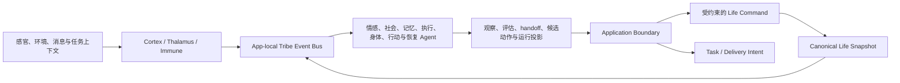

生产 Host 为 23 个 Agent 构造一个 owner-bound runtime scope。事件与 `TribeStateRegistry` 只承担进程内协作；它们不能直接成为七海长期自我。需要改变 self affect、关系、成长或主动节律的贡献必须经过 application boundary，写为可重放的 canonical Life command。有外部副作用的动作则进入 Task 或 Delivery 路径。

## 2. 普通情感对话

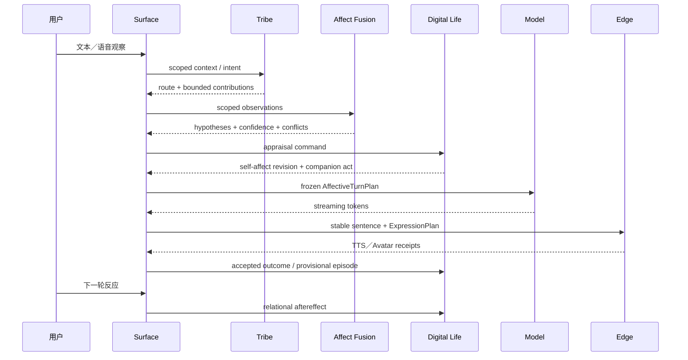

关键不变量：用户 observation 不直接写 self affect；纯文本回合不重置为中性；已交付分句不重复；技术失败不当作关系拒绝。

可见分句在返回前仍必须拥有 canonical Life delivery intent；但它提交后的诊断 Trace、assistant turn、LifeMemory 和其他 projection 不属于下一轮对话的同步前缀。`LifeProjectionDispatcher.dispatch_pending_async` 与 `LifeOutboxDispatcher.dispatch_pending_async` 会把同步 Repository、关系 reconciliation 和同步 handler 放入工作线程，异步 handler 保持原生 await。这样既保留 exact replay、lease/fence 和 durable receipt，也避免定时批量扫 SQLite 占住 Host ASGI 事件循环。普通聊天没有因此增加新 journal、审计表或模型请求。

情感聚合键由 `workspace_id + relationship_subject_id + session_id` 共同派生，不能只按 person 或 workspace 复用。A15 隔离 canary 在四组交叉 scope 上创建四个 aggregate，并只对主 scope 推进 1001 次时间事件；其他 scope digest 保持不变。Fusion 会省略 raw audio/image/video，reducer 也拒绝携带 raw 字段的旁路 command；完整 affective command、event、snapshot 与 projection intent 扫描未命中合成隐私 sentinel。重启时使用新 Repository 从同一 SQLite 重放，最终 snapshot 与 digest 完全一致。

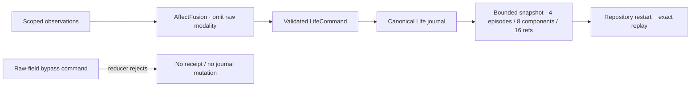

自然中文先经进程内纯函数 observer 形成低置信、多标签 observation；`AffectFusionService` 再把“不顺”“好消息＋不踏实”“不要建议”和“不要限制现实关系”分别评价为 distress、mixed affect、listen boundary 与 relational autonomy。只有 Appraisal reducer 能改变七海自己的 component。该快路径不调用模型；模型只在冻结后的 `AffectiveTurnPlan` 内完成措辞。

普通低风险回合生成一个回复；冲突、边界和修复等深路径在同一次请求中生成两个候选。中文文本＋日语声线模式下，候选是两个完整的配对对象而不是两个裸中文字符串；本地评分只决定选择哪一个，不能重新生成情绪，也不能丢掉选中候选的日语发声字段。首轮候选数量错误会触发唯一一次语义修复；第二轮若只有一个完整且安全的中日配对对象，可以明确降级发送但不计双候选通过，避免私人陪伴因输出形状问题整轮沉默。其余连续协议或安全失败仍记录为语义重试耗尽，不伪装成 Token／成本预算超限。

无前序 Task artifact 的普通 Gateway 回合在冻结模型目标时选择 `CHAT_SURFACE_REALTIME`。当前 DeepSeek Tier B 由 provider adapter 把服务端 `thinking_mode=disabled` 映射为请求的 `thinking.type=disabled`，使 completion 预算用于中文正文和日语 TTS 配对 JSON；该字段不会进入 Gemini、OpenAI 等其他 provider。普通陪伴中的双候选择优仍属于同一 realtime model lane，只在一次返回内比较两种措辞；规划、研究和非陪伴 Task Surface 才使用各自质量优先模型场景。

候选选择顺序固定为“逐候选关系／安全／Voice 完整性门禁 → 在合格集合内评分择优 → 交付”。某个高分候选带追问、否定复杂感受或关系防御时，只淘汰该候选；只有所有候选都不合格时才触发语义重试或终止，不能让一个坏候选拖掉另一个可发送候选。

近期对话的两条 SQLite 读取路径都按 canonical `turn_index` 取回后再恢复正序，不能按跨机器 `ts_ms` 排列，否则时钟偏差会把两条用户消息或两条回复错误相邻。当前轮没有新 appraisal 时，Fusion 只在活跃 episode 与窄文本标记同时匹配时输出 `MINIMIZED_UNRESOLVED_AFFECT` 或 `MIXED_AFFECT_RESULT_CONTINUATION`；Planner 消费 enum 而非历史正文。空间边界的 counter-pressure 在候选 Gate 直接拒绝。这条链路不增加模型调用，也不把日常对话改造成同步审计事务。

关系与任务措辞在发送前还经过两条轻量真实性边界。显式“道歉了但没过去／还没原谅”会把现有关系 episode 保持为 `REPAIR_UNRESOLVED`，只有明确接受才能关闭；canonical `REPAIR` 若生成追问，可在本地收敛为承担而不追加第二次模型调用。另一方面，Surface 只有在 server-authored facts 或 accepted result 证明 Task 正在运行时才允许“后台在跑／我盯着／有结果告诉你”；`RESPECT_AUTONOMY` 会淘汰“早点回来／别喝太多”等现实关系管束。这些均是进程内纯门禁，不创建新的 journal 或审计路径。

`6160c4564` 与 `eb2f68d29` trace 证明 enum 到达截断前 Planner，却也暴露最终 packet 仍丢失后置约束。packet compiler 现在在原 8 条上限内先选必要事实、最近对话、陪伴动作、情感连续性及已完成的子代理结果，并把 enum 作为 typed control 传到单回复／双候选 Gate。前者拒绝虚假收束，后者拒绝完全丢失混合感受；失败进入原有一次 repair，没有新增第二条状态链、写事务或额外重试额度。

低风险 Companion Profile 不旁路这条链路。五条跨日至少三天、helpfulness 下界不低于 0.85 且无边界违规的 canonical aftereffect 只能创建可回滚 canary；接下来的五次强后效应把同一候选自动激活。Planner 将 profile 变成文本 style anchor，ExpressionPlan 同步缩放 Voice rate 与 Avatar motion。Rollback 只能恢复 active profile 自带的 exact predecessor，不能由调用者指定任意历史版本。A15 隔离 SQLite canary 已验证 Host 协议上的 `文本策略改变 + Voice 1.0→1.15 + Avatar 0.5→0.8`，并在 rollback 后全部恢复；它没有执行模型生成和远端设备。

版本化表达偏好经 app-local projection port 在每轮 Surface 编译时只读一次。完整 prompt 原本会消费 style anchor，但生产默认 compact prompt 为缩短首字延迟省略了整个控制包；因此 `a84fa23b8` 的真实 apply 虽改变 `reply_plan`，最终 prompt digest 仍不变。当前 compact 路径只在偏好实际激活时补入一条最多 180 字的长期表达指令，baseline 不增加 prompt 文本；既有 ModelAttempt 行只附带该指令的 SHA-256，不保存 prompt 正文，也不新增写事务。`7ab64a246` 的真实 candidate prompt digest／Token 已变化，exact rollback 后下一轮恢复原 digest、Token 和无指令状态。

Knowledge 在线读链为 `recall planner → active Knowledge read port → personal/project namespace → bounded facts → Surface compact prompt`。只有 `should_recall=true` 才调用本地 SQLite；普通陪伴回合为零查询，且不会复用会写 shadow comparison 的 legacy recaller。Identity 在线读链为 `active release projection → structured style fingerprint → bounded identity directive → Surface compact prompt`；当前 affect、关系权限和 Soul 始终具有更高 authority。验收链把 `action-scoped Lab experiment → trusted report → exact target proposal → Review → activation` 分层，避免同一对照数据的 spec replay 与真实 Knowledge／Identity version 混为一体。第二轮已完成 Knowledge 全链，Identity 在 apply 前 fail-closed；两者的联合正式收据仍需绑定新提交重跑。

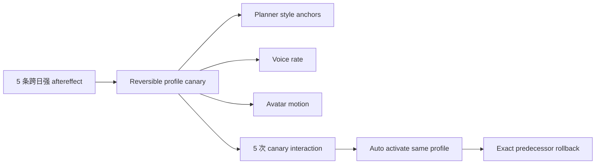

## 3. 有副作用的任务

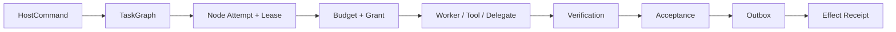

节点失败、取消、重试和未知副作用在 Task Runtime 内恢复。只有 accepted effect 才进入外部交付。

Node Grant 的有效期不是 Worker Lease 的镜像：它至少覆盖冻结时间预算，并额外保留一个 survivor 扫描窗口。这样 Host 在模型调用前崩溃时，旧 Lease 到期后仍有一段受限授权窗口可取得更高 fencing token；恢复仍复用同一 HostCommand、TaskGraph、Node 和 Attempt，不重新观察情绪、不重新规划，也不生成第二张图。

A15 真实进程注入已经验证这条路径：旧 fencing token 1 Lease 到期后，survivor 以 token 2 接管同一 Attempt；接管时 Node Grant 尚余 57.211 秒。最终 TaskGraph `COMPLETED`、TaskNode `ACCEPTED`、Budget `CONSUMED`，6 个 Acceptance Effect 均只提交一次。该结果只关闭 Host pre-Operation 崩溃项，不替代 unknown effect、rollback 或外部平台物理送达验收。

图已终止但预算或节点未结算时，terminal reconciliation 只能自动处理能由 canonical durable evidence 唯一推出的修复；任何需要解释或权限扩张的组合都保持原状并阻断生产就绪。Canary 报告绑定实际 migration catalog head，禁止用历史 migration 名称兜底制造“当前 schema 已验证”的假象。

operation reservation 已持久化、但 receipt 尚未提交时发生崩溃，系统不能判断外部调用究竟“尚未执行”还是“已执行但响应丢失”。恢复器因此只允许 `RUNNING → RECOVERABLE`、`RESERVED → RECOVERY_REQUIRED`，并追加 `UNKNOWN_SIDE_EFFECT` hold；在签名 reconciliation 给出 `NO_SIDE_EFFECT` 或 `SIDE_EFFECT_CONFIRMED` 前，禁止新建 Attempt、重新调用 worker 或提交 Acceptance Effect。这个高风险恢复边界不进入没有外部副作用的普通实时对话主链。

Gateway 平台外发采用相同的效果边界，但保持更轻量：payload 校验和 adapter selection 都在 `dispatch_started` 前完成，因此明确未发送时可以用同一冻结 Outbox 有界重试；真实 adapter 调用开始后若响应丢失，记录直接进入 `GATEWAY_TRANSPORT_DELIVERY_UNCERTAIN`／DLQ。此后 duplicate enqueue、进程重启和普通 replay 都只返回已有事实，不再次调用平台；只有独立 reconciliation 能决定下一步。Loopback OneBot HTTP 可以证明本地 socket、SQLite 和重启语义，不能证明 QQ／微信客户端实际收到消息。

Container 启动是另一条生命周期边界：Coordinator 已激活、Continuation 尚未就绪时若启动失败，逆序回滚必须先静默 worker 再关闭 Coordinator。任一关闭失败都会保留 bound runtime 与 Store 并进入 `LIFECYCLE_RETRY_REQUIRED`；这时既不能再次 activate，也不能关闭底层 SQLite。后续 retry 只有在全部 quiescence proof 通过后才能 drain Outbox 并逆序关闭基础设施。

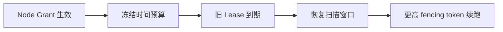

只读 Delegate 也不共用一套模糊执行权限：Pentest handoff 不接模型或工具并提交精确零用量证明；翻译 Delegate 从冻结 Node Budget 生成不可扩大的 model guard，经唯一 `ModelAttemptService` 调用 `workbench_translate`，把真实 provider usage 结算回 Node Budget。翻译结果本身没有 delivery authority，只有图 Acceptance 后才可进入 Gateway 回复。

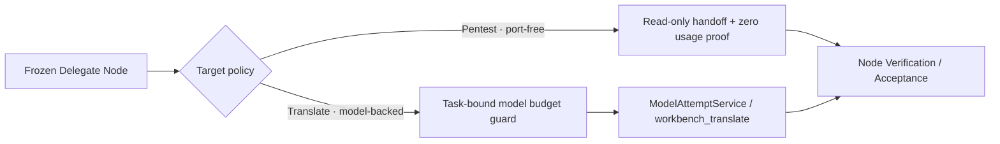

Gateway 入站聊天属于“实时生成 + 有副作用交付”的交界：消息经 Secure Ingress 后编译为紧凑单节点 TaskGraph，聊天生成仍只执行一次，Acceptance 再原子写入可见对话和 Gateway Outbox。直接网页／本地聊天继续走低延迟实时链，不承担这层外部投递账本。

直接聊天的上下文准备遵守“先计划、后读取”：`NO_RECALL` 直接生成跳过包，不进入显式记忆 helper 或语义嵌入；`MAY_RECALL／MUST_RECALL` 才检查近期显式记忆并进入对应召回预算。近期对话连续性仍由 Surface 的有界 history window 独立消费。旧显式记忆 helper 对无关文本本已有内容级短路，所以这个计划级收敛只证明调用边界，不把一次真实样本差值冒充确定的 SQLite 收益。

召回后的领域增强同样先做廉价必要条件。普通情绪陪伴直接跳过轻小说最近推荐上下文；“刚才第二本的详情”等可能指代推荐的消息才读取 durable preference pack，补齐 recommendation packet 后执行完整 light-novel predicate。深读与 evidence 回写复用同一 packet，避免一轮内重复读取。

`MAY_RECALL／MUST_RECALL` 进入真正检索时，从 Agent Runtime app-local scope 取得同一个 RecallFusionService；该服务使用 canonical EpisodicStore 已持有的 Chroma client。请求只创建本轮 query embedding 与局部候选，不再创建第二个 HTTP client 或第二份服务 owner。

该路径的现有 trace 分别记录 query plan、显式记忆、collection fastpath、embedding、service resolve、route recall、轻小说／通用 evidence review 和总耗时；Cortex 再记录通用 preference pack 与整个 context pipeline。计时字段不写第二份 ledger，只用于把首句延迟归因到真实调用段。

OBS 的 Task 读模型不在交互事务中同步构造。Sidecar 每 15 秒读取 canonical Task 索引，优先补齐新图，再按最旧 freshness 每波刷新最多 16 个详情；每次派生写提交后让出 5 ms canonical writer window。这样 Monitor 最终一致地看到 TaskGraph／Budget／Verification／Acceptance，同时等待写入 worker projection 的 Host 不会被一整波派生事务连续饿死。worker projection 本身在线程持久化，但 Task Runtime 必须等待其完成，不能把未落库 COMMIT 交给 Verification。

实际全栈复验观察到详情批次上限为 16、index 加详情上限为 17；三轮 worker projection 到后预算落库为 187／94／49 ms，而旧路径峰值为 2,880 ms。该证据关闭了 OBS 连续抢写这一段阻塞，后续仍需分别处理模型语义修复和 artifact 冷态尾部。

Gateway INBOX 固定请求体与 Host 幂等键；即使第一次 HTTP 响应丢失，Secure Ingress 和 HostCommand repository 也只返回既有图的精确结果，因此可以有界重试。向 QQ 等平台发送的 OUTBOX 不具备同等可证明语义，dispatch 开始后的未知结果必须进入对账隔离，不能盲目重发。

INBOX 与 OUTBOX 由同一 app-local Delivery Runtime 管理，但不共用执行线程。`gateway-durable-inbox` 只领取并向 Host 交付冻结入站；`gateway-durable-outbox` 只执行平台发送。两个方向各自使用 `worker_id:inbox/outbox`、Lease 与 fencing token。平台调用阻塞或进入 uncertain DLQ 不会阻塞下一条用户消息被 Host 接管，停止信号和 readiness 仍由同一 Runtime 统一收口。

HostCommand 一旦与 Secure Ingress claim 原子绑定，Gateway 重试只验证 claim、command、principal 和 body digest 后确认 durable handoff，不重新运行情绪观察、反馈、路由或图编译。Task Runtime 独立负责把已接管图推进到 Verification／Acceptance／Outbox。

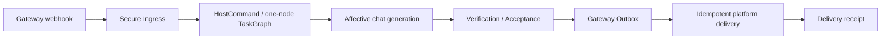

## 4. 语音与 Avatar

Acceptance 只代表 Host 已决定表达，不代表声音已经播放或动作已经执行。Host 为每个 TTS／Avatar effect 写入 durable intent；Edge 接收后，排队中的语音保持 `IN_DOUBT`，物理播放完成或失败时再写 terminal receipt。Host 只按同一 effect identity 对账，不盲目重放未知外部副作用。

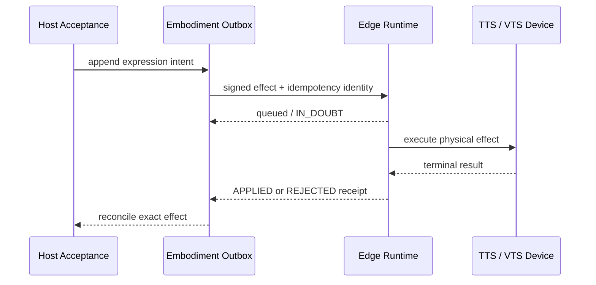

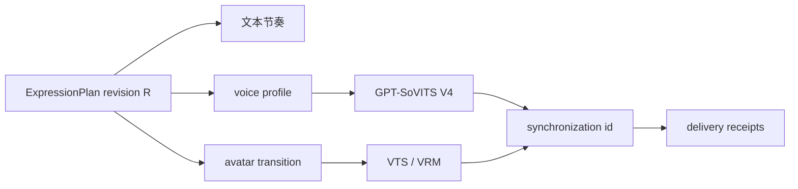

当前方案显示中文文本、生成日语语音。各通道独立失败与降级，不反向修改七海情绪。

Edge 回传事件按寿命分层处理。`ASR_CHUNK` 是实时传输碎片，只允许在当前进程内参与最终语句桥接，不写入 Host SQLite；`ASR_FINAL`、TTS 终态和 Avatar 终态等低频事件可进入 `voice_event_log` 供运行诊断。`voice_event_log` 不再派生 Life Memory episode，七海的长期情感与关系记忆只来自已接受的对话、Affective Life、Relationship 和 Expression receipt。这样既保留物理链路可诊断性，也避免 Edge 重放把数万条分块转写变成人生记忆并阻塞普通聊天。

GPT-SoVITS persistent worker 的所有权从 `Popen` 成功开始，到 Manager 接收 READY 后才转为长期驻留。READY 超时、加载拒绝或进程异常必须先终止并等待子进程退出，再返回 TTS 失败；不得让后续请求并行堆叠新的模型 runtime。合成超时同样先释放当前 worker，下一请求才重建。该生命周期不增加 Host 对话审计，也不改变同一 expression intent／receipt identity。

真实远端复验中，Edge 重启后的旧 session 命令先以 `EMBODIMENT_COMMAND_EXPIRED` fail-closed；新 fencing session 上的全新 effect 才进入 TTS，并以 `TTS_PLAYBACK_FINISHED/APPLIED` 结算。随后强制 READY timeout 的独立 worker 被同步回收，主 Edge 始终只保留一个常驻模型进程。这证明 session 恢复、TTS 生命周期和物理播放是三条分别判定的边界。

## 5. 主动陪伴

```text
relationship state + unresolved episodes + time + user state + permission
→ proactive candidate
→ quiet-hour / refusal / frequency policy
→ accepted delivery intent
→ Gateway/Edge
→ next user response or technical outcome
→ durable aftereffect
```

明确拒绝立即生效；连续忽略只降低频率，不扣信任，也不升级追问。

## 6. 偏好成长

```text
independent aftereffects
→ low-risk preference proposal
→ confidence and boundary checks
→ 5-interaction canary
→ activate version
→ next-turn text/TTS/avatar behavior
→ exact rollback when degraded
```

核心人格、价值观、亲密身份和敏感推断不进入自动成长。

## 7. 观测流

Host lifespan 心跳分别读取 Host 自身和真实 Edge 子服务，只把明确探测到的事实写入 canonical `service_health_log`；Host-only 自检不会再写一组较新的 Edge `NOT_TESTED` 覆盖远端事实。RPC 端口可达只作为缺失子服务结果时的 fallback，不能把关闭的 barge-in 或故障的播放设备标为 `UP`。OBS 从 canonical SQLite ledgers 生成只读 projection，Monitor 通过 OBS/Host API 展示状态。Monitor 的 React state、toast 或缓存不是业务成功证据。

Gateway 页面同样区分服务进程、durable transport 与平台通道详情。Gateway 本身 `UP` 但平台详情尚未上报时，读模型保留 `UNKNOWN` 并显示未确认数量；只有具体平台 observation 才能改变对应状态。

```text
canonical ledgers
→ OBS public projection
├→ current document：普通 JSON，直接服务 Monitor 查询
└→ immutable recovery checkpoints：默认每 kind/key 每小时至多一个
   ├→ Host source instance 切换：强制记录；同实例 revision 按小时检查点
   ├→ 小对象保持旧 JSON；大对象使用有界 zlib/base64 envelope
   → size + source digest 校验
   → rebuild / history reader 透明解码
```

压缩和检查点间隔只作用于派生 projection history。检查点之间的最新公开文档与 source cursor 仍原子持久化，Monitor freshness 不会降成小时级；极端情况下从 journal rebuild 最多恢复到上一个检查点，随后由下一次 source refresh 追平。解压后的公开载荷必须与 journal `source_digest` 一致，声明大小超过上限、编码损坏、尾随数据或摘要漂移均以 `OPERATOR_PROJECTION_DATA_INVALID` 阻断；canonical 账本和当前 Monitor 读路径不经过该 envelope。

## 8. 数据保留

| 数据 | 默认策略 |
|---|---|
| 原始音频／图像 | 不落盘 |
| 用户正文 | 对话存储按用户配置；不进入 affect journal |
| Affect observation | 脱敏摘要、TTL、证据 digest |
| Self affect snapshot | 有界 head，可由 journal 重放 |
| Relation episode | 结构化意义与未解决线程 |
| Task／effect receipt | 幂等与恢复所需最小字段 |
| 模型／语料／密钥 | 仓库外保存 |

## 9. Gateway 回复与生命体情绪观测流

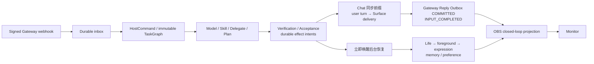

`WAKE → BG` 是持久恢复链，不是请求线程里的松散任务。同步的 Expression／Memory／Preference handler 由 Dispatcher 在线程池调用；Life conversation／foreground 虽保留异步 handler 合同，其 SQLite 主体同样显式下沉到 worker thread。这样上一轮后台状态仍按 durable effect 顺序收敛，但不会独占事件循环并阻止下一轮 Gateway admission。

这条链到 `OUTBOX_COMMITTED` 只证明 Host 已经完成可恢复提交。Gateway 实际 dispatch、未知外部副作用对账、平台 ACK 和用户可见性是后续独立阶段，缺少后续回执时不得推断为已送达。

上述短前缀只对编译器可信标记的普通 Chat 生效。用户轮次未提交时不得发送 Surface；后台 effect 仍在同一 SQLite 队列中按原语义顺序完成，进程退出后也由同一恢复 owner 接管。Plan、Skill、Delegate 控制动作和旧账本不会因为存在 Surface delivery 自动获得快速路径。

```text
canonical Life journal
→ digital_life_runtime_snapshot.hard_state.emotion_tag
→ life_body_source.derived.currentEmotion
→ OBS /obs/life-body
→ Monitor 人格上下文
```

旧 `emotion_context` 只用于历史兼容；新运行时不会为了适配 UI 再制造第二份情绪真相。

## 10. 拆分后的对话与具身数据流

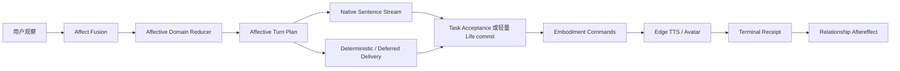

`domain_reducer.py` 仍是 canonical 聚合入口，但 self-affect 与 relationship 的纯 reducer 已分开；`surface_main_chain_adapter.py` 仍是调用 facade，但不再内嵌整套流式生成和交付实现。数据流和 authority 没有因文件移动发生改变。

Surface 的本地门禁只读取本轮冻结计划与已有 facts，不写 self affect，也不新增模型调用。边界、防御、混合情绪抹平和无依据物理共处只会让当前候选进入一次既有语义修复；显式事实已经说明见面或同处时，“当面”类措辞不会被误拦截。最终 runner 使用独立规则读取持久 projection，避免生产门禁自己给自己签发体验通过。

计划层向 Surface 传递的不是固定情绪模板：`HOLD_COMPLEXITY` 必须携带本轮观察到的害怕／不安语义，`GIVE_SPACE` 携带直接减少主动联系的动作，`CONTAINED_JEALOUSY` 携带“感受属于七海、选择权属于用户”的边界。候选层只能润色和筛选，不能把这些动作改写成忙碌反驳、赶走负面情绪或自贬为负担。

## 11. Research PlanningSearch 配对数据流

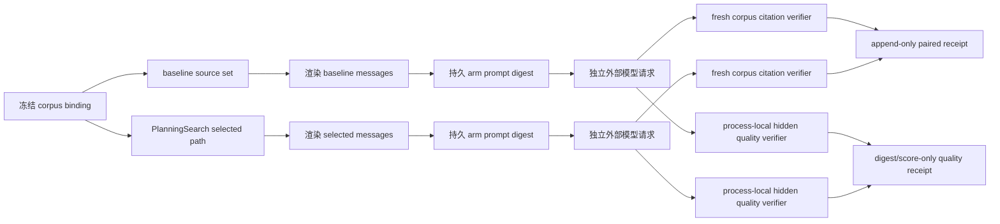

预注册顺序固定为：搜索／基线确定 source set，渲染实际 messages，计算并持久保存每只 arm 的 prompt digest，然后才允许外部调用。receipt 必须逐 arm 精确匹配 execution ID、prompt digest、provider transport identity、usage 和预算；旧规格只有在字段确实不存在时才使用历史共享 digest。这样 search arm 改变资料组合不会被误判为请求漂移，也不能用临时调用参数替换 ledger 中的输入身份。

成本数据流为 `provider usage → cache hit/miss 一致性检查 → endpoint/model 价目匹配 → micro-USD 向上取整 → ModelAttempt audit → Research attestation`。价目不匹配或 usage 不完整时流程停在“成本未知”，不会用 0 继续进入收益比较。工具计数同样来自请求能力边界：请求没有 tools 才能证明为 0。

回答正文只沿上图的进程内质量分支存在，不能写入 paired ledger；重启后终态只能精确重放公开 receipt，不能补造隐藏评审。质量评审使用统一 rubric 且不接收 arm role，持久化的是被评响应摘要、分数、错误计数和评审模型 attestation。

固定 24 题在进入图中 `baseline source set`／`PlanningSearch selected path` 前共用同一三来源 snapshot。baseline 仅关闭 L3，search 使用 AUTO；两者的差异由公共搜索结果产生。期望覆盖点位于图外的隐藏 verifier 输入，不参与 source ranking 或正文生成。

真实 A15 运行后，这条链路在 SQLite 中形成 24 registration、25 run spec（含预检）、50 arm execution、25 terminal receipt、24 cohort member 和 1 cohort report。24 题的质量提升、citation、成本、延迟与严重错误门槛全部通过；报告只把 `proposal_eligible` 置为 true，`production_influence_enabled` 仍为 false，因此“实验通过”和“生产切流”保持两件独立的事。

## 12. Code PlanningSearch 配对数据流

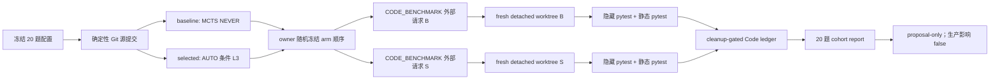

预注册必须发生在第一条外部请求之前；真实调用发生后若进程丢失模型正文，不能从摘要恢复源码或重复调用同一 execution identity。runner 只允许使用新 namespace 重新实验，并保留旧模型 audit／失败证据。隐藏 cases 不进入模型消息，模型 replacement 不进入 durable ledger；最终证据只绑定 response digest、attempt、provider/model、成本、两个 verifier receipt、diff 和 worktree cleanup。

Code 模型请求通过共享 attestation boundary 进入 canonical ModelAttempt，但 scene 固定为 `CODE_BENCHMARK`。runner 把实际 route timeout 与 request deadline 写入 execution profile；这避免 Code 任务继承普通短请求的全局超时，也使改变超时后的实验无法复用旧 cohort identity。

production route catalog 还按 `code.benefit.execution.json` 注入冻结的 non-thinking generation profile。prompt identity、scene、generation、route timeout 与 request deadline 共同构成 Code execution profile digest；任一项变化都要求新 cohort 版本和新运行身份。

进入 Git sandbox 前，语义 run identity 会导出一个固定长度 filesystem digest。bare repo 与 detached worktree 只使用该短组件；ledger 仍保存完整 workload/run/receipt 绑定，从而同时满足 Windows 路径边界和可追踪性。

两臂共享的 objective 不包含目标语义；差异只在 `PlanningSearch selected evidence`。隐藏 cases 位于模型数据流之外，因此 baseline 若通过只能来自其自身生成能力，而不能来自题名泄漏；v2 的泄漏收据被排除，v3 才重新进入收益测量。

v3 的 20 条 member evidence 经 authority resolver 重开 Code terminal receipt 后写入 cohort ledger；seal 得到 pass-rate gain 1.0、静态与 diff-risk 不退化。report 的 proposal 位为 true、production influence 位为 false，后续 promotion 仍需独立 Review／策略切流。

## 13. 普通陪伴文字交付数据流

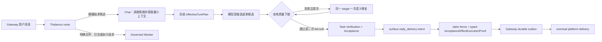

`A → E` 已冻结正文、目标与 effect id；`F` 只证明当前 dispatcher 正在执行同一持久 effect，不再次计算情感、Scene 或策略。正文、目标、请求或 effect id 任一漂移都会在进入 Gateway 前拒绝。该轻量路径没有新增普通对话审计表，也不会把每个 token、候选正文或内部思考写入数据库；Affective Life、Relationship 和必要 terminal receipt 继续按原有有界写入工作。高风险与设备数据流不经过这条豁免路径。

下一条用户消息到达时，Relationship 会先把它与上一条 accepted response 关联。若“没听懂我／让我不舒服”等反馈命中且没有明确要求停止或离开，aftereffect 记为 `MISUNDERSTOOD`。当前输入同时是“你真烦”一类直接冒犯时，AffectFusion 不再在“修复责任”和“七海受伤”之间二选一，而是生成单一 `repair_under_directed_disrespect`：`HURT + CARE + CAUTION → CONTAIN → REPAIR + CONTAINED_HURT`。没有待评价回复的独立冒犯仍进入克制边界，明确空间仍优先退开。该分流复用既有 Relationship/Life journal，不新增普通对话审计或同步模型调用。

`REPAIR` 的唯一一次候选重试还会把失败原因翻译成具体生成约束：普通修复承认“刚才没接住”；composite 修复先回应最新一句，再允许一处很短的第一人称受伤反应，不复演整套道歉，也不用赌气退出。关系 scorer 会把“抱歉”与真实身体亲密分开，避免正常道歉被错误扣到亲密越界；第二次仍命中硬门禁时继续 fail-closed，不新增第三次 provider 调用。

composite 分支的候选还要通过 `RELATIONAL_REPAIR_CONTAINED_HURT_MISSING` 发送 Gate。该 Gate 读取 canonical frame，不把用户原文关键词当 authority；通过时只校准当前 scene grounding，其他操控、关系距离和安全规则继续生效。二次候选仍失败时，本地 fallback 也用同一 Gate 复核，并明确标记为非搜索收益。

关系 guidance 中的完整自然语言约束进入 `facts/style` 平面，只有真正要求逐字出现的短标记才能进入 `must_include`。候选评分仅在 canonical `REPAIR` 且文本由七海第一人称具体承认“没听懂／没接住／误解”时认定修复已落地；因此后接一句克制的在场表达不会被技术场景模板误杀，缺少具体承担的泛化安慰仍不能通过。

同一个 repair grounding 也区分语义方向：否定完成的“我没接住”表示承认失败，不进入 emotional-containment 模板；肯定能力的“我能接住／我接得住”仍受原门禁约束。该判断发生在本地评分，不新增模型调用、同步存储或普通对话审计。

第二轮 48 条真实文本暴露的连续性缺口按下面的轻量读路径收口：

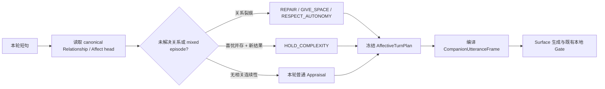

这条路径只读已有有界 head，并复用原来的 Life／Relationship 写入；不会为每轮建立新审计记录。只有明确接受才关闭裂痕，新的正向结果也不能覆盖仍活跃的 mixed episode。指代澄清属于 facts，关系修复优先时会被抑制；canonical 克制吃味由非占有门禁评分，不借“亲近”自动升级关系。

`CompanionUtteranceFrame` 是同一计划内的进程内数据，不经过新 repository。它把“接住什么、七海是什么立场、做哪一种回应、哪些推断不能补、怎样自然停住”传给所有 Surface prompt 路径；模型仍负责自然语言，而 frame 不记录候选正文。普通回合仍一次请求，高歧义回合仍在一次响应内返回两个候选，并最多进行一次既有重试。

当 frame 为 `HOLD_COMPLEXITY + SHARED_MIXED_RESONANCE / RESONATE_WITH_BOTH_SIDES` 时，Surface 生成必须把两面从“用户情绪标签”变成“七海自己的即时共鸣”：候选同时包含第一人称高兴与悬心才可进入排序。纯复述、只说“我懂”或替用户安排情绪的候选在发送前以 `MIXED_SELF_RESONANCE_MISSING` 进入既有一次重试；这个判断不写 journal，也不会由普通 mixed 关键词单独触发。

曾试验的 `normalized latest user text → stable cue fragments` 步骤在真实 cohort 中没有改善，并已删除；它不属于当前生产数据流。当前 frame 直接进入同一次 Surface 双候选请求，再走原有 Gate、评分和发送路径。语言多样性后续通过显式模型／文本版本实验处理，不在主链中继续叠加 prompt 处理节点。

Prefrontal／Tribe 的历史 event handler 只允许读取 canonical Life 结果或生成 proposal。`TribeApplicationPorts` 缺失、类型错误或未完整注入时按 canonical affective life fail-closed，不得回退到 Endocrine、Limbic、PainReward 或 volatile Bond 写入；因此组合错误不会重新形成第二条 self-affect 数据流。
