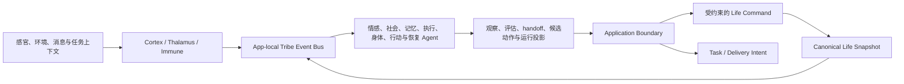
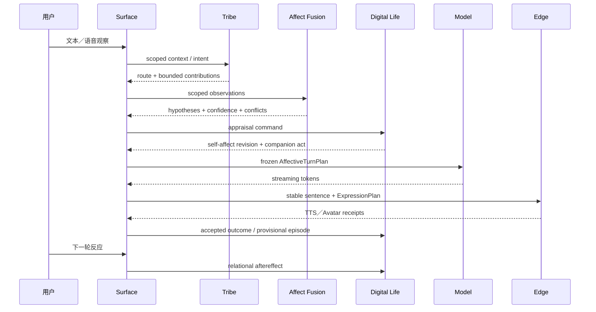
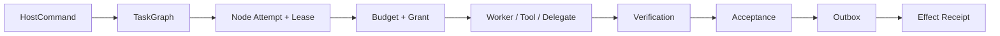
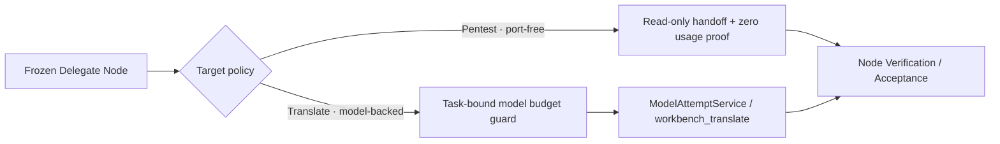
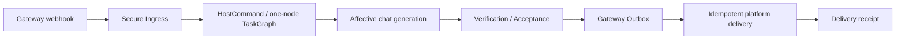
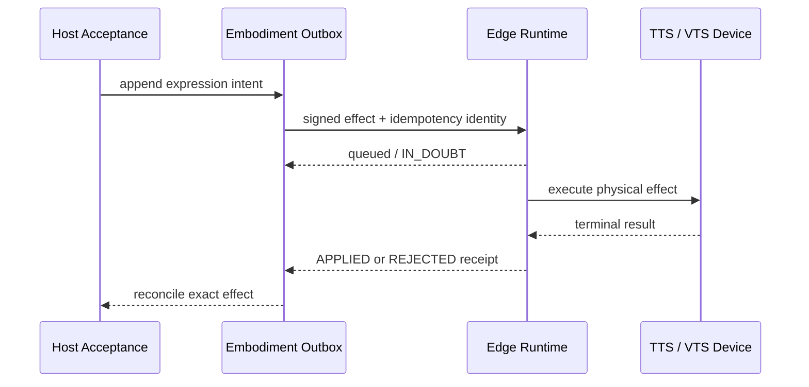
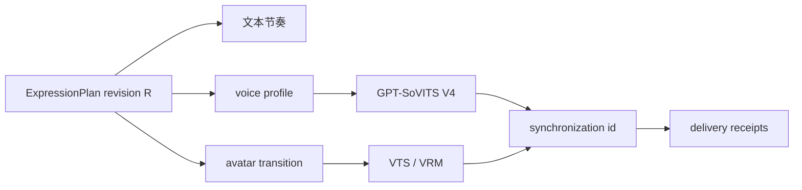
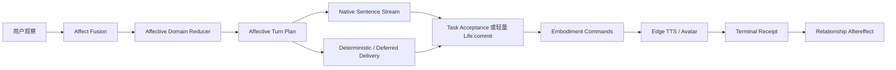

受众：CODEX
标题：Natsume AI 数据流架构

# 数据流架构

## 1. Tribe 智能体协作



生产 Host 为 23 个 Agent 构造一个 owner-bound runtime scope。事件与 `TribeStateRegistry` 只承担进程内协作；它们不能直接成为七海长期自我。需要改变 self affect、关系、成长或主动节律的贡献必须经过 application boundary，写为可重放的 canonical Life command。有外部副作用的动作则进入 Task 或 Delivery 路径。

## 2. 普通情感对话



关键不变量：用户 observation 不直接写 self affect；纯文本回合不重置为中性；已交付分句不重复；技术失败不当作关系拒绝。

自然中文先经进程内纯函数 observer 形成低置信、多标签 observation；`AffectFusionService` 再把“不顺”“好消息＋不踏实”“不要建议”和“不要限制现实关系”分别评价为 distress、mixed affect、listen boundary 与 relational autonomy。只有 Appraisal reducer 能改变七海自己的 component。该快路径不调用模型；模型只在冻结后的 `AffectiveTurnPlan` 内完成措辞。

普通低风险回合生成一个回复；冲突、边界和修复等深路径在同一次请求中生成两个候选。中文文本＋日语声线模式下，候选是两个完整的配对对象而不是两个裸中文字符串；本地评分只决定选择哪一个，不能重新生成情绪，也不能丢掉选中候选的日语发声字段。首轮候选数量错误会触发唯一一次语义修复；第二轮若只有一个完整且安全的中日配对对象，可以明确降级发送但不计双候选通过，避免私人陪伴因输出形状问题整轮沉默。其余连续协议或安全失败仍记录为语义重试耗尽，不伪装成 Token／成本预算超限。

## 3. 有副作用的任务



节点失败、取消、重试和未知副作用在 Task Runtime 内恢复。只有 accepted effect 才进入外部交付。

只读 Delegate 也不共用一套模糊执行权限：Pentest handoff 不接模型或工具并提交精确零用量证明；翻译 Delegate 从冻结 Node Budget 生成不可扩大的 model guard，经唯一 `ModelAttemptService` 调用 `workbench_translate`，把真实 provider usage 结算回 Node Budget。翻译结果本身没有 delivery authority，只有图 Acceptance 后才可进入 Gateway 回复。



Gateway 入站聊天属于“实时生成 + 有副作用交付”的交界：消息经 Secure Ingress 后编译为紧凑单节点 TaskGraph，聊天生成仍只执行一次，Acceptance 再原子写入可见对话和 Gateway Outbox。直接网页／本地聊天继续走低延迟实时链，不承担这层外部投递账本。

Gateway INBOX 固定请求体与 Host 幂等键；即使第一次 HTTP 响应丢失，Secure Ingress 和 HostCommand repository 也只返回既有图的精确结果，因此可以有界重试。向 QQ 等平台发送的 OUTBOX 不具备同等可证明语义，dispatch 开始后的未知结果必须进入对账隔离，不能盲目重发。

HostCommand 一旦与 Secure Ingress claim 原子绑定，Gateway 重试只验证 claim、command、principal 和 body digest 后确认 durable handoff，不重新运行情绪观察、反馈、路由或图编译。Task Runtime 独立负责把已接管图推进到 Verification／Acceptance／Outbox。



## 4. 语音与 Avatar

Acceptance 只代表 Host 已决定表达，不代表声音已经播放或动作已经执行。Host 为每个 TTS／Avatar effect 写入 durable intent；Edge 接收后，排队中的语音保持 `IN_DOUBT`，物理播放完成或失败时再写 terminal receipt。Host 只按同一 effect identity 对账，不盲目重放未知外部副作用。





当前方案显示中文文本、生成日语语音。各通道独立失败与降级，不反向修改七海情绪。

## 5. 主动陪伴

```text
relationship state + unresolved episodes + time + user state + permission
→ proactive candidate
→ quiet-hour / refusal / frequency policy
→ accepted delivery intent
→ Gateway/Edge
→ next user response or technical outcome
→ durable aftereffect
```

明确拒绝立即生效；连续忽略只降低频率，不扣信任，也不升级追问。

## 6. 偏好成长

```text
independent aftereffects
→ low-risk preference proposal
→ confidence and boundary checks
→ 5-interaction canary
→ activate version
→ next-turn text/TTS/avatar behavior
→ exact rollback when degraded
```

核心人格、价值观、亲密身份和敏感推断不进入自动成长。

## 7. 观测流

Host lifespan 心跳分别读取 Host 自身和真实 Edge 子服务，只把明确探测到的事实写入 canonical `service_health_log`；Host-only 自检不会再写一组较新的 Edge `NOT_TESTED` 覆盖远端事实。RPC 端口可达只作为缺失子服务结果时的 fallback，不能把关闭的 barge-in 或故障的播放设备标为 `UP`。OBS 从 canonical SQLite ledgers 生成只读 projection，Monitor 通过 OBS/Host API 展示状态。Monitor 的 React state、toast 或缓存不是业务成功证据。

Gateway 页面同样区分服务进程、durable transport 与平台通道详情。Gateway 本身 `UP` 但平台详情尚未上报时，读模型保留 `UNKNOWN` 并显示未确认数量；只有具体平台 observation 才能改变对应状态。

## 8. 数据保留

| 数据 | 默认策略 |
|---|---|
| 原始音频／图像 | 不落盘 |
| 用户正文 | 对话存储按用户配置；不进入 affect journal |
| Affect observation | 脱敏摘要、TTL、证据 digest |
| Self affect snapshot | 有界 head，可由 journal 重放 |
| Relation episode | 结构化意义与未解决线程 |
| Task／effect receipt | 幂等与恢复所需最小字段 |
| 模型／语料／密钥 | 仓库外保存 |

## 9. Gateway 回复与生命体情绪观测流

```text
signed Gateway webhook
→ Durable inbox
→ HostCommand / immutable TaskGraph
→ model / skill / delegate / plan
→ Verification / Acceptance
→ surface.reply_delivery
→ Gateway Reply Outbox COMMITTED
→ INPUT_COMPLETED {authority, state}
→ OBS closed-loop projection
→ Monitor
```

这条链到 `OUTBOX_COMMITTED` 只证明 Host 已经完成可恢复提交。Gateway 实际 dispatch、未知外部副作用对账、平台 ACK 和用户可见性是后续独立阶段，缺少后续回执时不得推断为已送达。

```text
canonical Life journal
→ digital_life_runtime_snapshot.hard_state.emotion_tag
→ life_body_source.derived.currentEmotion
→ OBS /obs/life-body
→ Monitor 人格上下文
```

旧 `emotion_context` 只用于历史兼容；新运行时不会为了适配 UI 再制造第二份情绪真相。

## 10. 拆分后的对话与具身数据流



`domain_reducer.py` 仍是 canonical 聚合入口，但 self-affect 与 relationship 的纯 reducer 已分开；`surface_main_chain_adapter.py` 仍是调用 facade，但不再内嵌整套流式生成和交付实现。数据流和 authority 没有因文件移动发生改变。
