受众：MASTER
标题：Natsume AI 数据流与回执架构事实

# Natsume AI 数据流与回执架构事实

版本：v3.1

核对日期：2026-07-25

文档类型：`CURRENT_DATA_FLOW / CODE_FACTS`

总体状态：`FULL_ARCHITECTURE_INCOMPLETE`

本文不用理想化的箭头代替生产代码，只描述当前 composition 真正能够触发的数据流、状态流、副作用流和回执边界。架构总览见 [CURRENT_CODE_ARCHITECTURE.md](CURRENT_CODE_ARCHITECTURE.md)，最终目标见 [TARGET_ARCHITECTURE.md](TARGET_ARCHITECTURE.md)，差距见 [ARCHITECTURE_GAP_MATRIX.md](ARCHITECTURE_GAP_MATRIX.md)，实施顺序见 [NEXT_GENERATION_EVOLUTION_EXECUTION.md](../../30_devspec/NEXT_GENERATION_EVOLUTION_EXECUTION.md)。

当前 authority 数据流为：`ASGI/CLI → fresh ProcessApplicationPorts → HostAuthorityRuntimeOwner → frozen Host/Agent/Context/Startup ports → router/runtime`。没有发布或查找全局 ports 的中间步骤，Host builder 缺少显式 ports 时直接失败。生产 locator consumer/import/module/field/lock/ref 全为 0；pytest-only bridge 不进入该图。底层 canonical ledger、Episodic/LifeMemory、Prompt/Route/Provider/ModelAttempt 与 Capability runtime 流由 `HostAuthorityRuntimeOwner` 固定；ResourceManager status 则经 0123 Runtime Event journal 绑定 Host lease/fence。外部 Chroma/Neo4j namespace 与其它外部资源恢复仍未闭环。本文后续更大的 locator 数字只作为历史快照。

情感数据流现在分成有副作用的 admission 与无副作用的 replay 两条。生产 admission 为 `Input/Tribe → HostLifecycleApplicationPorts.emotion_context_runtime → HostEmotionRuntime.ingest → current vector/timeline/profile`；同一 Host root 共享同一 identity，不同 root 不共享状态。`normalize_chat_emotion_context(raw)` 不带 runtime 时只计算归一化、echo 和 trigger，不追加 Timeline、不改变画像或前一标签。回复形态为 `Input composition → owned ResponseFormDecider → locked quota check+record`，不再经过进程 singleton。

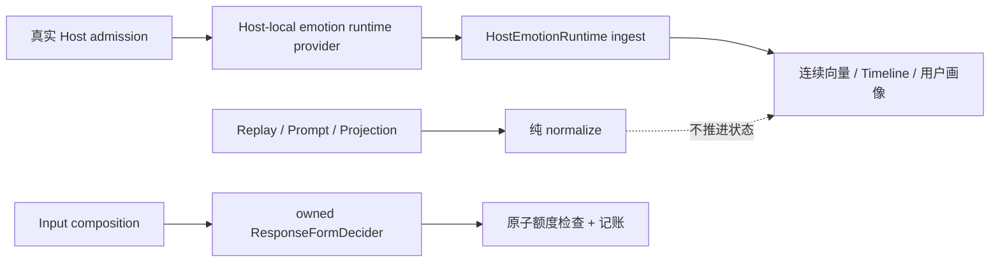

Internal 后置审核取消的数据流只覆盖一个精确终态：Operator Secure Ingress → immutable `BLOCKED` cancellation intent → trusted `CANCELLED` final decision → restart terminal worker → deterministic nonacceptance claim → tombstone/Workspace cleanup。intent 不能冒充 final decision，任何 lineage 漂移均 fail-closed；该流不处理一般取消、多节点或 unknown effect。

Edge 下行现在明确分成两条：Tribe 的平台/情绪事件只进入 Host-owned state observation，不再直接取得客户端；旧内部 POST 立即返回 authority-required。Obs `edge.command.push` 的首条窄链已成为正向 issuer：只允许 `edge.somatic + emotion_state_command`，经 Secure Ingress、risk-4 Review、TaskGraph、Acceptance Effect 与 terminal Preview 写入 durable outbox。低层网络发送仍由独立 `HostEmbodimentRuntime` worker 完成；真实 Edge/Gateway canary 尚未执行。

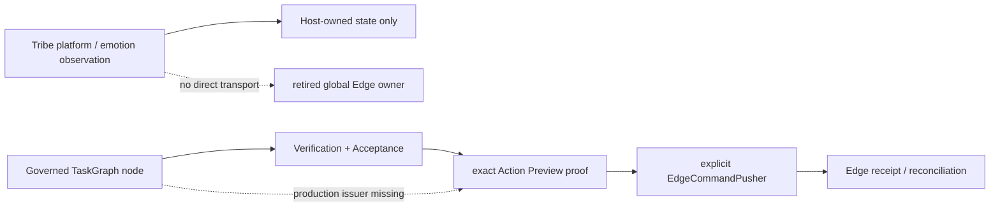

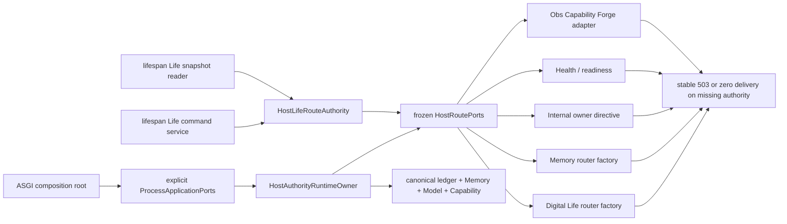

## 1. 如何读本文

本文对每条数据流使用四种定级：

| 定级 | 含义 | 可否当作当前生产事实 |
|---|---|---|
| `WIRED` | 入口、生产 composition、持久化与回执主链均已接通 | 可以，但仍受表内明示限制约束 |
| `PARTIAL` | 主要资产或部分路径存在，但未形成完整闭环 | 只能按已实现范围引用 |
| `BROKEN` | 表面有 adapter 或 lifecycle wiring，首个真实请求仍会在合同或 admission 处阻断 | 不能宣称可用 |
| `TARGET` | 只存在于目标架构或待实施合同 | 不是当前事实 |

三种容易混淆的语义必须分开：

1. **接受成功**：某个请求已被 inbox 或 Host TaskGraph 持久化，不等于外部副作用已发生。
2. **执行验收成功**：Graph 已通过 Verification/Acceptance，不等于 conversation、Life、Gateway 等后续 effect 已全部提交。
3. **外部效果确认**：Gateway/Edge adapter 已返回对应层级的确认证据。它不能由 Task receipt 或 HTTP 200 替代。

## 2. 全局数据流总览

```mermaid
flowchart TD
    UI["Chat / Host API"] --> Cortex["Cortex + Governor"]
    GW["Gateway 已验证输入"] --> Ingress["Host Secure Ingress"]
    Ingress --> Cortex

    Cortex --> Route{"route"}
    Route -->|chat| Chat["Frozen Chat node"]
    Route -->|skill| Skill["Frozen Skill node"]
    Route -->|delegate| Delegate["Frozen Delegate node\n仅 pentest_agent 有内层授权"]
    Route -->|plan| Plan["已批准 steps 的拓扑合法化"]

    Chat --> Compile["HostCommand + WorkOrderV3 + TaskGraph"]
    Skill --> Compile
    Delegate --> Compile
    Plan --> Compile
    Compile --> PolicyGate["atomic policy capability + node-grant service\n+ parent grant：admission 前 fail-close"]
    PolicyGate --> Admission["HostCommandRepository 原子 admission"]
    Admission --> GraphHook["private Graph insert hook\n同一 admission UoW，唯一调用"]
    GraphHook --> Schema["0090 + 0092；atomic 时再校验 0091\nBudget / worker 前 fail-fast"]
    Schema --> Runtime["Durable Task Runtime"]
    Runtime --> Worker["Attempt + Lease + Grant + Budget + Worker\n已登记 production Skill 只消费 admission-frozen payload"]
    Runtime -.->|"atomic production default ON\nbounded fan-out default OFF"| ShadowFanOut["atomic outer authority\nbounded 时 ready sibling 有界 child"]
    ShadowFanOut -.-> NodeLocal["child deferred authority\nAttempt/Node/Lease/Reservation\nBudget usage/EXCEEDED"]
    NodeLocal -.-> Worker
    Worker --> HB["Durable heartbeat\nLease → Reservation"]
    HB --> Checkpoint{"checkpoint 可提交?"}
    Checkpoint -->|是| VA["COMMIT → Verification + Acceptance"]
    Checkpoint -->|否| Recovery["RECOVERY_REQUIRED\n禁止 COMMIT"]
    VA -.-> DurableOutcome["node-local durable outcome\nreceipt ↔ latest Attempt/Node"]
    DurableOutcome -.-> OuterSettle["outer/live + ACTIVE re-entry\ndurable Node/latest Attempt outcomes\nrecovery > Budget > failure > review\n原子 Graph + 可选 Budget + Outbox + 0090 decision"]
    OuterSettle -.-> RevisionedOutbox["0095 Graph exact revision/payload\nID/key 保持升级前稳定\n歧义 producer 事务失败"]
    RevisionedOutbox -.-> RuntimeEvent["新 Event = graph_id@revision\nsource_ref 一 Outbox 一 Event\nlegacy 重投 exact replay"]
    DurableOutcome -.-> AtomicSuccess["atomic policy + 全 Node ACCEPTED\ncanonical projections + exact grant map\n显式 result projection"]
    AtomicSuccess -.-> SuccessUow["单 UoW：Graph COMPLETED + Budget CONSUMED\n两 Outbox + 全图 effect intents + 0091 decision"]
    SuccessUow -.-> RevisionedOutbox
    Runtime -.-> Reentry["crash/re-entry\nACTIVE 多节点 durable snapshot"]
    Reentry -.-> Idle{"live Node / active Attempt / ACTIVE Lease?"}
    Idle -->|"是"| InProgress["GOVERNED_EXECUTION_IN_PROGRESS\n不 resolve worker / 不抢 authority"]
    Idle -->|"否"| OuterSettle
    OuterSettle -.-> Window{"结算 ownership fence\n或 CAS 后重读 active ownership?"}
    Window -->|"是"| InProgress
    Window -->|"纯 CAS"| Conflict["GOVERNED_DURABLE_STATE_CONFLICT"]
    VA --> Receipt["Execution receipt"]
    VA --> EffectHook["private Effect insert hook\n3 个 canonical UoW / 6 个调用点"]
    EffectHook --> Effects["Acceptance effect intents"]
    SuccessUow --> Receipt
    SuccessUow --> EffectHook
    Effects --> Conversation["Conversation / Life / Memory"]
    Effects --> Delivery["Gateway / Edge 副作用"]

    CancelUI["Task Runtime UI\n选择 exact graph revision"] -.-> CancelBff["同源 Operator BFF\ntask_graph.cancel"]
    CancelBff -.-> CancelGateway["Operator Command Gateway\nobs:write + task-runtime:cancel"]
    CancelOff["feature flag 默认 OFF\nENFORCE + Gateway 可用\n否则启动 fail closed"] -.-> CancelGateway
    CancelGateway -.-> CancelVerify["process-shared Secure Ingress verifier\ncommitted audit/claim + canonical body"]
    CancelVerify -.-> CancelRoute["immutable HostCommand surface\nHost / Internal / Scheduler"]
    CancelRoute -.-> CancelIntent["0092 phase 1 UoW\nintent + Graph BLOCKED + durable fences"]
    LocalRegistry["process-shared LocalGraphExecutionRegistry\nHost / Internal / Scheduler / 0094 worker\nquiescence only，非 durable authority"]
    Runtime -.-> LocalRegistry
    SchedulerWO -.-> LocalRegistry
    InternalWO -.-> LocalRegistry
    CancelIntent -.-> LocalJoin["intent 提交后才 cancel/join\n本进程 child + heartbeat"]
    LocalRegistry -.-> LocalJoin
    LocalJoin -.-> CancelReconcile["active ownership / operation / effect / review\nadvance + reconciliation gate"]
    CancelScan["0094 composition-owned scanner\nrecovery-scoped worker"] -.-> CancelClaim["协调 claim + heartbeat\nexpired takeover / stale fence"]
    CancelClaim -.-> CancelAdmission["HostCommandRepository exact revision\n重建 replay admission\nBEGIN IMMEDIATE 后采样 lease 时钟"]
    CancelAdmission -.-> LocalJoin
    CancelReconcile -.->|"本地 pending 非空或 durable facts 未收敛"| CancelDefer["0094 durable defer\n不伪造业务完成"]
    CancelDefer -.-> CancelScan
    CancelReconcile -.-> CancelFinal["phase 2 UoW\nGraph CANCELLED + Budget + Outbox + decision"]
    CancelFinal -.-> RevisionedOutbox
    CancelFinal -.-> CancelComplete["0092 FINALIZED + decision 后\n才清理 0094 协调行"]
    CancelFinal -.-> Receipt
    CancelRoute -.-> CancelFailure["下游异常后读取 exact durable intent\n无 intent=明确未执行；匹配=可能已执行\n不可判定则保守 uncertain"]

    StartupRecover["startup recover_startup"] -.-> TerminalInventory["0099 inventory：单次最多 10,000 terminal Graph\nappend-only case/proof/supersession；migration 不修业务行"]
    TerminalState["BLOCKED / FAILED / CANCELLED / COMPLETED\n+ unsettled Budget"] -.-> NoSilentRepair["Runtime re-entry 不静默修复"]
    NoSilentRepair -.-> TerminalInventory
    TerminalInventory -.-> ExactAuto["仅 FAILED + exact atomic failure bundle\n+ ACTIVE/EXCEEDED Budget\n显式 default-OFF system auto"]
    TerminalInventory -.-> SignedRepair["BLOCKED failure / legacy CANCELLED\nEd25519 signed task_terminal.reconcile"]
    TerminalInventory -.-> Quarantine["COMPLETED / structural ambiguity\nquarantine only"]

    Scheduler["Scheduler"] --> SchedulerWO["WorkOrderV3 + Budget + child grant"]
    SchedulerWO --> Admission
    Worker -.-> SchedulerPlan["immutable scheduler operation plan\nhandler 调用数 = 0"]
    SchedulerPlan -.-> VA
    EffectHook -.-> SchedulerEffect["scheduler.operation.execute\nGraph Acceptance 同 UoW staging"]
    SchedulerEffect -.-> SchedulerDispatcher["shared app-local AcceptanceEffectDispatcher\nclaim + derived Preview + recovery"]
    SchedulerDispatcher -.-> SchedulerHandler["real Scheduler handler\n只在 Acceptance 后"]
    SchedulerHandler -.-> SchedulerResult["immutable SchedulerExecutionResultRepository\nactual result receipt"]
    SchedulerResult -.-> SchedulerClaim["native ingress 绑定 actual receipt\nOperator 独立 outcome 仅在可归因后封口"]
    Internal["Internal Agent"] --> InternalWO["边界 v2 → WorkOrderV3\nBudget + child grant"]
    InternalWO --> Admission
    Worker -.-> ProtectedStage["protected raw artifact stage\nexact inventory + ref/digest projection"]
    ProtectedStage -.-> InternalEffect["internal.agent.result_commit\npost-Acceptance exact TaskStore evidence"]
    InternalEffect -.-> WorkspacePromotion["clean/no-change Git Workspace\n0116 ACTIVE→ACCEPTED→PROMOTED"]

    classDef wired fill:#dff5e1,stroke:#1b7f3a,color:#102a17;
    classDef partial fill:#fff3cd,stroke:#a87500,color:#332400;
    class UI,GW,Ingress,Cortex,Route,Chat,Skill,Compile,Admission,GraphHook,Schema,Worker,HB,Checkpoint,VA,Receipt,EffectHook,Effects,Internal,InternalWO,RevisionedOutbox,RuntimeEvent wired;
    class Delegate,Plan,PolicyGate,Runtime,ShadowFanOut,NodeLocal,DurableOutcome,AtomicSuccess,SuccessUow,Reentry,Idle,InProgress,OuterSettle,Window,Conflict,Recovery,Conversation,Delivery,CancelCaller,CancelVerify,CancelIntent,LocalRegistry,LocalJoin,CancelScan,CancelClaim,CancelAdmission,CancelReconcile,CancelDefer,CancelFinal,CancelComplete,StartupRecover,TerminalInventory,TerminalState,NoSilentRepair,ExactAuto,SignedRepair,Quarantine,Scheduler,SchedulerWO,SchedulerPlan,SchedulerEffect,SchedulerDispatcher,SchedulerHandler,SchedulerResult,SchedulerClaim,ProtectedStage,InternalEffect,WorkspacePromotion partial;
```

### 2.1 Chat 与 Host Input 的显式 Tribe 端口边界

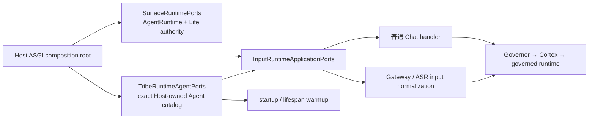

普通 Chat、Gateway 与 ASR 通过 ASGI 传入的 `InputRuntimeApplicationPorts` 取得 Thalamus/ANS/Immune；缺少端口分别以稳定 reason code 拒绝，不回退请求期 singleton。`TribeRuntimeAgentPorts` 绑定当前 `TribeRuntimeScope.require_agent()`，因此与 cross-Agent compatibility getter 解析同一个 Host-owned catalog；production provider 已从 singleton getter 改为 Agent constructor。Host bind 后不发布进程级 active context，lifespan/background execution 与 HTTP middleware 分别激活 exact scope；两个重叠 execution 已证明 Agent/registry identity 隔离，解绑后的继承 context 失败关闭。该证据仅覆盖 Tribe execution boundary，不等同完整 Host multi-app、Chat acceptance 或 NE-01 完成。生产 Service Locator 已物理清零；历史测试批次相互重叠，不能相加。

普通 Cortex 的检索支路也不再在 helper 内重新发现依赖：`AgentRuntimeApplicationPorts.run_retrieval()` 从同一 Host scope 传入会话历史、偏好构造器和 recall factory；factory 在 composition 内绑定 ledger、Life memory 与 Bond Neo4j。`chat_retrieval_helpers.py` 只消费这些显式输入，缺失的低层 authority 只能让该检索支路降级，不能回退至 `process_services`。这只说明读取依赖的解析边界已收口，尚不等于可见对话在 Acceptance 后原子提交。

上图的核心结论是：

- Host `chat` / `skill` / `delegate` / `plan` 四路已经进入共用 Governed Runtime，不再允许失败后退回 Executive 执行。D10 已让 `pentest_agent` Delegate 带着冻结的 command/graph/node/attempt/lease/fence/parent+node grant invocation 执行；真正调用前重验 node grant，Attempt/Lease/Fence 仍由外层 durable worker 保持。该 handler 仅生成无副作用的 Domain Pack/SecureRun handoff，且不写 legacy `skill_exec_log`。`intent_agent`、`translate_agent`、`vision_agent`、`repair_agent` 与未注册 target 均在 HostCommand/TaskGraph admission 前拒绝，因此 Delegate 通用平台仍未完成。
- Cortex 已不再保留 contextual-session/style、clarification、LLM unavailable 或异步 post-process 的 direct-reply compatibility branch，Surface 的 `schedule_async_post_process()` fire-and-forget 入口也已删除。canonical route 未通过 Governed Runtime `supports()` 时会在任何可见对话写入前返回拒绝；通过后 Cortex 仅生成冻结上下文，TaskGraph 的 Verification/Acceptance 才决定可见结果和后续 effect，提交后的 Life/Conversation 投影经 durable `surface.post_process` outbox 处理。
- `app/intelligent_runtime.py` 已物理删除，不能再产生任何 planning outline、SkillDag hint 或执行 authority；`SkillComposer` 也不再暴露 SkillDag 执行方法。旧 Executive 的 `route_planning`、`conversation_execution`、application `composition`、application port wiring 与 legacy diagnostic direct-skill matrix 已物理删除；`executive_runtime/runtime.py` 和 stale app wrapper 均只能拒绝 canonical route。Executive 内的 Forge override call 已移除，纯 SkillDag adapter 零生产调用；但独立 Forge `runtime-match` 尚未退役，不能把这次删除表述为全局 authority 清零。任何后续动作仍必须从 Governed admission 生成新的 immutable TaskGraph。
- direct `skill` 与 selected `plan` 中的登记 production target 都会在 admission 内把 `codex_production` adapter payload（含 profile/default 展开）冻结到 `WorkOrderV3.input_pack.frozen_node_executor_payloads[node_id]`。Plan 只从 immutable node binding 对应的 approved candidate input 生成该 payload；任意 caller-supplied frozen payload、candidate route/target/objective/args 漂移都会在 admission 前拒绝，replan 则按新 graph revision 生成新的 node-bound payload。payload digest、V2 adapter work-order identity 与 root/graph/node/revision/scope/fingerprint/Review/approval lineage 都在 Frozen Skill Worker 中重验；通过后才可进入 Broker，且一律同步执行，不能恢复旧 background daemon。replay comparison 只将该嵌套载荷中的轮换 Review/approval ref 和派生 digest 归一化，runtime 仍只消费 durable 首次准入载荷，其他任一字段漂移均拒绝。此切片不把 legacy adapter 形状提升为第二份 TaskGraph authority，也不完成通用多节点恢复或全路线 acceptance。

- Plan 已能编译为多节点 TaskGraph，但当前只排序 Governor 已批准的 steps，不会从目标生成多个竞争方案。
- Task Runtime 当前为 `PARTIAL_ATOMIC_DEFAULT / NE01_IN_PROGRESS`。新生产 Graph 已使用 0090/0091 原子终态；Budget 高竞争唯一 winner、single-node canonical COMMITTED checkpoint continuation、scheduler-owned 多节点 exact COMMITTED checkpoint continuation、exact operation-free persisted Attempt takeover、ACCEPTED→Effect restart 和 0099 窄 terminal reconciliation已有证据。正数 `time_ms` 只从 durable remaining projection 取得当前单节点 worker 截止：零剩余会在 Operation reservation 前写 `TIME_GUARD` 拒绝，超时则将测得时间至少结算到剩余额度以上并保留 Operation，返回 `RECOVERY_REQUIRED` 供 reconciliation；`time_ms=0` 仍表示未设截止。多节点 continuation 只接受 `EXACT_ACCEPTED / EXACT_REJECTED / MISSING` 并复用同 Attempt 的更高 fence，accepted 回到 READY sibling、rejected 进入并行结算，worker 不重跑。bounded fan-out/cancellation仍 OFF；general/unknown-effect/multi-node batch recovery、跨节点时间预算、外部 deployment inventory/remediation、现实 resolver、部署凭据、完整 key lifecycle和真实 canary仍缺。
- Chat 的 frozen model budget guard 属于执行约束，不是公开投影数据：route executor 先精确验证 terminal 携带的 guard 和 measurement，worker 再从公开 `audit_refs.trace_stage_meta` 移除已消费 guard，只把 typed `budget_usage.measurements` 写入 WorkerProjection。这样既保留 fail-closed Budget 证据，也不会让 `max_output_tokens/max_token_count` 绕过 projection 的敏感 token 字段门禁。
- Preview 数据流固定为 `canonical WorkOrder → Runtime Context projection → Scene sha256 identity → Guardian exact authority → issue → terminal reopen`。同 Guardian lease 续租只能单调延长 expiry；terminal proof 的 boundary 使用独立 `action_args` 副本，再把 proof 注入 handler payload，因而不会形成 `payload → proof → boundary → payload` 循环。
- focused 拆分后的数据方向仍是 `聚焦 helper/wiring/mixin → 原 authority owner`：Acceptance common/Surface 不取得第二 writer，Internal/runtime-context wiring 不取得 ASGI lifespan/task owner，Scheduler retry mixin 复用原 repository connection/UoW。共享合同流现固定为 `SQLite feature-canary repository → contracts/task_runtime_feature_canary ← Task Runtime` 与 `Host Composition → contracts/host_lifecycle ← App lifecycle`；旧路径仅同对象重导出，不能形成第二合同 authority。三个原 owner 为1262/1389/2942行；967行 Budget rejection Store只拥有受约束的 C mutation，444行 terminal resolver只读重开exact internal/canonical终态，93行 route helper只做纯authority绑定。当前独立 Gate 1～14=`PASS`、Gate 1 SCC=`[]`；NE-01保持`PARTIAL / IN_PROGRESS`，`REMOTE_CI=NOT_RUN_ACCOUNT_QUOTA`。
- Operator continuation 不把 `secure_ingress_idempotency_claim.result_ref` 当成任意非空 bearer。ASGI 从同一个 app-local OBS composition 向 Task Runtime 注入 Outcome Journal 的只读 lookup；HostCommand validation 精确绑定 checksum-chained outer receipt、claim/audit、command/action/scopes/body、`SUCCEEDED` 终态和可重建 domain result。lookup 缺失、异常、记录缺失或字段漂移均 fail closed，且 validation 不创建第二个 Journal/Store/UoW。
- 0095 的 CREATED 由 immutable HostCommand evidence 回填，ACTIVE 等由 deterministic legacy ID/key 重算；升级保持 ID/key，新增 revisioned payload。旧 payload 仅 replay 兼容；source-ref 围栏收敛 legacy 重投。`created_ts=0` 容差可用于 current revisioned 与 legacy unrevisioned 两种可重建 candidate，但除 timestamp 外必须全字段 exact。PlanningRecovery 显式 opt-in 同事务 Graph Outbox inventory 并使用真实 terminal ref；默认 snapshot 不扫描 Outbox。Operator/Review exact revision。
- Lifecycle 未完成统一返回 `TASK_RUNTIME_LIFECYCLE_RETRY_REQUIRED`并锁死 bind/activate，只保留 `aclose` 重试。Coordinator admission close/drain/aclose 或 worker quiescence 任一失败都不关 Store；Coordinator 与 worker 都静默后才 drain Outbox/关 infrastructure。
- Scheduler governed occurrence 已把执行流拆成两段：Task worker 只生成 immutable operation plan；Graph Verification/Acceptance 与 `scheduler.operation.execute` staging 同 TaskStore UoW，shared app-local dispatcher 在提交后才调用真实 handler，并把实际结果写回既有 immutable Scheduler result ledger。0117 在 occurrence admission 的同一 `BEGIN IMMEDIATE` 中把 live DUE retry row 原子转为 occurrence-bound owner/fence；独立 execution lifecycle 在 dispatch 前 renew、运行中 heartbeat，过期 lease 不能自我复活，第二实例/stale fence不能 dispatch/clear/defer，backoff 取真实失败时刻。该 Clock 定向批次为 19 项、47.53 秒。definition/admin、mutable batch freezing、通用未知效果人工归因和 canary 仍未完成。
- Internal 状态为 `PARTIAL / INTERNAL_SEALED_CHECKPOINT_CONTINUATION`。外部入口只接受未准入的 v2 描述；显式 V3 或顶层 graph identity 以 `INTERNAL_RUNTIME_PRE_ADMITTED_WORK_ORDER_FORBIDDEN` 拒绝，canonical lineage 才使用 V3；准入后的 frozen worker、Agent executor、prompt、review 和 Workspace 直接消费同一个 `WorkOrderV3`，不再由 V3 回投 v2，且顶层 graph/node/revision 与 legacy metadata 漂移失败关闭。worker 将 raw material写入exact-inventory protected stage，公共projection只含ref/digest与摘要。下一次runtime activation会扫描受治理Internal单节点sealed checkpoint，重开seal-bound recovery envelope、历史Lease→更高fence completion Lease与Operation/Budget/Preview/Grant/Task lineage，重建唯一projection并继续Verification→Acceptance→Effect→claim→clean/no-change promotion，Agent不重跑。数据提交依次经过三个独立原子边界：A=`WorkerProjection + Operation COMMITTED + Operation Outbox`，B=`rejected BudgetUsage + Budget EXCEEDED + Budget Outbox`，C=`重验A/B + Graph/Node/Attempt/Lease/Budget terminal + 5 Outbox`。它们由显式checkpoint UoW和durable continuation衔接，不是单一整链事务；response loss只读重开。终态worker仅周期处理精确sealed abandon/cleanup。周期survivor continuation、crash-left unsealed partial cleanup、failure/cancel/budget claim closeout、general `settle_worker` crash bundle仍缺；一般write、handle-level TOCTOU、OS/container isolation与七路线验收也未完成。
- 通用单节点 post-COMMIT settlement 流程为：`Operation COMMITTED → BudgetUsage write/read identity 不确定 → RECOVERY_REQUIRED（不附加 lifecycle/finalization mutation）→ Lease 自然到期 → higher-fence committed checkpoint takeover → EXACT_ACCEPTED / EXACT_REJECTED / MISSING / CONFLICT → ACCEPTED、BUDGET_BLOCKED 或 fail-closed`。hold 不覆盖可能已提交的 usage/`EXCEEDED`，进程控制异常不会被转换成业务失败；多节点/批次仅安全 hold，recovery 仍缺。
- bounded fan-out 仍是默认关闭的 Host 组合能力：仅设置环境变量不会启用。启动时必须从 canonical SQLite 重开 migration 0120 的不可变 receipt，使用独立 Ed25519 公钥验签，并精确匹配当前 build SHA、migration version、atomic success policy 和 fan-out event buffer digest；缺失、过期、伪签名或任一漂移都在路由开放前失败关闭。该门禁不是实际 canary，真实 Docker/Host/Obs/Monitor/Edge/Gateway 服务栈验收仍属于 NE-07。
- pre-Operation Attempt 流程为：`Node/Attempt RUNNING 且 Operation 不存在 → 单一 scheduler snapshot 校验 latest Attempt、过期 Lease、ACTIVE/EXCEEDED graph Budget 与 canonical PRECHARGE → TaskLeaseTakeoverAuthorityMixin 借用 TaskStore BEGIN IMMEDIATE 重验 deterministic reservation id + scope/fingerprint 均不存在 → Attempt/owner/TTL/version/mode/reservation 生成确定性 Lease+初始 Heartbeat identity → 同 Attempt、更高 fence Lease → worker 首次调用`。响应丢失重入必须在同一事务核对exact Lease、唯一初始Heartbeat、历史fence+1、未过期TTL和Outbox；参数或行漂移零写拒绝。mixin与纯identity模块都不创建连接、事务或第二 writer。普通Attempt/Lease/Operation authority先要求唯一ACTIVE graph Budget。任一 sibling live owner 先返回 `GOVERNED_EXECUTION_IN_PROGRESS`；Operation 在 absence 检查窗口出现则进入 `RECOVERY_REQUIRED`，不得启动或重放 worker。Operation 已预留后的异常只保留 reconciliation authority，不转普通失败。
- Acceptance 只在同一事务中生成 effect intents；下游副作用使用持久队列最终一致，不是全局单事务。
- TaskStore 生产写流已收窄到两个 private hook：Graph/Node 只能由 `HostCommandRepository._admit_normalized() → _insert_graph_from_host_command_in_transaction()` 在同一 admission UoW 写入，生产调用数为 1；Effect 只能由 `transition_graph_and_stage_acceptance_effects`、`commit_node_acceptance`、`complete_parallel_graph_success` 三个 canonical UoW 通过 `_stage_acceptance_effect_intent_in_transaction()` 写入，共 6 个调用点。对应 Graph/Node/Effect INSERT SQL 也各自只在这两个 hook 中。public `create_graph`、`insert_graph_in_transaction`、`stage_acceptance_effect_intent` 已删除。
- 0124/0125 将这条流提升为窄范围的 `APPLICATION_AND_SQL_ADMISSION_AND_EFFECT_STAGING_WRITE_AUTHORITIES_SEALED`。Graph、Node 与 HostCommand 新 INSERT 必须命中 exact `graph_id + revision` scope；Effect 新 INSERT 必须命中 exact effect/graph/revision/node/attempt/commit-scope/idempotency scope，并满足规范初始状态。scope 分别只由 `HostCommandRepository._admit_normalized()` 与 Effect 私有 staging hook 的实际 INSERT 持有；exact replay 不取得写 scope。plain SQLite、unscoped/wrong scope、raw HostCommand、late Node、非规范 Effect 与 trigger drift 均失败关闭。既有行不重写；其它运行期 mutation、wave integration 与 NE-01 仍未完成。

Host lifecycle 的当前数据流为：

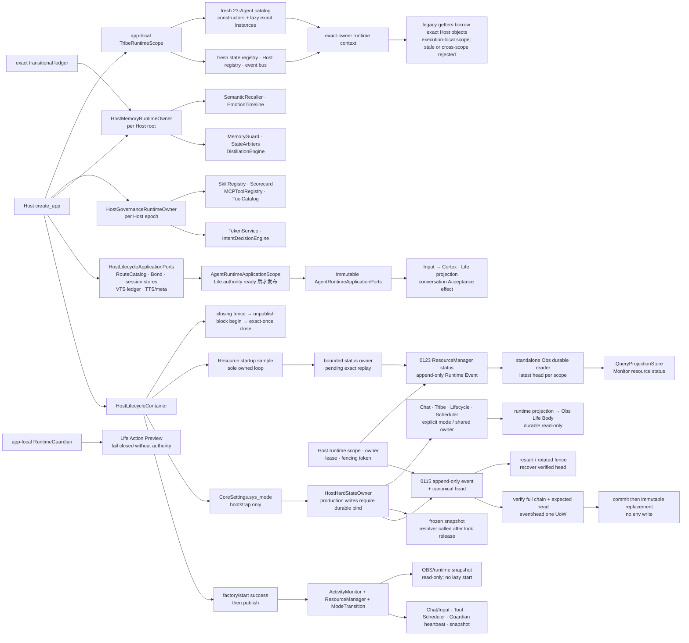

Activity factory 失败不会发布 Mode；`aclose()` 进入 closing 后新 `begin()` 必须失败。ASGI 把 typed Host bundle 显式传给 Lifecycle、Tribe、Input、Agent、Context、Startup、Multimodal 与 heartbeat。Authority migration-first 后建立 exact ledger、Memory、Model 与 Capability 图，启动顺序为 Authority→Governance→Bond；ResourceManager 则延后到 Task Runtime→Host lease/fence→Guardian 之后。关闭顺序先 drain admission 与 Scheduler，再写 ResourceManager stopped revision，之后才能关闭 Task Runtime、Workspace/Activity 和 Host lease；status append 不确定时保留后续 authority。Obs 不访问 Host 内存或共享文件，只将 0123 durable head 物化为 Monitor read model。Tribe 启动、订阅、内部路由与关闭都消费 scope-owned exact bus/registry/state/Agent catalog；23 个 Agent setter/backing singleton 与 state/Host registry/event bus fallback 已归零，无 exact context 失败关闭。EventBus 仍是易失通知面。生产 locator 和 ResourceManager shared status authority 已物理清零；外部 namespace、其它 crash recovery、generic Delegate、真实 executor 与完整 Host/Worker/Obs authority 仍未闭环。

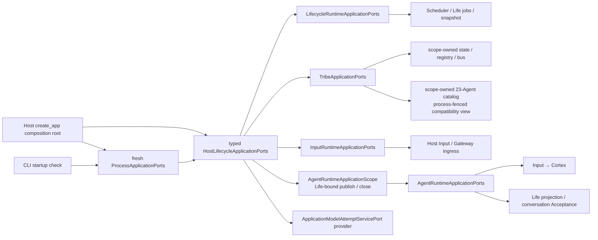

## 3. 入口与路由分流

Tribe state-helper 流把 Host ledger 显式传给偏好包、对话经历 read pack 与 `IntentSequenceAllocator`；该切片的 `3/15/6、Container48/2/45` 只作历史。现行生产 locator consumer/import/module/field/lock/ref 全为 0，ResourceManager status 由 0123 journal 持久化。Host-root owner 与底层 Authority identity 隔离仍不能替代外部 namespace、其它外部资源恢复、Chat TaskGraph、Acceptance、Outbox、正式 evolution activation 或 Tribe app-local 隔离。

### 3.1 Host 对话入口

Host lifespan 先固定 `SurfaceRuntimePorts`（AgentRuntime ports + Life authority），经 Internal/Tool Runtime 到 frozen Chat；普通 `/v1/chat` 同时接收 ASGI 注入的 `InputRuntimeApplicationPorts`，只用它获取 Intent、Governor 和情绪上下文。缺端口在入口失败关闭，不再从 locator 或请求期 composition 回退。#103+#104 rebase 的定向并集为 `196 passed in 21.08s`；这不改变 visible turn、Memory/Life、delivery 必须在 Acceptance 后提交的边界。

[cortex_runtime.py](../../../host_brain/agent_runtime/cortex_runtime.py) 把 `chat` / `skill` / `delegate` / `plan` 定义为 canonical governed route。数据流是：

```text
normalized request
  → route decision
  → Governor APPROVE + grant
  → GovernedHostRuntime.supports(route)
  → immutable command/graph contracts
```

这四路有两个关键 fail-closed 规则：

1. Governor 未批准不进入 worker。
2. Governed Runtime 不可用或不支持 route 时，返回 `GOVERNED_RUNTIME_UNAVAILABLE` / `GOVERNED_ROUTE_UNSUPPORTED`，不回退 Executive。

canonical route 不会在 graph Acceptance 之前写入 user turn。`task_progress` 和 `recent_turn` 是独立的 durable projection/read route：Governor 批准后仅返回暂态 Task 或 conversation projection，不创建 Task/Attempt，也不写入 visible conversation、Memory、Life、Preference、Outbox 或 Delivery，更不进入 Executive。若要把查询结果写入历史，必须先重新准入 immutable TaskGraph。

### 3.2 Gateway / Host Input 入口

Gateway 不直接调用 Host worker。它先完成签名验证、规范化与 durable inbox 接收，再由 worker 单次回报 Host `/v1/host/input`。Host 的 [ingress.py](../../../host_brain/input_runtime/ingress.py) 验证 secure claim 与幂等键，然后经 [cortex_dispatch.py](../../../host_brain/input_runtime/cortex_dispatch.py) 进入同一 Cortex/Governor 链。

Gateway 的 intake ack 只表示“已持久接收”。Gateway 只在 Host 返回可验证的 Host input receipt 后才把 inbox 标记为完成。该回执要绑定 source、body digest 和 idempotency digest，不仅检查 HTTP 200。

受认证 Host Input/Gateway 在 Governor 前冻结 Secure Ingress principal，并在 direct `chat/skill/delegate` 与 approved-plan admission 中保留同一 `surface / principal / claim_ref / audit_ref / body SHA-256`。Plan 在首次 HostCommand/TaskGraph admission 前以 base request/session/principal 只读预检 parent Governor binding，direct route 也先预检，child grant 派生再复验。只有成对 ref 与 Gateway source 同时存在时 surface 为 `GATEWAY`；其他认证输入为 `HOST_INPUT`，无 ingress 才是 `CHAT`。半绑定 ref、畸形摘要或 parent binding 漂移会失败关闭。D10 只把这个 authority 继续传给 `pentest_agent` 的内层 immutable invocation；其余 Delegate target 在 admission 前失败关闭，Plan 也仍不会生成候选方案。

Host 内的 Canon/Tool/Bond HTTP 与对应 OBS command adapter 现在从同一个 app-local frozen `HostRoutePorts` 解析依赖；router factory 在 app 构造时闭包绑定，运行期不再通过 module setter 或 `process_services` fallback 改写三类 provider。因此同解释器多 Host app 的请求不会因后构造 app 而串到另一对象图。该数据流边界仅覆盖三类 route；其余 OBS/Scheduler/Review/Life/Tribe locator 尚未迁移。

### 3.3 入口状态表

| 来源 | 当前入口 | 进入 canonical TaskGraph | 状态 | 边界 |
|---|---|---:|---|---|
| Host Chat/API | Cortex | 是 | `WIRED` | 仅四条 canonical route |
| Visual Agent legacy HTTP | `/v1/agent/run` compatibility adapter + vision chat format fence | 否 | `RETIRED_COMPATIBILITY_ONLY` | raw loop/client 与 Ledger writer 已删除；兼容 route 只返回 `AGENT_INIT → LOOP_DONE / REJECTED`，视觉聊天非 `text` 值在 runtime/model/Prompt/Memory/Ledger 前固定拒绝。正向能力必须重新 admission 为 immutable TaskGraph revision |
| Gateway | durable inbox → Host Input | 是 | `WIRED_OUTER_ADMISSION` | principal、claim/audit、body digest 与 surface 贯通 Governor/HostCommand；可能提交时间不明的请求进 uncertain DLQ，不盲目重试 |
| Scheduler | governed scheduler adapter | 是 | `WIRED` | Clock/Manual occurrence，完整 child grant/Review/Verification/Acceptance/Receipt |
| Internal Agent | internal task adapter | 是 | `WIRED` | 入口只接受未准入 v2 描述；V3/顶层图身份拒绝，清除 caller authority 后才编译 V3；`delegate:agent_runtime` child grant 验证后才调用 executor |
| Read projection | `task_progress` / `recent_turn` | 否 | `WIRED_READ_ONLY` | 读取 durable projection，不拥有任务状态 |
| Executive | partially retired fail-closed guard | 否 | `PARTIAL_RETIRED_FAIL_CLOSED / PRODUCTION_OFF` | 无 Executive 生产调用、无 `route_planning`/`conversation_execution`/application `composition`/application port wiring、无 legacy diagnostic direct-skill matrix、无 SkillDag worker 执行、无内存 registry；Executive 内 Forge override call 已删除，纯 SkillDag adapter 仅兼容合同，cycle 只能投影为空 batch 并以 `PLAN_CYCLE` 拒绝。独立 Forge `runtime-match` 仍是待退役边界 |

## 4. Host 四路 Governed Runtime

[governed_task_adapter.py](../../../host_brain/app/governed_task_adapter.py) 是 Host 四路的生产 adapter。它把 route 产物编译为 `HostCommand + WorkOrderV3 + TaskGraph`，再交给 [governed_command.py](../../../host_brain/orchestration/governed_command.py) 与 `GovernedCommandApplication`。[governed_task_authority.py](../../../host_brain/app/governed_task_authority.py) 独立承担无状态的 exact replay、lineage 与 fail-closed 校验：chat/delegate/skill 先走共同 binding，只有 skill 叠加 direct-skill 专属 metadata，避免 replay 路径因错误复用 validator 被拒绝。

| route | 冻结输入 | worker 主行为 | 当前状态 | 未完成语义 |
|---|---|---|---|---|
| `chat` | prompt、conversation context、reply channel | 调用 Surface Reply，输出冻结 worker projection | `WIRED` | conversation 与 delivery 是 Acceptance 后最终一致 |
| `skill` | target skill、arguments、capability scope | 验证 node-bound grant，执行 frozen governed skill，校验 durable skill receipt | `WIRED` | 只证明冻结 skill vertical slice，不等于所有 legacy skill 路径已删除 |
| `delegate` | 精确 `target_id`、上下文和超时 | 经 frozen delegate port 调用指定 sub-agent | `PARTIAL` | outer graph 受治理，但内部 dispatcher 尚未消费 node grant/Attempt；worker 不得从 context 重新选 route 或 target |
| `plan` | server-owned `CAPABILITY_SEARCH_V1` 的 task/tag/risk 与 Governor binding | 冻结 Registry → L1/L2/条件 L3 → selected-only context → immutable multi-node graph | `PARTIAL` | 仅 Research/Frontend 的窄 catalog；顶层或 `args` 的 `planned_steps/steps` 在上下文构造和 admission 前拒绝，Code/Research/Pentest 的通用生产切流与收益尚未证明 |

### 4.1 Chat

Chat worker 经 [route_execution_ports.py](../../../host_brain/app/route_execution_ports.py) 组装 `SurfaceReplyInput`，使用已批准的输入与 recall packet 调用 Surface Reply。worker 本身不获得 Governor 或 Gateway delivery authority；交付权由 Acceptance Effect Compiler 从已 admission 的 command 重建。

因此正确语义不是“生成文字后立即写对话并发送”，而是：

```text
frozen chat execution
  → worker projection
  → verification
  → graph acceptance
  → graph-scoped conversation/life/delivery effect intents
```

### 4.2 Skill

Direct Skill worker 使用每节点 child grant，从 durable grant ledger 加载授权，再执行 frozen governed skill。之后它记录 governed skill execution，校验 durable receipt projection，并返回 worker commit 和可计量 budget usage。

这条链建立了 `command → graph/node → attempt → child grant → worker receipt` lineage。Executive legacy SkillDag 生产执行、`route_planning`、`conversation_execution`、application `composition`、application port wiring、legacy diagnostic direct-skill matrix 和进程内 registry 已删除；Executive 内 Forge route override call 也已删除，留下的纯 SkillDag adapter 不拥有 worker 或 production caller。它检测到 dependency cycle 时只保留空 batch，admission 返回 `PLAN_CYCLE`，绝不改写为串行执行。独立 Forge `runtime-match` 仍须在 NE-05 退役。后续约束重点是把 Internal 与领域兼容入口全部迁入同一 lineage。

### 4.3 外部 Skill 生命周期（NE-05）

外部 bundle 不会因为存在于目录中就进入运行时。签名接收先完成 quarantine/stage；0109 ledger 再把 Lab report、Review、SBOM、signature、sandbox、rollback 和 maturity 固定为不可变 evidence。只有 fenced Supply Chain Repository 成功推进 `STAGED → ACTIVE` 后，content-addressed registry 才能返回该版本；降级和回滚同样必须留下 durable receipt。回滚会重开目标版本自己此前的 `ACTIVATED` receipt 与精确 evidence，拒绝从未独立激活或跨 skill kind/name 的 target；它不得复制当前版本的证据来授权旧版本。

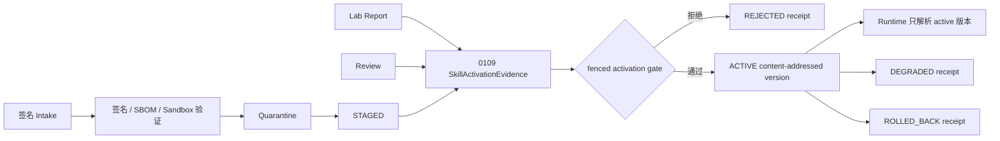

该链已经在 repository/service/contract 层可回放；V1 的 URI reference 仍不是对真实 Lab/Review authority 的查询，Supply Chain 状态、evidence 与 terminal receipt 也还不是同一 UoW。外部 provider 的真实 sandbox canary、Review production route 和 bundle import 仍标记为未验收，不能把 stage 或测试 fixture 写成生产激活。

### 4.4 Feedback、Knowledge 与 Identity 演化（NE-06）

NE-06 把长期变化限定为 proposal 流：旧增长入口只生成 FeedbackProposal，Knowledge 先以 namespace-scoped proposal 保存，Identity 先注册 migration plan。0110 ledger 以 append-only event 记录 `PROPOSED/STAGED → Lab + Review → ACTIVE/APPLIED → ROLLED_BACK/DEPRECATED`，任何读取只看已激活 projection。

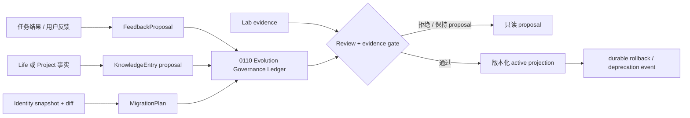

反馈、知识和人格都没有直接生产 writer；当前 repository/composition 已能回放 apply/rollback，旧 Memory、IdentitySnapshot owner 和所有增长 caller 的完整切流仍待完成。

### 4.5 Delegate

Delegate worker 仅接受冻结的 `target_id`。D10 的 [governed_delegate_dispatch.py](../../../host_brain/app/governed_delegate_dispatch.py) 只注册 `pentest_agent`，将 command/request/session/principal、root WorkOrder、graph/revision/node、attempt、lease/owner/fence、parent/node grant、objective 与 input reference 冻结为一次 invocation；调用前重新校验 node grant，并只投影无副作用的 Domain Pack/SecureRun handoff。它不经过旧 `SubAgentDispatcher`、全局 Agent gateway 或独立 `skill_exec_log`。

旧 `SubAgentDispatcher` 现在是无状态 fail-closed compatibility gate：任何 direct request 都在读取 context、加载 handler、构造 gateway 或写日志之前返回 `LEGACY_SUB_AGENT_DISPATCH_RETIRED`。Executive compatibility ports、runtime wiring 和 `_dispatch_to_sub_agent` 已不再携带 request factory 或 dispatcher accessor。`intent_agent_handler` 也只输出待重新 admission 的 handoff，不能使用 legacy source/gateway 生成模型结果。保留的 request codec 不形成执行路径；该负向封口不替代 `pentest_agent` 以外 target 的正向迁移，也不提升 Delegate 路线为 `COMPLETE`。

`intent_agent`、`translate_agent`、`vision_agent`、`repair_agent` 以及未注册 target 会在 direct/Plan admission 前失败关闭。故该实现保证已启用目标执行的是上游冻结决定，而不是 worker 内重新选择 agent；它不代表 child agent 的全部工作已迁入同一 TaskGraph，也不代表一般 Delegate 平台已经完成。

### 4.6 Plan

[plan_intent_search.py](../../../host_brain/orchestration/plan_intent_search.py) 仍保留纯 compatibility/contract adapter，用于读取已批准的 `planned_steps/steps` 并检查拓扑；它没有 Host production adapter import 或调用点，不能从 caller 输入获得执行 authority。[planning_execution.py](../../../host_brain/orchestration/planning_execution.py) 只接收 SearchResult，再交给 [planning_graph_compiler.py](../../../host_brain/orchestration/planning_graph_compiler.py) 编译成不可变 TaskGraph。

唯一生产入口是显式 `route=plan + target_id=planning_search + args.planning_mode=CAPABILITY_SEARCH_V1`。顶层或 `args` 中出现 `planned_steps/steps` 均在 Host 上下文构造和 admission 前拒绝。普通用户输入中，只有 Thalamus server-owned rule 识别出的明确 Research/调研和 Frontend/可用性计划会填入 `task`、受限 tag 与最大风险；`compile_intent_draft()` 只保留这一声明合同，Governor schema/binding 再冻结它。仅建议、禁止调用工具、通用目标、Code/Pentest 不会由这条规则获得执行 authority。随后它经 [capability_plan_search.py](../../../host_brain/orchestration/capability_plan_search.py) 从 app-composed `SkillRegistry` 冻结至少两项 `scope=host`、`require_confirm=false`、风险不高于 Governor-bound 上限且标签匹配的能力元数据；[capability_domain.py](../../../host_brain/planning_search/capability_domain.py) 用公共 L1/L2/条件 L3 在虚拟态选择两项不同 Skill 的有界顺序路径，服务端冻结为 `skill → skill → chat`。每个选中节点使用 Task Runtime 的标准 `receipt_ref + narrative` 输出合同。只有搜索选中后，`compilation_context_resolver` 才重建 selected-only `approved_candidate_inputs`，再进入 compiler/admission；Registry handler、未选候选和 worker 都不进入搜索，worker 不会重规划。若携带显式、Governor-bound `failure_replan`，同一路径必须先由 `GovernedPlanningRecoveryService` 重开 canonical `FAILED` graph、quiescence 和 failure evidence，才可创建同 root 的 revision `+1`；它不是 worker 失败后的自动触发器。

Risk 收紧发生在 Registry 快照前：`requested_max_risk_level` 与 Governor approved binding 的整数 risk ceiling 取最小值，Governor decision ref 进入 virtual-state source refs；缺失、布尔值、非整数或越界 ceiling 均在搜索前失败关闭。该数据流只减少 Research/Frontend capability catalog 的候选，不能把 intent 参数提升为 grant，也不扩展到一般 Plan、Code 或 Pentest。

当前 Plan **不会**：

- 把旧 `planned_steps/steps` 或普通 Plan 输入作为生产执行授权；
- 在通用普通 Plan 输入中根据虚拟状态动态生成领域 successor（当前仅 capability mode 的受限 catalog 可以）；
- 在真实 Code/Research 场景中证明 Graph Search 或 MCTS 收益；
- 在 worker 失败时自动生成 revision + 1 并继续调度。

显式 failure-replan metadata 现可由 Host capability route 走 canonical durable recovery 构造 graph revision + 1；它仍只是人工/显式恢复，不是完整的自动或 failure-adaptive 重规划闭环。

### 4.7 PlanningSearch shadow calibration

Pentest 的公共 L3 只在纯虚拟状态中计算。0105 提供通用、append-only 的 calibration repository，但它不是执行 authority：只有调用方显式把 repository 注入 Pentest kernel context 时，adapter 才会写 prediction；候选 target 会在计算 candidate fingerprint 前收口到授权 scope，真实动作始终来自 L1/L2 baseline。

```text
L1/L2 baseline selection ───────────────────────────────→ actual Pentest action
       │                                                        │
       └→ L3 virtual shadow → immutable prediction ────────────┤
                                                                ▼
     explicit SQLite CalibrationRepository ← UNVERIFIED_RUNTIME_RECORD projection
                   │ busy/schema/drift
                   └→ observable unavailable event; baseline continues
```

prediction 固定 virtual state digest、baseline/executed/shadow path、trace、budget 与纯虚拟 counters；outcome 固定实际执行的 baseline candidate、规范化结果摘要和 verifier label。两表禁止 update/delete，重复只允许 exact replay，身份、candidate 或 outcome drift 一律拒绝；repository 会验证 table/index/FK/trigger 物理语义，防止 catalog-only replay 掩盖半残 schema。当前 runtime record 没有 durable Task/Run receipt，因此该 outcome 不能证明未执行的 L3 路径收益，也不能喂给 promotion；repository 未注入时仅保留兼容内存 ledger，注入库不可用时只记录 unavailable 事件而不阻断 baseline。

### 4.8 Code 动态 pure-shadow flow

```text
frozen CodeTaskSnapshot (opaque refs + digest + registered patch catalog)
  → CodeSuccessorCatalog: inspect → registered patch → unit/rollback
  → pure L1/L2; L3 only if frozen virtual_model_ready=true
  → selected path rechecked against the same catalog
  → catalog-derived approved_candidate_inputs
  → immutable PlanningCompilationContext
  → optional compile / governed initial or replan preparation
```

该流在 D16 结束于纯编译准备：snapshot 不包含 source text、worktree handle、凭据或 executor；候选不携带 budget、review、workspace 或 approval authority；`intent_draft` 被拒绝，避免覆盖 catalog-derived args。context 的 `approval_ref` 必须与 parent Governor grant 一致，state/goal/objective 也必须对齐。这里没有真实 workspace ACL、模型/工具/测试调用、Task admission、receipt 或生产 side effect；中间虚拟 state 也不能直接编译为 replan 图，直到 durable predecessor lineage 被另行设计。

### 4.9 D20a～D20c Research 冻结语料、citation 与外部模型证据流

```text
ResearchTaskSnapshot
  (public task/corpus refs + source_id/ref/digest + bounded ranking metadata;
   no dedicated locator/source-body/answer-key/verifier-decision field;
   task text is not content-level DLP)
  → ResearchSuccessorCatalog
    在当前虚拟状态中动态给出 query、quick-answer、primary-source、
    independent-source、cross-check、resolve-conflict（仅冻结需求要求时）或 stop
  → L2 public authority/relevance/read-cost ranking
  → L3 virtual transition/reward only when virtual_transition_ready=true
  → SearchResult + trace only (no source read, answer, graph or execution)

trusted experiment root + FrozenResearchCorpusManifest
  → 仅 manifest 列出的 repository-relative regular file
  → 读取前后 file identity + byte-count + digest checks
  → trusted private experiment consumer
  → public receipt: source_id/ref/digest/size/authority only

ResearchTaskSnapshot + manifest + ResearchCorpusBindingV1
  → exact corpus/source id/ref/digest/tier handshake
  → fresh FrozenResearchCorpusLoader per verify()
  → reopen cited source; verify UTF-8 byte boundary + span SHA-256
  → path/body-free ResearchVerifierReceiptV1
  → typed projection/models (no connection or write authority)
  → canonical JSON codec (no SQLite owner)
  → SQLiteResearchShadowLedger (single connection/transaction/UoW owner)
  → 0107 reopen registration + RunSpec + two persisted arms
  → exact terminal receipt/replay only when plan/model/verifier/evidence digest all match

owner-randomized 0107 RunSpec (CSPRNG order + cohort key digest only)
  + private prompt/messages (never written to 0107)
  → ResearchPairedExecutionRunner derives deterministic execution identity
  → 0121 reservation → fenced call claim → EXTERNAL_CALL_STARTED
  → restart: empty canonical audit only → explicit retry authorization;
             audit without 0107 arm evidence → RECONCILIATION_REQUIRED
  → AttestedExternalResearchAdapter
  → canonical ModelAttemptService foreground request
  → accept only one non-cached SUCCEEDED attempt with exact route/output identity
  → require rendered prompt digest + canonical tool/token/cost + provider/total latency
  → embedded ExternalProviderRunAttestationV1
  → profile-bound strict JSON citation-output parser (discard answer body)
  → fresh citation verifier → 0107 arm evidence → 0121 EVIDENCE_PERSISTED
  → both persisted arms: pair token/latency bound → exact terminal receipt
  → ResearchModelExecutionReceiptV1
  → still shadow ledger only; no promotion authority
```

`FrozenResearchCorpusLoader` 在稳定受信输入中拒绝绝对/遍历/ADS colon/case-alias 语法、link/symlink 和 Windows reparse component、非普通文件、root escape 及任何未列入 manifest 的来源。它有意与 planner 分离：planner 只看公开 metadata，公开 receipt 也同时省略本机 locator 与正文 bytes。D20b 的 verifier 在构造和验证两阶段分别精确比较 snapshot、manifest、binding 及新打开 document 的 corpus/source id/ref/digest/tier；调用方不能交入 executor loader 或未经核验的有效率。D20c 的 paired runner 不接收可替换的 plan、budget 或 arm order，而是重开 0107 RunSpec；新 RunSpec 先在 SQLite 写事务内由 ledger owner 对 cohort key 的 digest 建稳定 identity，精确 replay 在取熵前返回已有规格，只有新 identity 才以 CSPRNG 选择 `BASELINE/SELECTED` 顺序。raw cohort key、prompt 和 response 都不进入账本；旧 RunSpec 与 terminal receipt 只能只读重开，不能生成新的外呼或 terminal receipt。profile 的 output-schema digest 必须在任何模型调用前等于 `ResearchCitationOutputParserV1` 的固定 JSON envelope digest；parser 严格拒绝额外字段、非 JSON、越界或重复 span，并丢弃 answer 正文后只交出 citation span。它要求每个新 arm 使用 fresh verifier，且 profile prompt digest、工具调用数、单臂/成对 token 与时延超过预算均失败关闭。已有 evidence 只重开，`EXTERNAL_CALL_STARTED` 后只有空 canonical audit 才会落 retry authorization；有 audit 而无 evidence 必须冻结 reconciliation。adapter 不能从 caller 获得 provider/model/base URL/cache 控制；它在调用前先经 `AttemptAuditLookup` 确认该 execution ID 不存在 canonical audit row，任何已有行或 lookup 故障均阻断外呼并要求 reconciliation。随后只向已 composition 的模型 authority 发出一个 request，并拒绝 cache、多 attempt、route/output 漂移、缺 prompt digest/工具/token/成本或 provider/总延迟的结果。签发前它还必须重开同一 request 的 canonical audit started/terminal rows，要求 terminal record 和 provider latency 精确一致。普通 request 仍不能自行压低 route-owned retry ceiling；本地 SQLite audit reopen 与 in-process model double 都不等于已经验收的真实 provider 调用。D20a～D20c 未接入生产 Research route、TaskGraph、Host、BrowserWorker、网页抓取、真实 credential/provider execution、独立信任域 verifier 或 paired cohort；它不提供 benefit/promotion authority 或 OS/tenant/sandbox 隔离。Research 为 `ACCEPTANCE_PENDING_EXTERNAL`，benefit 仍为 `UNPROVEN`。

### 4.10 D17–D19 Code historical trusted-process experiment, controlled pytest and durable evidence flow

```text
registered clean protected source (unshared non-link .git; local Git config is trusted)
  + exact six-field isolation manifest + frozen commit + source fingerprint
  → git clone --bare --no-local (disposable private bare; sanitized Git env,
     no system/global config, file transport only, standard LFS smudge skipped,
     private empty hooks path; remote removed)
  → baseline detached worktree ─┐
                                ├→ lower-case repository-relative API → trusted executor
  → selected detached worktree ─┘
  → D19 preregistered frozen `python -m pytest -q <repo-relative-test>`
     (worktree root, shell-free child, no PYTHONPATH, plugin autoload off)
  → path-free command/exit/output-digest/duration verifier receipt per arm
  → tracked diff + untracked-file content digest; ignored artifacts fail closed
  → compare private bare refs unchanged
  → remove both worktrees + private bare
  → recheck protected source HEAD / refs / status / worktree / Git-control fingerprint
  → path-free VERIFIED_CLEAN receipt (private bare/worktrees/run root removed
     and protected source fingerprint unchanged)
  → 0106 preregistration transaction A: workload + optional exact verifier plan
  → 0106 preregistration transaction B: exact RunSpec
  → D19 terminal-evidence transaction only after both arms + VERIFIED_CLEAN:
     BASELINE/SELECTED evidence/outcome + cleanup + terminal receipt
  → terminal reader requires two successful run/arm/plan/budget-bound controlled arms;
     a started arm has already reserved its frozen command budget even on timeout/error
  → EXPERIMENT_EVIDENCE_ONLY (no production influence, winner or promotion)
```

该 adapter 与 D16 compiler、W2 WorkspaceRuntime、Host、TaskGraph、AgentExecutor 都没有接线。路径 API 会在文件 I/O 前拒绝 padding、case alias、Windows trailing-dot/space、reserved device、`.git`、absolute path、`..`、ACL 外和 symlink component；不可信 model、skill/plugin 或 hidden-oracle 绝不能传入。D19 的 verifier 把同主机 child 仅用作受控仓库测试命令：它实际强制冻结 argv、paired `max_test_commands` / `max_wall_time_ms`、worktree cwd、`shell=False`、无 `PYTHONPATH` 与关闭自动插件加载，并只持久化无路径摘要；实际解释器路径先被同次 child 核验，持久化的是无主机路径的冻结 portable argv digest。`PASS` 必须对应 exit code `0`，receipt 还会绑定 exact run/arm/plan/budget，并在 terminal replay 重验两个 arm 的 aggregate test/wall limit及两个成功 outcome；没有受控 receipt 的 D17 verifier 仍必须与 executor cost 完全相等。arm 在 child 可能启动前就预留冻结 command count，所以 timeout/policy error 也不能同一 pair 内重试规避预算。它不能强杀子进程树，也没有 CPU/内存、container、tenant、文件系统或网络隔离。本地 source、pytest 测试及 user-site 依赖仍是受信输入；为 Windows user-site discovery 会保留 `APPDATA`，且未设 `PYTHONNOUSERSITE`。0106 先独立 append-only preregister workload/plan，再独立 preregister RunSpec；只有正常 runner cleanup 成功后的 terminal-evidence transaction 才写两 arm evidence/outcome、cleanup 和 terminal receipt。SQL/Python 会再验证 registration/spec 绑定、两个 arm、source/commit/policy 一致性及 cleanup gate，并以 immutable trigger、canonical JSON/digest 和 restart replay 拒绝漂移。它是真实本地 Git + durable experiment evidence 机械链，但口径仍仅为 `PRIVATE_BARE_WORKTREE_TRUSTED_PROCESS_ONLY` / `network_isolation=NOT_ENFORCED`：模型/provider/tool/token/cost 不受 D19 预算治理，也没有隐藏 oracle、durable cleanup lease/retry、cohort/statistical comparison 或收益/promotion 结论。

## 5. TaskGraph 状态流与回执

### 5.1 Admission

[host_command_repository.py](../../../host_brain/persistence/host_command_repository.py) 的 admission 同时绑定：

- immutable `HostCommand`；
- 显式 `WorkOrderV3`；
- 显式 `BudgetPolicy`；
- runtime assignment；
- TaskGraph 及 revision。

它在事务内写入 durable state 并生成 `TASK_GRAPH_CREATED` / `HOST_COMMAND_ADMITTED` outbox 事件。非 `WorkOrderV3` 或没有 BudgetPolicy 的请求不会被自动升级，而是 fail closed。

若图声明可选 `ATOMIC_GRAPH_SUCCESS_V1`，`GovernedCommandApplication` 会在调用 repository admission 前确认 Coordinator capability、node-grant service 和 parent Governor grant；不支持的生产进程不会先留下半份 admission。admission 后派生的 node grant map 必须精确覆盖全部 TaskNode，Coordinator 不接受缺项或多项。

### 5.2 Coordinator

[coordinator.py](../../../host_brain/task_runtime/coordinator.py) 对可运行节点进行：

```text
claim runnable node
  → create/load Attempt
  → acquire Lease + fence
  → reserve idempotency + budget
  → PRE review if required
  → execute worker with node-bound grant
  → verification
  → POST acceptance review if required
  → atomic freeze exact NODE effects + immutable result artifact
  → accept node + append Attempt-bound Node Outbox
  → progress dependants
  → finalize graph receipt
```

| 能力 | 当前事实 | 定级 |
|---|---|---|
| 持久 admission | command/work order/assignment/graph 原子绑定 | `WIRED` |
| 依赖推进 | 能从 `BLOCKED` 推进到 `READY`，拒绝未知依赖与环 | `WIRED` |
| Attempt / Lease / Fence | durable 状态与 fencing 已存在 | `WIRED` |
| Idempotency | 有 reservation、commit 和 conflict 语义 | `WIRED` |
| Budget | Host 四路、Scheduler、Internal 有预留、计量和结算；8/16/32 线程与跨进程只有一个 `EXCEEDED` winner/Outbox，其他 sibling 为引用 winner 的 `ALREADY_EXCEEDED` | `CONTENTION_PROVEN / PROGRAM_PARTIAL` |
| Review | PRE/POST waiting、durable token/checkpoint、拒绝/过期、0096 continuation coordination | `WIRED_SLICE` |
| Resume | 消费 token 后由 composition worker 按原 HostCommand surface 自动重调度；PRE 无伪 Attempt，POST 不重跑 worker | `WIRED_0096` |
| B0/B1 调度决策 | Coordinator 从 durable snapshot 消费稳定 READY/fan-in/retry due 决策 | `WIRED_PARTIAL_RUNTIME` |
| 原子 claim | ACTIVE graph + Budget concurrency 下原子写 Attempt/Node/Lease/Heartbeat/Outbox，并支持 exact replay | `WIRED` |
| Node Acceptance / result artifact | 0102+GR06 将 production normal/checkpoint/Review 的 exact NODE Effect set、`ACCEPTED`、artifact 与 Attempt-bound Node Outbox 放入一个 UoW；response loss 只能 exact replay，Effect claim 必须重验同 lineage artifact。后继只消费 compiler-owned、同 graph/revision 的全部前驱 refs。新 admission 拒绝空合同，startup 隔离 active legacy 空合同/缺 artifact和缺 exact artifact 的可投递 terminal legacy Effect。public Graph create/transaction insert 与 standalone Effect stage 已删除；生产 Graph/Effect 只能经过各自私有 canonical UoW hook。0124 物理封闭 Graph/Node/HostCommand 新准入 INSERT，0125 封闭 Effect 新 INSERT 与非规范初始状态；既有行及其它 mutation 不在该声明内 | `UNIFIED_APPLICATION_STORE_UOW_WIRED / APPLICATION_AND_SQL_ADMISSION_AND_EFFECT_STAGING_WRITE_AUTHORITIES_SEALED` |
| Completion policy | TaskGraph v1 可选 `ATOMIC_GRAPH_SUCCESS_V1` 必须显式 sink result；新生产 builder 与新 PlanningGraph 默认 atomic，失败重规划继承 previous revision，历史 legacy 多 sink 无 result | `ATOMIC_DEFAULT_LEGACY_COMPAT` |
| DAG 并发 | `atomic_graph_success_enabled` 对生产默认 ON，Scheduler/Internal/Operator显式 ON；`bounded_fanout_enabled` 独立默认 OFF。atomic 可单节点/串行 outer 封口；bounded 才允许 ready sibling 实际有界并发 | `ATOMIC_DEFAULT_FANOUT_OFF` |
| 并行合流 | progress 用 `fanout_event_buffer_size` 个 semaphore slot（默认 32、非正值拒绝）限制在途事件，并为每个 child 预留独立 control 容量；size=1 慢消费者仍会反压 child，自发 `CancelledError` 也不会因 progress 满而丢失监督信号。fan-in 只在依赖 `ACCEPTED` 后执行 | `SHADOW_BOUNDED_FLOW` |
| 并行 child authority | deferred child 只拥有 Attempt/Node/Lease/Reservation 与 Budget usage/`EXCEEDED`；不能终结 Graph 或把 Budget 置为 `RELEASED/CONSUMED`。正常非接受等待所有已启动 sibling 到 durable node-local terminal，不再 fail-fast | `SHADOW_NODE_LOCAL_AUTHORITY` |
| Admission / grant 门禁 | atomic capability、node-grant service、parent grant 在 repository admission 前校验；Coordinator 直入要求 exact node grant map | `B5_FAIL_CLOSED_SHADOW` |
| Schema 前置门禁 | Budget/worker 前验证 `0090` 与 `0092`；atomic policy 还验证 `0091` | `B5C_FAIL_FAST_WIRED` |
| 共享终态 authority | live/re-entry 从 durable Node/Attempt/Reservation/BudgetUsage 重建同一 payload/ref；outcomes 全量覆盖 admitted Graph durable terminal Nodes/latest stable Attempts（含非 selected `RETRY_PENDING`），当前 batch 仅定优先级/selected。ownership/CAS 后 active ownership 映射 `IN_PROGRESS`，纯 CAS为 conflict | `B4_LIVE_AND_REENTRY_OUTER_WIRED` |
| 并行终态证据 | pre-reservation failure、Budget overrun、post-review、Review denial ref fence 与 crash re-entry failure-over-review/live authority preservation 均有集成证据，包含结算提交响应丢失 exact replay；伪 receipt/旧 Attempt lineage、digest/payload/Outbox/replay 漂移被拒绝 | `INTEGRATION_AND_STORE_CONTRACT_PROVEN` |
| 未决副作用与执行恢复 | post-COMMIT continuation 接受 exact canonical checkpoint：COMMITTED Reservation + 唯一 COMMITTED Outbox + 原 Attempt/历史 Lease/fence + hash receipt + canonical WorkerProjection + 唯一 graph Budget，并按 `EXACT_ACCEPTED / EXACT_REJECTED / MISSING / CONFLICT` 收口且不重跑 worker。单节点直接续接；多节点只有 outer DAG scheduler 在所有 live owner fence 清除后可授权同 Attempt、更高 fence的 exact continuation，accepted 后继续 READY sibling，rejected usage进入 existing parallel settlement。独立的 pre-Operation 窄窗只接受尚无 Operation、latest Attempt/过期 Lease/唯一 graph Budget/canonical PRECHARGE 完全一致的 persisted Attempt；TaskStore 在同一写事务重验 reservation id 与 scope/fingerprint absence 后复用同 Attempt、签发更高 fence，随后才首次调用 worker。Lease请求的TTL/mode/reservation等全部进入确定性identity，提交后response loss只能exact重开未续租Lease、初始Heartbeat、连续fence与同Outbox。普通execution authority没有唯一ACTIVE Budget时直接阻断。任一 live owner、并发 Operation 或identity/行漂移都先失败关闭。未知外部副作用、`RESERVED`/`CONFLICT`、该窄窗之外的 general recovery 与 general batch/multi-node settlement仍不具备自动恢复 | `CANONICAL_PRE_OPERATION_ATTEMPT_TAKEOVER_PROVEN / SCHEDULER_OWNED_EXACT_MULTI_NODE_COMMITTED_CONTINUATION_PROVEN / GENERAL_MULTI_NODE_RECOVERY_INCOMPLETE` |
| crash/re-entry 终态 | `ACTIVE` 多节点 Graph 从 durable Node/latest Attempt 复原 outcomes；`BLOCKED/FAILED/CANCELLED/COMPLETED + 未结 Budget` 不由 Runtime 重入静默修复，改由 0099 immutable case/proof/supersession authority 分类 | `B4_ACTIVE_REENTRY_WIRED_TERMINAL_REPAIR_EXPLICIT` |
| 0099 历史终态对账 | schema-only migration；readiness 比较 3 table/4 index/10 trigger canonical SQL 并做 Python case/subject/proof 复核；`recover_startup` 后单次最多 inventory 10,000 个 terminal Graph。仅 `FAILED + exact atomic failure bundle + 唯一 graph-scope ACTIVE/EXCEEDED Budget` 可由默认开启的 system auto 精确处理；child/missing/multi Budget、PENDING/CONSUMED 或 Graph/Node/Review/Attempt/Lease/并行终态不一致只 quarantine。0090 唯一且 0091/0092 完整验证；未决 case graph-wide 围栏普通 Graph/cancellation request 与 Budget transition/consume/usage/retry，只有 0099 UoW bypass；每个历史 case 的 supersession chain 最终须可信 proof，healthy closure 只能 signed `NONE` 且零业务写 | `AUTO_EXACT_ON / OPERATOR_OFF / CANARY_NOT_RUN` |
| 决策记录 | canonical payload 与 Graph、可选 Budget、Outbox 同事务写 `0090`。selected `BUDGET_BLOCKED` 绑定 rejected usage；共享超额后的被动 blocked sibling 不要求本地 rejected usage。每个 row 读取校验 digest、精确 Graph/可选 Budget Outbox 与 Attempt，BUDGET 另校验 usage；terminal replay 还校验 Graph target/version | `B4_CANONICAL_DECISION_JOURNAL_WIRED` |
| marker 历史扫描 | 0095 令所有 `TASK_GRAPH` Outbox 精确绑定现存 revision，完整 taskbatch marker 缺行/错绑扫描按 `graph_id + revision` 覆盖 multi-revision 历史；decision getter 同时复核 exact Outbox revision | `WIRED_0095_REVISIONED_GRAPH_OUTBOX` |
| failure replan evidence | scheduler snapshot 默认不扫 Outbox；PlanningRecovery 显式 opt-in，在同一读事务选择唯一 terminal Graph Outbox 的真实 payload ref。0100 append-only supersession 与 `admit_replan()` 单事务重新核验 same-root `FAILED` predecessor、精确 Outbox 和静止 facts，再原子写 revision+1 admission/supersession；共享 Store/Review fence 阻止旧 revision 再 mutation/continuation。response loss exact replay，故障注入全回滚。当前保守拒绝 `BLOCKED`、所有历史 Review continuation 与所有 Acceptance Effect，自动 replan/生产 canary仍缺 | `PARTIAL_DURABLE_SUPERSESSION_SAFE_SUBSET` |
| PRE Review 观察 | `WAITING_APPROVAL` 已纳入统一 0090 outcome；合法无 worker Attempt，receipt/decision 使用 `attempt_id=null`，其它状态仍强制真实 Attempt | `WIRED_0096_OPTIONAL_ATTEMPT` |
| atomic 成功 UoW | 全 Node Accepted 后单事务提交 Graph COMPLETED、Budget CONSUMED、两 Outbox、全图 effect intents 与 0091 decision；结果只取显式 result 的 canonical projection。新生产 Graph 已使用该路径，历史 legacy仍只读兼容 | `PRODUCTION_DEFAULT_TARGETED_VALIDATION_PASSED_WAVE_CANARY_PENDING` |
| legacy ACCEPTED→Effect 重启 | Node ACCEPTED、Graph ACTIVE、Effect 未落盘时，共享 `AcceptedGraphFinalizationRuntime` 从 exact Operation checkpoint/canonical WorkerProjection 重建 Effect，并原子提交 Graph+Effect；篡改 fail closed，重放不新增 Effect，worker 不重跑 | `PROVEN_NARROW_RESTART_FINALIZATION` |
| projection / replay | projection 重算 digest并绑定 command/request/route/target/graph/node/attempt/receipt/grant；completed replay 只读 0091、不重编 effects；双响应丢失重读 terminal authority | `B5_ADVERSARIAL_PROVEN_SHADOW` |
| Durable Graph 取消 | `task_graph.cancel`、Operation/Effect/terminal reconciliation 均经默认关闭入口。0098 处理 Effect 不确定性；启用 cancellation 时，0099 production gate阻断 current terminal anomaly、缺失 trusted proof/supersession closure 的历史 case与任何 quarantine，但不阻断 terminal remediation Operator 本身。外部 deployment inventory、凭据/key lifecycle/canary未知 | `B5C_WIRED_DEFAULT_OFF_PRODUCTION_OFF` |
| Outbox 并发发布 | 0093 持久化 owner/token/expiry/单调 fence 并支持 takeover。0095 按 `type + id + revision` 隔离 head；CREATED 用 HostCommand evidence，ACTIVE 等用 deterministic legacy ID/key 重算，无法解析则迁移阻断。升级保持 Outbox ID/key，新增 `@revision` payload；旧 payload 仅 replay 兼容。新 Event=`graph_id@revision`，旧 journal 经 source Outbox exact read；unique partial source-ref 防重复投影，Operator/Review exact revision。publisher 继续 claim→幂等 append→fenced complete；`DRAINED` 仅在 total_pending=0 | `WIRED_0093_CLAIM_0095_REVISION_IDENTITY` |
| Budget 并发 CAS | winning rejected usage 独占 `ACTIVE→EXCEEDED` 与唯一 Outbox；sibling只追加 `ALREADY_EXCEEDED`并引用 winner。0090 decision 写/读/replay 在单一读快照中重验 Reservation 精确版本、sole winner Outbox、Attempt/Graph lineage与全部 sibling；charge attempts 至少为 `max(configured retries, concurrency + 1)`；concurrency=8 时连续 8 次 conflict 后第 9 次成功；线程/跨进程/restart/interleave 已验证 | `UNIQUE_WINNER_AND_ADMITTED_WAVE_RETRY_PROVEN` |
| Retry/backoff | Coordinator 仅对 reservation 前显式 marker 重试；并行 deferred child 使用 domain-separated node-only usage identity 与 `schedule_retry_node_outcome`，保持 Graph ACTIVE，提交响应丢失 exact replay 不重复扣费。无前置 Review 的到期 `RETRY_PENDING` 由同一 `BEGIN IMMEDIATE` 同时 promotion 为 READY 并领取 Attempt/Lease/Heartbeat/Outbox；注入 Attempt Outbox 漂移会回滚 promotion。需要新 Review 的重试先持久化 Review，不能绕过审批。预算拒绝只落 Budget `EXCEEDED` 与 node-local terminal，再交 outer 裁决。生产 resolver 尚无现实 marker 来源 | `PARTIAL_B4_SAFE_RETRY` |
| Pre-reservation failure | 普通/耗尽的 direct、non-deferred failure 通过 `fail_running_attempt_bundle` 在同一 SQLite UoW 原子落 Attempt FAILED、Node FAILED、Graph FAILED/BLOCKED、Lease RELEASED、精确 graph-scope Budget RELEASED、四条 attempt/evidence-bound Outbox 与一条无 attempt lineage 的 `BUDGET_RESERVATION_RELEASED` Outbox；Budget/outbox/version/timestamp 精确 replay，任一 Outbox fault 回滚全部。已有 reservation 时拒绝；并行 deferred child 仍由 outer settlement 收口共享 Budget | `WIRED_NARROW_BOUNDARY` |
| 执行心跳 | reservation 后后台先续 Lease 再续 Reservation；流事件和最终结果均 checkpoint，停止/join 后才用最新 version COMMIT。续租同参响应丢失可精确重放 | `WIRED` |
| 心跳失败 | 未形成 exact canonical COMMITTED checkpoint 时返回 `RECOVERY_REQUIRED` 且不 COMMIT；只有上表 single-node 窄窗可 takeover。0096 Review continuation是另一条 task-bound 协调链；两者都不代表 asyncio 能撤销外部副作用，也不代表 general recovery 完成 | `FAIL_CLOSED_WITH_NARROW_TAKEOVER` |

启动恢复数据流为 migration → TaskStore 0093/0094/0095/0098/0099 与 Review 0096 readiness → `task_store.recover_startup` → 0099 单次最多 10,000 个 terminal Graph inventory → 可选且默认关闭的 exact system auto → publisher → recovery outbox publish → RuntimeGroup 激活共享 Acceptance Effect owner、Host/Internal/Scheduler/Operator → `HostCommandRepository.list_nonterminal_admissions()` 在一个读事务内按 Host surface 联结最多 `100 + 1` 条 `CREATED/ACTIVE/BLOCKED` admission → `HostStartupGraphContinuation` 精确重开 Host-owned immutable tuple → scheduler clock 与 cancellation/Review workers。foreign surface 不能消耗 Host bound，恰好 100 条可继续，真实 overflow、tuple/snapshot/receipt 漂移才失败关闭；live Lease 或已有执行 owner 只记 `DEFERRED`。它不构造请求、不重新 Governor/规划，也不直接抢 Lease 或重放 worker。0099 inventory 是显式历史终态分类，Host continuation 是一次 boot-scoped 正确入口，两者都不是 general recovery；单节点 post-budget Operation takeover仍发生在 exact request re-entry，batch/multi-node/pre-budget 以及 live Lease 过期后的周期 survivor 都不会被启动流程自动修复。

拒绝性 Review continuation 的数据流独立于 worker re-entry：`REJECTED/EXPIRED/CANCELLED` claim → immutable `denied_review_node_id`（无 node grant）→ scheduler 读取同一 TaskGraph snapshot → 精确等待节点/无活跃 sibling 检查 → ReviewStore 重开 `REVIEW_DENIED` → 既有 terminal release、Verification/Acceptance receipt 与 outbox 路径。claim 指向未知节点、携带 grant、节点已离开等待 checkpoint、sibling 正在执行或 Review disposition 变化时，流程在任何状态 mutation 前以 durable-state conflict 失败关闭；不得把拒绝当成可重跑 worker 的许可。

Budget 的 token/cost 在 provider 没有返回真实计量时保持 `UNMEASURED`，不做伪精确估算。concurrency charge 和超限后的完整 `DEGRADE` / `REVIEW` 分支还没有闭环。

### 5.3 Scheduler Clock/Effect 与 Internal result 边界

[scheduler/governed_runtime.py](../../../host_brain/scheduler/governed_runtime.py) 已构造 `WorkOrderV3 + BudgetPolicy`，以 `delegate:<worker_key>` 冻结 TaskNode。`operation_plan.py` 的 worker 在 durable child grant、occurrence、definition 和 fingerprint 全部重验后只生成 `scheduler.operation.execute` descriptor，不调用领域 handler；canonical WorkerProjection 是 Acceptance 前的 plan checkpoint。Graph Verification/Acceptance 与 Effect staging 使用同一 TaskStore UoW。提交后，共享 app-local dispatcher 才派生 exact Preview 并交给 `accepted_operation.py` 调用真实 handler；实际结果写原有 immutable result repository，native claim 只凭该 result receipt 收口；Operator 外层继续持有独立的 checksum-chained outcome receipt，并只在实际结果可归因后收口。

Review 前 handler 调用数为 0，Effect commit 后为 1；duplicate 只读重放实际 result。过期 claim 或 handler 调用后的响应丢失必须先按 operation/result authority 对账，不能盲目再次执行。该切流不覆盖 Scheduler definition/admin direct authority、mutable batch/clock retry、一般未知外部效果人工归因、wave integration 或 canary。

Clock 的 occurrence admission 不再经历“清 DUE claim→另行领取 occurrence claim”的空窗：repository 在同一事务校验 live DUE owner/fence、插入 immutable occurrence、推进 definition head，并把 retry row 的 key/type 原子转成 occurrence/`OCCURRENCE`，保持同 owner/fence 后续租。Clock 仅接受返回的 exact occurrence claim。dispatch 前和执行中 heartbeat 续租；lease 已过期的 owner不能自我续活，clear/defer 也必须使用当前实际时间与 exact owner/fence。故慢执行不会被第二实例重复 dispatch，异常退避也不再基于旧 tick timestamp。

[internal_task_runtime.py](../../../host_brain/app/internal_task_runtime.py) 在认证 ingress 只接受未准入的 v2 `AgentWorkOrder` 描述；显式 V3 或顶层 graph identity 会以 `INTERNAL_RUNTIME_PRE_ADMITTED_WORK_ORDER_FORBIDDEN` 拒绝，随后才清除调用方伪造的 lineage/approval authority 并构造 `WorkOrderV3 + BudgetPolicy`。TaskNode 冻结为 `delegate:agent_runtime`；worker 只有在 durable child grant 完整验证后才把冻结的 V3 直接交给 Agent executor，禁止 V3→v2 compatibility projection。

因此实际流程是：

```text
authenticated Internal ingress
  → Secure Ingress principal + Governor grant
  → strip caller authority; compile WorkOrderV3 + positive BudgetPolicy
  → HostCommandRepository atomic admission
  → TaskNode delegate:agent_runtime + child-grant verification
  → PRE Review if required
  → native WorkOrderV3 Agent executor (external accepts pre-admission v2 only; V3/graph identity rejects)
  → raw work-order/prompt/metadata/result/changed-files/verification
    写入 protected exact-inventory stage
  → WorkerProjection 只携带 protected stage ref/digest + bounded summary
  → Verification + Acceptance / POST Review
  → internal.agent.result_commit Acceptance Effect
  → reopen exact TaskStore Node=ACCEPTED / Attempt=SUCCEEDED
    / Lease=RELEASED / Node artifact / claimed Effect
  → clean/no-change Git Workspace only
  → 0116 ACTIVE → ACCEPTED → PROMOTED
  → canonical Agent result repository
  → exact COMMITTED result receipt
  → ingress claim terminalization + replay
```

前置 Review 不执行 handler，且在尚无 worker receipt 时保持 ingress claim result 未绑定；内部 acceptance decision 不是 `ACCEPT` 时不允许进入 canonical result commit。`artifact_store_read_model.py` 只重开/校验 seal inventory、promotion、recovery envelope 与 tombstone；`internal_startup_checkpoint_continuation.py` 在 activation 扫描并续接 admission；`internal_agent_sealed_checkpoint_recovery.py` 在精确 lineage 与更高 fence 下重建唯一 WorkerProjection；`node_worker_stream.py` 只归一化 stream 与中断心跳；`operation_recovery_checkpoint_loader.py` 只校验、接管并加载 COMMITTED checkpoint。上述 continuation/recovery 流均禁止再次调用 Agent/worker。当前结构切片还把 Acceptance、ASGI、Scheduler 三个原 owner 降至1262/1389/2942行且未扩白名单；fresh 主证据统一为 36 文件 `265 passed in 210.19s`、`0 failed/skip`，旧 61/73/102/54/14 批次只作包含或重叠历史、不得相加。四项一般恢复缺口、handle-level TOCTOU、一般write、OS/container isolation与七路线验收仍未删除；外部 v2 ingress compatibility 不拥有 Internal worker execution authority。全仓静态 Gate 虽已 `PASS`，NE-01 仍 `PARTIAL / IN_PROGRESS`，`REMOTE_CI=NOT_RUN_ACCOUNT_QUOTA`。

## 6. Acceptance Effect 与对话提交语义

[acceptance_effects.py](../../../host_brain/task_runtime/acceptance_effects.py) 在 graph 验收后从受信 worker projection 编译 graph-scoped effects。当前主要 effect 类型是：

1. `conversation.user_turn`；
2. `life.foreground_completed`；
3. 在存在 reply channel/target 时的 `surface.reply_delivery`；
4. Internal Agent 路线的 `internal.agent.result_commit`。

worker 不能提供这些 effect 的 authority 或 idempotency key。Compiler 只使用已接纳 HostCommand 和 graph 事实重建，避免 worker 扩权。

Legacy completion 的崩溃重入也经过同一编译/落库边界。`AcceptedGraphFinalizationRuntime` 不信任 terminal replay 的任意 mapping，而是要求 Store 返回 exact COMMITTED Operation checkpoint，并验证历史 Lease、Attempt SUCCEEDED、COMMITTED Outbox evidence、hash receipt 与 canonical WorkerProjection lineage；随后才在一个 UoW 中提交 Graph COMPLETED 和 Effect intents。测试覆盖 ACCEPTED 已提交但 Effect 为空的进程退出、重启无 worker replay、重复执行 Effect 幂等，以及篡改 projection 时零 Effect/Graph 不完成。

[acceptance_effect_dispatcher.py](../../../host_brain/task_runtime/acceptance_effect_dispatcher.py) 使用 durable queue、lease 和 fence 按以下语义顺序提交：

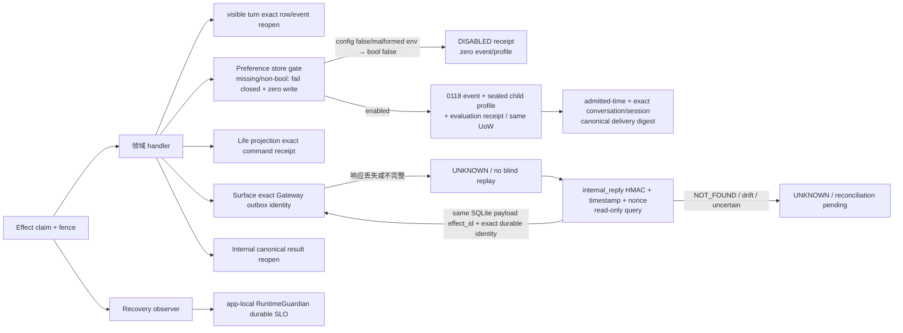

visible turn、Preference evaluation 与 Life conversation projection 是三个独立 post-Acceptance Effect。visible turn 精确重开 `MemoryEvent`。Preference store gate缺失/非`bool`时失败关闭且零写；配置false或malformed env保守解析为`bool false`，只写`DISABLED` receipt且event/current profile/child version均为0。启用路径以effect-bound operation ID在0118同一SQLite UoW写event、append-only child profile与evaluation receipt；parent receipt可见后trigger封住child集，reconcile比较声明与实际全集以发现绕过trigger的篡改，零信号写真实`NO_SIGNAL`。推荐反馈只读取admitted-time以前且exact person/conversation/session的delivery，并将canonical full-delivery digest放入evidence。Surface response loss只允许通过`internal_reply` HMAC只读query；Gateway从同一SQLite outbox snapshot的canonical payload精确校验`effect_id`，Host重新派生delivery/payload digest后才归因，`NOT_FOUND`永远不是`NO_SIDE_EFFECT`。

### 6.1 Operator `sys_mode.switch` 的 Review、Effect 与 outer receipt

```mermaid
sequenceDiagram
    participant O as Operator / OBS HTTP
    participant I as Secure OBS Ingress
    participant G as GovernedOperatorRuntime
    participant R as Task Review continuation
    participant E as Shared AcceptanceEffectRuntime
    participant H as HostHardStateOwner / 0115
    O->>I: sys_mode.switch signed command
    I->>G: server-owned claim/audit/body authority
    G->>R: typed HostCommand + immutable TaskGraph
    R-->>I: WAITING_REVIEW; outer claim remains unsettled
    R->>G: exact approved continuation
    G->>E: host.sys_mode_transition effect
    alt effect terminal COMMITTED
        E->>H: exact Preview proof + event identity
        H-->>E: MODE_CHANGED event or NO_CHANGE
        E-->>I: terminal continuation result
        I-->>O: finalize outer WAL and central claim
    else RECOVERY_PENDING or uncertain
        E-->>R: durable defer; do not terminalize outer claim
    else Review CANCELLED
        R->>R: reopen exact Task cancellation authority
        R-->>I: terminal denial only when durable evidence matches
    end
```

Host 与 Operator 不再各自启动一套 Effect recovery loop；一个 app-local `AcceptanceEffectRuntime` 同时拥有 claim/retry/recovery。Review admission 已持久化而 outer WAL append 失败时，重启阶段保持 OBS admission 关闭：零条Review转UNCERTAIN，唯一六种合法状态重开Secure Ingress、HostCommand、TaskNode、ReviewItem与terminal continuation后恢复同一 `WAITING_REVIEW`，多条或绑定漂移阻断启动。HardState 调用后的响应丢失、`success=False` 或归因异常必须先重开 exact event；已提交则 `REPLAYED`，读取不确定则保持 `PENDING + RECONCILIATION_REQUIRED`/`UNKNOWN`，只有权威不存在才普通失败。历史成功和未知结果都使用永久 event ID，不受 `history(limit)` 影响，也不再次执行 mode transition。`NO_CHANGE` 没有 event，外层 `side_effects_executed=false`。关停时先停止并排空 Secure OBS ingress，再停止 Scheduler producer，随后关闭 Task Runtime/Effect owner、quiesce Workspace，最后才停止 ModeTransition/Activity 依赖、关闭 command/security stores 并清空 app state；关键关闭失败保留依赖与发布引用以供重试。

取消并发下必须区分“成功证据”和“失败不确定性”：`COMMITTED + durable receipt` 是正向证据，可自动解除 cancellation fence；普通 handler/transport `FAILED` 可能发生在外部副作用之后，不能推导 `NO_SIDE_EFFECT`。因此取消前已失败及取消后 in-flight 失败都保持 `RECONCILIATION_REQUIRED`。0098 不改写这些 Effect/fence 行，而是追加 immutable case/proof；PENDING proof 的 `NO_SIDE_EFFECT` 或 `SIDE_EFFECT_CONFIRMED + receipt` 只影响之后的新 cancellation decision。对已 FINALIZED 历史 decision，correction 只在 trusted read 时复核原 decision ref/payload digest，旧 decision、fence、evidence 均保持原字节。迟到 commit/fail/reschedule 与已有 PENDING proof 冲突时在同一事务拒绝。

Obs 读取不借用 Host 进程内 Task container：`obs_fastapi_app` 仅在 `HOST_NLE_OPERATOR_VIEWS_ENABLED=true` 时，从 ledger canonical DB path 创建只继承 read/validation mixin 的 `EffectReconciliationQueryRepository`，数据库连接强制 `mode=ro + query_only=ON`。开关关闭时不触发 0098；开启后 candidates/cases/challenge 只接受 `obs:task-runtime:read`，通用 Operator read scope 无权读取。cases/proof 为最小投影，challenge 把离线签名所需 exact subject 编码为 canonical-JSON base64url，并附 SHA-256 供传输后复核。

0099 terminal reconciliation 在主 Host 与独立 Obs 都提供 `candidates/cases/challenge` 三条 GET，并要求 `obs:task-runtime:read`；两处都只构造同 canonical SQLite 的 `mode=ro + query_only=ON` reader，禁止 fallback 到完整 `DurableTaskStore`。Cases 只给最小摘要，subject snapshot 不出库。Challenge 从 OperatorQueryGateway request context 取得认证 principal，接收 `attestation_ref/key_id/issued_ts_ms`，在 authority 已绑定 key ID 时拒绝不一致请求；权威 builder 用 case、current subject 与确定性 Graph/Budget Outbox 生成 Store 实际验证的 final canonical bytes和 `command_request`。HTTP → 真实 Ed25519 → Store round-trip 已通过，但外部 key lifecycle/canary 未验证。

D7b 后独立 Obs 与主 Host 同时保留以下必须区分的数据流：

```text
create_obs_app
  → ObsApplicationPorts
  → 21 registered producer callbacks（registration，不是运行成功证明）
      → 21 declared non-TYPED_UNAVAILABLE（非运行成功证明）
          → 17 durable/static/app-owned source callbacks
          → 4 AUTHENTICATED_HOST_READ（Forge / Semantic / Governance / Organ）
          → 0 process-local module-cache coupled callbacks
          → 8 DURABLE_READ_PARTIAL（缺 source/target 时仍写 typed unavailable）
              → Life Body 读取同 app runtime / overview / insights / trace roots
              → 再读 canonical ledger 有界 lineage；不读取 Host/process locator
              → root missing / invalid / stale / ledger failure 写 SOURCE_UNAVAILABLE
  → app-local ProjectionJobDaemon
  → QueryProjectionStore
  → /health DEGRADED（missing=0、typed-unavailable=0，但 partial=8；认证源另看运行态）

36 identified production projection endpoints (35 HTTP + 1 WebSocket)
and identified projection/stats queries / sessions + prompt cache
  → request.app.state.obs_route_ports
  → app-local QueryProjectionStore / ProjectionLedgerView / response single-flight
  → 0 Obs-route consumers of compatibility global query helpers
  → 0 global locator/helper definitions in the four audited projection modules

19 D4-migrated production GET routes
  → read_process_projection(explicit app-local store, ...)
  → no process store discovery

5 mounted /api/ui/* GET routes
  → require_obs_query_projection_store
  → current app-local QueryProjectionStore

7 remaining mounted GET routes
  → Security 3 + Skill 1 + Life 1 + Semantic 1 + Governance 1
  → require_obs_query_projection_store
  → current app-local QueryProjectionStore

6 Host projection GET routes
  → world 1 + canon/startup 2 + memory 3
  → Host lifespan-owned ObsRoutePorts
  → current canonical QueryProjectionStore

Host sys-mode command adapters
  → HostRoutePorts.mode_transition_service_provider
  → missing provider fails closed

Life action-preview
  → ObsRoutePorts.life_action_context_provider + approval_token_validator
  → missing/untrusted authority remains unavailable
  → DRY_RUN only; no execution authority

Host /internal/obs-sources/{mode,capability-forge,semantic-recall,governance,runtime}
  → dedicated HOST_OBS_READ_TOKEN
  → per-Host-lifespan source_instance_id + per-contract monotonic revision
  → Host composition public serialization + contract validation
  → Host route public serialization + contract validation
  → bounded DNS + no-proxy/no-redirect transport + 1 MiB monotonic total deadline
  → Obs public serialization + contract validation + local clock bounds
  → per-path app-local cache + generic QueryProjectionStore durable lineage CAS/journal
      → same epoch revision/observed/evidence rollback rejected
      → complete historical epoch inventory rejects every retired epoch replay

capability-forge endpoint → capability-forge-operator job → one document
semantic-recall endpoint → semantic-recall-stats job → one document
governance endpoint → governance-snapshot job → one document
runtime endpoint → organ-tribe job → one document

Capability v1 compatibility child provider failure
  → only that child becomes typed SOURCE_UNAVAILABLE
  → capability-forge remains available when its own authority is valid

Host lifespan
  → 捕获 resource manager / episodic store / semantic recaller 实例
  → GovernedSkillExecutionPorts immutable snapshot
  → Direct Skill worker thread
  → 不在执行期回读 process_services
  → runtime A/B 交错与单侧关闭保持各自实例
```

21个producer callback执行路径不调用`process_services`。Host source endpoint不在GET时构造服务；ASGI lifespan预热并捕获provider、关闭时清空，但其底层Mode/Forge/ledger/Semantic/Governance/Scheduler/Tribe仍来自process authority。合同只递归约束`timestamp`、`*_ts_ms`、`*_at_ms`字段不晚于Host observed，不是“所有future字段”过滤器；Obs允许相对本地接收时钟最多5秒skew，正evidence最大年龄120秒，并把freshness写成`min(source evidence, local receive)`。五路径分别缓存，lineage以SQLite单事务CAS更新当前head并从immutable journal读取完整epoch历史。三层公共序列化与合同复验保护通用payload；Organ `key_metrics`另以逐agent显式数值/布尔allowlist阻断任意state标量。

Forge、Semantic Recall公开运行配置、Governance只读快照与Organ分别从独立endpoint/contract/cache/failure domain进入四个job并各写一个文档；生产Semantic/Governance不读取Capability v1的兼容内嵌child，因此Forge/ledger endpoint故障不会连带阻断二者。反向也隔离：兼容 child provider 异常只会把 Capability v1 中对应字段降级为有类型的`SOURCE_UNAVAILABLE`，不会在 Forge 自身 authority 有效时使 capability-forge endpoint 失效。Forge/Organ/sys-mode等运行时来源缺token、Host或有效证据时仍失败关闭。mode transition history 已由 0115 journal 持久化；auto-rules/last-interaction 与 Organ 指标仍是易失派生状态，Organ不是Life authority。D6的Memory/VTS冷读、0103迁移与ModelAttempt口径继续有效。

D7a把`obs_routes*.py`中的`process_services`与`_get_ledger`直接词法引用从5降至0；后续切片又物理删除生产 locator container/facade/environment/wiring，让 Tribe shared state/registry/bus/23-Agent catalog 归 Host scope，并退役无上下文 fallback；Obs Organ registry 现在只保存 Agent ID/族名，不再保存已删除的模块单例名。现行生产 inventory 为 consumer/import/module/field/lock/ref 全 0。0123 又把 ResourceManager shared status file 改成 Host-fenced Runtime Event journal，Obs 只读 canonical head。当前四条 governed Operator 正向链仍不覆盖其余33条命令、commit-bound acceptance、事务化 Chat、真实 workspace-bound executor、易失 Endocrine 事件缓冲/last state、易失 bus、其它资源恢复和完整 Host/Worker/Obs composition；Edge 表情链只有本地 SQLite 与记录型 physical port 证据。Query Plane、Composition 与 NE-01 继续 partial/in-progress，HTTP/network canary 与 wave integration 未运行，`REMOTE_CI=NOT_RUN_ACCOUNT_QUOTA`。

Ledger-stats 的 source job 对每张表按公开时间戳与 `id/rowid` 倒序取最近 5,001 行，再升序物化最新 5,000 行。内容 digest 未变化时复用原 source identity，`QueryProjectionStore` 只刷新 freshness，journal 的唯一 source tuple 不新增；新增事实才推进 cursor 并追加 journal。`truncated` 表示物化窗口之外仍有旧尾部；查询只在 `start_ms` 严格晚于最老保留时间时服务最新有界窗口，同毫秒边界、直接全表读取和未命中的 request ID 返回 typed truncated。source unavailable 与 retention 外查询也走 typed fail-closed。

ModelAttempt 终态先按 `attempt_id` 去重，再进入健康与用量投影。prompt、completion、total 只保留 provider 明确测量值；两子维度齐全时才可推导 total。LLM 总览、模型分组和时序桶携带 measured-call coverage 与 lower-bound，前端以“不可测”或“≥下界”表达，不能把缺测补零。LLM Gateway 健康把 canonical terminal Attempt 与显式 pool 事件按有效事件时间和持久身份全局稳定排序后再截取滚动窗口，不能由数据源追加顺序决定健康结果。

```text
conversation.user_turn
  → life.foreground_completed
  → surface.reply_delivery
```

某个较早 effect 未提交时，当次 graph dispatch 不继续提交后续 effect。失败会保留原因并按队列策略 reschedule；这不是一个跨所有存储与外部系统的原子事务。

### 6.1 Conversation / Life / Memory 实际提交链

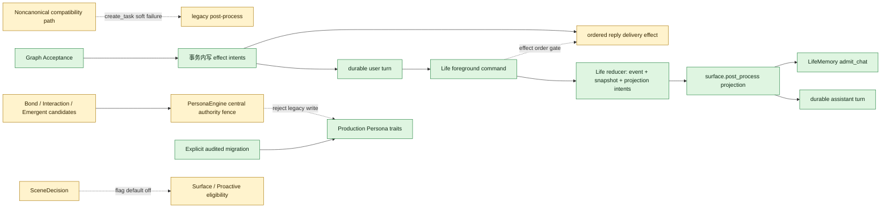

[acceptance_effect_handlers.py](../../../host_brain/app/acceptance_effect_handlers.py) 分别调用 durable conversation writer、提交 `LifeCommand` 和进入 Gateway delivery。Conversation/Life handler 都在返回后以独立 reader 重开 exact authority，writer 异常也只允许只读 reconcile；Surface response 必须携带 exact Gateway outbox identity，否则保持未知。[life_projection_handlers.py](../../../host_brain/app/life_projection_handlers.py) 再由 Life projection 触发 `_async_post_process`。

[postprocess.py](../../../host_brain/agent_runtime/postprocess.py) 在 Life projection mode 下对 assistant turn 和 LifeMemory admission 使用 durable-required 语义；失败会向上抛出，不当作成功。它随后在该 mode 提前返回，避免重复执行 persona/tribe mutation 和 VTS/TTS。

因此 canonical 对话的准确定级是 `POST_ACCEPTANCE_DURABLE_EVENTUAL`：

- graph Acceptance 与 effect intents 原子绑定；
- user turn 与 Life command 的 response-loss 可用 exact authority 对账；assistant turn、Memory 和 delivery仍分阶段持久提交；
- 队列可重试并保存状态；
- Surface 未知响应只能经 authenticated Gateway read-only query 精确重开；`NOT_FOUND`、identity drift 或 query 不确定时不重发、不伪造成功；
- 不存在把上述所有操作包进单个数据库事务的语义。

## 7. Gateway 双向链路

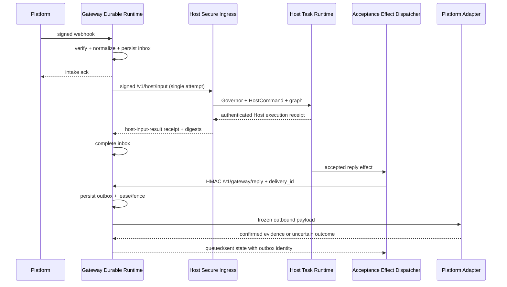

### 7.1 Inbound

[delivery_runtime.py](../../../edge_client/gateway/delivery_runtime.py) 对 inbound 先持久化、后 dispatch；worker 使用 lease/fence claim inbox。[input_reporter.py](../../../edge_client/channels/input_reporter.py) 对 Host 使用签名身份和幂等头，并验证 Host receipt 与 body/idempotency digest。

一旦 dispatch 已开始却无法确定 Host 是否已提交，Gateway 不会盲目重发，而会把记录转入 uncertain DLQ。这是 at-most-once 副作用与不确定性之间的显式取舍。

### 7.2 Outbound reply

accepted reply effect 经 [gateway_delivery.py](../../../host_brain/input_runtime/gateway_delivery.py) 调用 [edge_transport.py](../../../host_brain/channels/edge_transport.py) 的 `submit_gateway_reply`，使用稳定 `delivery_id` 和 HMAC 发送 `/v1/gateway/reply`。Gateway server 把 payload 放入 durable outbox，并以 platform + conversation 作 ordering key。

Host 侧只把精确回传的 outbox/delivery/platform/conversation/payload digest 当提交证据；HTTP 500、缺字段或 response loss 都不能证明 Gateway 未持久化。当前没有 Host 可调用的 authenticated Gateway outbox read API，因此这类 Effect 在恢复时保持 `UNKNOWN`，不会以普通 retry 再次发送。

[outbound.py](../../../edge_client/gateway/outbound.py) 在 dispatch 前验证并冻结 payload。只有 adapter 返回确认证据时才能写入 ACK；在 send boundary 之后发生异常或返回 false 会被定级为 `MAY_HAVE_COMMITTED` / uncertain，不会伪造成功。

### 7.3 两种“成功”

| 回应 | 证明什么 | 不证明什么 |
|---|---|---|
| Gateway `queued/accepted` | 冻结 payload 已进 durable outbox | 平台用户已收到 |
| Gateway `sent/ACKED` | platform adapter 已返回按合同可接受的确认证据 | 不同平台对“最终呈现”的所有业务语义 |

## 8. Edge 设备与实体副作用

Host 只创建版本化 `EmbodimentCommand`，不导入设备 driver。[embodiment.py](../../../host_brain/channels/embodiment.py) 把 avatar、voice、desktop 等意图发送给 Edge；Edge 是唯一物理 actuator。D8 后，Host 不再通过 module-global outbox、lease 或 receipt observer 共享这条 authority：每个 ASGI lifespan 创建一个 [`HostEmbodimentRuntime`](../../../host_brain/channels/embodiment.py)。0104 同时让每条新 outbox 记录绑定不可变 `runtime_scope_id`，并以 durable runtime lease/fence 保证同一 canonical DB/scope 只有一个 Host 进程可 claim 或投递；第二实例失败关闭，历史无 scope 行不被接管。NE-01 的首条 Operator 正向链在这条队列之前增加 `Secure Ingress → TaskGraph → Review → Acceptance → edge.embodiment_enqueue → terminal Preview`，只把 `edge.somatic` 表情命令编译成确定性的 `set_expression`。

该 runtime 的 Edge session/owner 由 normalized canonical DB path 的稳定 hash 派生，并在持有当前 Host runtime fence 时保存 Edge 返回的精确 lease/fence。替代进程重启后读取该 credential，以同 session/owner 做 exact reconnect；若旧 Edge lease 仍 live，必须请求原子轮换 fence，且只接受新 lease ID 与旧 fence 加一的回包，才开放路由。回包、精确重连或 Host authority 任一不成立都会失败关闭；不同 store 不会争用默认 lease；同一 store 的第二 app 无 durable Host lease，不能借不同进程内身份获得第二 writer。

| 阶段 | 当前流程 | 当前定级 |
|---|---|---|
| 选定 Host 路径入队 | 持有 exact ActionPreview 的 Life VTS/MateEngine 与 Gateway/Edge 出站从 app runtime 入队；Operator `edge.command.push` 另经 immutable TaskGraph、risk-4 Review 与 `edge.embodiment_enqueue` 在 Acceptance 后写入同一队列。新命令响应为 `PENDING / DURABLY_QUEUED`；旧 reply-performance、Gateway voice、chat cue 等缺证明调用失败关闭。精确重复返回既有 durable 状态，只有既有 `APPLIED` receipt 才能令 `physical_effect_verified=true` | `FIRST_GOVERNED_EXPRESSION_SLICE` |
| Host writer authority | 新行必须匹配 canonical DB 的 `runtime_scope_id`；enqueue、claim、过期、收口、对账与 Edge credential persistence 各自在同一 SQLite 写事务复验当前 durable runtime lease/fence，第二实例与旧 fence 失败关闭 | `WIRED_FOR_D8_SCOPE` |
| 正常投递 | Host `PENDING → DISPATCHING`，取得 Edge session lease/fence 后 HMAC RPC；Edge 按 command/idempotency key 持久去重并写 durable receipt | `WIRED_FOR_D8_SCOPE` |
| 不确定性 | 过期 claim 转 `IN_DOUBT`；Host 只发 receipt query，绝不 submit/retry。FOUND receipt 必须以 command/key identity 与 receipt digest CAS 收口；重复同 digest 不重复推进 observer/audit，`NOT_FOUND`、传输/校验失败保持 `IN_DOUBT` | `WIRED_FOR_D8_SCOPE` |
| 未迁移路径 | 其余 legacy direct adapter 和 Edge command type 仍未经过 Operator TaskGraph；并非每个 Host embodiment 调用都先经过 Host Acceptance Effect Outbox | `INCOMPLETE` |

```text
Host ASGI lifespan
  → build Task Runtime and apply canonical migrations
  → construct migration-gated Life authority and Query Projection store
  → acquire one durable Host runtime lease for canonical DB runtime_scope
  → second app for the same scope fails closed
  → HostEmbodimentRuntime (scope-filtered outbox / dispatcher / observers)
  → inherited live Edge lease: exact reconnect + rotate fence, verify new lease/fence+1
  → durable enqueue acknowledgement only
  → claim PENDING command
  → load or persist exact Edge session / owner / lease / fence
  → HMAC Edge command RPC
  → Edge SQLite command/key dedupe + immutable owner authority + durable receipt

Obs edge.command.push
  → Secure Ingress exact request/claim/audit
  → typed Governor action + OPERATOR HostCommand
  → immutable one-node TaskGraph + risk-4 Review
  → Attempt / Lease / node Grant / Budget / Verification / Acceptance
  → deterministic edge.embodiment_enqueue Acceptance Effect
  → terminal Preview reopens Graph / Context / Scene / Guardian / Effect
  → HostEmbodimentRuntime durable set_expression outbox
  → exact replay reopens the same row; no second enqueue

claim expiry or unknown command outcome
  → Host IN_DOUBT
  → HMAC+nonce read-only /v1/edge/embodiment/receipt
  → owner + current session + lease + fencing token + exact command_id/key
  → FOUND: identity + receipt-digest CAS settle
  → legacy ownerless / NOT_FOUND / lookup error: keep IN_DOUBT
  → never replay or resubmit the physical command
```

[`embodiment_outbox_repository.py`](../../../host_brain/persistence/embodiment_outbox_repository.py) 管理 Host scope、runtime lease、outbox 和 Edge reconnect credential；[`embodiment_runtime.py`](../../../edge_client/gateway/embodiment_runtime.py) 管理 Edge 端 durable owner authority 与 receipt。receipt query 本身不执行命令：它只在同 owner 的 current live lease/session/fence 内返回同一 `command_id + idempotency_key` 的 receipt；legacy ownerless、跨 owner/session 或不匹配查询得到 `NOT_FOUND` 且不泄漏 receipt。Host transport 的明文 HTTP 只允许 loopback/localhost，非 loopback 必须使用 HTTPS并在创建 client 前失败关闭。

真实 child Edge 的 loopback TCP/HMAC/SQLite 历史测试已覆盖命令、receipt query 和重启后的 exact replay；本轮 Operator 集成则使用真实 Host SQLite 与记录型 async physical port，证明 Acceptance 前后边界、唯一入队、一次 dispatch 和 `IN_DOUBT` 只读对账。两类证据都没有在本轮拉起真实 Edge/Gateway/MateEngine/设备，因此不证明 TTS、VTS、桌面或任何硬件物理效果；物理效果保持 `NOT_TESTED`。所有外部副作用统一先经 Host Acceptance Effect Outbox 仍是目标，当前只完成首条表情命令切片。

## 9. Memory、Persona 与 Scene

### 9.1 Memory read

[chat_retrieval_helpers.py](../../../host_brain/app/chat_retrieval_helpers.py) 使用 [surface_memory_recall.py](../../../host_brain/persona/surface_memory_recall.py) 规划 recall，在多个 typed store 上执行 MUST/MAY/NO 范围的查询、覆盖与证据检查，最终压缩为 `MemoryRecallPacket` 交给 Surface Reply。

对话模型消费的是 packet，不是未经约束的全库原始行。这条 read path 已接通，但仍是调用期检索，不等于 Knowledge OS 或可演化知识层已实现。

### 9.2 Memory write

canonical 写路径是：

```text
Graph Acceptance
  → Acceptance Effect Dispatcher
  → durable user turn
  → Life foreground command
  → Life projection
  → durable assistant turn + LifeMemory.admit_chat
```

非 canonical compatibility path 仍可以用 `asyncio.create_task()` 启动 legacy post-process，某些失败只降级记录。因此 Memory 不能简化标记为“全入口强持久”；对 Host 四路的准确说法是 `WIRED_POST_ACCEPTANCE_EVENTUAL`。

### 9.3 Persona

[persona_engine.py](../../../host_brain/persona/persona_engine.py) 已把 `apply_growth_delta()` 变为中央 fail-close 兼容围栏。所有非迁移调用都会返回稳定的 `PERSONA_GROWTH_AUTHORITY_CLOSED`，且不会修改 trait 或写入变更日志。

[persona_growth.py](../../../host_brain/persona/persona_growth.py) 的 stage/milestone、interaction cycle，以及 [emergent_growth_engine.py](../../../host_brain/persona/emergent_growth_engine.py) 的 emergent weekly 当前只生成经过 drift guard 的 candidate；它们不会消费 one-time 标志、weekly cumulative、change history 或 feedback buffer。显式历史迁移只能通过带 `migration_id`、actor 和 evidence 的 `apply_migration_growth_delta()` 写入，并产生结构化审计。

`T-PERSONA-FENCE-01` 会拒绝生产代码重新调用 legacy writer、在迁移命名空间之外构造迁移 authority，或绕过引擎直接修改 `_user_traits`。当前定级为 `CENTRAL_FENCE_WIRED`：旧直写已归零，但 `proposal → Lab/shadow → Review → version activation → rollback` 尚待 NE-06 实现，因此人格长期演化仍不可用。

[prefrontal_agent.py](../../../host_brain/tribe/prefrontal_agent.py) 对 `PersonaGrowthTracker.on_interaction_cycle()` 的调用参数与真实签名不匹配，`TypeError` 会被吞掉/降级。该 experience-feedback 分支是 `PARTIAL_BROKEN_PATH`，不能作为人格演化已闭环的证据。

### 9.4 Scene

[world_observation_journal.py](../../../host_brain/persistence/world_observation_journal.py) 通过 0111 为每个 workspace/subject 维护原子 head，持久端而非 caller 分配连续 revision。Host lifespan 中的 [world_observation_application.py](../../../host_brain/runtime/world_observation_application.py) 只把 Secure Ingress principal、既有 Bond/Emotion 投影与 composition-owned environment 转为 canonical RuntimeEvent 和 observation batch；raw request body 不能提交 scene 或 constraints。每次 append 同时校验 source event、Host runtime lease/fence、server time、active TTL target 和 authority lineage，显式 expiry transition 而非读取负责推进 TTL。`WorldResolver` 捕获 exact head 后只读分页到该 revision，并核对 digest chain、物理列/JSON 与 terminal digest。

[scene_resolver.py](../../../host_brain/runtime/scene_resolver.py) 是 NE-03 的 canonical、workspace/subject-scoped 场景解析边界。它只接受不可变 `WorldSnapshotV2` 与 typed `SceneResolutionInputV1`，Guardian status/digest 必须从 composition 注入的 `RuntimeGuardian.snapshot` 读取，caller 不能指定最终 scene、constraints 或伪造 `READY`。八类场景、fingerprint、digest chain、tail refresh 与 1001+ replay 已覆盖；0112 对 `SCENE_STATE/<scope digest>/<revision>` 建立唯一 CAS，并以 Host lease trigger 阻断旧进程追加。

Host 请求经 [context_application.py](../../../host_brain/runtime/context_application.py) 将重开的 World 与 Scene 冻结进 `WorkOrderV3.input_pack`。Surface eligibility、proactive dispatch 和 Task admission 都要求完整且可重开的 `scene_identity_v2`，上下文漂移失败关闭。旧 [scene_policy.py](../../../host_brain/persona/scene_policy.py) 定义仍保留用于兼容，但已无这三处生产 `build_scene_decision()` 调用；这是三消费者切流，不是预测型 World/Scene 模型完成。

### 9.5 Intent 与 Runtime Guardian

`IntentArbiter` 不能裸信 `IntentFrameV1` 的 digest；生产 [production_intent_authority.py](../../../host_brain/runtime/production_intent_authority.py) 重开 canonical HostCommand、WorkOrder、TaskGraph/node、ContextPack、Scene、action、Grant 和 composition-owned policy。[Intent admission](../../../host_brain/runtime/intent_admission.py) 在 TaskGraph 已持久化、worker/child grant 执行前先仲裁所有节点，写入 node preparation、graph prepared marker、最终节点 receipt 与 graph complete marker；中途崩溃只能按 exact identity 修复。`BLOCK` 与无效 evidence 失败关闭，`REVIEW` 经 Task Runtime durable ReviewStore 和一次性 continuation 恢复；输出固定 `permission_effect=RESTRICT_ONLY`、`execution_authorized=false`。

`RuntimeGuardian` 由 Host ASGI lifespan 中的 [runtime/production_composition.py](../../../host_brain/runtime/production_composition.py) 构造，并绑定同一 runtime scope/owner/lease/fence。Health/heartbeat 与已审计高风险前门通过 typed degradation port 消费 Guardian；每个 lifespan 的 [`ServiceHealthHeartbeat`](../../../host_brain/app/observability_runtime/service_health_heartbeat.py) 独占并关闭自身 heartbeat/keepalive task、observer、probe cache 与 HTTP transport，禁止跨 Host scope 改绑、读取、取消或关闭。没有 observer 的 compatibility probe 只能刷新自己的兼容 cache，不能回退写入全局 degradation reducer；独立 Obs health projection 和 probe registry 只读 durable ledger/projection，不能读任何跨进程不可见 cache。兼容顶层 helper 不是 Host production authority；Host lifespan 不再构造、绑定或在 shutdown 解绑 process-owned MCP broker。legacy global degradation 只能通过显式 compatibility adapter 使用。Guardian 先得到不可变 next-state、再持久化并替换本地投影，重放校验 RuntimeEvent envelope、revision/digest chain 和 from/to identity。

[action_preview_resolver.py](../../../host_brain/runtime/action_preview_resolver.py) 不接受 caller 自报的 `verified_node_grant` 或 action authority。它在签发和执行两个时点重开 immutable HostCommand/WorkOrder/TaskGraph、Attempt/Lease、parent/node Grant、ContextPack、Scene、Guardian，以及 Acceptance Effect claim/artifact；derived terminal 还按 event ID 递归重开 origin Attempt/Lease，而不是把中间 receipt 当继续权限；receipt 固定 `authority_granted=false`。Scheduler 下游、Proactive 和 Life delivery 使用 typed EffectDescriptor 限制 exact scope/args。Acceptance surface Gateway 只允许 effect 精确绑定的最小文本，任意 `raw_extra`、媒体、二次回复或内容漂移在网络前拒绝；公开具身 submit/enqueue 同样必须重开 exact proof，只有已 claim durable outbox 的私有 submitter 可继续。终端正向覆盖 Acceptance surface Gateway、Scheduler-derived Life Edge/Gateway/VTS/MateEngine，以及 Operator `host.sys_mode_transition`、`task.terminal_reconciliation` 与 `edge.embodiment_enqueue`。旧 WorkOrder/effect、reply-performance/Gateway voice/Avatar 直通和剩余 33 个尚未进入 Governed TaskGraph 的 Operator 写入口失败关闭；这证明首条 Edge 安全执行链，不代表 Operator 平面或其它具身功能已迁移。

签名终态修复的完整命令不会进入通用 TaskGraph：

```mermaid
flowchart LR
    O["认证 Operator 请求"] --> S["Secure Ingress 验签与权限绑定"]
    S --> J["0119 append-only signed command"]
    J --> H["HostCommand / immutable TaskGraph\n仅 signed ref + digest"]
    H --> R["durable Review continuation"]
    R --> W["Worker 生成 terminal reconciliation Effect"]
    W --> A["Acceptance"]
    A --> P["Action Preview 重开 Graph/Grant/Scene/Guardian"]
    P --> E["Accepted handler 重开 0119 exact command"]
    E --> T["0099 proof + Budget/Outbox 原子修复"]
    T --> X["Effect / Task receipt exact replay"]
```

`attestation_signature` 与 key ID 仅存在于 0119 专用权威表；WorkOrder、TaskGraph、Review 和 Effect payload 只携带不敏感的 ref/digest。风险级别 4 触发 durable Review，风险级别 5 仍是不可批准的绝对阻断。Review 前 0099 proof 与目标 Budget 不变化；Acceptance 后 handler 才能重开并执行。当前证据来自真实 SQLite 的本地集成，未覆盖 HTTP/network canary 或 NE-07 全服务栈。

0113 Service Catalog 的应用数据流现在通过 [rollout_authority.py](../../../host_brain/service_catalog/rollout_authority.py) 中的 repository Protocol 进入 [SQLiteServiceCatalogRolloutRepository](../../../host_brain/persistence/service_catalog_rollout_repository.py)。authority 只拥有合同、Protocol 和 Guardian Observer；具体 SQLite 连接、SQL 与事务归 persistence repository。Host 生产入口以 ENFORCE 为默认目标，但 fresh DB 必须逐级真实启动 AUDIT→SHADOW→PREFLIGHT→CANARY→ENFORCE，每阶段通过真实 HTTP Host/Guardian identity 后才推进 head，中间 listener 关闭后才进入下一阶段。Pending health 必须同时绑定 exact operation ID digest、snapshot、stage 与 candidate；另一个健康 listener 不得替它推进 head。`REGISTERED` 崩溃以同 operation ID 续跑；stop 失败或 listener 未停时维持 `STARTING` 等待对账，绝不伪造 `ROLLED_BACK`。`ACTIVATION_STARTED` receipt 与 rollout head 在同一 repository 事务内提交，任一写入失败共同回滚；Store 与 SQLite trigger 继续拒绝非法 event/status、terminal-first、第二终态、stage/rank 漂移、runtime-scope/activation identity 漂移、rollback-ref replay drift 与 stage skip/regression。`host_startup.py` 与 ASGI 仍是 concrete repository wiring，typed composition 和部署多实例 canary 均未完成。

0112 Runtime Context 的 schema readiness 也已沿同一分层方向迁移：runtime 只通过 `RuntimeEventStore` readiness port 发起检查，具体 SQLite/schema 读取归 `RuntimeEventRepository`；World Observation 的 `_write_lock` 只是 `RLock` 命名误判，现为 `_transition_lock`，不形成第二数据库 writer。该切片无新 migration。Global SQLite boundary 与 Gate 10 已 `PASS`。

Obs projection 生命周期现在只有一条生产控制流：`ObsApplicationPorts` bundle 先执行内部原子 single-use claim，`ObsApplicationContainer.compose()` 创建 app-local daemon，嵌套 ASGI `lifespan` 唯一调用 `start_projection_jobs()`，启动后才 `yield`。finally 先 stop/join 并等待 background/manual in-flight fence，再释放 exact leader lease、关闭 owned SQLite，最后清除 app state。stop timeout 或 rollback close failure 会保留原 container/ports 句柄，供后续精确重试。`dataclasses.replace()` 继承同一 claim，不能生成可二次消费的 derived bundle；全新独立 ports/app 则保持隔离。无 module-global daemon，无新 migration。

Gate 6 最终定向集合为 `19 passed`；原始证据批次重叠禁止相加。该切片完成时 full architecture static 从 `FAIL [1,6,10]` 变为 `FAIL [1,11]`，后续 Gate 1/11 曾在各自提交绑定快照关闭；那些静态 PASS 只属于历史提交。

当前监督流是 `ProjectionJobDaemon wave → secret-free health_snapshot → ObsApplicationContainer → GET /health`。普通 job/lease acquire/renew 失败只投影 job 名、错误类型和 opaque incident，线程继续下一 wave；成功 wave 清零连续失败并标记恢复；进程控制异常使 daemon 进入 `FAILED`，显式 close 前拒绝重启。首批合同/单测 `6 passed in 13.13s`；首次受影响回归 `67 passed, 1 failed in 169.29s`，补齐旧 Host fixture lifespan 后单 case `1 passed in 22.08s`，最终受影响集合 `68 passed in 211.30s`，批次重叠不得相加。该流仍是 app-local 内存监督，不是 durable SLO event：Guardian acknowledgement、跨进程历史、production canary 和 wave integration 均未完成；NE-01 继续 `PARTIAL / IN_PROGRESS`，`REMOTE_CI=NOT_RUN_ACCOUNT_QUOTA`。

Service Catalog 分层切片随后把启动数据流固定为 `Host/ASGI → service_catalog/startup_coordinator.py → ServiceCatalogRolloutAuthority Protocol → SQLiteServiceCatalogRolloutRepository`；DTO、校验和 port 从 `contracts/service_catalog.py` 进入，旧 composition/类型路径仅作同对象重导出，`rollout_authority.py` 只观察 Guardian。该流清除了 application→composition 两条与 Catalog persistence→application 一条依赖，Gate 1 SCC 缩为 application/persistence；该切片完成时仍有 11 条 persistence→application 反向依赖（PlanningSearch 7、Evolution/Lab/Skill/World 4）。验证为 contract/unit `61 passed`、真实 socket integration `7 passed`、边界复跑 `7 passed`，集合可能重叠不得相加。

PlanningSearch 持久化合同分层切片把仓储依赖流改为 `SQLite repositories → contracts/planning_search`，不再形成 `persistence → planning_search application`。core、benchmark、calibration、code、research 八组合同与模型由纯合同包持有，旧 application 模块只做同对象兼容重导出，因此调用者的 `__all__`、类型 identity、`isinstance` 与序列化形状不变。code benchmark、calibration、research shadow 三条 SQLite 流合计清除 7 条反向依赖；边界 `5 passed`，D13/D18/D19/D20 `60 passed, 1 skipped`（Windows 无 symlink 权限）。Gate 1 仍因 Evolution/Lab/Skill/World 4 条反向依赖维持 `FAIL`，application/persistence SCC 未消失；application→composition=0、Edge violation=0、reverse import=0，Gate 6/10 保持 `PASS`。该数据流调整无 migration，也没有增加候选生成、执行或收益 authority；wave integration=`NOT_RUN_PER_WAVE_POLICY`、`REMOTE_CI=NOT_RUN_ACCOUNT_QUOTA`。

最终合同切片把剩余仓储依赖流固定为 `Evolution Governance / Evolution Lab / Skill Lifecycle / World Observation repositories → contracts/{evolution,evolution_lab,skill_lifecycle,runtime_context}`。旧 Evolution/Lab/Runtime Context 模块仅同对象重导出，Skill Lifecycle 应用模块只保留服务与合同重导出，因此不再存在 `persistence → application` 回流。fresh static Gate 1 `issues=[]`、SCC=`[]`、persistence→application=0、Edge finding/violation=0、reverse imports=`[]`，Gate 6/10 继续通过。边界 `4 passed`、相关定向 `32 passed`、py_compile/diff-check 通过；无 migration。该流只收口类型依赖方向，不新增 Lab、Skill activation、Feedback/Knowledge/Identity 或 PlanningSearch 的生产 authority。

0122 在不改变 0108 V1 的前提下增加一条 proposal-only 的 V2 Lab evidence 流。`LabDatasetV1` 只在 runner 内存中使用，runner 重算其 canonical digest、record count 和 workspace-bound manifest；isolated executor 必须返回 no-network/read-only/temporary-output sandbox receipt 与零 effect audit，独立 verifier 必须提供同一 execution 的 identity、version、digest 与 evidence digest。repository 在一个 SQLite 事务中先写 evidence 再写 run；任一 run 写入失败共同回滚。report 只能关联已经精确持久化的所有 arm，proposal 仍固定 `review_required=true` 和 `production_influence_enabled=false`。这条数据流是结构性本地 SQLite 边界，并不证明真实 container、只读 mount、network namespace、外部模型、Golden Experiment 或生产侧零 effect。

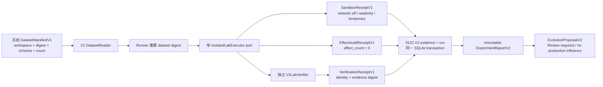

随后 Gate 11 把 Tool 对象流固定为 `Host ASGI lifespan → GovernedHostToolRuntimeComposition → ToolRuntimeBoundary → ToolBroker`；process Broker accessor/slot/provider 保持删除，唯一 app-local constructor count=1。该切片的提交绑定静态快照与当前分支独立全量静态结果均为 `PASS`，但证据范围仍分别绑定各自提交。真实 workspace-bound governed executor 与剩余全局对象图仍缺，NE-01 继续 `PARTIAL / IN_PROGRESS`，wave integration=`NOT_RUN_PER_WAVE_POLICY`、`REMOTE_CI=NOT_RUN_ACCOUNT_QUOTA`。

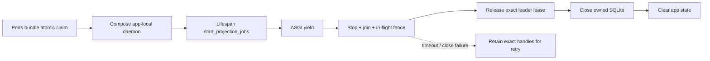

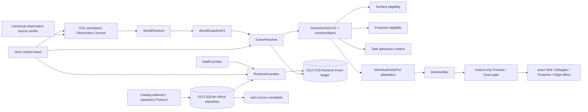

本数据流切片的本地证据分组为 Runtime Context `7 passed`、Catalog unit/contract `15 passed`、真实 Host socket integration `6 passed`、Repository/Global 独立复跑 `16 passed`；最后一组与 15 项有重叠，禁止合计。wave integration=`NOT_RUN_PER_WAVE_POLICY`，`REMOTE_CI=NOT_RUN_ACCOUNT_QUOTA`。

Guardian、Scene transition 与 ContextPack 构造均不得写 Memory/Life；Surface、Proactive 和 Task 已消费一致的 scene revision/digest。长周期目标尚无独立 durable owner，Bond 原始证据仍来自既有上游投影，因此空 `long_term_goal_refs` 不得被臆造值填充。

兼容 World projection 不参与 Scene authority：它只按 `(key, source_ref)` 保留来源，值不同的来源形成只读 `competing_facts`，同值多来源是 corroboration；任何一方都不能用较高 confidence 静默覆盖另一来源。

### 9.6 Host HardState durable mode flow

```mermaid
sequenceDiagram
    participant H as Host ASGI lifespan
    participant O as HostHardStateOwner
    participant J as SQLiteHardStateJournal
    participant L as Host runtime lease
    participant D as 0115 event/head
    H->>L: obtain scope/owner/lease/fence
    H->>J: bind canonical DB + authority provider
    J->>D: verify migration, full chain and head
    J-->>O: load or initialize verified snapshot
    O->>J: transition(expected revision/mode, event identity)
    J->>L: reopen exact active authority
    J->>D: BEGIN IMMEDIATE; append event + advance head
    D-->>J: commit
    J-->>O: committed snapshot
    O->>O: replace immutable memory state
```

production owner 在 bind 前拒绝写入。0115 trigger 和 repository 都验证 exact lease/fence；event 与 head 同事务，故 `after_event_append` 或 `after_head_write` 故障会共同回滚。restart/new fence 先完整分页重放 revision/digest/from-to chain，再采用 durable head；不同 bootstrap mode 不能覆盖已提交事实。成功 transition 只由 journal 形成 canonical audit；exact event replay 返回原结果且不再追加进程内 history 或 legacy `error_log`，payload drift、并发 stale head、released/expired lease 和 tamper 失败关闭。`sys_mode.switch` 已把这条 durable authority 接入 governed Operator vertical slice；Effect terminal proof 精确绑定 event/boundary/authority，历史回放用 permanent event-id lookup，`NO_CHANGE` 不制造 event。连同 `scheduler.task.trigger`、`task_terminal.reconcile` 与窄化的 `edge.command.push`，当前 Operator 共覆盖 4/37；本段只展开 mode route 和 current mode/transition history。自动模式规则、last-interaction、commit-bound acceptance、production canary 和 NE-01 wave integration仍未完成。

| 能力 | 读路径 | 写路径 | 定级 |
|---|---|---|---|
| Memory | typed recall → compressed packet → Surface | Acceptance → Life projection → assistant/Memory | `WIRED_POST_ACCEPTANCE_EVENTUAL` |
| Persona | Surface/relationship 等多处读 | legacy 写入中央拒绝；仅显式审计迁移可写 | `CENTRAL_FENCE_WIRED` |
| Scene | RuntimeContextApplication → SceneResolver → Surface/Proactive/Task | resolver + app-local Guardian 推导 scene；仅追加 lease-bound 0112 transition | `PARTIAL_NE03_THREE_CONSUMERS_WIRED` |
| Intent | ProductionIntentAuthority → IntentArbiter → durable Task admission/Review | authority attested；仅输出限制；`execution_authorized=false` | `PARTIAL_NE03_PRODUCTION_ADMISSION_WIRED` |
| Action Preview | canonical authority reopen → RuntimeEvent receipt → execution-point reopen | receipt 不授予权限；旧任务/effect 与未 Governed Operator 直写失败关闭 | `PARTIAL_NE03_PRODUCTION_AUTHORITY_WIRED_LOCAL_ACCEPTANCE_PASSED` |
| Runtime Guardian / Catalog | Host lifespan health/degradation/maintenance/SLO + 0113 五阶段 rollout | lease-bound Guardian event；Catalog operation/receipt/head append-only | `PARTIAL_NE03_ENFORCE_TARGET_WIRED_LOCAL_ACCEPTANCE_PASSED` |
| World Model | server observation → 0111 ObservationPort → WorldResolver | lease/source authority 分配 revision/expiry；captured-head Resolver 纯读 | `PARTIAL_NE03_PRODUCTION_OBSERVATION_WIRED` |
| Host HardState | bootstrap candidate → app-local owner → 0115 journal/head → explicit consumers | exact Host lease/fence；event/head 同 UoW；commit 后替换内存；restart 完整 replay | `WIRED_DURABLE_MODE_AUTHORITY / NE01_IN_PROGRESS` |

## 10. 回执与证据分层

系统中的 receipt 不是一张可通用替换的“成功证明”。每一层只对自己的责任边界负责。

| 证据/回执 | 生成者 | 权威范围 | 不可替代 |
|---|---|---|---|
| Secure ingress claim/audit | Host/Gateway ingress | 身份、签名、nonce、body digest | Task execution receipt |
| Gateway inbox intake ack | Gateway durable runtime | inbound 已持久接收 | Host 已执行 |
| Host admission outbox | HostCommandRepository | command/work order/graph 已绑定 | worker 或 graph 已完成 |
| Node worker receipt/projection | frozen worker | 某一 node attempt 的执行结果 | graph Acceptance |
| Graph execution receipt | Task Runtime | graph revision 已通过或被拒绝 | conversation/delivery effect 已提交 |
| Acceptance Effect receipt | Effect Dispatcher | 某个 graph-scoped effect 已提交 | 其他 effects 已提交 |
| Gateway adapter ACK | Gateway outbound | adapter 已提供确认证据 | 平台端所有终端呈现语义 |
| Edge embodiment receipt | Edge actuator runtime | 某个设备命令的 durable 处理结果 | 任意其他 Task/effect 的成功 |

只读 projection 和 Operator UI 必须从上述 durable 事实派生，不得自行提升为新的执行真相。

## 11. 失败、重试与不确定性

| 失败位置 | 当前行为 | 安全属性 | 缺口 |
|---|---|---|---|
| Host command admission 前 | fail closed，不创建可执行 graph | 不先写 canonical user turn | Scheduler/Internal 合同仍会在此阻断 |
| Worker 执行前 | Lease/fence、idempotency reservation、budget/review 约束 | 降低重复执行 | 现实 resolver marker、batch/pre-budget recovery 未完整 |
| Verification/Acceptance | 拒绝 node/graph，不生成已批准副作用 | worker 不直接获得对外 authority | 自动 revision + 1 replan 未闭环 |
| Acceptance effect | durable queue 保留状态并 reschedule | graph result 与 effect state 可分辨 | 不是全局原子提交 |
| Gateway dispatch 开始后无回执 | uncertain DLQ，不盲目重发 | 优先避免重复外部副作用 | 需要 Operator 对账/处置 |
| Edge device dispatch 中崩溃 | 恢复为 `IN_DOUBT`，不盲目重执行 | 防止重复物理动作 | 需要外部状态核对 |
| 历史 terminal Graph + 未结 Budget | Runtime re-entry 不隐式修复；0099 inventory 后 exact auto / signed / quarantine 三分，未决 case graph-wide 围栏普通 Graph/cancellation request 与 Budget transition/consume/usage/retry，仅 0099 UoW bypass；旧 case 通过 supersession 链最终收敛到可信 proof | 不把 child/missing/multi Budget 或任一完整终态漂移伪装成可恢复；healthy closure 仅 signed `NONE` 且零业务写 | 外部 inventory、key lifecycle、remediation 与 canary 未知 |
| Legacy post-process | 某些路径异步启动并降级失败 | 不阻断 legacy reply | 没有 canonical 路径的强语义 |

## 12. 目标数据流（不是当前现状）

本节全部标记为 `TARGET`。它用于约束后续重构，不能与上文已接线事实混写。

```text
All ingress sources
  → Secure Ingress + Identity + Scope + Governor
  → HostCommand + Intent/Scene/World Context
  → domain-neutral PlanningSearch over virtual state
  → immutable TaskGraph revision
  → parallel/retry-capable Durable Task Runtime
  → Verification + Acceptance
  → transactional effect intents
  → all external writers through durable outbox
  → immutable scoped receipts
  → read-only projections
```

从当前流程到目标流程的必要变更是：

1. 守护 B5C cancellation、Operation/Effect reconciliation、0098 append-only/trusted-overlay 与 0099 append-only terminal case/proof/supersession 合同；每个历史 case 链必须最终收敛到可信 proof。在目标部署执行 inventory/remediation，补齐 credential/key lifecycle 和 production canary。0099 只关闭窄历史终态，不得被泛化成通用恢复。
2. 持续守护已通过的 0099 主 Host/独立 Obs query-only 边界与 final-binding round-trip（server-bound actor、key mismatch rejection、time/ref、deterministic Outbox、command request），并保持 system auto 默认 OFF、唯一 graph-scope exact-only 与结构 quarantine 分类；持续守护 0096 `WAITING_APPROVAL` optional-attempt observation。
3. 持续守护 0095 revisioned TaskGraph Outbox：歧义回填必须整笔事务失败，Graph/non-Graph trigger/readiness 必须 exact，multi-revision marker 扫描、revision 内顺序、revision 间独立推进、Runtime Event 与 Operator exact read 必须持续通过；跨进程 drain authority 继续保留 0093 expired takeover、stale fence 和 append/complete 响应丢失回归矩阵。
4. 将可证明无副作用的现实 resolver 瞬态来源映射到现有 safe-retry marker；持续守护已完成的 Budget unique-winner 与无前置 Review 到期 retry 的 promotion+claim 单事务，完成历史半状态 reconciliation，以及 exact operation-free Attempt 窄窗之外的 general/multi-node/batch recovery。两类 takeover 都不得被泛化。
5. 对已接通的 0096 Resume continuation 做跨进程故障矩阵和 canary：原子 enqueue、到期 sweep、claim takeover/stale fence、精确 surface 路由、POST no-rerun、grant renewal 与关闭 quiescence。
6. 从 objective/context 生成多个可比较计划，为 L1/L2/L3 提供真实虚拟 successor 与 durable calibration。
7. 失败重规划必须自动生成同一 graph ID 的 revision + 1，而不修改旧图或在 worker 内偷偷重规划。
8. 所有 Gateway、Edge、Memory、Knowledge、Persona 写操作统一从 Acceptance Effect Outbox 获取 authority 与幂等身份。
9. 保持 Persona 中央围栏，把无副作用 candidate 接入 proposal、shadow、Review、版本激活和可回滚流程，禁止恢复 direct writer。
10. 建立默认启用、有单 writer 和 transition journal 的 Scene/World/Intent context，并使其变成 TaskGraph 输入事实。
11. W0 继续在 D0 canonical path fence 之上熔断未授权写入。W1/0101 把逻辑 workspace 精确绑定到 graph epoch/root WorkOrder/owner/configured-root/allow-list。W2 的认证 Internal 路线执行 `server-derived workspace_id → source commit freeze → lease/worktree → worker protected stage → sealed checkpoint → runtime activation projection recovery → Acceptance → real TaskStore evidence → clean/no-change HEAD capture → 0116 ACTIVE→ACCEPTED→PROMOTED`；终态worker另行处理sealed abandon/cleanup。该正向路径拒绝dirty/advanced HEAD，只覆盖no-change inspect。一般write promotion、周期survivor continuation、crash-left unsealed partial cleanup、failure/cancel/budget claim closeout、general `settle_worker` crash bundle、逐操作fence/强杀、handle-level原子TOCTOU与OS/container/tenant隔离仍未解决。

## 13. 代码证据索引

| 数据流 | 主要生产证据 |
|---|---|
| Cortex/Governor 与四路分流 | [cortex_runtime.py](../../../host_brain/agent_runtime/cortex_runtime.py)，[governed_task_adapter.py](../../../host_brain/app/governed_task_adapter.py)，[governed_host_contracts.py](../../../host_brain/app/governed_host_contracts.py)，[governed_frozen_skill_runtime.py](../../../host_brain/app/governed_frozen_skill_runtime.py) |
| Host command admission | [governed_command.py](../../../host_brain/orchestration/governed_command.py)，[host_command_repository.py](../../../host_brain/persistence/host_command_repository.py)，[host_command_repository_codec.py](../../../host_brain/persistence/host_command_repository_codec.py)；只有 repository 持连接/UoW |
| TaskGraph runtime | [coordinator.py](../../../host_brain/task_runtime/coordinator.py)，[dag_scheduler.py](../../../host_brain/task_runtime/dag_scheduler.py)，[task_repository.py](../../../host_brain/persistence/task_repository.py) |
| TaskNode result artifact | [node_artifact.py](../../../host_brain/contracts/agent_runtime/node_artifact.py)，[task_node_artifact_store.py](../../../host_brain/persistence/task_node_artifact_store.py)，[node_execution_runtime.py](../../../host_brain/task_runtime/node_execution_runtime.py)，[governed_workers.py](../../../host_brain/task_runtime/governed_workers.py) |
| 0099 historical terminal reconciliation | [terminal_state_reconciliation.py](../../../host_brain/task_runtime/terminal_state_reconciliation.py)，[task_terminal_reconciliation_store.py](../../../host_brain/persistence/task_terminal_reconciliation_store.py)，[terminal_reconciliation_query_repository.py](../../../host_brain/persistence/terminal_reconciliation_query_repository.py) |
| Budget contention / narrow recovery | [task_budget_usage_store.py](../../../host_brain/persistence/task_budget_usage_store.py)，[task_operation_checkpoint_store.py](../../../host_brain/persistence/task_operation_checkpoint_store.py)，[operation_recovery_runtime.py](../../../host_brain/task_runtime/operation_recovery_runtime.py)，[accepted_graph_finalization.py](../../../host_brain/task_runtime/accepted_graph_finalization.py) |
| Plan search/compiler | [plan_intent_search.py](../../../host_brain/orchestration/plan_intent_search.py)，[planning_execution.py](../../../host_brain/orchestration/planning_execution.py)，[planning_graph_compiler.py](../../../host_brain/orchestration/planning_graph_compiler.py) |
| Scheduler/Internal | [scheduler/governed_runtime.py](../../../host_brain/scheduler/governed_runtime.py)，[scheduler/command_service.py](../../../host_brain/scheduler/command_service.py)，[internal_task_runtime.py](../../../host_brain/app/internal_task_runtime.py)（occurrence/internal 已接通 canonical admission；Scheduler 管理命令仍是 NE-01 待迁移边界） |
| Read projection / Executive retirement | [read_routes.py](../../../host_brain/agent_runtime/read_routes.py)，[cortex_runtime.py](../../../host_brain/agent_runtime/cortex_runtime.py)，[runtime.py](../../../host_brain/executive_runtime/runtime.py) |
| Workspace 路径围栏与 W2 worktree/lease/cleanup 资产 | [workspace_paths.py](../../../host_brain/agent_runtime/workspace_paths.py)，[workspace_repository.py](../../../host_brain/persistence/workspace_repository.py)，[workspace_operation_fencing.py](../../../host_brain/persistence/workspace_operation_fencing.py)，[workspace_allocator.py](../../../host_brain/agent_runtime/workspace_allocator.py)，[workspace_runtime.py](../../../host_brain/agent_runtime/workspace_runtime.py)，[workspace_policy.py](../../../host_brain/agent_runtime/workspace_policy.py)，[agent_workspace.py](../../../host_brain/composition/agent_workspace.py) |
| D17/D18 Code private-bare benchmark experiment ledger | [code_benchmark_models.py](../../../host_brain/planning_search/code_benchmark_models.py)，[code_benchmark_sandbox.py](../../../host_brain/planning_search/code_benchmark_sandbox.py)，[code_benchmark_ledger.py](../../../host_brain/planning_search/code_benchmark_ledger.py)，[code_benchmark_ledger_repository.py](../../../host_brain/persistence/code_benchmark_ledger_repository.py) |
| Acceptance effects | [acceptance_effects.py](../../../host_brain/task_runtime/acceptance_effects.py)，[acceptance_effect_dispatcher.py](../../../host_brain/task_runtime/acceptance_effect_dispatcher.py)，[acceptance_effect_handlers.py](../../../host_brain/app/acceptance_effect_handlers.py) |
| Life/Memory post-process | [digital_life/service.py](../../../host_brain/digital_life/service.py)，[life_projection_handlers.py](../../../host_brain/app/life_projection_handlers.py)，[postprocess.py](../../../host_brain/agent_runtime/postprocess.py) |
| Gateway inbound/outbound | [delivery_runtime.py](../../../edge_client/gateway/delivery_runtime.py)，[input_reporter.py](../../../edge_client/channels/input_reporter.py)，[ingress.py](../../../host_brain/input_runtime/ingress.py)，[gateway_transport_repository.py](../../../host_brain/persistence/gateway_transport_repository.py)，[outbound.py](../../../edge_client/gateway/outbound.py) |
| Edge embodiment | [embodiment.py](../../../host_brain/channels/embodiment.py)，[embodiment_outbox_repository.py](../../../host_brain/persistence/embodiment_outbox_repository.py)，[embodiment_runtime.py](../../../edge_client/gateway/embodiment_runtime.py) |
| Memory recall | [chat_retrieval_helpers.py](../../../host_brain/app/chat_retrieval_helpers.py)，[surface_memory_recall.py](../../../host_brain/persona/surface_memory_recall.py) |
| Persona/Scene/World | [persona_engine.py](../../../host_brain/persona/persona_engine.py)，[persona_growth.py](../../../host_brain/persona/persona_growth.py)，[scene_policy.py](../../../host_brain/persona/scene_policy.py)，[surface_runtime/eligibility.py](../../../host_brain/surface_runtime/eligibility.py)，[runtime/world_model.py](../../../host_brain/runtime/world_model.py) |

## 14. 封板口径

本文可以支持的结论是：

```text
Host canonical four-route data flow        WIRED
Durable TaskGraph execution                PARTIAL
TaskStore admission/effect staging authority SEALED / OTHER MUTATIONS INCOMPLETE
Scheduler governed admission               WIRED
Internal governed admission                WIRED
Conversation effects                       POST_ACCEPTANCE_DURABLE_EVENTUAL
Gateway durable transport                  WIRED_WITH_UNCERTAIN_DLQ
Edge as sole physical actuator             WIRED
All Host external effects via one outbox    NOT YET TRUE
Memory canonical write path                 WIRED_EVENTUAL
Persona evolution authority                CENTRAL_FENCE_WIRED / PROPOSAL PIPELINE MISSING
Workspace authority                        PARTIAL_W2_ASSETS_WIRED / NO POSITIVE AGENT TOOL CONSUMER / STRONG ISOLATION MISSING
Scene context                               PARTIAL_THREE_CONSUMERS_WIRED
Full Architecture                           INCOMPLETE
```

因此，当前不应使用“全入口统一”、“通用智能规划已完成”、“所有副作用全局原子提交”或“人格已可安全长期自主演化”作为封板结论。

### 终态对账 canary 数据流

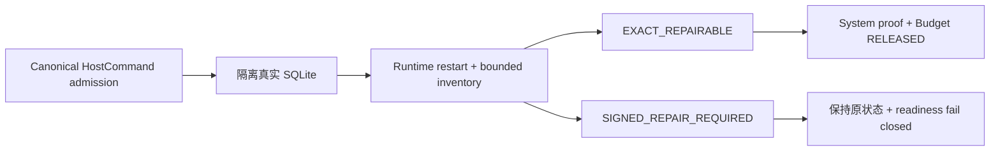

本切片只证明本地 exact-auto 的机械恢复和非 exact 围栏；它没有执行签名 Operator HTTP、外部 Effect reconciliation、真实 Gateway/Edge 或 Docker 服务栈。
