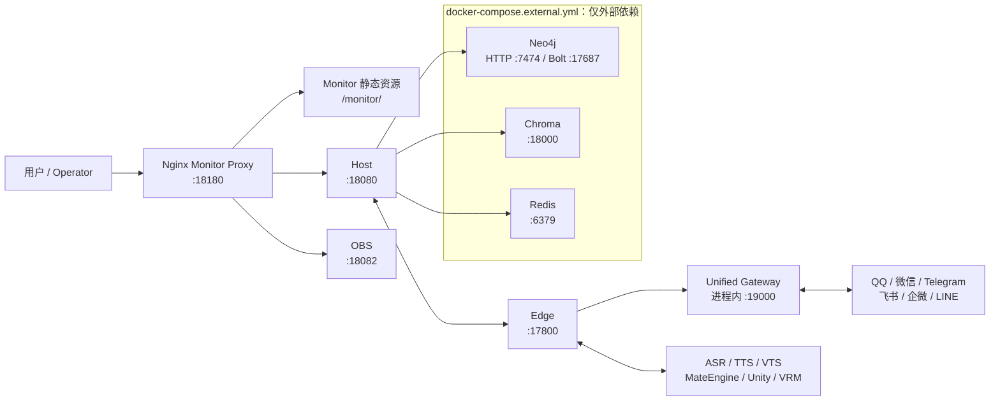
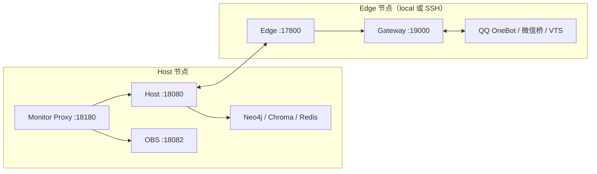

受众：MASTER
标题：Natsume AI 部署架构与运行验收

# Natsume AI 部署架构与运行验收

> 基线日期：2026-07-15
>
> 事实来源：当前仓库的 Python 入口、PowerShell 运行脚本、类型化设置与外部服务 Compose。
>
> 核心结论：当前交付形态是 **Windows 原生多进程应用 + Docker 外部依赖**，不是完整应用容器化，也不是具备事务式发布、滚动升级和自动回滚能力的生产部署平台。

本文统一替代旧的外部服务配置说明与检查清单。它描述当前代码真正能够启动、停止和验收的系统，并把“已经接线”“允许降级”和“仍是部署缺口”分开记录。

## 1. 部署边界

当前部署由六类运行单元组成：

| 运行单元 | 当前形态 | 默认地址 | 责任 | 状态 |
|---|---|---|---|---|
| Host | `python -m host_brain` | `127.0.0.1:18080` | 对话、任务、记忆、生命系统和权威写入 | 已接线 |
| OBS | `python -m host_brain.obs_main` | `127.0.0.1:18082` | 只读查询、指标与 Operator Projection | 已接线，可降级 |
| Monitor UI / Proxy | 预构建 Vite 静态文件 + Nginx | `127.0.0.1:18180` | 管理界面与 Host/OBS 反向代理 | 部分接线，可降级 |
| Edge | `python -m edge_client` | 本地 `127.0.0.1:17800`；远端脚本默认 `0.0.0.0:17800` | ASR、TTS、VTS、设备与资源门禁 | 已接线；另有 loopback-only TCP receipt smoke，非硬件验收 |
| Unified Gateway | Edge 进程内的受管 Uvicorn 线程 | `127.0.0.1:19000` | QQ、微信、Telegram、飞书、企微、LINE 接入 | 已接线，可独立失败 |
| 外部数据服务 | Docker Compose | Neo4j、Chroma、Redis | 图、向量、限流/短期协调依赖 | 已接线 |

桌面宠物是独立 Electron 展现端，入口见 [desktop_pet/package.json](../../../desktop_pet/package.json)。它不在 Host 或分布式启动脚本的生命周期内，因此不属于默认部署成功条件。

### 1.1 明确不属于当前能力的内容

- Compose 不包含 Host、OBS、Edge、Gateway、Nginx 或 Monitor UI。
- 没有 Kubernetes、Nomad、Windows Service 或 systemd 单元。
- 没有滚动发布、蓝绿发布、自动数据备份、跨节点配置同步和版本一致性证明。
- 没有统一 TLS 终止、证书轮换和主机防火墙编排。
- 没有“启动脚本返回成功即代表前端、后端、Edge、Gateway 和外部依赖全部就绪”的保证。

## 2. 本机拓扑



Host 是系统权威执行与写入面；OBS 是只读投影面；Monitor Proxy 是可选入口；Edge 管理具身和平台侧能力；Gateway 随 Edge 启动，不是独立容器。`start_host_side.ps1` 中的本地 Ollama 自动启动逻辑已经被禁用，模型供应商或外部 Ollama 必须另行准备。

## 3. 分布式拓扑

[start_distributed_services.ps1](../../../scripts/runtime/start_distributed_services.ps1) 先启动 Host 侧，再在本机或 SSH 节点启动 Edge：



分布式脚本只是跨进程/跨机启动编排，不是部署分发器：

- SSH 模式假设远端仓库、Python/Node 依赖、模型、`.env` 和秘密已经准备好；脚本不传输或校验这些资产。
- 未设置 `EdgeHealthUrl` 时，Host 节点不会执行跨机 Edge 健康校验。
- Edge 启动失败默认保留已启动的 Host；只有显式使用 `-RollbackHostOnEdgeFailure` 才尝试回滚 Host，外部容器仍不会随之回滚。
- SSH 启动默认 shell 是 `powershell`，停止默认是 `pwsh`，远端环境必须同时满足或显式覆盖。
- SSH `main_service` 分支不会像本地 Side Profile 一样先拉起 QQ OneBot。
- 同一相对数据库路径在两台机器上代表两份本地文件，不构成共享存储。

## 4. 配置架构

配置优先级不是全系统统一的一条链，必须按入口理解。

### 4.1 Host 与 OBS

Host 入口见 [host_brain/__main__.py](../../../host_brain/__main__.py)，OBS 入口见 [host_brain/obs_main.py](../../../host_brain/obs_main.py)。实际层级为：

1. 进程已有环境变量；
2. 仓库根 `.env`，直接 Python 入口加载时不覆盖已有环境；
3. `HOST_RUNTIME_ENV_FILE` 或默认 `runtime/host/host.runtime.env`，运行入口会覆盖前面值；
4. 类型化 Settings 读取环境与 `.env`；
5. `--host`、`--port`、`--db-path` 等 CLI 参数覆盖本次进程行为。

[start_host_side.ps1](../../../scripts/runtime/start_host_side.ps1) 会从 `.env`（缺失时回退 `.env.example`）构造运行环境，并把 `HOST_`、`EDGE_`、`Natsume_` 及部分供应商前缀变量写入 `runtime/host/host.runtime.env`。该文件被 Git 忽略且正常停止时会删除，但它是包含潜在秘密的明文快照。

### 4.2 Edge

[edge_client/__main__.py](../../../edge_client/__main__.py) 本身不加载 dotenv；直接启动时只消费现有进程环境、默认值和秘密配置。PowerShell 启动器负责注入 `.env` 或运行时覆盖。远端主服务脚本会写入 `runtime/edge/edge.runtime.env`，并可能把环境值写进动态 CMD/PowerShell 启动文件。

### 4.3 活跃配置资产

| 资产 | 真实作用 | 注意事项 |
|---|---|---|
| [.env.example](../../../.env.example) | 脚本在 `.env` 缺失时的综合回退模板 | 不是秘密文件；部分默认值与 Compose 不一致 |
| `.env.core.example` / `.env.optional.example` / `.env.experimental.example` | 人工分层参考 | 运行时代码不会自动合并三者 |
| [model_profiles.yaml](../../../configs/model_plane/model_profiles.yaml) | 模型 Profile 与路由配置 | 由模型解析代码实际读取，并带 mtime 缓存失效 |
| [node_registry.yaml](../../../configs/model_plane/node_registry.yaml) | 模型节点注册表 | 不是纯文档资产 |
| [node_inventory_personal_lan.json](../../../configs/deploy/node_inventory_personal_lan.json) | 个人局域网节点清单 | 应显式设置 `HOST_NODE_INVENTORY_PATH` |
| [secret_store.runtime.example.json](../../../configs/secrets/secret_store.runtime.example.json) | 秘密引用结构示例 | 生产应创建被忽略的本地 runtime 文件，不得把真实秘密提交到仓库 |

健康/报告代码的默认节点清单仍指向不存在的 `configs/deploy/node_inventory_9.json`，随后可能回退到测试 fixture；启动脚本也不负责同步节点清单。因此部署时必须显式设置：

```dotenv
HOST_NODE_INVENTORY_PATH=configs/deploy/node_inventory_personal_lan.json
```

### 4.4 配置安全要求

- `.env`、`host.runtime.env`、`edge.runtime.env`、动态启动器和本地秘密 JSON 必须限制文件 ACL。
- 不得依赖示例秘密或 Compose 内置回退密码。
- 远端 Edge 绑定 `0.0.0.0` 前，必须在宿主机配置防火墙、可信网段与鉴权；当前部署层不提供 TLS。
- 运行时快照失败或异常退出后可能残留，应纳入人工清理与秘密轮换流程。

## 5. 数据目录与所有权

当前没有单一数据根目录，持久数据、运行状态和验收产物分布如下：

| 路径 | 所有者 | 内容 | 生命周期 |
|---|---|---|---|
| `runtime/host/` | Host/OBS/Proxy 脚本 | PID、运行环境、日志、Nginx 配置、启动告警 | 运行态；日志保留 |
| `runtime/edge/` | Edge 脚本 | PID、运行环境、日志、QQ 状态、微信队列和动态启动器 | 运行态；部分状态持久 |
| `runtime/docker/neo4j/` | Neo4j 容器 | 图数据与日志 | 持久；`down` 默认保留 |
| `runtime/docker/chroma/` | Chroma 容器 | 向量数据 | 持久；`down` 默认保留 |
| `runtime/docker/redis/` | Redis 容器 | AOF/快照 | 持久；`down` 默认保留 |
| `host_brain/data/audit.sqlite3` | Host | 默认权威 Audit/Task 数据库 | 持久 |
| `host_brain/data/checkpoints.db` | Host 子系统 | 默认 checkpoint 数据 | 持久 |
| `edge_client/data/gateway_transport.sqlite3` | Gateway fallback | 平台 transport/outbox 状态 | 持久 |
| `%LOCALAPPDATA%/NatsumeAI/edge/` 或 `~/.natsume-ai/` | Edge fallback | 具身 transport 数据 | 持久 |
| `artifacts/release/reports/` | 验收脚本 | 可审查的实测报告 | 构建/发布证据 |

`.env.example` 当前设置 `NATSUME_DATA_DIR=./data`，会让部分 Edge 数据重新落到仓库顶层 `data/`；这与“仓库根不承载运行数据”的整理原则冲突。部署时应把 `NATSUME_DATA_DIR` 指向明确的仓库外或 `runtime/` 下持久目录。

停止外部容器时，[stop_docker_services.ps1](../../../scripts/runtime/stop_docker_services.ps1) 默认保留数据；只有显式 `-RemoveVolumes` 才删除 Compose 卷/挂载关联状态。执行该参数前必须单独备份并确认数据所有权。

## 6. 启动顺序

### 6.1 Host 侧真实顺序

[start_host_side.ps1](../../../scripts/runtime/start_host_side.ps1) 的实际行为是：

1. 选择 `.env`，创建 `runtime/host/` 与日志目录；
2. 默认调用 [start_docker_services.ps1](../../../scripts/runtime/start_docker_services.ps1)，启动并探测 Neo4j、Chroma、Redis；`ExternalServicesBackend=none` 时跳过；
3. 按配置尝试启动 MateEngine Bridge；
4. 启动 `python -m host_brain`，可附加 `--startup-check`；
5. 依次尝试 Host `/health?skip_dependency_probes=1`、`/ready`、错误遗留的 `/obs/metrics` 或端口监听判定；
6. 启动 OBS，失败只记降级警告；
7. 探测 OBS、MCP、Canon Sync，失败只记降级警告；
8. 启动 Nginx Monitor Proxy，失败只记降级警告。

典型命令：

```powershell
powershell -ExecutionPolicy Bypass -File scripts/runtime/start_host_side.ps1
```

若外部服务由其他平台管理：

```powershell
powershell -ExecutionPolicy Bypass -File scripts/runtime/start_host_side.ps1 `
  -ExternalServicesBackend none
```

此模式不会证明 Neo4j、Chroma、Redis 已由别处正确提供，必须单独验收。

### 6.2 Edge 侧真实顺序

本地 Side Profile 使用 [start_edge_side.ps1](../../../scripts/runtime/start_edge_side.ps1)，内部委托 [start_edge.ps1](../../../scripts/runtime/start_edge.ps1)：

1. 按配置确保 QQ OneBot/NapCat；
2. 启动 `python -m edge_client`；
3. Edge bootstrap 在同一进程中尝试启动 Unified Gateway；Gateway 失败只记录警告；
4. 脚本确认 Edge 主端口稳定；
5. 再分别探测 ASR、TTS、VTS、微信桥等外围能力。

```powershell
powershell -ExecutionPolicy Bypass -File scripts/runtime/start_edge_side.ps1
```

远端主服务使用 [start_edge_main_service.ps1](../../../scripts/runtime/start_edge_main_service.ps1)，通过计划任务/WMI 进行脱离当前 shell 的启动。它默认绑定 `0.0.0.0`，部署前必须先限制网络暴露。

对 Host→Edge 传输、HMAC、owner/session/lease/fence、durable receipt 和重启回放做本机验收时，应使用 `minimal_rpc`，不要使用会强制拉起 QQ OneBot 的 Side Profile。Host transport 只允许 loopback/localhost 使用明文 HTTP；任何非 loopback Edge 地址必须使用 HTTPS，否则会在创建 HTTP client 前失败关闭。该 profile 必须有 `EDGE_HMAC_SHARED_KEY` 或 `EDGE_HMAC_SHARED_KEY_REF`，并且会强制：

- `127.0.0.1` loopback 绑定与 `Natsume_ENV=prod`、`EDGE_ALLOW_INSECURE_AUTH=false`；
- 独立 `NATSUME_DATA_DIR` 与 `EDGE_EMBODIMENT_TRANSPORT_DB`；
- 关闭 ASR、TTS、barge-in、fallback、资源门禁、Unified Gateway、QQ OneBot、VTS 自动启动和面捕；
- 保留 `EDGE_RPC_GATEWAY_ENABLED=true`，因为它是经过 HMAC 的 Edge RPC 边界，不是 Unified Gateway。

例如：

```powershell
powershell -ExecutionPolicy Bypass -File scripts/runtime/start_edge_main_service.ps1 `
  -ExecutionProfile minimal_rpc `
  -BindHost 127.0.0.1 `
  -Port 17810 `
  -MinimalDataDir runtime/edge/minimal_rpc/manual `
  -EmbodimentTransportDb runtime/edge/minimal_rpc/manual/embodiment_transport.sqlite3
```

分布式入口也可显式传入 `-EdgeStartupProfile main_service -EdgeExecutionProfile minimal_rpc -EdgeBindHost 127.0.0.1`。这只是安全的 RPC/receipt 验收模式；其结果固定报告 `physical_effect_verification=NOT_TESTED`，不得用于宣称 ASR、TTS、VTS、平台或实体设备已经验收。

当前 Edge core 仍会构造 avatar driver；该 profile 将其唯一启动/健康探测指向临时的未监听 loopback 端口，因此不会启动或连接 VTS/VRM 外部进程。这个受控失败探测不是硬件验证，也不替代后续对 Edge core 的显式 peripheral lifecycle 收口。

### 6.3 一键分布式启动

```powershell
powershell -ExecutionPolicy Bypass -File scripts/runtime/start_distributed_services.ps1
```

启动顺序固定为“整个 Host 侧 → Edge 侧”，不是并行启动。分布式入口把 Edge 等待时间压到 20 秒，慢模型加载环境可能出现超时但后台进程仍继续启动的情况。

## 7. 停止顺序与恢复语义

当前停止不是安全的启动逆序：

```text
Host 主进程 → OBS → Monitor Proxy
→ Edge 主进程 → 微信桥 → 自有 QQ OneBot
→ Docker（仅显式 -StopLocalServices）
```

[stop_distributed_services.ps1](../../../scripts/runtime/stop_distributed_services.ps1) 先停 Host 侧，再停 Edge；[stop_host_side.ps1](../../../scripts/runtime/stop_host_side.ps1) 又先强停 Host，再停 OBS 和 Proxy。主要实现依赖 PID、端口、命令行匹配与 `Stop-Process -Force`，没有以下阶段：

1. 入口拒绝新请求；
2. Gateway/Proxy 停止接单；
3. 等待运行中任务、Outbox 与 checkpoint 刷盘；
4. 超时后再强杀；
5. 验证进程、端口和数据已进入一致状态。

因此“脚本输出 stopped”只证明停止命令未抛出，并不能证明所有子进程、端口和队列已经干净。目标安全顺序应是“外部入口/Gateway → drain Host/Edge → UI/OBS → Host/Edge → 外部存储”，但这仍是待实现目标，不是当前事实。

## 8. 外部服务 Compose

[docker-compose.external.yml](../../../scripts/runtime/docker-compose.external.yml) 只定义三个依赖：

| 服务 | 镜像 | 宿主端口 | 数据目录 | 当前问题 |
|---|---|---:|---|---|
| Neo4j | `neo4j@sha256:409728…` | HTTP `${NATSUME_NEO4J_HTTP_PORT:-7474}`；Bolt `${NATSUME_NEO4J_BOLT_PORT:-17687}` | `${NATSUME_DOCKER_DATA_ROOT}/neo4j/` | 密码必须由运行期注入；容器内 HTTP healthcheck |
| Chroma | `chromadb/chroma@sha256:3a9bcb…` | `${NATSUME_CHROMA_PORT:-18000}` | `${NATSUME_DOCKER_DATA_ROOT}/chroma/data/` | digest 固定；容器内 healthcheck，外层仍验证 v2 heartbeat |
| Redis | `redis@sha256:8b81dd…` | `${NATSUME_REDIS_PORT:-6379}` | `${NATSUME_DOCKER_DATA_ROOT}/redis/data/` | digest 固定；`redis-cli ping` healthcheck |

Compose 的 project、三个 container name、network、端口与数据根现在都可独立
参数化，三个服务也有容器 healthcheck。仍未提供资源限制、备份任务或跨版本
数据迁移策略；这些不能由 healthcheck 替代。
启动前配置校验固定使用 `docker compose config --quiet`，避免失败诊断路径
输出展开后的运行期认证。隔离验收优先经进程级
`NATSUME_NEO4J_USER/NATSUME_NEO4J_PASSWORD` 注入；错误只报告配置类别，
不拼接认证引用或认证值。

### 8.1 已收口的端口契约

`.env.example`、`start_docker_services.ps1`、`start_host_side.ps1`、`check_external_env.py` 与 Compose 现在共同使用 Neo4j Bolt 默认 `17687`；启动器从 `BOND_NEO4J_URI` 解析端口后传入 `NATSUME_NEO4J_BOLT_PORT`。Chroma 则从 `CHROMA_ENDPOINT` 解析端口并传入 `NATSUME_CHROMA_PORT`，模板的 `CHROMA_ENDPOINT` 与 `CHROMA_PORT` 均为 `18000`。定向回归测试会防止这个默认值再次漂移。

自定义端口时，`BOND_NEO4J_URI` 与 `CHROMA_ENDPOINT` 是运行时探测的权威来源；
不要只改 `CHROMA_PORT` 却保留旧 endpoint。进程级变量优先于 checked-in
`.env`，以便 NE-07 在不碰用户默认数据的情况下创建独立 acceptance project。
Neo4j 启动结果不回显运行期密码。

### 8.2 NE-07 隔离实例

默认端口上已有的 `natsume-ext` 容器属于用户长期环境，不能作为验收数据源。
NE-07 使用独立 project、container names、network、ports 和
`runtime/acceptance/...` 数据根并行启动；默认不删除其 volume/data root。
只有隔离实例完成真实写入、读取、重启读取和 namespace 清理，才能形成
`FullStackAcceptanceReceiptV1` 的 Docker 部分。
该机械链由
`scripts/runtime/run_ne07_external_services_acceptance.py` 执行；runner
拒绝默认容器 identity、默认端口和非 loopback endpoint，并重开每个容器的
Compose project 标签。输出只含 probe digest、container/image identity、
重启时间和清理结果，不含 Neo4j 密码或探针原文。

## 9. 健康与降级语义

### 9.1 端点不是同义词

| 组件 | 端点 | 能证明什么 | 不能证明什么 |
|---|---|---|---|
| Host | `/health` | 进程可响应并返回组件状态 | HTTP 200 不保证 payload 为完全健康 |
| Host | `/ready` | 返回 `ready` 投影 | HTTP 200 仍可能是 `ready=false` |
| Host | `/health/degradation` | 当前降级投影 | 不自动阻断流量 |
| Host | `/health/mcp`、`/health/canon_sync` | 对应子系统状态 | 失败默认只警告 |
| Host | `/health/env-readiness` | 环境准备度投影 | 不等同发布验收 |
| OBS | `/health`、`/obs/metrics` | 侧车可响应、指标可读 | 投影可能陈旧 |
| Edge | `/v1/edge/health` | Edge 及嵌套组件状态 | HTTP 200 不保证 ASR/TTS/VTS 全部 ready |
| Gateway | `/v1/gateway/health` | Gateway 线程可响应 | Edge 启动脚本目前不主动探测它 |
| Monitor | `/monitor/index.html`、`/obs/metrics` | 静态资源和 OBS 代理可达 | 不证明 Host/Edge 完整业务链 |

Host 的 `--startup-check` 在探测结果为 degraded 时仍继续启动，只有异常才阻断。OBS、Monitor、MCP、Canon Sync 与多数 Edge 外围能力也允许降级。这是有意的可用性策略，但启动结果必须保留 `warnings`，不能把 `started` 翻译成“全栈 READY”。

### 9.2 当前探测错位

- 本地 Edge 脚本在主 Edge 端口之外，仍探测遗留的 `17801 /health`（ASR）和 `17802 /health`（TTS）；当前实现的权威组件状态实际嵌套在 `17800/v1/edge/health`。
- `start_edge.ps1` 默认可因 17801 探测失败而禁用 ASR 重启；`start_edge_side.ps1` 又默认关闭该自动降级，入口行为不一致。
- Gateway 在 Edge bootstrap 中失败时只告警，启动脚本也不检查 19000，因此 Edge “started” 不保证平台入口可用。
- Host 已运行时启动脚本会提前返回，不会补拉已掉线的 OBS 或 Monitor Proxy。
- 多处以“端口正在监听”推断“本服务已运行”，强制停止也可能误杀占用相同端口或命令模式的无关进程。

## 10. 验收分层

部署验收应区分“生成报告”和“以退出码阻断”。

| 层级 | 命令/脚本 | 输出与退出语义 | 结论限制 |
|---|---|---|---|
| 外部依赖检查 | [check_external_env.py](../../../scripts/runtime/check_external_env.py) | 输出 JSON；正常执行通常退出 0 | 不探测 Redis、Host、OBS、Edge、Gateway、UI；不能仅看退出码 |
| 环境准备度报告 | [generate_env_readiness_report.py](../../../scripts/runtime/generate_env_readiness_report.py) | 写 `runtime/reports/env_readiness_report.json`；报告未 ready 仍可退出 0 | 是报告生成器，不是 Gate |
| Host 基础端点 | [test_basic_endpoints.py](../../../scripts/runtime/test_basic_endpoints.py) | 探测 health/ready/metrics/canon | 不会因 `ready=false` 必然失败 |
| Host 实链 | [test_full_service.py](../../../scripts/runtime/test_full_service.py) | 写 `artifacts/release/reports/full_service_probe_*.json`；失败退出 2 | `/ready` 主要检查 HTTP 200，没有强制 `ready=true` |
| Host↔Edge durable receipt | [test_edge_tcp_receipt_smoke.py](../../../scripts/runtime/test_edge_tcp_receipt_smoke.py) | 启动真实 loopback Edge 子进程；HMAC、owner/session/lease/fence、receipt query v2、SQLite SHA 与重启回放任一失败即非零 | 不启动 `host_brain` 服务；不接真实/假硬件，预期结果是 `DEGRADED/MATEENGINE_UNAVAILABLE` 与 `physical_effect_status=NOT_TESTED` |
| Gateway 实链 | [test_gateway_live_matrix.py](../../../scripts/runtime/test_gateway_live_matrix.py) | 写 `gateway_live_matrix_*.json`；存在 FAIL 才非零，WARN 允许 | 需要真实平台凭据与用户环境 |
| Monitor UI | `npm run build`、`npm run typecheck`、`npm run test:read-model`、`npm run test:e2e` | Node 工具退出码 | Host 脚本不会自动 build UI |

可重复执行的最小传输实测命令为：

```powershell
python scripts/runtime/test_edge_tcp_receipt_smoke.py --timeout-seconds 60
```

它会为本次运行生成短生命周期 HMAC、动态 loopback 端口和独立 SQLite，启动两次真实 `python -m edge_client` 子进程；Host 侧的 `HttpEdgeTransportPort` 与 `EdgeRpcEmbodimentCommandPort` 完成 lease、命令、owner-bound receipt query v2 和重启后的精确回放。Edge 0002 会冻结 command owner；legacy ownerless command 不会通过查询接口被猜测归属。它故意把 MateEngine `health` 指向未监听的 loopback 端口，所以只有收到 `DEGRADED/MATEENGINE_UNAVAILABLE`、同一 SQLite command row 和匹配的 receipt SHA-256 才通过。它不启动 Host HTTP 服务、QQ、Unified Gateway、ASR、TTS、VTS 或假设备，也不证明真实物理效果。

推荐验收顺序：

```text
配置/秘密检查
→ 外部数据服务真实读写
→ Host /ready payload 与关键健康投影
→ OBS 指标及时性
→ Monitor 静态构建和代理
→ Edge 嵌套组件健康
→ Host↔Edge TCP/HMAC/durable receipt smoke
→ Gateway 实平台矩阵
→ 真实 SSE Chat COMMIT
→ 重启后任务/Outbox/投影一致性
```

Monitor UI 源码位于 [host_brain/app/monitor_ui/package.json](../../../host_brain/app/monitor_ui/package.json)。[start_monitor_proxy.ps1](../../../scripts/runtime/start_monitor_proxy.ps1) 只服务已经构建到 `host_brain/app/static/monitor/` 的资源，不执行前端构建。干净 checkout 没有该静态产物时，Proxy 会降级而 Host 仍可成功。

## 11. 当前部署缺口

### P0：会导致错误成功、错误失败或安全暴露

| 缺口 | 当前影响 | 完成条件 |
|---|---|---|
| Gateway 未纳入启动就绪 | Edge 成功但平台入口不可用 | 启动与验收显式检查 `/v1/gateway/health` |
| ASR/TTS 探测指向遗留端口 | 虚假降级或错误禁用 ASR | 统一读取 `/v1/edge/health` 的组件状态 |
| 健康只看 HTTP/端口 | `ready=false` 仍可能被判 started | Gate 校验 payload 状态和版本标识 |
| 明文运行环境落盘 | 供应商密钥、Token 可能残留 | 最小化快照、ACL、退出清理与秘密轮换 |
| 远端 Edge 默认全网绑定且无 TLS | 扩大 RPC/Gateway 暴露面 | 默认可信网卡、防火墙、TLS/反代与鉴权验收 |
| 强杀且无 drain | 任务、Outbox、队列可能停在中间态 | 分阶段停机、超时强杀、恢复一致性实测 |
| 端口/PID 所有权判断不足 | 误认或误杀无关进程 | PID + 启动标识 + executable + health identity 联合校验 |

### P1：影响可重复部署与运维质量

| 缺口 | 当前影响 | 完成条件 |
|---|---|---|
| 应用未容器化 | 环境依赖宿主 Python/Node/Nginx/Docker Desktop | 明确原生安装包策略，或补齐应用镜像与编排 |
| Chroma 使用 `latest` | 不能复现同一版本 | 固定 digest/版本并验证迁移 |
| Compose 无 healthcheck/资源/备份 | 可运行不等于可运维 | 健康、资源、备份、恢复演练进入配置 |
| 启动/回滚非事务 | 失败后残留 Host、容器、Bridge 或 Edge | 记录所有权并按已完成阶段逆序回滚 |
| 停止顺序非 ingress-first | 上游先死、入口仍短暂接单 | 先停入口，再 drain，最后停存储 |
| SSH 不同步代码/配置/秘密/模型 | 节点版本漂移不可见 | 发布清单、哈希、远端预检与版本证明 |
| 节点清单默认回退测试 fixture | 环境准备度可能基于错误拓扑 | 显式生产 inventory，禁止测试 fixture 回退 |
| UI 构建未纳入启动/发布 | 后端绿但前端缺失 | 发布阶段固定构建并校验静态清单哈希 |
| 数据根分裂 | 备份、迁移和清理边界不清 | 统一数据根、所有权、保留和备份策略 |
| 多实例隔离不足 | 固定 container name/端口产生冲突 | 项目化名称、网络、端口和目录命名空间 |
| 验收脚本退出语义不统一 | 报告失败但 CI 仍绿 | 每个 Gate 明确机器可判定的非零退出条件 |

## 12. 运维命令索引

| 目标 | 入口 |
|---|---|
| 启动/停止外部依赖 | [start_docker_services.ps1](../../../scripts/runtime/start_docker_services.ps1) / [stop_docker_services.ps1](../../../scripts/runtime/stop_docker_services.ps1) |
| 启动/停止 Host 侧 | [start_host_side.ps1](../../../scripts/runtime/start_host_side.ps1) / [stop_host_side.ps1](../../../scripts/runtime/stop_host_side.ps1) |
| 启动/停止 OBS | [start_obs_side.ps1](../../../scripts/runtime/start_obs_side.ps1) / [stop_obs_side.ps1](../../../scripts/runtime/stop_obs_side.ps1) |
| 启动/停止 Monitor Proxy | [start_monitor_proxy.ps1](../../../scripts/runtime/start_monitor_proxy.ps1) / [stop_monitor_proxy.ps1](../../../scripts/runtime/stop_monitor_proxy.ps1) |
| 启动/停止本地 Edge | [start_edge_side.ps1](../../../scripts/runtime/start_edge_side.ps1) / [stop_edge_side.ps1](../../../scripts/runtime/stop_edge_side.ps1) |
| 启动/停止远端主 Edge | [start_edge_main_service.ps1](../../../scripts/runtime/start_edge_main_service.ps1) / [stop_edge_main_service.ps1](../../../scripts/runtime/stop_edge_main_service.ps1) |
| 启动/停止分布式系统 | [start_distributed_services.ps1](../../../scripts/runtime/start_distributed_services.ps1) / [stop_distributed_services.ps1](../../../scripts/runtime/stop_distributed_services.ps1) |

## 13. 封板口径

当前可以成立的结论是：

```text
Windows 原生 Host/OBS/Edge 运行入口       AVAILABLE
外部 Neo4j/Chroma/Redis Compose           AVAILABLE_WITH_GAPS
Monitor UI 发布链                         PARTIAL
本机/SSH 分布式启动                       DEVELOPMENT_GRADE
统一健康与严格 READY Gate                 INCOMPLETE
优雅停机、自动回滚、版本同步               NOT_IMPLEMENTED
完整应用容器化部署                         NOT_IMPLEMENTED
生产级部署架构封板                         INVALID
```

因此，任何发布记录都应分别报告 Host、OBS、Monitor、Edge、Gateway、外部依赖和真实业务链的状态；不得再用“Docker 已启动”或“Host 返回 HTTP 200”代替全栈部署验收。
