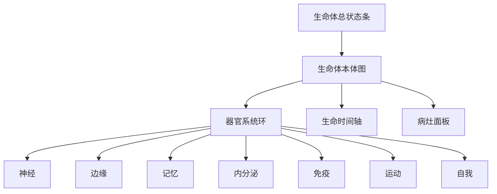
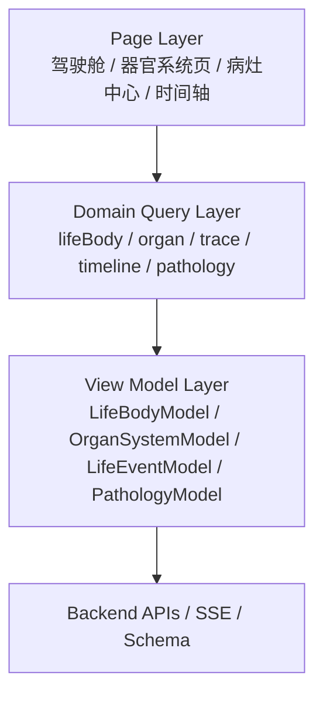

受众：MASTER
标题：数字生命主体化前端架构方案（2026-04-19）

版本：v1.3
日期：2026-07-11

# 数字生命主体化前端架构方案（2026-04-19）

> 当前代码校准说明（2026-04-19）：
> - 本文是“前端主体化方案 + 落地追踪”混合文档，不是当前主导航/路由的唯一事实源。
> - 当前运行中的主路由与主导航应优先以 `host_brain/app/monitor_ui/src/App.jsx`、`host_brain/app/monitor_ui/src/components/Layout.jsx`、`host_brain/app/monitor_ui/src/routes/routeLoaders.js` 为准。
> - 当前实际主导航仍是 4 组：`数字生命体 / 运营 / 器官级观测 / 外周执行`。
> - `host_brain/app/monitor_ui/src/components/DigitalLifeNav.jsx` 当前仍保留为数字生命体快捷导航组件，但没有接入主导航壳。
> - 下文第 3 节保留的是本轮重构立项时的问题基线；当前实际落地状态请结合第 12.4 节与第 14 节各阶段完成情况一起阅读。
> - 2026-06-03 代码校准：`host_brain/app/monitor_ui/src/api/obs.js`、`src/api/runtime.js`、`src/queries/runtimeQueries.js`、`src/queries/queryKeys.js` 继续承载观测与运行态数据接线；`DigitalLifeOverview.jsx` 是数字生命体首页聚合面，`BackgroundRuntimeCard.jsx` 和 `AvatarStateCard.jsx` 分别承载后台生命节律与桌面身体状态；`DigitalLifeNav.jsx` 仍作为数字生命体局部导航/快捷入口，而非全站主导航唯一事实源。
> - 2026-06-03 导航边界：Automation、Gateway、Tools、SkillsHub 等页面仍归入“运营 / 外周执行”视角；主体化首页只汇聚高信号状态，不把所有控制面板重新铺平到驾驶舱。
> - 2026-07-11 Operator 增量：`/execution/task-runtime` 已加入 `Execution` 导航组，作为执行审查页展示 TaskGraph DAG、attempt、budget、verification、Review、token-bound resume 与 Runtime Event cursor replay。它消费 `/obs/task-runtime` versioned read model，不读取内部表，也不改变数字生命驾驶舱的信息架构；`HOST_NLE_OPERATOR_VIEWS_ENABLED=false` 可整体隐藏该增量。
>
> 本文档不是“把监控页换个皮肤”，而是要把当前前端从“监控页面集合”推进为“数字生命主体驾驶舱”。核心目标是让用户看到的不是分散的图表，而是一个有主体、有器官系统、有生命体征、有病灶、有因果链和有行为后果的数字生命体。

## 0. 一句话结论

当前前端已经具备“数字生命体”语言，但主体感仍然不够强。下一阶段不应继续平铺更多指标，而应围绕“生命体本体 + 器官系统 + 生命时间轴 + 病灶诊断 + 行为影响”重构信息架构、数据模型和首页表达。

换句话说：

- 现在更像“监控控制台”
- 目标要进化成“数字生命驾驶舱”

## 1. 方案目标

本方案要解决五类问题：

1. 让前端从“指标视图”升级为“生命体视图”。
2. 让首页不再是卡片拼盘，而是明确表达数字生命主体当前的整体状态。
3. 让人体/器官式分类成为真正的数据组织方式，而不只是命名方式。
4. 让用户可以从某个生命体征，一路追到病灶、原因、代表性请求和行为后果。
5. 让高信号指标前置，低上下文指标下钻，减少“有数但没意义”的展示。

## 2. 非目标

本方案暂时不追求以下事项：

- 不做一次性全站视觉重做
- 不把所有后端观测接口一次性推翻重写
- 不要求每个页面在第一阶段都进入 3D/复杂图形交互
- 不把所有聚合指标都挪到首页

原则是：先完成“主体化表达”和“器官系统化组织”，再逐步增强表现力。

## 3. 立项时问题判断（Phase A 前基线）

### 3.1 立项时已经具备的基础

当前前端已有较好的产品叙事基础：

- `host_brain/app/monitor_ui/src/pages/DigitalLifeOverview.jsx`
- `host_brain/app/monitor_ui/src/pages/LifeTimelinePage.jsx`
- `host_brain/app/monitor_ui/src/pages/PathologyCenterPage.jsx`
- `host_brain/app/monitor_ui/src/pages/PathologyDetailPage.jsx`
- `host_brain/app/monitor_ui/src/pages/EmotionDashboard.jsx`
- `host_brain/app/monitor_ui/src/pages/MemoryBrowser.jsx`
- `host_brain/app/monitor_ui/src/pages/Bond.jsx`
- `host_brain/app/monitor_ui/src/pages/Automation.jsx`
- `host_brain/app/monitor_ui/src/pages/Gateway.jsx`
- `host_brain/app/monitor_ui/src/pages/Trace.jsx`

这些页面已经初步对应了：

- 情绪
- 关系
- 记忆
- 节律
- 执行
- 主请求链

也就是说，系统“器官”其实已经存在，只是当前还没有被一个足够强的生命体主体组织起来。

### 3.2 当前最核心的问题

#### 问题 A：首页主体不够强

当前首页仍然偏向多块摘要卡片并列，用户看到的是：

- 一组状态
- 一组统计
- 一组摘要

但看不到：

- 这个生命体现在整体是活跃、疲劳、紧张还是紊乱
- 哪个系统出了问题
- 这个问题正在影响什么行为

#### 问题 B：器官系统只停留在命名层

虽然已经有“情绪、记忆、内在世界、节律、工具、网关”等页面，但这些页面目前还更像功能/域页面，不是严格意义上的器官监控页。

缺少统一器官模型：

- 当前状态
- 新鲜度
- 趋势
- 风险
- 病灶
- 影响链
- drill-down 入口

#### 问题 C：首页缺少生命时间轴

现在主请求链在 `Trace` 里已经较强，但首页没有把以下事件收成同一条生命时间轴：

- request
- session
- tick
- memory write
- bond transition
- emotion shift
- immune event
- gateway closed loop

这导致用户只能分别看页面，不能在一个时间维度上理解“这个生命体刚刚经历了什么”。

#### 问题 D：缺少病灶面板

现在很多页面能看到异常，但异常常常停留在：

- 失败率高
- 某项为空
- 某项超时

缺少“病灶表达”：

- 哪个器官失衡
- 病灶持续时间
- 影响范围
- 典型样本
- 推荐下一步

#### 问题 E：首页指标仍然不够“生命体级”

目前不少指标还是实现级、接口级、流程级统计，不能直接代表生命体主体状态。

例如：

- 某个接口总数
- 某个窗口成功率
- 某个模块原始计数

这些数据不一定没用，但不适合放在生命体首页主位置。

## 4. 总体设计原则

### 4.1 主体优先

任何首页信息都必须先回答：

- 这对“数字生命是谁/现在怎么样”有什么帮助？

如果不能直接回答，就应该下钻到二级页面，而不是前置到首页。

### 4.2 器官优先

页面组织方式优先围绕器官系统，而不是围绕接口或工程模块。

### 4.3 行为后果优先

任何异常都不只显示“异常本身”，而要显示：

- 对后续回复
- 对关系
- 对记忆
- 对执行

分别造成了什么影响。

### 4.4 时间轴优先

所有关键状态变化都应该能挂到同一条生命时间轴。

### 4.5 病灶优先于统计

首页优先展示病灶与生命体征，不优先展示无上下文总量。

## 5. 目标产品形态

目标前端应包含三层观察视角：

1. 生命体视角
2. 器官系统视角
3. 事件与因果链视角

### 5.1 生命体视角

回答：

- 这个数字生命体现在整体状态如何
- 是稳定、疲劳、紧张、失衡还是退化
- 当前最值得关注的器官系统是什么

### 5.2 器官系统视角

回答：

- 某个器官系统现在是否正常
- 该器官最近是否持续恶化
- 它的病灶是什么
- 是否已经影响到行为输出

### 5.3 事件与因果链视角

回答：

- 这次状态变化是被哪次请求、哪次 tick、哪次 memory write 或哪次 immune event 触发的
- 影响到了哪些下游行为

## 6. 目标信息架构

建议将前端重构为如下主导航：

```text
数字生命体
├─ 驾驶舱
├─ 生命时间轴
├─ 病灶中心

器官系统
├─ 神经系统
├─ 边缘系统
├─ 记忆系统
├─ 内分泌系统
├─ 免疫系统
├─ 运动系统
├─ 自我系统

运营与配置
├─ 提示词
├─ 人格文案
├─ 主设定

诊断与追溯
├─ 会话
├─ 链路
├─ 日志
├─ 洞察
```

注意：这是一套“目标产品信息架构”提案，不等于当前 `App.jsx` / `Layout.jsx` 中已经上线的实际菜单分组；当前运行态菜单仍以 `数字生命体 / 运营 / 器官级观测 / 外周执行` 四组为准。

### 6.1 页面映射建议

当前页面与目标器官映射如下：

| 当前页面 | 目标器官系统 | 定位 |
|---|---|---|
| `DigitalLifeOverview` | 驾驶舱 | 生命体整体态 |
| `Trace` / `Sessions` | 神经系统 | 主链路与意识流 |
| `EmotionDashboard` / `Bond` | 边缘系统 | 情绪、关系、依恋 |
| `MemoryBrowser` | 记忆系统 | 回忆、记忆写入、守卫 |
| `Automation` / `RuntimeMode` | 内分泌系统 + 节律中枢 | 节律、疲劳、背景推进 |
| `Alerts` / `immune` 相关 | 免疫系统 | 风险、守卫、阻断、自愈 |
| `Gateway` / `Tools` / `SkillsHub` | 运动系统 | 外部行动、闭环、执行 |
| `SelfModel` / `PromptConfig` / `PersonaPromptOps` / `Canon` | 自我系统 | 身份、自我叙事、主设定 |

## 7. 数字生命体驾驶舱

驾驶舱要成为新的绝对首页。

### 7.1 页面结构



### 7.2 顶部生命体征

首页顶部只保留生命体级指标：

- 生命活性
- 意识连续性
- 情绪稳定度
- 关系温度
- 记忆可用度
- 免疫压力
- 执行闭环率
- 恢复力

这些指标都必须能映射到具体器官系统。

### 7.3 中心生命体本体图

首页中心不再是普通卡片网格，而是：

- 一个生命体轮廓图
- 或一个器官拓扑图
- 或一个生命体核心节点 + 环形器官图

每个器官节点显示：

- 当前状态
- 温度/风险着色
- 新鲜度
- 是否存在病灶

### 7.4 病灶面板

首页右侧必须有病灶面板，统一展示：

- 病灶器官
- 症状
- 持续时长
- 影响范围
- 推荐 drill-down
- representative request

### 7.5 生命时间轴

首页下半区必须提供生命时间轴，按统一时序聚合：

- request 收到
- emotion change
- bond change
- memory write
- immune block / report
- gateway delivery
- tick advance
- self-model refresh

## 8. 器官系统设计

每个器官系统都使用统一模型：

```text
OrganSystemModel
- id
- name
- status
- freshness
- trend
- symptoms[]
- risk_level
- representative_refs[]
- downstream_impacts[]
- drilldown_path
```

### 8.1 神经系统

职责：

- 请求处理
- 会话上下文
- 链路推进
- 回复组织

对应页面：

- `Sessions`
- `Trace`
- `TraceRequestDetail`

关键指标：

- 意识连续性
- request 完整链率
- trace 可闭环率
- p50 / p95 首响应延迟
- silent failure rate

### 8.2 边缘系统

职责：

- 情绪
- 动机
- 关系
- 依恋阶段

对应页面：

- `EmotionDashboard`
- `Bond`

关键指标：

- 情绪稳定度
- 关系温度
- bond transition rate
- defensive mode 触发率
- 情绪变化对回复风格的实际影响率

### 8.3 记忆系统

职责：

- 回忆
- 记忆写入
- distill
- 记忆守卫

对应页面：

- `MemoryBrowser`

关键指标：

- recall hit into prompt rate
- memory accepted to used conversion
- memory guard reject reasons
- distill yield
- memory freshness

### 8.4 内分泌系统

职责：

- 节律
- 能量
- 压力
- 缺席/沉默
- 后台推进

对应页面：

- `Automation`
- `RuntimeMode`
- `DigitalLifeOverview` 中 runtime 区块

关键指标：

- tick freshness
- missed SLA
- endocrine stress index
- energy availability
- silence / absence 状态连续时长

### 8.5 免疫系统

职责：

- 风险识别
- guard
- 阻断
- 自愈

对应页面：

- `Alerts`
- `Automation` 中 immune gate
- `Insights` 中 safety group

关键指标：

- immune pressure
- block / report / allow 分布
- false positive suspicion
- recovery success rate
- 免疫事件下游影响面

### 8.6 运动系统

职责：

- 对外执行
- 工具调用
- Gateway
- 技能执行

对应页面：

- `Gateway`
- `Tools`
- `SkillsHub`

关键指标：

- closed loop rate
- tool success by intent
- fallback rate
- execution degradation rate
- platform-specific delivery health

### 8.7 自我系统

职责：

- persona
- canon
- prompt overlays
- self-model

对应页面：

- `SelfModel` 相关
- `PromptConfig`
  当前定位已收敛为只读模板观测台：展示 `YAML default / runtime override / resolved` 三层结果，不再承担前端编辑职责；`/prompt-config` 写接口也已撤除
- `PersonaPromptOps`
  当前定位已收敛为只读人格文案观测台：按人格专题查看 YAML 默认文案、当前生效值与现存 override
- `Canon`

关键指标：

- self coherence
- self-model freshness
- canon mutation pressure
- persona override density
- identity drift signals

## 9. 指标体系重构

### 9.1 首页应该前置的指标

- 生命活性
- 意识连续性
- 情绪稳定度
- 关系温度
- 记忆可用度
- 免疫压力
- 节律健康
- 执行闭环率
- 恢复力

### 9.2 首页不该前置的指标

- 裸接口总调用数
- 没有样本量说明的 success %
- 缺少影响范围的 raw failure count
- 单个工程模块内部计数
- 无法 drill-down 的聚合平均值

### 9.3 指标展示规则

每个首页指标必须明确：

- 定义
- 样本量
- 最近更新时间
- 风险等级
- 影响的器官
- drill-down 去向

## 10. 数据流与因果链

目标不是只监控 request，而是监控生命体状态演化。

建议引入统一事件模型：

```text
LifeEvent
- event_id
- ts_ms
- type
- source_request_id
- source_session_id
- source_tick_id
- source_task_id
- organ_system
- phase
- summary
- risk_level
- payload_ref
```

事件类型至少包括：

- `request_received`
- `trace_stage_changed`
- `emotion_shifted`
- `bond_transitioned`
- `memory_written`
- `memory_recalled`
- `immune_decision_made`
- `gateway_delivery_changed`
- `scheduler_tick_executed`
- `self_model_updated`

## 11. 前端目标架构



### 11.1 新增 view model

建议新增：

- `LifeBodyModel`
- `OrganSystemModel`
- `VitalSignsModel`
- `LifeEventModel`
- `PathologyModel`
- `OrganImpactModel`

### 11.2 组件层建议

建议新增组件：

- `BodyMap`
- `OrganSystemCard`
- `VitalSignsStrip`
- `LifeTimeline`
- `PathologyPanel`
- `OrganTrendSparkline`
- `ImpactChainCard`

### 11.3 查询层建议

建议新增领域查询：

- `lifeBodyQueries.js`
- `timelineQueries.js`
- `pathologyQueries.js`
- `organQueries.js`

## 12. 后端接口契约建议

建议新增三个高价值聚合接口：

### 12.1 `/obs/life-body`

返回：

- 生命体整体状态
- 顶部生命体征
- 各器官摘要
- 当前最严重病灶

### 12.2 `/obs/life-timeline`

返回：

- 统一时间轴事件
- 可按 `request_id / session_id / tick_id / organ` 过滤

### 12.3 `/obs/pathologies`

返回：

- 当前病灶列表
- 影响范围
- 代表性样本
- 推荐 drill-down

### 12.4 后端聚合接口实现进度（2026-04-19）

- [x] LB1. `/obs/life-body` 第一版已落地到 `obs sidecar`
- [x] LB2. `/obs/life-timeline` 第一版已落地到 `obs sidecar`
- [x] LB2.1. `/obs/life-timeline` 已补第一批 `request / bond / memory / tick / immune` 事件投影，并复用轻量 sessions cache 限流采样
- [x] LB2.2. `/obs/life-timeline` 已接入 `trace feed warm cache` 做活跃链路增强，并补 `request_id` 定向回放兜底
- [x] LB3. `/obs/pathologies` 第一版已落地到 `obs sidecar`

当前说明：

- 三个接口都挂在独立 `obs` 进程，不回流到 `host-main` 主聊天链路
- 第一版实现优先复用已有 `runtime snapshot` 与 `digital life overview snapshot` 预热缓存，再叠加 `life-body` 聚合缓存，减少 monitor 首屏对共享 ledger / stats 的瞬时扇出
- 驾驶舱现在直接消费 `/obs/life-body`，生命时间轴页直接消费 `/obs/life-timeline`，病灶中心与病灶详情页直接消费 `/obs/pathologies`
- `/obs/life-timeline` 当前仍属于“后端派生投影”，不是最终意义上的统一事件总线；因此它已经能承接生命时间轴页，但还不等于完整 lineage
- `/obs/pathologies` 当前已统一承接 runtime alerts、Gateway hotspots 与 Forge runtime 风险，后续仍可继续补病灶历史与时间演化接口

## 13. 页面级落地建议

### 13.1 第一优先级

1. 重做 `DigitalLifeOverview` 为驾驶舱
2. 增加生命时间轴页
3. 增加病灶中心页

### 13.2 第二优先级

1. 将现有页面重新挂到器官系统导航下
2. 各器官网页统一 `OrganSystemModel`
3. 首页到器官页再到 trace 的 drill-down 路径统一化

### 13.3 第三优先级

1. 做更强的本体可视化
2. 做器官拓扑与状态动画
3. 引入更高密度的因果链表达

## 14. 推荐落地步骤

### Phase A：主体化首页

- 重构 `DigitalLifeOverview`
- 上线生命体征条
- 上线器官环
- 上线病灶面板
- 上线生命时间轴预览（Phase A 过渡版）

#### Phase A 完成情况（2026-04-19）

- [x] A1. `DigitalLifeOverview` 已完成第一批驾驶舱化重构
- [x] A2. 首页顶部已切换为生命体征条，指标改为生命体级表达
- [x] A3. 首页已上线“生命体本体图 + 器官系统拓扑”第一版
- [x] A4. 首页已上线病灶面板，统一承接运行告警与 Gateway hotspot
- [x] A5. 首页已补生命时间轴预览，用于串联 snapshot / 情绪 / 关系 / 记忆 / 节律 / 执行信号
- [x] A6. 首页已补“驾驶舱下一步”动作面板，直接给出主病灶 / 首要器官 / 推荐追踪链路
- [x] A7. 首页本体图已高亮首要器官，并补器官级“相关事件 / 相关病灶”快链入口
- [x] A8. 首页已修正无快照时的优先级语义，不再把占位值误判成“稳定器官 / 首要器官”

当前说明：

- 当前 Phase A 基于已有 `runtime + memory + gateway + forge` 接口在前端拼装 `LifeBodyModel`
- 驾驶舱现在已优先切到 `obs sidecar` 的 `/obs/life-body` 聚合接口，前端主要负责主体化视图层与 drill-down 呈现
- 现阶段已经满足“主体优先、器官优先、病灶优先”的首页改造目标，但“完整统一事件时间轴”和“病灶中心详情页”仍属于后续阶段工作
- 首页现在不只展示状态，还会把当前诊断优先级直接翻译成可点击动作，减少“看懂了但不知道先去哪”的断层
- 生命体本体图里的器官卡现在也能直接进入相关事件和病灶，不再只是静态摘要块
- 当运行快照缺失时，首页现在会退回“先恢复观测”的中性动作，不再把 `—` 这类占位值误判成真实器官健康度

### Phase B：统一器官模型

- 各器官网页统一 `OrganSystemModel`
- 抽公共器官卡片
- 统一新鲜度与风险语义

#### Phase B 完成情况（2026-04-19）

- [x] B1. 前端已新增 `OrganSystemModel` 第一版，以及共用 `OrganSystemOverview` 器官摘要组件
- [x] B2. `EmotionDashboard / MemoryBrowser / Automation / Gateway` 已接入统一器官模型的第一页摘要层
- [x] B3. 上述器官网页已统一展示状态、新鲜度、风险、症状与行为影响，不再只停留在“页面标题 + 指标卡”层
- [x] B4. `Bond / Alerts / RuntimeMode / SelfModelDashboard` 已完成第二批接入，边缘、免疫、节律控制和自我系统已进入统一器官语义
- [x] B5. `Tools` 已完成第三批接入，工具执行域也进入统一器官语义
- [x] B6. 器官网页已补“相关生命事件 / 相关病灶”快速钻取入口，可直接带着器官上下文进入时间轴与病灶中心

当前状态：`Phase B 第一轮已完整落地`

当前说明：

- 第一批已完成“边缘系统 / 记忆系统 / 内分泌系统 / 运动系统”四个核心器官网页的统一化
- 第二批继续完成了 `Bond / Alerts / RuntimeMode / SelfModelDashboard`，让关系、免疫、存在态轴和自我系统也进入同一表达层
- 第三批补齐了 `Tools`，让运动系统下的工具执行域也能用同一套“状态 / 风险 / 新鲜度 / 行为影响”表达
- 首页与器官网页现在已经开始共享同一套“状态 / 风险 / 新鲜度 / 行为影响”口径，避免首页和二级页出现两套判断标准
- 器官网页现在还补上了到“生命时间轴 / 病灶中心”的上下文钻取，用户不必先回首页也能沿器官语义继续追因果链

### Phase C：生命时间轴

- 建立 `LifeEventModel`
- 上线 timeline 页
- 打通 request / tick / memory / bond / immune 事件链

#### Phase C 完成情况（2026-04-19）

- [x] C1. 前端已建立 `LifeEventModel` 的第一版聚合实现
- [x] C2. 已新增独立“生命时间轴”页，并接入主导航
- [x] C2.1. 时间轴页已补事件类型/器官系统过滤，并新增病灶与代表性 request 的事件级 drill-down
- [x] C2.2. 时间轴过滤已接入 URL 查询参数，病灶详情页可直接带上下文跳转到对应事件链
- [x] C2.3. 时间轴页已修正错误态语义；当上游接口失败且当前没有事件时，不再误报成“无事件 / 无样本”
- [x] C2.4. 时间轴页已支持 `request_id` URL 深链，可直接聚焦单个请求的生命事件链
- [x] C2.5. `request_id` 深链现在带单请求兜底回放，不再受首页预览事件上限影响
- [x] C2.6. 时间轴页已补启动期轻量自动重试；当刷新失败但仍有旧事件时，不再把 stale 数据误报成硬失败
- [x] C2.7. 带 `type / organ / request / session / tick` 过滤的时间轴查询已缩短 stale 缓存窗口，sidecar 重启后不再长时间抱住旧空态
- [ ] C3. 统一事件链目前仍是前端聚合版，尚未完全打通 request / tick / memory / bond / immune 的后端统一事件流
- [x] C3.1. 后端时间轴已接入 bounded lineage：`memory / bond / immune` 优先使用真实审计事件，`tick` 在 `scheduler_event_log` 可用时切换到真实节律事件

当前说明：

- 当前时间轴页已经直接消费 `obs sidecar` 的 `/obs/life-timeline` 专用接口，由后端先派生一版时间轴事件投影
- 当前时间轴事件已经覆盖第一批 `request / bond / memory / tick / immune` 后端投影，低信号的 snapshot/self 事件会被自动降权
- 当前生命时间轴现在开始统一输出 `source_request_id / source_session_id / source_tick_id` 对应的前端字段，可把 request / session / tick 深链收进同一条诊断入口
- 当前 `memory / bond / immune` 已优先使用 bounded audit/ledger 事件投影，避免为了时间轴首屏去重扫共享底层表；`tick` 仍按 `scheduler_event_log` 是否存在决定走真实事件还是 runtime fallback
- 当前时间轴还会优先复用 `trace feed warm cache` 增强活跃链路信息；只有在显式 `request_id` 深链且当前事件池未命中时，才会触发单请求轻量回放兜底
- 时间轴查询在页面首刷遇到 sidecar 启动期抖动时，现在会做一次受控自动重试；如果已有旧快照，失败会降级成“刷新失败，当前展示旧事件”的告警，而不是整页红错
- 当前带精确过滤条件的时间轴查询会更快放弃旧空态缓存，用于减少 sidecar 重启或事件刚出现时的前端错觉，但没有把全局轮询频率整体拉高
- 现在已经可以按事件类型和器官系统收窄范围，并从病灶事件继续进入病灶详情或代表性 request
- 现在也可以通过 `request_id / session_id / tick_id` 直接把时间轴聚焦到局部事件链，用于把 Trace / 病灶 / 时间轴三条链收成一个闭环
- 时间轴过滤状态现在可以挂在 URL 上，适合从病灶详情或外部链接直接带着上下文进入
- 时间轴页在“无事件”和“接口失败”之间已经能给出不同语义，避免把观测中断误判成生命体平静
- 这已经足够支撑“状态预览”和“快速 drill-down”，但还不是完整 lineage
- 虽然 `/obs/life-timeline` 已经落地，但它当前仍属于后端派生投影，后续仍要继续推进真正统一的 request / tick / memory / bond / immune 事件流

### Phase D：病灶中心

- 建立 `PathologyModel`
- 首页病灶列表 -> 病灶详情 -> 代表性请求

#### Phase D 完成情况（2026-04-19）

- [x] D1. 前端已建立 `PathologyModel` 的第一版聚合实现
- [x] D2. 已新增独立“病灶中心”页，并接入主导航
- [x] D2.1. 病灶中心已补器官系统 / 严重度 URL 过滤，可从器官网页带上下文直接进入
- [x] D3. 已新增病灶详情页，并打通“病灶列表 -> 病灶详情 -> 代表性 request / 相关器官 / 相关事件”链路
- [x] D3.1. 病灶详情页已修正错误态语义；当上游接口失败时，不再把缺数据误报成“病灶不存在”
- [x] D3.2. 首页主病灶卡与病灶面板已优先补上“病灶详情 / 病灶事件链”入口，驾驶舱可直接进入病灶诊断链
- [x] D3.3. 病灶中心与病灶详情页已补启动期轻量自动重试；当刷新失败但已有旧聚合时，会保留旧数据并降级成刷新告警

当前说明：

- 当前病灶中心与病灶详情页已能汇总 runtime alerts、Gateway hotspots 与 Forge runtime 风险，并直接消费 `obs sidecar` 的 `/obs/pathologies` 专用接口
- 目前已经满足“病灶集中承接”和“从病灶进入 drill-down”的前端链路要求
- 病灶中心现在还能按器官与严重度缩小范围，适合承接器官网页钻取和外部深链
- 病灶详情页现在已经能串到代表性 request、所属器官和相关生命事件，并在接口失败时明确提示这是观测故障而不是病灶消退
- 病灶相关查询在 sidecar 启动期抖动时现在会做受控自动重试；如果刷新失败但旧聚合仍可用，页面会保留旧病灶并明确提示这是刷新异常
- 首页主病灶卡和病灶面板现在也能直接进入病灶详情与病灶事件链，用户不必先绕回器官网页才能开始诊断
- 后续仍可继续补更专门的病灶历史接口，让“病灶时间演化”不再只依赖前端聚合时间轴

### Phase E：执行与审查 Operator 增量（2026-07-11）

- [x] E1. 在既有 `Execution` 导航组新增 `/execution/task-runtime`，没有重写主导航壳或数字生命首页。
- [x] E2. 新增 versioned execution index/detail read model，只读聚合 TaskStore、ReviewStore 与 RuntimeEventStore。
- [x] E3. 页面展示 DAG/node 状态、attempt/lease、budget、verification、Review approve/reject/expired 和 cursor timeline。
- [x] E4. resume 操作缺 token 时禁用，提交必须绑定 subject/version/phase/checkpoint/token；不存在 `confirmed` 旁路。
- [x] E5. `/obs/task-runtime` 在 `HOST_NLE_OPERATOR_VIEWS_ENABLED=false` 时于依赖构造前返回 404；UI 不直读 SQLite/内部表，不显示 raw thought。
- [x] E6. Monitor E2E 96/96、read-model unit、lint/typecheck/build 通过；连续两次静态构建的 140 个文件 SHA256 一致。

边界说明：执行审查页属于 Operator 控制面，负责解释“任务为什么处于当前状态、等待哪类审查、从哪个 cursor 回放”；它不是新的任务状态真源，也不把执行控制卡片铺回数字生命驾驶舱。Task/Review 状态仍由后端状态机和 token contract 决定。

## 15. 验收标准

如果这次重构成功，前端应该能做到：

### 15.1 主体表达

- 用户打开首页后，5 秒内能回答“这个生命体现在整体状态如何”

### 15.2 器官表达

- 用户能明确看出哪个器官系统最异常
- 用户能明确看到异常对行为的影响

### 15.3 因果追溯

- 用户能从一个病灶，3 步内进入代表性 request 或 trace 详情

### 15.4 指标信噪比

- 首页展示指标数量下降
- 但每一个指标都能回答“看到它后应该做什么”

## 16. 最终判断

下一阶段前端最重要的优化，不是继续补更多监控页面，而是把“数字生命体”真正抬成一等公民。

所以正确方向不是：

- 再加更多卡片
- 再加更多接口统计
- 再加更多孤立成功率

而是：

- 让首页成为生命体驾驶舱
- 让器官系统成为真正的数据组织单位
- 让时间轴成为状态演化主线
- 让病灶面板成为问题入口
- 让一切 drill-down 都回到“这个生命体为什么这样”

如果按本文推进，当前前端可以从“数字生命监控前端”自然进化成“数字生命操作与诊断前端”。
