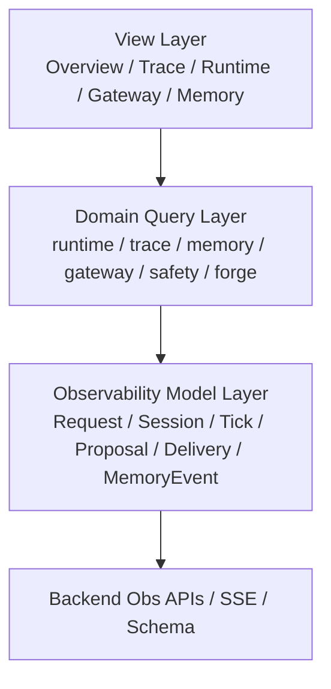

受众：MASTER
标题：前端观测架构优化方案（2026-04-18）

版本：v1.0
日期：2026-04-18

# 前端观测架构优化方案（2026-04-18）

> 本文档不是“页面美化建议”，而是面向当前监控前端的结构化重构方案，目标是把现有前端从“监控页集合”推进为“统一观测平台”，并提升问题追溯能力、指标信噪比与跨页面钻取效率。

## 0. 一句话结论

当前前端的产品概念架构是对的，已经能较好映射系统拓扑；但数据架构仍偏向页面级拼接和端点级消费，尚未形成统一观测对象、统一加载语义与统一因果链路，因此还不能算完整的 observability system。

换句话说：

- 它已经是一个不错的“系统操作台”
- 但还不是一个成熟的“统一观测平台”

## 1. 方案目标

本方案聚焦解决四个核心问题：

1. 让前端从“页面拉接口”升级为“围绕观测对象组织数据”。
2. 让前端从“展示统计值”升级为“表达原因、影响范围、责任链和下一步动作”。
3. 让前端从“主请求链可追”升级为“请求链 + 异步状态演化链可追”。
4. 让前端从“指标很多”升级为“指标有行动价值、可验证、可归因”。

## 2. 当前现状判断

### 2.1 与系统架构的匹配度

当前前端的导航与页面分组，和系统领域边界整体是匹配的。

证据入口：

- `host_brain/app/monitor_ui/src/components/Layout.jsx`
- `host_brain/app/monitor_ui/src/pages/DigitalLifeOverview.jsx`
- `host_brain/app/monitor_ui/src/pages/Overview.jsx`
- `host_brain/app/monitor_ui/src/pages/Sessions.jsx`
- `host_brain/app/monitor_ui/src/pages/Trace.jsx`
- `host_brain/app/monitor_ui/src/pages/Gateway.jsx`
- `host_brain/app/monitor_ui/src/pages/Insights.jsx`

当前的“数字生命体 / 运营 / 器官级观测 / 外周执行”叙事并不违和，反而是这个系统的一项优势。问题不在页面命名，而在这些页面背后的数据组织方式还不够统一。

### 2.2 当前已经做得好的部分

- 页面信息架构具备系统感，产品语言统一。
- `Sessions -> Trace -> TraceRequestDetail` 这条主请求链已经具备较好的钻取能力。
- 数字生命体总览中的运行态语言有统一复用基础。
- 已经存在一些“从监控走向诊断”的雏形，例如 Gateway 闭环、代表性请求、热点与 remediation 提示。

### 2.3 当前最关键的结构性问题

#### 问题 A：数据层仍然是 endpoint-centric

当前 `obs.js` 聚合了大量 `/obs/*` 请求，页面再各自 `Promise.all` 拼接视图模型。

证据入口：

- `host_brain/app/monitor_ui/src/api/obs.js`
- `host_brain/app/monitor_ui/src/pages/DigitalLifeOverview.jsx`
- `host_brain/app/monitor_ui/src/pages/MemoryBrowser.jsx`
- `host_brain/app/monitor_ui/src/pages/EmotionDashboard.jsx`

这会导致：

- 错误处理分散
- 超时、空样本、真实零值、接口失败经常混淆
- 页面之间没有统一缓存、去重、重试与 freshness 语义
- 同一类指标在不同页面可能被解释成不同含义

#### 问题 B：全局状态过轻，没有统一的观测对象层

当前全局 store 基本只存轮询开关、时间范围和 `selectedRequestId`。

证据入口：

- `host_brain/app/monitor_ui/src/store/useAppStore.js`

缺失的不是“更大的 store”，而是“统一的观测对象模型”。前端尚未把以下对象提升为一等公民：

- `request_id`
- `session_id`
- `conversation_id`
- `tick_id`
- `task_id`
- `proposal_id`
- `gateway_delivery_id`
- `persona_user_id`

#### 问题 C：页面能看到结果，但常常不能看到原因

当前很多页面是窗口聚合统计页，能看到结果，但不能稳定追到：

- 哪个阶段出了问题
- 影响了多少请求或会话
- 哪类根因最集中
- 有哪条代表性请求可以直接复现
- 接下来该去哪个页面继续看

这就是“看起来数据很多，但不够有意义”的核心来源。

#### 问题 D：Trace 很强，但仍有前后端漂移风险

`Trace.jsx` 中存在较强的前端内建链路知识。

证据入口：

- `host_brain/app/monitor_ui/src/pages/Trace.jsx`
- `FULL_CHAIN_SCHEMA`
- `fetchGraphSchema`

这保证了当前体验，但如果主链图结构持续演进，而前端仍靠硬编码 schema 做主要展示，长线会出现：

- 后端已变，前端图没变
- 新节点没有进入可视化链路
- 页面表达与实际系统链路不一致

#### 问题 E：加载与空态语义不统一

本轮已经修过几处典型问题，例如：

- 无样本被错误展示为 `0%`
- 无运行快照时页面默认展示成“正常在线”
- 并发请求超时后静默渲染成 `0/0`

这些问题说明前端目前缺少统一的加载语义和状态枚举，而是由每个页面各自解释。

## 3. 当前能力边界判断

### 3.1 能否全面覆盖监控

覆盖面已经比较广，但深度不均匀。

- 广度：强
- 深度：中等
- 问题归因能力：中等偏弱
- 跨域关联能力：偏弱

### 3.2 能否完整追溯整个数据流

目前只能说“主请求链基本可追”，还不能说“整个系统状态演化可完整追溯”。

当前较强的链路：

- `Sessions -> Trace -> TraceRequestDetail`
- `request_id` 维度的事件、stream、tribe、retrieval runtime 汇总

当前仍然缺失的链路：

- `bond` 状态为何变化
- 哪个 background tick 改写了情绪、关系、动机或回复姿态
- 某条记忆写入是否真正影响了最终回复
- 某次 forge proposal 是否真的进入执行链
- gateway 事件如何和请求链、会话链、外部平台事件完整闭环

### 3.3 当前指标是否足够有用

不是“不够多”，而是“高信号指标不够前置，低上下文统计占位过多”。

典型问题包括：

- 只给总量，不给影响面
- 只给比例，不给分子分母和样本量
- 只给失败率，不给失败归因
- 只给快照，不给新鲜度
- 只给状态，不给导致状态变化的前因请求

## 4. 目标架构

目标是形成一个分四层的前端观测架构：



四层职责如下：

### 4.1 View Layer

页面只做三件事：

- 表达当前状态
- 提供钻取入口
- 呈现明确的加载、错误、空样本语义

页面不再承担接口容错和复杂 view model 拼装责任。

### 4.2 Domain Query Layer

以领域而非页面组织数据：

- `runtime`
- `trace`
- `memory`
- `gateway`
- `safety`
- `forge`
- `agent_loop`
- `alerts`

建议使用 `TanStack Query` 或等价查询缓存层承担：

- 缓存
- 重试
- staleTime
- dedupe
- polling
- section-level error
- optimistic freshness 标识

### 4.3 Observability Model Layer

引入统一的前端观测对象模型。前端不再只认“某个接口返回了什么”，而是认“系统里发生了什么对象级事件”。

建议优先落地的对象：

- `Request`
- `Session`
- `Conversation`
- `BackgroundTick`
- `MemoryEvent`
- `MemoryUse`
- `CapabilityProposal`
- `GatewayDelivery`
- `StateTransition`

每个对象都应有：

- 主键
- 时间戳
- 上下游关联键
- 状态
- 新鲜度
- 归属模块
- 可钻取链接

### 4.4 Backend Contract Layer

后端继续提供聚合接口，但对以下能力要逐步增强：

- schema 驱动的 trace graph
- 统一 correlation id
- 状态变化事件流
- 指标定义的口径说明
- 样本量与 null 语义的显式表达

## 5. 统一数据语义设计

### 5.1 LoadState 统一枚举

所有卡片、列表和详情面板都统一使用以下状态语义：

- `loading`：首次加载中
- `refreshing`：有旧数据，正在刷新
- `stale`：数据存在，但超过新鲜度阈值
- `no_sample`：接口成功，但窗口内无样本
- `unavailable`：该模块当前不可用或未启用
- `error`：请求失败
- `ready`：有效数据可展示

禁止再使用以下混合表达方式：

- 用 `0` 表达 `no_sample`
- 用 `--` 同时表达 `error` 和 `unavailable`
- 用默认绿态表达“未取到数据”

### 5.2 统一指标显示规则

每类指标都按同样格式显示：

- 比率
- 分子 / 分母
- 样本量
- 窗口大小
- 更新时间
- 数据来源
- 口径说明

例如不再只展示 `56.2%`，而是展示：

- `闭环率 56.2%`
- `27 / 48`
- `窗口 6h`
- `更新时间 12s 前`
- `口径：出现 closed-loop 终态事件的 request / 全部 gateway request`

### 5.3 统一跨页关联键

所有页面顶部或详情抽屉都应支持统一的“关联键导航条”：

- `request_id`
- `session_id`
- `conversation_id`
- `tick_id`
- `proposal_id`
- `gateway_delivery_id`

用户从任何一页进入详情，都能继续向：

- 上游原因
- 下游影响
- 同批次相关对象
- 代表性异常样本

继续钻取。

## 6. 页面级改造方案

### 6.1 Digital Life Overview

定位：系统态势总览，不承担细节归因。

保留内容：

- 运行态摘要
- 核心体征卡片
- 风险总览
- 关键分区健康摘要

新增要求：

- 所有卡片必须可钻取到对应详情页
- 所有状态必须显示 freshness
- 所有空态必须明确区分 `无样本 / 暂不可用 / 加载失败`
- 所有高风险卡片必须给出“继续查看”入口

不建议继续塞入：

- 过多无上下文统计
- 大量只在单页有意义的技术细节

### 6.2 Trace

定位：主请求链和事件链的核心诊断入口。

改造方向：

- 让图结构优先由后端 schema 驱动
- 前端保留 fallback schema 作为兜底，不再作为默认真相
- 支持按 `request / session / conversation / tick` 切换视角
- 支持异常链路高亮，而不是所有节点一视同仁
- 支持“从异常指标直接跳到代表性 request trace”

### 6.3 Sessions

定位：流量入口与异常会话筛选器。

改造方向：

- 强化筛选维度：intent、渠道、风险、结果、agent 路由
- 增加“影响面视角”：异常会话数、重复失败用户、沉默失败会话
- 列表行直接显示可钻取标签，而不是只显示基础状态

### 6.4 Memory / Emotion / Bond / Self / Inner World

定位：状态演化与器官级观测页。

改造方向：

- 从“当前窗口统计”升级为“状态变化时间线 + 代表性触发因子”
- 每次状态变化都尽量关联：
  - 来源 request
  - 来源 tick
  - 写入模块
  - 守卫判定
  - 是否真正被后续回复消费

### 6.5 Gateway

定位：外周闭环和用户触达质量页。

改造方向：

- 区分“进入终态”与“成功完成”
- 分离依赖故障、平台故障、内部逻辑故障
- 每类异常都有代表性 request
- 支持平台维度拆分与趋势视图

## 7. 指标体系重构

### 7.1 需要前置的高信号指标

#### 用户影响类

- ACK p50 / p95
- first actionable feedback latency
- silent failure rate
- completion-without-touch rate
- final response success rate by intent/source

#### 因果链类

- failure by stage
- root cause family 分布
- 受影响 request / session 数
- 代表性 request 直达 Trace

#### 状态新鲜度类

- bond / emotion / motive / reply posture 最后更新时间
- 各关键 slot stale age
- tick freshness
- missed SLA / skipped reason

#### 记忆有效性类

- recall hit rate into final prompt
- accepted memory -> actually used conversion
- memory guard reject reason distribution
- distill yield

#### 执行质量类

- tool / skill success by intent
- fallback rate
- retry count
- dependency-caused failure vs logic-caused failure

#### 变更影响类

- prompt / persona / canon / config 变更标记
- deploy / build version 标记
- 变更前后关键指标对比

### 7.2 应该降权或删除的低信号数据

下列数据不是完全没用，但不应再占据首页或关键版位：

- 无分子分母的单独百分比
- 无样本量说明的成功率
- 无归因的单纯失败数
- 无新鲜度说明的状态快照
- 无 drill-down 入口的“看起来很多”的聚合数

## 8. 具体实施分期

### Phase 1：1 周内可落地

目标：先把“语义错误”和“基础数据层重复问题”收住，不做大规模页面重写。

执行状态：首批落地完成（2026-04-18，本轮已完成 T1-T6）

执行 Todo：

- [x] T1：引入统一 `LoadState` 模型与观测通用组件（`LoadStateBadge / FreshnessPill / SampleMeta / DrilldownLink`）
  - 完成情况：已新增 `src/models/loadState.js` 与 `src/components/obs/*`，统一承载 `loading / refreshing / stale / no_sample / unavailable / error / ready` 语义，以及更新时间、样本元信息和 drill-down 入口组件。
- [x] T2：建立第一层领域 API 拆分（`runtime.js / memory.js / gateway.js / trace.js`）
  - 完成情况：已新增 `src/api/runtime.js`、`src/api/memory.js`、`src/api/gateway.js`、`src/api/trace.js`，并让 `useDigitalLifeRuntimeSignals` 先切到 `runtime.js`，后续页面改造将逐步从这些领域入口走。
- [x] T3：改造 `DigitalLifeOverview`，接入统一加载语义、更新时间/样本元信息与关键 drill-down
  - 完成情况：`DigitalLifeOverview` 已改走领域 API，并在页首、Gateway 区块、体征核心区块、记忆快照区块接入统一 `LoadState`、`更新时间 / 样本量 / 来源口径` 元信息，同时补齐了到 `Trace` 与 `Memory` 的关键 drill-down。
- [x] T4：改造 `MemoryBrowser` 与 `EmotionDashboard`，统一空态 / 错态 / 无样本表达
  - 完成情况：`MemoryBrowser` 与 `EmotionDashboard` 已接入统一 `LoadState`、页首观测元信息和区分式提示文案；空样本、运行快照缺席、接口暂不可用不再复用同一类占位。
- [x] T5：改造 `Gateway`，统一空态 / 错态 / 样本语义并补充可追溯元信息
  - 完成情况：`Gateway` 已接入统一 `LoadState`、事件计数、更新时间与来源口径说明，并新增到 `Trace` 的追溯入口；空流量初始态与接口不可用已拆开表达。
- [x] T6：执行构建验证并回写验收结果
  - 完成情况：已在 `host_brain/app/monitor_ui` 执行 `npm run build`，构建通过；新增的 `LoadState` 模型、观测元组件、领域 API 分层与页面接入均已通过生产构建验证。

交付项：

1. 引入统一 `LoadState` 常量和展示规范。
2. 建立 `domain api` 基础拆分：
   - `api/runtime.js`
   - `api/trace.js`
   - `api/memory.js`
   - `api/gateway.js`
3. 把总览页、记忆页、情绪页、Gateway 页的空态 / 错态语义统一。
4. 为核心卡片补齐：
   - 更新时间
   - 样本量
   - 口径说明
5. 为关键总览卡片增加 drill-down link。

验收标准：

- 不再出现 `null => 0%`
- 不再出现“无快照 => 正常在线”
- 同类指标跨页口径一致
- 页面中所有 `no sample / unavailable / error` 可区分

本轮验收结果：

- 已完成：`null => 0%` 的记忆类误报已在此前修复基础上继续统一到页首状态语义中。
- 已完成：总览页继续保持“无快照不报正常”的约束，并补齐页首状态与更新时间语义。
- 已完成：`DigitalLifeOverview / MemoryBrowser / EmotionDashboard / Gateway` 已统一接入 `LoadState + SampleMeta`。
- 已完成：生产构建通过，可作为后续继续推进 Phase 2 的稳定基线。

### Phase 2：1 个月内可落地

目标：把“页面级数据拼装”升级成“领域查询层 + 统一观测对象”。

执行状态：第二十九批落地完成（2026-04-19，本轮已完成 T2-64 ~ T2-65，累计完成 T2-1 ~ T2-65）

执行 Todo：

- [x] T2-1：实现等价查询层基础设施（统一 query key、缓存、去重、轮询、stale 语义）
  - 完成情况：已新增 `src/queries/queryCache.js`、`queryKeys.js`、`freshness.js`、`useObservabilityQuery.js`，形成第一版等价查询层，统一缓存、去重、轮询触发与 stale 判定。
- [x] T2-2：建立领域 query hook（至少覆盖 `runtime / memory / gateway / digital-life-overview`）
  - 完成情况：已新增 `runtimeQueries.js`、`memoryQueries.js`、`gatewayQueries.js`、`digitalLifeQueries.js`，并补充 `emotion` 聚合 query hook。
- [x] T2-3：让关键页面切到 query hook，减少页面内 `Promise.all + catch(() => null)` 逻辑
  - 完成情况：`useDigitalLifeRuntimeSignals` 已切到 query 层；`DigitalLifeOverview`、`MemoryBrowser`、`Gateway`、`EmotionDashboard` 已改为消费领域 query hook，不再各自维护页面级轮询与主数据装配。
- [x] T2-4：补充 `observabilityRefs` 模型，统一 request/session/tick/proposal/delivery 引用对象
  - 完成情况：已新增 `src/models/observabilityRefs.js`，先落第一版 request 级引用模型，为后续 session/tick/proposal/delivery 扩展预留统一入口。
- [x] T2-5：补充 `RepresentativeRequests` 组件，并在高风险区块接入直达 Trace 的异常样本入口
  - 完成情况：已新增 `src/components/obs/RepresentativeRequests.jsx`，并在 `DigitalLifeOverview` 的闭环自愈建议、病灶热区样本区块接入代表性 request 入口。
- [x] T2-6：迁移 `Overview` 到 query 层，并保留 WebSocket 实时健康快照的页面编排
  - 完成情况：已新增 `src/queries/overviewQueries.js`，并将 `Overview.jsx` 的器官子系统、执行护栏和界面断言统计迁到 query 层；页面继续保留 WebSocket 实时健康快照，并新增页首观测元信息。
- [x] T2-7：迁移 `Alerts` 到 query 层，统一错误、服务降级与 capability gap 告警装配
  - 完成情况：已新增 `src/queries/alertsQueries.js`，`Alerts.jsx` 的错误事件、服务降级与 capability gap 数据装配已改由 query 层驱动，同时接入了统一 `SampleMeta`。
- [x] T2-8：迁移 `Insights` 的首批主数据到 query 层，减少页面级 `Promise.allSettled` 汇总逻辑
  - 完成情况：已新增 `src/queries/insightsQueries.js`，`Insights.jsx` 页首摘要层的 `gov / err / subsys / agent / memory / vts / qa / llmCall` 已切到 query 层，保留分组 section 的既有深度查询逻辑。
- [x] T2-9：迁移 `SystemConfig` 到 query 层，收敛路由/调用/限流/健康/检索摘要的页面内装配
  - 完成情况：已新增 `src/queries/systemConfigQueries.js`，`SystemConfig.jsx` 的路由、调用、限流、器官健康与检索运行时摘要已切到 query 层，并接入页首 `SampleMeta`。
- [x] T2-10：迁移 `AgentLoop` 到 query 层，收敛 UI 信息、统计和历史摘要的页面内装配
  - 完成情况：已新增 `src/queries/agentLoopQueries.js`，`AgentLoop.jsx` 的配置、统计与历史摘要已切到 query 层，页面仅保留运行控制和 SSE 事件流，同时接入页首 `SampleMeta`。
- [x] T2-11：迁移 `Bond` 到 query 层，收敛关系健康、用户列表、阶段分布与用户详情的页面内装配
  - 完成情况：已新增 `src/api/bond.js` 与 `src/queries/bondQueries.js`，并将 `Bond.jsx` 的关系健康、用户列表、阶段分布、选中用户详情与页首观测元信息统一迁入 query 层；页面只保留事件补录 mutation 和选中用户 UI 状态。
- [x] T2-12：迁移 `Tools` 主摘要到 query 层，收敛工具健康、目录与筛选查询的页面内装配
  - 完成情况：已新增 `src/api/tools.js` 与 `src/queries/toolsQueries.js`，并将 `Tools.jsx` 的工具健康、目录查询、筛选基础数据与页首观测元信息迁入 query 层；搜索空结果不再与“系统无样本”混淆。
- [x] T2-13：迁移 `Tools` 的权限拦截 / 执行计划统计到 query 层，统一子区块观测语义
  - 完成情况：`Tools.jsx` 的权限拦截统计与执行计划统计已改由 query hook 驱动，并接入各自的 `SampleMeta`、无样本提示和暂不可用告警；页面级 `useEffect + fetch` 已收敛为统一 query 语义。
- [x] T2-14：迁移 `Automation` 主摘要到 query 层，收敛节律任务总览、健康态与页首观测元信息
  - 完成情况：已新增 `src/api/automation.js` 与 `src/queries/automationQueries.js`，并将 `Automation.jsx` 的节律任务总览、调度健康态、页首 `SampleMeta` 与统一加载语义接入 query 层；页面只保留筛选参数、顶部编排与任务动作 mutation。
- [x] T2-15：迁移 `Automation` 的 immune gate 统计与回放到 query 层，统一窗口、回放请求与观测语义
  - 完成情况：`ImmuneGateOpsPanel` 已改由 `useImmuneGateStatsQuery` 与 `useImmuneGateReplayQuery` 驱动，窗口切换、近期事件点击回放、指定 request 回放与观测元信息已统一收口，不再由组件本地 `useEffect + fetch` 维护。
- [x] T2-16：迁移 `Automation` 的 24h 调度历史到 query 层，收敛历史摘要与门控原因分布装配
  - 完成情况：`SchedulerHistorySection` 已接入 `useSchedulerHistoryQuery`，24h 历史摘要、门控原因 Top、Gate 分布与任务级历史体征统一迁入 query 层，同时补齐了无样本与暂不可用语义。
- [x] T2-17：迁移 `RuntimeMode` 到 query 层，收敛生命体存在态轴状态、切换历史与页首观测元信息
  - 完成情况：已新增 `src/api/runtimeMode.js` 与 `src/queries/runtimeModeQueries.js`，并将 `RuntimeMode.jsx` 的存在态轴状态、切换历史、页首 `SampleMeta` 与统一加载语义接入 query 层；模式切换与自动规则更新继续保留为 mutation。
- [x] T2-18：迁移 `WeChat` 到 query 层，收敛通道统计、窗口轮询与页首观测语义
  - 完成情况：已新增 `src/queries/wechatQueries.js`，并将 `WeChat.jsx` 的通道统计、窗口切换轮询、页首 `SampleMeta` 与无样本语义改由 query 层驱动；通道重置动作继续保留为 mutation。
- [x] T2-19：迁移 `SkillsHub` 到 query 层，收敛技能总览、过滤结果与页首观测元信息
  - 完成情况：已新增 `src/api/skillsHub.js` 与 `src/queries/skillsHubQueries.js`，并将 `SkillsHub.jsx` 的技能总览、过滤结果、页首 `SampleMeta` 与统一加载语义接入 query 层；搜索空结果不再与系统无样本混淆。
- [x] T2-20：迁移 `Sessions` 到 query 层，收敛请求列表、分页筛选与页首观测元信息
  - 完成情况：已新增 `src/api/sessions.js` 与 `src/queries/sessionsQueries.js`，并将 `Sessions.jsx` 的请求列表、分页筛选、页首 `SampleMeta` 与统一加载语义接入 query 层；CSV 导出与 Trace 跳转继续保留为动作型交互。
- [x] T2-21：迁移 `LogStream` 的错误批次轮询到 query 层，收敛日志流主数据拉取与页首观测语义
  - 完成情况：已新增 `src/api/logs.js` 与 `src/queries/logQueries.js`，并将 `LogStream.jsx` 的错误批次轮询、页首 `SampleMeta` 与统一加载语义迁入 query 层；页面本地仅保留日志累积、暂停、过滤和自动滚动等 UI 状态。
- [x] T2-22：迁移 `ChatDebug` 的 Trace 摘要拉取到 query 层，收敛 request 级链路快照与页内实时流
  - 完成情况：已新增 `src/queries/traceQueries.js`，并将 `ChatDebug.jsx` 的 Trace 摘要拉取改为消费 `useTraceSnapshotQuery`；页面本地仅保留 SSE 流、聊天输入与调试交互状态，同时补齐了 Trace 摘要的紧凑加载/新鲜度元信息。
- [x] T2-23：抽离 `Metrics / Insights` 共用的深层诊断 query hook，收敛重复取数逻辑
  - 完成情况：已新增 `src/api/diagnostics.js`、`src/queries/diagnosticQueries.js`、`src/components/obs/InlineQueryMeta.jsx`，统一承接 `memory-guard / state-arbiter / context-compressor / prompt-builder / episodic-store / canon / chain / capability-gap / error-heatmap` 等深层诊断接口，并收口 section 级加载状态展示。
- [x] T2-24：迁移 `Metrics` 深层迷你卡片到共用 query hook，统一这些区块的加载/空态语义
  - 完成情况：`Metrics.jsx` 中的 `MemoryGuard / StateArbiter / ContextCompressor / PromptBuilder / EpisodicStore / CanonProposal / Chain / Distillation / SemanticRecall` 迷你卡片已全部切到 query hook，并补齐统一的紧凑状态行，不再由各卡片本地 `useEffect + fetch` 分散维护。
- [x] T2-25：迁移 `Insights` 深层诊断 section 到共用 query hook，减少分组内部的本地装配
  - 完成情况：`Insights.jsx` 中的 `Route / RecallPack / Failure / Permission / SchedulerGate / MemoryGuard / StateArbiter / ContextCompressor / PromptBuilder / EpisodicStore / UIAssertion / Chain / CapabilityGap / Canon / ErrorHeatmap` 已切到 query hook，并补齐 section 级统一状态行；深层诊断区块不再依赖分散的本地 `useEffect + fetch`。
- [x] T2-26：迁移 `Metrics` 顶层主摘要到 query 层，收敛 timeseries / rate-limit 主数据与页面级轮询
  - 完成情况：已新增 `src/api/metrics.js` 与 `src/queries/metricsQueries.js`，并将 `Metrics.jsx` 的顶层请求趋势、拒绝率、限流后端状态和刷新轮询迁入 query 层；页面级 `load + setInterval` 已移除，同时补齐了页首统一观测元信息与 mock fallback 来源说明。
- [x] T2-27：迁移 `TraceRequestDetail` 的请求级主数据到 query 层，收敛详情页的初始加载与轮询补齐
  - 完成情况：已扩展 `src/queries/traceQueries.js` 与 `src/queries/automationQueries.js`，并将 `TraceRequestDetail.jsx` 的 Trace 快照、流式事件、Tribe 事件、检索运行时和 immune replay 改为消费 query hook；页面仅保留 SSE 实时合并与节点交互逻辑。
- [x] T2-28：迁移 `Trace` 首页的历史请求列表与实时链路快照 fallback 到 query 层，收敛首页级 fallback 取数
  - 完成情况：`Trace.jsx` 已接入 `useSessionsListQuery` 与 `useTraceLiveSnapshotQuery`，历史请求列表、活跃链路快照 fallback 与对应刷新动作已迁入 query 层；首页不再手写 `loadRecentRequests / loadLiveTraces + interval` 来维护这两块主数据。
- [x] T2-29：迁移 `Trace` 首页的当前请求总览与 Tribe 联动事件到 query 层，继续收敛首页级 request 详情装配
  - 完成情况：`Trace.jsx` 已进一步接入 `useTraceSnapshotQuery` 与 `useTraceTribeFeedQuery`，当前选中 request 的总览快照与 Tribe 联动事件不再由页面本地 `fetch + interval` 维护；首页现在主要只保留 SSE 实时流、选中态和视图交互。
- [x] T2-30：迁移 `Insights` 的 `TribeEventsSection` 到 query 层，补齐安全分组最后一块 section 级统一取数
  - 完成情况：`Insights.jsx` 的 `TribeEventsSection` 已接入 `useTraceTribeFeedQuery`，过滤条件、刷新动作与 section 级状态行统一迁入 query 层；该分组不再保留本地 `useEffect + fetch` 取数逻辑。
- [x] T2-31：迁移 `PromptConfig` 到 query 层，收敛模板列表、模板详情与页首观测元信息
  - 完成情况：已新增 `src/api/promptOps.js` 与 `src/queries/promptQueries.js`，并将 `PromptConfig.jsx` 的模板列表、模板详情、刷新动作与页首 `SampleMeta` 迁入 query 层；页面只保留筛选条件、草稿态与模板编辑 mutation。
- [x] T2-32：迁移 `PersonaPromptOps` 到 query 层，收敛首批人格文案目录、模板详情与页首观测语义
  - 完成情况：`PersonaPromptOps.jsx` 已接入 `usePersonaPromptCatalogQuery` 与 `usePromptTemplateDetailQuery`，目录包、详情刷新、页首 `SampleMeta` 与详情状态提示统一迁入 query 层；页面不再手写目录/详情拉取与本地错误拼装。
- [x] T2-33：迁移 `Canon` 到 query 层，拆分提案列表、主设定文档与变更清单统计的独立取数语义
  - 完成情况：已新增 `src/api/canon.js` 与 `src/queries/canonQueries.js`，并将 `Canon.jsx` 的提案分页、主设定文档、Vault 清单统计、页首 `SampleMeta` 与刷新动作迁入 query 层；提案/文档/清单统计的失败状态不再混成单一错误。
- [x] T2-34：迁移 `Tools` 的自定义 provider 安装器到 query 层，收敛提供器列表与模板加载逻辑
  - 完成情况：已扩展 `src/queries/toolsQueries.js`，并将 `Tools.jsx` 中 `CustomSkillInstaller` 的 provider 列表、模板源码、各自 `SampleMeta` 与刷新动作迁入 query 层；刷新 provider 列表不再重置模板草稿，模板加载与提供器列表也各自拥有独立状态语义。
- [x] T2-35：迁移 `Layout` 顶部 capability gap 摘要到 query 层，收敛全局导航告警角标的页面外取数
  - 完成情况：`Layout.jsx` 已接入 `useCapabilityGapStatsQuery`，移除本地 capability gap 双重 `useEffect + fetch` 轮询；全局导航与顶部运行态告警现在统一复用 query 层缓存、轮询和空态语义。
- [x] T2-36：迁移 `ForgeRiskActionBar` 的 Forge proposal 列表到 query 层，并清理 `Trace` 残留旧取数引用
  - 完成情况：已新增 `src/api/forge.js` 与 `src/queries/forgeQueries.js`，`ForgeRiskActionBar.jsx` 的 proposal 列表改为消费 `useCapabilityForgeProposalsQuery`，审批/回滚后统一回刷 query；同时清理了 `Trace.jsx` 中已失效的旧 `fetch*` 接口引用。
- [x] T2-37：继续收缩前端入口主包，迁移 `SelfModelDashboard` 到路由级懒加载
  - 完成情况：`App.jsx` 中的 `SelfModelDashboard` 已从静态引入改为 `lazy()` 懒加载，生成了独立的 `SelfModelDashboard-*` chunk；重新构建后入口主包 `index-*` 由约 `61.4 kB` 降到约 `48.7 kB`，进一步改善了控制台初始加载速度。
- [x] T2-38：为路由级懒加载补充导航预取能力，降低重型页面的切页等待
  - 完成情况：已新增 `src/routes/routeLoaders.js`，统一收口页面 loader 与 `lazy()` 定义；`Layout.jsx` 中的导航按钮现会在 hover/focus/touchstart 时调用 `preloadRoute()` 预取下一页 chunk，减少 `Trace / Insights / DigitalLifeOverview` 等重型页面的切页白屏等待。
- [x] T2-39：继续拆分 `Trace` 重型 chunk，按需加载请求级详情视图
  - 完成情况：`Trace.jsx` 中的 `TraceRequestDetail` 已改为路由级 `React.lazy()` 按需加载，并补上了详情路由 fallback；重新构建后 `Trace-*` chunk 由约 `181.6 kB` 降到约 `72.6 kB`，同时生成独立的 `TraceRequestDetail-*` chunk（约 `55.2 kB`），显著降低了进入 `Trace` 首页时的下载体积。
- [x] T2-40：继续拆分 `Trace` 高级拓扑视图，抽离共享链路模型与按需图视图模块
  - 完成情况：已新增 `src/components/trace/traceFlowModel.js` 统一承载 `GROUPS / FULL_CHAIN_SCHEMA / getTraceGroupState / getLiveTraceFlow / normalizeBadgeStatus` 等共享链路对象模型，并新增 `src/components/trace/TraceAdvancedViews.jsx` 承载 `Trace` 的分组 DAG、全链路拓扑图和首页 inline 总览图；`Trace.jsx` 现改为按需懒加载这些高级图视图。重新构建后 `Trace-*` chunk 进一步收缩到约 `45.9 kB`，同时新增独立 `TraceAdvancedViews-*` chunk（约 `15.7 kB`）。使用 `agent-browser` 对 `http://127.0.0.1:4173/monitor/#/trace`、`#/trace/full`、`#/trace/test-request-id` 的实测确认：`/trace` 首屏仅加载 `Trace.jsx`，`/trace/full` 才加载 `TraceAdvancedViews.jsx`，`/trace/:id` 继续只单独加载 `TraceRequestDetail.jsx`。
- [x] T2-41：继续拆分 `Insights` 重型分组视图，把 `global` 深钻页从根页总览中按需拆出
  - 完成情况：已新增 `src/components/insights/InsightsGlobalGroup.jsx`，将 `Insights` 的 `global` 分组主内容以及 `ErrorHeatmap / CapabilityGap / Chain / Failure` 等深钻 section 抽为独立懒加载模块；`Insights.jsx` 在 `currentGroup === 'global'` 时才通过 `React.lazy()` 加载。重新构建后 `Insights-*` 主 chunk 由约 `70.8 kB` 收缩到约 `54.9 kB`，同时新增独立 `InsightsGlobalGroup-*` chunk（约 `17.0 kB`）。使用 `agent-browser` 对 `http://127.0.0.1:4173/monitor/#/insights` 与 `#/insights/global` 的实测确认：根页只加载 `Insights.jsx`，进入 `global` 分组后才额外加载 `InsightsGlobalGroup.jsx`。
- [x] T2-42：继续拆分 `Insights` 的 `memory` 深钻页，把器官健康矩阵和记忆深钻 section 从根页主 chunk 中按需拆出
  - 完成情况：已新增 `src/components/insights/InsightsMemoryGroup.jsx`，将 `memory` 分组的器官健康矩阵、记忆器官统计以及 `EpisodicStore / ContextCompressor` 深钻 section 抽为独立懒加载模块；`Insights.jsx` 在 `currentGroup === 'memory'` 时才通过 `React.lazy()` 加载。重新构建后 `Insights-*` 主 chunk 进一步由约 `54.9 kB` 收缩到约 `47.8 kB`，同时新增独立 `InsightsMemoryGroup-*` chunk（约 `8.9 kB`）。使用 `agent-browser` 对 `http://127.0.0.1:4173/monitor/#/insights` 与 `#/insights/memory` 的实测确认：根页仍只加载 `Insights.jsx`，进入 `memory` 分组后才额外加载 `InsightsMemoryGroup.jsx`。
- [x] T2-43：清理 `Insights` 主文件中已迁出的 `memory` 旧实现和残余依赖，收口本轮 `Insights` 分组拆分
  - 完成情况：`Insights.jsx` 已移除迁出到 `InsightsMemoryGroup.jsx` 的旧 `memory` 分组内联实现、`ContextCompressorStatsSection / EpisodicStoreStatsSection` 定义，以及对应的无效依赖；再次执行 `npm run build` 通过，保持 `Insights-*` 主 chunk 约 `47.8 kB`，说明页面已经稳定切换到“根页 + 按需分组模块”的新结构。
- [x] T2-44：继续拆分 `Insights` 的 `llm` 深钻页，把执行循环、推理成本和路由/提示/召回深钻从根页主 chunk 中按需拆出
  - 完成情况：已新增 `src/components/insights/InsightsLlmGroup.jsx`，将 `llm` 分组的执行循环统计、推理成本统计以及 `Route / PromptBuilder / RecallPack` 深钻 section 抽为独立懒加载模块；`Insights.jsx` 在 `currentGroup === 'llm'` 时才通过 `React.lazy()` 加载。使用 `agent-browser` 对 `http://127.0.0.1:4173/monitor/#/insights/llm` 的实测确认：该路由只额外加载 `InsightsLlmGroup.jsx` 与共享 `insightsGroupShared.jsx`，不再把其它分组逻辑一并拉进首屏。
- [x] T2-45：继续拆分 `Insights` 的 `safety` 深钻页，把安全与护栏分组从根页主 chunk 中按需拆出
  - 完成情况：已新增 `src/components/insights/InsightsSafetyGroup.jsx`，将 `safety` 分组的 `QA / Permission / SchedulerGate / MemoryGuard / UIAssertion / Tribe` 深钻 section 抽为独立懒加载模块；`Insights.jsx` 在 `currentGroup === 'safety'` 时才按需加载。使用 `agent-browser` 对 `http://127.0.0.1:4173/monitor/#/insights/safety` 的实测确认：该路由只额外加载 `InsightsSafetyGroup.jsx` 与共享 `insightsGroupShared.jsx`。
- [x] T2-46：继续拆分 `Insights` 的 `state` 深钻页，把状态与规范分组从根页主 chunk 中按需拆出
  - 完成情况：已新增 `src/components/insights/InsightsStateGroup.jsx`，将 `state` 分组的 `StateArbiter / CanonProposal` 深钻 section 抽为独立懒加载模块；`Insights.jsx` 在 `currentGroup === 'state'` 时才按需加载。使用 `agent-browser` 对 `http://127.0.0.1:4173/monitor/#/insights/state` 的实测确认：该路由只额外加载 `InsightsStateGroup.jsx` 与共享 `insightsGroupShared.jsx`。
- [x] T2-47：继续拆分 `Insights` 的 `vts` 深钻页，把表情通道分组从根页主 chunk 中按需拆出
  - 完成情况：已新增 `src/components/insights/InsightsVtsGroup.jsx`，将 `vts` 分组的表情通道统计与对话门控统计抽为独立懒加载模块；`Insights.jsx` 在 `currentGroup === 'vts'` 时才按需加载。使用 `agent-browser` 对 `http://127.0.0.1:4173/monitor/#/insights/vts` 的实测确认：该路由只额外加载 `InsightsVtsGroup.jsx` 与共享 `insightsGroupShared.jsx`。
- [x] T2-48：抽取 `Insights` 分组共享 helper 并清理根页残余深钻实现，完成 `Insights` 根页主包瘦身
  - 完成情况：已新增 `src/components/insights/insightsGroupShared.jsx`，统一收口 `formatTime / StatCard / SectionQueryMeta / loadState` 等重复 helper，并回接到 `InsightsGlobalGroup.jsx`、`InsightsMemoryGroup.jsx` 及新拆出的四个分组模块；`Insights.jsx` 现仅保留根页摘要、分组导航和按需懒加载骨架，已移除全部内联深钻 section 旧实现。重新执行 `npm run build` 后，`Insights-*` 主 chunk 由约 `47.8 kB` 继续收缩到约 `10.8 kB`，同时新增独立的 `InsightsLlmGroup-*`（约 `13.3 kB`）、`InsightsSafetyGroup-*`（约 `16.9 kB`）、`InsightsStateGroup-*`（约 `6.1 kB`）、`InsightsVtsGroup-*`（约 `3.2 kB`）以及共享 `insightsGroupShared-*`（约 `1.8 kB`）；使用 `agent-browser` 对 `http://127.0.0.1:4173/monitor/#/insights` 的实测确认：根页只加载 `Insights.jsx`，不再提前加载任何具体分组实现。
- [x] T2-49：为 `DigitalLifeOverview` 引入共享 section shell 与视口门控基础设施，给首屏以下生命体分区延迟激活打底
  - 完成情况：已新增 `src/components/obs/ViewportLazySection.jsx` 作为基于 `IntersectionObserver` 的视口延迟加载容器，并新增 `src/components/digitalLife/digitalLifeSectionShared.jsx` 统一承载 `LifeSection / DomainCard / GrowthTextCard`；`LifeSection` 同时补上了 `content-visibility` 与 `contain-intrinsic-size`，让未进入视口的生命体分区减少首屏布局与绘制成本。
- [x] T2-50：为 `DigitalLifeOverview` 的 Gateway 区块和下半屏生命体分区接入视口级延迟渲染，避免首页一进入就渲染完整长页
  - 完成情况：`DigitalLifeOverview.jsx` 已把 `Gateway` 深区块和后续次级生命体分区统一包到 `ViewportLazySection` 中，首屏先展示轻量占位 banner，待视口接近后再激活真实内容；这一步先解决的是首屏渲染压力，而不是一次性把所有逻辑都继续塞在首屏同步渲染。
- [x] T2-51：将 `DigitalLifeOverview` 下半屏次级生命体分区拆为独立懒加载模块，进一步收缩总览页主 chunk
  - 完成情况：已新增 `src/components/digitalLife/DigitalLifeSecondarySections.jsx`，将“体征核心指标 / 非监督成长 / 器官系统联通态 / 体内快照与异常槽位”四个下半屏分区从 `DigitalLifeOverview.jsx` 中拆出，并在 `ViewportLazySection + React.Suspense` 中按需加载。重新执行 `npm run build` 后，`DigitalLifeOverview-*` 主 chunk 由约 `46.4 kB` 收缩到约 `38.6 kB`，同时新增独立 `DigitalLifeSecondarySections-*` chunk（约 `7.2 kB`）与共享 `digitalLifeSectionShared-*` chunk（约 `2.9 kB`）。使用 `agent-browser` 对 `http://127.0.0.1:4173/monitor/#/digital-life` 的实测确认：首屏仅加载 `DigitalLifeOverview.jsx + digitalLifeSectionShared.jsx`，滚动到下半屏后才额外加载 `DigitalLifeSecondarySections.jsx`。
- [x] T2-52：将 `DigitalLifeOverview` 的 Gateway 深区块拆为独立懒加载模块，进一步收缩总览页主 chunk
  - 完成情况：已新增 `src/components/digitalLife/DigitalLifeGatewaySection.jsx`，把 `Gateway` 区块中的闭环趋势、病灶热区、源头归因、异常回放与自愈建议从 `DigitalLifeOverview.jsx` 中整体抽离，并改为通过 `React.lazy()` 独立加载；Gateway 相关格式化 helper、request 样本装配与深层派生逻辑也一起迁入该模块。重新执行 `npm run build` 后，`DigitalLifeOverview-*` 主 chunk 继续由约 `38.6 kB` 收缩到约 `17.0 kB`，同时新增独立 `DigitalLifeGatewaySection-*` chunk（约 `23.1 kB`）。
- [x] T2-53：为 `DigitalLifeOverview` 的 Gateway 与次级生命体分区补齐分段按需加载验证，确认视口触发边界生效
  - 完成情况：`DigitalLifeOverview.jsx` 已改为在 `ViewportLazySection` 内通过 `React.Suspense` 加载 `DigitalLifeGatewaySection`；使用 `agent-browser` 对 `http://127.0.0.1:4173/monitor/#/digital-life` 的实测确认：首屏只加载 `DigitalLifeOverview.jsx + digitalLifeSectionShared.jsx`，滚动到约 `scrollY=758` 时才额外加载 `DigitalLifeGatewaySection.jsx`，继续滚动到约 `scrollY=1852` 时才再加载 `DigitalLifeSecondarySections.jsx`，说明 Gateway 与下半屏分区已经形成分段式按需加载链路。
- [x] T2-54：将 `DigitalLifeOverview` 的 `Capability Gap & Forge Loop` 区块拆为独立懒加载模块，继续压缩总览页主 chunk
  - 完成情况：已新增 `src/components/digitalLife/DigitalLifeCapabilitySection.jsx`，把 `Capability Gap & Forge Loop` 中的 gap 摘要、forge 健康提示、热点列表和风险队列从 `DigitalLifeOverview.jsx` 抽离，并改为通过 `React.lazy()` 独立加载。重新执行 `npm run build` 后，`DigitalLifeOverview-*` 主 chunk 继续由约 `17.0 kB` 收缩到约 `14.3 kB`，同时新增独立 `DigitalLifeCapabilitySection-*` chunk（约 `4.2 kB`）。
- [x] T2-55：为 `DigitalLifeOverview` 补齐 `Capability -> Gateway -> Secondary` 三级视口按需加载验证，确认长页分段加载顺序稳定
  - 完成情况：`DigitalLifeOverview.jsx` 已把 `Capability Gap & Forge Loop` 接入 `ViewportLazySection + React.Suspense`。使用 `agent-browser` 对 `http://127.0.0.1:4173/monitor/#/digital-life` 的实测确认：首屏仍只加载 `DigitalLifeOverview.jsx + digitalLifeSectionShared.jsx`；滚动到约 `scrollY=220` 时仅额外加载 `DigitalLifeCapabilitySection.jsx`，滚动到约 `scrollY=1100` 时再额外加载 `DigitalLifeGatewaySection.jsx`，继续滚动到约 `scrollY=1840` 时才加载 `DigitalLifeSecondarySections.jsx`，说明总览页已经形成稳定的三级分段加载链。
- [x] T2-56：拆分 `Metrics` 深层诊断 mini cards，将后半段 diagnostics 区块迁为独立懒加载模块
  - 完成情况：已新增 `src/components/metrics/MetricsDiagnosticsCards.jsx`，把 `MemoryGuard / StateArbiter / ContextCompressor / PromptBuilder / EpisodicStore / Canon / Chain / Distillation / SemanticRecall` 这组诊断 mini cards 及其 query helper 全部从 `Metrics.jsx` 中抽离，并改为通过 `React.lazy()` 独立加载。重新执行 `npm run build` 后，`Metrics-*` 主 chunk 由约 `26.6 kB` 收缩到约 `11.0 kB`，同时新增独立 `MetricsDiagnosticsCards-*` chunk（约 `16.8 kB`）。
- [x] T2-57：为 `Metrics` 补齐深层 diagnostics 区块的视口按需加载验证，确认首屏不再提前拉取后半段 mini cards
  - 完成情况：`Metrics.jsx` 已通过 `ViewportLazySection + React.Suspense` 接入 `MetricsDiagnosticsCards`。使用 `agent-browser` 对 `http://127.0.0.1:4173/monitor/#/metrics` 的实测确认：首屏只加载 `Metrics.jsx + ViewportLazySection.jsx`，当滚动到约 `scrollY=946` 时才额外加载 `MetricsDiagnosticsCards.jsx`，同时页面上才出现“记忆守卫规则校验（近 1h）”“请求链路统计（近 1h）”“语义召回”等 diagnostics 卡片，说明 `Metrics` 已形成“主摘要先到、深层诊断后到”的按需加载结构。
- [x] T2-58：将 `Automation` 的“生命体运行与免疫护栏”分区拆为独立懒加载模块，避免首屏提前装配 immune gate 统计与回放细节
  - 完成情况：已新增 `src/components/automation/AutomationImmuneSectionContent.jsx`，把 `Automation.jsx` 中的 `DigitalLifeRuntimeCard`、immune gate 统计、原因热区、近期事件与指定 `request_id` 回放逻辑整体抽离，并通过 `React.lazy()` 挂回主页面；同时在 `src/queries/automationQueries.js` 补充 `refreshSchedulerHistoryQuery()`，保留顶部刷新与任务操作后的历史联动刷新能力。重新执行 `npm run build` 后，`Automation-*` 主 chunk 收敛到约 `14.9 kB`，immune 分区独立产出 `AutomationImmuneSectionContent-*` chunk（约 `14.2 kB`）。
- [x] T2-59：将 `Automation` 的“节律历史脉络”分区拆为独立懒加载模块，并验证 `Automation` 页分段加载顺序
  - 完成情况：已新增 `src/components/automation/AutomationHistorySectionContent.jsx`，把 24h 调度历史摘要、门控分布、任务级历史体征与执行量对比图从 `Automation.jsx` 中整体抽离，并在页面中改为 `ViewportLazySection + React.Suspense` 按需加载。使用 `agent-browser` 对 `http://127.0.0.1:4173/monitor/#/automation` 的实测确认：首屏仅加载 `Automation.jsx + ViewportLazySection.jsx`；滚动到约 `scrollY=240` 时才额外加载 `AutomationImmuneSectionContent.jsx`，继续滚动到约 `scrollY=1820` 时才加载 `AutomationHistorySectionContent.jsx`，说明 `Automation` 已形成“主骨架 -> 免疫护栏 -> 历史脉络”的分段加载链。
- [x] T2-60：将 `Tools` 的 provider 安装器与工具侧深层统计拆为独立懒加载模块，收缩工具页主 chunk
  - 完成情况：已新增 `src/components/tools/ToolsOperationsSection.jsx`，把 `CustomSkillInstaller`、provider 列表、权限拦截统计和执行计划统计从 `Tools.jsx` 中整体抽离，并新增 `refreshPermissionStatsQuery()`、`refreshActionPlanStatsQuery()` 保留页首刷新与共享缓存联动。重新执行 `npm run build` 后，`Tools-*` 主 chunk 由约 `27.7 kB` 收缩到约 `13.1 kB`，同时新增独立 `ToolsOperationsSection-*` chunk（约 `12.7 kB`）。
- [x] T2-61：为 `Tools` 补齐深层运维分区的视口按需加载验证，确认首屏不再提前拉取 provider 与深层统计
  - 完成情况：`Tools.jsx` 已通过 `ViewportLazySection + React.Suspense` 接入 `ToolsOperationsSection`。使用 `agent-browser` 对 `http://127.0.0.1:4173/monitor/#/tools` 的实测确认：首屏仅加载 `Tools.jsx + ViewportLazySection.jsx`；当滚动到约 `scrollY=320` 时才额外加载 `ToolsOperationsSection.jsx`，说明工具页已经形成“目录与执行器先到、provider 与深层统计后到”的按需加载结构。
- [x] T2-62：将 `Canon` 的提案审核、文档浏览与提交提案弹窗拆为独立懒加载模块，并关闭隐藏标签页的预取数
  - 完成情况：已新增 `src/components/canon/CanonProposalsSection.jsx`、`src/components/canon/CanonDocumentsSection.jsx`、`src/components/canon/CanonSubmitModal.jsx`，并重写 `Canon.jsx` 使其只保留页级状态、英雄区与变更清单统计；同时为 `src/queries/canonQueries.js` 补充 `enabled` 参数，让未激活标签页不再提前发起查询。重新执行 `npm run build` 后，`Canon-*` 主 chunk 由约 `22.4 kB` 收缩到约 `9.6 kB`，并新增独立 `CanonProposalsSection-*` chunk（约 `7.3 kB`）、`CanonDocumentsSection-*` chunk（约 `3.2 kB`）与 `CanonSubmitModal-*` chunk（约 `4.3 kB`）。
- [x] T2-63：为 `Canon` 补齐标签页与弹窗级按需加载验证，确认首屏只装当前提案审核分区
  - 完成情况：使用 `agent-browser` 对 `http://127.0.0.1:4173/monitor/#/canon` 的实测确认：首屏加载时只出现 `Canon.jsx + CanonProposalsSection.jsx`，并未提前加载文档浏览与提交提案弹窗模块；切换到“主设定文档”后才额外加载 `CanonDocumentsSection.jsx`，点击“提交提案”后才加载 `CanonSubmitModal.jsx`。这说明 `Canon` 已形成“页级壳 -> 当前标签分区 -> 按需弹窗”的分层加载结构。
- [x] T2-64：抽取 `PromptConfig / PersonaPromptOps` 共享模板详情编辑面板，收敛重复的保存、恢复、详情预览与状态展示逻辑
  - 完成情况：已新增 `src/components/promptOps/PromptTemplateEditorPanel.jsx`，把两页重复的覆盖内容编辑、默认值/生效值预览、详情元信息、保存/恢复按钮和详情状态提示收敛到同一组件；并更新 `PromptConfig.jsx`、`PersonaPromptOps.jsx` 改为通过 `React.lazy()` 引入共享详情面板。重新执行 `npm run build` 后，`PromptConfig-*` 主 chunk 由约 `12.7 kB` 收缩到约 `10.5 kB`，`PersonaPromptOps-*` 主 chunk 由约 `13.6 kB` 收缩到约 `11.3 kB`，同时新增独立 `PromptTemplateEditorPanel-*` chunk（约 `4.1 kB`）。
- [x] T2-65：验证 `PromptConfig / PersonaPromptOps` 两页共用同一个懒加载详情模块，确认共享 chunk 生效
  - 完成情况：使用 `agent-browser` 分别打开 `http://127.0.0.1:4173/monitor/#/prompt-config` 和 `http://127.0.0.1:4173/monitor/#/persona-config`，确认两页都会加载同一个 `PromptTemplateEditorPanel.jsx` 资源，而不再各自携带一份独立详情编辑实现；`PromptConfig` 页面在模板详情出现后会补载该共享模块，切到 `PersonaPromptOps` 后则直接复用同一共享 chunk。

交付项：

1. 接入 `TanStack Query` 或等价查询层。
2. 建立统一 query key 与 freshness 规则。
3. 抽象以下 view model：
   - `RuntimeSummaryModel`
   - `GatewayLoopModel`
   - `MemoryHealthModel`
   - `TraceSelectionModel`
4. 建立观测对象类型定义：
   - `RequestRef`
   - `SessionRef`
   - `TickRef`
   - `ProposalRef`
   - `DeliveryRef`
5. 在 `Sessions / Trace / Gateway / Overview` 之间打通统一关联键跳转。
6. 新增“代表性异常样本”组件，所有高风险卡片都能直达一条或多条 request。

验收标准：

- 页面不再各自 `Promise.all + catch(() => null)` 处理主数据源
- 核心领域数据具备缓存、去重、重试、统一错误态
- 至少 70% 的关键告警卡片具备直达 trace 的能力
- 用户能从 Overview 在 3 次点击内到达代表性异常 request 详情

本轮验收结果：

- 已完成：`runtime / memory / gateway / digital-life-overview / emotion` 已进入统一 query 层。
- 已完成：关键页面的主数据不再依赖页面内自管轮询；统一改由 query 层 + 全局 `pollingTick` 协同刷新。
- 已完成：总览页中的代表性异常 request 已收敛到统一组件，并可直接跳转到 `Trace`。
- 已完成：`Overview / Alerts / Insights` 的主摘要层已接入 query 层，并补齐了页首加载语义与更新时间/来源信息。
- 已完成：`SystemConfig / AgentLoop` 已接入 query 层，模型路由/限流/检索与 Agent Loop 配置/统计/历史不再由页面手写主数据装配。
- 已完成：`Bond` 已接入 query 层，关系健康、用户列表、阶段分布与用户详情不再由页面手写轮询与装配。
- 已完成：`Tools` 的目录主摘要、权限拦截统计与执行计划统计已接入 query 层，并统一补齐 `SampleMeta`、无样本与暂不可用语义。
- 已完成：`Automation` 已接入 query 层，节律任务总览、immune gate 统计/回放与 24h 调度历史不再由页面内手写 `load + setInterval + fetch` 分散维护。
- 已完成：`RuntimeMode / WeChat / SkillsHub` 已接入 query 层，存在态轴状态、单通道统计和技能总览不再由页面内手写轮询与取数维护。
- 已完成：`Sessions / LogStream` 已接入 query 层，请求列表分页筛选和错误批次轮询不再由页面内自管轮询维护，同时补齐了页首观测元信息。
- 已完成：`ChatDebug` 已接入 Trace 查询层，请求级链路快照与实时 SSE 流解耦，Trace 摘要刷新与页内观测元信息改由统一 query 语义承接。
- 已完成：已补齐 `diagnostics` 领域 API 与共用 query hook，`Metrics / Insights` 的深层诊断区块开始共享同一套 key、stale 与轮询语义。
- 已完成：`Metrics` 深层迷你卡片已全部切到 query hook，不再由各卡片本地 `useEffect + fetch` 分散取数。
- 已完成：`Insights` 深层诊断 section 已大规模切到 query hook，`Route / RecallPack / Failure / Permission / SchedulerGate / MemoryGuard / StateArbiter / ContextCompressor / PromptBuilder / EpisodicStore / UIAssertion / Chain / CapabilityGap / Canon / ErrorHeatmap` 现已统一接入 section 级状态行。
- 已完成：`Metrics` 顶层主摘要已接入 query 层，请求趋势、拒绝率和限流后端状态不再由页面内 `load + setInterval` 分散维护。
- 已完成：`TraceRequestDetail` 已接入请求级 query hook，详情页主数据不再靠页面手写初始加载和轮询补齐。
- 已完成：`Trace` 首页的历史请求列表与实时链路快照 fallback 已接入 query 层，首页级 fallback 取数逻辑进一步收敛。
- 已完成：`Trace` 首页的当前请求总览与 Tribe 联动事件已接入 query hook，主链页现在只剩实时 SSE 和视图交互保留为页面本地状态。
- 已完成：`Insights` 安全分组中的 `TribeEventsSection` 已接入 query hook，`Insights` 页面已基本没有深层 section 级散落取数。
- 已完成：`PromptConfig / PersonaPromptOps` 已接入 query 层，模板列表、人格目录与模板详情不再由页面手写 `load + useEffect` 维护，同时补齐了页首观测元信息。
- 已完成：`Canon` 已接入 query 层，提案分页、主设定文档与变更清单统计已拆成独立查询，页面现在能明确区分当前标签页失败和 Vault 统计失败。
- 已完成：`Tools` 的自定义 provider 安装器已接入 query hook，provider 列表与模板源码不再由组件内 `useEffect + fetch` 管理，刷新列表也不会再误伤模板编辑区本地草稿。
- 已完成：`Layout` 顶部 capability gap 摘要已接入 query hook，导航角标和顶部风险条不再各自维护一份独立 capability gap 轮询逻辑。
- 已完成：`ForgeRiskActionBar` 已接入 query hook，Forge proposal 列表与审批/回滚后的刷新统一走缓存层；`Trace` 中残留的旧取数引用也已清理。
- 已完成：`SelfModelDashboard` 已迁到路由级懒加载，前端入口主包继续缩小，重型页面按需下载的策略更完整。
- 已完成：导航级 chunk 预取已接入，路由切换时的按需加载不再完全等到 click 之后才开始下载。
- 已完成：`Trace` 重型详情已从主链首页 chunk 拆出，链路首页与单请求详情不再绑定下载。
- 已完成：`npm run build` 通过，静态产物已同步刷新，可作为继续推进剩余历史页面与 Trace 体系重构的稳定基线。

### Phase 3：长期演进

目标：把主请求链追踪扩展成“请求 + 状态演化 + 异步事件”的完整 lineage。

交付项：

1. 后端提供 schema 驱动的 trace graph 主通道。
2. 后端补齐状态变化事件流：
   - bond transition
   - emotion transition
   - motive / reply posture transition
   - memory write / use
   - background tick lifecycle
3. 前端实现“状态变化时间线”与“因果回放”。
4. 增加版本、配置与 prompt 变更叠加视图。
5. 引入观测对象详情抽屉，支持跨页统一展开。

验收标准：

- 能回答“这个坏结果是由哪条请求或哪次 tick 导致的”
- 能回答“这次状态变化是否真实影响了后续回复”
- 能回答“这类异常集中发生在哪个 stage / 平台 / 版本”

## 9. 推荐代码改造清单

### 9.1 前端代码结构

建议新增目录：

```text
host_brain/app/monitor_ui/src/
├─ api/
│  ├─ runtime.js
│  ├─ trace.js
│  ├─ memory.js
│  ├─ gateway.js
│  └─ shared.js
├─ queries/
│  ├─ runtimeQueries.js
│  ├─ traceQueries.js
│  ├─ memoryQueries.js
│  └─ gatewayQueries.js
├─ models/
│  ├─ loadState.js
│  ├─ observabilityRefs.js
│  ├─ runtimeModel.js
│  └─ gatewayModel.js
├─ components/
│  ├─ obs/
│  │  ├─ LoadStateBadge.jsx
│  │  ├─ FreshnessPill.jsx
│  │  ├─ SampleMeta.jsx
│  │  ├─ DrilldownLink.jsx
│  │  └─ RepresentativeRequests.jsx
```

### 9.2 后端接口契约建议

后端不一定要立刻推翻现有接口，但建议逐步补齐：

- 每个聚合接口显式返回：
  - `sample_size`
  - `window_minutes`
  - `generated_at`
  - `is_partial`
  - `null_reason`
- 所有关键领域统一支持 correlation id
- 所有状态变化类接口支持：
  - `source_request_id`
  - `source_tick_id`
  - `transition_reason`
  - `applied_at`

## 10. 风险与迁移策略

### 10.1 主要风险

- 页面较多，直接硬切容易引入回归
- 后端观测契约尚未完全统一，前端先抽象可能遇到灰区
- `Trace` 一旦切 schema 驱动，需要兼顾已有 fallback 体验

### 10.2 迁移策略

- 不做一次性重写，按页面和领域渐进替换
- 优先从总览页、Gateway、Memory 开始，因为它们最容易产生“数据有但误读”的问题
- `Trace` 采用“双轨制”：
  - 优先使用后端 schema
  - schema 缺失时 fallback 到前端内建 schema
- 所有新模型先并行接入，不立即删除旧接口层

## 11. 项目级验收指标

如果要判断这次前端观测重构是否成功，建议用以下指标验收：

### 11.1 可用性

- 首屏关键分区成功加载率 >= 99%
- 首屏关键卡片误导性空态数下降 80% 以上
- 因超时导致的静默 `null` 渲染显著下降

### 11.2 可追溯性

- Overview 高风险卡片到代表性 request 的平均点击深度 <= 3
- 至少 80% 的关键异常都可关联到 request、session 或 tick

### 11.3 信噪比

- 首页展示指标数量下降，但高风险诊断效率提升
- 每一项首页指标都能回答“为什么展示它”和“看到它后该做什么”

### 11.4 一致性

- 同类指标跨页口径一致
- 同类空态跨页语义一致
- 同类 drill-down 跨页路径一致

## 12. 推荐优先级

如果资源有限，建议严格按下面顺序推进：

1. 统一加载语义与样本语义
2. 拆领域查询层，替代页面级 `Promise.all`
3. 打通代表性 request 钻取链
4. 建立统一观测对象模型
5. 推动 Trace schema 化和状态演化链路

## 13. 最终判断

当前前端不是方向错了，而是“已经长出了正确的产品形态，但还没有完成观测模型升级”。

因此这次优化不应理解为“重做 UI”，而应理解为：

- 以统一观测对象替代页面拼接口
- 以统一加载语义替代局部兜底
- 以高信号指标替代低上下文统计
- 以可追责的数据流替代孤立卡片

只要按本文的 Phase 1 -> Phase 2 -> Phase 3 逐步推进，当前前端可以自然演进成一个真正可用于日常运营、问题排障、能力验收和版本回归分析的统一观测平台。
