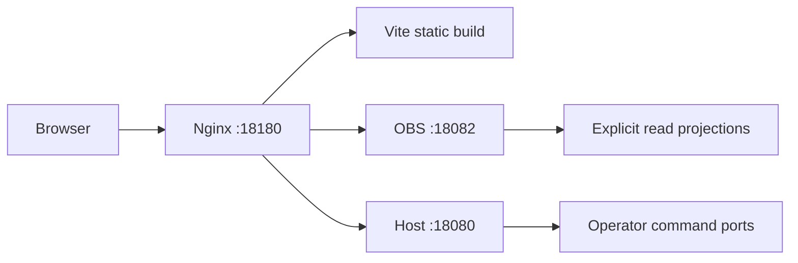

受众：MASTER
标题：Monitor UI 当前架构

# Monitor UI 当前架构

Monitor UI 是 Operator 观测与受控命令界面，不是业务 authority。它通过 Nginx 同源访问 Host 与 OBS，展示服务端读模型和 durable receipt。

## 运行形态



前端位于 `host_brain/app/monitor_ui/`，使用 React、Vite 和 HashRouter。生产验收必须运行 `npm ci`、lint、typecheck、read-model tests 和 build，再由真实 Nginx 提供产物。

## 页面职责

| 页面类型 | 展示内容 | 写入边界 |
|---|---|---|
| Overview | Host、OBS、Gateway、Edge、模型和外部服务状态 | 无 |
| Task Runtime | graph revision、attempt、lease、budget、verification、acceptance、effect、receipt | 受控取消／恢复命令 |
| Digital Life | self affect、relationship、expression 和 profile projection | 无直接状态写入 |
| Trace | 时间线、错误和降级 | acknowledgement 等受控命令 |
| Review | 待审项目与版本引用 | 通过 Host Review authority |

## 数据规则

- UI 将服务端 schema 转成 view model，不在组件中猜测业务状态。
- 网络成功不等于业务成功；必须显示 receipt 或明确 reason code。
- `UNKNOWN`、`DEGRADED` 和 `NOT_TESTED` 不得渲染为绿色。
- Host 健康不能替代 Edge、模型、Docker 或 Gateway 健康。
- fixture、local storage 和 React state 不能成为 canonical 状态。
- 用户正文、密钥和模型内部推理不得出现在 Overview 或日志下载中。

## Operator 命令

```text
UI intent
→ same-origin Host BFF
→ authenticated actor/action/scope
→ Preview/Review when required
→ governed runtime or owned domain port
→ durable receipt
→ refresh projection
```

UI 不做 optimistic canonical mutation。命令失败、超时或状态未知时保留原投影并显示明确边界。

## 真实验收

Playwright 必须连接运行中的 Nginx、OBS 和 Host，不允许拦截请求后用 fixture 冒充全栈。当前 UI 与读模型已接线，但完整服务栈和远端 Edge 仍未在当前版本共同验收。
