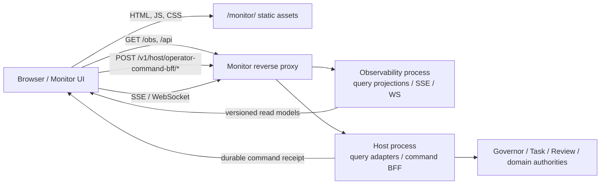
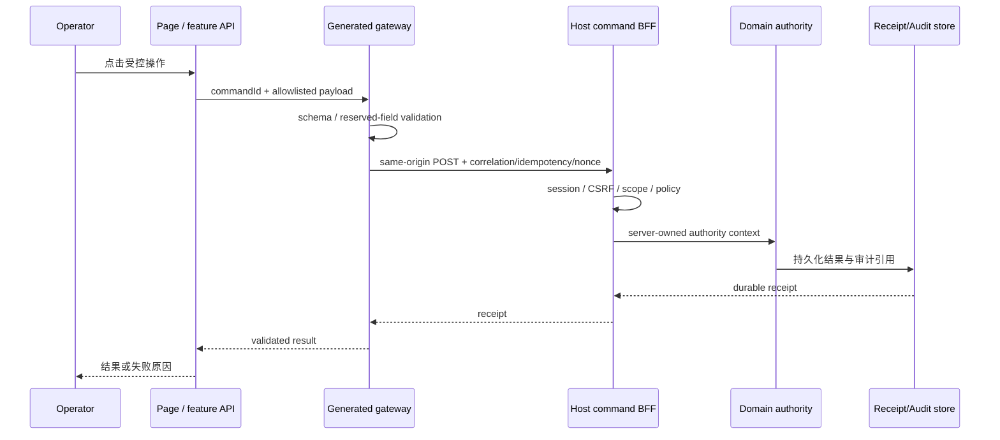
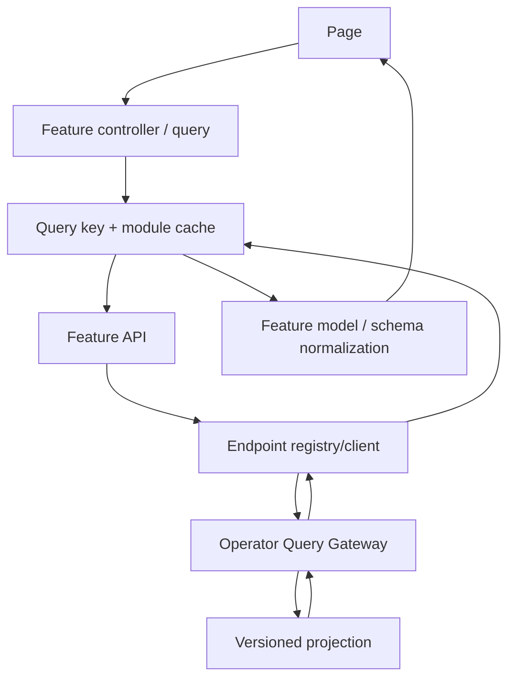

受众：MASTER
标题：Natsume AI Monitor UI 当前架构

# Natsume AI Monitor UI 当前架构

版本：v1.0
维护日期：2026-07-15
事实基线：当前仓库的 production source、Vite 配置、Nginx 启动脚本与测试
文档职责：解释 Monitor UI 现在如何启动、导航、查询、发送 Operator 命令和展示 Task Runtime，不承诺尚未接线的能力。

## 1. 结论与边界

Monitor UI 是 Natsume AI 的浏览器端 Operator 界面，不是业务权威层，也不是 Task、Review、Memory 或 Life State 的第二套真相源。它的生产边界是：

1. 通过 Observability/Host 查询接口消费版本化读模型；
2. 在页面和 feature 层将原始读模型转成可视状态；
3. 对写操作只构造合同允许的 payload，再经同源 Operator Command BFF 转交服务端权限链；
4. 展示服务端返回的 durable receipt，不把本地 toast 或 React state 当成命令成功证据。

因此，当前更准确的定级是：

| 能力 | 当前状态 | 说明 |
|---|---|---|
| SPA 入口、布局、路由和懒加载 | `WIRED` | HashRouter、route manifest、Layout 和 chunk recovery 已接线 |
| 观测与业务读模型 | `WIRED / PARTIAL` | 共享 query 层已建立，但尚未覆盖所有页面和 schema |
| Operator Command 通道 | `WIRED` | 浏览器不持有签名凭据，命令经同源 BFF |
| Task Runtime 读模型 | `WIRED` | 只读投影、DAG、Attempt、Budget、Verification、Review 和 timeline 已展示 |
| Review resume | `TRANSPORT WIRED / UI FLOW BROKEN` | 底层可消费绑定 token，但当前 approve/reject 在浏览器侧先失败，正常 UI 流程拿不到一次性 token |
| Review approve/reject | `BROKEN / FAIL-CLOSED` | 当前 UI 传入服务端保留的 `actor_id`，生成合同会在发网络请求前拒绝 |
| 路由级依赖与风险门禁 | `DECLARED ONLY` | `serviceDeps` 和 `riskLevel` 已声明，暂无生产消费者 |

与全局系统边界的关系见 [SYSTEM_ARCHITECTURE.md](SYSTEM_ARCHITECTURE.md)，状态、副作用和 receipt 流见 [DATA_FLOW_ARCHITECTURE.md](DATA_FLOW_ARCHITECTURE.md)。

## 2. 运行时拓扑



代码证据：

- 浏览器入口：[`src/main.jsx`](../../../host_brain/app/monitor_ui/src/main.jsx)
- 路由根：[`src/App.jsx`](../../../host_brain/app/monitor_ui/src/App.jsx)
- 全局 shell：[`src/app/shell/Layout.jsx`](../../../host_brain/app/monitor_ui/src/app/shell/Layout.jsx)
- 观测进程：[`host_brain/app/obs_fastapi_app.py`](../../../host_brain/app/obs_fastapi_app.py)
- Host router 组装：[`host_brain/app/router_registry.py`](../../../host_brain/app/router_registry.py)
- 生产反向代理：[`scripts/runtime/start_monitor_proxy.ps1`](../../../scripts/runtime/start_monitor_proxy.ps1)

### 2.1 启动入口

[`main.jsx`](../../../host_brain/app/monitor_ui/src/main.jsx) 先安装 chunk reload recovery，再将 React `StrictMode` 下的 `App` 挂载到 `#root`。[`App.jsx`](../../../host_brain/app/monitor_ui/src/App.jsx) 负责：

- 用 `ErrorBoundary` 包裹整个 SPA；
- 使用 `HashRouter`，避免生产静态托管为每条子路径配置 server-side fallback；
- 用 `Layout` 作为所有页面的 shell；
- 把默认路由、未匹配路由和旧路径定向到当前 canonical route；
- 为懒加载页面提供 `Suspense` fallback；
- 挂载全局 toast，但 toast 仅是交互反馈，不是持久化 receipt。

### 2.2 全局 shell

[`Layout.jsx`](../../../host_brain/app/monitor_ui/src/app/shell/Layout.jsx) 把以下跨页关切收敛在 shell：

- 桌面端两级导航与移动端 drawer；
- 当前路由高亮和鼠标/触摸预加载；
- 全局 polling 开关、间隔和页面可见性；
- 告警状态提示；
- `ForgeRiskActionBar` 等跨页风险交互；
- `Outlet` 中的页面内容。

页面转入后的业务代码不应反向修改 shell 或再定义一套导航。

## 3. Route manifest 与信息架构

### 3.1 路由事实源

[`src/app/routeManifest.jsx`](../../../host_brain/app/monitor_ui/src/app/routeManifest.jsx) 是当前 canonical route、导航分组和 legacy redirect 的主事实源。每个 entry 可声明：

| 字段 | 当前用途 | 是否生产强制 |
|---|---|---|
| `path` | canonical HashRouter 路径 | 是 |
| `legacyPaths` | 产生兼容重定向 | 是 |
| `navGroup` / `label` / `icon` | 产生导航组与项 | 是 |
| `element` | 对应懒加载页面 | 是 |
| `hiddenFromNav` | 保留可访问但不显示的详情页 | 是 |
| `smokeTest` | 路由 smoke suite 的候选标记 | 测试消费 |
| `serviceDeps` | 声明页面依赖 `obs`/`host` | 否，尚未用于 availability gate |
| `riskLevel` | 声明路由风险 | 否，尚未用于命令或访问控制 |

`NAV_SECTIONS` 从 manifest 派生，不应再手写一份菜单。文档也不锁定“页面数量”，因为路由应随功能增删；审查时应比对 manifest、loader 与 smoke test 的一致性。

### 3.2 导航分区

当前信息架构以稳定职责分组，而不是按源码文件数量分组：

| 分区 | 用户问题 | 主要内容 |
|---|---|---|
| Cockpit | 系统和数字生命当下处于什么状态？ | 驾驶舱、健康摘要、重要生命指标 |
| Life Systems | 记忆、情绪、关系、自我模型和内在世界如何变化？ | 生命时间轴、病灶、运行态和叙事视图 |
| Observability | 请求、会话、指标、Trace、告警和日志发生了什么？ | 可观测投影、链路与诊断 |
| Operations | 提示词、人格配置、系统底座和 Canon 如何管理？ | 运维配置和受治理操作 |
| Execution | 网关、Skill、Tool、Automation、TaskGraph 和边缘命令如何执行？ | 执行视图、Task/Review 和受治理命令 |
| Security Lab | 安全资产、事件和免疫运行态如何？ | 安全读模型与受控响应 |
| Integrations | 外部设备与身体表现如何接入？ | 身体集成和设备状态 |

详情页可以隐藏于导航，但仍必须保留 manifest entry、loader 和可验证深链。

### 3.3 懒加载和预加载

[`src/routes/routeLoaders.js`](../../../host_brain/app/monitor_ui/src/routes/routeLoaders.js) 维护 `PAGE_LOADERS`，将路径映射到 dynamic import，并向 shell 提供 `preloadRoute()`。导航 hover、focus 或 touch 可提前触发 loader，降低切页延迟。

当前缺口是：`routeManifest.jsx` 与 `routeLoaders.js` 都保留了 path 集合。两者可以漂移，因此 manifest 还不是完整的单一事实源。目标是让 manifest 直接持有 loader，或用构建时校验强制集合相等。

## 4. 源码分层与 feature 组织

前端当前的主调用方向是：

```text
App / Layout
  → Page
    → feature controller / query
      → feature model
      → feature api
        → shared endpoint/query/command client
          → Obs or Host HTTP boundary
```

| 层 | 主要路径 | 职责 |
|---|---|---|
| App shell | `src/app/` | 路由、导航、全局布局与 shell 交互 |
| Pages | `src/pages/` | 路由级组装，不应直接成为巨型 API/formatting 层 |
| Features | `src/features/` | 按 execution、governance、integrations、life、observability、operations、security 分包 |
| Shared API | `src/shared/api/` | endpoint registry、HTTP/Obs client、Operator Command gateway |
| Shared query | `src/shared/query/` | query key、freshness、cache、retry 和 polling |
| Global UI state | `src/store/` | 少量真正跨页的互动状态 |
| Shared UI | `src/shared/ui/` | ErrorBoundary 等通用显示基础件 |

Page 可以组装 feature，但新的 schema normalization、command payload 和数据组合应优先放入 feature model/API，以便在不启动浏览器时做合同测试。

## 5. 读链：API registry 和 query 层

### 5.1 Endpoint registry

[`src/shared/api/endpointRegistry.js`](../../../host_brain/app/monitor_ui/src/shared/api/endpointRegistry.js) 按 governance、pentest、securityImmune、observability、digitalLife、operations、integrations 和 execution 组织 endpoint。当前 entry 有两类：

- 查询 entry：带 `service: 'obs' | 'host'` 及 `path`/`queryPath`；
- 命令 entry：带 `commandId`，不在浏览器内保存服务端执行路径或签名凭据。

极少数非 GET 查询可以用 `queryOnly` 和 `queryMethods` 显式列入白名单。[`endpointClient.js`](../../../host_brain/app/monitor_ui/src/shared/api/endpointClient.js) 对其余非 GET 请求默认拒绝，并用 `DIRECT_MUTATION_ENDPOINT_DENIED` 暴露越界调用。

### 5.2 HTTP 客户端

| 客户端 | 职责 |
|---|---|
| [`httpClient.js`](../../../host_brain/app/monitor_ui/src/shared/api/httpClient.js) | 同源 fetch、JSON/body 处理、超时、错误规范化和流/文本/blob 工具 |
| [`obsClient.js`](../../../host_brain/app/monitor_ui/src/shared/api/obsClient.js) | Obs 查询包装、热 GET 的 inflight 去重/短缓存、EventSource 与 WebSocket 工具 |
| [`endpointClient.js`](../../../host_brain/app/monitor_ui/src/shared/api/endpointClient.js) | 校验 registry entry，把读分流至 Obs/Host，把命令分流至 Operator Command gateway |

前端不应依据页面所在分组猜测后端进程；实际所有者以 endpoint registry 和反向代理命名空间为准。

### 5.3 Query cache

[`queryCache.js`](../../../host_brain/app/monitor_ui/src/shared/query/queryCache.js) 是一个模块级 `Map`，提供：

- serialized query key；
- 同 key inflight Promise 去重；
- `idle/loading/refreshing/success/stale/error` 状态；
- freshness 命中；
- subscriber 通知。

[`useObservabilityQuery.js`](../../../host_brain/app/monitor_ui/src/shared/query/useObservabilityQuery.js) 用 `useSyncExternalStore` 订阅缓存，并提供有界重试、polling、页面可见性感知和手动 refetch。[`queryKeys.js`](../../../host_brain/app/monitor_ui/src/shared/query/queryKeys.js) 管理 canonical key，[`freshness.js`](../../../host_brain/app/monitor_ui/src/shared/query/freshness.js) 管理不同领域的 stale time。

这是仓库自己的轻量 query layer，不是 TanStack Query。当前 `Map` 没有显式容量上限、驱逐策略或统一 invalidation API，长会话和命令后缓存一致性仍需收敛。

## 6. 写链：Operator Command 与权限边界

### 6.1 浏览器侧

[`operatorCommandGateway.js`](../../../host_brain/app/monitor_ui/src/shared/api/operatorCommandGateway.js) 是浏览器命令出口。它：

1. 从生成客户端确认 `commandId` 存在；
2. 合并 body、path params 和 query，并转换为 snake_case；
3. 按生成 schema 执行 `additionalProperties: false` 等校验；
4. 用 Web Crypto 产生不透明 correlation ID、idempotency key 和 nonce；
5. 把请求发到同源 `/v1/host/operator-command-bff/{commandId}`；
6. 校验返回的 receipt，已完成的 receipt 必须含 audit/claim 引用。

合同要求浏览器不得发送 actor、principal、scope、签名或 proof header；这些权限信息必须由服务端从 HttpOnly session 和当前 policy 解析。当前 Review approve/reject 的 payload builder 仍错误加入 `actor_id`，因此这两条命令会在生成客户端的保留字段校验处 fail-closed；这是已知缺口，不是合同允许的例外。

### 6.2 合同生成

[`scripts/generate_operator_command_client.py`](../../../host_brain/app/monitor_ui/scripts/generate_operator_command_client.py) 生成：

- [`generated/operator-command.openapi.json`](../../../host_brain/app/monitor_ui/src/shared/api/generated/operator-command.openapi.json)
- [`generated/operatorCommandClient.ts`](../../../host_brain/app/monitor_ui/src/shared/api/generated/operatorCommandClient.ts)

生成文件不允许手改。合同源是服务端 command specs；修改 command 时应先改服务端合同，重新生成，再更新 feature payload 和测试。

### 6.3 服务端 BFF

[`host_brain/observability/command_http.py`](../../../host_brain/observability/command_http.py) 提供同源 Operator Command BFF。它的主要责任是：

- 从 operator session 解析 server principal 与 scope；
- 执行 CSRF、nonce、idempotency 和 correlation 检查；
- 要求 `obs:write` 和每条命令的专用 scope；
- 拒绝浏览器伪造的身份、authority 或 proof 字段；
- 将命令转交真正的领域/Task/Review authority；
- 返回可校验 receipt。

命令注册与 payload 约束见 [`host_brain/observability/command_ports.py`](../../../host_brain/observability/command_ports.py)。查询侧的 operator session、scope policy 和隐私字段过滤见 [`host_brain/observability/operator_query_gateway.py`](../../../host_brain/observability/operator_query_gateway.py)。

### 6.4 命令流



## 7. Task Runtime 与 Review

### 7.1 前端组件

Task Runtime 的主链是：

- 路由页：[`src/pages/TaskRuntime.jsx`](../../../host_brain/app/monitor_ui/src/pages/TaskRuntime.jsx)
- API：[`src/features/execution/taskRuntimeApi.js`](../../../host_brain/app/monitor_ui/src/features/execution/taskRuntimeApi.js)
- Query：[`src/features/execution/taskRuntimeQueries.js`](../../../host_brain/app/monitor_ui/src/features/execution/taskRuntimeQueries.js)
- 版本化 normalization 和 payload：[`src/features/execution/taskRuntimeModel.js`](../../../host_brain/app/monitor_ui/src/features/execution/taskRuntimeModel.js)
- 显示层：[`src/features/execution/components/TaskRuntimeConsole.jsx`](../../../host_brain/app/monitor_ui/src/features/execution/components/TaskRuntimeConsole.jsx)

读链消费执行索引、单个 TaskGraph 快照和 Review locator，主要显示：

- graph ID、revision、status 和 terminal 状态；
- DAG node/edge；
- Attempt、Budget 和 Verification；
- Review 状态、绑定 subject/version/checkpoint；
- 按 cursor 排序并去重的 timeline；
- `review_id` 深链定位。

### 7.2 只读投影和 fail-closed

服务端路由位于 [`host_brain/app/obs_routes_task_runtime.py`](../../../host_brain/app/obs_routes_task_runtime.py)，它从 QueryProjectionStore 读版本化投影，可在后台从 Task/Review/Runtime Event store 刷新投影。浏览器不直连 TaskStore 或 ReviewStore。

`taskRuntimeModel.js` 只接受预期 schema，并对以下不变量 fail-closed：

- 投影必须声明 `read_only: true`；
- 命令不允许 direct database write；
- resume 必须使用 bound token；
- `automatic_resume` 必须为 false；
- Review 深链必须精确匹配且不能重复；
- graphless durable Review 可被 locator 返回，不得伪造 TaskGraph 归属。

这些条件不成立时，UI 关闭命令入口，而不是降级到直接写库。

### 7.3 Review 命令的当前真实状态

| 操作 | 服务端合同 | 前端现状 | 结论 |
|---|---|---|---|
| Approve | `review_id` + subject/version/phase/checkpoint，actor 由服务端提供 | `buildReviewDecisionPayload()` 加入 `actor_id` | 生成合同会拒绝保留字段，当前不可用 |
| Reject | `review_id`，actor 由服务端提供 | 仅构造 `actor_id`，path param 合并 `review_id` | 同样在浏览器 schema 校验时拒绝 |
| Resume | `review_id` + token + subject/version/phase/checkpoint | payload 与合同一致，但正常 UI happy path 无法从已失败的 approve/reject 获得一次性 token | 仅底层 transport/模型可用；端到端 UI Review 流程仍不可用，也不会自动重排图 |

这是当前代码缺陷，不是绕过权限检查的理由。修复应删除浏览器侧 actor 输入，保留 BFF 的 server-owned authority，为 approve/reject 加上正向交互验收，并证明 approve 返回的单次 token 能被同一 subject/version/checkpoint 的 resume 流程消费。

## 8. 状态管理

Monitor UI 没有把全部业务状态塞进一个全局 store。当前状态所有权是：

| 状态类型 | 所在位置 | 例子 |
|---|---|---|
| 服务端权威状态 | Host/Obs 读模型 | TaskGraph、Review、Memory、Life state、receipt |
| 服务端数据缓存 | `shared/query/queryCache.js` | query data、error、freshness、inflight Promise |
| 跨页 UI 偏好 | [`src/store/useAppStore.js`](../../../host_brain/app/monitor_ui/src/store/useAppStore.js) | polling 开关/间隔/tick、page visibility、time range、selected request ID |
| 路由状态 | Hash URL 和 search params | canonical route、Trace/Review 深链 |
| 页面交互状态 | React local state | 选择项、表单、notice、resume token 输入 |
| 派生显示状态 | feature model/controller | schema normalization、可执行动作、风险文案 |
| 实时连接状态 | EventSource/WebSocket helper 与 feature | Trace feed、health 更新 |

不变量：页面刷新后，任何需要继续存在的业务状态都必须能从服务端读模型重建；Zustand、query cache 和 local state 不能成为唯一副本。

## 9. 数据流

### 9.1 查询数据流



查询返回不等于可盲信显示。对 Task Runtime 等关键页面，feature model 还必须校验 schema version、只读边界和命令合同元数据。

### 9.2 实时流

Trace feed 的 SSE 和健康通道的 WebSocket 由 Obs 进程提供，反向代理对 SSE 关闭 buffering，对 WebSocket 执行 upgrade。实时流只提供更新通知/投影，不能变成绕过 Operator Command 的双向写通道。

## 10. 构建、开发与部署

### 10.1 前端构建

[`package.json`](../../../host_brain/app/monitor_ui/package.json) 定义 Vite 开发/构建、Operator client 生成校验、选定 lint/typecheck、Node 测试和 Playwright 测试。主要命令：

当前锁定的 Vite 8 要求 Node.js `^20.19.0` 或 `>=22.12.0`。全新工作区应先用 lockfile 做确定性安装：

```powershell
Set-Location host_brain/app/monitor_ui
npm ci
npm run check:operator-client
npm run lint
npm run typecheck
npm run test:operator-client
npm run test:read-model
npm run build
```

[`vite.config.js`](../../../host_brain/app/monitor_ui/vite.config.js) 定义：

- public base 为 `/monitor/`；
- 产物输出到 `host_brain/app/static/monitor`；
- 对 React、ECharts、React Flow 和 UI dependency 做手动分 chunk；
- 开发服务使用同源路径模拟生产反代；
- Obs 和 Host 使用不同的默认本地目标，可通过环境变量覆盖。

`node_modules` 和静态构建产物不是架构事实源。启动生产反代前必须先完成构建；如果 `static/monitor/index.html` 不存在，不应将反代进程存活误判为 UI 可用。

### 10.2 生产反向代理

[`start_monitor_proxy.ps1`](../../../scripts/runtime/start_monitor_proxy.ps1) 生成 Nginx 配置并启动 Monitor 反代，关键边界是：

- `/monitor/assets` 可使用 immutable cache，`index.html` 不长缓存；
- HashRouter 入口回落到 `/monitor/index.html`；
- `/obs/ws/health` 以 WebSocket 转发到 Obs；
- `/obs/trace-feed/live` 以 SSE 转发到 Obs，禁用 proxy buffering；
- `/obs/` 与 `/api/ui/` 不缓存 principal-scoped 数据；
- 其余业务命名空间转发到 Host；
- 启动检查同时探测 Monitor index 与 Obs metrics。

## 11. 测试策略

### 11.1 快速合同测试

| 测试 | 验证点 |
|---|---|
| [`operatorCommandGateway.test.js`](../../../host_brain/app/monitor_ui/src/shared/api/operatorCommandGateway.test.js) | 命令 schema、保留字段、BFF 路径和 receipt |
| [`taskRuntimeModel.test.js`](../../../host_brain/app/monitor_ui/src/features/execution/taskRuntimeModel.test.js) | Task/Review schema normalization 和 fail-closed |
| [`runtimeHealth.test.js`](../../../host_brain/app/monitor_ui/src/utils/runtimeHealth.test.js) | 运行时健康派生模型 |
| [`playwrightArtifactPolicy.test.js`](../../../host_brain/app/monitor_ui/playwrightArtifactPolicy.test.js) | Playwright 产物策略 |
| [`tests/contract/test_web_ui_contract.py`](../../../tests/contract/test_web_ui_contract.py) | SPA 源码、进程边界与 Obs UI API 合同 |

### 11.2 浏览器验收

| Suite | 验证点 |
|---|---|
| [`monitor-route-smoke.spec.js`](../../../host_brain/app/monitor_ui/e2e/monitor-route-smoke.spec.js) | route shell、canonical route 和 legacy redirect |
| [`monitor-interactions-smoke.spec.js`](../../../host_brain/app/monitor_ui/e2e/monitor-interactions-smoke.spec.js) | 关键交互、生成 BFF、Task Review 与命令拒绝 |
| [`monitor-canonical-regression.spec.js`](../../../host_brain/app/monitor_ui/e2e/monitor-canonical-regression.spec.js) | canonical 页面实际流程回归 |
| [`core-release-real-interaction.spec.js`](../../../host_brain/app/monitor_ui/e2e/core-release-real-interaction.spec.js) | Core Release 的真实交互切片 |

修改路由时至少运行 route smoke；修改 command、Task Runtime 或 Review 时运行 generated-client check、相关 Node tests 和 interaction E2E；改变反代或进程所有权时还必须做 Host + Obs + proxy 的联合实测。

## 12. 当前缺口与收敛顺序

### P0：正确性

1. **修复 Task Review approve/reject payload**：删除浏览器 actor 字段，使 payload 与 generated contract 一致，增加正向 BFF/receipt E2E。
2. **保持 resume 的 bound-token 语义**：不得用 boolean 确认或 local state 替代 token、subject/version、phase 和 checkpoint。
3. **统一命令后数据更新**：用 receipt 和服务端投影刷新驱动页面，不用本地乐观状态伪造完成。

### P1：架构收敛

1. **合并 route manifest 与 loader 事实源**，消除双重 path 清单。
2. **让 `serviceDeps` 和 route `riskLevel` 变成真正门禁输入**，用于服务可用性、feature gate 和风险呈现；它们现在只是注释性元数据。
3. **完成 endpoint registry 集中化**：Task Review locator 尚在 feature API 内联声明，个别页面仍直接依赖 shared endpoint 层。
4. **完成 query layer 迁移**：统一 schema normalization、freshness、retry 和 polling 语义，补充缓存驱逐与 invalidation。
5. **扩大 lint/typecheck 覆盖**：当前 package scripts 只检查 Task Runtime 与部分 generated/shared 文件，不是全量前端门禁。

### P2：验收可靠性

1. **路由 smoke 应直接消费可导入 manifest**：当前测试用正则解析 JSX 源文本，并保留与页面数相关的固定下界，对格式变更和功能删减较脆弱。
2. **补齐真实 session 和多进程联合验收**：包括 CSRF/scope、Host/Obs 故障、SSE/WS 重连、响应式和可访问性。
3. **区分“反代存活”与“UI 可用”**：产物缺失、chunk 失配、Obs 投影不可用都应有独立探测。

## 13. 变更规则

1. 新增页面时，同步更新 route manifest、loader、feature/page 源码和 route smoke，不更新一个手写“总页面数”。
2. 新增查询时，先确定 Obs/Host owner、scope、隐私过滤和 schema，再注册 endpoint/query key/freshness。
3. 新增写操作时，先定义服务端 command spec 和 authority，重新生成客户端，不直接在页面写 fetch POST。
4. 修改 Task/Review 时，保持 graph revision、subject version、checkpoint、token 和 receipt 的绑定，不以 UI 便利性放宽合同。
5. 修改部署路径时，同步检查 Vite base/outDir、Nginx location、SSE/WS 特殊配置和启动 probe。
6. 文档中的 `WIRED`、`PARTIAL`、`BROKEN` 以生产接线与测试证据为准，不以组件文件存在或 mock 页面可渲染为准。

## 14. 审查清单

对 Monitor UI 架构变更进行 code review 时，至少回答：

- canonical route 只在哪里定义，legacy 深链是否继续有效？
- 读数据的真实 owner 是 Obs 还是 Host，schema 不兼容时是否 fail-closed？
- 读模型是否过滤了 principal-scoped/private 字段？
- 写操作是否全部通过 generated Operator Command gateway？
- 浏览器是否伪造 actor、scope、proof 或签名？
- 页面是否用 durable receipt/重读投影确认结果，而不是只看 HTTP 200 或 toast？
- query key、freshness、retry、polling 和 cache invalidation 是否可预期？
- Task/Review 是否保留 revision、subject/version、checkpoint 和 token 绑定？
- 构建、合同、route smoke、interaction E2E 和真实多进程验收是否按风险覆盖？
