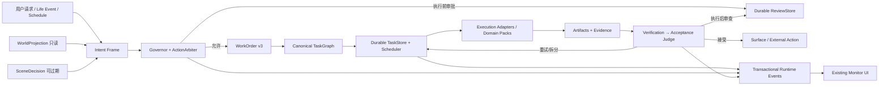

受众：PROJECT
标题：Natsume AI V1 长期演化能力重构架构基线（代码事实版）

# Natsume AI V1 长期演化能力重构架构基线（代码事实版）

版本：v1.3
日期：2026-07-12
状态：`ADOPTED_ARCHITECTURE_BASELINE`
代码基线：`dev@1ec8be1a8a20397627855aa946c0ff8aaaa87b72`
工作区状态：dirty；未提交业务改动和运行数据未被视为稳定代码基线。
上游参考：`C:/Users/34145/Downloads/Natsume_AI_V1_高级能力拓展重构计划_新增长期演化能力.md`
历史 M48 记录：`docs/30_devspec/NATSUME_AI_V1_LONG_TERM_EVOLUTION_EXECUTION_20260710.md`
完整目标蓝图：`docs/50_project/arch/NATSUME_AI_V1_FULL_ARCHITECTURE_TARGET_20260710.md`
完整程序执行：`docs/30_devspec/NATSUME_AI_V1_FULL_ARCHITECTURE_REFACTOR_MASTER_EXECUTION_20260710.md`

本文记录 M48-A 从白皮书目标到当前代码事实的安全收敛裁决，不是完整目标架构。本文不是实现任务源；M48-A 的 TASK 编号和内部依赖以 M48-A 详细执行文档为准，跨 M48-B～M57 的切流、停止、回滚和退役以完整程序执行文档为准。

---

## 0. 结论

当前 Natsume AI 并不是缺少高级能力的空白原型，而是已经拥有多套任务、生命、治理、领域和观测能力，但存在控制面分叉、持久恢复不完整和状态写边界不清晰的问题。

M48-A 的合理定位是“安全收敛地基”：

1. 收敛现有 PlanningAgent、SkillDagPlan、PlanGraph、AgentWorkOrder、SubAgent 和 Governed Graph，而不是新建第三套 Supervisor/TaskGraph。
2. 先封住 Domain→Life/Canon 写边界，再建设 WorldProjection 和长期演化层。
3. 先完成 durable TaskStore、Verification、Judge、Review/Resume，再切换主执行链。
4. 在现有 runtime/persona/bond/memory/tribe 上扩展 Life 能力，不建立平行 Life Core。
5. 复用现有 Monitor UI、health/startup/heartbeat 和 identity 组件，不重写 Operator Console 或 Runtime Guardian。

M48-A 详细执行文档拆分为 26 个逻辑工作包，单人串行预估 58～97 个有效开发日。技能编译器、完整经验回流、通用 MCTS、反事实实验室、Knowledge OS 和自动人格迁移不属于 M48-A；其中经代码审计确认需要的能力已纳入完整程序的 M49～M57，不能再把本文件的局部范围解释为完整重构范围。

---

## 1. 白皮书目标与代码裁决原则

上游文档给出的长期方向包括 Digital Life Core、Universal Agent Runtime、Domain Pack、Operator Console、World Model、Scene Engine、Intent Arbiter、Capability Maturity、Runtime Guardian 和 Identity Migration。

该文档同时明确生成时未直接挂载代码仓库，因此其中的路径、类名、数量和工期只能作为目标候选。架构裁决采用以下优先级：

```text
当前代码事实
  > 当前 Living 架构/DevSpec
  > 白皮书目标模型
  > 白皮书建议文件路径与工时
```

当能力已经存在时，V1 采用保留、适配和收敛；当能力只有字段或占位接口时，不能把“声明存在”写成“运行闭环已经完成”。

---

## 2. 当前代码事实表

| 代码事实 | 证据 | 架构含义 |
|---|---|---|
| `AgentWorkOrder` 已有 domain、run_mode、workspace、actions、acceptance、verification、approval、review | `host_brain/agent_runtime/work_order.py:48-109` | 在现有契约上版本化扩展，不另建同义 WorkOrder |
| `SkillDagNode/SkillDagPlan` 已声明 dependencies、retry、idempotency、risk 和 execution batches | `host_brain/app/skill_dag_planner.py:15-73,150-264` | 它是 TaskGraph 契约种子，但 retry/idempotency 尚无完整运行时消费者 |
| 普通复杂任务调用 `run_plan_graph()` 时没有把原 plan 作为执行真源 | 历史提交中的 `host_brain/app/executive_runtime_core.py:1377-1419`（现迁至 `host_brain/executive_runtime/`） | 当时主链会二次规划；V1 需要只规划一次并持久化同一 revision |
| `PlanGraph` 保存 depends_on，却把 dependency context 置空并将所有任务通过 `Send` 发出 | `host_brain/app/plan_graph.py:168-175,209-235` | 依赖语义在普通复杂任务路径不成立 |
| 旧依赖感知执行分支已不可达 | 历史提交中的 `host_brain/app/executive_runtime_core.py:1453-1454`（现迁至 `host_brain/executive_runtime/`）及调用点检查 | 不能把死代码当作可靠 fallback |
| 当前幂等 key 包含 plan/node 身份 | `host_brain/app/skill_dag_planner.py` 的 idempotency 生成逻辑 | 重规划会产生新 key；副作用需要稳定业务 scope/fingerprint |
| Governed `GraphState` 已有 checkpoint、interrupt/resume、branch、barrier、artifact 和 Judge 字段 | `host_brain/integrations/graph_contract.py:97-176` | 它是单次执行控制态，不是任务/记忆/关系/知识共用领域图 |
| LangGraph checkpoint 优先使用 SQLite，`CheckpointManager` 仍有占位部分 | `host_brain/integrations/graph_checkpoint.py:133-171,218-227` | 复用 checkpoint；补 durable Review 和真实 resume，不再造平行系统 |
| `AgentContextEnvelope` 已有限额、角色 profile、敏感键脱敏与 forbidden context | `host_brain/app/sub_agent_context.py:18-227` | Context 工作是 tokenizer/ref authorization/审计升级，不是从零建设 |
| Context 已有局部 tool budget，但没有统一 durable BudgetLedger | `host_brain/app/sub_agent_context.py:66,263-277,343-345` | 预算应随 TaskStore 持久化预留与用量，不另建脱离任务状态的控制面 |
| SubAgent 注册仍由常量集合和 handler map 硬编码 | `host_brain/app/sub_agent_protocol.py:31-75,131-172` | 适合做目录适配，但 Tribe 器官不能自动等同任务 Worker |
| Tribe 当前有 23 family、25 个默认 descriptor | `host_brain/tribe/registry.py:17-79` 与运行时盘点 | 它们主要是生命内部组织，不是 23 个可独立调度子 Agent |
| Tribe EventBus 是 1024 条内存环形缓冲，队列满可丢事件 | `host_brain/tribe/event_bus.py:40-64,127-149,253-277` | 只可作为通知面；关键事件必须先持久化 |
| Agent Job Registry 仅在内存中 | `host_brain/agent_runtime/job_registry.py:11-51` | 长任务、审批和重启恢复前需要 durable TaskStore |
| VerificationPolicy 可以执行命令，但 Executor 未用结果控制最终接受状态 | `host_brain/agent_runtime/verification_policy.py:10-68`；`executor.py:421-445` | Verification 需成为 fail-closed 状态门禁 |
| Verification 命令路径缺少统一 sandbox/allowlist 与规范异常映射 | `host_brain/agent_runtime/verification_policy.py` | required verification 需区分 PASS/FAIL/ERROR/NOT_RUN |
| acceptance criteria 主要进入 prompt，没有逐项证据判定 | Agent Runtime 和 Executive Runtime 调用链 | 执行成功与符合验收必须分离 |
| ReviewPolicy 只产生布尔；写确认可由 payload `confirmed=true` 表达 | `review_policy.py:8-12`；`workspace_policy.py:92-105` | 需要 durable ReviewItem 与 TokenService 绑定 |
| 两套 ReAct 会把原始 `thought` 放入持久/传播结构 | `agent_runtime/agent_executor.py:81-110,529-550`；`app/agents/react_loop.py:58-103` | 新持久层之前先完成数据最小化 |
| Digital Life 已有 versioned snapshot、state/work events 和 proactive outbox | `host_brain/runtime/life_continuity.py:42-56,164-218` | World/Life 演化从现有运行时投影，不新建 Life Core |
| Digital Life 保存使用无条件 upsert | `host_brain/runtime/life_continuity.py:201-208` | 多写入者前需要 expected-version OCC |
| Life schema 仍由运行时代码直接创建 | `host_brain/runtime/life_continuity.py:42-56,127-140` | schema 应进入受控 migration catalog |
| 通用 migration metadata 以无 scope 的 migration ID 为主 | `host_brain/audit/migration_runner.py:213,316-348` | M48 新 schema 统一使用 central audit catalog；拆独立 catalog 前需先解决 scope 冲突 |
| Bond 已包含积分/阶段、情感质感、裂痕/修复 | `host_brain/bond/bond_stage_engine.py:208-314` | 关系系统并非单一好感分 |
| SocialBrain 已派生 trust、affinity、safety、dependency、rupture/repair 向量 | `host_brain/tribe/social_brain_agent.py:200-255,689-740` | 多维关系是现有能力；score/stage 适合作为兼容 projection |
| `EmotionalProactiveEpisode` 已表达 felt reason、行动、边界、aftereffect 和 evidence | `host_brain/persona/emotional_proactive.py:30-73,100-235` | Appraisal 应作为事件适配和证据链，不重置现有情绪系统 |
| Pentest 多个模块直接依赖 WorldCanonStore | `host_brain/pentest/` 调用点扫描 | Domain 与核心知识边界当前被实际穿透 |
| 成功攻击链会被 Pentest 直接 upsert 到 Canon | `host_brain/pentest/autonomous_kernel.py:1602-1659` | Pentest 知识隔离是长期演化层之前的最高优先级 |
| `proposal_id` 不提供真实审批；WorldCanonStore 先写文件再记 APPLIED | `host_brain/memory/canon_world_store.py:97-172` | Canon 需要唯一受治理 Apply Service |
| `campaign_memory.py` 使用失效导入/签名并吞异常 | `host_brain/pentest/campaign_memory.py` | 迁移清单必须区分活跃路径与死代码 |
| Pentest GraphMerger 是 AttackGraph 原地 union，无版本控制 | `host_brain/pentest/swarm/graph_merge.py:32-139` | 不能直接抽成通用 GraphStateStore |
| `run_swarm()` 在主聊天/Governed Graph 主链无生产调用点 | `host_brain/pentest/swarm/swarm_kernel.py:214-267` 与调用点扫描 | Swarm/MCTS 先评测，不进入 V1 公共 Runtime |
| Monitor UI 已有 37 条路由和 7 组信息架构 | `host_brain/app/monitor_ui/src/app/routeManifest.jsx` | 扩展现有页面，不重写前端壳 |
| startup、health、heartbeat、resource manager 已提供守护底座 | 对应 `host_brain/app`、`observability`、`core` 模块 | DegradationState 是统一投影和状态机，不是新 guardian 进程 |
| SelfModel、漂移检测、启动快照和 release manifest 已存在 | `persona/self_model.py`、`persona/drift_detector.py`、`app/startup_snapshot.py`、release 模块 | V1 身份演化从 snapshot/diff/review 开始 |

---

## 3. 已验证基线

2026-07-10 当前工作树的只读验证结果：

| 检查 | 结果 |
|---|---|
| SkillDag、复杂规划、SubAgent Context、checkpoint、Codex runtime 五组测试 | 34 passed，0 failed |
| 架构边界候选测试 | 14 passed，0 failed |
| static scan | passed，0 violations；当前只覆盖 Bond SSOT 与 no-rule-degrade |
| 全量 pytest 收集 | 6881 collected，0 collection errors |
| 稳定范围收集 | 6449 collected（unit 5228；contract/integration 1221） |
| Monitor UI Playwright discovery | 93 tests（routes 65；interactions 28） |
| 已知警告 | `candidate_scoring.py:1097` 的 `\[` 无效转义 |

这些数字是基线快照，不是永恒门槛。测试数量有意变化需要说明；硬门槛是 0 collection errors、稳定门禁不退化和新增契约有对应测试。

---

## 4. 不采用的目标路径

1. 不新增 `host_brain/life/` 平行根包。
2. 不把当前 GraphState 扩为任务、关系、记忆和知识共用的超级图。
3. 不直接把 Pentest GraphMerger、MCTS 或 Swarm 提升为公共 Runtime。
4. 不把 23 个 Tribe family 等同为 23 个任务 Worker。
5. 不新建第二套 Runtime Guardian。
6. 不在 V1 自动修改人格、关系、长期记忆、策略或成熟度。
7. 不把 raw chain-of-thought 当作 Trace 产品字段。
8. 不先重写 Monitor UI；后端 read model 和治理闭环先于页面扩展。
9. 不在新旧执行器之间交接存量任务或同时执行真实副作用。
10. 不使用破坏性 down migration 作为回滚手段。

---

## 5. 目标架构



### 5.1 权力顺序

1. Hard Policy、Host Sovereignty 和 Governor 拥有最终否决权。
2. 用户显式意图定义目标；Life/Emotion/Relationship 推断不能替换目标。
3. Planner 决定完成路径，但不能授予能力或越过审批。
4. World/Scene/Appraisal/Bond 只提供事实、软约束和表达策略。
5. Capability maturity 只能收紧静态权限上限。
6. Domain 只能提交本领域结果和核心状态变更候选。
7. 用户可见人格表达只经 Surface 收口。

### 5.2 状态所有权

| 状态 | 唯一写入者/命令入口 | 其他模块权限 |
|---|---|---|
| TaskGraph/Node/Attempt | TaskStore + canonical scheduler | 提交命令或事件候选 |
| Governed execution state | GraphRuntime/GraphExecutor | 既有 checkpoint API |
| Review 决策 | ReviewStore + TokenService | 创建候选或消费绑定决定 |
| Digital Life | LifeState command path | expected-version 命令 |
| World model | 无独立真源；WorldProjection 构建 | 只读 |
| Persona/Identity | Persona Engine + owner-approved release | snapshot 或候选变更 |
| Bond | BondDynamics 单写路径 | 关系事件候选和只读 projection |
| LifeMemory | LifeMemory governance path | Domain 只能提交候选 |
| WorldCanon | CanonApplyService | Domain 只能提交 promotion candidate |
| Pentest knowledge | PentestKnowledgeStore | 领域内受控读写 |
| Trace/Evidence | Evidence Plane/outbox | 引用化读取 |

---

## 6. 关键状态语义

执行前审批和执行后验收必须分离：

```text
READY → WAITING_APPROVAL → READY | CANCELLED

READY → LEASED → RUNNING → EXECUTED → VERIFYING
VERIFYING → VERIFIED | VERIFICATION_FAILED
VERIFIED → ACCEPTED | WAITING_ACCEPTANCE_REVIEW
WAITING_ACCEPTANCE_REVIEW → ACCEPTED | FAILED | RETRY_PENDING | CANCELLED
```

`VERIFIED → WAITING_REVIEW → READY` 不是合法统一恢复语义，因为它可能重放已发生的副作用。required verification 仅 `PASS` 可继续；`FAIL`、`ERROR` 和 `NOT_RUN` 都是 fail closed。

TaskStore 的持久化语义不仅是 SQLite 表，还包括：

- expected-version CAS
- task attempt ownership
- worker lease 与 heartbeat
- startup recovery scan
- cancel/cancel-ack protocol
- 稳定业务 idempotency reservation
- 状态与 outbox 同事务提交
- token/tool/time/concurrency/retry/model cost 的预算预留、消费与超限事件

---

## 7. 能力范围

### V1 / M48

- Domain/Canon 写边界与 Pentest 知识隔离
- WorkOrder v3 与 Canonical TaskGraph
- Durable TaskStore 与 shadow/canonical scheduler
- Verification、Acceptance Judge、Review/Resume
- Runtime Event、SSE replay、Context 引用治理
- Life OCC、WorldProjection、Appraisal/Bond、Scene/ActionArbiter
- Capability maturity、DegradationState、Identity Snapshot
- 现有 Monitor UI 的增量 read model
- 迁移、canary、drain 和 rollback seal

### V1.x

- 技能编译器候选与人工发布流程
- 经验回流候选、counterfactual 报告
- 能力实验沙盒和第二领域搜索评测
- 知识治理增强与长期指标

### V2

- 通用场景实验室
- 跨设备世界模型
- 自主知识维护
- 完整人格迁移与回归体系
- 经第二领域证明后的通用搜索/MCTS 接口

---

## 8. 风险结论

| 风险 | 架构控制 |
|---|---|
| 双计划或双执行产生重复副作用 | plan once、stable business idempotency、shadow 禁副作用、新旧任务不交接 |
| TaskStore 名义持久但无法恢复 | CAS、attempt、lease、heartbeat、recovery、cancel、outbox 同时成立 |
| Verification 失败仍被接受 | required 仅 PASS；FAIL/ERROR/NOT_RUN 全部 fail closed |
| Review 恢复阶段混淆 | PRE/POST Review 分态和一次性 resume |
| Domain 污染人格/Canon | Domain store、promotion candidate、CanonApplyService、static scan |
| Trace 泄漏内部推理或私密数据 | allowlist、refs、集中脱敏、raw thought 零新增 |
| WorldProjection 把推断当事实 | source/confidence/TTL/epistemic type/conflict、只读接口 |
| Bond 重构丢失裂痕修复语义 | 复用 BondDynamics/SocialBrain，score/stage 仅兼容投影 |
| Capability 自我强化 | 自动只降级，升级依赖评测与人工 Review |
| Persona 漂移 | release snapshot/diff/review，不做自动迁移 |

---

## 9. 正式执行关系

本架构基线对应以下正式资产：

| 层级 | 文档/编号 |
|---|---|
| PRD | `FR-NLE-001`～`FR-NLE-005` |
| DevSpec | `docs/30_devspec/DevSpec.md` §15 |
| 历史 DevTasks | `TASK-0461`～`TASK-0486`（仅作追踪） |
| 正式执行文档 | `docs/30_devspec/NATSUME_AI_V1_FULL_ARCHITECTURE_REFACTOR_MASTER_EXECUTION_20260710.md` v2 |
| TestPlan | `T-NLE-01`～`T-NLE-24` |
| Trace | `R-178`～`R-182` |

架构基线状态为 ADOPTED 不等于代码已经完成。任何能力只有在所属 Architecture Wave 完成 production cutover、旧 authority 收敛并通过 Master v2 的分层验收后，才可从规划口径变成当前代码事实。

当前执行状态（2026-07-12）：M48 已实现资产作为历史地基复用，未完成的 production 接线并入 AW-00。旧 TASK-0486 的 identity/live/prod 环境欠项进入 AW-08 最终验收，不再阻塞 AW-01～AW-07 的本地架构实施。
