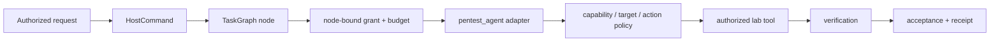

受众：CODEX
标题：Pentest Delegate 当前架构

# Pentest Delegate 当前架构

Pentest 是当前保留的受管 Delegate 场景，用于经过授权的靶场测试。它不是七海普通聊天主链，也不拥有独立于 Host 的执行或授权 authority。

## 不变量

- 只允许明确登记的实验目标、capability 和 action。
- 禁止越权、生产目标探测和策略绕过。
- 每个动作绑定 node grant、预算、workspace 和 target identity。
- 工具输出是证据，不是自动成功结论。
- 失败、取消和未知副作用由 Task Runtime reconciliation 处理。
- Pentest 自己不能启用生产策略或抽取第二套公共 Planning Runtime。

## 证据

历史靶场能力图已移入 `docs/_history/testing/`。新的原始 probe result 放在忽略的 `artifacts/pentest_agent_lab_evidence/`，不得用旧 Markdown 快照宣称当前能力通过。

Pentest 不是当前数字生命交付的主优先级；其代码仅需保持受管、可回归和不影响实时陪伴热路径。
