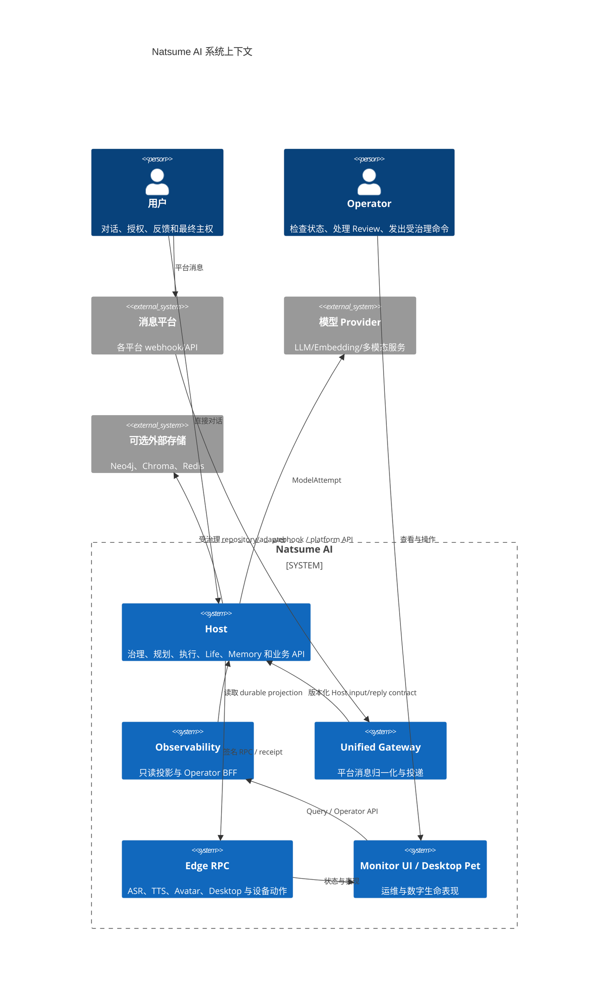
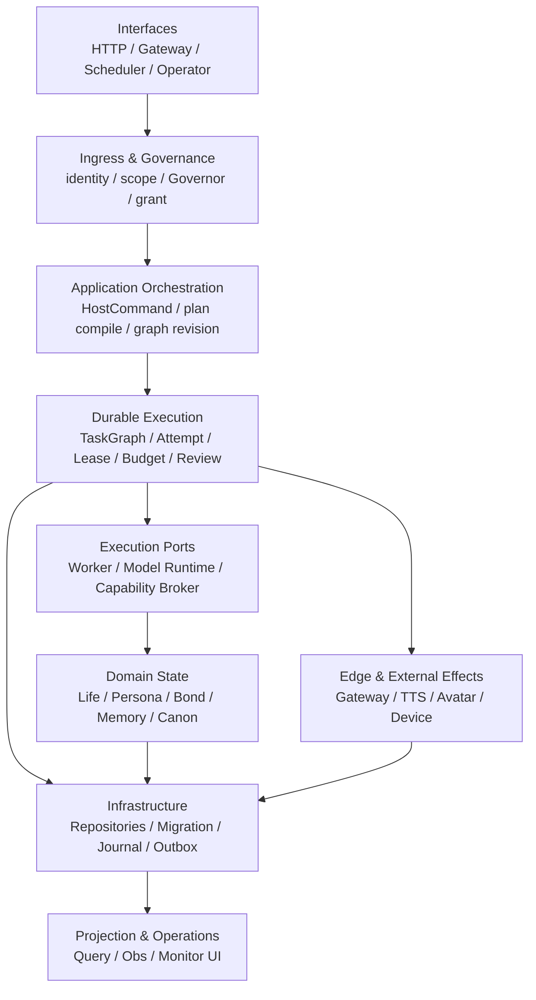
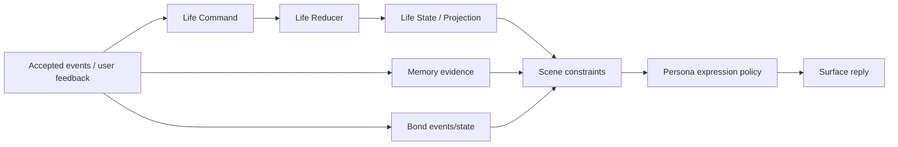
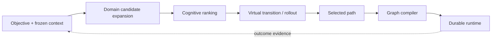

受众：PROJECT
标题：Natsume AI 系统架构总览

# Natsume AI 系统架构总览

版本：v2.3
核对日期：2026-07-18
文档类型：`CURRENT STRUCTURAL OVERVIEW`

本文解释生产代码如何分层、各进程如何协作、状态和执行 authority 放在哪里。它不承担完成度裁决：具体接线状态看 [CURRENT_CODE_ARCHITECTURE.md](CURRENT_CODE_ARCHITECTURE.md)，目标看 [TARGET_ARCHITECTURE.md](TARGET_ARCHITECTURE.md)，差距看 [ARCHITECTURE_GAP_MATRIX.md](ARCHITECTURE_GAP_MATRIX.md)。

## 1. 系统边界

Natsume AI 由一个 Host 控制面、多个接入/外显运行面和若干可选基础服务组成。Host 负责业务决策和长期状态，Gateway 负责平台协议，Edge 负责本机感知与物理动作，Observability 负责只读投影和 Operator 交互。



若渲染器不支持 C4 扩展，可从 [运行拓扑图](diagrams/01_runtime_topology.md) 查看普通 Mermaid 版本。

## 2. 进程与部署拓扑

| 进程/运行面 | Composition 入口 | 拥有的职责 | 不应拥有的职责 |
|---|---|---|---|
| Host Main | `host_brain/__main__.py` → `host_brain.app.asgi:app` | Command admission、Governor、Task Runtime、业务领域、API | 平台协议细节、设备驱动、只读 UI 状态真相 |
| Observability | `host_brain/obs_main.py` → `host_brain.app.obs_fastapi_app:app` | 运行投影、Trace、健康、Operator BFF | 直接修改业务数据库或绕过 Command 入口 |
| Edge RPC | `edge_client/__main__.py` → `edge_client.app.fastapi_app` | 本机感知、语音、Avatar、Desktop、actuator | 人格、任务或对话事实裁决 |
| Unified Gateway | `edge_client.gateway.bootstrap` → `edge_client.gateway.server` | Webhook、平台归一化、可靠投递 | Host 的业务路由和长期状态 |
| Monitor UI | `host_brain/app/monitor_ui/` | Query、Review、Operator command 客户端 | 自己维护任务真相或直接调用 worker |
| Desktop Pet | `desktop_pet/main.cjs` | Live2D 表现和桌面交互 | Life/Persona authority |

Host 与 Observability 是独立 ASGI 应用。Gateway 可以由 Edge lifecycle 装配，但其 transport state 和平台 adapter 仍是独立边界。所有跨进程 payload 应来自 `natsume_contracts/` 或显式版本化 HTTP 合同。

## 3. 逻辑分层



依赖方向的核心规则：接口适配器可以调用 application port，application 可以组合 domain contract，infrastructure 实现 repository/transport port；domain 不应反向导入 FastAPI、全局 composition 或平台 SDK。

### 3.1 接口与输入层

主要代码：

- `host_brain/app/app_factory.py`：Host FastAPI 应用构造和特殊入口。
- `host_brain/app/router_registry.py`：普通业务 router 装配。
- `host_brain/input_runtime/`：Host input、delivery 和 reply contract。
- `host_brain/secure_ingress/`：身份、scope、重放和输入合法性边界。
- `edge_client/gateway/`：平台 payload 归一化与出站 adapter。

输入层只负责把外部协议变成内部 command 材料，不应自己执行 Skill、调用模型或修改长期状态。

### 3.2 治理与应用编排层

主要代码：

- `host_brain/governor/`：意图规则、授权、rate limit 和 action preview。
- `host_brain/agent_runtime/cortex_runtime.py`：Host route 识别与 governed/compatibility 分流。
- `host_brain/orchestration/`：HostCommand、WorkOrderV3、计划图编译、revision、node grant 和 recovery intent。
- `host_brain/app/governed_task_adapter.py`：Host 请求到 Governed Task Runtime 的生命周期、合同编译与应用适配。
- `host_brain/app/governed_task_authority.py`：无状态的 HostCommand/WorkOrder/planning lineage、route-aware exact replay 与 fail-closed authority 校验；不写 Store、不执行 TaskGraph。

该层决定“是否允许做、冻结成什么图”，但不应把模型输出直接当成已经执行的事实。

### 3.3 规划层

`host_brain/planning_search/` 提供无副作用搜索内核；领域 adapter 提供 candidate expander、ranker、virtual transition 和 reward。选中路径必须经过 `host_brain/orchestration/planning_graph_compiler.py` 编译为不可变 TaskGraph 才能进入执行。D16 将 Code 的冻结证据边界放在 `planning_search/code_domain_models.py`，将动态 catalog/ranker/compile binding 放在 `planning_search/code_domain.py`：它只消费冻结 opaque ref/digest，动态生成虚拟 `inspect → registered patch → unit/rollback`；其 selected inputs 必须由 catalog 重建后才能进入 compiler context。D17 的 `planning_search/code_benchmark_models.py` / `code_benchmark_sandbox.py` 则处在实验 I/O 边界：它对清洁、受保护且拥有非共享 `.git` 的 source 建立无 remote、private-hooks 的 private bare clone，再创建同 frozen commit 的 baseline/search detached worktree；只允许仓库自有 trusted in-process adapter 使用 lower-case repository-relative file API。D18 的 `code_benchmark_ledger.py` / 0106 SQLite owner 将 preregistered workload、paired RunSpec、两臂 evidence/outcome 和 `VERIFIED_CLEAN` 回执封成 append-only terminal experiment receipt。D19 的 `code_benchmark_verification_contracts.py` / `code_benchmark_verifier.py` 只在预注册 plan 下运行冻结 `python -m pytest -q <repo-relative-test>` argv，并把 shell-free child 的无路径命令回执写回 arm evidence；`code_benchmark_experiment.py` 只在两 arm PASS 与 clean receipt 时登记 terminal evidence。这都是可重放实验事实，不是 execution/promotion authority。该 adapter/ledger 没有进入 production composition；窄 API、Git hardening、同主机 subprocess 与账本都不是 OS/container/filesystem/network sandbox，`network_isolation=NOT_ENFORCED`；只有测试命令数/验证总时限在 D19 adapter 内受控，model、plugin/skill、hidden-oracle、provider/tool/token/cost 和一般 runtime budget 均不在其 authority 内。

当前 Host `plan` 的搜索材料来自已经批准的 `planned_steps/steps`，主要作用是校验和拓扑选择，而不是从目标发明新步骤。Code adapter 仍是 pure shadow：`virtual_model_ready=false` 时不暴露 L3 simulation ports，且它不读工作区、不调用模型/工具/测试、不 admission 图或写 workspace；`allowed_path_refs` 不是 live ACL。Pentest 是目前更完整的领域 adapter，但 Conditional MCTS 仍不能影响生产选择。

### 3.4 Durable 执行层

主要代码：

- `host_brain/task_runtime/coordinator.py`：DAG 外层调度和对窄 runtime service 的直接调用；不再拥有 0091 complete wrapper。
- [`host_brain/task_runtime/node_execution_runtime.py`](../../../host_brain/task_runtime/node_execution_runtime.py)：完整节点 worker/heartbeat/retry/Budget/verification/acceptance/review 编排；共享既有 authority，不建立第二事务或锁。
- [`host_brain/task_runtime/accepted_graph_finalization.py`](../../../host_brain/task_runtime/accepted_graph_finalization.py)：normal Node、single-node checkpoint continuation 与 outer all-ACCEPTED re-entry 共用的 Graph+Acceptance Effect completion；重启只接受 Store exact Operation checkpoint 与 canonical WorkerProjection。
- [`host_brain/task_runtime/operation_recovery_runtime.py`](../../../host_brain/task_runtime/operation_recovery_runtime.py)、[`operation_checkpoint_continuation.py`](../../../host_brain/task_runtime/operation_checkpoint_continuation.py)：仅 single-node post-budget checkpoint 的 fenced takeover 与 Verification/Acceptance continuation；不执行 worker，不取得 general/batch/pre-budget recovery authority。
- [`host_brain/audit/migrations/0100_task_runtime_graph_revision_supersession.sql`](../../../host_brain/audit/migrations/0100_task_runtime_graph_revision_supersession.sql)、[`host_brain/persistence/host_command_repository.py`](../../../host_brain/persistence/host_command_repository.py)：显式 FAILED-only replan 的 append-only predecessor→replacement authority；同一写事务重验静止 predecessor并 admission revision+1，普通 Store/Review mutation 读取 supersession fence。当前为保守 safe subset，不等于自动重规划。
- [`host_brain/task_runtime/node_execution_projection.py`](../../../host_brain/task_runtime/node_execution_projection.py)：节点 terminal replay、Attempt/Reservation 等 durable read；只读，不拥有 mutation authority。
- [`host_brain/task_runtime/node_execution_records.py`](../../../host_brain/task_runtime/node_execution_records.py)：节点执行的纯构造、digest、retry identity 与 record 校验。
- [`host_brain/task_runtime/parallel_success_runtime.py`](../../../host_brain/task_runtime/parallel_success_runtime.py)：0091 整图成功的 durable read/validation、Budget refresh、Outbox 与 canonical success 编排；共享原 authority，不拥有事务。
- [`host_brain/task_runtime/parallel_success_records.py`](../../../host_brain/task_runtime/parallel_success_records.py)：0091 route-authority 纯投影；不持有 Store 或 runtime authority。
- `host_brain/task_runtime/coordinator_records.py`：durable record 校验、并行节点 outcome 与稳定字段读取；纯叶子模块。
- `host_brain/task_runtime/coordinator_receipts.py`：不可变 execution receipt、构造器与 terminal/commit event rendering；纯叶子模块并保持旧导入 identity。
- `host_brain/task_runtime/parallel_settlement_projection.py`：0090 active re-entry、rejected Budget outcome 与 outcome snapshot 的 durable read/validation；只持同一 Store，无 mutation authority。
- `host_brain/task_runtime/parallel_settlement_runtime.py`：0090 failure/review/Budget outcome resolution、ownership/CAS conflict 判定与 settlement orchestration；共享原 Store、BudgetRuntime、RuntimeOutbox 和 Projection，不建立第二事务或发布锁。
- `host_brain/task_runtime/graph_cancellation_records.py`：取消 intent 校验、Node 状态投影与 Budget target/projection；不拥有取消编排 authority。
- `host_brain/task_runtime/graph_cancellation_runtime.py`：两阶段取消 request/continue、exact replay、advance/finalize 与本地 cancel/join 编排；只依赖同一 Store、共享 Outbox/Registry、lease TTL 和只读 Projection。
- `host_brain/task_runtime/graph_cancellation_projection.py`：读取取消 intent、Graph/Node/Budget/Attempt/decision durable facts并构造 terminal receipt；只持 Store，不拥有 mutation authority。
- `host_brain/task_runtime/graph_cancellation_continuation_worker.py`：0094 composition-owned pending-intent scanner；持久 claim/heartbeat/defer/expired takeover，从 exact HostCommand admission 重建 replay 上下文后重入既有 GraphCancellationRuntime，不拥有业务取消状态。
- `host_brain/task_runtime/runtime_outbox.py`：每个 Coordinator 唯一的 Outbox message factory/publisher/limit/发布锁；不持有 Store 或 Coordinator。
- `host_brain/task_runtime/local_graph_execution_registry.py`：graph revision 级本地 task tracking 与 bounded cancel/join；只作 durable cancellation 的进程内加速器。
- `host_brain/task_runtime/dag_scheduler.py`：稳定 READY/fan-in/retry due 纯调度决策。
- `host_brain/task_runtime/budget_runtime.py`：预算预留、计量和结算。
- `host_brain/task_runtime/review_runtime.py`：PRE/POST Review 与 continuation 材料。
- `host_brain/task_runtime/acceptance_effects.py`：Acceptance effect intent 构造。
- `host_brain/task_runtime/acceptance_effect_dispatcher.py`：验收后副作用投递。
- `host_brain/persistence/task_repository.py`：Durable TaskGraph、Node、Attempt、Lease、Budget 的唯一 Store 组合、连接与事务 authority；通过无状态 persistence mixin 复用窄职责实现。
- `host_brain/persistence/task_dag_state_store.py`：Graph/Node 创建、读取、状态转换与一致 scheduler snapshot；caller-owned insert 不接管调用方事务。
- `host_brain/persistence/task_ready_claim_store.py`：READY claim 与 response-loss exact replay；一个 writer transaction 内复核容量并提交 Attempt、Node、Lease、Heartbeat 与三条 Outbox。
- `host_brain/persistence/task_store_types.py`：TaskStore 错误、状态枚举、Outbox 与稳定 value records；无连接、SQL 或事务，并由 repository 兼容重导出。
- `host_brain/persistence/task_record_codec.py`：确定性 JSON/SQLite Row 校验与合同重建；不执行 SQL，依赖方向固定为 repository → codec → types/contracts。
- `host_brain/persistence/task_budget_usage_store.py`：BudgetUsage 唯一 winner、`ALREADY_EXCEEDED` sibling、exact replay 与可供 0090 decision 写/读/replay 在单一快照中复用的 terminal authority 校验；只借用主 Store transaction。
- `host_brain/persistence/task_operation_checkpoint_store.py`：一次读取并验证 COMMITTED Reservation、唯一 COMMITTED Outbox、Attempt 与历史 Lease/fence 的 fail-closed checkpoint；不创建第二 Store。
- `host_brain/persistence/task_outbox_delivery_store.py`：`TaskOutboxDeliveryStoreMixin` 统一拥有 Task mutation 的 `_insert_outbox` 与 response-loss `_assert_mutation_outbox_replay` 实现，并承担 0093 Task Runtime Outbox 的跨进程 claim、expired takeover、fenced complete/release 和失败 backoff；0095 将 Graph predecessor/head 隔离到 `aggregate_type + aggregate_id + graph_revision`，并以 exact trigger/readiness 拒绝错绑。Mixin 只借用 `DurableTaskStore` 的连接、时钟与事务 authority；它不是第二个 Store 或 UoW owner。
- `host_brain/persistence/task_graph_cancellation_continuation_store.py`：0094 cancellation coordination claim、heartbeat、defer、complete 与 expired takeover；只保存租约/重试元数据并借用主 Store authority，0092 intent/decision 仍是唯一业务真相。
- `host_brain/persistence/review_continuation_store.py`：0096 task-bound Review continuation 的 enqueue/reconcile/claim/heartbeat/defer/complete 与 expired takeover；只保存协调身份和租约，不复制 Review status/token 或 Task 状态。create 时在同一事务校验 canonical subject、outer graph/node、精确 Node waiting/version 及 PRE/POST Attempt 约束；claim 按候选独立事务隔离 poison 行。
- `host_brain/persistence/task_decision_integrity.py`：decision/outbox lineage 的只读绑定校验；只借用 repository 当前事务连接执行 `SELECT`，不取得连接、事务或 mutation authority。
- `host_brain/persistence/task_acceptance_effect_staging.py`：Acceptance Effect 规范化、staging，以及 Node/Graph acceptance 与 effect 的原子同事务提交；只借用主 Store 当前事务。
- `host_brain/persistence/task_acceptance_effect_delivery.py`：Acceptance Effect schema、查询、claim、commit/fail/reschedule 与 fencing；不创建独立 Store、连接或事务 owner。
- `host_brain/persistence/task_parallel_success_store.py`：0091 Parallel Success schema、read/replay、Attempt/projection lineage 与 Graph/Budget/Outbox/effect/decision 原子成功收口；只借用主 Store 的唯一事务。
- `host_brain/persistence/task_parallel_settlement_store.py`：0090 failure/review/Budget settlement 的 schema、read/replay、lineage 与 Graph/Budget/Outbox/decision 原子收口；只借用主 Store 的唯一事务。
- `host_brain/persistence/task_parallel_state.py`：0090/0091/0092 共用的 Node snapshot 规范化和严格对账；无 SQL、连接或事务 authority。
- `host_brain/persistence/task_graph_cancellation_request.py`：0092 phase-1 intent 与 Graph/Node/Attempt/Lease/Review/token/operation/effect fence 原子请求写路径；只借用主 Store 事务。
- `host_brain/persistence/task_graph_cancellation_finalization.py`：0092 reconciliation advance 与 Graph/Budget/Outbox/decision 原子终结写路径；Operation proof 与 PENDING Effect proof 仍通过主 Store common evidence 验证。
- `host_brain/task_runtime/graph_cancellation_operation_reconciliation.py`、`graph_cancellation_effect_reconciliation.py`：受限签名 Operation/Effect 对账服务，由 ProcessTaskRuntimeContainer 构造并经各自 ASGI/OBS 默认关闭入口注册，当前均为 `WIRED_DEFAULT_OFF / CANARY_NOT_RUN`。
- `host_brain/persistence/task_effect_reconciliation_store.py`：稳定兼容 composite；实际实现拆到 common helpers、read/validation 与 mutation focused modules，只借用主 Store authority。
- `host_brain/persistence/task_graph_cancellation_effect_overlay_store.py`：PENDING proof/new-decision evidence 与 FINALIZED trusted correction overlay；不改写旧 decision/fence/evidence。
- `host_brain/task_runtime/terminal_state_reconciliation.py`：0099 历史 TaskGraph 终态 repair service；只处理 inventory case，不成为 Runtime 重入或通用恢复 authority。显式 system auto 仅消费带唯一 graph-scope Budget 的 exact failure bundle，Operator repair 必须签名。
- `host_brain/persistence/task_terminal_reconciliation_store.py`、`terminal_reconciliation_query_repository.py`：0099 append-only case/proof/supersession composite 与 SQLite query-only authority；migration 只建 schema/trigger/index，不修改 Graph、Budget 或旧业务记录。
- `host_brain/persistence/task_retry_mutation_store.py`：retry promotion/schedule、BudgetUsage、Budget/Attempt/Node/Lease/Outbox 原子 mutation；区分 legacy 与 node-only disposition。
- `host_brain/persistence/task_retry_replay_store.py`：retry response-loss 的同事务 exact replay；不创建连接或事务。
- `host_brain/persistence/task_atomic_failure_store.py`：pre-reservation Attempt/Node/Lease、可选 Graph 与 Outbox 原子失败收口；明确不拥有 Budget mutation。

执行器只接收冻结节点输入和 node-bound grant。任何失败后的计划变化都应生成新 graph revision，不能在 worker 内静默修改原图。

当前 Task Runtime 已消费 B0 的 `{max_attempts, retry_backoff_ms}` 与无副作用调度决策。`DurableNodeExecutionRuntime` 在 B1 原子 claim/promotion 上保留唯一自动重试边界：worker resolver 在 operation reservation 前显式抛 `RetryableWorkerPreparationError`。TaskStore 在同一 `BEGIN IMMEDIATE` 中写 retry_count BudgetUsage、Budget、Attempt、Node、Lease 与 Outbox；允许时到期创建 attempt 2，超限时 fail closed，reservation 后异常绝不 retry。提交响应丢失时，exact replay 会严格校验上述聚合、BudgetUsage 与关联 Outbox，避免重复扣费；resolver `CancelledError` 原样传播。

TaskStore 的 DAG state、READY claim、中央 mutation Outbox、BudgetUsage contention 与 Operation checkpoint read 均已拆为 focused mixin。`task_repository.py` 当前 4,358 行，`task_budget_usage_store.py` 732 行，`task_operation_checkpoint_store.py` 214 行；`DurableTaskStore` 仍是唯一组合/连接/UoW owner，没有新增 architecture policy 白名单或第二 Store authority。

0102 又增加 focused `TaskNodeArtifactStoreMixin`，并与 GR06 NODE Effect 汇合到 canonical `commit_node_acceptance()`。production normal/checkpoint/Review acceptance 在同一 Store transaction 中冻结 exact NODE Effect set、写 immutable artifact、推进 Node `ACCEPTED` 与追加 Attempt-bound Node Outbox；exact replay 不得在 Acceptance 后补写缺失 effect。dispatcher 只有在同 graph/revision/node/Attempt 的 artifact 通过 contract/payload digest 重验后才可 claim Effect。compiler 生成 dependency result refs，后继执行只解析同 revision 的 exact 前驱 artifact 并冻结进 worker 输入。新 admission 拒绝空 `output_contract`；Task Runtime 在 recovery 前校验 0102 migration asset 和完整 schema snapshot，并隔离 active legacy 空合同/缺 artifact，以及缺 exact artifact 的可投递 terminal legacy Effect。应用 Store 的低层 ACCEPTED writer 已被 artifact fence 阻断，但 standalone pre-stage、legacy/internal `create_graph` 与 direct SQL 仍是兼容/物理旁路，因此定级为 `UNIFIED_APPLICATION_STORE_UOW_WIRED / PRESTAGE_COMPATIBILITY_PRESENT / SQL_DIRECT_BYPASS_PRESENT`。

Coordinator 当前 268 行，`DurableDagSchedulingRuntime` 1,338 行；238 行 `AcceptedGraphFinalizationRuntime` 统一 normal/restart/continuation completion，Operation recovery 与 checkpoint continuation均低于 600 行。Dag 矩阵为 Store9/Budget9/Lifecycle17/AcceptedFinalization1/NodeProjection13/NodeExecution7/Settlement4/Success1/Review4/Cancellation1/Outbox 1 build+6 publish。没有 Coordinator callback、新锁或第二 persistence authority。mixed-file Gate 仍因 `governed_task_adapter.py`、`host_command_repository.py`、`review_continuation_store.py`、`scheduler/governed_runtime.py` 四个既存未分类 >1,500 行文件为 RED；`asgi.py` 保持在门禁线内，本切片未新增违规或白名单，整体仍为 `PARTIAL_B5C_DURABLE_CANCELLATION_SHADOW / PRODUCTION_OFF`。

0093 已完成 Task Runtime Outbox 投递的跨进程 authority：每个 claim 持久化 owner、token、expiry 和单调递增 fencing token，过期后可由新 owner takeover，旧 owner 的 complete/release 会被 fence。0095 给 canonical Outbox 增加 nullable `graph_revision`，强制 `TASK_GRAPH` 行绑定现存 `(graph_id, revision)`；0098 只为 `GRAPH_CANCELLATION_EFFECT_RECONCILIATION` 增加同样的 revision，并由 trigger 约束 case ID、payload ref 与 immutable inventory 一致；其他 aggregate 保持 `NULL`。物理形状固定为 `INTEGER / nullable / no-default / non-PK`，insert/update trigger、readiness 和 codec 都拒绝错绑。历史回填只采用 0090/0091/0092 decision、0092 intent、Attempt、唯一 durable revision，或 Outbox evidence 中 immutable HostCommand `command_id`；HostCommand 来源精确覆盖正常 multi-revision CREATED，来源冲突或仍无法唯一归属时整笔迁移回滚。Store 以 `aggregate_type + aggregate_id + graph_revision` 隔离 predecessor/head，再按 aggregate version、created timestamp 与 outbox id 阻止同 revision 后续消息越过未发布 predecessor。所有生产 Graph producer 显式写 revision；新 Runtime Event aggregate key 为 `graph_id@revision`，旧 journal 不改写并通过 source Outbox revision 兼容 exact 查询。Operator Query 按 exact revision 读取，ReviewStore 同时按 canonical task-node subject ref revision 过滤。`RuntimeOutboxPublisher` 逐条 `claim → idempotent append_task_outbox → fenced complete`；append 失败则以同一 claim fenced release，并落 retry deadline/backoff 与 last_error。Composition 使用 boot/construction-scoped `recovery_id::outbox` 唯一 owner，在 startup publish 后启动可关闭后台 worker；worker 按 aggregate-head backlog 的最早 available/claim-expiry 与有界轮询自动续投。显式 drain 只有 canonical total_pending=0 才返回 DRAINED，仍有 claim/backoff/blocked predecessor 时返回 DEFERRED。`list_pending_outbox` 保留完整 PENDING inventory，delivery-ready 只由 aggregate-head claim/backlog 表达。Readiness 是每个 Store 实例的缓存 mode，热路径不重扫，显式诊断 force-revalidate 例外；进程内锁仅是降噪。

非 attempt 历史 transition 不局限于 CREATED：Migration Runner 的 deterministic `natsume_sha256_hex` 会以 revision-bound HostCommand command ID 重建升级前 governed digest，并同时验证 legacy Outbox ID/key，因此 ACTIVE 等正常多 revision 行也可 exact 回填；自定义 producer 无可证明身份时仍整事务阻断。升级不改变既有 ID/key，只新增 revision 列。新 Graph payload ref 带 `@revision`，旧 ref 仅限 codec/replay compatibility，新写 trigger 拒绝。Runtime Event 侧以 `TASK_STORE_OUTBOX source_ref` unique partial index 建立一对一围栏；append 已提交但 complete 未确认的旧事件重投，只有可精确重建原 legacy event 时才返回原 journal，不重复投影。0095 readiness/receipt gate 同时冻结 payload trigger 和 source index。

Event 的零时间兼容允许 `source created_ts=0 + current revisioned 或 legacy unrevisioned 可重建 candidate + durable ts 非负`；两条历史 append 路径都可能用时钟替代零值，除 timestamp 外的字段仍必须 exact。PlanningRecovery 才会以 `include_graph_outboxes=true` 在 scheduler snapshot 的同一读事务加载 exact Outbox，并使用真实 terminal payload ref；默认 `false` 使普通调度与 Operator 热路径不扫描 Outbox。只有旧版或替代 Store 未提供可选扩展字段时才合成 revisioned fallback；生产 DurableTaskStore 提供 inventory 后，缺行、畸形或歧义均 fail closed。

pre-reservation 的普通或重试耗尽 failure 已由 `fail_running_attempt_bundle` 原子关闭 Attempt、Node、Graph 和 Lease。reservation 建立后，`DurableExecutionHeartbeat` 周期性先续 Lease、再续 Reservation；心跳失败返回 `RECOVERY_REQUIRED`，不会提交未经证明的 Worker 结果。自动接管只接受 single-node canonical COMMITTED checkpoint：COMMITTED Reservation、唯一 COMMITTED Outbox、原 Attempt、历史 Lease/fence、hash receipt、canonical WorkerProjection 与唯一 ACTIVE graph Budget。已有 exact accepted usage 只读核对；usage 完全缺失且无 worker-kind 冲突时，旧 Lease 到期后先以新 fence 接管，再用 Attempt start→Reservation commit 的正持久时间上界幂等结算。并发、响应丢失与超限均不重跑 worker；冲突/拒绝/漂移 usage、非法时间、general/batch/pre-operation recovery仍 fail closed。

Node 已 ACCEPTED、Graph ACTIVE、Effect 尚未落盘的崩溃窗由共享 `AcceptedGraphFinalizationRuntime` 处理：重启重验同一 Operation checkpoint/canonical projection后，通过既有 Graph+Effect UoW 原子补写；篡改投影时零 Effect且 Graph不完成，重复重放保持 Effect identity/idempotency。

`PARTIAL_B5C_DURABLE_CANCELLATION_SHADOW / PRODUCTION_OFF` 在 B4 之上保留 B5A/B5B 的持久可选 `completion_policy=ATOMIC_GRAPH_SUCCESS_V1`、显式 sink `result_node_id` 和 0091 atomic success；atomic/bounded 两个能力开关独立且默认 `false`，Host、Scheduler、Internal 三处生产 composition 均 OFF。

运行入口先验证 `0090` settlement 与 `0092` cancellation schema；atomic policy 还验证 `0091`，再允许 Budget activation 或 worker resolution。0090 的 active re-entry、rejected Budget outcome 与 outcome snapshot read/validation 由 ParallelSettlementProjection 完成，resolution 与 settlement orchestration 由 ParallelSettlementRuntime 完成；`ACTIVE` 多节点重入的 B4 ownership/CAS 语义不变。

0090/B4 继续从 durable Node、Attempt、Reservation、BudgetUsage 重建 failure/review/Budget canonical v2 decision；ParallelSettlementRuntime/Projection 取得 runtime orchestration/read owner，但 `task_parallel_settlement_store.py` 仍在唯一 UoW 中提交 Graph、可选 Budget、两类 Outbox 与 0090 decision。全节点 Accepted 时，B5 对每个 frozen worker projection 重算 canonical digest并绑定 command/request、route/target、graph/node/attempt、receipt 与 node grant；只有显式 result projection 编译整图 effects 和公开结果。`complete_parallel_graph_success()` 在单 UoW 中提交 Graph COMPLETED、Budget CONSUMED、两条 Outbox、全图 effect intents 与 0091 decision。completed replay 只读 0091、不重编 effects；两次响应丢失后重读 terminal authority。

B5C 以迁移 0092 建立 canonical cancellation intent/decision/effect fence。`task_graph.cancel` 已接入 Operator Command Gateway、同源 BFF 与 Task Runtime UI，payload 精确绑定 `graph_id + graph_revision + reason_code`，并要求 `obs:write + task-runtime:cancel`。Gateway 认证后的 server-owned authority 携带 durable audit/claim、request/principal/tenant、认证 body digest、action/scopes；同一个 `SecureIngressGraphCancellationAuthorityVerifier` 注入 Host、Internal、Scheduler，重读 committed 且尚无 terminal `claim_result_ref` 的 Secure Ingress authority 并复核 canonical body 后，才以 `audit_ref` 签发 request identity。Outcome 封口后的 authority 不可再作为进程内 bearer；公开 duplicate 只重放原 outcome。Application 不接受调用方自报 request identity/source。phase 1 UoW 先写 intent、Graph `BLOCKED` 及 Node/Attempt/Lease/Review/token/operation/effect fence，提交后 GraphCancellationRuntime 才通过共享 registry cancel/join 本进程 child 与 heartbeat。execute re-entry 由 Coordinator 薄委托该 Runtime 读取 durable intent 并继续 advance/finalize；只读 Projection 与本地 task handle 都不拥有取消 authority。

Operator Runtime 先用 exact revision 读取 immutable HostCommand surface，再回到 Host、Internal 或 Scheduler owner。下游异常后，它重读 exact revision 的 durable intent：本次 request、audit identity、OPERATOR、reason、graph/revision 全匹配才报告可能已有副作用，明确无 intent 则按未执行拒绝，读取失败或畸形事实保守标为不确定。只有 cancellation handler 显式翻译为 OBS 封闭端口异常的确定性可被采信；任意依赖异常即使暴露同名字段也保持 uncertain。UI 只触发命令并刷新 durable projection，不从按钮返回乐观推断 `CANCELLED`。Cancellation、Operation/Effect reconciliation 与 0099 terminal reconciliation 开关均默认 `false`；任一 Operator 入口还要求 Secure Ingress=`ENFORCE`、可执行 Gateway 和有效 Ed25519 公钥环，否则开放路由前失败。Cancellation 是否可生产启用还受 Operation/Effect 与 0099 current anomaly、proof/supersession closure、quarantine gate 共同约束。

phase 2 只在 active ownership 与 operation/effect/review 不确定性全部 reconciliation 后提交 Graph `CANCELLED`、Budget 释放/取消、Outbox 和 canonical decision。`ACCEPTED` Node + `SUCCEEDED` Attempt 对应的 NODE effect 已拥有 acceptance authority，取消后继续 delivery；其余 NODE effect 与未完成 Graph 的 GRAPH effect被 fence。0091 success 与 0092 cancellation first-writer-wins，请求与封口响应丢失 exact replay；shutdown/disconnect 不自动变成业务取消。

Effect fence 的证据规则为 fail closed：一般 handler/transport `FAILED` 不能证明 `NO_SIDE_EFFECT`。取消请求看到既有 `FAILED`，或 `CLAIMED` effect 在取消后失败，都保持 `RECONCILIATION_REQUIRED`；advance 不得把它们自动升级为 `FAILED_EVIDENCE`。只有携带 durable receipt 的 `COMMITTED` 自动成为 `COMMITTED_EVIDENCE`。0098 将旧 `FAILED_EVIDENCE`、retry-PENDING+CANCELLED fence 与 finalized 历史异常冻结成 immutable case；PENDING proof 可成为新 decision evidence，FINALIZED correction只作 trusted overlay，旧 decision/fence/evidence 不变。proof exact 绑定 case/intent/effect/fence/Attempt/resolution/actor/Outbox/revision；迟到 Effect writer 与 PENDING proof 冲突时同事务拒绝。

0094 在该业务状态机之外增加 composition-owned continuation worker。`ProcessTaskRuntimeContainer` 拥有一个 process-shared `LocalGraphExecutionRegistry`，Host、Internal、Scheduler Coordinator 与 worker 的 GraphCancellationRuntime 共用它确认本进程 quiescence，但它不是 durable authority。0094 readiness/codec 要求 exact frozen columns，拒绝额外 `status` 等业务字段；`intent_ref` 必须是 `TEXT NOT NULL PRIMARY KEY` 的物理 identity，不接受 SQLite rowid PK NULL/复合 FK 豁免幽灵行。worker 以 `recovery_id::graph-cancellation` owner 扫描 0092 `REQUESTED` 且无 decision 的 intent，持久 claim/heartbeat/defer，并在 lease 过期后以更高 fence takeover；claim/heartbeat/defer/complete 在 `BEGIN IMMEDIATE` 获得写锁后才采样时钟。worker 从 HostCommandRepository 精确重建 command、work order、assignment、graph 与 replay admission，再调用现有 GraphCancellationRuntime。Runtime 未显式获得 `local_pending` 时必先 `cancel_and_join`；本地 task 非静默时不得 advance/finalize，只 durable defer。只有 0092 intent 已 `FINALIZED` 且 decision 存在时才 complete 协调行；operation/effect/review 尚未收敛时同样只 durable defer。0094 表不是取消状态副本。

0095 之后，完整历史 `taskbatch` marker 缺行/错绑扫描按 exact `graph_id + graph_revision` 执行，multi-revision graph ID 不再跳过历史扫描。0090/0091/0092 decision 读取继续校验 digest、Outbox、Attempt/usage 等既有 lineage，并新增 Graph Outbox revision 精确绑定；revisioned 0090/Outbox identity 缺口已关闭。

这些仍是默认关闭的 cancellation production wiring，不是 production cancellation enablement。Budget 高竞争唯一 winner已证明；目标部署 legacy inventory remediation、历史半状态、general/batch/pre-budget recovery、现实 resolver、部署密钥/凭据、完整 key lifecycle 与真实 canary仍是缺口。整体状态保持 `PARTIAL_B5C_DURABLE_CANCELLATION_SHADOW / PRODUCTION_OFF`。

0096 的 Review authority 是固定字段集、secret-free projection；原始 claim token 不跨 surface，任何额外字段拒绝。READY claim 前先验证 immutable node grant，并在创建 Attempt/Lease 的同一 `BEGIN IMMEDIATE` 中复核 live Review claim；worker 首次执行前再验证 exact Attempt、Lease、owner 与 fence，下游节点还要求 reviewed anchor 已 `ACCEPTED + SUCCEEDED`。credential 覆盖 budget time window 加 child TTL、最多 24 小时，但不以长 credential 取代 live claim hand-off。首次 worker 校验后由 Task Attempt/Lease 管理已开始的调用；Review heartbeat 丢失不能撤销 blocking/to_thread 外部副作用，也不能让 stale owner complete/defer。一般工具级合作取消仍未闭环。

0097 对 node-grant stage 建立 request+intent partial unique index和身份 trigger；ledger 以 writer transaction 内的 deterministic batch CAS 让并发进程收敛到同一批。Review HTTP 决策使用 `review.operator / review:decide`，actor 强制绑定认证 principal，Task-bound create 不暴露给 HTTP。Internal/Scheduler denial 使用 exact `review-decision://...`；历史 POST pre-acceptance result 只能在 HostCommand、Graph/Node/Review/version 与旧 receipt 全匹配时原子替换。以上为 `WIRED_TASK_BOUND / CANARY_NOT_RUN`，不是完整 Review UI 或 cancellation enablement。

0099 把旧 Runtime 曾经可能静默修补的 terminal Graph/Budget 半状态改为显式 reconciliation。`recover_startup` 先完成已有 Attempt/Lease/Reservation 恢复，随后在单一 SQLite snapshot 中单次最多分类 10,000 个 terminal Graph 并追加 immutable case；migration 本身不扫描或修复业务行。Readiness 严格比较 3 table/4 index/10 trigger 的 canonical `sqlite_master` SQL，并用 Python 复核 case/subject/proof。只有 `FAILED + exact atomic failure bundle + 唯一 graph-scope ACTIVE/EXCEEDED Budget` 是 `EXACT_REPAIRABLE`；`BLOCKED + durable failure` 和 legacy `CANCELLED + unsettled Budget` 是 `SIGNED_REPAIR_REQUIRED`。child/missing/multi Budget、PENDING/CONSUMED，以及 Graph/Node/Review/Attempt/Lease/并行终态任一漂移只可 `QUARANTINED_STRUCTURAL`。Classifier 要求唯一 0090 decision、完整 0091/0092 validator 和 exact Attempt failure Outbox payload refs。Runtime 重入在新建/激活 Budget 前拒绝 terminal Graph；已 inventoried 未决 current case 是 graph-wide 围栏，拒绝普通 Graph transition/cancellation request 与 Budget transition/consume/usage/retry，只有 0099 proof UoW 可 bypass。case/proof/supersession 只追加；旧 case 只能指向同事务冻结的新 current case，每个历史 case 的替代链最终必须收敛到可信 proof。System proof 用 immutable case 时间稳定跨进程 identity；healthy closure 只在历史未决 case 且 current classifier healthy 时生成 signed `NONE`，且零 Graph/Budget/Outbox 写入。这不是 general/multi-node/pre-budget recovery。

### 3.5 模型与能力执行层

- `host_brain/model_runtime/`：prompt contract、provider route、ModelAttempt、重试与用量证据。
- `host_brain/capability_plane/`：Capability Broker、descriptor policy、execution journal。
- `host_brain/skills/`：内置 Skill 定义、executor 和签名供应链资产。
- `host_brain/tools/`、`host_brain/mcp/`、`host_brain/lsp/`：具体工具和协议 adapter。
- `host_brain/airlock/`：外部 bundle 的验证、隔离和 quarantine。

模型建议和工具返回值都是执行材料，不自动成为事实。Capability 执行必须有 grant、attempt 和 receipt；外部 bundle 当前只允许安全接收和隔离，完整 staged activation/rollback 尚未闭环。

### 3.6 数字生命与表达层

- `host_brain/digital_life/`：Life command/event/reducer/projection 主干。
- `host_brain/persona/`：人格、情绪、场景策略、表达材料和最终 Surface 行为。
- `host_brain/bond/`：关系状态与事件。
- `host_brain/tribe/`、`host_brain/organ_ops/`：器官化能力模型与协作材料。
- `host_brain/surface_runtime/`：最终回复运行合同。

Life 状态、人格策略和最终文本不是同一种 authority：Life reducer 管状态，Persona 提供表达约束，Surface 生成最终外显。当前仍存在直接 Persona growth writer，因此“安全演化”尚未成立。

### 3.7 记忆、知识素材与状态层

- `host_brain/memory/`：Life memory、episodic/semantic material、Canon adapter 和投影同步。
- `host_brain/retrieval/`：Surface recall 的多路召回、融合和来源标注。
- `host_brain/canon/`：Canon 的提案、应用和 durable state。
- `host_brain/persistence/`：typed repositories 和只读 query repositories。
- `host_brain/audit/`：SQLite ledger、migration、journal 和审计资产。

向量、图和缓存只用于召回与投影，不能独立覆盖 canonical state。Memory/Canon 的写入必须经过对应 application/repository 合同并保留 provenance。

### 3.8 观测与运维层

- `host_brain/observability/`：运行事件、健康、跨时间线和 Query services。
- `host_brain/app/obs_fastapi_app.py`、`host_brain/app/obs_routes_*`：独立 Observability API。
- `host_brain/app/monitor_ui/`：React Operator UI。
- `host_brain/service_catalog/`：端点目录与启动 preflight 合同。

Observability 读取 durable projection。目标约束是：任何改变系统的操作都应发出 Operator command，并重新进入对应的 Governed Runtime/领域 authority，UI/BFF 不得直接写 repository。当前仍有少量专用 control endpoint 直接调用 domain 或 embodiment port，因此 Operator 写链整体只能定级为 `WIRED/PARTIAL`；这些例外必须继续收敛，不能从本节反推为已经统一接线。

0099 的 `candidates/cases/challenge` 三条 GET 与 Effect 查询一样要求 `obs:task-runtime:read`。主 Host 与独立 Obs 均只构造同 canonical SQLite 的 `mode=ro + PRAGMA query_only=ON` repository，且禁止回退完整 `DurableTaskStore`。Challenge 直接从 `request.state.operator_query_context.authority.principal_id` 绑定认证 actor，要求 `attestation_ref/key_id/issued_ts_ms`，并在认证 authority 已绑定 key ID 时拒绝 key 漂移。Route 调用 runtime 权威 builder，将 case/current subject 与确定性 Graph/Budget Outbox 编进 Store 实际验签的 final canonical bytes，同时返回 `command_request`；HTTP challenge → 真实 Ed25519 签名 → Store round-trip 已通过。该证据不覆盖外部 deployment inventory、凭据或 key rotation/revocation 生命周期。

## 4. Host Composition

Host 的入口装配顺序是：

```text
host_brain.__main__
  → uvicorn imports host_brain.app.asgi:app
  → asgi.create_app()
  → app_factory creates FastAPI and special routes
  → router_registry registers ordinary routers
  → lifespan owns startup / drain / shutdown
```

`host_brain/composition/task_runtime.py::ProcessTaskRuntimeContainer` 已显式拥有 TaskStore、ReviewStore、CommandRepository、EventStore 和 lifecycle，是当前较清晰的 composition 范例。

D1 route scope 另将 Canon/Tool/Bond 从模块全局 provider 迁到每个 app 的 frozen `HostRoutePorts`。`app_factory`/`router_registry` 用 `create_canon_router/create_tool_router/create_bond_router` 闭包注册，Security→OBS composition 把同一个 ports bundle 传给三类 command adapters；构造或关闭另一个 Host app 不会覆盖已有 app。该切片没有删除 Capability Forge、Scheduler/Review、Life、Tribe 或其余 `process_services` locator。

D2 为独立Obs增加`create_obs_app()`与app-local `ObsApplicationPorts/Container`。D3最初注册19个producer并先迁移17个端点。D4将BioOps 8、Life 3、Operator live 4、summary/runtime/resource 4共19个GET的store discovery改为必需显式参数；36个已识别端点（35 HTTP + 1 WebSocket）及stats查询使用当前app Store/View。D5又修正5个`/api/ui/*` GET，以及Security 3、Skill 1、Life 1、Semantic 1、Governance 1共7个实际GET，并以双Obs app/双SQLite验证隔离。Semantic/Governance拆为独立认证job后总producer增至21。

Host新增mode、capability-forge、semantic-recall、governance、runtime五条不进入OpenAPI的隐藏只读路由及版本合同；Host侧只保留专用token摘要，Obs client持有启动时捕获的配置值。每个Host lifespan创建一个五合同共享的source instance，合同revision各自锁内单调递增。Obs通过通用Query Projection SQLite的`compare_and_upsert`单事务CAS持久当前lineage，并从immutable journal读取完整历史epoch；同epoch revision/observed/evidence回滚、同revision payload漂移和任意退役epoch重放都会失败关闭。合同递归约束`timestamp`、`*_ts_ms`、`*_at_ms`不晚于Host observed；Obs以本地接收时间最多允许5秒skew、正证据最大120秒，freshness不晚于本地接收。Host composition、route、Obs receiver各做公共序列化和合同复验；Organ `key_metrics`另以逐agent显式数值/布尔allowlist约束。Transport固定五路径allowlist、禁代理/重定向、限制1 MiB，并以单一monotonic总deadline覆盖DNS解析、连接、响应头和分块正文；HTTP的解析结果再次限定为loopback，不可取消的系统DNS调用由全进程4槽有界resolver限制。Forge、Semantic、Governance、Organ四个认证job各读独立生产source；Semantic/Governance不消费Capability v1兼容child，故拥有独立cache和failure domain。

Capability v1的兼容child provider异常仅把该字段降级为带reason code的`SOURCE_UNAVAILABLE`；Forge自身authority有效时，capability-forge endpoint仍返200，不会被child反向拖垮。

当前`REGISTERED_21_OF_21`只证明registration。source-mode为6 durable、3 static、8 partial、4 authenticated-host-read、0 unavailable；21/0与认证声明都不是成功率。Host source provider只在ASGI lifespan预热/捕获并在finally清空，但底层ledger、Forge、Semantic、Governance、Tribe等authority仍由process-global服务提供，因此Host/Worker composition未完成。缺token、Host或证据时仍写`SOURCE_UNAVAILABLE`；mode history只在当前进程内，Organ只反映allowlist内瞬态runtime，不是Life authority。D7b Life Body改读同app四个durable roots和canonical ledger有界lineage；它不再声明整job unavailable，但任一root缺失、无效、过期或ledger查询失败仍会物化typed unavailable。8个partial与4个认证job使health保持`DEGRADED`。Ledger-stats最新有界窗口、D6 Memory/VTS冷读、0103迁移与ModelAttempt测量边界继续有效。

D7关闭了两个更窄的结构边界。第一，`obs_routes*.py`中的`process_services`与`_get_ledger`直接词法引用均从5降到0，四个projection兼容模块的全局reader/factory/source fallback也已删除；显式reader和composition-owned source job保留。第二，Host world/canon-sync/startup/3个memory GET由lifespan Query Projection Store服务，sys-mode通过`HostRoutePorts.mode_transition_service_provider`，Life action-preview通过可选trusted context/token validator端口；缺端口全部失败关闭，preview仍只DRY_RUN。无挂载消费者的core ledger compatibility handlers已删除，不保留伪ledger route port；Host factory强制typed `ObsRoutePorts`，Process/Tribe全局ports不再捕获某个app closure。这个结果只证明已识别route/helper不再反向定位服务，不证明底层authority已脱离process-global对象图。

D7b另将Direct Skill worker的resource manager、episodic store与semantic recaller改为Host lifespan捕获的实例快照；执行线程不再导入或回读`process_services`，双runtime交错及单侧关闭已有隔离证据。节点授权与durable child intent先验证，依赖预检随后执行；缺后端稳定失败且不进入低层执行或生成成功receipt。Life Body保留prompt injection/high-risk、Gateway与capability风险，并用稳定source identity避免未变化轮询追加journal。D7c把Obs application/job assembly移入app层，composition→app NLE违规归零且没有白名单。剩余定级仍是：`ProcessServiceContainer`有60个字段，排除6个锁和`application_ports`后约53个可变服务引用；`process_services.py`与`process_runtime_services.py`仍暴露大量accessor。Host source、Chat/Delegate、Acceptance Effect与其余Worker typed composition、真实Edge进程/设备/物理回执和全局Service Locator删除均未完成，NE-01不能封板。

Workspace 已推进到 `PARTIAL_W2_INTERNAL_GIT_WORKTREE_WIRED`。0101 authority、`WorkspaceRepository` 和配置根 allocator 继续持有 exact graph epoch/root WorkOrder/owner/allow-list；认证 Internal Agent admission 只携带服务端派生的逻辑 ID。显式配置稳定 HMAC secret 后，Host composition 冻结 source commit、创建独立 namespace Git worktree，并注入实例/PID 绑定 lease、独占 heartbeat scope、顺序 handoff/过期 takeover、cleanup receipt 与 pending cleanup worker；启动同步最多续清 1 条，其余 durable backlog 交 worker。Provisioning/allocator/cleanup adapter 的 Filesystem/Git callback 在 workspace→source 固定锁序下共享一个 monotonic deadline；SQLite 只承担前后 exact fence/status/expiry 验证和独立 CAS，长 callback 不占 writer，后验漂移不得成为成功结果。Agent tool 只在动作间协作取消，Verification 只在整体启动前验活；二者没有逐操作 fence或强杀。Workspace worker 必须先于 Task Store 静止；启动或关闭回滚失败会保留两者 handle并上抛 retry-required。缺 secret 时 Host 可降级在线但写入 fail closed。该切片没有 promotion/abandon、accepted checkpoint HEAD、Domain/Skill 接线、OS/container/tenant 或 handle-level TOCTOU 隔离，真实 canary 也未运行。

它的启动门禁已固定为 migration → TaskStore 0093/0094/0095/0098/0099/0102 与 Review 0096 readiness → `task_store.recover_startup` → 0099 bounded terminal inventory → 可选且默认关闭的 exact system auto → publisher/worker → surface activation → continuation workers；恢复异常会终止容器构造并阻止路由开放。0102 在 recovery 前阻断 active legacy 空合同/缺 artifact，并隔离缺 exact artifact 的可投递 terminal legacy Effect；0099 继续负责窄 terminal inventory。配置中的逻辑 owner 会派生为 construction/recovery-scoped execution owner。Operation/Effect/terminal services 仍由独立默认关闭开关控制，外部 deployment inventory、凭据、key lifecycle、remediation 与 canary 未知时不宣称生产就绪。

三个 surface 继续共享 Secure Ingress cancellation verifier；TaskStore 只加载 verification-only Ed25519 公钥。`task_terminal.reconcile` 要求 Secure Ingress=`ENFORCE`、可执行 Operator Gateway 与有效公钥环。启用 cancellation 时 production gate 仍阻断 current terminal anomaly、缺少 trusted proof/supersession closure 的 0099 case 和 quarantine，但不阻断专用 remediation 入口。0099 仍为 `WIRED_DEFAULT_OFF / CANARY_NOT_RUN`。

activation rollback 或 `aclose` quiescence 任一未完成都返回 `TASK_RUNTIME_LIFECYCLE_RETRY_REQUIRED`，容器随即拒绝 bind/activate，只允许 `aclose` 重试。Coordinator admission close、drain 或 `aclose` 中任一步失败时，Task/Command Store 及其他 infrastructure 均保持打开；只有 Coordinator 和 worker 都已静默后才能 drain Outbox 并进入反向关闭。

但整个 Host 尚未完成显式对象图迁移：两轮已静态证明并删除 6 个零消费者槽位和 4 个死 accessor，第二轮另收掉 7 个宽泛重导出及测试 reset 残留；当前仍有 60 个 container 字段，排除 6 个 lock 与 `application_ports` 端口束后是 53 个可变服务引用。`process_services.py` 与 `process_runtime_services.py` 继续暴露大量全局 accessor，部分 `host_brain.app` 文件仍同时承担 adapter 和 service factory。新代码不应继续扩大这条 Service Locator 路径。

## 5. Command 与 Task 架构


各对象的职责不同：

| 对象 | 回答的问题 | 生命周期 |
|---|---|---|
| Governor Decision | 这次请求允许做什么 | 对一次批准不可变 |
| HostCommand | 系统接受了什么命令 | Durable admission record |
| WorkOrderV3 | 范围、预算、验收和上下文是什么 | 与 graph revision 绑定 |
| TaskGraph | 哪些节点以何种依赖执行；可选 completion policy 与显式 result authority | revision 不可变；atomic policy 不可由进程开关推断 |
| Attempt | 某节点第几次执行发生了什么 | 每次执行独立 |
| Lease | 哪个 worker 在什么 fencing token 下拥有节点 | 有时效，可回收 |
| Node Grant | 该 worker 对该节点能做什么 | scope 精确绑定 |
| Verification | 输出是否满足机器可验证条件 | Acceptance 前 |
| Acceptance | 是否接纳结果并允许副作用 | 决定 effect intent |
| Receipt | 外部或持久副作用实际发生了什么 | 不可变证据 |

Scheduler 与 Internal Agent 已统一进入 `WorkOrderV3 + BudgetPolicy` admission，并贯通 child grant、Review、Verification、Acceptance 与 Receipt。Internal 的 `AgentWorkOrder` 只保留为 ingress/executor 兼容对象：调用方 authority 在边界清除，child grant 验证前不能调用 executor。0096 已闭环 task-bound 长时间 Review 的 renewal/derivation：续跑 authority 不携带 bearer token，只绑定当前 Review claim 的 owner、token digest、expiry、fence 与 decision version；READY claim 在创建 Attempt/Lease 的同一事务复核它，worker 再复核 exact Attempt、Lease owner 与 fencing token。该闭环不等于一般 recoverable Attempt takeover，也不改变 cancellation 的 `PRODUCTION_OFF` 定级。

## 6. 状态与数据 authority

| 状态域 | 当前主要 authority | 读模型/衍生层 | 关键约束 |
|---|---|---|---|
| Command / Graph / Attempt | `HostCommandRepository`、`DurableTaskStore` | Task runtime projection | 已删除进程内 registry；禁止重新引入第二真相 |
| Historical terminal reconciliation | 0099 immutable case/proof/supersession + `DurableTaskStore` CAS | 主 Host/独立 Obs physical query-only repository | 单次启动最多 10,000 Graph；唯一 graph-scope exact-only；历史替代链最终必须有可信 proof；system auto 默认 OFF、canary 未跑 |
| Governor / Grant | canonical audit ledger 与 grant resolver | Operator/trace projection | token 必须绑定 scope 和 subject |
| Model invocation | `ModelAttemptService` 及持久记录 | 用量和健康投影 | terminal attempt 去重；三维 token 为 Optional 并携带 measured coverage/lower-bound；provider 缺失时不得伪造精确成本；stream 当前无生产调用者且最终 usage 未接，启用前必须补 typed final usage |
| Capability execution | Capability Broker journal/receipt | maturity scorecard | maturity 投影本身不是执行 authority |
| Life | Life command/event/reducer | Life projection、UI | 业务模块不能直接改 projection |
| Persona policy | Persona/version authority（目标） | Surface context | 当前直接 growth writer 必须封禁 |
| Memory / Canon | typed repository + governed apply | vector、semantic、graph、prompt slots | 衍生召回不能反写事实 |
| Gateway delivery | durable transport/outbox/receipt | delivery status | adapter 不能自行重做业务决定 |
| Edge effect | actuator execution + receipt | device telemetry | 物理动作必须可追踪和降级 |

SQLite migration/ledger 是当前多数 durable 主干的基础；Neo4j、Chroma、Redis 等是可选服务或衍生索引，不应让服务可用性改变 authority 归属。

## 7. 数字生命状态模型



该图表达职责边界，不代表 Scene 已经成为统一 aggregate。当前 `persona/scene_policy.py` 有消费接线，但生产默认受 `HOST_LIFE_PROJECTION_ENABLED=false` 关闭；World Model 当前也是只读投影，不是可模拟未来的规划世界模型。

安全演化的目标链必须是：运行证据/反馈 → proposal → 隔离实验与 shadow → Review → version activation → rollback point。任何 milestone、后台周期或模型输出直接调用 trait writer 都违反目标 authority。

## 8. Planning 与执行分离



搜索侧只能看到冻结上下文和虚拟状态，执行侧只能看到选中后编译的图。搜索不得调用真实工具；执行不得静默二次规划。真实 outcome 通过 durable calibration 反馈给后续 proposal，而不是在同一 run 中篡改搜索证据。对 D16 Code adapter，编译还要求 goal 中冻结 task/workspace/verification refs、state、objective 和 context 的 `approval_ref` 与 admitted parent grant 对齐；legacy `intent_draft` 不得覆盖 catalog-derived node input。该约束只保证纯规划输入的不可替换性，不构成 Code execution 或收益证明。

## 9. 跨进程合同

`natsume_contracts/` 当前按 task、edge、life、identity 等 namespace 存放运行时中立合同。合同包不得导入 Host/Edge 实现，也不应包含可变服务或环境读取。

跨进程变更需要同时满足：

1. Schema 有明确版本和向后兼容策略。
2. Producer/consumer contract test 同步更新。
3. 不把实现对象、数据库连接或内部异常类型穿过边界。
4. 请求和回执保留 request/command/graph/node/attempt 等 lineage。
5. 旧 consumer 未升级时明确拒绝或降级，禁止猜测字段语义。

## 10. 可靠性与安全机制

| 机制 | 解决的问题 | 当前实现入口 |
|---|---|---|
| Migration + checksum | Schema 漂移与重复初始化 | `host_brain/audit/migration_runner.py` |
| Durable journal/outbox | 重启后事件和副作用恢复 | `host_brain/eventing/`、persistence repositories |
| Idempotency + replay guard | 重复请求和重复执行 | TaskStore、Secure Ingress、Gateway stores |
| Attempt + Lease + fencing | worker 崩溃和并发所有权 | `host_brain/task_runtime/` |
| Budget | token、工具、时间、成本边界；唯一超限 winner，CAS attempt 至少覆盖 `concurrency + 1` admitted writer wave | `budget_runtime.py`、`task_budget_usage_store.py` |
| Review token | 高风险 PRE/POST 审核 | `review_runtime.py`、ReviewStore |
| Verification + Acceptance | 输出与副作用分离 | coordinator、acceptance effects |
| Capability grant | 精确限制工具/Skill 权限 | Governor、node grants、Capability Broker |
| Degradation evidence | 依赖不可用时显式降级 | `host_brain/observability/degradation_state.py` |
| Signed intake + Airlock | 外部 bundle 供应链风险 | `host_brain/skills/`、`host_brain/airlock/` |

## 11. 当前过渡边界

系统仍处于迁移期，但 Executive 执行兼容层和内存任务真相已经退役：

| 新主干 | 待退役/修复 |
|---|---|
| Governed Host/Scheduler/Internal routes + durable read projections | Operator/领域兼容入口尚未完成最终 route matrix 验收 |
| Durable TaskStore | 无第二 task registry；0094/0096 coordination、single-node post-budget checkpoint 与 0099 窄终态 reconciliation 已有；general/multi-node/pre-budget recovery仍缺，外部 deployment inventory/remediation 未知 |
| WorkOrderV3 + BudgetPolicy | Agent executor v2 兼容投影仅允许发生在 child-grant 验证后，不拥有 admission authority |
| TaskGraph revision + `PARTIAL_B5C_DURABLE_CANCELLATION_SHADOW / PRODUCTION_OFF` | 0091～0099 authority、Budget unique-winner contention、single-node post-budget takeover、ACCEPTED→Effect restart 与窄 terminal reconciliation已有证据；general/multi-node/pre-budget recovery、现实 resolver、外部 inventory/凭据/key lifecycle/canary未完成，atomic/bounded/cancellation仍 OFF |
| Typed task composition | 全局 ProcessServiceContainer accessor |
| Acceptance effect intents | 零散 fire-and-forget 后效 |
| Proposal-driven evolution（目标） | Persona legacy writer 已封口；无副作用 candidate 尚未接 proposal pipeline |

过渡期文档必须同时画出两侧，并明确哪一侧拥有 authority。隐藏兼容层会制造虚假的完成结论。

## 12. 架构阅读路径

1. 本文：建立全局结构。
2. [FUNCTIONAL_MODULES.md](FUNCTIONAL_MODULES.md)：查某个包或能力的职责。
3. [DATA_FLOW_ARCHITECTURE.md](DATA_FLOW_ARCHITECTURE.md)：追踪请求、状态和副作用。
4. [架构图册](diagrams/00_INDEX.md)：快速查看关键拓扑。
5. [CURRENT_CODE_ARCHITECTURE.md](CURRENT_CODE_ARCHITECTURE.md)：核对真实接线和限制。
6. [TARGET_ARCHITECTURE.md](TARGET_ARCHITECTURE.md)：理解最终边界。
7. [ARCHITECTURE_GAP_MATRIX.md](ARCHITECTURE_GAP_MATRIX.md)：确定实施差距与执行波。

生产代码、production composition 和 machine status 永远高于本文；发现不一致时先修正文档和门禁，不得用文档覆盖代码事实。
