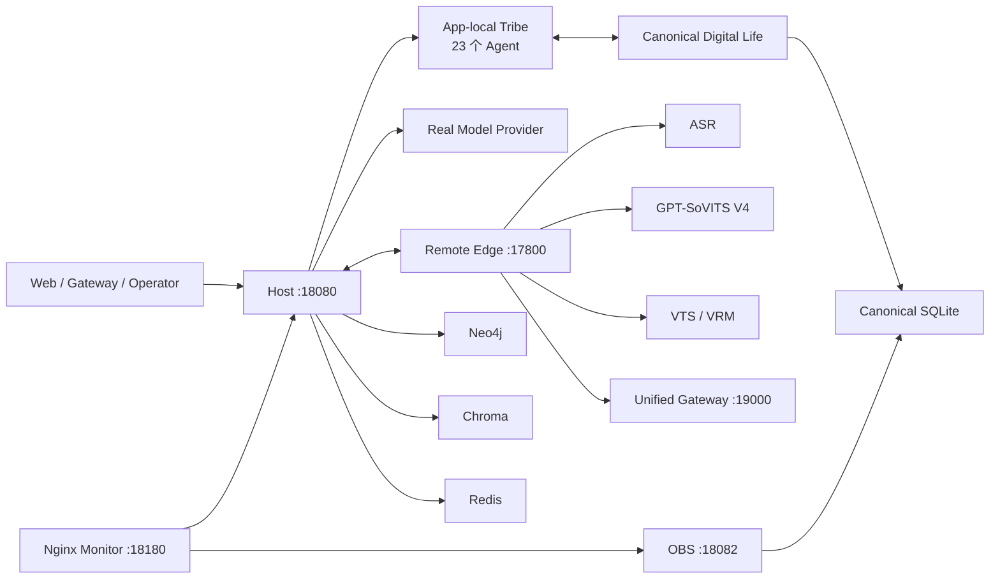
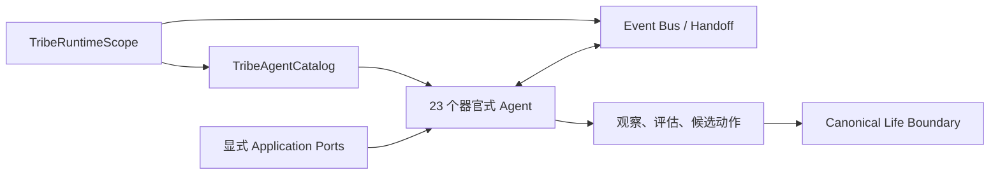

受众：MASTER
标题：Natsume AI 系统架构

# 系统架构

## 1. 架构目标

系统围绕七海的实时情感陪伴组织：Host 保存人格、关系和执行真相；Edge 提供感知与身体；Gateway 连接消息通道；OBS/Monitor 提供只读观测。可靠性机制必须保护连续性，但不能拖慢普通聊天。

## 2. 进程拓扑



## 3. Host 内部智能体群

Host 不是单一模型包装器。ASGI lifespan 拥有一个 `TribeRuntimeScope`，其中固定构造 23 个 Agent、一个 agent catalog、一个共享状态 registry 和一个最大保留 2048 条事件的进程内 event bus。



Agent 按感知与路由、情感与社会、执行与自主、记忆与语言、身体与稳态、行动与协调、防御与恢复七组协作。它们不是 23 个独立 LLM；具体 Agent 可使用规则、状态机、模型或外部端口。事件总线与短期 organ state 随 Host 生命周期重建，不能作为 self affect 或关系的持久 authority。

## 4. Authority 边界

| 状态 | 唯一 authority | 其他消费者 |
|---|---|---|
| Tribe Agent 实例、事件和短期 organ state | 当前 Host 的 `TribeRuntimeScope` | Agent、OBS 运行投影；进程重启后重建 |
| 七海 self affect、relationship、profile | canonical Digital Life journal | Surface、Proactive、OBS、TTS、Avatar |
| 用户情绪 | scoped observation journal／本轮 Context | appraisal，不直接写 self affect |
| 有副作用任务 | TaskGraph 与 Task Runtime ledgers | Worker、OBS、Monitor |
| 对外发送 | acceptance + outbox + delivery receipt | Gateway／Edge transport |
| 人格宪法 | `Soul.md` 与已激活 identity version | prompt、planner、regression verifier |
| 读模型 | canonical ledger 派生 projection | OBS／Monitor；不能反向写业务状态 |

## 5. 两条执行主链

### 实时陪伴主链

```text
Ingress → observation/fusion → appraisal/fold → AffectiveTurnPlan
       → model streaming → text/TTS/avatar delivery → aftereffect
```

该链只保留幂等交付、关系连续性和必要的错误证据。普通闲聊不创建复杂 TaskGraph。

### 受管执行主链

```text
HostCommand → immutable TaskGraph → node attempt
           → worker/tool/external effect → verification
           → acceptance → outbox → durable receipt
```

该链用于 Skill、Delegate、Plan、Scheduler、Internal、Operator 和设备副作用。

## 6. 故障模型

- Host 重启：从 canonical journal 和 ledger 恢复，不重复已接受输出。
- Tribe 重建：Agent catalog、event bus 和短期状态重新构造；长期自我只从 canonical Life 恢复。
- Edge 断开：文本可继续；语音／Avatar 各自降级，self affect 不被改写。
- Provider 超时：快速回退并表达不确定性，不阻塞数分钟。
- Gateway 网络中断：accepted outbox eventual delivery，重复 webhook 不重复建任务。
- Neo4j／Chroma／Redis 中断：依能力降级；不可把内存 fallback 当最终验收。

## 7. 安全与隐私

原始音视频默认只在 Edge 内存中处理；Host 保存脱敏观察摘要。外部 effect 需要明确 grant 与 Preview。用户可关闭观察、主动陪伴与学习。密钥只运行时注入，Monitor 和日志不得暴露用户正文或模型内部推理。

## 8. 当前状态

Tribe 的 23 个 Agent 已在 production composition 中完成 app-local 构造、端口绑定和订阅注册，canonical Life 仍是唯一长期自我。目标 Edge、真实三模态、长期人工体验和全栈故障恢复尚未共同通过，因此系统状态为 `INCOMPLETE`。
