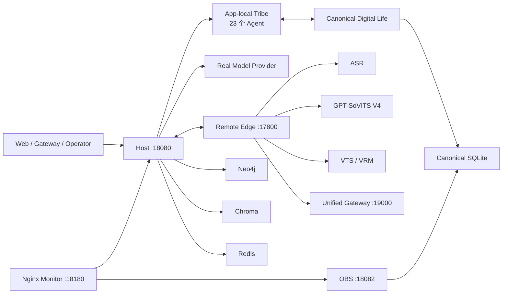
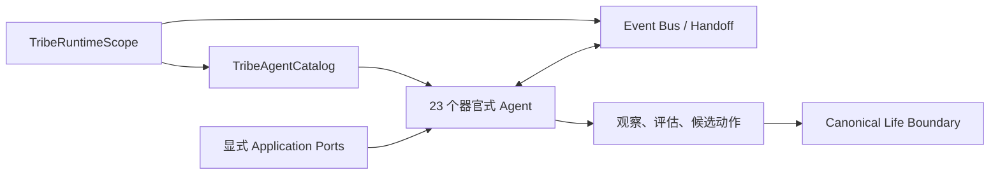
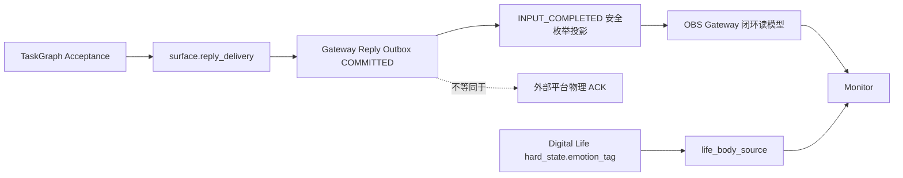

受众：MASTER
标题：Natsume AI 系统架构

# 系统架构

## 1. 架构目标

系统围绕七海的实时情感陪伴组织：Host 保存人格、关系和执行真相；Edge 提供感知与身体；Gateway 连接消息通道；OBS/Monitor 提供只读观测。可靠性机制必须保护连续性，但不能拖慢普通聊天。

## 2. 进程拓扑



## 3. Host 内部智能体群

Host 不是单一模型包装器。ASGI lifespan 拥有一个 `TribeRuntimeScope`，其中固定构造 23 个 Agent、一个 agent catalog、一个共享状态 registry 和一个最大保留 2048 条事件的进程内 event bus。



Agent 按感知与路由、情感与社会、执行与自主、记忆与语言、身体与稳态、行动与协调、防御与恢复七组协作。它们不是 23 个独立 LLM；具体 Agent 可使用规则、状态机、模型或外部端口。事件总线与短期 organ state 随 Host 生命周期重建，不能作为 self affect 或关系的持久 authority。

## 4. Authority 边界

| 状态 | 唯一 authority | 其他消费者 |
|---|---|---|
| Tribe Agent 实例、事件和短期 organ state | 当前 Host 的 `TribeRuntimeScope` | Agent、OBS 运行投影；进程重启后重建 |
| 七海 self affect、relationship、profile | canonical Digital Life journal | Surface、Proactive、OBS、TTS、Avatar |
| 用户情绪 | scoped observation journal／本轮 Context | appraisal，不直接写 self affect |
| 有副作用任务 | TaskGraph 与 Task Runtime ledgers | Worker、OBS、Monitor |
| 对外发送 | acceptance + outbox + delivery receipt | Gateway／Edge transport |
| 人格宪法 | `Soul.md` 与已激活 identity version | prompt、planner、regression verifier |
| 读模型 | canonical ledger 派生 projection | OBS／Monitor；不能反向写业务状态 |

## 5. 两条执行主链

### 实时陪伴主链

```text
Ingress → observation/fusion → appraisal/fold → AffectiveTurnPlan
       → model streaming → text/TTS/avatar delivery → aftereffect
```

该链只保留幂等交付、关系连续性和必要的错误证据。本地／HTTP 普通闲聊不创建复杂 TaskGraph；来自 Gateway 的聊天因为需要产生可恢复的外部回信，会编译为单节点受管图，由 Acceptance 生成唯一 delivery intent。它不会把整段日常对话升级成多节点任务规划。

模型路由同样按体验分层：普通 Gateway 陪伴使用 `CHAT_SURFACE_REALTIME`／Tier B，并由服务端为支持该能力的 DeepSeek transport 显式关闭 thinking；Plan、Research 和深路径候选不继承该设置。`thinking_mode` 只存在于冻结的 route metadata，在 provider adapter 边界转换为供应商字段，其他 provider 会删除该提示而不是收到未知参数。

### 受管执行主链

```text
HostCommand → immutable TaskGraph → node attempt
           → worker/tool/external effect → verification
           → acceptance → outbox → durable receipt
```

该链用于 Skill、Delegate、Plan、Scheduler、Internal、Operator、Gateway 回信和设备副作用。Gateway Secure Ingress 在 Host composition 启动时按已配置 HMAC key 幂等注册最小权限 service principal；数据库中只保存 secret ref，不保存密钥值。合法的既有轮换引用会原样保留，权限、身份或凭据类型不一致时启动失败而不是覆盖。

## 6. 故障模型

- Host 重启：从 canonical journal 和 ledger 恢复，不重复已接受输出。
- Tribe 重建：Agent catalog、event bus 和短期状态重新构造；长期自我只从 canonical Life 恢复。
- Edge 断开：文本可继续；语音／Avatar 各自降级，self affect 不被改写。
- Provider 超时：快速回退并表达不确定性，不阻塞数分钟。
- Gateway 网络中断：INBOX 以稳定 Host 幂等键精确重试，重复 webhook 不重复建任务；accepted OUTBOX eventual delivery，但平台 dispatch 后的未知结果必须隔离对账，不能盲目重发。
- Neo4j／Chroma／Redis 中断：依能力降级；不可把内存 fallback 当最终验收。

## 7. 安全与隐私

原始音视频与分块 ASR 默认只在 Edge／Host 短期内存中处理；Host 只保存脱敏观察摘要和必要终态。外部 effect 需要明确 grant 与 Preview。用户可关闭观察、主动陪伴与学习。密钥只运行时注入，Monitor 和日志不得暴露用户正文或模型内部推理。

## 8. 当前状态

Tribe 的 23 个 Agent 已在 production composition 中完成 app-local 构造、端口绑定和订阅注册，canonical Life 仍是唯一长期自我。目标 Edge 已真实运行：ASR、GPT-SoVITS TTS、音频播放、Edge RPC 和 Unified Gateway 为 `UP`；VTS 已认证且口型／身体动作可用，但缺兼容情绪热键而保持 `DEGRADED`，barge-in 关闭并保持 `NOT_TESTED`。

真实消息平台入站已经贯通 Secure Ingress、canonical HostCommand、不可变单节点 TaskGraph、Attempt、Verification、Acceptance、Gateway Outbox 和平台回执；超时重试复用同一 command／graph，不重复创建任务或外发。Host 接受后的 TTS／Avatar intent 通过 Edge durable receipt 对账，排队中的物理动作先保持 `IN_DOUBT`，只在终端回执到达后变更为 `APPLIED`／`REJECTED`，不会把“已入队”冒充“已经播放”。

OBS/Monitor 读取 Host、Edge 与 Gateway 的最新 canonical health projection，关闭能力不再因 RPC 可达而显示为 `UP`。本轮 P0 双端主链已通过真实网络验证，但 VTS 情绪热键、barge-in、长期多轮体验与完整性能门槛仍未完成，所以整体数字生命状态仍为 `INCOMPLETE`。

## 9. 当前观测闭环



`worker_dispatch` 只把 `gateway_delivery_authority=acceptance_effect_outbox` 与 `gateway_delivery_state=OUTBOX_COMMITTED` 两个无正文枚举写入完成事件。OBS 用它们判断当前请求是否已完成 Host→Gateway 的可恢复提交；平台物理送达仍由独立 terminal/ACK 证据负责。Life Body 则直接从 canonical runtime snapshot 的 `hard_state` 派生当前情绪，旧 `emotion_context` 仅作历史兼容读取。

普通陪伴文字回复属于已经通过 Task Verification／Acceptance 的低风险终态投影。dispatcher 从持久 effect row 与当前 claim fence 构造进程内 typed `AcceptanceEffectExecutionProof`，Gateway transport 只允许 proof 中的 effect id、请求、目标和正文做固定的 text-outbox 转换。它不再对同一回复追加第二次 Scene／Guardian 策略判断，从而避免心跳或场景 revision 更新把合法回复误判为 `ACTION_PREVIEW_DRIFT`。该简化只适用于 `surface.reply_delivery`；Skill、Delegate 的实际工具动作、Operator、Scheduler、Edge embodiment 与系统状态变更仍保留原 ActionPreview／Review 边界。

Scene 解析同样以已分类 route 为先：显式 `route=chat` 始终是 Chat task kind，文本中出现“发布成功”或“部署结束”不会反向制造维护权限与 Review；只有可执行 route 才使用 research、debug、refactor、release 等关键词补全 task kind。这保证日常聊天不会因为谈论工作而进入工程控制流。

关系修复也区分“七海被直接冒犯”和“用户在评价七海刚才的回复”。前者在没有待结算回复时允许形成克制的 `SET_BOUNDARY`；后者先关联上一条 accepted response，写成 `MISUNDERSTOOD` aftereffect，再让本轮 Appraisal 保持 `REPAIR`。因此七海可以真实感到被刺到，但不能在自己没接住用户之后用受伤或退出逼用户反过来安抚她。
