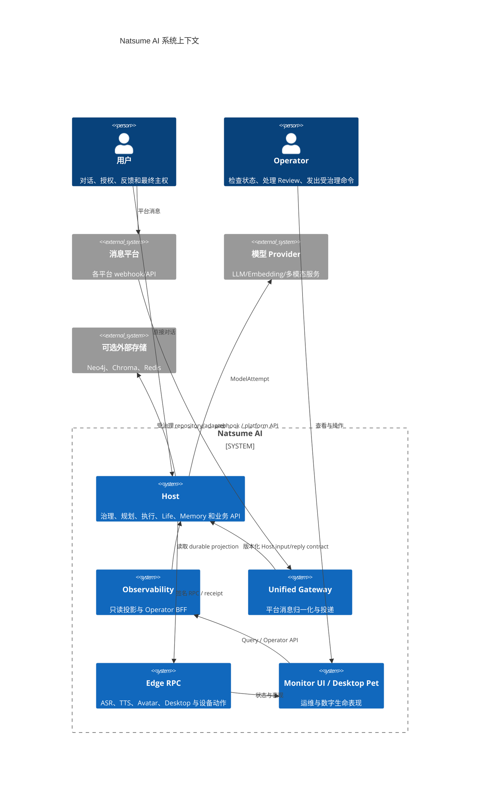
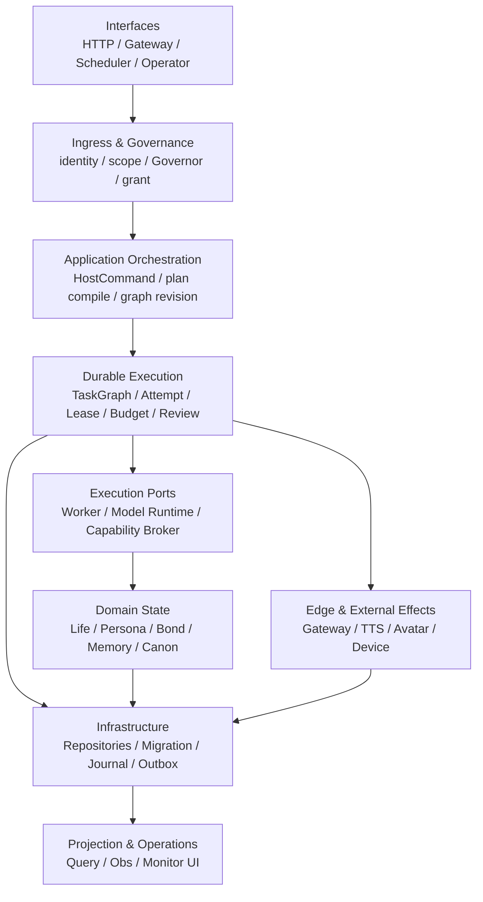
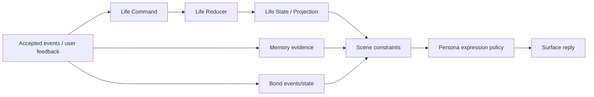
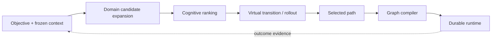

受众：PROJECT
标题：Natsume AI 系统架构总览

# Natsume AI 系统架构总览

版本：v1.4
核对日期：2026-07-16
文档类型：`CURRENT STRUCTURAL OVERVIEW`

本文解释生产代码如何分层、各进程如何协作、状态和执行 authority 放在哪里。它不承担完成度裁决：具体接线状态看 [CURRENT_CODE_ARCHITECTURE.md](CURRENT_CODE_ARCHITECTURE.md)，目标看 [TARGET_ARCHITECTURE.md](TARGET_ARCHITECTURE.md)，差距看 [ARCHITECTURE_GAP_MATRIX.md](ARCHITECTURE_GAP_MATRIX.md)。

## 1. 系统边界

Natsume AI 由一个 Host 控制面、多个接入/外显运行面和若干可选基础服务组成。Host 负责业务决策和长期状态，Gateway 负责平台协议，Edge 负责本机感知与物理动作，Observability 负责只读投影和 Operator 交互。



若渲染器不支持 C4 扩展，可从 [运行拓扑图](diagrams/01_runtime_topology.md) 查看普通 Mermaid 版本。

## 2. 进程与部署拓扑

| 进程/运行面 | Composition 入口 | 拥有的职责 | 不应拥有的职责 |
|---|---|---|---|
| Host Main | `host_brain/__main__.py` → `host_brain.app.asgi:app` | Command admission、Governor、Task Runtime、业务领域、API | 平台协议细节、设备驱动、只读 UI 状态真相 |
| Observability | `host_brain/obs_main.py` → `host_brain.app.obs_fastapi_app:app` | 运行投影、Trace、健康、Operator BFF | 直接修改业务数据库或绕过 Command 入口 |
| Edge RPC | `edge_client/__main__.py` → `edge_client.app.fastapi_app` | 本机感知、语音、Avatar、Desktop、actuator | 人格、任务或对话事实裁决 |
| Unified Gateway | `edge_client.gateway.bootstrap` → `edge_client.gateway.server` | Webhook、平台归一化、可靠投递 | Host 的业务路由和长期状态 |
| Monitor UI | `host_brain/app/monitor_ui/` | Query、Review、Operator command 客户端 | 自己维护任务真相或直接调用 worker |
| Desktop Pet | `desktop_pet/main.cjs` | Live2D 表现和桌面交互 | Life/Persona authority |

Host 与 Observability 是独立 ASGI 应用。Gateway 可以由 Edge lifecycle 装配，但其 transport state 和平台 adapter 仍是独立边界。所有跨进程 payload 应来自 `natsume_contracts/` 或显式版本化 HTTP 合同。

## 3. 逻辑分层



依赖方向的核心规则：接口适配器可以调用 application port，application 可以组合 domain contract，infrastructure 实现 repository/transport port；domain 不应反向导入 FastAPI、全局 composition 或平台 SDK。

### 3.1 接口与输入层

主要代码：

- `host_brain/app/app_factory.py`：Host FastAPI 应用构造和特殊入口。
- `host_brain/app/router_registry.py`：普通业务 router 装配。
- `host_brain/input_runtime/`：Host input、delivery 和 reply contract。
- `host_brain/secure_ingress/`：身份、scope、重放和输入合法性边界。
- `edge_client/gateway/`：平台 payload 归一化与出站 adapter。

输入层只负责把外部协议变成内部 command 材料，不应自己执行 Skill、调用模型或修改长期状态。

### 3.2 治理与应用编排层

主要代码：

- `host_brain/governor/`：意图规则、授权、rate limit 和 action preview。
- `host_brain/agent_runtime/cortex_runtime.py`：Host route 识别与 governed/compatibility 分流。
- `host_brain/orchestration/`：HostCommand、WorkOrderV3、计划图编译、revision、node grant 和 recovery intent。
- `host_brain/app/governed_task_adapter.py`：Host 请求到 Governed Task Runtime 的生命周期、合同编译与应用适配。
- `host_brain/app/governed_task_authority.py`：无状态的 HostCommand/WorkOrder/planning lineage、route-aware exact replay 与 fail-closed authority 校验；不写 Store、不执行 TaskGraph。

该层决定“是否允许做、冻结成什么图”，但不应把模型输出直接当成已经执行的事实。

### 3.3 规划层

`host_brain/planning_search/` 提供无副作用搜索内核；领域 adapter 提供 candidate expander、ranker、virtual transition 和 reward。选中路径必须经过 `host_brain/orchestration/planning_graph_compiler.py` 编译为不可变 TaskGraph 才能进入执行。

当前 Host `plan` 的搜索材料来自已经批准的 `planned_steps/steps`，主要作用是校验和拓扑选择，而不是从目标发明新步骤。Pentest 是目前更完整的领域 adapter，但 Conditional MCTS 仍不能影响生产选择。

### 3.4 Durable 执行层

主要代码：

- `host_brain/task_runtime/coordinator.py`：节点推进、worker 调度、Verification 和 Acceptance。
- `host_brain/task_runtime/dag_scheduler.py`：稳定 READY/fan-in/retry due 纯调度决策。
- `host_brain/task_runtime/budget_runtime.py`：预算预留、计量和结算。
- `host_brain/task_runtime/review_runtime.py`：PRE/POST Review 与 continuation 材料。
- `host_brain/task_runtime/acceptance_effects.py`：Acceptance effect intent 构造。
- `host_brain/task_runtime/acceptance_effect_dispatcher.py`：验收后副作用投递。
- `host_brain/persistence/task_repository.py`：Durable TaskGraph、Node、Attempt、Lease、Budget 的连接、SQL 与事务 authority。
- `host_brain/persistence/task_store_types.py`：TaskStore 错误、状态枚举、Outbox 与稳定 value records；无连接、SQL 或事务，并由 repository 兼容重导出。
- `host_brain/persistence/task_record_codec.py`：确定性 JSON/SQLite Row 校验与合同重建；不执行 SQL，依赖方向固定为 repository → codec → types/contracts。
- `host_brain/persistence/task_decision_integrity.py`：decision/outbox lineage 的只读绑定校验；只借用 repository 当前事务连接执行 `SELECT`，不取得连接、事务或 mutation authority。
- `host_brain/persistence/task_acceptance_effect_staging.py`：Acceptance Effect 规范化、staging，以及 Node/Graph acceptance 与 effect 的原子同事务提交；只借用主 Store 当前事务。
- `host_brain/persistence/task_acceptance_effect_delivery.py`：Acceptance Effect schema、查询、claim、commit/fail/reschedule 与 fencing；不创建独立 Store、连接或事务 owner。
- `host_brain/persistence/task_parallel_success_store.py`：0091 Parallel Success schema、read/replay、Attempt/projection lineage 与 Graph/Budget/Outbox/effect/decision 原子成功收口；只借用主 Store 的唯一事务。
- `host_brain/persistence/task_parallel_settlement_store.py`：0090 failure/review/Budget settlement 的 schema、read/replay、lineage 与 Graph/Budget/Outbox/decision 原子收口；只借用主 Store 的唯一事务。
- `host_brain/persistence/task_parallel_state.py`：0090/0091/0092 共用的 Node snapshot 规范化和严格对账；无 SQL、连接或事务 authority。
- `host_brain/persistence/task_graph_cancellation_request.py`：0092 phase-1 intent 与 Graph/Node/Attempt/Lease/Review/token/operation/effect fence 原子请求写路径；只借用主 Store 事务。
- `host_brain/persistence/task_graph_cancellation_finalization.py`：0092 reconciliation advance 与 Graph/Budget/Outbox/decision 原子终结写路径；operation proof 仍通过主 Store common evidence 验证。
- `host_brain/persistence/task_retry_mutation_store.py`：retry promotion/schedule、BudgetUsage、Budget/Attempt/Node/Lease/Outbox 原子 mutation；区分 legacy 与 node-only disposition。
- `host_brain/persistence/task_retry_replay_store.py`：retry response-loss 的同事务 exact replay；不创建连接或事务。
- `host_brain/persistence/task_atomic_failure_store.py`：pre-reservation Attempt/Node/Lease、可选 Graph 与 Outbox 原子失败收口；明确不拥有 Budget mutation。

执行器只接收冻结节点输入和 node-bound grant。任何失败后的计划变化都应生成新 graph revision，不能在 worker 内静默修改原图。

当前 Coordinator 已消费 B0 的 `{max_attempts, retry_backoff_ms}` 与无副作用调度决策。B1 在原子 claim/promotion 上增加了唯一自动重试边界：worker resolver 在 operation reservation 前显式抛 `RetryableWorkerPreparationError`。TaskStore 在同一 `BEGIN IMMEDIATE` 中写 retry_count BudgetUsage、Budget、Attempt、Node、Lease 与 Outbox；允许时到期创建 attempt 2，超限时 fail closed，reservation 后异常绝不 retry。提交响应丢失时，exact replay 会严格校验上述聚合、BudgetUsage 与关联 Outbox，避免重复扣费；resolver `CancelledError` 原样传播。

pre-reservation 的普通或重试耗尽 failure 已由 `fail_running_attempt_bundle` 原子关闭 Attempt、Node、Graph 和 Lease，并生成四条 attempt/evidence-bound Outbox；如果 attempt 已存在 operation reservation 就拒绝进入该 bundle。Budget finalize 仍在 bundle 外。reservation 建立后，`DurableExecutionHeartbeat` 周期性先续 Lease、再续 Reservation，并在流事件与最终结果处提供 fail-closed checkpoint。续租支持同参响应丢失精确重放；心跳失败返回 `RECOVERY_REQUIRED`，不会提交 Worker 结果。

`PARTIAL_B5C_DURABLE_CANCELLATION_SHADOW / PRODUCTION_OFF` 在 B4 之上保留 B5A/B5B 的持久可选 `completion_policy=ATOMIC_GRAPH_SUCCESS_V1`、显式 sink `result_node_id` 和 0091 atomic success；atomic/bounded 两个能力开关独立且默认 `false`，Host、Scheduler、Internal 三处生产 composition 均 OFF。

运行入口先验证 `0090` settlement 与 `0092` cancellation schema；atomic policy 还验证 `0091`，再允许 Budget activation 或 worker resolution。`ACTIVE` 多节点重入的 B4 ownership/CAS 语义不变。

0090/B4 继续从 durable Node、Attempt、Reservation、BudgetUsage 重建 failure/review/Budget canonical v2 decision。全节点 Accepted 时，B5 对每个 frozen worker projection 重算 canonical digest并绑定 command/request、route/target、graph/node/attempt、receipt 与 node grant；只有显式 result projection 编译整图 effects 和公开结果。`complete_parallel_graph_success()` 在单 UoW 中提交 Graph COMPLETED、Budget CONSUMED、两条 Outbox、全图 effect intents 与 0091 decision。completed replay 只读 0091、不重编 effects；两次响应丢失后重读 terminal authority。

B5C 以迁移 0092 建立 canonical cancellation intent/decision/effect fence。Application 只提供无 HTTP/UI 暴露的内部入口，并要求 authority verifier 将 request、principal、source、reason 精确绑定既有 durable Graph revision；当前生产 composition 没有注入该 verifier。phase 1 UoW 先写 intent、Graph `BLOCKED` 及 Node/Attempt/Lease/Review/token/operation/effect fence，提交后 Coordinator 才 cancel/join 本进程 child 与 heartbeat。execute re-entry 能读取 durable intent 并继续 advance/finalize；本地 task handle 不拥有取消 authority。

phase 2 只在 active ownership 与 operation/effect/review 不确定性全部 reconciliation 后提交 Graph `CANCELLED`、Budget 释放/取消、Outbox 和 canonical decision。`ACCEPTED` Node + `SUCCEEDED` Attempt 对应的 NODE effect 已拥有 acceptance authority，取消后继续 delivery；其余 NODE effect 与未完成 Graph 的 GRAPH effect被 fence。0091 success 与 0092 cancellation first-writer-wins，请求与封口响应丢失 exact replay；shutdown/disconnect 不自动变成业务取消。

完整历史 `taskbatch` marker 缺行/错绑扫描只在 single-revision graph ID 上安全。legacy TaskGraph Outbox 没有 `graph_revision`，multi-revision 时不能可靠把同一 graph ID 下的历史 marker 分配到 revision；此时读取仍对返回 decision row 自身做 digest/Outbox/Attempt/usage 精确校验。revisioned TaskGraph Outbox identity 是尚未完成的结构边界。

这些仍只是默认关闭的 shadow 机制证据，不是 production wiring。B5C 合同、0092 Store、Coordinator re-entry 与 verified internal boundary 已有定向证据，但生产 verifier/受控入口/canary、跨进程自动 reconciliation/online takeover/continuation 尚未完成；revisioned 0090、历史半提交修复、统一 `WAITING_APPROVAL`、跨进程 Outbox 与 Budget 高竞争也仍是缺口。

### 3.5 模型与能力执行层

- `host_brain/model_runtime/`：prompt contract、provider route、ModelAttempt、重试与用量证据。
- `host_brain/capability_plane/`：Capability Broker、descriptor policy、execution journal。
- `host_brain/skills/`：内置 Skill 定义、executor 和签名供应链资产。
- `host_brain/tools/`、`host_brain/mcp/`、`host_brain/lsp/`：具体工具和协议 adapter。
- `host_brain/airlock/`：外部 bundle 的验证、隔离和 quarantine。

模型建议和工具返回值都是执行材料，不自动成为事实。Capability 执行必须有 grant、attempt 和 receipt；外部 bundle 当前只允许安全接收和隔离，完整 staged activation/rollback 尚未闭环。

### 3.6 数字生命与表达层

- `host_brain/digital_life/`：Life command/event/reducer/projection 主干。
- `host_brain/persona/`：人格、情绪、场景策略、表达材料和最终 Surface 行为。
- `host_brain/bond/`：关系状态与事件。
- `host_brain/tribe/`、`host_brain/organ_ops/`：器官化能力模型与协作材料。
- `host_brain/surface_runtime/`：最终回复运行合同。

Life 状态、人格策略和最终文本不是同一种 authority：Life reducer 管状态，Persona 提供表达约束，Surface 生成最终外显。当前仍存在直接 Persona growth writer，因此“安全演化”尚未成立。

### 3.7 记忆、知识素材与状态层

- `host_brain/memory/`：Life memory、episodic/semantic material、Canon adapter 和投影同步。
- `host_brain/retrieval/`：Surface recall 的多路召回、融合和来源标注。
- `host_brain/canon/`：Canon 的提案、应用和 durable state。
- `host_brain/persistence/`：typed repositories 和只读 query repositories。
- `host_brain/audit/`：SQLite ledger、migration、journal 和审计资产。

向量、图和缓存只用于召回与投影，不能独立覆盖 canonical state。Memory/Canon 的写入必须经过对应 application/repository 合同并保留 provenance。

### 3.8 观测与运维层

- `host_brain/observability/`：运行事件、健康、跨时间线和 Query services。
- `host_brain/app/obs_fastapi_app.py`、`host_brain/app/obs_routes_*`：独立 Observability API。
- `host_brain/app/monitor_ui/`：React Operator UI。
- `host_brain/service_catalog/`：端点目录与启动 preflight 合同。

Observability 读取 durable projection。目标约束是：任何改变系统的操作都应发出 Operator command，并重新进入对应的 Governed Runtime/领域 authority，UI/BFF 不得直接写 repository。当前仍有少量专用 control endpoint 直接调用 domain 或 embodiment port，因此 Operator 写链整体只能定级为 `WIRED/PARTIAL`；这些例外必须继续收敛，不能从本节反推为已经统一接线。

## 4. Host Composition

Host 的入口装配顺序是：

```text
host_brain.__main__
  → uvicorn imports host_brain.app.asgi:app
  → asgi.create_app()
  → app_factory creates FastAPI and special routes
  → router_registry registers ordinary routers
  → lifespan owns startup / drain / shutdown
```

`host_brain/composition/task_runtime.py::ProcessTaskRuntimeContainer` 已显式拥有 TaskStore、ReviewStore、CommandRepository、EventStore 和 lifecycle，是当前较清晰的 composition 范例。

它的启动门禁已固定为 migration → `task_store.recover_startup` → publisher 构造 → recovery outbox publish → 稍后 runtime activation；恢复异常会终止容器构造并阻止路由开放。配置中的逻辑 owner 会经 `ProcessTaskRuntimeContainer.execution_owner_id()` 派生为绑定当前 construction/recovery id 的唯一 execution owner，重启不会沿用旧进程 owner 身份。这里没有宣称 recoverable attempt 已自动 continuation，也没有补齐在线 takeover 或即时 reconciliation。

但整个 Host 尚未完成显式对象图迁移：两轮已静态证明并删除 6 个零消费者槽位和 4 个死 accessor，第二轮另收掉 7 个宽泛重导出及测试 reset 残留；当前仍有 60 个 container 字段，排除 6 个 lock 与 `application_ports` 端口束后是 53 个可变服务引用。`process_services.py` 与 `process_runtime_services.py` 继续暴露大量全局 accessor，部分 `host_brain.app` 文件仍同时承担 adapter 和 service factory。新代码不应继续扩大这条 Service Locator 路径。

## 5. Command 与 Task 架构

```mermaid
flowchart LR
    R["Request / Scheduled Intent"]
    G["Governor Decision"]
    C["HostCommand"]
    W["WorkOrderV3 + BudgetPolicy"]
    TG["TaskGraph revision"]
    N["Node"]
    A["Attempt + Lease"]
    GR["Node-bound Grant"]
    X["Worker"]
    V["Verification"]
    AC["Acceptance"]
    E["Effect Intent / Receipt"]

    R --> G --> C
    C --> W --> TG --> N --> A --> GR --> X --> V --> AC --> E
```



各对象的职责不同：

| 对象 | 回答的问题 | 生命周期 |
|---|---|---|
| Governor Decision | 这次请求允许做什么 | 对一次批准不可变 |
| HostCommand | 系统接受了什么命令 | Durable admission record |
| WorkOrderV3 | 范围、预算、验收和上下文是什么 | 与 graph revision 绑定 |
| TaskGraph | 哪些节点以何种依赖执行；可选 completion policy 与显式 result authority | revision 不可变；atomic policy 不可由进程开关推断 |
| Attempt | 某节点第几次执行发生了什么 | 每次执行独立 |
| Lease | 哪个 worker 在什么 fencing token 下拥有节点 | 有时效，可回收 |
| Node Grant | 该 worker 对该节点能做什么 | scope 精确绑定 |
| Verification | 输出是否满足机器可验证条件 | Acceptance 前 |
| Acceptance | 是否接纳结果并允许副作用 | 决定 effect intent |
| Receipt | 外部或持久副作用实际发生了什么 | 不可变证据 |

Scheduler 与 Internal Agent 已统一进入 `WorkOrderV3 + BudgetPolicy` admission，并贯通 child grant、Review、Verification、Acceptance 与 Receipt。Internal 的 `AgentWorkOrder` 只保留为 ingress/executor 兼容对象：调用方 authority 在边界清除，child grant 验证前不能调用 executor。长时间人工 Review 超出 grant TTL 的 renewal/derivation 尚未随自动 continuation 闭环。

## 6. 状态与数据 authority

| 状态域 | 当前主要 authority | 读模型/衍生层 | 关键约束 |
|---|---|---|---|
| Command / Graph / Attempt | `HostCommandRepository`、`DurableTaskStore` | Task runtime projection | 已删除进程内 registry；禁止重新引入第二真相 |
| Governor / Grant | canonical audit ledger 与 grant resolver | Operator/trace projection | token 必须绑定 scope 和 subject |
| Model invocation | `ModelAttemptService` 及持久记录 | 用量和健康投影 | provider 返回缺失时不得伪造精确成本 |
| Capability execution | Capability Broker journal/receipt | maturity scorecard | maturity 投影本身不是执行 authority |
| Life | Life command/event/reducer | Life projection、UI | 业务模块不能直接改 projection |
| Persona policy | Persona/version authority（目标） | Surface context | 当前直接 growth writer 必须封禁 |
| Memory / Canon | typed repository + governed apply | vector、semantic、graph、prompt slots | 衍生召回不能反写事实 |
| Gateway delivery | durable transport/outbox/receipt | delivery status | adapter 不能自行重做业务决定 |
| Edge effect | actuator execution + receipt | device telemetry | 物理动作必须可追踪和降级 |

SQLite migration/ledger 是当前多数 durable 主干的基础；Neo4j、Chroma、Redis 等是可选服务或衍生索引，不应让服务可用性改变 authority 归属。

## 7. 数字生命状态模型



该图表达职责边界，不代表 Scene 已经成为统一 aggregate。当前 `persona/scene_policy.py` 有消费接线，但生产默认受 `HOST_LIFE_PROJECTION_ENABLED=false` 关闭；World Model 当前也是只读投影，不是可模拟未来的规划世界模型。

安全演化的目标链必须是：运行证据/反馈 → proposal → 隔离实验与 shadow → Review → version activation → rollback point。任何 milestone、后台周期或模型输出直接调用 trait writer 都违反目标 authority。

## 8. Planning 与执行分离



搜索侧只能看到冻结上下文和虚拟状态，执行侧只能看到选中后编译的图。搜索不得调用真实工具；执行不得静默二次规划。真实 outcome 通过 durable calibration 反馈给后续 proposal，而不是在同一 run 中篡改搜索证据。

## 9. 跨进程合同

`natsume_contracts/` 当前按 task、edge、life、identity 等 namespace 存放运行时中立合同。合同包不得导入 Host/Edge 实现，也不应包含可变服务或环境读取。

跨进程变更需要同时满足：

1. Schema 有明确版本和向后兼容策略。
2. Producer/consumer contract test 同步更新。
3. 不把实现对象、数据库连接或内部异常类型穿过边界。
4. 请求和回执保留 request/command/graph/node/attempt 等 lineage。
5. 旧 consumer 未升级时明确拒绝或降级，禁止猜测字段语义。

## 10. 可靠性与安全机制

| 机制 | 解决的问题 | 当前实现入口 |
|---|---|---|
| Migration + checksum | Schema 漂移与重复初始化 | `host_brain/audit/migration_runner.py` |
| Durable journal/outbox | 重启后事件和副作用恢复 | `host_brain/eventing/`、persistence repositories |
| Idempotency + replay guard | 重复请求和重复执行 | TaskStore、Secure Ingress、Gateway stores |
| Attempt + Lease + fencing | worker 崩溃和并发所有权 | `host_brain/task_runtime/` |
| Budget | token、工具、时间、成本边界 | `budget_runtime.py` |
| Review token | 高风险 PRE/POST 审核 | `review_runtime.py`、ReviewStore |
| Verification + Acceptance | 输出与副作用分离 | coordinator、acceptance effects |
| Capability grant | 精确限制工具/Skill 权限 | Governor、node grants、Capability Broker |
| Degradation evidence | 依赖不可用时显式降级 | `host_brain/observability/degradation_state.py` |
| Signed intake + Airlock | 外部 bundle 供应链风险 | `host_brain/skills/`、`host_brain/airlock/` |

## 11. 当前过渡边界

系统仍处于迁移期，但 Executive 执行兼容层和内存任务真相已经退役：

| 新主干 | 待退役/修复 |
|---|---|
| Governed Host/Scheduler/Internal routes + durable read projections | Operator/领域兼容入口尚未完成最终 route matrix 验收 |
| Durable TaskStore | 无第二 task registry；仍缺统一自动 continuation |
| WorkOrderV3 + BudgetPolicy | Agent executor v2 兼容投影仅允许发生在 child-grant 验证后，不拥有 admission authority |
| TaskGraph revision + `PARTIAL_B5C_DURABLE_CANCELLATION_SHADOW / PRODUCTION_OFF` | 0091 atomic success 与 0092 两阶段 cancellation 已有 shadow 证据；verified entry 尚未注入生产 verifier，无 HTTP/UI 和跨进程自动 reconciliation/takeover/continuation。atomic/bounded/cancellation 及三处生产 composition 均 OFF；revisioned 0090、Outbox/Budget 高竞争与 canary 未接线 |
| Typed task composition | 全局 ProcessServiceContainer accessor |
| Acceptance effect intents | 零散 fire-and-forget 后效 |
| Proposal-driven evolution（目标） | Persona legacy writer 已封口；无副作用 candidate 尚未接 proposal pipeline |

过渡期文档必须同时画出两侧，并明确哪一侧拥有 authority。隐藏兼容层会制造虚假的完成结论。

## 12. 架构阅读路径

1. 本文：建立全局结构。
2. [FUNCTIONAL_MODULES.md](FUNCTIONAL_MODULES.md)：查某个包或能力的职责。
3. [DATA_FLOW_ARCHITECTURE.md](DATA_FLOW_ARCHITECTURE.md)：追踪请求、状态和副作用。
4. [架构图册](diagrams/00_INDEX.md)：快速查看关键拓扑。
5. [CURRENT_CODE_ARCHITECTURE.md](CURRENT_CODE_ARCHITECTURE.md)：核对真实接线和限制。
6. [TARGET_ARCHITECTURE.md](TARGET_ARCHITECTURE.md)：理解最终边界。
7. [ARCHITECTURE_GAP_MATRIX.md](ARCHITECTURE_GAP_MATRIX.md)：确定实施差距与执行波。

生产代码、production composition 和 machine status 永远高于本文；发现不一致时先修正文档和门禁，不得用文档覆盖代码事实。
