受众：PROJECT
标题：Natsume AI 系统架构总览

# Natsume AI 系统架构总览

版本：v2.34
核对日期：2026-07-28
文档类型：`CURRENT STRUCTURAL OVERVIEW`

本文解释生产代码如何分层、各进程如何协作、状态和执行 authority 放在哪里。它不承担完成度裁决：具体接线状态看 [CURRENT_CODE_ARCHITECTURE.md](CURRENT_CODE_ARCHITECTURE.md)，目标看 [TARGET_ARCHITECTURE.md](TARGET_ARCHITECTURE.md)，差距看 [ARCHITECTURE_GAP_MATRIX.md](ARCHITECTURE_GAP_MATRIX.md)。

NE-01 的本地代码封口把七个入口、一般多节点恢复和 Workspace 生命周期放进
同一证据边界：路线收据从一个 canonical SQLite 只读快照派生；恢复波次由
fresh Windows process 重开同一 ledger，Git Workspace 只在 Acceptance 后
promotion，失败或取消则按 exact authority abandon/cleanup。系统仍以签名
feature receipt 控制生产 fan-out，未知副作用保持 ambiguity 直到对账，因而
本地代码封口不会绕过 NE-07 的部署验收。

Host survivor 现在在 Command Recovery Inventory 层区分两种 `BLOCKED`：
含 ready/retry/review/execution/cancellation 节点的 actionable block 继续进入
startup 与周期 continuation；已由 failure/budget settlement 收口、共享预算
已释放且只剩终态/结构性阻断节点的 terminal block 不再进入 Host worker
清单。图的 canonical 状态和审计回执保持不变，筛选只改变“谁仍有执行权”。
跨进程矩阵已证明 retry+failure、Budget 和 Review 三类 outer-settlement
崩溃都由新 Host 以零 worker replay 唯一收口。

Host 的跨进程恢复现在保持两层终态边界：Node continuation 可以产生
checkpoint outcome，但不得直接成为多节点调用的最终结果；DAG Scheduler
将其交给 shared settlement，并只把唯一 Graph terminal 交给 Host。该边界
已经由一个 sibling ACCEPTED、另一个 sibling RESERVED 的真实进程崩溃链
验证，避免“SQLite 已完成、Host 却因两个终态失败”的分裂结果。

取消恢复则由 Operation reconciliation 与 Graph cancellation continuation
分工：前者提交/重开 exact signed action，后者持有 graph terminal authority。
COMMIT 和 RELEASE 两种 cancellation action 都能跨 handler 崩溃继续，且
终态进程不再领取 continuation。生产开关仍受 signed canary gate 约束。

跨进程恢复的系统边界现在明确区分目标提交与 handler 响应。目标
Operation/Outbox Store 是 durable mutation owner；Accepted handler 和 Host
startup 只是可替换消费者。目标已提交后任一消费者崩溃，新进程必须按
case-bound proof/receipt 恢复，不能获得第二次 worker authority。当前真实
进程证据覆盖 checkpoint COMMIT 与无 intent failure RELEASE，取消绑定
组合和部署 fan-out 仍保持失败关闭。

Scheduler 的生产对象图现在把“发现本轮工作”视为独立不可变 authority。
Persistence owner 在单一 SQLite snapshot 内构造 ClockBatch；Scheduler
进程只接收 content-addressed、深冻结的 bounded rows，并在任何执行前重验。
这样 Task Runtime 仍独占每个 occurrence 的 Attempt/Lease/Budget/Acceptance，
而 Clock 只决定同一 capture point 的有界候选集合。Release 的 query-only
reader 与运行对象图分离，只能裁决已落盘事实，不能修改 Scheduler 或 Task。
clean SHA `2a88f56e` 的正式同库收据已让七路全部 PASS，并证明
Internal/Operator/Scheduler policy count 各为 1；其它运行控制和全栈 canary
仍不由该收据覆盖。

Skill 执行现在有一个显式 policy gate 和一个 app-local authority root。
canonical Host Registry 对 93 个 Skill 做完备分区：28 个 inline read-only、13 个
proposal-only、3 个 post-Acceptance Workspace、49 个 catalog-only
blocked。只有 44 个可执行条目进入 manifest/search/scheduling/admission；
缺 policy、descriptor drift 和 stale graph 都失败关闭。这个分区不从风险、
名称或 handler 输出推断副作用，因此 catalog 可见不等于执行可用。

独立旧 Personality Registry 的 19 个 metadata 不属于这 93 个 canonical
条目；5 个明确 blocked、14 个 `UNCLASSIFIED`，运行 manifest 为 0。
动态 MCP Skill 也固定 blocked。它们只保留目录兼容，不取得 Task 执行权。

Frozen worker 提供 exact
TaskGraph/Node/Attempt/Lease/Budget/grant 上下文和显式依赖，
`governed_skill_execution.py` 才能调用 handler 并进入 Capability Broker。
Executive 不再拥有 Skill executor；token-only Loader 和 Scheduler metadata
只能产生失败关闭审计。启用节点统一先做 Task precharge；Agent 模型走
Task-bound measurement，proposal-only 不得投递可见副作用，三条写 Agent
只在 Acceptance 后 promotion。该结构已由干净提交 `c68850f8` 的同库 v3
收据复验，当前 44 个启用项的 Skill 路线为 `COMPLETE`；49 个 blocked
能力须在未来拥有 typed Effect handler 后另行验收，不因 catalog 可见而
获得执行权。

Plan 的审批 authority 现在贯穿 Registry、Search、Compiler 和 Task Runtime，但每层只拥有一种职责。Registry 是 `require_confirm` 来源，Search 只能选择并携带候选事实，Compiler 独占 immutable TaskNode policy 生成，ReviewStore 独占人类决定，Continuation Worker 只协调已持久决定的 claim，NodeBoundGrantService 只续签时限与原约束。Scheduler 恢复历史 accepted projection grant 与当前 renewed grant，防止长审批把已提交节点误判成 authority drift；它不允许续签改变 graph revision、目标、风险或权限。

通用执行层新增一个 route-neutral 证据边界，而不是第二套 Runtime。Chat、Skill、Delegate、Plan、Tool 与 Operator worker 仍由原 Task Runtime 调度；其 terminal COMMIT 只被视为主张。Verifier 与 Acceptance 分别通过 projection reader 重开同一 durable evidence，任何身份、grant、digest、COMMIT 或输出合同漂移都阻断。Plan 的 successor artifact 由 canonical TaskStore 解析并经 `NodeInputArtifactAttestation` 绑定后才进入 final Chat；该 attestation 不赋予新的执行权。

Delegate 也没有建立第二套预算账本。Task Runtime 对外层 canonical dispatch 记一次工具调用；当前唯一 target `pentest_agent` 是无模型/工具/嵌套派发/Effect port 的只读 adapter，由 dispatcher 生成 `ReadonlyDelegateUsageAttestationV1` 明确证明内部四类用量为零。Frozen executor 在进入共享 WorkerBudgetUsage/settlement 前重验完整 Task lineage、node grant 与 invocation digest，缺失或漂移失败关闭。该结构只证明当前 target，不授权一般 Delegate。

模型调用 authority 也沿同一 Task 边界收口。普通受治理 Skill 只有在 `SkillMeta.model_budget_required=true` 时才会获得 [`GovernedSkillModelBudgetRuntime`](../../../host_brain/model_runtime/governed_skill_budget.py)；它从当前 Task Budget 派生不可扩张的 node/attempt guard，逐次消费 canonical provider measurement，并生成不含 secret 的 usage attestation。未声明的普通 Skill 不再得到裸 `ModelAttemptService`，外层 frozen worker 必须重验 attestation 的 request/Budget/Graph/Node/Attempt 绑定后才能构造 `WorkerBudgetUsage`。Agent Skill 保留独立 sealed model runtime；两条路径最终都由 Task Runtime 持久结算，而不是由 Skill 自报成功。

当前分支的独立 Gate 1～14 已全部 `PASS`、`failed_gates=[]`。最后两条回环通过中立合同层关闭：`SQLiteTaskRuntimeFeatureCanaryReceiptStore → contracts/task_runtime_feature_canary`，`composition/host_application → contracts/host_lifecycle`；旧 Task Runtime 与 App lifecycle 路径只重导出 canonical 对象，类型 identity 不分叉。Gate 1 的 issues/SCC 均为空，Gate 3 继续由 Research ledger 的 1271 行 repository owner、512 行 canonical codec 与 108 行 typed projection 保持通过，未扩白名单。该结果是当前工作树的静态分层证据，不是 Universal Runtime、NE-01 或完整架构项目封板；NE-01 仍 `PARTIAL / IN_PROGRESS`，`REMOTE_CI=NOT_RUN_ACCOUNT_QUOTA`。

Chat 的本地提交边界现由同一个 app-local `LifeProjectionDispatcher` 与新 `life_projection_barrier` 组成。Acceptance 先原子生成有序 Effect；Life handler 提交或重开 exact command 后，只领取该 command 的 intent id，并对 intent 全集、payload digest、target、result 和完成时间逐项复验。`surface.post_process` 的 durable projection mode 会把 assistant turn 与 LifeMemory admission 的失败向上抛出，所以它的 receipt 是外部 reply delivery 的必要前置条件。启动后的 reclaimed Effect 只读对账，普通后台 Life worker仍可完成 crash-left intent；屏障完成后 Task Effect 才能转为 `COMMITTED`。这是 durable saga 顺序，不是跨 Gateway、Host 和多个数据库的全局事务。

直接 Agent Skill 写入现在复用 Internal composition 已拥有的 ArtifactStore、DurableWorkspaceRuntime 和 0101/0116 lifecycle，而不创建可从 payload 发现的服务。Host 在 admission 时从 app-local SkillRegistry 冻结风险与 Review policy；frozen worker 先验证 child grant，再从 durable ReviewStore 重开唯一已消费的 task/node-bound Review。`governed_skill_work_order.py` 只复制兼容 WorkOrder 的语义字段，所有 Graph/Attempt/Lease/Grant/Budget/Review/Workspace authority 均从受信执行上下文重建。`codex_runtime` adapter 取得的 ports 只存在于 sealed broker dispatch context。写结果的 protected descriptor 进入 immutable WorkerProjection；231 行纯模块 `agent_workspace_acceptance_effect.py` 负责 descriptor canonicalization/lineage 校验，1499 行 canonical `acceptance_effects.py` 只编排 graph-scope Effect，未扩大巨石白名单。共享 dispatcher 以 terminal Preview/fence 调用 `AcceptedAgentWorkspaceArtifactHandler`，该 handler 重新验证 admission、projection、Node/Attempt/Lease/NodeArtifact、Effect payload/digest 与 sealed bytes，才推进 Workspace。promotion 的 Effect 排在 conversation、Life 与 delivery 之前，未知结果进入 Effect reconciliation，不允许后续可见副作用越过。该结构仅覆盖三条已登记 risk-4 Agent Skill，不代表 Domain Pack、任意 Skill 或一般恢复完成。

Task Runtime 的恢复架构新增一个持久“停机面”，而不是第二执行器。scheduler 在重开 Operation 时，只有 exact `COMMITTED` checkpoint、完整 Budget authority 和当前版本链一致，才可沿原 immutable graph 取得 higher-fence continuation；五节点菱形与八根节点已证明依赖释放和每个 worker 单次执行。其它未知效果、取消交叉或 checkpoint conflict 由 0130 在 canonical Store 同一事务写 append-only hold 与 Outbox。hold 读取会复验 Graph/Node/Attempt/Operation/Budget/cancellation/active Lease 的当前版本；unknown/cancellation 进入各自签名 reconciliation，conflict 保持 quarantine 且零 takeover Lease。它没有自动归因，也没有替代 DAG scheduler、Effect reconciliation 或 terminal finalizer。

0131 没有新增 mutation authority，而是在既有 0126 evidence 与 0130 hold 之间增加数据库级精确绑定。当前 UNKNOWN/CANCELLATION hold 的 ref 与 subject digest 必须从 Secure Ingress 一路冻结到 Acceptance Effect；Accepted handler 调用原 Operation/Outbox 单事务 owner 后，再重开同一 hold 并验证 `current=false`。每 case 唯一 evidence、case 字段不可变、响应丢失 exact replay 和进程重启均由 durable ledger保证。checkpoint conflict 不具备合法动作矩阵，继续留在 quarantine。

0132 也不创建第二个 Budget authority。Graph reservation 继续是唯一 aggregate ceiling；TaskStore 在 `READY → LEASED`、Attempt、Lease 同一事务中创建 Attempt-bound child reservation。worker、retry 和 terminal sibling observation 的用量在一个 UoW 同时推进 parent、child binding 与稳定 Outbox，父级 CAS 仍决定唯一 EXCEEDED winner。child 的 `ACTIVE/CONSUMED/RELEASED/EXCEEDED` 由 durable Attempt 和父级记录投影，不能单独终结 Graph 或释放额度。旧 Attempt 的升级回填继承历史 usage，防止 schema 升级恢复已消费容量。

0133 把 Verification 纳入同一 durable execution spine。Verifier 的规范结果、Graph revision、Node、Attempt、evidence、result digest 与 Node Outbox 被写入 append-only decision；Node 状态和 decision 同事务提交。Continuation 对 `VERIFIED` checkpoint 只读重开该 decision。直接拒绝的 Node、Graph、graph Budget 和三个 Outbox 由一个 Store UoW 共同收口；多节点拒绝保留节点决定并继续复用 0090 graph settlement，因而没有新增第二个 Graph terminal writer。

0134 在 Verification 之后增加独立的 durable Acceptance spine。自动接纳时，Acceptance decision、TaskResult artifact、可选 Effect intents、`ACCEPTED` Node 和 Node Outbox 共用 canonical TaskStore UoW；需要人工判断时，decision、`WAITING_ACCEPTANCE_REVIEW` Node、pending ReviewItem 和 Node Outbox 同事务提交，直接单节点图还共同提交 Graph `BLOCKED` 与 Graph Outbox。Review pending INSERT 只有 `review_pending_uow.py` 一个 SQL owner，ReviewStore 与 TaskStore 都通过它写入。DAG scheduler 的 read snapshot 包含 `node_acceptances`，重启按 exact node version/Attempt/Review identity 重开，不再重复运行 Acceptance judge。

0135 在 Review 等待检查点之后增加唯一 denial terminal writer。它在同一 TaskStore UoW 中验证 terminal Review version/digest、Node/Graph/graph Budget、可选 0134 Acceptance/Attempt 和已有 0090 `BLOCKED` decision，然后共同提交 Node、Graph、Budget、三条 Outbox 与 append-only settlement。PRE Review 必须证明零 Attempt；POST Review 必须证明 `SUCCEEDED` Attempt。响应丢失后的 continuation 只重开 settlement 和既有 Worker receipt，不再取得执行 authority。它复用 Graph 状态机，但不是普通成功/失败的第二套 Graph settlement authority。

Scheduler 管理写入口由 Host ASGI composition 显式注入一个 app-local runtime。两个公开前缀的 create/update/delete/enable/disable 都编译为 `HostCommand(surface=SCHEDULER)` 和不可变 TaskGraph；route 只持 runtime provider，不持 repository writer。Acceptance Effect 与 Operator 状态控制复用同一 canonical handler，但 Scheduler 请求额外绑定原 HTTP method/path/body、definition head 与 Scheduler claim。operation journal 先于 claim completion，重启恢复只补齐同一 receipt。read 路由与 trigger 分别保持 query-only 和既有 governed occurrence 边界。

Task Runtime 现把 Operation 预留后的“中断分类”拆为两个 focused owner：`operation_interruption_runtime.py` 只编排 exact marker、Budget metering 与 recovery receipt，`task_worker_interruption_store.py` 只在 canonical Store 的同一连接/UoW 中把 live `RESERVED` Operation 与 Outbox 原子推进为 `RECOVERY_REQUIRED`。两者都不能 `COMMIT/RELEASE` Operation，也不能终结 Attempt/Node/Graph/Budget/Lease；外部效果归因仍归签名 reconciliation。当前 `node_execution_runtime.py`、`task_repository.py` 与新 helper 分别为 1495、4597、273 行，均低于未变的 1500/4600/300 结构边界，没有扩大例外。

签名 reconciliation 的生产边界现分成“证据接收”和“动作专属执行”两段。`GovernedOperationReconciliationRuntime` 先将完整 Ed25519 attestation 写入 0126 append-only evidence ledger，再把无签名的 ref/digest 与 Operation subject 编译为 Operator HostCommand/TaskGraph；`AcceptedOperationReconciliationHandler` 只有在 Review、Preview、Verification 和 Acceptance 后才重开 evidence、重新验签并路由到 `OperationReacquisitionService`、checkpoint service 或 failure service。`GovernedEffectReconciliationRuntime` 对 cancellation-independent `GENERAL_UNKNOWN_EFFECT` 使用同一结构原则，但原始签名进入独立 0128 sidecar，Accepted handler 在外层 Acceptance 后才调用 general Effect proof UoW；取消绑定模式继续使用既有独立合同。`REACQUIRE` 通过 TaskStore 同一 authority 验证同一 Attempt、旧 Operation version、严格更高 fence、Budget segment 和新 owner，随后由原 route-specific continuation 继续 immutable graph；两类 terminal exact replay 都不再进入目标 mutation。为保持职责边界，frozen Operator 编译已拆入 focused owner；Gate 3 未增加例外。这个局部闭环不改变自动副作用推断、多节点/批次恢复和部署 canary 的未完成状态。

signed checkpoint `COMMIT` 在相同证据入口之后使用单独的 `OperationCheckpointReconciliationService`，不借用 cancellation intent。服务先把 signed worker-projection receipt 与 immutable HostCommand/TaskGraph identity 对齐，Store 再在 Operation CAS 的同一事务中重验同一 Attempt、Graph/Node 状态、scope/fingerprint、旧 Lease expiry 和 canonical projection 行；0127 trigger 使该投影不可 UPDATE/DELETE。与它互斥的 `OperationFailureReconciliationService` 只接受无 cancellation intent 的 `RELEASE/NO_SIDE_EFFECT/no receipt`，并要求 ACTIVE Graph、未终结目标 Attempt/Node、过期 Lease、唯一 graph Budget、零 projection/effect。单节点仍在一个 SQLite UoW 收口六个聚合与 Outbox；多节点第一 UoW 只关闭 Operation/Attempt/Node/Lease，Graph/Budget 保持 ACTIVE，重启后由既有 0090 owner 原子提交共享失败终态。v4 Acceptance receipt 只绑定节点级不可变事实，0090 `PENDING→COMMITTED` 不改变摘要；单节点 v3 digest 保持兼容。真实双根 SQLite 验证 READY sibling 调用为0与0090 Outbox篡改失败关闭；两节点同时签名失败时，0090 selected node 只决定终结优先级，decision outcomes 仍精确覆盖并允许重开另一失败节点。该结构不接受普通 transport receipt，也不授权未签名 general `RELEASE` 或其它批次 recovery。

最新 `dev` 同时保留 exact Internal 单节点后置审核取消恢复：immutable `BLOCKED` intent 只建立取消围栏，独立 trusted `CANCELLED` decision 才授权 restart terminal worker 关闭 nonacceptance claim，随后才允许 tombstone 与 Workspace cleanup。当前 raw-failure result contract 与该 cancellation contract 分离：前者只接受已签名原子失败终态，并同样要求 claim-before-cleanup。两者都不提升一般取消、multi-node、unknown-effect 或 NE-01 状态。

Host composition 通过 fresh `ProcessApplicationPorts` 与 frozen Host/Agent/Context/Startup ports 注入依赖；ASGI/CLI 都显式持有该 bundle，Host builder 不回读全局状态。生产 locator consumer/import/module/field/lock/ref 全为 0，旧测试桥仅在 pytest 安装。`HostAuthorityRuntimeOwner` 在 migration-first 后固定 canonical ledger、Episodic/LifeMemory、Prompt/Route/Provider/ModelAttempt 与 Capability runtime。ResourceManager status 已由 0123 Host-fenced journal 持久化；外部 Chroma/Neo4j namespace、Token/MCP durable restart 和其它外部资源恢复仍未闭环。locator 与 status 文件 authority 退役不代表事务化 Chat、完整 Worker/Obs Composition 或 NE-01 完成。

情感运行面不再是进程共享 singleton。Host root 通过 construction factory 创建一个 `HostEmotionRuntime`，Input 与 Tribe 的 admission resolver 取得同一 Host-scoped identity，Lifecycle 的画像读取也指向该实例；只读归一化不触碰它。回复形态决策器则由每个 Input composition 独占，并在一个锁内完成语音额度检查与消费。该分层隔离了重叠 Host/Input 对象图，但没有提供跨进程持久恢复或 NE-06 人格演化 authority。

Edge 指令不再由 Host lifespan 创建一个进程共享客户端。Tribe Agent 只提交计划或观察，内部/Obs 兼容入口只返回 fail-closed 状态；`EdgeCommandPusher` 是不可发现的低层 adapter，只有显式 TaskGraph 执行边界持有 exact Preview proof 时才能调用。当前正向 issuer 尚缺，因此结构上清除了第二 authority，但没有把具身执行定级为完成。

Tribe compatibility 面也不再发布一个进程级 active Host。每个 `TribeRuntimeScope` 持有独立 state registry、Host registry、event bus 与 23-Agent catalog；lifespan 为启动/后台 execution、HTTP middleware 为每个请求激活 execution-local `ContextVar`。旧 shared-state/cross-Agent getter 与显式 Agent ports 只能读取当前 execution 的 exact scope；跨 scope 激活、active execution 解绑和 scope 释放后的 stale inherited context 都失败关闭。23 个 Agent backing singleton/setter、state registry、Host registry 与 event bus 的无上下文 fallback 已物理删除，缺 exact context 统一拒绝。两个本地重叠 Tribe scope 已证明 identity 隔离，但这不是完整 Host multi-app production canary；易失 EventBus 仍是待清理边界。

Universal Runtime 的 Plan/Delegate 控制面现在多一层不可变 execution policy，
位置在“搜索或目标解析”之后、“HostCommand admission”之前。它不形成第二个
planner，也不写 Task 状态：Plan policy 绑定不可变 Graph、Graph Budget 与
每节点 Registry/Review/effect mode；Delegate policy 绑定 target adapter、
durable Review、exact-zero inner usage 与 Graph-Acceptance-only effect。
Host、Review continuation、startup recovery 和 frozen executor 只消费这份
政策并重验 content address。该层阻止配置热变更在重放时悄悄扩大权限；
clean-SHA `2a88f56e` 的同库 v3 收据已重开 Plan 三节点与 Delegate Review
continuation，当前 enabled scope 为 `COMPLETE`。该结论不覆盖其它 Delegate
target 或 NE-02 通用搜索收益。

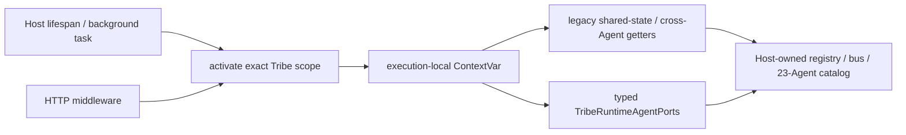

## 1. 系统边界

Natsume AI 由一个 Host 控制面、多个接入/外显运行面和若干可选基础服务组成。Host 负责业务决策和长期状态，Gateway 负责平台协议，Edge 负责本机感知与物理动作，Observability 负责只读投影和 Operator 交互。

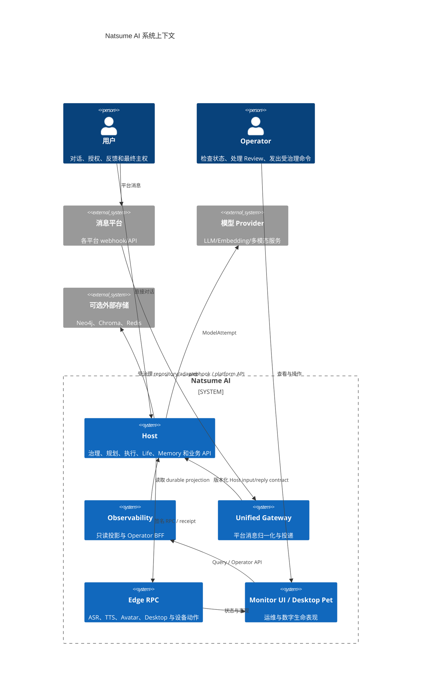

若渲染器不支持 C4 扩展，可从 [运行拓扑图](diagrams/01_runtime_topology.md) 查看普通 Mermaid 版本。

## 2. 进程与部署拓扑

| 进程/运行面 | Composition 入口 | 拥有的职责 | 不应拥有的职责 |
|---|---|---|---|
| Host Main | `host_brain/__main__.py` → `host_brain.app.asgi:app` | Command admission、Governor、Task Runtime、业务领域、API | 平台协议细节、设备驱动、只读 UI 状态真相 |
| Observability | `host_brain/obs_main.py` → `host_brain.app.obs_fastapi_app:app` | 运行投影、Trace、健康、Operator BFF | 直接修改业务数据库或绕过 Command 入口 |
| Edge RPC | `edge_client/__main__.py` → `edge_client.app.fastapi_app` | 本机感知、语音、Avatar、Desktop、actuator | 人格、任务或对话事实裁决 |
| Unified Gateway | `edge_client.gateway.bootstrap` → `edge_client.gateway.server` | Webhook、平台归一化、可靠投递 | Host 的业务路由和长期状态 |
| Monitor UI | `host_brain/app/monitor_ui/` | Query、Review、Operator command 客户端 | 自己维护任务真相或直接调用 worker |
| Desktop Pet | `desktop_pet/main.cjs` | Live2D 表现和桌面交互 | Life/Persona authority |

Host 与 Observability 是独立 ASGI 应用。Gateway 可以由 Edge lifecycle 装配，但其 transport state 和平台 adapter 仍是独立边界。所有跨进程 payload 应来自 `natsume_contracts/` 或显式版本化 HTTP 合同。

## 3. 逻辑分层

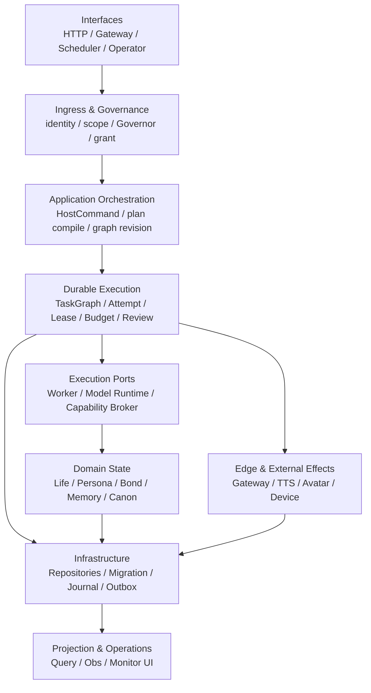

依赖方向的核心规则：接口适配器可以调用 application port，application 可以组合 domain contract，infrastructure 实现 repository/transport port；domain 不应反向导入 FastAPI、全局 composition 或平台 SDK。

### 3.1 接口与输入层

主要代码：

- `host_brain/app/app_factory.py`：Host FastAPI 应用构造和特殊入口。
- `host_brain/app/router_registry.py`：普通业务 router 装配。
- `host_brain/input_runtime/`：Host input、delivery 和 reply contract。
- `host_brain/secure_ingress/`：身份、scope、重放和输入合法性边界。
- `edge_client/gateway/`：平台 payload 归一化与出站 adapter。

输入层只负责把外部协议变成内部 command 材料，不应自己执行 Skill、调用模型或修改长期状态。

### 3.2 治理与应用编排层

主要代码：

- `host_brain/governor/`：意图规则、授权、rate limit 和 action preview。
- `host_brain/agent_runtime/cortex_runtime.py`：Host route 识别与 governed/compatibility 分流。
- `host_brain/orchestration/`：HostCommand、WorkOrderV3、计划图编译、revision、node grant 和 recovery intent。
- `host_brain/app/governed_task_adapter.py`：Host 请求到 Governed Task Runtime 的生命周期与应用适配；Frozen Skill worker/投影/验收由 `governed_frozen_skill_runtime.py` 拥有，冻结上下文和 Direct Host 合同由 `governed_host_contracts.py` 拥有。
- `host_brain/persistence/host_command_repository.py`：HostCommand/WorkOrder/Assignment/TaskGraph 的唯一 SQLite admission UoW；`_admit_normalized()` 是生产中唯一调用 TaskStore private Graph insert hook 的方法，且把当前 admission transaction 交给 hook，不开第二事务。严格 typed codec 与 immutable graph identity 校验在 `host_command_repository_codec.py`，稳定错误/迁移常量在 `host_command_repository_types.py`，Host 启动只读库存位于 `host_command_recovery_inventory.py`；三个 focused module 都不另建连接或取得写 authority。
- `host_brain/persistence/review_continuation_store.py`：Review continuation 的 claim/takeover/complete Store；Subject/Intent receipt authority 与纯 row/schema codec 分别位于 focused binding/codec 模块。
- `host_brain/scheduler/governed_runtime.py`：Scheduler occurrence 的 Governed Task Runtime；生产 worker 只编排 immutable operation plan 与 Acceptance 后 Effect dispatch，不直接调用领域 handler。定义管理、Secure Ingress 校验与 terminal replay command service 由 `scheduler/command_service.py` 拥有并从旧路径兼容重导出。
- `host_brain/scheduler/operation_plan.py`：把冻结 occurrence/definition/worker/fingerprint 编译为 `scheduler.operation.execute` descriptor，并从 canonical WorkerProjection 与 Scheduler repository 独立 Verification/Acceptance；不执行领域副作用。
- `host_brain/scheduler/accepted_operation.py`：共享 dispatcher 的 Scheduler Effect handler；在 Graph Acceptance 后重开 exact operation/Preview authority、调用真实 handler，并将实际结果写入既有 immutable Scheduler result ledger。
- `host_brain/scheduler/accepted_effect_runtime.py`：投递已提交的 Scheduler Effect，并在向调用方暴露领域结果前独立重开 actual-result 与 occurrence authority；缺失或读取不确定时保持 `RECOVERY_REQUIRED`。
- `host_brain/scheduler/clock.py` + `persistence/scheduler_repository.py` + 0117：在一个 SQLite UoW 内把 live DUE retry authority 原子转为 occurrence-bound owner/fence；独立 execution lifecycle 在 dispatch 前续租并在运行中 heartbeat，实际 failure time 决定退避，过期 lease 和 stale fence 均失败关闭。
- `host_brain/app/governed_task_authority.py`：无状态的 HostCommand/WorkOrder/planning lineage、route-aware exact replay 与 fail-closed authority 校验；不写 Store、不执行 TaskGraph。
- `host_brain/app/governed_operator_runtime.py` 与 `governed_terminal_reconciliation_runtime.py`：为 `sys_mode.switch` 和 `task_terminal.reconcile` 冻结 typed Operator action、server-reopened Secure Ingress authority 与 HostCommand/TaskGraph；前者提交 HardState effect，后者经 0119 signed-command ref、Review、Action Preview 和 Acceptance Effect 执行。加上 `scheduler.task.trigger` 后 Operator 进度为 3/37，其余 34 条命令不进入 handler。
- `host_brain/task_runtime/acceptance_effect_dispatcher.py::AcceptanceEffectRuntime`：Host、Operator、Scheduler 与 Internal result 共用的 app-local Effect 投递/恢复 owner；`RECOVERY_PENDING` 只允许 durable defer，不得先 terminalize outer claim。handler/transport 异常只保存 opaque incident，不把异常正文写入持久状态。
- `host_brain/app/acceptance_effect_handler_common.py` + `acceptance_surface_effect_handler.py`：前者只提供 JSON、effect identity、opaque failure 和 receipt 纯 helper；后者只提供 Gateway Surface reply Acceptance Effect handler 与只读 reconciler；写 authority 仍由原 Acceptance runtime 所有。
- `host_brain/app/internal_runtime_composition.py` + `host_runtime_context_wiring.py`：前者只组合并激活 Internal/Workspace/Operator/runtime group，后者只接 Runtime Context、Action Preview、Guardian 与 Service Catalog terminal observation；ASGI 继续唯一拥有 lifespan、task 创建/取消和关停顺序。通用 `runtime_lifespan()` 不再拥有模块级 service-heartbeat 的启动/停止 authority，正式 Host 仅由 ASGI-owned Guardian task 管理健康循环。
- `host_brain/persistence/scheduler_clock_retry_store.py` + `scheduler_repository_primitives.py`：Clock retry lease/fence 事务复用 `SchedulerRepository` 的 connection/UoW，primitives 只提供纯验证与稳定错误，不形成第二 repository authority。
- `host_brain/app/acceptance_effect_recovery_observer.py`：把 Effect 启动扫描/后台恢复失败与恢复投影为 app-local RuntimeGuardian durable SLO；它只观察恢复状态，不取得 Effect 或 Guardian 之外的业务 writer authority。
- `host_brain/agent_runtime/artifact_store.py`、`workspace_write_promotion.py`、`projection_recovery_contract.py`、`internal_precheckpoint_cancellation_claim_result.py`、`internal_raw_failure_claim_result.py`、`internal_artifact_terminal_reconciliation.py`、`accepted_result.py`、`task_internal_agent_checkpoint_store.py` 与 `app/periodic_durable_continuation.py`：Internal raw material进入protected exact-inventory stage，公共projection只携带ref/digest。外部入口只接受未准入 v2 描述，准入后的 frozen worker 原生传递 immutable `WorkOrderV3`。具备 exact Workspace authority 的 write 密封 frozen-base path manifest 与 binary patch，Acceptance 重算 deterministic accepted HEAD 并经 0116 晋升，源分支不移动。首次 activation 与周期 survivor 可从受治理单节点 sealed checkpoint 重开完整 lineage、以更高 fence completion Lease 重建唯一 projection并继续原图，Agent不重跑。终态 worker 处理精确 sealed abandon/cleanup；未 sealed cancellation 仍只接受自己的两类互斥 signed terminal。当前无取消 raw failure 则只在 failure Store 已原子终结 Operation/Attempt/Node/Graph/Lease/Budget 后生成独立 deterministic result，先提交 claim 再 cleanup/discard。Direct Agent Skill 使用同一 artifact/workspace owner 但只拥有另行校验的 post-Acceptance promotion，不继承 Internal recovery。一般 unknown effect、其它 failure/cancel/budget claim closeout与 general `settle_worker` crash bundle、Domain Pack/其它 Skill、handle-level TOCTOU、OS/container isolation与七路线验收也未完成。
- `host_brain/app/observability_runtime/review_wait_recovery.py`：只在 Host 启动阶段用 Secure Ingress、HostCommand、TaskNode 与 ReviewItem 四方 canonical authority 修复 Review 已落库但 outer WAL append 失败的崩溃窗；恢复前 OBS admission 保持关闭，绑定漂移失败关闭。

该层决定“是否允许做、冻结成什么图”，但不应把模型输出直接当成已经执行的事实。

### 3.3 规划层

`host_brain/planning_search/` 提供无副作用搜索内核；领域 adapter 提供 candidate expander、ranker、virtual transition 和 reward。选中路径必须经过 `host_brain/orchestration/planning_graph_compiler.py` 编译为不可变 TaskGraph 才能进入执行。D16 将 Code 的冻结证据边界放在 `planning_search/code_domain_models.py`，将动态 catalog/ranker/compile binding 放在 `planning_search/code_domain.py`：它只消费冻结 opaque ref/digest，动态生成虚拟 `inspect → registered patch → unit/rollback`；其 selected inputs 必须由 catalog 重建后才能进入 compiler context。D17 的 `planning_search/code_benchmark_models.py` / `code_benchmark_sandbox.py` 则处在实验 I/O 边界：它对清洁、受保护且拥有非共享 `.git` 的 source 建立无 remote、private-hooks 的 private bare clone，再创建同 frozen commit 的 baseline/search detached worktree；只允许仓库自有 trusted in-process adapter 使用 lower-case repository-relative file API。D18 的 `code_benchmark_ledger.py` / 0106 SQLite owner 将 preregistered workload、paired RunSpec、两臂 evidence/outcome 和 `VERIFIED_CLEAN` 回执封成 append-only terminal experiment receipt。D19 的 `code_benchmark_verification_contracts.py` / `code_benchmark_verifier.py` 只在预注册 plan 下运行冻结 `python -m pytest -q <repo-relative-test>` argv，并把 shell-free child 的无路径命令回执写回 arm evidence；`code_benchmark_experiment.py` 只在两 arm PASS 与 clean receipt 时登记 terminal evidence。这都是可重放实验事实，不是 execution/promotion authority。D20a 的 `research_domain_models.py` / `research_domain.py` 则以 `ResearchTaskSnapshot` 的公开 metadata（`source_id`、governed ref、digest 和有限排序 hints）按当前虚拟状态构造 `query`、`quick-answer`、`primary-source`、`independent-source`、`cross-check`、`resolve-conflict` 与 `stop` 的纯 L1/L2/L3 catalog；只有冻结 `virtual_transition_ready` 才暴露 L3 虚拟 ports，且其中没有 dedicated 本机 locator/source-body/answer-key/verifier-decision 字段，constraints 拒绝这些命名 key，任务文字不是内容级 DLP。`research_benchmark_corpus.py` 的 `FrozenResearchCorpusLoader` 仅从可信实验根目录下 manifest 列出的 repository-relative 普通文件读取，在稳定受信输入中读前/读后核对状态、大小并在读完后核对 digest，拒绝绝对/遍历/ADS colon/case alias/link/reparse/未列来源；public receipt 不含路径或正文。D20b 的 `research_benchmark_verifier.py` 对 snapshot/manifest/source id/ref/digest/tier 做 exact handshake，并在每次校验时新建 loader，从重新打开的 source bytes 验证 UTF-8 byte-boundary 与 citation span digest；0107 repository owner 会在 arm/terminal replay 时重开 registration、RunSpec 与两条 arm evidence，精确拒绝 plan/model/verifier/evidence digest drift。D20c 的 `research_paired_execution.py` 只重开已登记 RunSpec 的实际 arm order，从 run/role/arm 派生 external execution ID，保持 private prompt/response 不入 0107，并以每臂 fresh verifier、prompt digest、工具/token/时延和 aggregate budget 封口 evidence/terminal。`attested_external_research_adapter.py` 是该 runner 唯一允许的模型边界：它只能调用 composition 注入的 canonical `ModelAttemptService`，为每个 arm 发送一个前台 canonical request；只有 returned result 恰有一个非缓存成功 attempt，且 final target、输出摘要、rendered prompt digest、工具/token/成本与 provider/总延迟都精确对齐时，才会经 `AttemptAuditLookup` 重开同一 request 的 canonical started/terminal pair，核对 terminal row 与 provider latency 后嵌入 `ExternalProviderRunAttestationV1`。已有 evidence 只重开；audit 存在而 evidence 缺失则冻结 reconciliation，空审计才可重试。请求参数不能重写 route-owned retry ceiling；它仍没有真实 provider credential execution 或 production prompt/workload composition，所以是 `ACCEPTANCE_PENDING_EXTERNAL`，不是外部收益证据。该 Research adapter/ledger 没有进入 production composition；本地 in-process model double 也不是 provider evidence。它也不是 hostile TOCTOU、事实正确性或来源独立性证明，没有接入 production route、TaskGraph、Host、BrowserWorker、网页抓取、独立信任域 verifier、paired cohort、收益/promotion 或 OS/tenant/sandbox，benefit 仍为 `UNPROVEN`。窄 API、Git hardening、同主机 subprocess 与账本都不是 OS/container/filesystem/network sandbox，`network_isolation=NOT_ENFORCED`；只有测试命令数/验证总时限在 D19 adapter 内受控，model、plugin/skill、hidden-oracle、provider/tool/token/cost 和一般 runtime budget 均不在其 authority 内。

Host 现有两条 Plan 入口：遗留 `planned_steps/steps` 只校验并拓扑选择；`CAPABILITY_SEARCH_V1` 的普通入口仅由 Thalamus server-owned rule 为明确 Research/调研和 Frontend/可用性计划生成。该 rule 只携带任务、受限 tag 和最大风险；编译器与 Governor schema/binding 都保留它，之后 `orchestration/capability_plan_search.py` 才从 app-composed `SkillRegistry` 冻结至少两项 host scope、免确认、风险和标签均满足约束的能力元数据。公共 L1/L2/条件 L3 在虚拟态选择两项不同 Skill 的有界顺序路径，服务端冻结为 `skill → skill → chat`；`GovernedPlanningExecutionService` 在搜索后、compiler/admission 前调用 selected-context resolver 重建 selected-only 输入。它不读取 handler、不把未选能力带入执行、也不在 worker 中二次规划。显式、Governor-bound `failure_replan` 会先经 `GovernedPlanningRecoveryService` 验证 canonical `FAILED` predecessor、quiescence 与 evidence，再生成同 root 的 `graph_revision + 1`；这不是自动触发、更不是按失败自适应挑选新候选。仅建议、禁止工具、普通 Chat/通用目标、Code/Pentest、真实 provider/cohort、收益或 promotion 都不在本切片范围。Code adapter 仍是 pure shadow：`virtual_model_ready=false` 时不暴露 L3 simulation ports，且它不读工作区、不调用模型/工具/测试、不 admission 图或写 workspace；`allowed_path_refs` 不是 live ACL。Pentest 是目前更完整的领域 adapter，但 Conditional MCTS 仍不能影响生产选择。

能力规划的 risk authority 位于纯搜索边界而不是 worker：`CapabilityPlanningSnapshot` 只接受 `min(intent.planning_max_risk_level, Governor approved binding.risk_level)` 的 effective ceiling，并把 Governor decision ref 与 server-owned 两项执行步数纳入 virtual-state source refs/digest。这样已绑定的计划参数只能收紧候选，不能把较宽 request 字段解释为更高能力权限或任意 fan-out；binding 缺失、布尔值、非整数或越界时拒绝进入搜索。该限制只覆盖当前 Research/Frontend 的窄 Host adapter，不等于一般 Plan 或多领域搜索完成。

当前 D19/Code cohort 口径以本段为准，并取代上文“仅两 arm PASS 才登记 terminal”的历史描述：verified cleanup 后，PASS 与 FAIL 都必须形成 terminal observation，且 outcome、verifier、controlled receipt 的状态完全一致；`COMPLETED_CLEAN` 只表示证据完整与工作区清理完成。`contracts/planning_search/code_benefit_cohort*` 在此基础上固定 20 项同 source/model/provider/profile/budget 的 paired workload，要求独立 fresh worktree 与模型/hidden/static execution；收益仅在 +10pp pass-rate，或非劣 5pp 且成本至少下降 15% 时成立，hidden/static/diff-risk 均不得退化。当前没有 durable cohort owner、真实 20 项模型运行或 promotion authority，故仍为 `UNPROVEN`。

Pentest 的 promotion 输入现也有独立纯合同边界：
`pentest_calibration_cohort*` 固定 30 项授权运行，将 environment/scope、
capability manifest、facts、policy 与 virtual state/candidate IDs 派生的
successor catalog 绑定到 Task、Authorization、Verification receipt 和
shadow prediction/outcome。evaluator 只输出校准、安全、成本与时延报告。
`promotion_gate.py` 再要求该报告合格且 Research/Code 至少一域收益合格，
输出仍是 Review-bound proposal，不是 activation authority。当前没有统一
SQLite owner、真实 30 次运行或生产 activation；AgentLoop 继续使用 L1/L2
baseline，L3 influence=false。

### 3.4 Durable 执行层

主要代码：

- `host_brain/task_runtime/coordinator.py`：DAG 外层调度和对窄 runtime service 的直接调用；不再拥有 0091 complete wrapper。
- [`host_brain/task_runtime/node_execution_runtime.py`](../../../host_brain/task_runtime/node_execution_runtime.py)：完整节点 worker/heartbeat/retry/Budget/verification/acceptance/review 编排；共享既有 authority，不建立第二事务或锁。
- [`host_brain/task_runtime/node_execution_preparation.py`](../../../host_brain/task_runtime/node_execution_preparation.py)、[`preoperation_attempt_recovery.py`](../../../host_brain/task_runtime/preoperation_attempt_recovery.py)：前者准备 frozen input/Grant/候选绑定；后者从单一 scheduler snapshot 纯分类 operation-free persisted Attempt，并通过 Store port 请求 absence-fenced higher-fence Lease。两者都不拥有 writer、连接或 UoW。
- [`host_brain/persistence/task_lease_takeover_authority.py`](../../../host_brain/persistence/task_lease_takeover_authority.py)、[`task_lease_replay_identity.py`](../../../host_brain/persistence/task_lease_replay_identity.py)：前者在调用方 TaskStore 写事务内重验 Operation presence/absence、ACTIVE Graph 与唯一 ACTIVE/EXCEEDED graph Budget，只借用 `conn` 和 Store helper；后者是无 I/O 的纯 identity/row-binding 模块，把 Attempt、owner、TTL、expected version、takeover mode 与 reservation ID 绑定到确定性 Lease/初始 Heartbeat。两者都不创建连接、事务或第二 writer。
- [`host_brain/task_runtime/accepted_graph_finalization.py`](../../../host_brain/task_runtime/accepted_graph_finalization.py)：normal Node、single-node checkpoint continuation 与 outer all-ACCEPTED re-entry 共用的 Graph+Acceptance Effect completion；重启只接受 Store exact Operation checkpoint 与 canonical WorkerProjection。
- [`host_brain/task_runtime/operation_recovery_runtime.py`](../../../host_brain/task_runtime/operation_recovery_runtime.py)、[`operation_checkpoint_budget_recovery.py`](../../../host_brain/task_runtime/operation_checkpoint_budget_recovery.py)、[`operation_checkpoint_continuation.py`](../../../host_brain/task_runtime/operation_checkpoint_continuation.py)：exact canonical COMMITTED checkpoint 的 fenced takeover 与 Verification/Acceptance/BUDGET_BLOCKED continuation；不执行 worker。多节点必须由 outer DAG scheduler 显式授权，且仅在 live owner fence 清除后继续 `EXACT_ACCEPTED / EXACT_REJECTED / MISSING`；不取得 operation-free Attempt、unknown side effect 或 general multi-node/batch 自动 recovery authority。
- [`host_brain/audit/migrations/0100_task_runtime_graph_revision_supersession.sql`](../../../host_brain/audit/migrations/0100_task_runtime_graph_revision_supersession.sql)、[`host_brain/persistence/host_command_repository.py`](../../../host_brain/persistence/host_command_repository.py)：显式 FAILED-only replan 的 append-only predecessor→replacement authority；同一写事务重验静止 predecessor并 admission revision+1，普通 Store/Review mutation 读取 supersession fence。当前为保守 safe subset，不等于自动重规划。
- [`host_brain/task_runtime/node_execution_projection.py`](../../../host_brain/task_runtime/node_execution_projection.py)：节点 terminal replay、Attempt/Reservation 等 durable read；只读，不拥有 mutation authority。
- [`host_brain/task_runtime/node_execution_records.py`](../../../host_brain/task_runtime/node_execution_records.py)：节点执行的纯构造、digest、retry identity 与 record 校验。
- [`host_brain/task_runtime/parallel_success_runtime.py`](../../../host_brain/task_runtime/parallel_success_runtime.py)：0091 整图成功的 durable read/validation、Budget refresh、Outbox 与 canonical success 编排；共享原 authority，不拥有事务。
- [`host_brain/task_runtime/parallel_success_records.py`](../../../host_brain/task_runtime/parallel_success_records.py)：0091 route-authority 纯投影；不持有 Store 或 runtime authority。
- `host_brain/task_runtime/coordinator_records.py`：durable record 校验、并行节点 outcome 与稳定字段读取；纯叶子模块。
- `host_brain/task_runtime/coordinator_receipts.py`：不可变 execution receipt、构造器与 terminal/commit event rendering；纯叶子模块并保持旧导入 identity。
- `host_brain/task_runtime/parallel_settlement_projection.py`：0090 active re-entry、rejected Budget outcome 与 outcome snapshot 的 durable read/validation；只持同一 Store，无 mutation authority。
- `host_brain/task_runtime/parallel_settlement_runtime.py`：0090 failure/review/Budget outcome resolution、ownership/CAS conflict 判定与 settlement orchestration；共享原 Store、BudgetRuntime、RuntimeOutbox 和 Projection，不建立第二事务或发布锁。
- `host_brain/task_runtime/graph_cancellation_records.py`：取消 intent 校验、Node 状态投影与 Budget target/projection；不拥有取消编排 authority。
- `host_brain/task_runtime/graph_cancellation_runtime.py`：两阶段取消 request/continue、exact replay、advance/finalize 与本地 cancel/join 编排；只依赖同一 Store、共享 Outbox/Registry、lease TTL 和只读 Projection。
- `host_brain/task_runtime/graph_cancellation_projection.py`：读取取消 intent、Graph/Node/Budget/Attempt/decision durable facts并构造 terminal receipt；只持 Store，不拥有 mutation authority。
- `host_brain/task_runtime/graph_cancellation_continuation_worker.py`：0094 composition-owned pending-intent scanner；持久 claim/heartbeat/defer/expired takeover，从 exact HostCommand admission 重建 replay 上下文后重入既有 GraphCancellationRuntime，不拥有业务取消状态。
- `host_brain/task_runtime/runtime_outbox.py`：每个 Coordinator 唯一的 Outbox message factory/publisher/limit/发布锁；不持有 Store 或 Coordinator。
- `host_brain/task_runtime/local_graph_execution_registry.py`：graph revision 级本地 task tracking 与 bounded cancel/join；只作 durable cancellation 的进程内加速器。
- `host_brain/task_runtime/dag_scheduler.py`：稳定 READY/fan-in/retry due 纯调度决策。
- `host_brain/task_runtime/budget_runtime.py`：预算预留、计量和结算。
- `host_brain/model_runtime/governed_skill_budget.py`：普通受治理模型 Skill 的 task-bound typed model port、逐次剩余额度与无 authority usage attestation；不持有 durable Budget writer。
- `host_brain/task_runtime/review_runtime.py`：PRE/POST Review 与 continuation 材料。
- `host_brain/task_runtime/acceptance_effects.py`：Acceptance effect intent 构造。
- `host_brain/task_runtime/acceptance_effect_dispatcher.py`：验收后副作用投递；visible turn、Preference 与 Life projection 是三个独立 Effect。Preference store gate 缺失/非 `bool` 失败关闭且零写，配置 false/malformed env 保守映射为 disabled并只写零 event/profile 的 `DISABLED` receipt；0118 将 event、append-only profile child version、evaluation receipt 原子提交并封闭 child 全集。Surface 以 `internal_reply` HMAC/timestamp/nonce 只读查询 exact Gateway outbox；Gateway 从同一 SQLite payload 精确校验 `effect_id`，`NOT_FOUND` 保持 `UNKNOWN`。
- `host_brain/persistence/task_repository.py`：Durable TaskGraph、Node、Attempt、Lease、Budget 的唯一 Store 组合、连接与事务 authority；通过无状态 persistence mixin 复用窄职责实现。
- `host_brain/persistence/task_dag_state_store.py`：Graph/Node 读取、状态转换与一致 scheduler snapshot；Graph/Node INSERT 只存在 private `_insert_graph_from_host_command_in_transaction()`，它仅借用 HostCommand admission 的 caller-owned transaction。public `create_graph` 与 `insert_graph_in_transaction` 已删除。
- `host_brain/persistence/task_ready_claim_store.py`：READY claim 与 response-loss exact replay；一个 writer transaction 内复核容量并提交 Attempt、Node、Lease、Heartbeat 与三条 Outbox。
- `host_brain/persistence/task_store_types.py`：TaskStore 错误、状态枚举、Outbox 与稳定 value records；无连接、SQL 或事务，并由 repository 兼容重导出。
- `host_brain/persistence/task_record_codec.py`：确定性 JSON/SQLite Row 校验与合同重建；不执行 SQL，依赖方向固定为 repository → codec → types/contracts。
- `host_brain/persistence/task_budget_usage_store.py`：BudgetUsage 唯一 winner、`ALREADY_EXCEEDED` sibling、exact replay 与可供 0090 decision 写/读/replay 在单一快照中复用的 terminal authority 校验；只借用主 Store transaction。
- `host_brain/persistence/task_operation_checkpoint_store.py`：一次读取并验证 COMMITTED Reservation、唯一 COMMITTED Outbox、Attempt 与历史 Lease/fence 的 fail-closed checkpoint；不创建第二 Store。
- `host_brain/persistence/task_outbox_delivery_store.py`：`TaskOutboxDeliveryStoreMixin` 统一拥有 Task mutation 的 `_insert_outbox` 与 response-loss `_assert_mutation_outbox_replay` 实现，并承担 0093 Task Runtime Outbox 的跨进程 claim、expired takeover、fenced complete/release 和失败 backoff；0095 将 Graph predecessor/head 隔离到 `aggregate_type + aggregate_id + graph_revision`，并以 exact trigger/readiness 拒绝错绑。Mixin 只借用 `DurableTaskStore` 的连接、时钟与事务 authority；它不是第二个 Store 或 UoW owner。
- `host_brain/persistence/task_graph_cancellation_continuation_store.py`：0094 cancellation coordination claim、heartbeat、defer、complete 与 expired takeover；只保存租约/重试元数据并借用主 Store authority，0092 intent/decision 仍是唯一业务真相。
- `host_brain/persistence/review_continuation_store.py`：0096 task-bound Review continuation 的 enqueue/reconcile/claim/heartbeat/defer/complete 与 expired takeover；只保存协调身份和租约，不复制 Review status/token 或 Task 状态。create 时在同一事务校验 canonical subject、outer graph/node、精确 Node waiting/version 及 PRE/POST Attempt 约束；claim 按候选独立事务隔离 poison 行。
- `host_brain/persistence/task_decision_integrity.py`：decision/outbox lineage 的只读绑定校验；只借用 repository 当前事务连接执行 `SELECT`，不取得连接、事务或 mutation authority。
- `host_brain/persistence/task_acceptance_effect_staging.py`：Acceptance Effect 规范化，以及 Node/Graph acceptance 与 effect 的原子同事务提交；Effect INSERT 只存在 private `_stage_acceptance_effect_intent_in_transaction()`，只能被三个 canonical Acceptance UoW 使用，并且只借用主 Store 当前事务。public `stage_acceptance_effect_intent` 已删除。
- `host_brain/persistence/task_acceptance_effect_delivery.py`：Acceptance Effect schema、查询、claim、commit/fail/reschedule 与 fencing；不创建独立 Store、连接或事务 owner。
- `host_brain/persistence/task_parallel_success_store.py`：0091 Parallel Success schema、read/replay、Attempt/projection lineage 与 Graph/Budget/Outbox/effect/decision 原子成功收口；只借用主 Store 的唯一事务。
- `host_brain/persistence/task_parallel_settlement_store.py`：0090 failure/review/Budget settlement 的 schema、read/replay、lineage 与 Graph/Budget/Outbox/decision 原子收口；只借用主 Store 的唯一事务。
- `host_brain/persistence/task_parallel_state.py`：0090/0091/0092 共用的 Node snapshot 规范化和严格对账；无 SQL、连接或事务 authority。
- `host_brain/persistence/task_graph_cancellation_request.py`：0092 phase-1 intent 与 Graph/Node/Attempt/Lease/Review/token/operation/effect fence 原子请求写路径；只借用主 Store 事务。
- `host_brain/persistence/task_graph_cancellation_finalization.py`：0092 reconciliation advance 与 Graph/Budget/Outbox/decision 原子终结写路径；Operation proof 与 PENDING Effect proof 仍通过主 Store common evidence 验证。
- `host_brain/task_runtime/graph_cancellation_operation_reconciliation.py`、`graph_cancellation_effect_reconciliation.py`：受限签名 Operation/Effect 对账服务，由 ProcessTaskRuntimeContainer 构造并经各自 ASGI/OBS 默认关闭入口注册，当前均为 `WIRED_DEFAULT_OFF / CANARY_NOT_RUN`。
- `host_brain/persistence/task_effect_reconciliation_store.py`：稳定兼容 composite；实际实现拆到 common helpers、read/validation 与 mutation focused modules，只借用主 Store authority。
- `host_brain/persistence/task_graph_cancellation_effect_overlay_store.py`：PENDING proof/new-decision evidence 与 FINALIZED trusted correction overlay；不改写旧 decision/fence/evidence。
- `host_brain/task_runtime/terminal_state_reconciliation.py`：0099 历史 TaskGraph 终态 repair service；只处理 inventory case，不成为 Runtime 重入或通用恢复 authority。显式 system auto 仅消费带唯一 graph-scope Budget 的 exact failure bundle，Operator repair 必须签名。
- `host_brain/persistence/task_terminal_reconciliation_store.py`、`terminal_reconciliation_query_repository.py`：0099 append-only case/proof/supersession composite 与 SQLite query-only authority；migration 只建 schema/trigger/index，不修改 Graph、Budget 或旧业务记录。
- `host_brain/persistence/task_retry_mutation_store.py`：retry promotion/schedule、BudgetUsage、Budget/Attempt/Node/Lease/Outbox 原子 mutation；区分 legacy 与 node-only disposition。
- `host_brain/persistence/task_retry_replay_store.py`：retry response-loss 的同事务 exact replay；不创建连接或事务。
- `host_brain/persistence/task_atomic_failure_store.py` 与 `task_atomic_failure_budget.py`：direct、non-deferred pre-reservation 的 Attempt/Node/Lease、可选 Graph、精确 graph-scope Budget 与五条 Outbox 原子失败收口；node-only/deferred 路径明确不取得共享 Budget mutation authority。

执行器只接收冻结节点输入和 node-bound grant。任何失败后的计划变化都应生成新 graph revision，不能在 worker 内静默修改原图。

当前 Task Runtime 已消费 B0 的 `{max_attempts, retry_backoff_ms}` 与无副作用调度决策。唯一自动重试边界仍是 worker resolver 在 operation reservation 前显式抛出的 `RetryableWorkerPreparationError`。对不需要新 Review 的到期 `RETRY_PENDING`，`DurableDagSchedulingRuntime` 不再先独立 promotion：它把 `TASK_NODE_READY` 交给 `DurableNodeExecutionRuntime`，由 `TaskStore.claim_ready_node()` 在同一 `BEGIN IMMEDIATE` 先 promotion、再写 Attempt、Node、Lease、Heartbeat 与 claim Outbox；Attempt Outbox identity 注入失败时上述所有变更回滚，exact replay 不会创建第二个 Attempt。需要新 Review 的到期重试仍先持久化新的 Review，下一轮才 claim，禁止绕过审批。retry_count BudgetUsage、Budget、Attempt、Node、Lease 与 Outbox 继续在 `schedule_retry` 的 canonical UoW 中写入；超限 fail closed，reservation 后异常绝不 retry。当前 Host、Scheduler 与 Internal production resolver 仍没有现实 marker 来源，general/multi-node/batch recovery 仍未完成；resolver `CancelledError` 原样传播。

每个 `AdmittedTaskNode` 还必须从已验证的 immutable TaskGraph 冻结 `risk_level`，并在 admitted boundary 再次限制为 1..5。worker execution context 只能读取该 frozen 值，不能从可变 payload 或不存在的属性补推；这一约束修复了 Scheduler 首次真实 worker 执行的断点。

ActionPreview 的生产重开使用 canonical Runtime Context 投影，不把 Host request 的其他 input-pack 字段混入 context identity。Scene 合同内部的 64hex digest 在 Preview receipt 边界转换为 `sha256:`，两侧都从 canonical WorkOrder 重算；Guardian 续租仅在 scope/owner/lease/fence/revision 和 policy 完全一致时允许 expiry 单调延长。Acceptance terminal boundary 对 `action_args` 深拷贝后才向 handler payload 注入 proof，避免自引用图进入 canonical digest。上述规则都保留 fail-closed：expiry 缩短、身份漂移、Scene/Context 漂移和非 canonical payload 仍拒绝。

Scheduler governed occurrence 当前沿同一边界运行：Task worker 只提交 immutable operation plan，Graph Verification/Acceptance 与 `scheduler.operation.execute` staging 在 TaskStore canonical UoW 同成同败；共享 app-local `AcceptanceEffectDispatcher` 在提交后派生 exact Scheduler Preview 并调用真实 handler，实际结果仍由既有 `SchedulerExecutionResultRepository` 持久化。0117 让 `admit_due_occurrence` 在同一 `BEGIN IMMEDIATE` 中验证 DUE owner/fence并把 retry row 原子转为 occurrence claim，消除 clear-DUE 后再 claim 的并发窗口；execution lifecycle 在 dispatch 前/中续租，过期 owner不能自我复活，clear/defer 使用实际调用时间。Scheduler Admin 的 route-local definition authority 已由后续双前缀 TaskGraph/Acceptance 切流关闭；mutable batch freezing、一般未知外部效果人工归因、wave integration 与 canary 仍缺，所以 Scheduler/NE-01 未完成。

通用 Effect 恢复按领域 authority 只读重开：visible turn 精确重验 turn+MemoryEvent。Preference 首先要求 app-local store privacy gate 为真实 `bool`，否则失败关闭且零写；配置 false 或 malformed env 保守解析为 `bool false`，只写 `DISABLED` receipt 且 event/current profile/0118 child version 为 0。启用路径以 deterministic operation ID 在一个 SQLite UoW 写 event、append-only profile child version 与 evaluation receipt；parent receipt 可见后 trigger 禁止追加 child，reconcile 再比较 receipt 声明与 child 实际全集，绕过 trigger 的篡改仍会失败。推荐反馈只选 admitted timestamp 以前且 exact person/conversation/session 的 delivery，并绑定 canonical full-delivery digest；零信号必须存在 `NO_SIGNAL` receipt。Surface 初次 POST 响应丢失后使用真实 `internal_reply` HMAC/timestamp/nonce 发起只读 query；Gateway 从同一 SQLite outbox snapshot 的 canonical payload 校验 `effect_id`，Host 重派生并校验 delivery/payload identity；`NOT_FOUND` 与任何漂移均保持 `UNKNOWN`。

Internal worker 的 raw work order、prompt、metadata、result、changed-files 与 verification 在 Acceptance 前只进入 protected stage；seal 锁定 exact inventory/byte digest。受治理 write 同时锁定 frozen-base manifest 与 binary patch；Acceptance 重算后生成 deterministic accepted HEAD，并通过 0116 生命周期晋升，源分支不移动。若进程在 seal 后、WorkerProjection 前退出，首次 runtime activation 或周期 survivor 会以严格更高 fence 重建唯一 projection并继续原图；Agent 调用数保持 1。检查点 A/B/C 仍是三个分别原子的持久边界。pre-checkpoint cancellation 只在 exact single-node cancellation lineage 下消费自己的两种签名终态。没有 cancellation intent 的 raw failure 现在由独立 failure service 在单一 UoW 中确认 `NO_SIDE_EFFECT` 并写 Operation `RELEASED`、Attempt/Node/Graph `FAILED`、Lease `EXPIRED`、Budget `RELEASED` 及 Outbox；Internal terminal worker 只有在重开该终态后，才先提交 deterministic claim、再清理 Workspace/stage。当前状态为 `PARTIAL / INTERNAL_WRITE_PROMOTION_AND_SIGNED_RAW_FAILURE_CLAIM_BEFORE_CLEANUP`，不是通用 worker crash recovery。三条 Agent Skill 使用独立 route-specific classifier，当前已证明 Direct success/Verification failure 与 Plan single-writer graph success/downstream failure/downstream post-review cancellation 的跨 runtime lifecycle，但不继承 Internal claim authority；Plan 取消还要求 finalized intent/decision、accepted writer 三快照同版本和零 Effect。其它 terminal matrix、多 Workspace、一般 unknown effect、general `settle_worker` crash bundle、Domain Pack/其它 Skill、handle-level 原子 TOCTOU 与 OS 隔离仍未完成，`REMOTE_CI=NOT_RUN_ACCOUNT_QUOTA`。

Operation 已 `COMMITTED` 后的 Budget settlement 采用不确定性 hold：若 BudgetUsage 写响应与首次精确重读都丢失，普通异常只能返回 `RECOVERY_REQUIRED`，不得把 worker 标为失败或释放 Lease/Budget，也不得覆盖可能已经原子提交的 usage/`EXCEEDED`；process-control `BaseException` 原样传播。BudgetUsage 只分为 `EXACT_ACCEPTED / EXACT_REJECTED / MISSING / CONFLICT`。Lease 到期后，committed-checkpoint takeover 会在更高 fence 下只读重开前两类、幂等补写 `MISSING`；共享 Budget 已 `EXCEEDED` 时，accepted 或 missing checkpoint 必须证明唯一 sibling winner，missing 只能补写为与 winner 共用 Outbox/dimensions 且不再推进版本的 `ALREADY_EXCEEDED`。真实 SQLite 现覆盖三 owner 连续响应丢失、双 checkpoint、four-root mixed settlement、五节点菱形和八个并行根节点，后继只在依赖满足后释放且 worker 不重跑。`CONFLICT`、`RESERVED/RECOVERY_REQUIRED` unknown effect 与 cancellation crossing 不再只是一次返回：0130 会在新 Lease 前写 exact version-bound append-only hold 与 Outbox；conflict 保持 quarantine，后两类要求各自签名 reconciliation。无限规模、其它 failure/cancellation、自动归因和部署 fan-out canary仍未解决。

TaskStore 的 DAG state、READY claim、中央 mutation Outbox、BudgetUsage contention、Lease takeover authority 与 Operation checkpoint read 均已拆为 focused mixin；Lease acquisition identity/row binding 又拆成 93 行纯模块。当前静态 Gate 记录 `task_repository.py` 4585 行、`task_lease_takeover_authority.py` 230 行，低于既有 4600/250 门禁；`DurableTaskStore` 仍是唯一组合/连接/UoW owner，没有新增 architecture policy 白名单或第二 Store authority。Gate 1～14 全部 `PASS`。repository 余量仍窄，后续继续拆分而不得提高上限。

本轮还删除了 `DurableTaskStore.create_graph`、`insert_graph_in_transaction`、`stage_acceptance_effect_intent` 三个 public 写入面。生产 Graph hook 只由 `HostCommandRepository._admit_normalized()` 调用 1 次；Effect hook 只属于 `transition_graph_and_stage_acceptance_effects`、`commit_node_acceptance`、`complete_parallel_graph_success` 三个 canonical UoW，共 6 个调用点。0124 在数据库边界以 exact graph/revision scope 和三条 trigger 封闭 Graph、Node、HostCommand 新 INSERT；0125 又以 exact effect/graph/revision/node/attempt/commit-scope/idempotency scope 和一条规范初始状态 trigger 封闭 Effect 新 INSERT。plain SQLite、unscoped/wrong scope、raw HostCommand、late Node、非规范 Effect 与 trigger drift 均失败关闭；既有行不重写，exact replay 不取得写 scope。因此窄边界为 `APPLICATION_AND_SQL_ADMISSION_AND_EFFECT_STAGING_WRITE_AUTHORITIES_SEALED`；其它运行期 mutation 不在这个物理声明内。最终受影响去重批次为 `99 passed in 245.03s`，wave integration 为 `NOT_RUN_PER_WAVE_POLICY`，NE-01 仍 `IN_PROGRESS`。

Host continuation 不再从所有 surface 的通用 Graph page 取样后再丢弃外部记录。`HostCommandRepository.list_nonterminal_admission_page()` 在每个只读事务中联结 journal、Graph 与当前 Node identity，SQL 先限定 Host surfaces 和 `CREATED/ACTIVE/BLOCKED`，再按 immutable journal `(created_at_ms, command_id)` keyset 读取 `limit + 1`。surface digest、cursor schema 与 page tail 绑定，consumer 还验证页内严格递增、command/Graph 不重复和整轮 scan limit。这既防止 Scheduler/Internal/Operator backlog 饥饿 Host 恢复，也让第 101 个及后续 survivor 继续下一页，不再形成容量触发的整批死锁；tuple/snapshot/page/receipt 漂移仍失败关闭。mandatory boot pass 后，app-local supervisor 通过 timer/wake 重用同一 continuation；live Lease 保持 `DEFERRED`，到期后在线重评。独立进程写入 101 个真实 SQLite admission、另一 Runtime 全量重开已通过。该改动不授予 scanner worker、Lease takeover、unknown-effect attribution 或一般恢复 authority。

同一 continuation engine 现由 RuntimeGroup 以独立 `INTERNAL/SCHEDULER/OPERATOR` surface set 复用。Host 与 control inventory 的 surface digest 不同且无交集；完整 RuntimeGroup 和共享 Effect owner 激活后先执行 Host mandatory pass，再执行 control mandatory pass，最后才启动 Scheduler clock。control record 只能按 immutable surface/target 路由到唯一 runtime 的 `continue_startup_admission`，不会伪造 Operation reconciliation authority。具体 App 实现通过 composition root factory 注入，静态依赖仍保持 `app → composition` 单向；Internal startup 执行另有窄模块，不回填巨石。RuntimeGroup 以 startup lock 去重并发 boot，以 execution lock 串行周期扫描和 Operation re-entry；shutdown 先停止并 join supervisor，活动事务不会被 task cancellation 截断。真实 SQLite 三类 admission 和 101 条跨页路由均已验证，但生产 worker 跨进程完整终结、一般 unknown-effect/failure/cancellation 与波次验收仍未证明。

Host 的进程重启链已从“同进程伪崩溃”推进到真实 spawned process。父测试进程只负责观察；进程 A 通过 production Task Runtime 写入 canonical SQLite 后在精确边界 `os._exit`，进程 B 重新构造 Host Runtime、repository、coordinator 和 owner 后运行 mandatory continuation，进程 C 再次重新构造并验证零重放。PRE-OPERATION 使用同 Attempt 的 higher-fence takeover，COMMITTED checkpoint 使用原 receipt 完成后半链，顺序依赖图保持 predecessor receipt/artifact。这里仍是可控 worker/Verifier/Acceptance 的本地机制验收，不是现实模型/Skill/provider、完整 control surface 或 NE-07 服务栈。

0102 又增加 focused `TaskNodeArtifactStoreMixin`，并与 GR06 NODE Effect 汇合到 canonical `commit_node_acceptance()`。production normal/checkpoint/Review acceptance 在同一 Store transaction 中冻结 exact NODE Effect set、写 immutable artifact、推进 Node `ACCEPTED` 与追加 Attempt-bound Node Outbox；exact replay 不得在 Acceptance 后补写缺失 effect。dispatcher 只有在同 graph/revision/node/Attempt 的 artifact 通过 contract/payload digest 重验后才可 claim Effect。compiler 生成 dependency result refs，后继执行只解析同 revision 的 exact 前驱 artifact 并冻结进 worker 输入。新 admission 拒绝空 `output_contract`；Task Runtime 在 recovery 前校验 0102 migration asset 和完整 schema snapshot，并隔离 active legacy 空合同/缺 artifact，以及缺 exact artifact 的可投递 terminal legacy Effect。public Graph create/transaction insert 与 standalone Effect stage 已删除；0124/0125 又分别封闭 Graph/Node/HostCommand admission 和 Acceptance Effect staging 的 SQL INSERT 旁路，故该部分为 `UNIFIED_APPLICATION_STORE_UOW_WIRED / APPLICATION_AND_SQL_ADMISSION_AND_EFFECT_STAGING_WRITE_AUTHORITIES_SEALED`。其它运行期 mutation仍按各自 canonical UoW 与 readiness 管理，不能外推为全库物理单写。

Coordinator 当前 271 行，`DurableDagSchedulingRuntime` 1,343 行；238 行 `AcceptedGraphFinalizationRuntime` 统一 normal/restart/continuation completion，Operation recovery 与 checkpoint continuation均低于 600 行。Dag 矩阵为 Store9/Budget8/Lifecycle17/AcceptedFinalization1/NodeProjection13/NodeExecution7/Settlement4/Success1/Review4/Cancellation1/Outbox 1 build+6 publish。没有 Coordinator callback、新锁或第二 persistence authority。两批 focused split 在不增加或放宽白名单的前提下把 fresh 全仓 mixed-file Gate 降为 0；ASGI 仍唯一持有 app 生命周期与 shutdown order，Intent/Guardian 主类仍唯一持有 durable event writer，迁出的 codec/contracts/mixins 无独立 store authority。该结果不改变运行能力定级，整体仍为 `PARTIAL_B5C_DURABLE_CANCELLATION_SHADOW / PRODUCTION_OFF`。

0093 已完成 Task Runtime Outbox 投递的跨进程 authority：每个 claim 持久化 owner、token、expiry 和单调递增 fencing token，过期后可由新 owner takeover，旧 owner 的 complete/release 会被 fence。0095 给 canonical Outbox 增加 nullable `graph_revision`，强制 `TASK_GRAPH` 行绑定现存 `(graph_id, revision)`；0098 只为 `GRAPH_CANCELLATION_EFFECT_RECONCILIATION` 增加同样的 revision，并由 trigger 约束 case ID、payload ref 与 immutable inventory 一致；其他 aggregate 保持 `NULL`。物理形状固定为 `INTEGER / nullable / no-default / non-PK`，insert/update trigger、readiness 和 codec 都拒绝错绑。历史回填只采用 0090/0091/0092 decision、0092 intent、Attempt、唯一 durable revision，或 Outbox evidence 中 immutable HostCommand `command_id`；HostCommand 来源精确覆盖正常 multi-revision CREATED，来源冲突或仍无法唯一归属时整笔迁移回滚。Store 以 `aggregate_type + aggregate_id + graph_revision` 隔离 predecessor/head，再按 aggregate version、created timestamp 与 outbox id 阻止同 revision 后续消息越过未发布 predecessor。所有生产 Graph producer 显式写 revision；新 Runtime Event aggregate key 为 `graph_id@revision`，旧 journal 不改写并通过 source Outbox revision 兼容 exact 查询。Operator Query 按 exact revision 读取，ReviewStore 同时按 canonical task-node subject ref revision 过滤。`RuntimeOutboxPublisher` 逐条 `claim → idempotent append_task_outbox → fenced complete`；append 失败则以同一 claim fenced release，并落 retry deadline/backoff 与 last_error。Composition 使用 boot/construction-scoped `recovery_id::outbox` 唯一 owner，在 startup publish 后启动可关闭后台 worker；worker 按 aggregate-head backlog 的最早 available/claim-expiry 与有界轮询自动续投。显式 drain 只有 canonical total_pending=0 才返回 DRAINED，仍有 claim/backoff/blocked predecessor 时返回 DEFERRED。`list_pending_outbox` 保留完整 PENDING inventory，delivery-ready 只由 aggregate-head claim/backlog 表达。Readiness 是每个 Store 实例的缓存 mode，热路径不重扫，显式诊断 force-revalidate 例外；进程内锁仅是降噪。

非 attempt 历史 transition 不局限于 CREATED：Migration Runner 的 deterministic `natsume_sha256_hex` 会以 revision-bound HostCommand command ID 重建升级前 governed digest，并同时验证 legacy Outbox ID/key，因此 ACTIVE 等正常多 revision 行也可 exact 回填；自定义 producer 无可证明身份时仍整事务阻断。升级不改变既有 ID/key，只新增 revision 列。新 Graph payload ref 带 `@revision`，旧 ref 仅限 codec/replay compatibility，新写 trigger 拒绝。Runtime Event 侧以 `TASK_STORE_OUTBOX source_ref` unique partial index 建立一对一围栏；append 已提交但 complete 未确认的旧事件重投，只有可精确重建原 legacy event 时才返回原 journal，不重复投影。0095 readiness/receipt gate 同时冻结 payload trigger 和 source index。

Event 的零时间兼容允许 `source created_ts=0 + current revisioned 或 legacy unrevisioned 可重建 candidate + durable ts 非负`；两条历史 append 路径都可能用时钟替代零值，除 timestamp 外的字段仍必须 exact。PlanningRecovery 才会以 `include_graph_outboxes=true` 在 scheduler snapshot 的同一读事务加载 exact Outbox，并使用真实 terminal payload ref；默认 `false` 使普通调度与 Operator 热路径不扫描 Outbox。只有旧版或替代 Store 未提供可选扩展字段时才合成 revisioned fallback；生产 DurableTaskStore 提供 inventory 后，缺行、畸形或歧义均 fail closed。

pre-reservation 的普通或重试耗尽 direct、non-deferred resolver failure 由 `fail_running_attempt_bundle` 在同一 `BEGIN IMMEDIATE` 原子关闭 Attempt、Node、Graph、Lease、唯一 graph-scope `ACTIVE/EXCEEDED` Budget，并写四条 attempt/evidence-bound Outbox 加一条无 attempt lineage 的 `BUDGET_RESERVATION_RELEASED` Outbox。精确预算 id/version、outbox aggregate/version 与 timestamp 必须在 response-loss replay 中逐项复核，任一 Outbox 插入失败都会回滚全部五类状态；已有 Operation reservation 一律拒绝接管。并行 deferred child 仍只能关闭 node-local Attempt/Node/Lease，outer settlement 才能终结共享 Graph/Budget。若进程已持久化 Node/Attempt/Lease/PRECHARGE、但尚未建立 Operation 就崩溃，则独立窄窗从同一 scheduler snapshot 校验 latest Attempt、过期 Lease、唯一 `ACTIVE/EXCEEDED` graph Budget 和 canonical PRECHARGE；Store 在一个 `BEGIN IMMEDIATE` 中重验 deterministic reservation id 与同 scope/fingerprint Operation 都不存在后，复用原 Attempt并签发更高 fence，worker 只在此后首次调用。acquisition 的全部请求字段生成确定性 Lease/初始 Heartbeat ID；若提交后响应丢失，重入只接受同一未续租 ACTIVE Lease、同一初始 Heartbeat、历史最大 fence+1、原 TTL 尚未过期及 exact Outbox，TTL/mode/reservation/row 任一漂移零写拒绝。普通 execution authority 还必须有且仅有一个 ACTIVE graph Budget。任一 sibling live owner 先返回 `GOVERNED_EXECUTION_IN_PROGRESS`，Operation 竞态转 `RECOVERY_REQUIRED`。reservation 建立后，Heartbeat 周期性先续 Lease、再续 Reservation；worker 异常或碰撞不再伪写普通 failure/release。COMMITTED checkpoint 按 `EXACT_ACCEPTED / EXACT_REJECTED / MISSING / CONFLICT` 续接且不重跑 worker；多节点时只有 outer scheduler 在全部 live owner fence 清除后才可授权同 Attempt、更高 fence continuation，accepted 节点继续 READY sibling，rejected usage进入既有 parallel settlement。另一个 signed `NO_SIDE_EFFECT` 窄窗可在 Operation 已存在时只关闭失败节点的 Operation/Attempt/Node/Lease，再由同一 outer 0090 writer 关闭 Graph/Budget；它不执行 READY sibling。Graph/Budget terminal writer会拒绝 active Node/Attempt/Lease/Operation，并与新 Attempt 建立 fence；direct failure 的上述分步终结崩溃窗已消除，但其它终态、普通 success/effect 原子 UoW、自动 unknown effect 与其它 general batch/multi-node settlement 仍未完成。

Node 已 ACCEPTED、Graph ACTIVE、Effect 尚未落盘的崩溃窗由共享 `AcceptedGraphFinalizationRuntime` 处理：重启重验同一 Operation checkpoint/canonical projection后，通过既有 Graph+Effect UoW 原子补写；篡改投影时零 Effect且 Graph不完成，重复重放保持 Effect identity/idempotency。

`PARTIAL_ATOMIC_DEFAULT / NE01_IN_PROGRESS` 在 B4 之上使用持久 `completion_policy=ATOMIC_GRAPH_SUCCESS_V1`、显式 sink `result_node_id` 和 0091 atomic success。新 Chat、Skill、Plan、Delegate、Tool、Scheduler、Internal 与 Operator Graph 均声明 atomic policy；Host 默认启用，Scheduler/Internal/Operator composition 显式启用。bounded fan-out 仍独立默认 `false`，所以多节点可按 durable topology 串行推进，但 ready sibling 的实际有界并发仍未生产启用。历史无 policy Graph 保持 legacy compatibility，不会被重规划静默升级。

运行入口先验证 `0090` settlement 与 `0092` cancellation schema；atomic policy 还验证 `0091`，再允许 Budget activation 或 worker resolution。0090 的 active re-entry、rejected Budget outcome 与 outcome snapshot read/validation 由 ParallelSettlementProjection 完成，resolution 与 settlement orchestration 由 ParallelSettlementRuntime 完成；`ACTIVE` 多节点重入的 B4 ownership/CAS 语义不变。

0090/B4 继续从 durable Node、Attempt、Reservation、BudgetUsage 重建 failure/review/Budget canonical v2 decision；ParallelSettlementRuntime/Projection 取得 runtime orchestration/read owner，但 `task_parallel_settlement_store.py` 仍在唯一 UoW 中提交 Graph、可选 Budget、两类 Outbox 与 0090 decision。全节点 Accepted 时，B5 对每个 frozen worker projection 重算 canonical digest并绑定 command/request、route/target、graph/node/attempt、receipt 与 node grant；只有显式 result projection 编译整图 effects 和公开结果。`complete_parallel_graph_success()` 在单 UoW 中提交 Graph COMPLETED、Budget CONSUMED、两条 Outbox、全图 effect intents 与 0091 decision。completed replay 只读 0091、不重编 effects；两次响应丢失后重读 terminal authority。

B5C 以迁移 0092 建立 canonical cancellation intent/decision/effect fence。`task_graph.cancel` 已接入 Operator Command Gateway、同源 BFF 与 Task Runtime UI，payload 精确绑定 `graph_id + graph_revision + reason_code`，并要求 `obs:write + task-runtime:cancel`。Gateway 认证后的 server-owned authority 携带 durable audit/claim、request/principal/tenant、认证 body digest、action/scopes；同一个 `SecureIngressGraphCancellationAuthorityVerifier` 注入 Host、Internal、Scheduler，重读 committed 且尚无 terminal `claim_result_ref` 的 Secure Ingress authority 并复核 canonical body 后，才以 `audit_ref` 签发 request identity。Outcome 封口后的 authority 不可再作为进程内 bearer；公开 duplicate 只重放原 outcome。Application 不接受调用方自报 request identity/source。phase 1 UoW 先写 intent、Graph `BLOCKED` 及 Node/Attempt/Lease/Review/token/operation/effect fence，提交后 GraphCancellationRuntime 才通过共享 registry cancel/join 本进程 child 与 heartbeat。execute re-entry 由 Coordinator 薄委托该 Runtime 读取 durable intent 并继续 advance/finalize；只读 Projection 与本地 task handle 都不拥有取消 authority。

Operator Runtime 先用 exact revision 读取 immutable HostCommand surface，再回到 Host、Internal 或 Scheduler owner。下游异常后，它重读 exact revision 的 durable intent：本次 request、audit identity、OPERATOR、reason、graph/revision 全匹配才报告可能已有副作用，明确无 intent 则按未执行拒绝，读取失败或畸形事实保守标为不确定。只有 cancellation handler 显式翻译为 OBS 封闭端口异常的确定性可被采信；任意依赖异常即使暴露同名字段也保持 uncertain。UI 只触发命令并刷新 durable projection，不从按钮返回乐观推断 `CANCELLED`。Cancellation、Operation/Effect reconciliation 与 0099 terminal reconciliation 开关均默认 `false`；任一 Operator 入口还要求 Secure Ingress=`ENFORCE`、可执行 Gateway 和有效 Ed25519 公钥环，否则开放路由前失败。Cancellation 是否可生产启用还受 Operation/Effect 与 0099 current anomaly、proof/supersession closure、quarantine gate 共同约束。

phase 2 只在 active ownership 与 operation/effect/review 不确定性全部 reconciliation 后提交 Graph `CANCELLED`、Budget 释放/取消、Outbox 和 canonical decision。`ACCEPTED` Node + `SUCCEEDED` Attempt 对应的 NODE effect 已拥有 acceptance authority，取消后继续 delivery；其余 NODE effect 与未完成 Graph 的 GRAPH effect被 fence。0091 success 与 0092 cancellation first-writer-wins，请求与封口响应丢失 exact replay；shutdown/disconnect 不自动变成业务取消。

Effect fence 的证据规则为 fail closed：一般 handler/transport `FAILED` 不能证明 `NO_SIDE_EFFECT`。取消请求看到既有 `FAILED`，或 `CLAIMED` effect 在取消后失败，都保持 `RECONCILIATION_REQUIRED`；advance 不得把它们自动升级为 `FAILED_EVIDENCE`。只有携带 durable receipt 的 `COMMITTED` 自动成为 `COMMITTED_EVIDENCE`。0098 将旧 `FAILED_EVIDENCE`、retry-PENDING+CANCELLED fence 与 finalized 历史异常冻结成 immutable case；PENDING proof 可成为新 decision evidence，FINALIZED correction只作 trusted overlay，旧 decision/fence/evidence 不变。proof exact 绑定 case/intent/effect/fence/Attempt/resolution/actor/Outbox/revision；迟到 Effect writer 与 PENDING proof 冲突时同事务拒绝。

0094 在该业务状态机之外增加 composition-owned continuation worker。`ProcessTaskRuntimeContainer` 拥有一个 process-shared `LocalGraphExecutionRegistry`，Host、Internal、Scheduler Coordinator 与 worker 的 GraphCancellationRuntime 共用它确认本进程 quiescence，但它不是 durable authority。0094 readiness/codec 要求 exact frozen columns，拒绝额外 `status` 等业务字段；`intent_ref` 必须是 `TEXT NOT NULL PRIMARY KEY` 的物理 identity，不接受 SQLite rowid PK NULL/复合 FK 豁免幽灵行。worker 以 `recovery_id::graph-cancellation` owner 扫描 0092 `REQUESTED` 且无 decision 的 intent，持久 claim/heartbeat/defer，并在 lease 过期后以更高 fence takeover；claim/heartbeat/defer/complete 在 `BEGIN IMMEDIATE` 获得写锁后才采样时钟。worker 从 HostCommandRepository 精确重建 command、work order、assignment、graph 与 replay admission，再调用现有 GraphCancellationRuntime。Runtime 未显式获得 `local_pending` 时必先 `cancel_and_join`；本地 task 非静默时不得 advance/finalize，只 durable defer。只有 0092 intent 已 `FINALIZED` 且 decision 存在时才 complete 协调行；operation/effect/review 尚未收敛时同样只 durable defer。0094 表不是取消状态副本。

0095 之后，完整历史 `taskbatch` marker 缺行/错绑扫描按 exact `graph_id + graph_revision` 执行，multi-revision graph ID 不再跳过历史扫描。0090/0091/0092 decision 读取继续校验 digest、Outbox、Attempt/usage 等既有 lineage，并新增 Graph Outbox revision 精确绑定；revisioned 0090/Outbox identity 缺口已关闭。

这些仍是默认关闭的 cancellation production wiring，不是 production cancellation enablement。Budget 高竞争唯一 winner已证明；目标部署 legacy inventory remediation、历史半状态、general/batch/pre-budget recovery、现实 resolver、部署密钥/凭据、完整 key lifecycle 与真实 canary仍是缺口。整体状态保持 `PARTIAL_B5C_DURABLE_CANCELLATION_SHADOW / PRODUCTION_OFF`。

0096 的 Review authority 是固定字段集、secret-free projection；原始 claim token 不跨 surface，任何额外字段拒绝。READY claim 前先验证 immutable node grant，并在创建 Attempt/Lease 的同一 `BEGIN IMMEDIATE` 中复核 live Review claim；worker 首次执行前再验证 exact Attempt、Lease、owner 与 fence，下游节点还要求 reviewed anchor 已 `ACCEPTED + SUCCEEDED`。credential 覆盖 budget time window 加 child TTL、最多 24 小时，但不以长 credential 取代 live claim hand-off。首次 worker 校验后由 Task Attempt/Lease 管理已开始的调用；Review heartbeat 丢失不能撤销 blocking/to_thread 外部副作用，也不能让 stale owner complete/defer。一般工具级合作取消仍未闭环。

0097 对 node-grant stage 建立 request+intent partial unique index和身份 trigger；ledger 以 writer transaction 内的 deterministic batch CAS 让并发进程收敛到同一批。Review HTTP 决策使用 `review.operator / review:decide`，actor 强制绑定认证 principal，Task-bound create 不暴露给 HTTP。Internal/Scheduler denial 使用 exact `review-decision://...`；历史 POST pre-acceptance result 只能在 HostCommand、Graph/Node/Review/version 与旧 receipt 全匹配时原子替换。以上为 `WIRED_TASK_BOUND / CANARY_NOT_RUN`，不是完整 Review UI 或 cancellation enablement。

0099 把旧 Runtime 曾经可能静默修补的 terminal Graph/Budget 半状态改为显式 reconciliation。`recover_startup` 先完成已有 Attempt/Lease/Reservation 恢复，随后在单一 SQLite snapshot 中单次最多分类 10,000 个 terminal Graph 并追加 immutable case；migration 本身不扫描或修复业务行。Readiness 严格比较 3 table/4 index/10 trigger 的 canonical `sqlite_master` SQL，并用 Python 复核 case/subject/proof。只有 `FAILED + exact atomic failure bundle + 唯一 graph-scope ACTIVE/EXCEEDED Budget` 是 `EXACT_REPAIRABLE`；`BLOCKED + durable failure` 和 legacy `CANCELLED + unsettled Budget` 是 `SIGNED_REPAIR_REQUIRED`。child/missing/multi Budget、PENDING/CONSUMED，以及 Graph/Node/Review/Attempt/Lease/并行终态任一漂移只可 `QUARANTINED_STRUCTURAL`。Classifier 要求唯一 0090 decision、完整 0091/0092 validator 和 exact Attempt failure Outbox payload refs。Runtime 重入在新建/激活 Budget 前拒绝 terminal Graph；已 inventoried 未决 current case 是 graph-wide 围栏，拒绝普通 Graph transition/cancellation request 与 Budget transition/consume/usage/retry，只有 0099 proof UoW 可 bypass。case/proof/supersession 只追加；旧 case 只能指向同事务冻结的新 current case，每个历史 case 的替代链最终必须收敛到可信 proof。System proof 用 immutable case 时间稳定跨进程 identity；healthy closure 只在历史未决 case 且 current classifier healthy 时生成 signed `NONE`，且零 Graph/Budget/Outbox 写入。这不是 general/multi-node/pre-budget recovery。

### 3.5 模型与能力执行层

- `host_brain/model_runtime/`：prompt contract、provider route、ModelAttempt、重试与用量证据。
- `host_brain/capability_plane/`：Capability Broker、descriptor policy、execution journal。
- `host_brain/skills/`：内置 Skill 定义、executor、确定性 SkillDraft 编译器和签名供应链资产。外部 bundle 经过 0109 evidence gate 才能进入 active content-addressed registry；运行时不扫描目录、不直接 import。
- `host_brain/tools/`、`host_brain/mcp/`、`host_brain/lsp/`：具体工具和协议 adapter。
- `host_brain/airlock/`：外部 bundle 的验证、隔离和 quarantine。

模型建议和工具返回值都是执行材料，不自动成为事实。Capability 执行必须有 grant、attempt 和 receipt；外部 bundle 当前只允许安全接收和隔离，完整 staged activation/rollback 尚未闭环。

### 3.6 数字生命与表达层

- `host_brain/digital_life/`：Life command/event/reducer/projection 主干。
- `host_brain/persona/`：人格、情绪、场景策略、表达材料和最终 Surface 行为。
- `host_brain/bond/`：关系状态与事件。
- `host_brain/tribe/`、`host_brain/organ_ops/`：器官化能力模型与协作材料。
- `host_brain/surface_runtime/`：最终回复运行合同。

Life 状态、人格策略和最终文本不是同一种 authority：Life reducer 管状态，Persona 提供表达约束，Surface 生成最终外显。当前仍存在直接 Persona growth writer，因此“安全演化”尚未成立。

### 3.7 记忆、知识素材与状态层

- `host_brain/memory/`：Life memory、episodic/semantic material、Canon adapter 和投影同步。
- `host_brain/retrieval/`：Surface recall 的多路召回、融合和来源标注。
- `host_brain/canon/`：Canon 的提案、应用和 durable state。
- `host_brain/persistence/`：typed repositories 和只读 query repositories。
- `host_brain/audit/`：SQLite ledger、migration、journal 和审计资产。

当前连续 SQLite migration head 为 `0137_long_term_goal_authority.sql`；旧 migration 不重写，后续资产继续从 next-free 编号扩展。0118～0135 继续封闭各自既有 Task/Review 边界；0136 独立保存 PlanningSearch cohort evidence/proposal；0137 独立保存 runtime-fenced 长期目标 event/head。后二者都不拥有 Task activation authority。

向量、图和缓存只用于召回与投影，不能独立覆盖 canonical state。Memory/Canon 的写入必须经过对应 application/repository 合同并保留 provenance。

### 3.8 观测与运维层

- `host_brain/observability/`：运行事件、健康、跨时间线和 Query services。
- `host_brain/app/obs_fastapi_app.py`、`host_brain/app/obs_routes_*`：独立 Observability API。
- `host_brain/app/monitor_ui/`：React Operator UI。
- `host_brain/service_catalog/`：端点目录与启动 preflight 合同。

Observability 读取 durable projection。目标约束是：任何改变系统的操作都应发出 Operator command，并重新进入对应的 Governed Runtime/领域 authority，UI/BFF 不得直接写 repository。当前仍有少量专用 control endpoint 直接调用 domain 或 embodiment port，因此 Operator 写链整体只能定级为 `WIRED/PARTIAL`；这些例外必须继续收敛，不能从本节反推为已经统一接线。

0099 的 `candidates/cases/challenge` 三条 GET 与 Effect 查询一样要求 `obs:task-runtime:read`。主 Host 与独立 Obs 均只构造同 canonical SQLite 的 `mode=ro + PRAGMA query_only=ON` repository，且禁止回退完整 `DurableTaskStore`。Challenge 直接从 `request.state.operator_query_context.authority.principal_id` 绑定认证 actor，要求 `attestation_ref/key_id/issued_ts_ms`，并在认证 authority 已绑定 key ID 时拒绝 key 漂移。Route 调用 runtime 权威 builder，将 case/current subject 与确定性 Graph/Budget Outbox 编进 Store 实际验签的 final canonical bytes，同时返回 `command_request`；HTTP challenge → 真实 Ed25519 签名 → Store round-trip 已通过。该证据不覆盖外部 deployment inventory、凭据或 key rotation/revocation 生命周期。

## 4. Host Composition

2026-07-23 的 Tribe state-helper 子切片 inventory 只作历史；现行生产 locator consumer/import/module/field/lock/ref 全为 0，三十五项 owner、底层 Authority 与 Tribe 23-Agent catalog 已 app-local，compatibility context 已 execution-local 且无 Host fallback 归零。ResourceManager status 已由 0123 journal 关闭共享文件边界；外部 Chroma/Neo4j namespace、其它外部资源恢复与完整 Host multi-app canary 仍未闭环；这个进展不证明 NE-06 activation、事务化 Chat Acceptance 或完整 Worker/Obs composition。

Chat retrieval 已纳入同一 Host-lifespan AgentRuntime composition：Cortex 只能通过端口取得会话历史、偏好构造器与 recall factory，factory 在 composition 内绑定 ledger、Life memory 和 Bond Neo4j。检索 helper 本身没有 `process_services` fallback；未注入 authority 只能降级该读支路，不能重新获得全局服务。这个收口不改变 Chat Admission、TaskGraph、Acceptance 或 Effect 的未完成状态。

当前 Chat composition 的窄切片已把 Surface 与普通准入分开显式注入：同一 Host lifespan 的 AgentRuntime/Life authority 组装 `SurfaceRuntimePorts` 并经 Internal/Tool Runtime 传给 frozen Chat；ASGI 将 `InputRuntimeApplicationPorts` 传给普通 Chat、Gateway 与 ASR，并由 `TribeRuntimeAgentPorts` 提供 Thalamus/ANS/Immune。`chat_immune_gate` 仅使用 `TribeRuntimeAgentPorts.require_immune_agent()`，输入归一化仅使用 `InputRuntimeApplicationPorts.require_immune_agent()`；缺失 provider 分别拒绝为 `HOST_TRIBE_IMMUNE_AGENT_NOT_INJECTED`、`HOST_INPUT_IMMUNE_AGENT_NOT_INJECTED`，没有 getter fallback。普通检查器故障仍是 `IMMUNE_EVALUATE_DEGRADED`，不应扩大为全域安全结论。补充边界集合为 `141 passed in 9.66s`，与既有 `131 passed in 7.25s`、旧免疫 `43 passed in 7.75s`、#103+#104 的 `196 passed in 21.08s` 重叠，均不得相加。它不证明底层实例隔离、Tribe app-local 化、Chat acceptance、generic Delegate 或完整 Host/Worker 对象图。

Host 的入口装配顺序是：

```text
host_brain.__main__
  → uvicorn imports host_brain.app.asgi:app
  → asgi.create_app()
  → app_factory creates FastAPI and special routes
  → router_registry registers ordinary routers
  → lifespan owns startup / drain / shutdown
```

`host_brain/composition/task_runtime.py::ProcessTaskRuntimeContainer` 已显式拥有 TaskStore、ReviewStore、CommandRepository、EventStore 和 lifecycle，是当前较清晰的 composition 范例。

NE-01 Gate 10 切片进一步把两个业务层私有 SQLite 边界下沉：0112 schema readiness 由 `RuntimeEventRepository` 实现，runtime 只消费 `RuntimeEventStore` readiness port；Service Catalog rollout 通过 Protocol 调用 `SQLiteServiceCatalogRolloutRepository`，后者独占 SQLite connection、SQL 与 transaction，`rollout_authority.py` 只保留合同和 Guardian Observer。`ACTIVATION_STARTED` receipt 与 rollout head 在同一 repository transaction 中同成同败。World Observation 原 `_write_lock` 只是 transition `RLock` 的命名误判，现更名 `_transition_lock`，没有形成第二 writer。该切片未新增 migration。

Gate 10 的定向证据为 Context `7 passed`、Catalog unit/contract `15 passed`、Host socket integration `6 passed`、Repository/Global 独立复跑 `16 passed`（后者与 15 项重叠，禁止相加）；Global SQLite boundary=`PASS`。

紧随其后的 Gate 6 切片将 `ObsApplicationContainer.start()` 收窄为 `start_projection_jobs()`，生产唯一调用点位于 `obs_fastapi_app.py` 的嵌套 ASGI `lifespan`。对象图按 ports bundle 原子 single-use claim→compose app-local daemon→start→yield 建立；finally 按 stop/join/in-flight fence→精确 leader lease release→close owned SQLite→clear state 关闭。stop timeout 或 rollback close failure 保留原 container/ports 供重试；同一 bundle 与 `dataclasses.replace()` derived bundle 都不能被第二 app 消费，两个独立 ports/app 仍隔离。无 module-global daemon，无新 migration。

Gate 6 原始证据为完整 Obs app `13 passed + 1 test fixture failed`、旧 `start` monkeypatch 修正后单 case `1 passed`、最终生命周期关键 `12 passed`、daemon cadence/shutdown/serialization/start-single-flight `4 passed`，最终定向集合 `19 passed`；各组有重叠，不得相加。该切片完成时 Gate 6/Gate 10 均 `PASS`，full architecture static=`FAIL [1,11]`，其先前审计基线为 `FAIL [1,6,10]`。当时 Gate 1 application/composition/persistence SCC 尚未关闭，Gate 11 已是 ToolBroker production-service inventory 双命中；后续 #89 已关闭 Gate 1/11。当前监督切片又令 daemon 的 app-local secret-free snapshot 进入 `/health`：普通 job/lease 失败继续运行，成功 wave 清零连续失败，进程控制异常进入 `FAILED` 并要求显式 close 后重启。首批 `6 passed in 13.13s`，最终受影响集合 `68 passed in 211.30s`；durable SLO journal、Guardian acknowledgement、production canary 与 wave integration 仍缺，typed composition 与 NE-01 保持 `IN_PROGRESS`，`REMOTE_CI=NOT_RUN_ACCOUNT_QUOTA`。

随后 Service Catalog 的 Gate 1 子切片把 application 启动协调从 composition 迁入 `service_catalog/startup_coordinator.py`，旧 composition 路径只保留同对象重导出；稳定合同进入 `contracts/service_catalog.py`，旧类型路径也仅同对象重导出；`rollout_authority.py` 只保留 Guardian observer，persistence repository 只依赖稳定 contracts。application→composition 两条与 Catalog persistence→application 一条依赖均归零，SCC 从 application/composition/persistence 缩为 application/persistence。该切片结束时剩余 11 条 persistence→application 依赖由 PlanningSearch 7 条和 Evolution/Lab/Skill/World 4 条构成；61 项 contract/unit、7 项真实 Catalog/Host socket integration、7 项边界复跑均通过但集合可能重叠。

接着 PlanningSearch 持久化合同分层把 core、benchmark、calibration、code、research 八组稳定类型归入纯 `contracts/planning_search/`。旧 application 路径仅作同对象重导出，保持 `__all__`、类型 identity、`isinstance` 与序列化形状；code benchmark、calibration、research shadow 三个 SQLite repository 只依赖新合同包，清除 7 条 persistence→application。边界 `5 passed`，D13/D18/D19/D20 `60 passed, 1 skipped`，跳过源于 Windows 缺少 symlink 权限；`py_compile`/diff-check 通过。Gate 1 仍未通过：application/persistence SCC 还剩 Evolution/Lab/Skill/World 4 条反向依赖；application→composition=0、Edge violation=0、reverse import=0，Gate 6/Gate 10 继续 `PASS`。该切片没有 migration，也没有证明 PlanningSearch 生产功能或收益，typed Composition 与 NE-01 不得封板。

最终 Gate 1 合同切片将剩余稳定类型迁入纯 `contracts/evolution.py`、`contracts/evolution_lab.py`、`contracts/runtime_context.py`、`contracts/skill_lifecycle.py`；旧 Evolution/Lab/Runtime Context 路径保持同对象重导出，Skill Lifecycle 只保留应用服务与合同重导出。Evolution Governance、Evolution Lab、Skill Lifecycle、World Observation 四个 repository 不再导入 application，最后 4 条 persistence→application 清零。fresh Gate 1=`PASS`，Gate 1 `issues=[]`、SCC=`[]`、Edge finding/violation=0、reverse imports=`[]`，Gate 6/10 继续通过；但在该切片的 commit-bound 快照中，full architecture static=`FAIL [11]`，Gate 11 仍由 ToolBroker production-service inventory 同时命中 `process_runtime_services.py` 与 `tools/broker.py`。边界 `4 passed`，相关 Context/World、Evolution Lab、Skill、Evolution Governance 定向 `32 passed`，py_compile/diff-check 通过；无 migration。该历史状态为 `GATE1_PASS / FULL_STATIC_FAIL_GATE11 / NE01_IN_PROGRESS`；该结果只覆盖 Gate 1 静态分层与类型 identity，不代表 typed Composition、Universal Governed Runtime、PlanningSearch 收益或 NE-04～NE-06 生产闭环完成。

后续 Gate 11 切片没有改写上述失败回执，而是消除了 ToolBroker 的第二个 production-service constructor。此前 Tool/MCP 切片已删除 `get_mcp_tool_broker` accessor 与 `mcp_tool_broker` slot；本次另行删除 process `get_tool_broker` accessor、`tool_broker` slot和 `HostLifecycleToolBrokerProvider`。唯一 `ToolBroker(...)` constructor 位于 `host_brain/tools/broker.py`，count=1，由每个 Host app 的 `GovernedHostToolRuntimeComposition → ToolRuntimeBoundary` 懒构造并持有，route/provider 只引用同一 app-local boundary。fresh full architecture static=`PASS`、`failed_gates=[]`，Gate 1/6/10/11 均 `PASS`。定向 `43 passed`，另组 `98 passed`，补充 `1 passed` 与 43 项组重叠不得相加；py_compile、policy JSON 与 whitespace 通过。NE-01 仍 `IN_PROGRESS`，真实 workspace-bound governed executor 和剩余全局对象图仍缺，wave integration=`NOT_RUN_PER_WAVE_POLICY`、`REMOTE_CI=NOT_RUN_ACCOUNT_QUOTA`。

D1 route scope 另将 Canon/Tool/Bond 从模块全局 provider 迁到每个 app 的 frozen `HostRoutePorts`。`app_factory`/`router_registry` 用 `create_canon_router/create_tool_router/create_bond_router` 闭包注册，Security→OBS composition 把同一个 ports bundle 传给三类 command adapters；构造或关闭另一个 Host app 不会覆盖已有 app。该切片没有删除 Capability Forge、Scheduler/Review、Life、Tribe 或其余 `process_services` locator。

D2 为独立Obs增加`create_obs_app()`与app-local `ObsApplicationPorts/Container`。D3最初注册19个producer并先迁移17个端点。D4将BioOps 8、Life 3、Operator live 4、summary/runtime/resource 4共19个GET的store discovery改为必需显式参数；36个已识别端点（35 HTTP + 1 WebSocket）及stats查询使用当前app Store/View。D5又修正5个`/api/ui/*` GET，以及Security 3、Skill 1、Life 1、Semantic 1、Governance 1共7个实际GET，并以双Obs app/双SQLite验证隔离。Semantic/Governance拆为独立认证job后总producer增至21。

Host新增mode、capability-forge、semantic-recall、governance、runtime五条不进入OpenAPI的隐藏只读路由及版本合同；Host侧只保留专用token摘要，Obs client持有启动时捕获的配置值。每个Host lifespan创建一个五合同共享的source instance，合同revision各自锁内单调递增。Obs通过通用Query Projection SQLite的`compare_and_upsert`单事务CAS持久当前lineage，并从immutable journal读取完整历史epoch；同epoch revision/observed/evidence回滚、同revision payload漂移和任意退役epoch重放都会失败关闭。合同递归约束`timestamp`、`*_ts_ms`、`*_at_ms`不晚于Host observed；Obs以本地接收时间最多允许5秒skew、正证据最大120秒，freshness不晚于本地接收。Host composition、route、Obs receiver各做公共序列化和合同复验；Organ `key_metrics`另以逐agent显式数值/布尔allowlist约束。Transport固定五路径allowlist、禁代理/重定向、限制1 MiB，并以单一monotonic总deadline覆盖DNS解析、连接、响应头和分块正文；HTTP的解析结果再次限定为loopback，不可取消的系统DNS调用由全进程4槽有界resolver限制。Forge、Semantic、Governance、Organ四个认证job各读独立生产source；Semantic/Governance不消费Capability v1兼容child，故拥有独立cache和failure domain。

Capability v1的兼容child provider异常仅把该字段降级为带reason code的`SOURCE_UNAVAILABLE`；Forge自身authority有效时，capability-forge endpoint仍返200，不会被child反向拖垮。

当前`REGISTERED_21_OF_21`只证明registration。source-mode为6 durable、3 static、8 partial、4 authenticated-host-read、0 unavailable；21/0与认证声明都不是成功率。Host source provider只在ASGI lifespan预热/捕获并在finally清空；ledger、Forge、Semantic 与 Governance 已由 Host owner 提供，Tribe state/registry/bus/Agent catalog 也由 Host scope 提供，但 compatibility context 并发隔离、外部 namespace 和其余 Worker authority 仍未完成。缺token、Host或证据时仍写`SOURCE_UNAVAILABLE`；0115 后 mode transition history 来自 durable HardState journal，但自动模式规则与 last-interaction 仍在当前进程内，Organ也只反映allowlist内瞬态runtime，不是Life authority。D7b Life Body改读同app四个durable roots和canonical ledger有界lineage；它不再声明整job unavailable，但任一root缺失、无效、过期或ledger查询失败仍会物化typed unavailable。8个partial与4个认证job使health保持`DEGRADED`。Ledger-stats最新有界窗口、D6 Memory/VTS冷读、0103迁移与ModelAttempt测量边界继续有效。

D7关闭了两个更窄的结构边界。第一，`obs_routes*.py`中的`process_services`与`_get_ledger`直接词法引用均从5降到0，四个projection兼容模块的全局reader/factory/source fallback也已删除；显式reader和composition-owned source job保留。第二，Host world/canon-sync/startup/3个memory GET由lifespan Query Projection Store服务，sys-mode通过`HostRoutePorts.mode_transition_service_provider`，Life action-preview通过可选trusted context/token validator端口；缺端口全部失败关闭，preview仍只DRY_RUN。无挂载消费者的core ledger compatibility handlers已删除，不保留伪ledger route port；Host factory强制typed `ObsRoutePorts`，Process/Tribe全局ports不再捕获某个app closure。这个结果只证明已识别route/helper不再反向定位服务，不证明底层authority已脱离process-global对象图。

D7b 将 worker 依赖改为 Host lifespan 捕获的实例快照；D7c 把 Obs assembly 移入 app 层。`AgentRuntimeApplicationScope` 向 Input→Cortex、Life projection 与 conversation Acceptance 发布 immutable bundle；生产 locator 已在后续切片物理清零。ResourceManager shared status authority 已经由 0123 Host-fenced Runtime Event journal 取代；外部 Chroma/Neo4j namespace、Token/MCP durable restart、其它资源 crash recovery、事务化 Chat、真实 executor 和完整 Host/Worker/Obs 对象图仍未完成，NE-01 不能封板。

Workspace 已推进到 `PARTIAL_DIRECT_AND_SINGLE_PLAN_WRITE_SUCCESS_FAILURE_CANCELLATION_LIFECYCLE / GENERAL_CROSS_ROUTE_INCOMPLETE`。0101 authority、`WorkspaceRepository` 和配置根 allocator 继续持有 exact graph epoch/root WorkOrder/owner/allow-list；Internal 与三条已登记 Agent Skill 都只携带服务端派生逻辑 ID。稳定 HMAC secret 下，Host composition 冻结 source commit、创建 namespace worktree，并注入 Lease、heartbeat、handoff/takeover 与 cleanup continuation。写 Worker 结束时，focused `workspace_write_promotion.py` 捕获 bounded path manifest 与 binary Git patch；protected artifact seal 同时绑定二者。Direct success/failure 与 Plan single-writer graph success/downstream failure/downstream post-review cancellation 都由 route-specific reconciler 和 shared lifecycle cleaner 在 fresh runtime 收口；配置源分支始终不移动，再次重启零重放。其它 terminal matrix、多 Workspace、一般 unknown effect、Domain Pack/其它 Skill、逐操作 fence/强杀、OS/container/tenant/handle-level TOCTOU 与真实 canary 仍未完成。

它的启动门禁已固定为 migration → TaskStore 0093/0094/0095/0098/0099/0102 与 Review 0096 readiness → `task_store.recover_startup` → 0099 bounded terminal inventory → 默认开启且只消费 `EXACT_REPAIRABLE` 的 exact system auto → publisher/worker → surface activation → continuation workers；恢复异常会终止容器构造并阻止路由开放。0102 在 recovery 前阻断 active legacy 空合同/缺 artifact，并隔离缺 exact artifact 的可投递 terminal legacy Effect；0099 继续负责窄 terminal inventory。配置中的逻辑 owner 会派生为 construction/recovery-scoped execution owner。Operation/Effect/terminal Operator services 仍由独立默认关闭开关控制，外部 deployment inventory、凭据、key lifecycle、remediation 与 canary 未知时不宣称生产就绪。

三个 surface 继续共享 Secure Ingress cancellation verifier；TaskStore 只加载 verification-only Ed25519 公钥。`task_terminal.reconcile` 要求 Secure Ingress=`ENFORCE`、可执行 Operator Gateway 与有效公钥环。启用 cancellation 时 Operation、Effect、Terminal 三类 Operator reconciliation 必须一起开启，production gate 仍阻断 current terminal anomaly、缺少 trusted proof/supersession closure 的 0099 case 和 quarantine，但不阻断专用 remediation 入口。0099 当前为 `AUTO_EXACT_ON / OPERATOR_OFF / CANARY_NOT_RUN`。

activation rollback 或 `aclose` quiescence 任一未完成都返回 `TASK_RUNTIME_LIFECYCLE_RETRY_REQUIRED`，容器随即拒绝 bind/activate，只允许 `aclose` 重试。Coordinator admission close、drain 或 `aclose` 中任一步失败时，Task/Command Store 及其他 infrastructure 均保持打开；只有 Coordinator 和 worker 都已静默后才能 drain Outbox 并进入反向关闭。

整个 Host 尚未完成显式对象图迁移。生产 locator 已物理清零，ResourceManager status 也已收回 Host-fenced journal，底层 authority 归属因而进一步收窄；但这不是外部 Chroma/Neo4j namespace、其它外部资源恢复、事务化 Chat、generic Delegate 或完整执行主链已切流的结论。

前一 ReAct 切片仅把 `run_skill` / `dispatch_sub_agent` 从发现面清除，并让注入的旧 ToolSpec 在低层执行器前拒绝；这不代表普通 ReAct `GovernedToolNode → CapabilityBroker`、其他 Tool 路线或完整 executor 已退役。本视觉切片再封口 route-local 执行 authority：`/v1/agent/run` 只发出 `AGENT_INIT`，随后以 `LOOP_DONE / REJECTED` 结束，并固定 `side_effects_executed=false`；它不解析或调用模型、Ledger、Edge session、HTTP client 或 automation executor。raw Agent Loop、ClawdBot/Edge client、历史 Ledger writer 与死列常量已删除；`generate_action_plan()` 固定抛出 `VISUAL_AGENT_GOVERNED_ADMISSION_REQUIRED`，剩余 `ActionPlan` schema/parser 仅 proposal-only。视觉聊天只有 `text` 可进入 handle/model 链，其他值在 handle/model/Memory/Ledger 前拒绝，历史 vision text helper 无生产 caller。该路径不是 Delegate `vision_agent`，也没有恢复 ToolBroker、MCP、Skill、Delegate、registry 或 closure 的直执行 authority；恢复视觉自动化必须经 Secure Ingress/Governor 新建 immutable TaskGraph revision。

每个 `create_app()` 的 `HostLifecycleContainer` 只有在 factory/start 成功后才发布 Activity/Resource/Mode；Activity factory 失败不发布 Mode，closing fence 阻断 `begin()`，ResourceManager startup sample 运行在唯一 owned loop。同一容器构造唯一 `HostHardStateOwner` 与 `HostModePolicyOwner`：`CoreSettings.sys_mode` 只用于 bootstrap，运行期不写环境。Host ASGI 在 migration 和 `HostEmbodimentRuntime` lease/fence 就绪后，用 canonical DB、runtime scope 与 authority provider 绑定 0115/0129 两个 journal；生产 owner 在此之前拒绝 mutation。两个聚合的 append-only event 和 canonical head 各由同一 transaction 提交，repository 验证 revision/digest chain、expected revision CAS，并在 trigger/应用两层验证 exact active lease/fence。owner 仅在 durable commit 后替换 immutable state；响应丢失按 event/operation identity exact replay，重启/新 fence 恢复 durable head。ResourceManager 同样只在 Task Runtime、Host lease/fence 和 Guardian 之后启动；0123 把 bounded status 写成 runtime-scope Runtime Event revision，Obs daemon 只读 latest heads。共享 JSON writer/reader 与 System Skill 文件回退已删除；ResourceManager durable stop 失败时 Task Runtime 和 Host lease 保留供重试。Endocrine resolver 仍在 owner 锁外执行。Chat mode gate、Tribe、Lifecycle、Scheduler 都消费同一 app-local mode/policy snapshot；runtime snapshot 缺 owner时失败关闭而不回退 env，Obs 读取 durable projection。旧 Obs sys-mode mutation helper 已删除；Scheduler CRUD HTTP 已由 app-local runtime 切入 governed TaskGraph。Tribe state registry、Host registry、event bus 与 23-Agent catalog 由 Host scope fresh 持有，legacy getter 只借用 exact execution context，两个重叠 scope 的 Agent identity 不复用；无 active Host 的 fallback 已退役，Obs Organ registry 也只保存 Agent ID/族名。Endocrine 事件缓冲/last state 与 event bus 仍易失，尚不是 durable journal。

HTTP Tool runtime 已改为 app-local application 捕获 Secure Ingress、Governor、Host Runtime、Catalog 与 binding resolver；唯一 `ToolBroker(...)` constructor 位于 `host_brain/tools/broker.py`，只由 app-local `GovernedHostToolRuntimeComposition` boundary 构造。原始 Broker direct/bound API 固定拒绝。Frozen Tool Worker 先在单个 SQLite 读事务内原子复验 Graph/Node/Attempt/Lease/Reservation 与 owner/fence/expiry，再分阶段复验 grant/binding；通过后 `before_handler` 才写 `PENDING` marker。旧 MCP direct/nested callback 固定拒绝，兼容 `MCPToolBroker` 只能拒绝；registry 仅保留 read-only scorecard/discovery。普通 ReAct `GovernedToolNode → CapabilityBroker` 仍需独立审计，Tool seed readiness 早于 runtime activation 的 P2 与真实 workspace-bound governed Tool/MCP/Visual executor 仍缺。

当前切片的 full architecture static 仍必须以本提交 fresh Gate 为准，不能沿用历史 `PASS`。Gate 1 的 application/persistence 与 app/composition SCC、生产 locator 和 Tribe fallback 已归零。0115/0129 分别持久化 mode 与 mode-policy，0137 持久化长期目标；当前 Operator 为 `16 active / 23 retired / 39 known / blocked=0`，旧 Obs sys-mode mutation helper 为 0；Scheduler CRUD HTTP 的双前缀 direct writer 也已归零。首次 Gate 3 对 `acceptance_effects.py:1511` 失败，state-control route predicate 下沉后主 owner 为 1500 行，未扩白名单，最近一次 Gate 1～14=`PASS`、`failed_gates=[]`，但当前提交仍须 fresh 复跑。易失 Endocrine 事件缓冲/last state、易失 Tribe bus、其它恢复边界与真实 executor 仍未完成。Scheduler Admin 历史受影响批次为 `34 passed in 139.12s`，不包含真实 HTTP/network、完整 Host 进程重启、production canary 或 NE-01 wave integration；远程 CI 保持 `NOT_RUN_ACCOUNT_QUOTA`。

## 5. Command 与 Task 架构

```mermaid
flowchart LR
    R["Request / Scheduled Intent"]
    G["Governor Decision"]
    C["HostCommand"]
    W["WorkOrderV3 + BudgetPolicy"]
    TG["TaskGraph revision"]
    N["Node"]
    A["Attempt + Lease"]
    GR["Node-bound Grant"]
    X["Worker"]
    V["Verification"]
    AC["Acceptance"]
    E["Effect Intent / Receipt"]

    R --> G --> C
    C --> W --> TG --> N --> A --> GR --> X --> V --> AC --> E
```

各对象的职责不同：

| 对象 | 回答的问题 | 生命周期 |
|---|---|---|
| Governor Decision | 这次请求允许做什么 | 对一次批准不可变 |
| HostCommand | 系统接受了什么命令 | Durable admission record |
| WorkOrderV3 | 范围、预算、验收和上下文是什么 | 与 graph revision 绑定 |
| TaskGraph | 哪些节点以何种依赖执行；可选 completion policy 与显式 result authority | revision 不可变；atomic policy 不可由进程开关推断 |
| Attempt | 某节点第几次执行发生了什么 | 每次执行独立 |
| Lease | 哪个 worker 在什么 fencing token 下拥有节点 | 有时效，可回收 |
| Node Grant | 该 worker 对该节点能做什么 | scope 精确绑定 |
| Verification | 输出是否满足机器可验证条件 | Acceptance 前 |
| Acceptance | 是否接纳结果并允许副作用 | 决定 effect intent |
| Receipt | 外部或持久副作用实际发生了什么 | 不可变证据 |

Scheduler 与 Internal Agent 已统一进入 `WorkOrderV3 + BudgetPolicy` admission，并贯通 child grant、Review、Verification、Acceptance 与 Receipt。Internal 的 `AgentWorkOrder` 只保留为未准入的外部 v2 描述；frozen worker、executor、prompt、review 与 Workspace 原生消费同一 V3。raw result material 在 protected stage，公共 projection 只暴露 ref/digest。Internal write 密封 frozen-base delta，Acceptance 重算 deterministic accepted HEAD 并经 0116 晋升，不移动 source branch。首次与周期 sealed checkpoint 可重建 projection 并继续 accepted path；当前 exact signed raw-failure 还可在六聚合原子失败终态和独立 claim contract 证明后清理未 sealed stage。三条 Agent Skill 也能从 server-bound V3 生成 protected stage；Direct success/failure 与至多一个 reviewed Plan 写节点的 graph success/downstream failure/downstream post-review cancellation 均通过 graph Acceptance、zero-effect terminal 或 finalized cancellation 证明收口，再交 shared lifecycle cleaner。其它 terminal matrix、多 Workspace、其它 failure/cancel/budget claim closeout、unknown effect、Domain Pack/其它 Skill 和 general `settle_worker` crash bundle 仍缺。0096 task-bound Review 不等于一般 recoverable Attempt takeover；durable cancellation 的生产默认关闭定级未改变。

## 6. 状态与数据 authority

| 状态域 | 当前主要 authority | 读模型/衍生层 | 关键约束 |
|---|---|---|---|
| Command / Graph / Attempt | `HostCommandRepository`、`DurableTaskStore` | Task runtime projection | 生产 Python Graph 只由 HostCommand admission 同 UoW 写入，public low-level graph/effect staging API 已删除；SQLite raw/orphan SQL 仍可绕过；已删除进程内 registry，禁止重新引入第二真相 |
| Historical terminal reconciliation | 0099 immutable case/proof/supersession + `DurableTaskStore` CAS | 主 Host/独立 Obs physical query-only repository | 单次启动最多 10,000 Graph；唯一 graph-scope exact-only；历史替代链最终必须有可信 proof；system auto 默认 OFF、canary 未跑 |
| Host mode HardState / Policy | app-local `HostHardStateOwner` + 0115 journal；`HostModePolicyOwner` + 0129 journal | ModeTransition history、runtime snapshot、Obs Life Body | 两个聚合各自 runtime-scoped event/head 同事务；expected revision CAS；exact Host lease/fence；完整 chain replay 后恢复。mode、auto-rules、last-interaction 与 event outcome 均有 canonical owner；canary未跑 |
| Governor / Grant | canonical audit ledger 与 grant resolver | Operator/trace projection | token 必须绑定 scope 和 subject |
| Model invocation | `ModelAttemptService` 及持久记录 | 用量和健康投影 | terminal attempt 去重；三维 token 为 Optional 并携带 measured coverage/lower-bound；provider 缺失时不得伪造精确成本；stream 当前无生产调用者且最终 usage 未接，启用前必须补 typed final usage |
| Capability execution | Capability Broker journal/receipt | maturity scorecard | maturity 投影本身不是执行 authority |
| Life | Life command/event/reducer | Life projection、UI | 业务模块不能直接改 projection |
| Acceptance Effect recovery | Effect row + app-local dispatcher + domain read authority | Guardian SLO | privacy gate fail-closed；disabled=`DISABLED`且零 event/profile；0118 sealed child + full-set reconcile；admitted-time/exact conversation/session delivery digest；Gateway同SQLite payload校验effect_id，`NOT_FOUND`仍`UNKNOWN` |
| Internal Agent result | protected stage + write-promotion seal + projection recovery envelope + explicit checkpoint UoW + terminal reconciler + Acceptance Effect + 0116 lifecycle | execution/read projection | post-admission Worker 原生消费 V3，图 identity metadata drift失败关闭，外部 v2 仅 ingress compatibility；write 密封 manifest/patch，Acceptance 生成 deterministic accepted HEAD 并经 0116 晋升；启动期sealed checkpoint可不重跑Agent地继续accepted path；A/B/C分别原子、WorkerProjection单一INSERT owner、response loss只读重开。终态worker做sealed abandon/cleanup。Direct Agent Skill promotion另列且不继承本行恢复语义；四项一般恢复缺口、Domain Pack/其它 Skill、OS/container isolation与七路线验收仍缺 |
| Persona policy | Persona/version authority（目标） | Surface context | 当前直接 growth writer 必须封禁 |
| Memory / Canon | typed repository + governed apply | vector、semantic、graph、prompt slots | 衍生召回不能反写事实 |
| Gateway delivery | durable transport/outbox/receipt | delivery status | adapter 不能自行重做业务决定 |
| Edge effect | actuator execution + receipt | device telemetry | 物理动作必须可追踪和降级 |

SQLite migration/ledger 是当前多数 durable 主干的基础，连续 migration head 为 `0137_long_term_goal_authority.sql`；Neo4j、Chroma、Redis 等是可选服务或衍生索引，不应让服务可用性改变 authority 归属。0119～0135 保持各自既有窄 authority；0136 定义 PlanningSearch cohort evidence/proposal；0137 定义 runtime-fenced 长期目标 event/head。两者都不取代 0090/0091 的普通 Graph settlement。

## 7. 数字生命状态模型

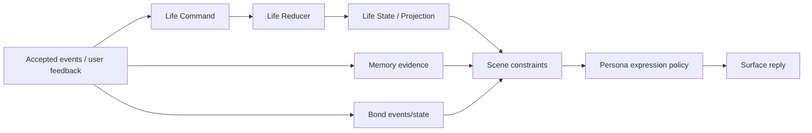

该图表达职责边界。NE-03 当前生产链为 `server observation + 0137 active goals → 0111 Observation Journal → WorldResolver → SceneResolver → frozen ContextPack → Intent admission → Action Preview authority reopen`：Host ASGI lifespan 在取得 runtime lease/fence 后构造唯一 app-local composition，World 读取 captured head，Scene/Guardian 的 revision 在 0112 中 CAS 封口。0137 长期目标只能经已验收的 governed Operator Effect 激活/撤销，并以 typed ref/constraint 进入 World；撤销形成 `SOURCE_REVOKED` expiry。Surface、Proactive 和 Task admission 消费同一 Scene revision/digest；production Intent authority 重开 HostCommand/WorkOrder/TaskGraph/Scene/Grant 和 current goal identity，并持久化 restrict-only receipt set；冻结后 goal 漂移的旧图失败关闭。高风险 Skill、Delegate、Scheduler/Proactive 与 Acceptance/Life 在执行点再次重开 Task/Attempt/Lease/Grant/Context/Scene/Guardian；Preview receipt 本身不产生新权限。`RuntimeGuardian` 的 health heartbeat task、可选 keepalive、observer、probe cache 与 HTTP transport 由每个 Host lifespan 的 `ServiceHealthHeartbeat` 单独拥有。0113 Service Catalog 从 durable head 逐级真实启动到默认目标 ENFORCE，commit-bound 本地 Gate 与 crash takeover 已通过；当前 `test_ne03_*` 完整波次为 `271 passed, 2 warnings in 332.52s`。这不等于整个演化架构完成：Bond 上游原始证据、Windows graceful stop 与部署多实例 canary 仍未验收，World 也不是可模拟未来的规划世界模型。

安全演化的目标链必须是：运行证据/反馈 → proposal → 隔离实验与 shadow → Review → version activation → rollback point。任何 milestone、后台周期或模型输出直接调用 trait writer 都违反目标 authority。

## 8. Planning 与执行分离

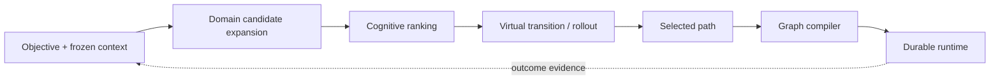

搜索侧只能看到冻结上下文和虚拟状态，执行侧只能看到选中后编译的图。搜索不得调用真实工具；执行不得静默二次规划。真实 outcome 通过 durable calibration 反馈给后续 proposal，而不是在同一 run 中篡改搜索证据。对 D16 Code adapter，编译还要求 goal 中冻结 task/workspace/verification refs、state、objective 和 context 的 `approval_ref` 与 admitted parent grant 对齐；legacy `intent_draft` 不得覆盖 catalog-derived node input。该约束只保证纯规划输入的不可替换性，不构成 Code execution 或收益证明。

同一分离原则也封住了历史子 Agent 直调：`SubAgentDispatcher` 不再拥有 handler map、模型 gateway 或独立日志 writer，direct dispatch 只给出 `LEGACY_SUB_AGENT_DISPATCH_RETIRED`。`intent_agent_handler` 不能依据 legacy context 调模型，只能产生待 `HostCommand → TaskGraph` 重新准入的 handoff。受治理 Delegate 当前仅有 `pentest_agent` read-only adapter；该安全封口不构成通用 Delegate 或模型执行闭环。

## 9. 跨进程合同

`natsume_contracts/` 当前按 task、edge、life、identity 等 namespace 存放运行时中立合同。合同包不得导入 Host/Edge 实现，也不应包含可变服务或环境读取。

跨进程变更需要同时满足：

1. Schema 有明确版本和向后兼容策略。
2. Producer/consumer contract test 同步更新。
3. 不把实现对象、数据库连接或内部异常类型穿过边界。
4. 请求和回执保留 request/command/graph/node/attempt 等 lineage。
5. 旧 consumer 未升级时明确拒绝或降级，禁止猜测字段语义。

## 10. 可靠性与安全机制

| 机制 | 解决的问题 | 当前实现入口 |
|---|---|---|
| Migration + checksum | Schema 漂移与重复初始化 | `host_brain/audit/migration_runner.py` |
| Durable journal/outbox | 重启后事件和副作用恢复 | `host_brain/eventing/`、persistence repositories |
| Idempotency + replay guard | 重复请求和重复执行 | TaskStore、Secure Ingress、Gateway stores |
| Attempt + Lease + fencing | worker 崩溃和并发所有权 | `host_brain/task_runtime/` |
| Budget | token、工具、时间、成本边界；唯一超限 winner，CAS attempt 至少覆盖 `concurrency + 1` admitted writer wave | `budget_runtime.py`、`task_budget_usage_store.py` |
| Review token | 高风险 PRE/POST 审核 | `review_runtime.py`、ReviewStore |
| Verification + Acceptance | 输出与副作用分离 | coordinator、acceptance effects |
| Capability grant | 精确限制工具/Skill 权限 | Governor、node grants、Capability Broker |
| Degradation evidence | 依赖不可用时显式降级 | `host_brain/observability/degradation_state.py` |
| Signed intake + Airlock | 外部 bundle 供应链风险 | `host_brain/skills/`、`host_brain/airlock/` |

## 11. 当前过渡边界

NE-06 的长期演化写入被收敛到 0110 Evolution Governance Ledger：Feedback、Knowledge 和 Identity 只能先写 proposal/plan，再由独立 Lab/Review evidence 产生 append-only apply/activation/rollback event。active Knowledge 通过 workspace-scoped read projection 提供，任何旧 Memory、Persona 或 Identity writer 都不能绕过该 ledger；当前仍处于 partial/canary 前阶段。

系统仍处于迁移期，但 Executive 执行兼容层中的 `route_planning`、`conversation_execution`、application `composition`、application port wiring、legacy diagnostic direct-skill matrix 与内存任务真相已经退役；其内部的 Forge route override call 也已移除，残留的 runtime/app guard 只能 fail-closed 拒绝，纯 SkillDag adapter 无生产调用。cycle 只能输出空 batch 并在适配层归一为 `PLAN_CYCLE`，不能被重排成串行执行。独立 Forge `runtime-match` 仍是待退役边界。prompt intelligence 也只能产生不带执行结果的计划提示：

| 新主干 | 待退役/修复 |
|---|---|
| Governed Host/Scheduler/Internal routes + durable read projections；Cortex 仅传递冻结上下文，prompt intelligence 仅输出 outline/SkillDag hint；Executive guard fail-closed | Operator/领域兼容入口尚未完成最终 route matrix 验收；Cortex 不再有 direct-reply/post-process compatibility branch，hint 不可调用 Plan/SkillDag/handler，纯 SkillDag adapter 无 worker dispatch，执行仍须重新 admission |
| Durable TaskStore | 无第二 task registry；0094/0096 coordination、canonical COMMITTED checkpoint、共享 `EXCEEDED` 下 `MISSING → ALREADY_EXCEEDED`、双 checkpoint、four-root mixed settlement、五节点菱形、八根节点 batch、exact operation-free Attempt takeover 与 0099 窄终态 reconciliation 已有。0130 将 `CONFLICT`、unknown `RESERVED/RECOVERY_REQUIRED` 和取消交叉持久化为 version-bound hold + Outbox，但不自动处置；无限规模、其它 failure/cancellation、Workspace 全终态与 deployment inventory/remediation 仍缺 |
| WorkOrderV3 + BudgetPolicy | Agent executor v2 兼容投影仅允许发生在 child-grant 验证后，不拥有 admission authority |
| TaskGraph revision + `PARTIAL_ATOMIC_DEFAULT / NE01_IN_PROGRESS` | 新生产 Graph 的成功/失败已分别切到 0091/0090 原子终态；公开 accepted replay 要求 Graph COMPLETED 与 graph Budget CONSUMED。历史 legacy Graph 继续只读兼容。two-checkpoint mixed Budget 仅为本地窄证明；bounded fan-out 部署门禁/cancellation 仍 OFF，general、unknown-effect 与任意 multi-node/batch recovery、现实 resolver、外部 inventory/凭据/key lifecycle/canary未完成 |
| Typed task composition；生产 Service Locator 已物理清零；0112 readiness 与 Catalog SQLite 已归 repository，Obs daemon 由 ports claim + 唯一 lifespan 启停并向 `/health` 暴露 app-local secret-free supervision | 外部 namespace、`host_startup.py`/ASGI concrete Catalog wiring、真实 workspace-bound governed executor、daemon durable SLO journal/Guardian acknowledgement/production canary 仍缺 |
| Acceptance effect intents | 零散 fire-and-forget 后效 |
| ASGI app-local Runtime Context、0111 World observation/resolver、0112 Scene/Guardian、0137 长期目标 owner、三消费者 Scene identity、durable Intent admission、Action Preview authority、0113 Host Catalog 五阶段及本地波次 | Bond 上游原始证据、Windows graceful stop、其余 Governed Operator 功能迁移、legacy compatibility adapter 清理与部署多实例 canary 尚未收口 |
| Proposal-driven evolution（目标） | Persona legacy writer 已封口；无副作用 candidate 尚未接 proposal pipeline |

过渡期文档必须同时画出两侧，并明确哪一侧拥有 authority。隐藏兼容层会制造虚假的完成结论。

## 12. 架构阅读路径

1. 本文：建立全局结构。
2. [FUNCTIONAL_MODULES.md](FUNCTIONAL_MODULES.md)：查某个包或能力的职责。
3. [DATA_FLOW_ARCHITECTURE.md](DATA_FLOW_ARCHITECTURE.md)：追踪请求、状态和副作用。
4. [架构图册](diagrams/00_INDEX.md)：快速查看关键拓扑。
5. [CURRENT_CODE_ARCHITECTURE.md](CURRENT_CODE_ARCHITECTURE.md)：核对真实接线和限制。
6. [TARGET_ARCHITECTURE.md](TARGET_ARCHITECTURE.md)：理解最终边界。
7. [ARCHITECTURE_GAP_MATRIX.md](ARCHITECTURE_GAP_MATRIX.md)：确定实施差距与执行波。

生产代码、production composition 和 machine status 永远高于本文；发现不一致时先修正文档和门禁，不得用文档覆盖代码事实。

## 13. Task-bound Agent 模型预算

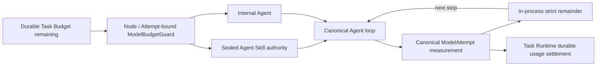

`R` 不是第二个预算 writer，只是同一 Attempt 内防止多次模型请求重复获得
完整额度。持久 reservation、超限裁决和最终结算仍由 Task Runtime 所有。
任何缺失 measurement、缓存结果、重复 ref 或 lineage 漂移都会停止后续
调用；Agent 自身的 `max_steps/timeout` 只能进一步收紧，不能扩张 Task
额度。当前该链覆盖 Chat、Internal 与受治理 Agent Skill，完整七路线和
生产 canary 仍待 NE-01/NE-07。

### 当前终态恢复边界

Host 启动时默认运行的 terminal exact-auto 只处理 `EXACT_REPAIRABLE`。隔离真实 SQLite restart canary 已证明：canonical FAILED 半状态只释放绑定预算并写确定性 proof/Outbox，不创建 Attempt、Lease 或重进 worker；同库的 signed-required CANCELLED 半状态保持不变并阻断 readiness。Operator HTTP 签名链、部署存量和 Operation/Effect 对账仍未完成，因此取消生产开关继续关闭。

这条 terminal inventory 之外，Host lifespan 还在 RuntimeGroup（含共享 Acceptance Effect owner）完全激活后执行一次 `HostStartupGraphContinuation`。它只读取最多 100 条 nonterminal durable graph，并经 canonical command repository 重开同一 immutable admission；只有 Host 的 `CHAT/HOST_INPUT/TOOL/GATEWAY` surface 可进入已有 governed application。live Lease 与并发执行均保持 `DEFERRED`，没有 scanner 自行夺取 Lease、生成新图或重放未知副作用；达到上限或任何 lineage/receipt 失配均失败关闭。已由 signed reconciliation node-local 关闭的 ACTIVE 多节点图会在这条 immutable DAG 重入中先进入 0090 Graph/Budget settlement，READY sibling 不执行。它仍只是 Host restart 的窄恢复入口，不改变 Scheduler/Internal 各自的 recovery owner，也不使其它通用多节点恢复完成。

Review 的拒绝终结由同一 Task Runtime 持有，而非新的 worker 入口：应用层只传递精确 node identity，scheduler 仅在无 node grant、目标仍为等待 Review、无活跃 sibling 且 durable Review decision 仍为 `REVIEW_DENIED` 时继续既有终结链。该 guard 不发行执行 authority，漂移一律失败关闭，因此不能被解释为通用恢复或并发 fan-out 已启用。

Host survivor 对 live Lease 的处理现在区分“另一执行 owner”与“已经由签名
reconciler 创建的 replacement fence”。前者继续 `DEFERRED`；后者先由
TaskStore 在同一 read transaction 重开并验签 `REACQUIRE/NO_SIDE_EFFECT`
Operation，再通过只含 reservation/Attempt/Lease/owner/fence/status/version
和 verified bool 的最小 projection 进入 canonical DAG Runtime。原始签名、
scope、fingerprint、receipt 和 reconciler 不进入通用 scheduler snapshot。
Runtime 仍按本进程 owner 复验，因而这个例外只修复 startup 发现死锁，不把
survivor 提升为执行 authority。真实启动若已将旧 Lease 置为 `EXPIRED`，
换权 Store 会读取历史原始 Lease并要求它仍是唯一最高 fence、没有其他
active Lease；不会为了兼容重启而降低互斥性。

## 14. Agent artifact 终态与 Workspace lifecycle

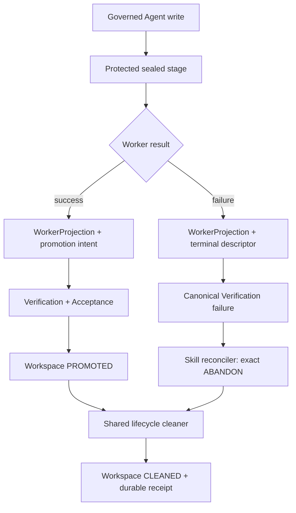

终态 continuation 在生产 Host 生命周期内运行，但推断 authority 按 route
分离。Direct write Agent Skill 只由
`GovernedSkillArtifactTerminalReconciler` 解释；Internal Delegate 继续由
Internal reconciler 解释。前者确认精确 ownership 后，后者跳过 staging
推断，避免活跃 Skill 被错误降级；两者只共享 `PROMOTED/ABANDONED`
之后的 Workspace lifecycle cleanup。

失败 projection 只包含密封 ref/digest 和公开结果 digest，不包含原始文件，
也没有 Acceptance Effect。真实 SQLite+Git 已覆盖 direct Skill 成功和
Verification failure 的跨 runtime cleanup，并修复 cleanup Lease 换权后
必须重开最新 authority version 的 CAS 边界。下一节补充受限 Plan
single-writer success/downstream-failure/downstream-cancellation；其它 terminal matrix、Domain
Pack 与强隔离仍未完成，因而 Workspace 和 NE-01 仍为
`PARTIAL / IN_PROGRESS`。

## 15. Plan 写节点的整图提交边界

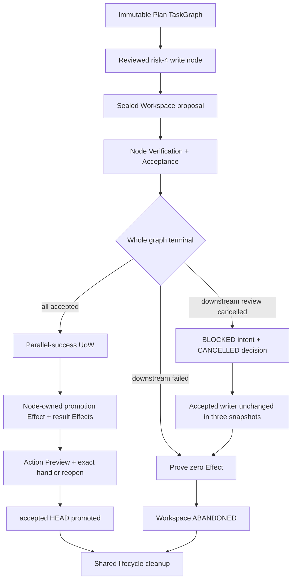

Plan policy 只允许一个非结果 Workspace 写 owner。该节点的 Attempt、Lease、
Grant、Budget、Review、Verification、Acceptance 和 artifact 都保持
node-bound；最终可见结果仍由 result node 拥有。整图成功 UoW 可以包含多个
节点各自拥有的 Effects，但不能把写节点伪装成 result node，也不能在
speculative batch 中提前 dispatch。

下游失败恢复由 route-specific reconciler 和 repository 双重验证：Graph
FAILED、write node ACCEPTED、Attempt SUCCEEDED、Lease 终止、唯一
Acceptance decision、artifact/Operation/projection 一致且该 node Effect
为零。下游取消还要求 Graph CANCELLED、immutable intent target BLOCKED、
可信 decision target CANCELLED，并且 accepted writer 在 intent-after、
decision-before、decision-after 中保持完全相同的 status/version。真实
SQLite+Git 已证明 success promotion、downstream-failure 与
downstream-cancellation abandon/cleanup；其它终态矩阵与强隔离仍是
NE-01 缺口。

## 16. Direct Skill 的 post-review cancellation 双层围栏

Direct Skill 自身的写节点在 Acceptance Review 等待期取消时，Node 最终为
`CANCELLED`，不同于 Plan 下游取消时保持 `ACCEPTED` 的先行写节点。两种路径
共用 finalized cancellation read proof，但必须传入不同 expected status，
不能互相兼容或回退。

系统采用双层围栏：

1. route-specific terminal reconciler 要求 exact post-execution Acceptance
   decision=`REVIEW`、review_id、Attempt、COMMITTED checkpoint、finalized
   intent/decision 和零 Effect；
2. Workspace repository 在 ABANDON CAS 前重新联结取消记录与当前
   Graph/Node/Review/Operation，校验 payload digest/ref、Graph final version、
   Node status/version、Review=`CANCELLED`、Operation=`COMMITTED`，并再次查询
   exact Attempt 的 Effect。

正常路径在 fresh Runtime 中清理真实 Git worktree；注入任何 Acceptance
Effect 时，上层报告 `BLOCKED`，底层也拒绝删除，Workspace 保持 `ACTIVE`。
当前证据为五文件去重集合 `68 passed in 117.23s`，无 migration。该围栏只
关闭一个 Direct Skill cancellation 组合，不改变一般 cancellation、
unknown-effect、多 Workspace 或 NE-01 的未完成状态。

## 17. Direct Skill 签名失败的双重重开

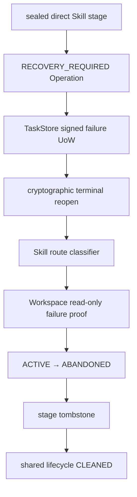

第一重由 TaskStore 持有 proof verifier，重开 Ed25519 signature、Operation
scope/fingerprint、Attempt/Lease owner/fence、Task terminal 和原子 Outbox。
第二重由 Workspace repository 在状态 CAS 前执行，只读核对单节点/单
Operation/单 graph Budget/单 HostCommand 基数、proof digest、failure error
ref、零 Projection/Verification/Acceptance/Effect/cancellation/artifact 和
六类 exact Outbox。Workspace 层不获得 Task mutation authority。

这种组合既阻止伪签名，也阻止签名结算后的持久状态漂移。任何不一致都使
terminal worker 报告 `BLOCKED`，stage 与 worktree 保持可对账；只有 exact
direct single-node no-effect failure 可以清理。一般失败恢复仍未完成。

## 18. Plan 多节点失败的两阶段终态

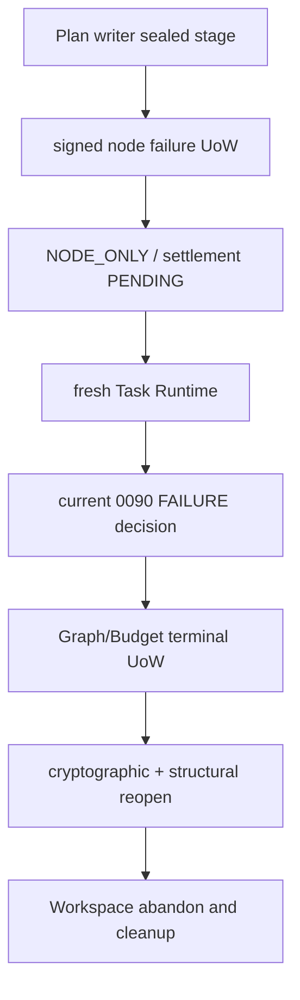

阶段一只归因一个 Operation/Attempt/Node/Lease，阶段二才拥有共享
Graph/Budget。系统保留 Review 时的历史 0090 decision；新只读 authority
验证全部历史记录和 Outbox，并以 current Graph status/version 选择唯一
terminal row。Workspace proof 同时验证全图 Node snapshot 和目标失败
outcome，因此不能靠追加一条看似较新的失败记录绕过。

真实测试中的 fresh Runtime 没有再次调用写节点，也没有调用依赖它的结果
节点；删除最终 Budget Outbox 会阻断 cleanup。该结构仍只覆盖单一 reviewed
Plan writer 的 pre-checkpoint no-effect failure，未提升为通用 batch recovery。

## 19. Plan post-COMMIT Budget rejection 的双层 authority

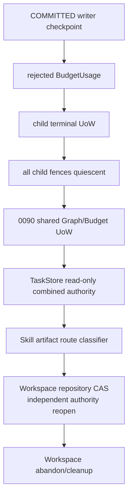

child UoW 只拥有 Attempt/Node/Lease terminal；0090 只拥有 Graph/Budget
terminal。组合 reader 要求两侧 Outbox、唯一 winner、父/子 usage 与 current
decision 在同一 SQLite snapshot 中一致。winner 未终态或 sibling 仍
in-flight 时，共享 writer不会执行；另一 owner 已终态的 winner只能由 exact
durable facts重建。`workspace_terminal_budget_authority.py` 在 lifecycle
repository 的最终写事务内再次验证相同 winner、Lease、child Outbox、
父/子 usage、current 0090 和零 downstream authority；上层分类成功不是
仓储放行凭据。Workspace 层不获得 Budget mutation 或重新执行 worker 的能力。

## 20. Signed node failure 与 graph Budget 的交叉终态

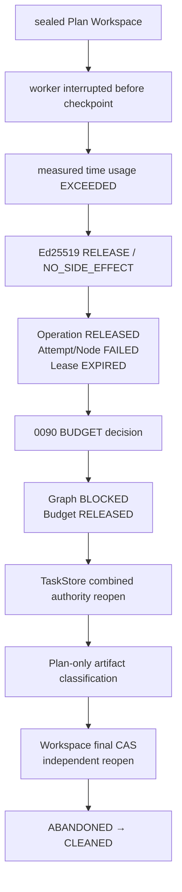

节点层的签名证明与图层的 Budget decision 各自保留唯一写 authority。组合
reader 只把它们连接起来：selected outcome 必须同时携带同一 Attempt 的
failure `error_ref` 与唯一 rejected `usage_id`，该 usage 必须回连 child
BudgetReservation 和父 Budget Outbox。缺失任一 current 0090 Outbox、usage
binding 或 version 都会阻断 Workspace 删除。

0090 是节点 reconciliation 之后的图级事实，因此 node-failure authority
kind 与 Accepted handler v4/v5 receipt ref 不随 PENDING→COMMITTED 改变；
live Graph/Budget 状态仍会被验证，但不进入已接受节点 effect 的稳定 digest。

这个结构只为 Plan 打开 `Graph=BLOCKED` 的 signed no-effect cleanup；Direct
Skill 单节点终态继续要求 `Graph=FAILED`，避免把任意 Budget block 伪装成
安全失败。系统不因此宣称一般 terminal cross-product、Budget policy 或
Workspace isolation 完成。

Budget policy 的合同表达能力与 production 执行能力必须分开。当前
`BudgetPolicy` v1 可以保存 `DEGRADE/REVIEW` 提案，但唯一 canonical
`DurableBudgetRuntime` 的 support matrix 只有 `BLOCK`。`ensure_active`
在 schema/lineage 校验后、`assert_budget_usage_ready()` 之前执行动作门禁；
低层 `_charge()` 再做第二道相同门禁，因此未来遗漏 Host adapter 校验也不能
创建 Reservation、usage 或 Outbox。并发维度则由 READY claim 的
`BEGIN IMMEDIATE`、active fenced Lease 计数和 Attempt-bound
`concurrency=1` child reservation共同执行，终态 Attempt 使 child 投影为
`CONSUMED/RELEASED` 并释放容量。真正支持 `DEGRADE/REVIEW` 时必须新增预算
例外或替换 Graph 的持久 authority，并且产生新 immutable
`graph_revision + 1`；不得在 executor 内二次规划或把动作改写为 `BLOCK`。

结构 Gate 的基线更新必须同时绑定 production owner 和独立行为证据。当前
Review denial 调用矩阵减少，是因为 0135 settlement Store 把 Node、Graph、
Budget、Outbox 合成同一 UoW；Plan writer terminal hash 增加，是因为
projection 只接受经独立验证的
`PARALLEL_CHECKPOINT_BUDGET_REJECTED`。DurableTaskStore 的 MRO 合同冻结完整
34 个 mixin owner，但局部测试使用相对邻接，避免在无关 owner 插入后误报。
Retry/Operation checkpoint 的纯 helper 不进入 MRO，也不拥有 transaction。

## 21. PlanningSearch 固定 cohort 的证据层

0136 在规划内核与未来 Evolution/Review 之间增加一个只写证据、不执行计划的
持久层。它不能调用模型、工具或 worker，也不能激活 L3：

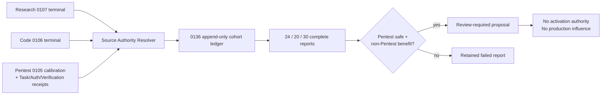

`planning_search_cohort_ledger_repository.py` 保留唯一连接和事务 owner；纯重开、
canonical/digest 校验在 support 模块，避免产生第二 writer。报告引用完整
evidence-set digest；response-loss replay 先查现有 identity，因此不会重新
执行实验。真实 provider/lab 证据仍是外部验收边界。
