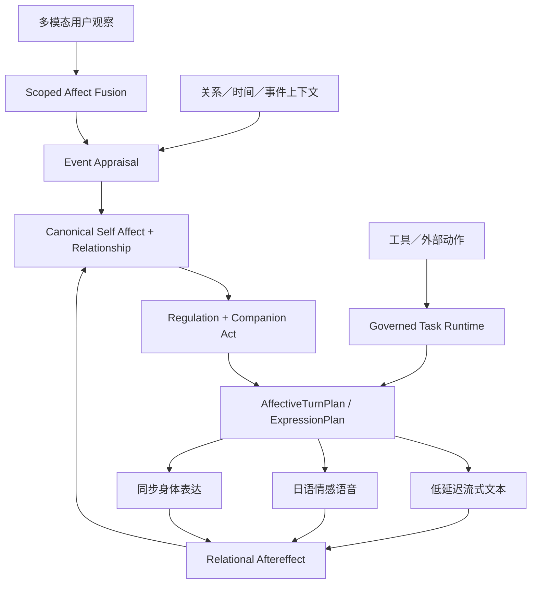

受众：MASTER
标题：七海实时情感数字生命目标架构

# 目标架构

## 1. 目标状态

七海以 canonical Digital Life 为稳定自我，以轻量实时链处理普通陪伴，以 Governed Runtime 处理工具与外部副作用，并通过同一个表达计划驱动文本、声音和 Avatar。

## 2. 目标特性

- 自我与用户情绪完全隔离但能相互影响。
- 混合情绪、慢速心境、需要和边界有原因且可跨重启延续。
- 关系通过真实后效应变化，不通过机械积分自动升级。
- 普通聊天低延迟、可打断，不同步写入大量审计记录。
- 文本、Voice、Avatar 在语义、强度和时间上保持一致。
- 主动陪伴尊重拒绝、安静时段和现实关系。
- 低风险偏好可以逐步学习和精确回滚，核心人格不可在线修改。
- 工具和副作用仍具备授权、预算、恢复与去重。

## 3. 完成条件

目标架构只有在目标 Edge 和真实 Provider 上通过固定多轮场景、三模态同步、重启／断线／打断、隐私与非操控门槛，并完成至少 3 人盲测后才算完成。静态合同、模拟器和本机单段语音仅是中间证据。
