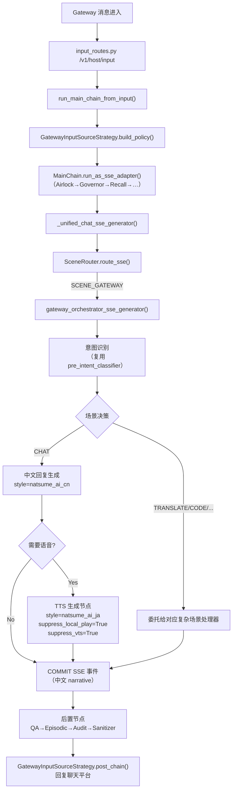

# 外部消息统一网关（Unified Message Gateway）设计方案

> 文档版本：v1.0
> 创建日期：2026-03-24
> 更新日期：2026-03-24
> 状态：**已实施完成（Phase 1-5 全部完成）**
> 关联模块：`edge_client/gateway/`、`tools/wx4_decrypt.py`、`edge_client/services/wx_db_service.py`

---

## 一、当前问题诊断

### 1.1 两套并行链路

| 方案 | 文件 | 核心问题 |
|------|------|---------|
| **A: WeChatFerry Hook** | `edge_client/channels/wechat_listener.py` | wcferry 原仓库停更，新版微信兼容性差，注入失败率高 |
| **B: UIA 桌面自动化** | `tools/wechat_uia_bridge.py`（215KB/5878行） | **当前微信 4.x 主路径**：负责 inbound webhook + outbound command queue，`uia_hook/uia_ocr/win_notify/vision_notify` 为可选后端 |

### 1.2 具体问题根因

| 问题现象 | 根因 |
|---------|------|
| 右下角微信闪烁检测不到 | Tray 图标闪烁检测用 mss 截图 + gemma3:4b 判断，本地小模型识别任务栏图标极不可靠 |
| 视觉模型不起作用 | Ollama 跑本地 gemma3:4b 做 UI 理解，JSON 结构化输出（page/target_visible/x_ratio/y_ratio）经常解析失败或坐标偏差大 |
| 点击位置错误/点到头像 | pyautogui 基于视觉模型返回的 ratio 坐标点击，模型坐标不准，且没有 UIA 元素校验兜底 |
| 消息监听失败 | UIA Hook（WinEvent）→ 截图 → OCR/Vision 提取文本，整个链路脆弱，依赖窗口焦点状态 |

**核心结论**：当前方案本质上是"用眼睛看屏幕+用鼠标点击"，和真人操作一样脆弱。这种方式不可靠、不可扩展，也无法支持多平台（QQ/飞书/企微）。

### 1.3 现有可复用资产

| 资产 | 文件 | 复用方式 |
|------|------|---------|
| ✅ `WeChatMessage` 数据结构 | `channels/wechat_listener.py` | 升级为 `UnifiedMessage` |
| ✅ `EdgeInputReporter` HTTP POST 通道 | `channels/input_reporter.py` | 直接复用，上报到 `/v1/host/input` |
| ✅ `WeChatListener._parse_raw()` 消息解析 | `channels/wechat_listener.py` | 提炼为微信适配器基底 |
| ✅ `_MessageDeduplicator` 去重器 | `channels/wechat_listener.py` | 上移到 Gateway 公共层 |
| ✅ `desensitize_content()` 脱敏函数 | `channels/wechat_listener.py` | 上移到 Gateway 公共层 |
| ✅ `wechat_uia_bridge.py` | `tools/wechat_uia_bridge.py` | **当前保留并接入 Gateway** |

---

## 二、架构全景

```
外部消息源
  微信 (wx4_decrypt 解密方案)  ──WxDbService──┐
  QQ (NapCat/OneBot v11)       ──OneBot WS/HTTP┤
  飞书 (官方 Open API)          ──Event Sub─────┤
  企微 (企业微信 API)            ──Callback URL──┘
                                                │
                          ┌─────────────────────▼──────────────────────┐
                          │   edge_client/gateway/  :19000              │
                          │                                             │
                          │  WebhookServer (FastAPI)                    │
                          │       │                                     │
                          │  PlatformAdapters (wechat/qq/feishu/wecom)  │
                          │       │                                     │
                          │  MessageNormalizer (去重 + 脱敏 + 校验)      │
                          │       │                                     │
                          │  MessageRouter ──────────────────────────── │──► EdgeInputReporter
                          │                                             │         │
                          │  OutboundDispatcher ◄────────────────────── │◄── Host Brain Reply
                          └─────────────────────────────────────────────┘
                                                │
                                    POST /v1/host/input
                                                │
                          ┌─────────────────────▼──────────────────────┐
                          │   Host Brain  :8000                         │
                          │   /v1/host/input → Main Chain → Reply Egress│
                          └─────────────────────────────────────────────┘

微信专属数据通道（补充）
  Weixin.exe ──pymem 附加提取密钥──► wx4_decrypt.py ──解密 db_storage/*.db──► WxDbService
                                                                                    │
                                                              Edge RPC Gateway :17800
                                                              POST /v1/edge/wx/contacts
                                                              POST /v1/edge/wx/messages
                                                              POST /v1/edge/wx/search
                                                                    │
                                                              Host Brain (MCP 工具 / Bond 关系层 / 七路召回)
```

---

## 三、目录结构

```
edge_client/gateway/                     # 新增统一消息网关
├── __init__.py
├── server.py                            # FastAPI Webhook Server (:19000)
├── models.py                            # UnifiedMessage / UnifiedReply 数据模型
├── normalizer.py                        # 消息标准化（去重/脱敏/校验）
├── router.py                            # 消息路由到 Host Brain（复用 EdgeInputReporter）
├── outbound.py                          # 回复分发器（Host → 各平台发送）
├── adapters/                            # 平台适配器
│   ├── __init__.py
│   ├── base.py                          # AbstractPlatformAdapter 抽象基类
│   ├── wechat_adapter.py               # 微信适配器（ntchat / ComWeChatBot）
│   ├── qq_adapter.py                    # QQ 适配器（OneBot v11 协议）
│   ├── feishu_adapter.py               # 飞书适配器（Open API）
│   └── wecom_adapter.py                # 企微适配器
└── media/                               # 多媒体处理（Phase 2）
    ├── __init__.py
    ├── image_handler.py
    ├── voice_handler.py
    └── file_handler.py
```

---

## 四、核心数据模型

### 4.1 `UnifiedMessage` — 跨平台统一消息信封

```python
@dataclass
class UnifiedMessage:
    msg_id: str                          # 消息唯一 ID
    platform: Platform                   # wechat | qq | feishu | wecom
    from_id: str                         # 发送者 ID（wxid / QQ号 / open_id）
    to_id: str                           # 接收者 ID
    conversation_id: str                 # 会话 ID（群/私聊统一）
    msg_type: MsgType                    # text | image | voice | ...
    content: str                         # 文本内容
    media_url: str | None = None         # 媒体文件 URL/本地路径
    media_data: bytes | None = None      # 媒体二进制数据
    reply_to_msg_id: str | None = None   # 引用的消息 ID
    is_group: bool = False               # 是否群消息
    sender_name: str | None = None       # 发送者昵称
    ts_ms: int = ...                     # 时间戳(ms)
    raw_extra: dict[str, Any] = ...      # 平台原始附加数据
```

### 4.2 `UnifiedReply` — 跨平台统一回复

```python
@dataclass
class UnifiedReply:
    conversation_id: str
    platform: Platform
    msg_type: MsgType = MsgType.TEXT
    content: str = ""
    media_data: bytes | None = None
    media_path: str | None = None
    reply_to_msg_id: str | None = None
    ts_ms: int = ...
```

### 4.3 `Platform` 枚举

```python
class Platform(str, Enum):
    WECHAT = "wechat"
    QQ = "qq"
    FEISHU = "feishu"
    WECOM = "wecom"
```

### 4.4 `MsgType` 枚举

```python
class MsgType(str, Enum):
    TEXT = "text"
    IMAGE = "image"
    VOICE = "voice"
    VIDEO = "video"
    FILE = "file"
    EMOJI = "emoji"
    LINK = "link"
    SYSTEM = "system"
```

---

## 五、适配器设计

### 5.1 抽象基类 `AbstractPlatformAdapter`

```python
class AbstractPlatformAdapter(ABC):
    """职责：
    1. Inbound: 将平台原始消息 → UnifiedMessage
    2. Outbound: 将 UnifiedReply → 平台 API 发送
    3. 健康检查
    """

    @property
    @abstractmethod
    def platform(self) -> Platform: ...

    @abstractmethod
    def parse_inbound(self, raw: dict[str, Any]) -> UnifiedMessage | None: ...

    @abstractmethod
    async def send_reply(self, reply: UnifiedReply) -> bool: ...

    @abstractmethod
    async def health_check(self) -> dict[str, Any]: ...

    def validate_webhook(self, headers: dict, body: bytes) -> bool:
        return True  # 各平台自行实现签名验证
```

### 5.2 微信适配器 `WeChatAdapter`

微信接入现为 **双模架构**：

- **主路径：UIAutomation bridge** —— `tools/wechat_uia_bridge.py` 负责 inbound webhook（`/v1/gateway/wechat/webhook`）与 outbound command queue 执行，适配微信 4.x。
- **可选增强：`wx4_decrypt.py` + `WxDbService`** —— 当配置 `WECHAT_DECRYPT_OUTPUT_DIR` 时，提供联系人映射、历史查询、增量 DB 监听与朋友圈读取能力。

**两条数据通道**：

| 通道 | 用途 | 实现 |
|------|------|------|
| **实时消息流（默认）** | 接收新消息 | `tools/wechat_uia_bridge.py` → `/v1/gateway/wechat/webhook` → `WeChatAdapter.parse_inbound()` |
| **实时消息流（可选增强）** | 接收新消息 | `WxDbService` 轮询 `message_*.db` 增量记录 → `UnifiedMessage` |
| **历史数据查询** | 联系人/聊天记录/全文搜索 | Edge RPC Gateway `/v1/edge/wx/*` 端点 → Host MCP 工具 |

**`WxDbService` 核心接口**：

```python
class WxDbService:
    """微信解密数据库查询服务（Edge 侧）。

    职责：
    1. 启动时/定时调用 wx4_decrypt 解密数据库（密钥缓存，微信不重新登录不重复扫描）
    2. 缓存解密后的 SQLite 连接
    3. 提供结构化查询接口（联系人/消息/群聊）
    4. 轮询增量消息推送到 Gateway Webhook
    """

    def get_contacts(self, *, contact_type: str | None = None) -> list[dict]:
        """查询联系人列表，按 wxid_ / gh_ / @chatroom / @openim 前缀自动分类"""

    def get_messages(self, *, wxid: str, limit: int = 50, before_ts: int | None = None) -> list[dict]:
        """查询与指定联系人的聊天记录"""

    def search_messages(self, *, keyword: str, limit: int = 20) -> list[dict]:
        """全文搜索聊天记录"""

    def get_contact_detail(self, wxid: str) -> dict | None:
        """获取单个联系人详情"""

    def refresh(self) -> dict:
        """重新执行解密（微信重新登录后密钥变化时调用）"""

    def poll_new_messages(self) -> list[UnifiedMessage]:
        """轮询增量消息，供 Gateway 实时推送"""
```

**消息类型映射**（复用现有 `wechat_listener.py` 的 `_TYPE_MAP`）：

```python
_WX_TYPE_MAP = {
    "1": MsgType.TEXT,   "3": MsgType.IMAGE,
    "34": MsgType.VOICE, "43": MsgType.VIDEO,
    "49": MsgType.LINK,  "10000": MsgType.SYSTEM,
}
```

**联系人分类规则**（解决解密数量对不上的问题）：

| `UserName` 前缀/条件 | 分类 |
|---------------------|------|
| `wxid_xxx` | 好友联系人 |
| `gh_xxx` | 公众号/服务号 |
| `xxx@chatroom` | 群聊 |
| `@openim` / `wo_xxx` | 企业微信联系人 |
| `filehelper`, `weixin`, `newsapp` 等 | 系统账号（过滤） |

### 5.3 QQ 适配器 `QQAdapter`

- **接入方式**：NapCat / Lagrange.Core → OneBot v11 HTTP/WebSocket
- **事件过滤**：只处理 `post_type == "message"` 事件
- **会话 ID**：群消息 `qq_group_{group_id}`，私聊 `qq_dm_{user_id}`

### 5.4 飞书适配器 `FeishuAdapter`（Phase 3）

- **接入方式**：飞书官方 Open API Event Subscription
- **签名验证**：飞书 Encrypt Key 验证

### 5.5 企微适配器 `WeComAdapter`（Phase 3）

- **接入方式**：企业微信开放 API Callback URL
- **签名验证**：企微 Token + EncodingAESKey

---

## 六、Gateway Server 设计

### 6.1 端点设计

| 端点 | 方法 | 说明 |
|------|------|------|
| `/webhook/{platform}` | POST | 统一 Webhook 入口（wechat/qq/feishu/wecom） |
| `/reply` | POST | Host Brain 回调，将回复发送到对应平台 |
| `/health` | GET | 各平台适配器健康检查 |

### 6.2 消息处理流程

```
POST /webhook/{platform}
    │
    ├─ 1. 适配器解析 adapter.parse_inbound(raw) → UnifiedMessage
    │
    ├─ 2. 标准化 normalizer.process(msg)
    │       ├─ 去重（复用 _MessageDeduplicator）
    │       ├─ 脱敏（复用 desensitize_content）
    │       └─ 校验（必填字段检查）
    │
    ├─ 3. 路由 router.route(msg)
    │       └─ EdgeInputReporter.report_gateway(payload)
    │               └─ POST /v1/host/input
    │
    └─ 4. 返回 {"status": "accepted", "msg_id": "..."}
```

### 6.3 回复流程

```
Host Brain 处理完成
    │
    └─ POST /reply {"platform": "wechat", "conversation_id": "...", "content": "..."}
            │
            └─ OutboundDispatcher → adapter.send_reply(reply)
                    └─ 调用对应平台 API 发送消息
```

---

## 七、与现有代码的集成

### 7.1 `EdgeInputReporter` 兼容改造

新增 `GATEWAY` 来源类型和 `report_gateway()` 方法：

```python
class InputSourceType(str, Enum):
    ASR = "ASR"
    WECHAT = "WECHAT"
    GATEWAY = "GATEWAY"   # 新增

def report_gateway(self, *, payload: dict[str, Any]) -> InputReportResult:
    """上报统一网关消息到 Host Brain。"""
    return self._send(payload, InputSourceType.GATEWAY)
```

### 7.2 `EdgeConfig` 新增配置项

```
EDGE_GATEWAY_ENABLED=true          # 是否启用统一消息网关（默认 true）
EDGE_GATEWAY_PORT=19000            # 网关监听端口（默认 19000）
EDGE_GATEWAY_PLATFORMS=wechat,qq   # 启用的平台（逗号分隔）
WECHAT_SELF_WXID=                  # 微信小号 wxid（用于过滤自发消息）
WECHAT_DB_STORAGE_DIR=             # 微信 db_storage 目录路径（解密源）
WECHAT_DECRYPT_OUTPUT_DIR=         # 解密输出目录（de_*.db 存放位置）
WECHAT_KEY_CACHE_PATH=             # 密钥缓存文件路径（加密存储，避免重复扫描进程）
WECHAT_POLL_INTERVAL_S=5           # 增量消息轮询间隔（秒，默认 5）
WECHAT_DECRYPT_REFRESH_INTERVAL_S=3600  # 定时重解密间隔（秒，默认 1h）
QQ_ONEBOT_API_BASE=                # OneBot HTTP API 地址
QQ_SELF_ID=                        # QQ 号（用于过滤自发消息）
```

### 7.3 `bootstrap.py` 集成点

在 `EdgeRuntime` 启动时，若 `gateway_enabled=True`，额外启动 Gateway Server（uvicorn :19000）。

### 7.4 Host 侧 `/v1/host/input` 适配

Host 侧需识别 `source=GATEWAY` 并提取 `platform` 字段，路由到正确处理链路。回复时通过 Gateway 的 `/reply` 端点回发。

---

## 八、微信接入技术选型

所有第三方 Hook 方案（ntchat / ComWeChatBotClient / WeChatFerryX / wcferry）均已过时或停更，对微信 4.x 兼容性差。**本项目采用自研 `wx4_decrypt.py` 解密脚本方案**，无需依赖任何第三方 Hook 库。

| 方案 | 状态 | 说明 |
|------|------|------|
| **`wx4_decrypt.py` 解密脚本** ✅ **当前采用** | 自研，持续维护 | `pymem` 附加 `Weixin.exe` 提取密钥 → 解密 `db_storage/*.db` → `WxDbService` 查询封装 |
| ~~ntchat~~ | ❌ 过时 | 仅支持微信 3.9.x，4.x 不兼容 |
| ~~ComWeChatBotClient~~ | ❌ 过时 | COM Hook，4.x 兼容性差 |
| ~~WeChatFerryX~~ | ❌ 过时 | DLL 注入，分支维护，不稳定 |
| ~~WeChatFerry (原版)~~ | ❌ 停更 | 原仓库已停更 |
| UIA 桌面自动化 | ✅ 当前主路径 | 优先 UIAutomation + command queue；视觉/OCR 仅作降级备选 |

### 解密脚本方案核心原理

```
1. pymem 附加 Weixin.exe 进程
2. 扫描内存特征，提取 AES 密钥（32字节）
3. 对 db_storage/ 下所有 .db 文件执行 AES-256-CBC 解密
4. 输出标准 SQLite 文件（de_*.db）
5. WxDbService 打开 SQLite，提供结构化查询
```

### 关键优势

- **无需第三方 Hook**：不注入 DLL，不依赖任何外部库的微信版本适配
- **版本无关**：只要微信使用 SQLite 存储（4.x 确认），解密方案长期有效
- **数据完整**：可访问全量历史数据（联系人/聊天记录/群信息），而非仅实时消息
- **密钥缓存**：微信不重新登录密钥不变，首次提取后缓存，避免重复扫描进程内存

---

## 九、微信能力边界与限制解决方案

### 9.1 能力全景

| 能力 | 状态 | 实现方式 |
|------|------|--------|
| 接收消息（文本/图片/语音/视频/文件/链接） | ✅ 支持 | `WxDbService.poll_new_messages()` 轮询 `message_*.db` |
| 回复消息（文本/图片） | ✅ 支持 | 剪贴板 + `Ctrl+V → Enter`，`pywinauto` 精确定位输入框 |
| 查询历史聊天记录 | ✅ 支持 | 解密后 SQLite 全量历史，按联系人/时间/关键词搜索 |
| 获取联系人列表及详情 | ✅ 支持 | `contact.db` 解密后按前缀分类 |
| 获取群聊信息及成员 | ✅ 支持 | `contact.db` + `message_*.db` |
| 读取朋友圈 | ✅ 支持 | 解密 `Sns.db` → `SnsInfo` 表（与 `message_*.db` 同解密方式） |
| 主动发起新对话 | ✅ 支持 | `pywinauto` 精确控件定位，见 9.3 节 |
| 撤回消息（2分钟内） | ✅ 支持 | `pywinauto` 右键菜单，见 9.4 节 |
| 实时消息监听（<100ms） | ✅ 支持 | `watchdog` 文件系统变更监听，见 9.2 节 |
| 接收语音消息（.silk 解码播放） | ✅ 支持 | `message_*.db` type=34，`pysilk` 解码 → PCM 播放，见 9.6 节 |
| 发送语音消息（.silk 编码发送） | ⚠️ Phase 3 | TTS → PCM → `pysilk` 编码 → 剪贴板发送，见 9.6 节 |
| 朋友圈发布 | ⚠️ 待评估 | `pywinauto` 控件操作，复杂度高，Phase 3 评估 |
| 转账/红包 | ❌ 不做 | 涉及支付，安全风险，不纳入范围 |

---

### 9.2 实时性问题（5s 轮询 → <100ms）

**方案：`watchdog` 文件系统变更监听**

不用定时轮询，改为监听 SQLite 数据库文件的写入事件。微信写入消息时，`watchdog` 毫秒级触发，立即执行增量读取。

```python
from watchdog.observers import Observer
from watchdog.events import FileSystemEventHandler

class WxDbChangeHandler(FileSystemEventHandler):
    """监听 db_storage/ 目录下 message_*.db 文件变更，触发增量消息读取。"""

    def __init__(self, wx_db_service: WxDbService):
        self._svc = wx_db_service

    def on_modified(self, event):
        if "message_" in event.src_path and event.src_path.endswith(".db"):
            new_msgs = self._svc.poll_new_messages()
            for msg in new_msgs:
                gateway_webhook_push(msg)   # 推送到 Gateway 处理链路

# 启动监听
observer = Observer()
observer.schedule(WxDbChangeHandler(wx_db_svc), path=DECRYPT_OUTPUT_DIR, recursive=False)
observer.start()
```

**效果**：延迟从 5s 降至 <100ms，且无 CPU 空转开销。

`WECHAT_POLL_INTERVAL_S` 配置项保留作为 `watchdog` 不可用时的降级兜底。

---

### 9.3 主动发起新对话

**方案：`pywinauto` 精确控件定位**

不使用视觉模型猜坐标，通过 `auto_id` / `control_type` 精确定位 UI 控件，不受分辨率和窗口位置影响。

```python
from pywinauto import Application

def open_chat_with(wxid_or_name: str) -> bool:
    """主动打开与指定联系人的聊天窗口。"""
    app = Application(backend="uia").connect(title_re="微信")
    main_wnd = app.window(title_re="微信")

    # 精确找到搜索框控件（不是截图猜坐标）
    search_box = main_wnd.child_window(auto_id="Search", control_type="Edit")
    search_box.set_focus()
    search_box.type_keys(wxid_or_name, with_spaces=True)

    # 等待搜索结果，点击第一条
    result = main_wnd.child_window(control_type="ListItem").wait("visible", timeout=3)
    result.click_input()
    return True
```

**关键点**：`pywinauto` 走 Windows UIA Accessibility API，控件定位稳定；当前 `wechat_uia_bridge.py` 已作为 UIAutomation bridge 保留，其视觉/OCR 分支仅作为降级备选而非主路径。

---

### 9.4 撤回消息

**方案：`pywinauto` 右键菜单**

```python
def recall_message(msg_text: str) -> bool:
    """撤回指定内容的消息（仅限发出后 2 分钟内）。"""
    app = Application(backend="uia").connect(title_re="微信")
    chat_wnd = app.top_window()

    # 找到消息气泡控件，右键点击
    msg_item = chat_wnd.child_window(name=msg_text, control_type="Text")
    msg_item.right_click_input()

    # 点击「撤回」菜单项
    recall_item = app.window(control_type="MenuItem", title="撤回")
    recall_item.click_input()
    return True
```

**限制**：2 分钟时间窗口是微信本身的限制，无法绕过。

---

### 9.5 朋友圈读取

**方案：解密 `Sns.db`**

朋友圈数据存储在独立数据库文件中，解密方式与 `message_*.db` 完全相同：

```
db_storage/
├── MicroMsg.db          # 联系人
├── message_0.db         # 消息（分片）
├── message_1.db
├── Sns.db               # 朋友圈 ← 新增解密目标
└── ...
```

`Sns.db` 中的 `SnsInfo` 表包含朋友圈内容（文本、图片路径、点赞、评论等）。`WxDbService` 扩展 `get_moments()` 接口即可，无需额外解密逻辑。

---

### 9.6 语音消息收发（.silk 格式）

微信语音消息使用腾讯私有 **silk** 编码格式（`.silk` / `.amr`），与微信语音/视频**通话**（TRTC 私有 P2P 协议）完全不同。

> ⚠️ **微信语音通话 / 视频通话**：走腾讯 TRTC 私有 P2P 协议，无任何公开 API，**不纳入范围**。

#### 接收语音消息（✅ 可做）

```python
import pysilk
import pyaudio

def play_voice_message(silk_path: str) -> None:
    """解码微信语音消息并通过扬声器播放。"""
    # 1. pysilk 解码 .silk → PCM（16kHz, 16bit, mono）
    with open(silk_path, "rb") as f:
        silk_data = f.read()
    pcm_data = pysilk.decode(silk_data, to_wav=False)  # 返回原始 PCM bytes

    # 2. 通过 pyaudio 播放
    pa = pyaudio.PyAudio()
    stream = pa.open(format=pyaudio.paInt16, channels=1, rate=16000, output=True)
    stream.write(pcm_data)
    stream.stop_stream()
    stream.close()
    pa.terminate()
```

**数据来源**：`WxDbService.get_messages()` 返回的消息记录中，`type=34` 的条目包含 `.silk` 文件的本地路径（`media_url` 字段），直接读取即可。

#### 发送语音消息（⚠️ Phase 3 评估）

```python
import pysilk
from pathlib import Path

def send_voice_message(pcm_bytes: bytes, target_wxid: str) -> bool:
    """将 PCM 音频编码为 silk 并通过微信发送（Phase 3 实现）。"""
    # 1. PCM → silk 编码
    silk_data = pysilk.encode(pcm_bytes, sample_rate=16000)
    silk_path = Path("temp_voice.silk")
    silk_path.write_bytes(silk_data)

    # 2. 打开目标聊天窗口
    open_chat_with(target_wxid)  # 见 9.3 节

    # 3. 通过剪贴板发送文件（微信支持拖拽/粘贴文件发送语音）
    # 注：此步骤依赖微信版本对文件粘贴的支持，需实测验证
    import win32clipboard
    # ... 文件粘贴逻辑 ...
    return True
```

**依赖**：`pip install pysilk-mod pyaudio`

**与本地语音链路的关系**：

| 场景 | 链路 |
|------|------|
| 本地麦克风对话 | ASR → Host Brain → TTS (GPT-SoVITS) → 扬声器（**已完整实现**） |
| 微信语音消息接收 | `message_*.db` type=34 → `pysilk` 解码 → 扬声器播放 |
| 微信语音消息发送 | TTS 生成 PCM → `pysilk` 编码 → 微信发送（Phase 3） |
| 微信语音/视频通话 | ❌ TRTC 私有协议，不纳入范围 |

---

### 9.7 各方案实施优先级

| 方案 | 优先级 | 难度 | 纳入 Phase |
|------|--------|------|----------|
| `watchdog` 实时监听 | 🔴 最高 | ⭐ 简单 | Phase 2 |
| `pywinauto` 主动发起对话 | 🟠 高 | ⭐⭐ 中等 | Phase 2 |
| 朋友圈读取（`Sns.db`） | 🟡 中 | ⭐ 简单 | Phase 2 |
| 撤回消息 | 🟡 中 | ⭐⭐ 中等 | Phase 3 |
| 语音消息接收（silk 解码播放） | 🟠 高 | ⭐ 简单 | Phase 2 |
| 语音消息发送（silk 编码发送） | 🟢 低 | ⭐⭐⭐ 复杂 | Phase 3 评估 |

---

## 十、实施路线图

### Phase 1：核心框架（✅ 已完成）

- [x] `gateway/models.py` — `UnifiedMessage` / `UnifiedReply` / `Platform` / `MsgType`
- [x] `gateway/adapters/base.py` — `AbstractPlatformAdapter` 抽象基类
- [x] `gateway/normalizer.py` — 去重 + 脱敏 + 校验（复用现有组件）
- [x] `gateway/router.py` — 路由到 Host Brain（复用 `EdgeInputReporter`）
- [x] `gateway/server.py` — FastAPI Webhook Server

### Phase 2：微信适配器（✅ 已完成）

- [x] `tools/wx4_decrypt.py` 重构为可导入模块（分离 CLI 与库函数，增加密钥缓存）
- [x] `edge_client/services/wx_db_service.py` — `WxDbService` 查询封装层（联系人/消息/搜索/增量轮询/朋友圈）
- [x] `gateway/media/voice_handler.py` — 语音消息接收（`pysilk` 解码 `.silk` → PCM 播放，type=34）
- [x] `edge_client/services/wx_watcher.py` — `watchdog` 文件系统监听替代定时轮询（延迟 <100ms）
- [x] `gateway/adapters/wechat_adapter.py` — 基于 `WxDbService` 的微信适配器
- [x] `edge_client/app/fastapi_app.py` — 新增 `/v1/edge/wx/*` 端点（contacts/messages/search/refresh/stats/moments）
- [x] `gateway/outbound.py` — 回复分发器（微信回复通过剪贴板+快捷键发送，不依赖 Hook API）
- [x] `gateway/adapters/wechat_adapter.py` — `pywinauto` 主动发起新对话支持（`_ensure_chat_open`）
- [x] `edge_client/config.py` 扩展 + `bootstrap.py` 集成
- [x] `channels/input_reporter.py` 新增 `GATEWAY` 来源

### Phase 3：QQ 适配器（✅ 已完成）

- [x] `gateway/adapters/qq_adapter.py` — OneBot v11 HTTP 接入（私聊/群聊 Inbound + send_private_msg/send_group_msg Outbound）
- [ ] OneBot WebSocket 长连接支持（待评估，HTTP 轮询已满足当前需求）

### Phase 4：飞书 / 企微（✅ 已完成）

- [x] `gateway/adapters/feishu_adapter.py` — 飞书官方 Open API（Event Subscription + tenant_access_token 缓存）
- [x] `gateway/adapters/wecom_adapter.py` — 企业微信 API（回调解析 + access_token 缓存）

### Phase 5：多媒体 + 清理（✅ 已完成）

- [x] `gateway/media/image_handler.py` — 图片 base64 读取 + 剪贴板发送（CF_DIB 格式）
- [x] `gateway/media/file_handler.py` — 文件信息读取 + CF_HDROP 剪贴板发送
- [x] `gateway/adapters/wechat_adapter.py` — 撤回消息支持（`recall_message()`，`pywinauto` 右键菜单，2分钟内有效）
- [ ] 语音消息发送（TTS + pysilk）— `encode_pcm_to_silk()` 已实现，发送路径待实测验证
- [x] 保留 `tools/wechat_uia_bridge.py`，并切换到 Gateway webhook + command queue 主链路
- [x] 废弃 `edge_client/channels/wechat_listener.py`（已添加 `@deprecated` 标记）
- [x] `gateway/bootstrap.py` — `start_gateway()` 一键启动，`bootstrap.py` 集成到 EdgeRuntime

---

## 十一、关键设计决策

### 决策 1：为什么不用 ntchat / ComWeChatBot / WeChatFerryX？

所有第三方 Hook 方案均依赖特定微信版本的内存布局或 COM 接口，微信 4.x 升级后全部失效。本项目已有自研的 `wx4_decrypt.py` 解密脚本，通过 `pymem` 提取密钥、解密 SQLite 数据库，**版本无关、无需第三方依赖**，是当前唯一可用的微信数据接入方案。

### 决策 1b：为什么不复用现有 `wechat_listener.py`？

`wechat_listener.py` 是为 wcferry 单一平台设计的，数据结构（`WeChatMessage`）和路由逻辑都是微信专用的。Gateway 需要跨平台统一抽象，因此选择**提炼其中的通用逻辑**（去重、脱敏、类型映射）而非直接复用整个文件。

### 决策 2：为什么 Gateway 独立运行在 :19000 而非复用 :17800？

Edge RPC Gateway（:17800）是 Host→Edge 的**下行通道**（Host 调用 Edge 的 ASR/TTS/资源门控等能力）。Unified Message Gateway（:19000）是外部平台→Edge 的**上行通道**（外部消息进入系统）。两者方向相反、职责不同，独立端口避免路由混乱。

### 决策 3：为什么复用 `EdgeInputReporter` 而非直接 HTTP POST？

`EdgeInputReporter` 已实现 HMAC 签名、失败缓存、后台重试等生产级特性，直接复用可避免重复实现这些基础设施。

### 决策 4：消息去重粒度

去重基于 `(platform, msg_id)` 组合键，而非单独的 `msg_id`，避免不同平台的消息 ID 碰撞。

---

## 十二、废弃计划

| 文件 | 废弃时间 | 替代方案 |
|------|---------|------|
| `tools/wechat_uia_bridge.py` | 保留 | 微信 4.x UIAutomation bridge（Gateway webhook + command queue） |
| `edge_client/channels/wechat_listener.py` | Phase 2 完成后（部分逻辑上移） | `gateway/adapters/wechat_adapter.py` + `gateway/normalizer.py` |

---

## 十三、Gateway Orchestrator Agent 设计

> 日期：2026-03-24
> 状态：**已实施完成**
> 关联模块：`host_brain/app/handlers/gateway_orchestrator_handler.py`

### 13.1 问题背景

Gateway 输入的行为需求与 ASR 链路存在本质差异：

| 维度 | ASR 链路 | Gateway 链路 |
|------|---------|-------------|
| 文字语言 | 日语（style=natsume_ai_ja） | 中文（style=natsume_ai_cn） |
| TTS 语音播放 | ✅ 本地播放 | ❌ 不本地播放（可选生成） |
| VTS 表情驱动 | ✅ 驱动 | ❌ 不驱动 |
| 回复目标 | 本地扬声器 | 聊天平台（微信/QQ/飞书/企微） |
| 可选语音回复 | — | ✅ TTS 生成日语音频推送到平台（不本地播放、不驱动 VTS） |
| 时效性要求 | 🔴 高（首字 token 极速） | 🟢 低（对延迟容忍度高） |

如果将这些差异作为条件分支塞进现有 `chat_stream_handler` 和 `SceneRouter`，会导致 if-else 地狱（"屎山"风险）。

### 13.2 方案选型：SCENE_GATEWAY 场景路由（方案一）

**核心原则：Gateway Orchestrator 注册为 SceneRouter 的新场景 `SCENE_GATEWAY`，仍然走 `run_as_sse_adapter` 全链路，不绕过任何安全审计节点。**

#### 为什么选择方案一

| 考量 | 方案一（SceneRouter 场景） | 方案二（独立 async） |
|------|--------------------------|-------------------|
| 安全审计覆盖 | ✅ 自动覆盖（Airlock → Governor → QA → Audit） | ❌ 需手动调用安全原语 |
| 代码侵入性 | 低（只加一个场景分支） | 中（需绕过 SSE 适配层） |
| 后续安全规则升级 | 自动跟随 | 每次升级都需同步改 |
| 宪法级约束合规 | ✅ "输入→语义内核→Governor裁决→Skills→Audit" | ⚠️ 有违反风险 |

#### 安全审计链路保证

```
Gateway 消息 → input_routes.py → run_main_chain_from_input()
                                        │
                          ┌──────────────▼────────────────────────┐
                          │   MainChain.run_as_sse_adapter()      │
                          │                                        │
                          │   前置节点：                            │
                          │     AirlockQuarantineNode（入站检疫）   │
                          │     GovernorNode（R1-R7 门控 + R8 情感）│
                          │     GraphExecutorNode                  │
                          │     RecallFusionNode                   │
                          │     LlmGatewayNode                     │
                          │                                        │
                          │   _unified_chat_sse_generator()        │
                          │     → SceneRouter.route_sse()          │
                          │       → SCENE_GATEWAY 分支             │
                          │         → gateway_orchestrator_sse()   │
                          │                                        │
                          │   后置节点：                            │
                          │     QAContractNode（出站质量检查）       │
                          │     EpisodicStoreNode                  │
                          │     AuditNode（审计日志写入）            │
                          │     AirlockSanitizerNode（出站净化）     │
                          └────────────────────────────────────────┘
```

### 13.3 架构流程



### 13.4 Style 选择策略

| 场景 | 文字 style canon | TTS style canon | 说明 |
|------|-----------------|----------------|------|
| Gateway 纯文字回复 | `natsume_ai_cn` | — | LLM 直接输出中文 |
| Gateway 带语音回复 | `natsume_ai_cn` | `natsume_ai_ja` | 文字中文，语音日语 |
| ASR 纯语音对话 | `natsume_ai_ja` | `natsume_ai_ja` | 全日语（不经过本场景） |

Style 选择**完全由 Orchestrator 内部控制**，不依赖外部参数传递。

### 13.5 TTS 行为控制

Gateway 链路的 TTS 行为与 ASR 链路完全隔离：

| 控制项 | Gateway 链路值 | 说明 |
|--------|--------------|------|
| `suppress_local_play` | `True` | 不通过本地扬声器播放 |
| `suppress_vts` | `True` | 不驱动 VTS 表情口型 |
| TTS 音频输出 | 推送到 Gateway 平台 | 作为语音消息发送到聊天窗口 |

### 13.6 实现位置

```
host_brain/
├── app/
│   ├── handlers/
│   │   └── gateway_orchestrator_handler.py  # 新增：Gateway 编排 SSE 生成器
│   ├── graph/
│   │   ├── main_chain.py                   # 微调：SceneRouter 注册 SCENE_GATEWAY
│   │   └── input_source_strategy.py        # 微调：强制 scene_type=SCENE_GATEWAY
│   └── prompt_builder.py                   # 新增 SCENE_GATEWAY 常量
```

### 13.7 完整链路对齐（与 SCENE_CHAT 100% 对齐）

Gateway Orchestrator 的 CHAT 场景复用 SCENE_CHAT 的**完整 prompt 构建管线**，确保七路召回和情感层完整接入。

#### 七路召回接入

| 环节 | 实现方式 | 状态 |
|------|---------|------|
| RecallFusionNode 预召回 | 上游 `run_as_sse_adapter` 前置节点已执行，结果通过 `_pre_recall_evidence` 参数注入 | ✅ |
| StateArbiter world_canon | `_resolve_state_arbiter_all()` 并行查询 | ✅ |
| StateArbiter style_canon | 同上 | ✅ |
| StateArbiter episodic_latest | 同上 | ✅ |
| StateArbiter bond_graph | 同上 | ✅ |
| RecallPackBuilder slot 分配 | `_build_recall_pack()` 复用 `_build_recall_pack_inputs` + `_recall_pack_to_retrieval_evidence_items` | ✅ |
| recall_slot_text 注入 | 提取 RecallPack 各 slot 文本，传入 `build_chat_runtime_input()` | ✅ |

#### 情感层接入

| 环节 | 实现方式 | 状态 |
|------|---------|------|
| `normalize_chat_emotion_context()` | 完整 VAD 映射 + 时间衰减 + 情绪混合 + 情感回声 | ✅ |
| `build_chat_emotion_snapshot()` | 快照构建（source="gateway_pre_llm"） | ✅ |
| `adjust_gen_params_for_emotion()` | 在 `_build_stream_chat_prompt` 内自动调用，动态调整 temperature/top_p | ✅ |
| EMOTION_BINDING prompt block | 通过 `render_node_generation_prompt()` 自动注入 system prompt | ✅ |
| Bond 动态写入 | `_run_post_generation_tasks()` 内 `BondDynamicsWriter` 并行执行 | ✅ |

#### Prompt 构建链路

| 环节 | 实现方式 | 状态 |
|------|---------|------|
| `build_chat_runtime_input()` | 统一运行时输入（含 retrieval/emotion/recall_slot/bond 所有上下文） | ✅ |
| `_build_stream_chat_prompt()` | 完整 prompt 组装（7 个上下文槽位 + 角色指令 + 情感绑定） | ✅ |
| `render_target_lang="zh"` | Gateway 强制中文输出 | ✅ |

#### 后置安全任务

| 环节 | 实现方式 | 状态 |
|------|---------|------|
| Airlock Ingress 检疫 | `quarantine_ingress()` 对 LLM 输出做内容安全检疫 | ✅ |
| 情节记忆写入 | `persist_chat_episodic_memory()` 写入 EpisodicStore | ✅ |
| Bond 动态写入 | `BondDynamicsWriter` 更新关系指标 | ✅ |
| 可观测性持久化 | `persist_chat_observability_rows()` 写入 Ledger | ✅ |
| 所有后置任务并行执行 | `asyncio.gather()` | ✅ |

#### 与 SCENE_CHAT 的唯一差异

| 差异点 | SCENE_CHAT | SCENE_GATEWAY |
|--------|-----------|---------------|
| `render_target_lang` | `infer_render_target_lang()` 自动推断 | 强制 `"zh"`（中文） |
| TTS 触发条件 | 始终触发 | 仅 `need_voice=True` 时触发 |
| TTS 行为 | 本地播放 + VTS 驱动 | `suppress_local_play=True, suppress_vts=True` |
| LLM 超时 | 15s | 30s（时效性要求低） |
| VTS 表情驱动 | ✅ | ❌ 跳过 |

### 13.8 不侵入原则

| 保证 | 说明 |
|------|------|
| 不修改 `chat_stream_handler.py` | ASR 链路的 SCENE_CHAT 完全不受影响 |
| 不修改 `chat_handler_complex.py` | 复杂场景处理器不变 |
| 不修改 `chat_handler_vision.py` | 视觉链路不变 |
| 不修改 `chat_handler_edge.py` | Gaming Edge 链路不变 |
| 安全链路自动覆盖 | Airlock/Governor/QA/Audit 全部生效 |

### 决策 5：为什么不直接用独立 async 函数？

独立 async 函数会绕过 `run_as_sse_adapter` 的全部 9 个安全节点（AirlockQuarantine、Governor、QAContract、Audit、AirlockSanitizer 等），违反宪法级约束"输入→语义内核→Governor裁决→Skills→Audit"。每次安全链路升级（如新增 R9 规则）都必须记得同步改 Orchestrator，维护成本高且容易遗漏。

### 决策 6：为什么 Gateway Orchestrator 要完整复用 SCENE_CHAT 的 prompt 构建管线？

Gateway 链路对时效性要求较低（不像 ASR 日常对话的首字 token 必须快），因此可以承受完整的七路召回 + StateArbiter + RecallPackBuilder + 情感层的全部开销。完整复用确保 Gateway 回复的质量与 ASR 链路完全一致（同样的世界观约束、同样的情感感知、同样的关系上下文），仅在输出语言（zh vs ja）和 TTS 行为上做差异化。
