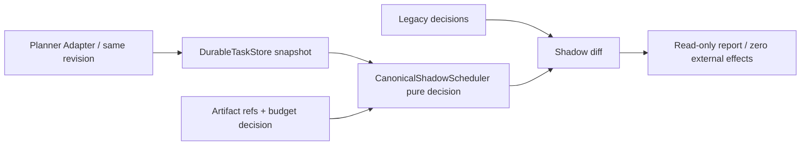

受众：MASTER
标题：当前数据流报告

版本：v4.2
日期：2026-07-11
定位：基于当前仓库代码，全面描述所有主流量路径。若历史方案文档与本文冲突，以本文与代码为准。

## 0. 代码证据入口

本文的数据流以下列文件为主要证据：

进程入口：
- `host_brain/__main__.py`
- `host_brain/obs_main.py`
- `edge_client/__main__.py`
- `edge_client/gateway/bootstrap.py`
- `desktop_pet/main.cjs`

Host Main FastAPI 装配：
- `host_brain/app/asgi.py`
- `host_brain/app/app_factory.py`
- `host_brain/app/router_registry.py`

Chat / Surface 主链：
- `host_brain/app/chat_routes.py`
- `host_brain/app/chat_immune_gate.py`
- `host_brain/app/chat_handler.py`
- `host_brain/app/cortex_orchestrator.py`
- `host_brain/app/agent_runtime_shared.py`
- `host_brain/app/executive_router.py`
- `host_brain/app/executive_runtime.py`
- `host_brain/app/executive_runtime_core.py`
- `host_brain/app/surface_reply_runtime.py`
- `host_brain/app/surface_reply_preprocessor.py`
- `host_brain/app/surface_reply_postprocessor.py`
- `host_brain/app/surface_main_chain_adapter.py`
- `host_brain/app/reply_envelope.py`
- `host_brain/persona/surface_main_chain.py`
- `host_brain/persona/surface_packet_compiler.py`
- `host_brain/persona/surface_runtime.py`

召回 / 记忆：
- `host_brain/app/chat_retrieval_helpers.py`
- `host_brain/persona/surface_memory_recall.py`
- `host_brain/retrieval/recall_fusion.py`
- `host_brain/retrieval/recall_fusion_stores.py`
- `host_brain/retrieval/recall_fusion_config.py`
- `host_brain/retrieval/recall_schemas.py`
- `host_brain/memory/life_memory.py`
- `host_brain/audit/sqlite_ledger.py`
- `host_brain/audit/ledger_schema.py`
- `host_brain/core/prompt_context.py`
- `host_brain/app/canon_routes.py`
- `host_brain/memory/canon_apply_service.py`
- `host_brain/memory/canon_world_store.py`
- `host_brain/governor/tokens.py`
- `host_brain/audit/migrations/0053_canon_apply.sql`
- `host_brain/agent_runtime/task_store.py`
- `host_brain/agent_runtime/task_scheduler.py`
- `host_brain/agent_runtime/planner_adapter.py`

Input / Edge / 外显面：
- `host_brain/app/input_routes.py`
- `host_brain/app/edge_event_routes.py`
- `host_brain/app/system_handler.py`
- `host_brain/channels/edge_rpc_client.py`
- `edge_client/gateway/server.py`
- `edge_client/gateway/router.py`
- `edge_client/gateway/normalizer.py`
- `edge_client/gateway/adapters/`
- `edge_client/runtime/voice_pipeline.py`
- `edge_client/runtime/avatar_behavior.py`
- `host_brain/app/mateengine_routes.py`
- `host_brain/channels/mateengine.py`

观测：
- `host_brain/app/obs_fastapi_app.py`
- `host_brain/app/obs_routes_*.py`
- `host_brain/app/monitor_ui/src/`

Pentest Agent 与子系统：
- `host_brain/pentest/agent/cognitive_engine.py`
- `host_brain/pentest/agent/evolution_core.py`
- `host_brain/pentest/agent/tool_registry.py`
- `host_brain/pentest/agent/belief_model.py`
- `host_brain/pentest/agent/goal_model.py`
- `host_brain/pentest/agent/compat.py`
- `host_brain/pentest/adversarial/adversarial_kernel.py`
- `host_brain/pentest/adversarial/game_loop.py`
- `host_brain/pentest/adversarial/red_mutation.py`
- `host_brain/pentest/adversarial/blue_detector.py`
- `host_brain/pentest/adversarial/blue_learner.py`
- `host_brain/pentest/adversarial/strategy_coevolution.py`
- `host_brain/pentest/adversarial/scoring.py`
- `host_brain/pentest/swarm/coordinator.py`
- `host_brain/pentest/swarm/message_bus.py`
- `host_brain/pentest/swarm/task_distributor.py`
- `host_brain/pentest/swarm/agent_lifecycle.py`
- `host_brain/pentest/online/safety_gate.py`
- `host_brain/pentest/online/authorization.py`
- `host_brain/pentest/online/rate_governor.py`
- `host_brain/pentest/online/target_queue.py`

Persona Surface 管线：
- `host_brain/persona/surface/candidate_scoring.py`
- `host_brain/persona/surface/scoring/parse.py`
- `host_brain/persona/surface/scoring/stage_positions.py`
- `host_brain/persona/surface/scoring/control_affect.py`
- `host_brain/persona/surface/scoring/texture.py`

Proactive Autonomy：
- `host_brain/runtime/autonomous_self.py`
- `host_brain/runtime/digital_life_supervisor.py`
- `host_brain/runtime/life_continuity.py`
- `host_brain/persona/proactive_voice.py`
- `host_brain/persona/emotional_proactive.py`
- `host_brain/app/digital_life_routes.py`
- `host_brain/app/obs_routes_proactive_autonomy.py`

## 1. 当前运行面与流量入口

| 流量类型 | 入口 | 处理面 | 出口 |
|---|---|---|---|
| 用户聊天 | `POST /v1/chat`（Host Main） | `chat_routes -> chat_immune_gate -> chat_handler -> cortex -> executive -> surface_reply -> SurfaceMainChain` | SSE：`PRESENCE -> COMMIT -> POST` |
| 平台消息入站 | Gateway adapter -> `POST /v1/host/input` | `input_routes -> cortex_orchestrator`，chat-bound 时复用 chat 主链 | SSE 或 ack |
| Edge 事件回流 | `POST /v1/edge/events` | `edge_event_routes` / `system_handler.receive_edge_events_response` | ack、遥测、必要的表现层/关系信号 |
| Edge 能力调用 | Host -> Edge RPC | `host_brain/channels/edge_rpc_client.py` | 同步执行结果 |
| Desktop Pet 控制 | Host -> Desktop Pet 直连或 Host -> Edge -> Desktop Pet | `edge_rpc_client.post_desktop_pet` / `POST /v1/edge/desktop_pet` | 本地桌宠动作 |
| MateEngine 表现层 | Host `/v1/mateengine/*` 或 chat lifecycle cue | `mateengine_routes` / `host_brain.channels.mateengine` | UDP signal 或 bridge HTTP |
| 观测数据查询 | Monitor UI -> Obs Backend | `obs_routes_*` | JSON |

Edge / Desktop Pet / MateEngine / VTS / VRM 均是外显执行或遥测面。它们可以上报状态、事件和执行结果，但不是事实裁决源，不能替代 SQLiteLedger、LifeMemoryStore 或 WorldCanonStore 的事实边界。

## 2. `/v1/chat` 主链

### 2.1 入口层

```text
uvicorn -> host_brain.app.asgi:app
  -> app_factory.create_host_fastapi_app(...)
  -> router_registry.register_host_routers(...)
  -> POST /v1/chat
  -> chat_routes.handle_v1_chat_route(...)
```

`ChatRequest` 进入后携带 message、session/person、reply target、attachments/multimodal observations、emotion context、intent draft、render target 等运行时字段。

### 2.2 Immune gate 与 handler

`chat_routes.handle_v1_chat_route` 在进入 chat handler 前完成：

1. `notify_user_interaction()`：触发用户活动信号。
2. `build_chat_bio_ops_preflight_trace(...)`：构建 BioOps trace 并写入 request state。
3. `evaluate_immune_gate_fn(...)`：得到 ALLOW / REPORT / BLOCK。
4. `schedule_immune_gate_fn(...)`：异步写 ledger，不阻塞主链。
5. BLOCK 直接返回拒绝型 COMMIT；REPORT 记录并继续放行；ALLOW 委托 `chat_handler.handle_chat`。

`chat_handler.handle_chat` 负责 metrics、request/session/person 解析、GATEWAY 中文渲染偏好、`HOST_SYS_MODE` 门控，然后返回 `_unified_chat_sse_generator(...)` 的 `StreamingResponse`。

### 2.3 统一 SSE 编排

```text
PRESENCE(THINKING)
  -> thalamus_agent.classify_and_compile_intent_draft(...)
  -> _evaluate_governor_with_timing(...)
  -> PRESENCE(GOV_APPROVED)
  -> cortex_orchestrator_sse_generator(...)
  -> record_user_turn(...)
  -> agent_runtime_shared._cortex_orchestrator_sse_generator_impl(...)
```

Governor 决策在 surface 回复前完成；immune gate 必须早于 chat handler。SSE 阶段顺序保持 `PRESENCE -> COMMIT -> POST`。

## 3. Cortex / Executive / Surface 数据流

`agent_runtime_shared._cortex_orchestrator_sse_generator_impl` 是当前 chat 主链的实际编排核心：

```text
1. airlock_sanitize_input(message)
2. retrieval/persona prefetch
3. direct fastpath 尝试
4. executive_router_sse_generator(...)
5. executive_runtime_core 决策 route=chat/delegate/skill/plan
6. route=chat/delegate 时进入 surface_reply_sse_generator(...)
7. SurfaceMainChain 生成最终文本
8. ReplyEnvelope 包装 COMMIT
9. commit 后调度 POST 后效
```

当前 direct fastpath 包括 task progress、recent turn、contextual memory、contextual style、contextual session、previous meaning 等快速回答。这里的 contextual style 是会话/上下文快速路径，不表示存在 `canon_style_store.py`、`host_brain/canon/style/` 或 StyleCanon 召回 route。

Executive 当前 route：

| Route | 含义 | 后续 |
|---|---|---|
| `chat` | 普通聊天 | `surface_reply_sse_generator` -> SurfaceMainChain |
| `delegate` | 委派给指定 agent | 带 sub-agent context 进入 surface reply |
| `skill` | 调用 skill/tool | tool/skill broker，结果写审计 |
| `plan` | 多步任务规划 | 生成多步计划并汇总输出 |

## 4. 当前 surface recall 链路

当前 surface recall 不走旧 Agentic RAG stack；入口由 `host_brain/app/chat_retrieval_helpers.py:_run_retrieval` 与 `RecallFusionServiceContract` 驱动，并在 surface memory recall / packet compiler 中转成给 SurfaceMainChain 的事实输入。

```text
SurfaceMainChain input build
  -> chat_retrieval_helpers._run_retrieval(...)
  -> _build_surface_memory_recall_service()
  -> RecallFusionServiceContract(recall runtime config)
  -> surface_memory_recall.py
  -> MemoryRecallPacket / evidence rows
  -> surface_packet_compiler.py
  -> CompiledSurfaceInput
  -> SurfaceRuntime.run(...)
```

当前主 surface recall routes：

| route_id | store_id | 角色 |
|---|---|---|
| `surface_life_collection` | `life_memory_collection` | life memory 集合快速取回，偏 SSOT 聚合视图 |
| `surface_life_episode` | `life_episode` | LifeMemoryStore 的 episode/evidence 事实取回 |
| `surface_semantic` | `semantic_memory` | SQLite 长期语义蒸馏层，需带来源/provenance |
| `surface_episodic` | `episodic_vector` | 向量兼容层，衍生召回 |
| `surface_sqlite` | `sqlite_ledger` | intent/governor/skill/memory/retrieval 等 ledger 记录 |
| `surface_neo4j` | `neo4j_bond` | 关系/bond 图或 SQLite 降级 |

`world_canon` 和 `artifact_vault` 在通用 `recall_fusion_config.py` / store 实现中仍存在能力定义，但不是当前 surface 主链的 route 配置。不要把 WorldCanon 写成 surface recall route。

## 5. 记忆 SSOT 与衍生层

当前记忆 SSOT 是 `host_brain/memory/life_memory/store.py` 的 `LifeMemoryStore`。SQLite 是 source of truth；vector / semantic / graph 是衍生层或兼容层。

`host_brain/memory/life_memory/` 子包（7 文件，8,718 行）：
- `store.py`（3,275 行）— `LifeMemoryStore` 主存储
- `semantic.py`（2,411 行）— 语义记忆操作
- `consolidator.py`（925 行）— `LifeMemoryConsolidator`
- `sleep.py`（183 行）— `MemorySleepReplayTask`
- `utils.py`（1,664 行）— 辅助工具
- `constants.py`（172 行）— 真值状态、episode 类型、保留层级
- `models.py`（22 行）— 数据模型

顶层 `memory/` 包（16 文件）：canon 世界存储（763 行）、ChromaDB 客户端（783 行）、episodic 记忆（1,000 行）、蒸馏（1,238 行）、上下文压缩（440 行）、记忆价值评估（206 行）。

`SQLiteLedger` schema 覆盖：

| 类别 | 代表表 |
|---|---|
| 意图 / 治理 / skill 审计 | `intent_log`、`governor_log`、`skill_exec_log` |
| 记忆操作与生命记忆 | `memory_ops_log`、`life_episode`、`life_evidence`、`life_episode_link`、`life_memory_collection*` |
| Canon / world canon 审计 | `canon_proposal_log`、`canon_apply_token`、`canon_apply_journal`、`canon_change_log`、`world_canon_doc` 等 `canon_*` 表 |
| 语义记忆 | `semantic_memory` |
| 召回观测 | `retrieval_event_log` |

因此：
- `life_episode` / `life_evidence` 是可追溯事实主体。
- `semantic_memory` 是长期语义蒸馏结果，不应脱离 source refs 当成原始事实。
- `episodic_vector` / Chroma 是衍生索引，不是事实真源。
- `sqlite_ledger` 可证明链路日志、决策和执行记录。

## 6. WorldCanon 边界

WorldCanon 的内容 SSOT 是 `host_brain/canon/world` 下的版本化文件，并通过 ledger 同步 `world_canon_doc`。`WorldCanonStore` 负责读取、扫描和 proposal；生产 mutation authority 已收敛到 `host_brain/memory/canon_apply_service.py:CanonApplyService`。Store 的旧 `upsert*`、`approve_proposal*`、`rollback_proposal` 写入口无条件 fail-closed，只有 Apply Service 的两个 identity-permit primitive 能替换或删除文件。

受治理写入路径：

```text
offline MASTER/GOVERNOR review
  -> CanonApprovalTokenIssuer 使用离线 Ed25519 私钥签署完整 binding
  -> canon_apply_token 只持 bearer digest + attestation/signature

POST canon approve / rollback / promotion route
  -> content-free CanonApplyCommand + SecretStr bearer
  -> CanonApplyService 先验签，再检查 expiry/replay/command binding
  -> 从同一 SQLite 中读取 proposal 或 promotion candidate 的已审 payload
  -> 单事务：subject CAS + once-only token burn + journal PREPARED
  -> 重验 canonical before/target snapshot 与 signed subject
  -> per-document lock + same-directory temp + file fsync + atomic replace/delete
  -> 重验 journal/token/source/file disposition
  -> 单事务：subject final CAS + world_canon_doc/canon_change_log + journal APPLIED
  -> 触发可重建的 vector projection sync
```

运行时只持受信 Ed25519 公钥；issuer 私钥不由 FastAPI composition 或 route 暴露。0053 必须先由中央 migration 流程落地，并具有精确 migration id/name/checksum；service/issuer 构造只读核对 schema manifest，不 inline 建表。额外列、约束/index 漂移以及引用 apply 表的 persistent/temp trigger/view 均 fail-closed。

SQLite 与 Canon 文件不是单一原子资源，因此 `canon_apply_journal` 显式保存 before/target canonical snapshot、owner lease、recovery-not-before 与递增 fence。PREPARE 或 replace 后崩溃由 `recover_pending()` 接管；恢复、写入和 finalize 每一段都重算完整 payload hash，并把磁盘原始 9 字段 JSON、journal 坐标、proposal `canon_kind=world` 或 promotion current-entry lineage 重新绑定到 burned token 与 signed command。任何 extra/missing/type/doc-id/source 不一致都进入 `RECOVERY_REQUIRED` 或 `FAILED`，不得把未批准正文写入 Canon，也不得标记 `APPLIED`。rollback-to-zero 使用授权 delete 和同样的 journal/recovery 协议。

Apply 使用独立 strict raw reader；普通 WorldCanon reader 暂保留旧兼容语义。仓库现有 Persona Canon 含本任务范围外的扩展顶层字段，因此 Apply 在消费 token 前冻结这类目标并保持原文件字节不变，不会以标准 9 字段重写导致扩展数据丢失；其 schema-aware 迁移由后续 Persona/Canon 架构任务处理。

Pentest 领域运行数据只进入 Pentest domain store；promotion 先形成同库 candidate，经上述审批路径才能进入 WorldCanon，旧脚本不再直接写 Canon。

WorldCanon 进入 prompt 的主要路径是：

```text
host_brain/core/prompt_context.py:build_world_canon_slot(...)
  -> WorldCanonStore.scan_documents()
  -> prompt_context["authoritative"]
  -> kind="world_canon"
  -> evidence_level="CANON_REFERENCE_ONLY"
  -> unsafe_as_fact=True
  -> reference_mode="citation_only"
```

含义：
- WorldCanon 是世界设定 / 典籍引用的权威槽位。
- WorldCanon 不能证明某件事已经执行、已经保存、已经被用户确认。
- prompt validation 会拒绝 world canon 内容中混入执行事实。
- WorldCanon 不应被写成 surface recall route，也不应和不存在的 StyleCanon 一起写入 StateArbiter 优先级。

当前源码没有 `canon_style_store.py`，也没有 `host_brain/canon/style/`。StyleCanon 不是当前 recall route。

### 6.1 Canonical Task Runtime shadow

Planner Adapter 生成同一 `graph_id/revision` 的 TaskGraph 与 dependency artifact refs，DurableTaskStore 保存 graph/node/attempt/lease。`CanonicalShadowScheduler.evaluate_durable()` 在一个 SQLite 读事务内取得 snapshot，再以纯函数计算 READY、BLOCKED、RETRY_WAIT、RECOVER、CANCEL、BUDGET_BLOCKED 与 HOLD。`HOST_TASK_RUNTIME_MODE=legacy` 时 executor adapter 不读取 shadow；`shadow` 模式还必须匹配 `HOST_TASK_RUNTIME_SHADOW_OWNER`。当前输出只用于 decision digest 与 legacy diff，不调用 Worker，也不改变 AgentJobRegistry 的 authority。



## 7. SurfaceMainChain -> ReplyEnvelope -> 后效

当前 normal chat 文本的最终作者是 SurfaceMainChain。Surface 生成后由 `ReplyEnvelope` 包装成 COMMIT：

```text
surface_main_chain_adapter
  -> run_surface_main_chain_for_chat_input(...)
  -> SurfaceRuntimeResult
  -> ReplyEnvelope.final_reply(
       source="surface_main_chain",
       audit={
         request_id,
         observation_codes,
         natsume_emotion_tag,
         user_emotion_tag,
         vts_expression_id,
         emotion_confidence
       }
     )
  -> COMMIT SSE
```

COMMIT 之后才调度副作用：

| 后效 | 代码路径 | 事实边界 |
|---|---|---|
| memory 写入 | `agent_runtime_shared._async_post_process(...)` -> `_write_surface_main_chain_memory_sync` | 写入 LifeMemoryStore / SQLiteLedger，属于事实写回 |
| emotion flow | Surface audit 中的 `natsume_emotion_tag` / `user_emotion_tag` -> `_surface_emotion_context(...)` -> TTS/VTS/表现层 | 情感上下文参与表现和后续调制，不替代记忆事实 |
| bond flow | `bond_summary` 进入 surface affect control 与 `_async_post_process(...)`，Edge emotion event 可触发 `post_process_bond_update` | bond 更新需经对应引擎/ledger，不由外显面裁决 |
| life aftereffect | `_schedule_surface_life_aftereffect(...)` -> `host_brain.runtime.life_continuity.record_dialogue_aftereffect(...)` | 对话后效异步记录，不阻塞 COMMIT |
| TTS / Desktop Pet / MateEngine | postprocessor、`edge_rpc_client`、`mateengine.py` | 外显执行，不是事实真源 |
| observability | audit / retrieval / latency trace 写入 | 可观测记录，不生成用户事实 |

## 8. `/v1/host/input` 回流链

输入源：
- Gateway 把平台消息归一化后 POST 到 `/v1/host/input`。
- Edge ASR 把识别结果作为 input 上报。
- 自动化或 proactive 任务可通过 input 路径触发 chat-bound 或 perception-only 流程。

```text
POST /v1/host/input
  -> input_routes.handle_input_request
  -> input_service_quality / input_service_log / input_service_ack / input_service_gateway
  -> chat-bound: cortex_orchestrator_sse_generator(...)
  -> perception-only: 写 perception episode 入 life memory
  -> system event: 派发 tribe_event
  -> ack response
```

`/v1/host/input` 可以落 ack、输入日志、感知 episode；当它触发 chat-bound 路径时，最终输出仍回到 SurfaceMainChain / ReplyEnvelope 语义。

## 9. Host <-> Edge 与外显面

Host -> Edge 主要能力：

- `/v1/edge/health`
- `/v1/edge/avatar_state`
- `/v1/edge/speak`
- `/v1/edge/barge_in`
- `/v1/edge/asr`
- `/v1/edge/vts`
- `/v1/edge/desktop_pet`
- `/v1/edge/screenshot`
- `/v1/edge/automate`
- `/v1/edge/visual_locate`
- `/v1/edge/proactive_push`
- `/v1/edge/wx/*`

Edge -> Host：

- 文本 / 语音 / 多媒体 -> Gateway 归一化 -> `/v1/host/input`
- 状态 / 事件 -> `/v1/edge/events`

`POST /v1/edge/events` 接收 EdgeEventsRequest，写审计/遥测，必要时派发 tribe event、驱动 VTS emotion 或触发 bond 更新任务。它仍然是回流与遥测入口，不是「用户事实已成立」的裁决源。

Desktop Pet 与 MateEngine：

```text
Host postprocessor / lifecycle cue
  -> edge_rpc_client.post_desktop_pet(...) 或 mateengine.py
  -> local Desktop Pet / MateEngine bridge
  -> 动作、气泡、口型、姿态、状态展示
```

这条链路只承载外显执行与状态展示，不提供 memory / policy / audit 的事实结论。

## 10. Unified Message Gateway 闭环

```text
External Platform
  -> edge_client/gateway/adapters/<platform>.py
  -> raw_event
  -> edge_client/gateway/router.py
  -> edge_client/gateway/normalizer.py
  -> edge_client/channels/input_reporter.py
  -> host_brain /v1/host/input
  -> cortex_orchestrator / SurfaceMainChain
  -> ReplyEnvelope COMMIT
  -> edge_client/gateway/humanize_sender.py
  -> adapter.send
```

Gateway 的职责是平台协议适配、thread resolve、附件归一化、输入上报和出站节奏处理；它不拥有记忆事实或最终事实裁决。

## 11. Observability 数据流

Host Main 与 Observability 是两个独立 ASGI app。Obs Backend 读取 ledger、运行时 metrics、聚合查询与 UI API：

```text
host_brain/obs_main.py
  -> host_brain.app.obs_fastapi_app:app
  -> /api/ui/* / /obs/*
  -> SQLiteLedger / observability queries / runtime metrics
```

Monitor UI 可展示 sessions、trace、metrics、memory、bond、gateway、skills、automation、avatar state 等视图。Avatar 行为按钮最终仍走 Edge / VTS 控制，是高层行为控制与观测，不直接写事实源。

## 12. 当前已废弃的旧口径

| 旧描述 | 当前事实 |
|---|---|
| Agentic RAG stack 提供 chat 召回 | 当前 surface recall 走 `_run_retrieval` + `RecallFusionServiceContract`；不要写 `RetrievalOrchestrator` / `RetrievalPipeline` / `QueryPlanner` / `AgenticRetrievalLoop` |
| `world_canon` 是当前 surface recall route | WorldCanon 主要通过 `build_world_canon_slot` 进入 authoritative slot，不是当前 surface route |
| `StyleCanon` / `canon_style_store.py` 是召回源 | 当前源码没有 `canon_style_store.py` 和 `host_brain/canon/style/` |
| vector / semantic 是记忆真源 | SQLite / LifeMemoryStore 是 SSOT；vector / semantic 是衍生层 |
| Edge 外显状态可证明事实 | Edge 只上报遥测/执行结果；事实写回由 ledger / LifeMemoryStore / canon store 边界裁决 |
| Surface 主链是实验链 | SurfaceMainChain 是 normal chat 默认最终作者 |
| prompt_builder 是 normal chat 主作者 | normal chat 最终作者是 SurfaceMainChain |
| Host Main 同时承担 Obs Backend | Host Main 与 Observability 是独立 ASGI app |

## 13. 关键不变量

1. normal chat 文本最终作者只能是 `SurfaceMainChain`。
2. 当前记忆 SSOT 是 `LifeMemoryStore` + SQLiteLedger；vector / semantic / episodic_vector 是衍生层。
3. 当前 surface recall routes 是 `life_memory_collection`、`life_episode`、`semantic_memory`、`episodic_vector`、`sqlite_ledger`、`neo4j_bond`。
4. WorldCanon 是 `WorldCanonStore` 的 authoritative slot 输入，不是当前 surface recall route；`unsafe_as_fact=True`、`reference_mode="citation_only"`。
5. WorldCanon 生产写入只经 `CanonApplyService`；必须具备已签完整 binding、一次性 durable token、journal、target fence 与可重验 recovery，不得恢复 direct Store/file writer。
6. 不存在 StyleCanon 召回 route 或 `canon_style_store.py` 事实源。
7. ReplyEnvelope COMMIT 完成后，memory 写入、emotion/bond flow、life aftereffect、TTS/外显执行再异步落地。
8. Edge 外显面只承载遥测、状态和执行结果，不是事实裁决源。
9. SSE 三阶段 `PRESENCE -> COMMIT -> POST` 不可颠倒。

## 14. Pentest Agent Cognitive Loop

```text
PentestAgentKernel (autonomous_kernel.py, 3,172 行)
  → CognitiveEngine.generate_hypotheses()  (agent/cognitive_engine.py, 834 行)
      → LLM 假设生成 + 信念加权评分
  → BeliefModel.update()                    (agent/belief_model.py, 394 行)
      → 贝叶斯信念系统（ToolBelief/PatternBelief/CapabilityBelief），时间衰减
  → GoalModel.select_action()               (agent/goal_model.py, 416 行)
      → 显式目标声明（shell/root/domain_admin/domain_takeover/read_flag/chain_depth/n_critical）
  → ToolRegistry.resolve()                  (agent/tool_registry.py, 796 行)
      → Capability enum (30+ intent types) → EnvTag → ToolCapability → ToolSpec
  → guarded executor                        (executor_guard.py)
      → ScopeGuard + RateLimiter + allow_exploit + approval token
  → EvolutionCore.observe()                 (agent/evolution_core.py, 693 行)
  → EvolutionCore.reflect()
  → EvolutionCore.adapt()
  → EvolutionCore.evolve()
      → 组合 KnowledgeBase + ExperienceRetriever + CampaignMemory + FailureClassifier
  → loop
```

三条规划路径选择（`agent/compat.py:LegacyKernelAdapter`）：
- `PENTEST_COGNITIVE_KERNEL=1` → CognitiveEngine（假设生成 + 信念评分）
- `PENTEST_COGNITIVE_KERNEL=0` → MCTSPlanner（`mcts_planner.py`, 1,111 行）或 LLMReActPlanner（`llm_react_planner.py`, 710 行）

MetaCognition（`agent/meta_cognition.py`, 288 行）实时监控决策质量、异常检测、策略热切换、后行动评审。

## 15. Adversarial Game Loop

```text
AdversarialHook (adversarial/adversarial_kernel.py, 注入到 autonomous_kernel._observe_success)
  → GameLoop.run_round() (adversarial/game_loop.py, 136 行)
    → RedMutationEngine.mutate()    (adversarial/red_mutation.py, 190 行)
        → payload/tool/timing/route 变异
        → TTP fallback map + payload variant map
    → BlueDetector.evaluate()       (adversarial/blue_detector.py, 134 行)
        → 评估 red action 是否被检测
    → RedMutationEngine.adapt()     → 红队适应
    → BlueLearner.learn()           (adversarial/blue_learner.py, 137 行)
        → 从 red 成功中学习检测规则
    → AdversarialScoring.score()    (adversarial/scoring.py, 167 行)
        → RoundScore / GameSummary
  → StrategyCoevolution.evolve()    (adversarial/strategy_coevolution.py, 250 行)
      → 遗传算法：pop=20, elite=4, tournament=3, crossover=0.7, mutation=0.15
      → red attack strategies + blue detection rules 协同进化
  → AdversarialArchive.record()     (adversarial/archive.py, 157 行)
      → AttackStrategy / DetectionRule 存档
```

## 16. Swarm Coordinator 消息流

```text
SwarmCoordinator (swarm/coordinator.py, 388 行)
  → TaskDistributor.shard()          (swarm/task_distributor.py, 114 行)
      → 按 IP/CIDR/service/phase 分片
  → AgentLifecycleManager.spawn()    (swarm/agent_lifecycle.py, 162 行)
      → 生成/监控/终止/重启 agent（heartbeat 机制）
  → RoleSpecialization.assign()      (swarm/role_specialization.py, 178 行)
      → RECON | VULN | EXPLOIT | POST | AD | GENERAL | BLUE | MANAGER
  → MessageBus.publish()             (swarm/message_bus.py, 75 行)
      → 内存 pub/sub，500 msg buffer，线程安全
  → GraphMerger.merge()              (swarm/graph_merge.py, 140 行)
      → AttackGraph 合并 + MergeConflict 解决
  → SwarmResult
```

## 17. Online Safety Gate 三层控制流

```text
SafetyGate.check() (online/safety_gate.py, 223 行)
  → Layer 1: ONLINE_SCAN_MODE check
      仅 offline | manual（无 auto 模式）
  → Layer 2: AuthorizationManager.verify() (online/authorization.py, 204 行)
      proof types: bug_bounty | pentest_contract | internal_lab
  → Layer 3: RateGovernor.check() (online/rate_governor.py, 111 行)
      硬编码限速（不可配置/不可绕过）：
      google_dork 10/day, shodan 30/min, censys 20/min,
      dns_query 100/min, crtsh 15/min, subdomain_hunt 50/min
      最小 target 间隔 5s
  → TargetQueue.enqueue() (online/target_queue.py, 127 行)
      仅手动 API 添加，永不自动发现
```

## 18. Persona Surface Scoring 管线

```text
SurfaceMainChain.run() (persona/surface_main_chain.py, 250 行)
  → SurfaceRuntime.generate()              (persona/surface_runtime.py, 2,668 行)
      → LLM 调用，生成候选回复
  → SurfaceMemoryRecall (persona/surface_memory_recall.py, 4,539 行)
      → 记忆召回计划与 evidence 组织
  → SurfacePacketCompiler (persona/surface_packet_compiler.py, 713 行)
      → 多包编译为 CompiledSurfaceInput
  → CandidateScoring.score_candidates()    (persona/surface/candidate_scoring.py, 1,912 行)
    → scoring/parse.py (262 行)
        → 候选解析、问题预算计数、控制违规检测
    → scoring/stage_positions.py (406 行)
        → 场景位置评分（back/morning/low-energy/self-doubt/positive 五种位置）
    → scoring/control_affect.py (398 行)
        → 控制情感评分（情绪基调 + 关系距离双轴）
    → scoring/texture.py (273 行)
        → 纹理评分（签名纹理命中 + 场景质量样本评分）
  → 最终选择最高分候选
```

Inner-state leakage 路径：
```text
OfflineInnerWorld.tick() (persona/inner_world.py, 2,565 行)
  → InnerWorldState (loneliness 0.05/hr accumulation, anticipation 0.03/hr)
  → ReplyControlPacket {
      inner_weather, body_state_hint, care_signal,
      continuity_signal, tension_hint, liveliness, active_loops
    }
  → IsolatedSurfaceInput
  → SurfaceRuntime → LLM prompt 生成
```

## 19. Proactive Autonomy 回路

```text
DigitalLifeSupervisor.tick_loop() (runtime/digital_life_supervisor.py, 1,235 行)
  → CORE_TICK_TASK_IDS: inner_world_numeric_tick, inner_world_monologue_tick,
                        silence_tick, body_sense_tick, emotion_decay_tick
  → autonomous_self.apply_autonomous_self_cycle() (runtime/autonomous_self.py, 1,009 行)
    → 8 维 SELF_REWARD_WEIGHTS (continuity/coherence/competence/curiosity/
       restraint/presence/aesthetic/attachment)
    → 7 维 DEFAULT_ADAPTIVE_TRAITS (curiosity/assertiveness/playfulness/
       sensitivity/resilience/restraint/warmth)
    → compute_dialogue_state_closure()
    → apply_proactive_outcome()
  → PersonaProactiveVoice.evaluate() (persona/proactive_voice.py, 1,477 行)
    → 场景感知 (LATE_NIGHT/LONG_ABSENT/POST_INTENSE/
                 TOPIC_FOLLOWUP/MORNING_GREET/HOLIDAY_GREET)
    → 24h per-type 冷却门控
  → EmotionalProactiveEpisode (persona/emotional_proactive.py, 845 行)
    → 冲动追踪与衰减
  → proactive_voice.generate() → ProactiveExpression
  → life_continuity.record_proactive_outbox() (runtime/life_continuity.py, 1,920 行)
    → SQLite proactive_life_outbox 表
  → Edge RPC proactive_push → 外显执行

API 端点：
- POST /v1/digital-life/proactive/attempt — 手动触发（支持 dry-run + forced）
- GET  /v1/digital-life/proactive/recent — 近期 outbox 条目
- GET  /v1/digital-life/proactive/episodes/recent — 近期 proactive episodes
- GET  /obs/proactive-autonomy — proactive autonomy 快照
    （inner_weather, reach_out_calibration, active_projects,
      proactive_readiness, top_intention, dialogue_closure）
```
