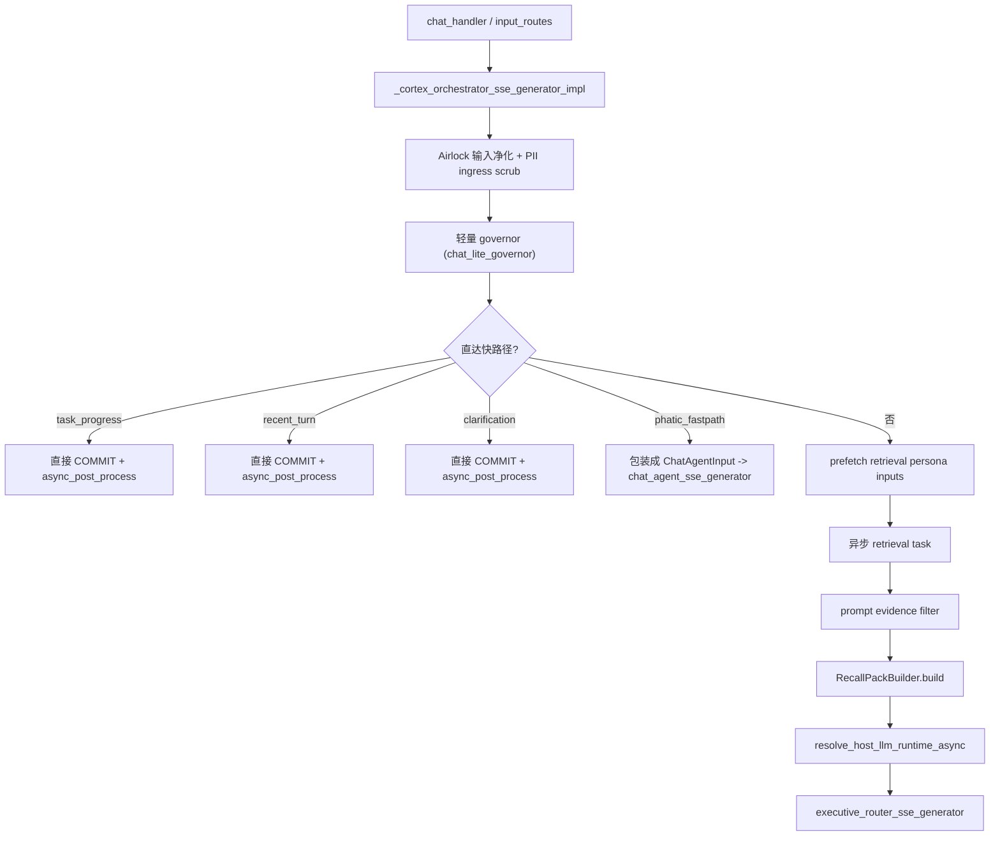
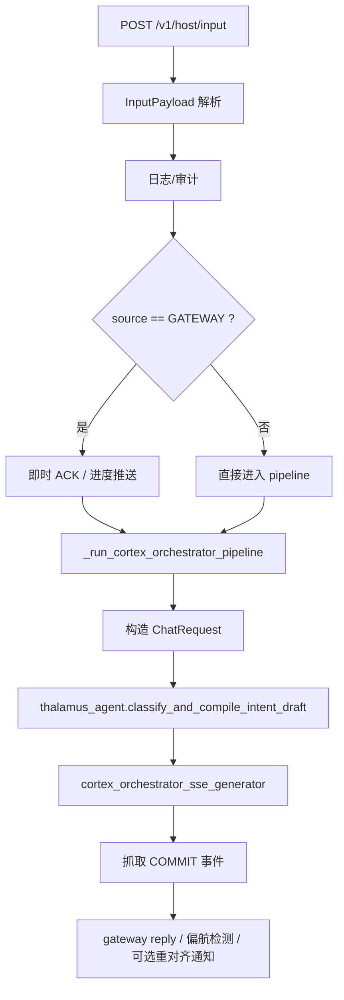

受众：PROJECT
标题：系统数据流全景报告（当前代码实况）

版本：v2.1
日期：2026-04-19
定位：从“流向”视角整理当前代码中的主请求链、外部输入回流、Host↔Edge 调用、Gateway 闭环和观测链路。若与历史 `SceneRouter / main_chain / top_agent / dispatch_agent` 口径冲突，以本文和代码为准。

# 系统数据流全景报告（当前代码实况）

## 0. 代码证据入口

本文主要依据以下文件整理：

- `host_brain/app/fastapi_app.py`
- `host_brain/app/chat_handler.py`
- `host_brain/app/cortex_orchestrator.py`
- `host_brain/app/agent_runtime_shared.py`
- `host_brain/app/executive_router.py`
- `host_brain/app/executive_runtime.py`
- `host_brain/app/executive_runtime_core.py`
- `host_brain/app/chat_agent.py`
- `host_brain/app/input_routes.py`
- `host_brain/app/obs_fastapi_app.py`
- `host_brain/app/web_ui.py`
- `host_brain/app/vision/proactive_push_client.py`
- `edge_client/app/fastapi_app.py`
- `edge_client/runtime/bootstrap.py`
- `edge_client/gateway/bootstrap.py`
- `edge_client/gateway/server.py`
- `edge_client/gateway/router.py`

## 1. 当前运行面与流量入口

| 运行面 | 默认端口 | 入口文件 | 主要流量 |
|---|---:|---|---|
| Host Main | 8000 | `host_brain/__main__.py` | `/v1/chat`、`/v1/host/input`、`/v1/edge/events`、`/tools/*`、`/prompt-config/*`、`/api/ui/*`、静态 Monitor |
| Observability Backend | 18082 | `host_brain/obs_main.py` | `/obs/*`、`/api/ui/*`、`/health`、数字生命体总览 / life body / trace / 洞察快照 |
| Edge RPC | 17800 | `edge_client/__main__.py` | speak / barge_in / vts / screenshot / automate / visual locate / proactive / wx 查询 |
| Unified Message Gateway | 19000 | `edge_client/gateway/bootstrap.py` | 平台 webhook、回复分发、网关健康与统计 |

## 2. `/v1/chat` 主链

当前聊天链不是旧的 `SceneRouter -> top_agent -> dispatch_agent`。当前代码里的常规主链是：

```text
POST /v1/chat
  -> fastapi_app.chat()
  -> _evaluate_immune_gate_for_chat()
  -> _schedule_chat_immune_gate_event()
  -> chat_handler.handle_chat()
  -> _unified_chat_sse_generator()
  -> thalamus_agent.classify_and_compile_intent_draft()
  -> Governor evaluate_intent()
  -> cortex_orchestrator_sse_generator()
  -> executive_router_sse_generator()
  -> executive_runtime_sse_generator()
  -> _executive_runtime_core_impl()
  -> chat_agent_sse_generator() / skill / delegate / plan
  -> async_post_process()
```

### 2.1 入口层

`host_brain/app/fastapi_app.py` 当前在进入 `handle_chat()` 之前会处理三件事：

1. `ImmuneAgent` 文本检查
2. 异步审计免疫门控结果
3. 命中 `phatic_fastpath` 时在 HTTP 路由层直接返回 SSE

若免疫决策为 `BLOCK`，直接返回单个 `COMMIT(REJECT)` SSE，不再进入后续链路。

### 2.2 `chat_handler.py`

`host_brain/app/chat_handler.py` 的职责是：

- 统一 `/v1/chat` SSE 入口
- 调用 `thalamus_agent.classify_and_compile_intent_draft()`
- 构建 emotion/governance snapshot
- 调用 Governor
- 将已通过的请求转给 `cortex_orchestrator`

它现在是“主入口薄层”，而不是承载全部业务细节的总装配文件。

## 3. `cortex_orchestrator` 数据流

`host_brain/app/cortex_orchestrator.py` 本身只是入口壳，真实实现位于 `host_brain/app/agent_runtime_shared.py` 的 `_cortex_orchestrator_sse_generator_impl()`。

当前数据流如下：



### 3.1 `cortex_orchestrator` 的快路径

当前代码里已确认的直达快路径有：

- `task_progress_direct`
- `recent_turn_direct`
- `clarification_direct`
- `phatic_fastpath`

这些路径的共同特点是：

- 先在 orchestrator 内部快速回答
- 仍然进入统一的 `async_post_process()`
- 不绕开记忆、Bond、VTS/TTS、观测审计

### 3.2 Retrieval 与 RecallPack

非快路径下，`cortex_orchestrator` 会：

1. 调用 `_run_retrieval()`
2. 用 `filter_retrieval_evidence_items_for_prompt()` 过滤证据
3. 用 `RecallPackBuilder.build()` 组装 `recall_slot_text`
4. 将 `recall_slot_text / retrieval_evidence_items / retrieval_summary` 传给执行层

如果 LLM runtime 不可用，则 orchestrator 会直接返回 `COMMIT(REJECT, reason_code=LLM_UNAVAILABLE)`，并异步补写后处理。

## 4. `executive_runtime` 路由流

`executive_router.py` 只是转发层，真正的路由判断在 `host_brain/app/executive_runtime_core.py`。

### 4.1 当前路由类型

当前执行层真实使用的 route type 为：

- `chat`
- `skill`
- `delegate`
- `plan`
- `recent_turn`
- `task_progress`

### 4.2 路由判断顺序

`_hard_rule_route()` 当前顺序如下：

1. 读取 `intent_draft.route`
2. 识别 `task_progress` 查询
3. 识别 `recent_turn` 查询
4. 提取 `skill_target`
5. 提取 `delegate_target`
6. 命中 `RULE_ROUTE_MAP`
7. 多步骤请求进入 `plan`
8. 兜底到 `chat`

### 4.3 器官族路由覆盖

`_executive_runtime_core_impl()` 会并行拉取 4 路器官状态：

- `ImmuneAgent`
- `ProprioceptionAgent`
- `LimbicAgent`
- `PrefrontalAgent`

覆盖逻辑：

- `ImmuneAgent` 高风险且 `REPORT/BLOCK`：强制 `chat`
- `ProprioceptionAgent` 认知负荷高：强制 `chat`
- `LimbicAgent` `withdraw > 0.80`：强制 `chat`
- `PrefrontalAgent` 漂移告警高：强制 `chat`

补充：

- `PREFRONTAL_PLAN_ENABLED=true` 时，还会调用 `PrefrontalAgent.plan_response()` 产出 `prefrontal_task` / `prefrontal_tone_hint`
- 这些结果会回写进 `intent_draft`，供 `chat_agent` 语言化

### 4.4 不同 route 的后续流向

| route | 主要去向 | 说明 |
|---|---|---|
| `chat` | `chat_agent_sse_generator()` | 标准人格渲染路径 |
| `skill` | `_execute_skill()` | 进入技能执行与结果整理 |
| `delegate` | `_execute_delegate()` 等执行路径 | 交给目标 agent / 子能力 |
| `plan` | `_execute_skill_dag()` | 构建多步 Skill DAG |
| `recent_turn` | `try_handle_recent_turn_direct_route()` | 直接回答 |
| `task_progress` | `try_handle_task_progress_direct_route()` | 直接回答 |

## 5. `chat_agent` 输出流

`host_brain/app/chat_agent.py` 当前只负责“说出来”：

- 接收 `ChatAgentInput`
- 组装 prompt
- 走流式 LLM 输出
- 发 `RENDER` / `SENTENCE` / `COMMIT`
- 调用共享后处理收口

它不再承担：

- 顶层场景路由
- skill/delegate 判断
- sys_mode 决策

因此，当前文档里凡是把 `chat_agent.py` 描述成“总路由器”或“主链调度器”的，都已经落后于代码。

## 6. `/v1/host/input` 回流链

当前外部输入统一落在 `host_brain/app/input_routes.py` 的 `POST /v1/host/input`。

### 6.1 输入源

- `ASR`
- `GATEWAY`

其他 Edge 运行时事件回流走 `POST /v1/edge/events`，不走 `POST /v1/host/input`。

### 6.2 当前回流流程



关键代码事实：

- Gateway 入口会强制 `render_target_lang="zh"`
- Gateway 入口默认 `suppress_edge_tts=true`、`suppress_edge_vts=true`
- Gateway 的文字回复统一由输入链尾部下发，避免 ChatAgent 再补播

## 7. Host ↔ Edge 调用链

### 7.1 Host -> Edge

当前 Host 侧主要通过 `host_brain/channels/edge_rpc_client.py` 调用：

- `/v1/edge/speak`
- `/v1/edge/vts`
- `/v1/edge/screenshot`
- `/v1/edge/automate`
- `/v1/edge/visual_locate`
- `/v1/edge/fallback/*`

主动消息推送由 `host_brain/app/vision/proactive_push_client.py` 调 `POST /v1/edge/proactive_push`。

### 7.2 Edge -> Host

Edge 侧向 Host 的主要上报有：

- `POST /v1/host/input`
- `POST /v1/edge/events`

### 7.3 `POST /v1/edge/events`

`host_brain/app/fastapi_app.py` 会把该端点交给 `receive_edge_events_response()`，用于接收：

- 语音播放状态
- 资源门控状态
- 运行时事件
- 需要桥接回主线程的 inline waiters

## 8. Unified Message Gateway 闭环

当前 Gateway 平台适配器已确认包括：

- `wechat`
- `qq`
- `feishu`
- `wecom`
- `telegram`
- `line`

闭环如下：

```text
平台 webhook
  -> edge_client/gateway/server.py
  -> GatewayRouter
  -> Host /v1/host/input
  -> cortex_orchestrator / executive runtime / chat_agent
  -> Host 产出 narrative
  -> OutboundDispatcher
  -> 平台 adapter
```

这条链路已经不再依赖旧的 `SCENE_GATEWAY -> SceneRouter -> top_agent.py` 说法。

## 9. 观测与前端数据流

### 9.1 独立观测后端

`host_brain/app/obs_fastapi_app.py` 当前负责：

- runtime snapshot warm cache
- trace feed warm cache
- insights summary warm cache
- digital life overview warm cache
- life body warm cache
- `/api/ui/*` 聚合 / 搜索接口
- `/obs/life-body`、`/obs/life-timeline`、`/obs/pathologies`

因此 Monitor UI 的高频读请求，优先应理解为：

```text
Monitor UI
  -> Observability Backend /obs/*
  -> warm cache / metrics collector / ledger 聚合
  -> 页面查询层
```

### 9.2 Monitor UI 页面组

前端当前围绕 4 组导航取数：

- 数字生命体
- 运营
- 器官级观测
- 外周执行

这说明它已经不是单一的“指标看板数据流”，而是“数字生命驾驶舱数据流”。

## 10. 当前已废弃的旧口径

以下表述已不适合继续作为“当前流向描述”：

- `host_brain/app/top_agent.py`
- `host_brain/app/dispatch_agent.py`
- `host_brain/app/chat_handler_complex.py`
- `host_brain/app/graph/main_chain.py`
- `SceneRouter.route_sse()`

如果后续还要整理文档，凡是依赖这些名词描述当前主链的，都应优先重写或标成历史参考。
