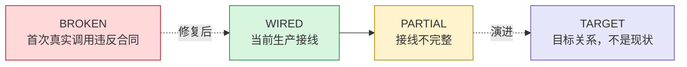

受众：PROJECT
标题：Natsume AI 当前架构图册

# Natsume AI 当前架构图册

版本：v2.2
核对日期：2026-07-18
文档类型：`CURRENT DIAGRAMS`

本图册用于快速理解生产拓扑和关键数据流。图中的实线表示当前生产调用或持久关系，虚线表示异步、可选或尚未完成的关系；红色/`BROKEN` 节点表示代码存在但当前合同不成立。

完成度以 [当前代码事实](../CURRENT_CODE_ARCHITECTURE.md) 和 [差距矩阵](../ARCHITECTURE_GAP_MATRIX.md) 为准。旧图中固定的进程数量、路由数量、Tribe family 数量、文件行数和“全部 A 级”等口径已废弃。

## 阅读顺序

| 顺序 | 图 | 回答的问题 |
|---|---|---|
| 1 | [运行拓扑](01_runtime_topology.md) | Host、Obs、Gateway、Edge、UI 和外部服务如何连接？ |
| 2 | [Governed 请求主链](02_main_chain_flow.md) | `chat/skill/delegate/plan` 如何从请求进入 TaskGraph 并提交副作用？ |
| 3 | [记忆、Canon 与召回](03_dataflow_recall.md) | 长期材料如何写入、索引、召回并进入表达上下文？ |
| 4 | [Planning、Task Runtime 与退役 Executive 边界](04_executive_layers.md) | 搜索、编译、执行、只读投影和退役边界各自在哪里？Code D16 是 pure-shadow catalog，D17/D18 是 trusted-process 私有 bare-worktree 加 cleanup-gated durable experiment ledger，均不是生产执行实线 |
| 5 | [数字生命状态与表达](05_tribe_topology.md) | Life、Memory、Bond、Scene、Persona 和 Surface 如何分工？ |
| 6 | [Gateway 与 Edge 输入输出](06_input_output_routes.md) | 外部平台消息和设备动作如何进入/离开 Host？ |
| 7 | [Observability 与 Operator](07_observability_topology.md) | 运行状态如何投影，Operator 如何安全操作？ |

## 图册约定

## 维护规则

1. 每张图必须给出代码锚点，禁止只画概念图却声称是当前事实。
2. 目标关系必须明确标 `TARGET`，不能与生产实线混用。
3. 改动 Host route、TaskGraph、state writer、Gateway/Edge contract 或 Observability composition 时同步更新对应图。
4. 不在图中维护易腐的文件行数、router 数量、测试数量或模块总数。
5. 发现图与代码冲突时，以 production composition 和 machine status 为准并立即修图。
6. Code/Research 的纯 shadow catalog、真实隔离执行与 production influence 必须画为不同层；不得以 catalog/compile 单测替代 worktree、verifier 或 receipt。
