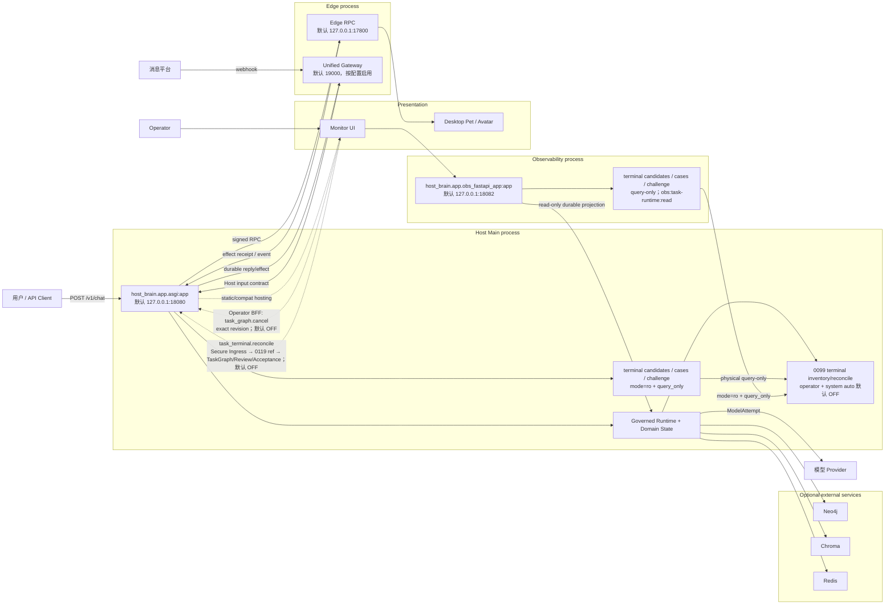

受众：PROJECT
标题：图 01——当前运行拓扑

# 图 01：当前运行拓扑

版本：v2.8
核对日期：2026-07-16

## 拓扑

## 运行面边界

| 运行面 | Authority | 依赖失效时的语义 |
|---|---|---|
| Host | Command、Task、Life、Memory 等业务协调 authority | 核心合同失败应拒绝或显式降级 |
| Observability | Query/Projection，不拥有业务写入 | 观测不可用不能偷偷改变业务状态 |
| Gateway | Transport inbox/outbox 与平台 delivery | 平台失败保留可恢复投递状态 |
| Edge | 设备执行与本机 receipt | 设备不可用返回 `DEGRADED/UNAVAILABLE` |
| UI/Pet | 人机界面和表现 | 不得成为任务、Persona 或 Life 真相 |
| Neo4j/Chroma/Redis | 可选图、向量或运行辅助 | 不得因可选服务可用性改变 canonical writer |

Gateway 通常在 Edge lifecycle 中启动，不应简单按“固定独立进程数量”理解部署。生产可以拆分进程，但 authority 边界不随部署方式改变。

## 代码锚点

- Host CLI：`host_brain/__main__.py`
- Host ASGI composition：`host_brain/app/asgi.py`、`host_brain/app/app_factory.py`、`host_brain/app/router_registry.py`
- Observability：`host_brain/obs_main.py`、`host_brain/app/obs_fastapi_app.py`
- Edge RPC：`edge_client/__main__.py`、`edge_client/app/fastapi_app.py`
- Gateway：`edge_client/runtime/bootstrap.py`、`edge_client/gateway/bootstrap.py`、`edge_client/gateway/server.py`
- 跨进程合同：`natsume_contracts/`
- 可选服务：`scripts/runtime/docker-compose.external.yml`

## 不能从本图推出的结论

- 图上有连线不等于全部 NE-01 已完成。Durable DAG 是 `PARTIAL_B5C_DURABLE_CANCELLATION_SHADOW / PRODUCTION_OFF`。0099 使用 immutable case/proof/supersession，readiness 严格比较 3 table/4 index/10 trigger canonical SQL 并复核 Python codec；单次最多 inventory 10,000 个 Graph。只有唯一 graph-scope exact FAILED bundle 可 default-off auto；结构漂移只 quarantine。未决 case graph-wide 围栏普通 Graph/cancellation request 与 Budget transition/consume/usage/retry，仅 0099 UoW bypass；0090 唯一、0091/0092 完整校验。System proof 以 case 时间跨进程收敛；healthy closure 仅 signed `NONE` 零业务写。主 Host/独立 Obs 物理 query-only。全部 reconciliation 默认 OFF、canary 未跑；外部 inventory/key lifecycle 与 general recovery未知，NE-01 保持 `IN_PROGRESS`。
- Terminal challenge 已从 OperatorQueryGateway context 绑定 principal，并把 ref/key/time与确定性 Outbox编入 service/store 同一 final canonical bytes；authority key 漂移被拒绝，HTTP→真实 Ed25519→Store round-trip 已通过。该证据仍不证明外部 deployment key lifecycle 或 inventory remediation。
- 可选服务启动成功不等于 Recall、Bond 或 rate limit 已生产启用。
- Edge/Gateway 存在不等于真实平台账号、硬件或密钥已验收。
