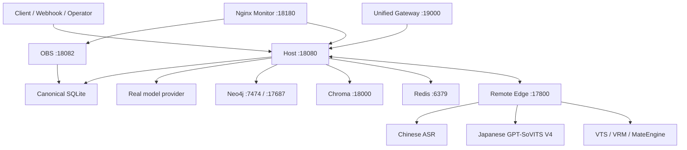

受众：MASTER
标题：图 01——运行拓扑

# 图 01：运行拓扑

Host、OBS 和 Monitor 在 Host 电脑运行；Edge 在另一台电脑。Docker 只承载 Neo4j、Chroma 和 Redis，canonical Life 与 Task 状态仍在 Host 的 SQLite ledgers。

远端 Edge 未经用户明确允许不得启动。服务健康必须逐组件判断，不能用 Host `/health` 替代完整拓扑验收。
