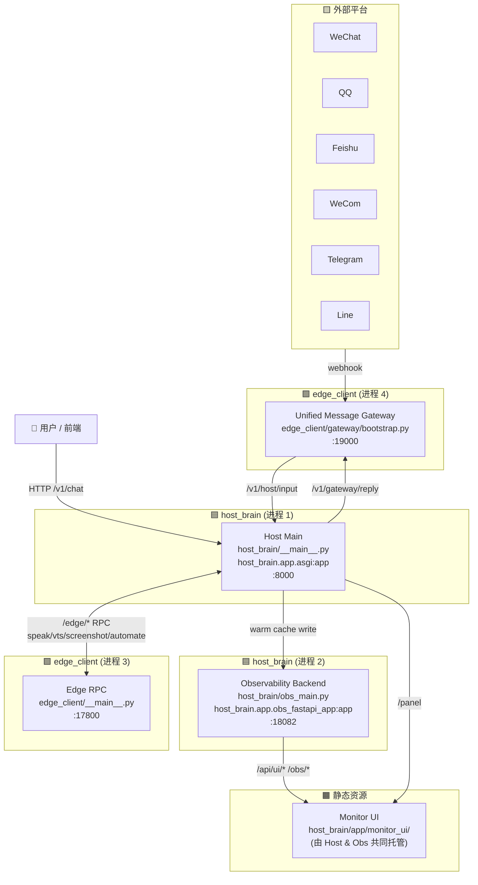

受众：MASTER
标题：图 01 — 运行面拓扑（5 个独立 ASGI / 进程）

版本：v1.0
日期：2026-05-30
归属：docs/50_project/arch/diagrams/

---

## 怎么读这张图

| 颜色 | 含义 |
|---|---|
| 🟦 蓝色 | 由本仓库 `host_brain/` 启动的进程 |
| 🟩 绿色 | 由本仓库 `edge_client/` 启动的进程 |
| 🟧 橙色 | 静态资源 / UI |
| 🟨 黄色 | 外部平台（微信 / QQ / 飞书 / 企业微信 / Telegram / Line 等） |

主入口都不再是单文件 `fastapi_app.py`，而是 `asgi.py + create_app()` 模式。

## 拓扑图

## 关键端点速查

| 运行面 | 端口 | 关键路由 |
|---|---:|---|
| Host Main | `8000` | `/v1/chat`、`/v1/host/input`、`/v1/edge/events`、`/v1/agent/*`、`/canon/*`、`/scheduler/*`、`/host-scheduler/*`、`/tools/*`、`/bond/*`、`/prompt-config/*`、`/api/ui/*`、`/obs/*`（兼容挂载）、`/health`、`/ready`、`/startup`、`/metrics`、`/panel` |
| Obs Backend | `18082` | `/obs/*`、`/api/ui/*`（独立 warm cache 后端） |
| Edge RPC | `17800` | `speak`、`barge_in`、`vts`、`screenshot`、`automate`、`visual_locate`、`proactive_push/proactive_messages`、`fallback/*`、`wx/*` |
| Unified Gateway | `19000` | webhook 平台适配（WeChat/QQ/Feishu/WeCom/Telegram/Line） |

## 代码锚点

| 节点 | 精确路径 |
|---|---|
| Host Main 入口 | `host_brain/__main__.py` → `uvicorn.run("host_brain.app.asgi:app", ...)` |
| Host Main 装配 | `host_brain/app/asgi.py:create_app()` → `host_brain/app/app_factory.py:create_host_fastapi_app()` → `host_brain/app/router_registry.py:register_host_routers(app)` |
| Obs Backend 入口 | `host_brain/obs_main.py` → `host_brain.app.obs_fastapi_app:app`（**单文件保留**） |
| Edge RPC 入口 | `edge_client/__main__.py` → `edge_client/app/fastapi_app.py` |
| Gateway 入口 | `edge_client/gateway/bootstrap.py` → `edge_client/gateway/server.py` |

## 不变量

1. Host Main 与 Obs 是**两个独立 ASGI app**，各自有进程和端口。
2. Edge RPC 与 Unified Gateway 在 `edge_client/` 下但部署互相独立，可分进程或合并启动。
3. 旧的 `host_brain/app/fastapi_app.py` 已删除；当前 Host Main 装配是 `asgi.py + app_factory.py + router_registry.py` 三件套。
4. Monitor UI 是静态资源，**两个 Host 端都能托管**，但 warm cache 类接口由 Obs Backend 提供。

---

## 已废弃节点（不得在新图中保留为活动）

| 节点 | 状态 |
|---|---|
| `host_brain/app/fastapi_app.py` | ❌ 已删除（v3.0 重写归档至 `_history/2026-04-22_arch_snapshot/`） |
| `host_brain/app/main.py` | ❌ 已迁移至 `__main__.py` |
| 单 ASGI 模式（Host + Obs 同进程） | ❌ 已拆为独立后端 |
