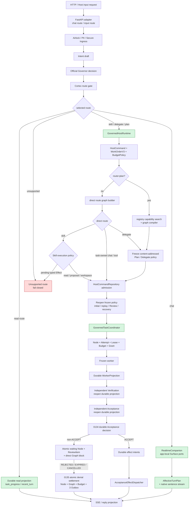
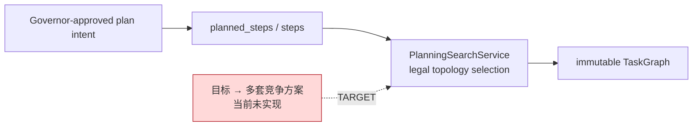

受众：PROJECT
标题：图 02——实时陪伴与 Governed Host 双主链

# 图 02：实时陪伴与 Governed Host 双主链

版本：v2.17
核对日期：2026-08-01

本文画的是当前双路径：普通 `chat` 直接进入 RealtimeCompanion；`skill/delegate/plan` 进入 Governed Runtime。两者共享 Cortex 的上下文和 Surface 的人格/情感表达，但不共享执行权限和事务开销。

## 请求总览



Plan 的合成节点还有一条不能省略的数据边：已验收 predecessor Node 先生成 canonical TaskResult artifact，TaskStore 解析其 payload，`NodeInputArtifactAttestation` 再绑定 artifact/receipt/payload digest bundle，final Chat 只消费这组证据。仅有拓扑依赖而没有该数据流不能通过固定结构验收。任意未被固定 predicate 覆盖的自然语言验收条件进入 durable Review，不会自动写成 `PASS`。

Plan 中 registry 标记 `require_confirm` 的 Skill 还有一条节点审批边：search 保留该候选并冻结 catalog provenance，compiler 将其重绑定到实际 Node ID，Scheduler 只让该节点进入 `WAITING_APPROVAL`。一次性 Review 消费后，0096 continuation 保留已 accepted predecessor 的历史 grant，并为未执行节点提供 claim-fenced 续签 grant；不会重新执行前驱。

当前 Plan policy 还冻结 Graph Budget digest、每个节点的 Registry
execution/budget/review/effect mode，并要求只有 final Chat 能编译 Graph
Acceptance Effect。当前 Delegate policy 则强制只读 `pentest_agent` 在
Attempt 创建前进入 durable Review，恢复后仍重验 target/adapter/mode
content address；其 adapter 返回的 Effect、Outbox 或 delivery claim 会在
COMMIT 前拒绝。

Skill policy gate 先把 canonical Host Registry 的 93 个条目分成 28 个只读、13 个 proposal-only、
3 个 post-Acceptance Workspace 和 49 个 blocked。只有前三类进入候选与
admission；blocked 条目也会在 frozen execution 再次拒绝，以覆盖旧图和
并发配置漂移。Catalog 存在不代表执行可用。
独立 Personality catalog 的 19 个 metadata 和动态 MCP Skill 均没有
governed manifest 入口。

需要模型的普通 Skill 还有一条预算数据边：Registry 的显式
`model_budget_required` 声明使 Task Runtime 从当前 Node/Attempt Budget 派生
typed model port；每次调用产生 canonical measurement，外层重验
request/Budget/Graph/Node/Attempt-bound attestation 后才写 `WorkerBudgetUsage`。
未声明的 Skill 不得到裸模型服务，因而不能绕开 Task Budget。

只读 Delegate 的预算边界与模型 Skill 不同：Task Runtime 先为 canonical Delegate dispatch 预扣一次工具调用；当前唯一 `pentest_agent` adapter 不取得任何模型、工具、嵌套派发或 Effect port，并返回完整 lineage-bound exact-zero usage attestation。Frozen worker 重验 command、graph/revision、node、attempt、node grant、target、adapter 和 invocation 后，才把内部零用量写入 `WorkerBudgetUsage`。字段缺失不能代替零证明，legacy Agent trace 也不进入结算。

## Task 节点时序

```mermaid
sequenceDiagram
    participant H as GovernedHostRuntime
    participant R as HostCommandRepository
    participant T as DurableTaskStore
    participant C as GovernedTaskCoordinator
    participant B as DurableExecutionHeartbeat
    participant W as Frozen Worker
    participant E as Effect Dispatcher

    H->>R: admit(command, WorkOrderV3, graph)
    R->>T: persist graph revision and nodes
    H->>C: execute_stream(graph)
    C->>T: claim READY node / create Attempt and Lease
    C->>T: reserve Budget
    alt pre-reservation resolver failed
        C->>T: atomic Attempt/Node/Graph/Lease terminal bundle + 4 Outboxes
        C-->>H: failed receipt
    else resolver ready
        C->>T: reserve operation idempotency
        C->>B: start + attach reservation
        C->>W: frozen node input + node-bound grant
        loop worker execution
            B->>T: renew Lease, then Reservation
            W-->>C: execution event / final result
            C->>B: checkpoint
        end
        C->>B: stop and join
        alt heartbeat failed
            C-->>H: RECOVERY_REQUIRED; never COMMIT
        else heartbeat healthy
            C->>T: COMMIT with latest Reservation version
            C->>C: verify(result)
            alt verified and accepted
                C->>T: atomic Acceptance decision + artifact + effect intents + Node
                C-->>H: accepted execution receipt
                H->>E: dispatch_graph(graph_id, revision)
                E->>T: commit or retain retryable effect receipt
            else review required
                C->>T: atomic Acceptance decision + WAITING node + ReviewItem
                opt direct single-node graph
                    C->>T: same UoW Graph BLOCKED + Graph Outbox
                end
                alt Review remains pending
                    C-->>H: durable Review gate
                else Review terminal denial
                    C->>T: 0135 atomic Node + Graph + graph Budget + 3 Outbox + settlement
                    C-->>H: REVIEW_DENIED; restart exact replay, no Worker re-entry
                end
            end
        end
    end
```

## 默认关闭的 fan-out 影子路径

```mermaid
flowchart TD
    POLICY["新生产 TaskGraph 默认 ATOMIC_GRAPH_SUCCESS_V1\n历史 legacy 只读兼容"] --> GATE["atomic capability + node-grant service\n+ parent grant：admission 前校验"]
    GATE --> SCHEMA["0090 + 0092；atomic 时 0091 schema ready?\nBudget / worker 前 fail-fast"]
    SCHEMA --> S["compute_dag_schedule"]
    S --> Q{"selected > 1 且\n有后继/剩余节点或 atomic policy?"}
    Q -->|"否 / 生产默认路径"| SEQ["顺序执行"]
    Q -.->|"bounded_fanout_enabled=true\n默认 OFF，生产未启用"| ACTIVATE["outer 在 spawn 前激活 Graph"]
    ACTIVATE --> LIMIT["BudgetPolicy concurrency 有界 child"]
    LIMIT --> NODE["child deferred authority\nAttempt / Node / Lease / Reservation\nBudget usage / EXCEEDED"]
    LIMIT --> MERGE["progress slots 默认 32，慢消费者反压\n每 child 预留 control slot"]
    NODE --> WAIT["正常非接受不 fail-fast\n等待所有已启动 sibling 落稳"]
    WAIT --> SNAP["live / ACTIVE crash-re-entry\ndurable Node/latest Attempt outcomes\n完整 snapshot + stable Attempt\n零 ACTIVE Lease / 未决 Reservation"]
    REENTRY["重启后 ACTIVE 多节点 Graph"] -.-> LIVE{"live Node / active Attempt / ACTIVE Lease?"}
    LIVE -->|"是"| INPROGRESS["GOVERNED_EXECUTION_IN_PROGRESS\n不 resolve worker / 不抢 authority"]
    LIVE -->|"否"| SNAP
    SNAP --> CANON["整个 admitted Graph durable terminal Nodes\n+ latest stable Attempts / Reservation / BudgetUsage\n含非 selected RETRY_PENDING\n重建 live/re-entry 同一 payload/ref"]
    CANON --> DECIDE{"批次结果"}
    DECIDE_NOTE["优先级：recovery > Budget > failure > review"] -.-> DECIDE
    DECIDE -->|"failure"| FAILED["Graph FAILED\nBudget RELEASED"]
    DECIDE -->|"Budget overrun"| BUDGET["Graph BLOCKED\nBudget RELEASED"]
    DECIDE -->|"post-review"| REVIEW["Graph BLOCKED\nBudget 保持 ACTIVE"]
    DECIDE -->|"全部 ACCEPTED"| SUCCESS_POLICY{"ATOMIC_GRAPH_SUCCESS_V1?"}
    SUCCESS_POLICY -->|"否"| ORDER["按 admission 顺序校验 outcomes\n继续调度"]
    SUCCESS_POLICY -->|"是"| PROJECTION["所有 Node/Attempt/Reservation ACCEPTED\ncanonical projection 重算 digest\n绑定 command/request/route/target/grant"]
    PROJECTION --> RESULT["仅显式 result projection\n编译全图 effects 与公开结果"]
    RESULT --> SUCCESS_UOW["单 UoW：Graph COMPLETED + Budget CONSUMED\n两 Outbox + effects + 0091 decision"]
    SUCCESS_UOW --> OUTBOX_REV
    SUCCESS_UOW --> REPLAY["completed replay 只读 0091\n双响应丢失重读 terminal authority"]
    NODE -->|"Operation Reservation 未决"| RECOVERY["RECOVERY_REQUIRED\nGraph/Budget 不终结"]
    FAILED --> ATOMIC["Graph + 可选 Budget + Outbox\n+ 0090 canonical v2 decision\n单事务 + exact replay"]
    BUDGET --> ATOMIC
    REVIEW --> ATOMIC
    ATOMIC --> MATCH["terminal replay：Graph target + status_version 精确匹配\nReview BLOCKED→FAILED 不泄漏旧 ref"]
    BUDGET --> USAGE["selected=BUDGET_BLOCKED 绑定 rejected usage\n被动 blocked sibling 无需本地 usage"]
    ATOMIC --> OUTBOX_REV["0095 Graph revision + payload\nID/key 升级前后稳定\n歧义 producer 整笔失败"]
    OUTBOX_REV --> PUB["0093 durable Outbox claim\nboot/recovery-scoped 唯一 owner"]
    PUB --> APPEND["逐条：owner + token + expiry + 单调 fence\n幂等 append runtime event"]
    APPEND --> COMPLETE["fenced complete\n失败 release + durable backoff/error"]
    APPEND --> EVENT_REV["新 Event = graph_id@revision\nsource_ref 一 Outbox 一 Event\nlegacy 重投 exact replay"]
    TAKEOVER["后台 worker 按 revisioned aggregate-head wake 自动续投\nexpired claim 可 takeover\n同 revision 严禁越过 predecessor"] -.-> PUB
    TAKEOVER --> DRAIN["canonical total_pending=0 才 DRAINED\nclaim/backoff/blocked backlog 为 DEFERRED"]
    ORDER --> FANIN["依赖均 ACCEPTED 后推进 fan-in"]
    OFF["atomic_graph_success_enabled 生产默认 ON\nbounded_fanout_enabled 独立默认 OFF"] -.-> GATE
    CANCEL_UI["Task Runtime UI\nexact Graph revision"] -.-> CANCEL_BFF["同源 Operator BFF\ntask_graph.cancel"]
    CANCEL_BFF -.-> CANCEL_GATE["Operator Command Gateway\nobs:write + task-runtime:cancel"]
    CANCEL_OFF["feature flag 默认 OFF\n非 ENFORCE / Gateway 不可用\n启动 fail closed"] -.-> CANCEL_GATE
    CANCEL_GATE -.-> CANCEL_ENTRY["共享 Secure Ingress verifier\ncommitted audit/claim + canonical body"]
    CANCEL_ENTRY -.-> CANCEL_ROUTE["immutable HostCommand surface\nHost / Internal / Scheduler"]
    CANCEL_ROUTE -.-> CANCEL_INTENT["0092 phase 1 UoW\nintent + Graph BLOCKED + durable fences"]
    CANCEL_ROUTE -.-> CANCEL_UNCERTAIN["下游异常后读 exact durable intent\n无 intent=未执行；匹配=可能已执行\n无法证明则保守 uncertain"]
    CANCEL_INTENT -.-> CANCEL_LOCAL["intent 提交后才 cancel/join\n本地 child + heartbeat"]
    CANCEL_INTENT -.-> CANCEL_RECON["active ownership / operation / effect / review\nadvance + reconciliation gate"]
    CANCEL_SCAN["0094 composition-owned scanner\nrecovery-scoped owner"] -.-> CANCEL_CLAIM["coordination claim + heartbeat\nexpired takeover / stale fence"]
    CANCEL_CLAIM -.-> CANCEL_ADMISSION["HostCommandRepository exact revision\n重建 replay admission"]
    CANCEL_ADMISSION -.-> CANCEL_RECON
    CANCEL_RECON -.->|"durable facts 未收敛"| CANCEL_DEFER["durable defer\n不伪造 cancellation 完成"]
    EFFECT_FAILED["Effect FAILED\nhandler/transport 失败 ≠ NO_SIDE_EFFECT"] -.-> CANCEL_RECON
    EFFECT_RETRY["legacy/imported/corrupt retry PENDING\ncanonical fence path 不可达；fail closed"] -.-> CANCEL_RECON
    EFFECT_VIRGIN["virgin PENDING\ncount/fence/version=0，无 reason/error"] -.-> EFFECT_RULE
    EFFECT_FAILED -.-> CANCEL_DEFER
    EFFECT_COMMITTED["Effect COMMITTED + durable receipt\n自动 COMMITTED_EVIDENCE"] -.-> CANCEL_RECON
    OP_RECON["Operation 签名对账 WIRED_DEFAULT_OFF\nservice + composition + OBS + public key"] -.-> CANCEL_RECON
    LEGACY_EFFECT["legacy FAILED_EVIDENCE 或 retry-PENDING+CANCELLED\n待审计、修复/隔离；FINALIZED replay 不改写"] -.-> HISTORY
    CANCEL_DEFER -.-> CANCEL_SCAN
    CANCEL_RECON -.-> CANCEL_FINAL["phase 2 UoW\nGraph CANCELLED + Budget + Outbox + decision"]
    CANCEL_FINAL -.-> CANCEL_COMPLETE["0092 FINALIZED + decision 后\n清理 0094 协调行"]
    CANCEL_FINAL -.-> OUTBOX_REV
    EFFECT_RULE["accepted NODE effect 继续 delivery\n其他未授权 NODE/GRAPH effect 被 fence"] -.-> CANCEL_RECON
    FIRST["0091 success / 0092 cancel\nfirst-writer-wins + exact replay"] -.-> CANCEL_INTENT
    TERMINAL_GUARD["BLOCKED / FAILED / CANCELLED / COMPLETED\n+ 未结 Budget：Runtime 重入不静默修复"] -.-> TERMINAL_INV["0099 recover_startup 后单次最多 10,000 Graph\nappend-only case/proof/supersession；migration schema-only"]
    TERMINAL_INV -.-> TERMINAL_AUTO["仅 FAILED + exact atomic failure bundle\n+ 唯一 graph-scope ACTIVE/EXCEEDED Budget\n显式 default-OFF system auto"]
    TERMINAL_INV -.-> TERMINAL_SIGNED["BLOCKED failure / legacy CANCELLED\nEd25519 signed task_terminal.reconcile"]
    TERMINAL_INV -.-> TERMINAL_QUARANTINE["child/missing/multi Budget 或完整终态漂移\nquarantine only"]
    TERMINAL_INV -.-> TERMINAL_FENCE["unresolved current case: graph-wide fence\nGraph/cancel + Budget transition/consume/usage/retry\n0099 proof UoW only bypass"]
    TERMINAL_FENCE -.-> TERMINAL_CHAIN["old case -> current replacement\nsupersession chain -> trusted proof"]
    REVIEW_QUEUE["0096 Review terminal mutation + enqueue\n同一事务；不复制业务 status"] --> REVIEW_CLAIM["claim + heartbeat + expired takeover\nowner/token/expiry/monotonic fence"]
    REVIEW_CLAIM --> REVIEW_ROUTE["immutable HostCommand surface\n重入 Host/Internal/Scheduler"]
    REVIEW_ROUTE --> REENTRY
    PREVIEW["WAITING_APPROVAL 合法 attempt_id=null\nPOST 仍绑定原 SUCCEEDED Attempt"] --> SNAP

    style LIMIT fill:#fff3cd,stroke:#a87500
    style OFF fill:#fff3cd,stroke:#a87500
    style TAKEOVER fill:#d1e7dd,stroke:#177245
    style OUTBOX_REV fill:#d1e7dd,stroke:#177245
    style EVENT_REV fill:#d1e7dd,stroke:#177245
    style CANCEL_ENTRY fill:#fff3cd,stroke:#a87500
    style CANCEL_UI fill:#fff3cd,stroke:#a87500
    style CANCEL_BFF fill:#fff3cd,stroke:#a87500
    style CANCEL_GATE fill:#fff3cd,stroke:#a87500
    style CANCEL_OFF fill:#fff3cd,stroke:#a87500
    style CANCEL_ROUTE fill:#fff3cd,stroke:#a87500
    style CANCEL_UNCERTAIN fill:#fff3cd,stroke:#a87500
    style CANCEL_INTENT fill:#fff3cd,stroke:#a87500
    style CANCEL_LOCAL fill:#fff3cd,stroke:#a87500
    style CANCEL_SCAN fill:#fff3cd,stroke:#a87500
    style CANCEL_CLAIM fill:#fff3cd,stroke:#a87500
    style CANCEL_ADMISSION fill:#fff3cd,stroke:#a87500
    style CANCEL_RECON fill:#fff3cd,stroke:#a87500
    style CANCEL_DEFER fill:#fff3cd,stroke:#a87500
    style EFFECT_FAILED fill:#fff3cd,stroke:#a87500
    style EFFECT_RETRY fill:#fff3cd,stroke:#a87500
    style EFFECT_VIRGIN fill:#d1e7dd,stroke:#177245
    style EFFECT_COMMITTED fill:#d1e7dd,stroke:#177245
    style OP_RECON fill:#fff3cd,stroke:#a87500
    style LEGACY_EFFECT fill:#fff3cd,stroke:#a87500
    style CANCEL_FINAL fill:#fff3cd,stroke:#a87500
    style CANCEL_COMPLETE fill:#fff3cd,stroke:#a87500
    style EFFECT_RULE fill:#fff3cd,stroke:#a87500
    style FIRST fill:#fff3cd,stroke:#a87500
    style TERMINAL_GUARD fill:#fff3cd,stroke:#a87500
    style TERMINAL_INV fill:#fff3cd,stroke:#a87500
    style TERMINAL_AUTO fill:#fff3cd,stroke:#a87500
    style TERMINAL_SIGNED fill:#fff3cd,stroke:#a87500
    style TERMINAL_QUARANTINE fill:#fff3cd,stroke:#a87500
    style TERMINAL_FENCE fill:#fff3cd,stroke:#a87500
    style TERMINAL_CHAIN fill:#fff3cd,stroke:#a87500
    style REVIEW_QUEUE fill:#d1e7dd,stroke:#177245
    style REVIEW_CLAIM fill:#d1e7dd,stroke:#177245
    style REVIEW_ROUTE fill:#d1e7dd,stroke:#177245
    style PREVIEW fill:#d1e7dd,stroke:#177245
    style RECOVERY fill:#fff3cd,stroke:#a87500
    style INPROGRESS fill:#fff3cd,stroke:#a87500
```



0090/B4 与 0091/B5 的既有语义保持不变。0092 intent/decision 仍是取消业务 authority；0098 只处理 Effect 不确定性。0099 另行冻结 append-only case/proof/supersession，readiness 比较 3 table/4 index/10 trigger canonical SQL 并复核 Python codec。已 inventoried 未决 current case graph-wide 围栏普通 Graph/cancellation request 与 Budget writer，仅 0099 UoW bypass。隔离真实 SQLite restart canary 已证明默认 exact-auto 修复唯一 FAILED 半状态，同时 signed-required CANCELLED 不被自动改写并阻断 readiness。这不是通用恢复器；Operator HTTP、Operation/Effect、部署 inventory/key lifecycle canary 未运行，取消整体仍保持 `PRODUCTION_OFF`。

## Plan 分支的真实边界



当前 Host Plan 不会新增步骤、发明工具组合或比较多套方案。搜索内核存在，但这里主要用于选择完整合法的拓扑顺序。

Code 的 D16 动态 catalog 不接入上图的 Host Plan 实线。它只在纯虚拟快照内生成 `inspect → registered patch → unit/rollback`，随后可将重验的 selected inputs 交给 compiler；没有 worktree、模型/工具/测试、admission、receipt 或生产影响。D17/D18 也没有接入该实线：它仅在实验 adapter 内从 clean protected source 创建 private bare clone 和 baseline/search detached worktree；仓库自有 trusted arm 才能使用 lower-case repository-relative ACL API，cleanup 后复核 source fingerprint。D18 将 preregistration、双臂 evidence/outcome、`VERIFIED_CLEAN` 和 terminal receipt 写入 0106 durable ledger。D19 只在预注册时让固定 `python -m pytest -q <repo-relative-test>` 在每条 worktree 的 shell-free child 中运行，拒 paired test/wall budget 超限并写 path-free verifier receipt；该 service 不选择 winner 或赋予生产 authority。API/账本都无法形成独立信任域，也没有 OS/container/filesystem/network sandbox、模型/工具/token/cost budget 或收益，故同样不能画成 Host 已具备目标规划。

## 当前例外与缺口

1. `task_progress`、`recent_turn` 已走严格无副作用的 durable projection，不创建 Task，也不写 visible conversation 或任何派生 Effect；未知 route 直接拒绝。
2. Scheduler 与 Internal 已接入同一 canonical admission；Internal v2 只保留在授权验证后的 executor 兼容边界。
3. Cortex 不再保留 contextual-session/style、clarification、LLM unavailable 或 async post-process 的 direct-reply branch。canonical route 必须由 Governed Runtime 支持，之后只传递冻结上下文给 TaskGraph。
4. `PARTIAL_B5C_DURABLE_CANCELLATION_SHADOW / PRODUCTION_OFF`：0091 atomic success 到 0099 terminal reconciliation 均有分范围证据；另有 scheduler-owned 多节点 exact COMMITTED checkpoint continuation，但只覆盖 `EXACT_ACCEPTED / EXACT_REJECTED / MISSING`，不重放 worker。0099 只允许带唯一 graph-scope Budget 的 exact FAILED bundle 显式 auto；child/missing/multi Budget 与完整终态漂移必须 quarantine，不代表 general/multi-node/pre-budget recovery。部署 inventory/remediation、凭据/key lifecycle 与真实 canary仍未完成。
5. Acceptance effect 是可恢复的最终一致，不是所有外部系统共享一个事务。
6. 启动按 migration/readiness（含0099）→ `recover_startup` → 0099 单次最多 10,000 个 terminal Graph inventory → 可选 default-off exact auto → recovery outbox publish → outbox worker → surface runtime activation → cancellation/Review workers 排序，异常 fail closed。0099 不扫描并重做 worker；它只处理已终态 Graph 的显式 case/proof/supersession。

### Agent 多轮预算补充

Internal 与 Agent Skill 进入模型执行前必须携带冻结 Task Budget 的
graph/revision/node/attempt guard。Skill 的 guard 来源先被纳入 sealed
capability authority；只读 V2 WorkOrder 随后由 server context 重建为 V3。
每次 ModelAttempt 后只依据 canonical measurement 缩小下一次额度，不能用
Agent 的环境 `max_steps/timeout` 重置 Task allowance。当前链仍缺真实
provider canary、波次集成和七路线 commit-bound receipt。

## 代码锚点

- HTTP 装配：`host_brain/app/app_factory.py`、`host_brain/app/chat_routes.py`、`host_brain/app/chat_handler.py`
- Cortex 分流：`host_brain/agent_runtime/cortex_runtime.py`
- Governed Host adapter：`host_brain/app/governed_task_adapter.py`
- Direct contracts：`host_brain/orchestration/host_route_contracts.py`
- Plan search/compiler：`host_brain/orchestration/plan_intent_search.py`、`planning_graph_compiler.py`
- Admission：`host_brain/orchestration/planning_admission.py`、`host_brain/persistence/host_command_repository.py`
- Task execution：`host_brain/task_runtime/coordinator.py`、`host_brain/task_runtime/heartbeat.py`、`host_brain/task_runtime/dag_scheduler.py`
- Read projection：`host_brain/agent_runtime/read_routes.py`
- Node grant：`host_brain/orchestration/node_grants.py`
- Acceptance effects：`host_brain/task_runtime/acceptance_effects.py`、`acceptance_effect_dispatcher.py`
- Retired Executive guards：`host_brain/executive_runtime/runtime.py`、`host_brain/app/executive_runtime.py`（旧 `route_planning`、`conversation_execution`、application `composition`、application port wiring、legacy diagnostic direct-skill matrix 和 Executive 内 Forge override call 已删除；独立 Forge `runtime-match` 仍待退役）
