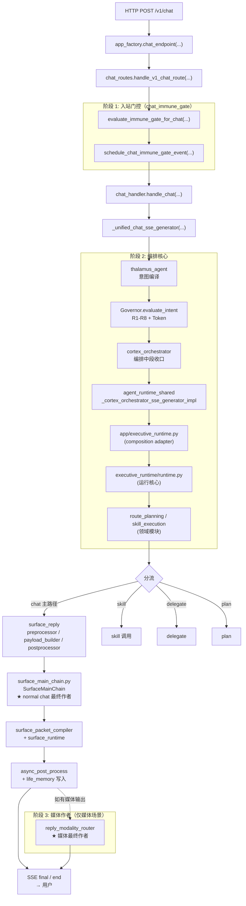
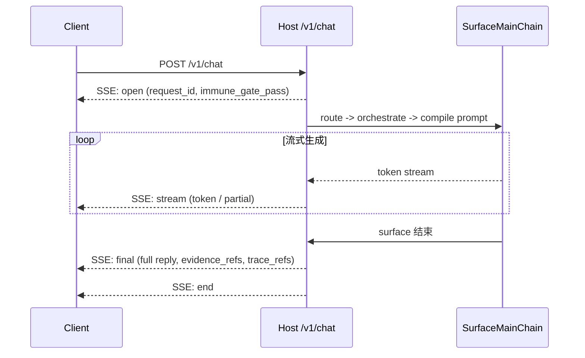

受众：MASTER
标题：图 02 — `/v1/chat` 主链全流程（HTTP→SSE 三阶段）

版本：v1.0
日期：2026-05-30
归属：docs/50_project/arch/diagrams/

---

## 怎么读这张图

主链分 3 大阶段：
1. **HTTP 装配 + 入站门控**（chat_routes / chat_immune_gate）
2. **编排核心**（cortex_orchestrator → executive 三层 → surface_reply → SurfaceMainChain）
3. **后处理与媒体作者**（async_post_process + reply_modality_router）

SSE 流也分 3 帧族：`open` → `stream` → `final/end`。

## 总览（HTTP → SSE）

## SSE 三阶段帧族

## 代码锚点（按执行顺序）

| 顺序 | 文件 | 关键函数 | 行号 |
|---|---|---|---:|
| 1 | `host_brain/app/asgi.py` | `app = create_app()` | — |
| 2 | `host_brain/app/app_factory.py` | `create_host_fastapi_app(...)`、`chat_endpoint(...)` | — |
| 3 | `host_brain/app/router_registry.py` | `register_host_routers(app)`、`wire_route_providers(...)` | — |
| 4 | `host_brain/app/chat_routes.py` | `handle_v1_chat_route(...)` | 68 |
| 5 | `host_brain/app/chat_immune_gate.py` | `evaluate_immune_gate_for_chat(...)`、`schedule_chat_immune_gate_event(...)` | — |
| 6 | `host_brain/app/chat_handler.py` | `handle_chat(...)`、`_unified_chat_sse_generator(...)` | 253 |
| 7 | `host_brain/app/cortex_orchestrator.py` | 编排中段收口 | — |
| 8 | `host_brain/app/agent_runtime_shared.py` | `_cortex_orchestrator_sse_generator_impl(...)` | 3720 |
| 9 | `host_brain/app/executive_runtime.py` | `executive_runtime_sse_generator(...)` | canonical runtime 应用入口 |
| 10 | `host_brain/executive_runtime/runtime.py` | `_executive_runtime_core_impl(...)`、`stream_chat_route(...)` | — |
| 11 | `host_brain/executive_runtime/route_planning.py`、`skill_execution.py` | 路由判定与 legacy Skill/Plan 执行 | — |
| 12 | `host_brain/app/surface_reply_runtime.py` (3361 行) | 入口 | — |
| 13 | `host_brain/app/surface_reply_preprocessor.py` (1623 行) | 预处理 | — |
| 14 | `host_brain/app/surface_main_chain.py` (1363 行) | payload 构建 | — |
| 15 | `host_brain/app/surface_reply_postprocessor.py` | 后处理 | — |
| 16 | `host_brain/app/surface_main_chain_adapter.py` | adapter | — |
| 17 | `host_brain/persona/surface_main_chain.py` | **SurfaceMainChain（normal chat 最终作者）** | — |
| 18 | `host_brain/persona/surface_packet_compiler.py` | packet 编译 | — |
| 19 | `host_brain/persona/surface_runtime.py` (1995 行) | runtime | — |
| 20 | （媒体路径）`host_brain/persona/reply_modality_router.py` | **媒体最终作者** | — |

## 不变量

1. `/v1/chat` 入口已不在单文件 `fastapi_app.py`，现由 `app_factory.chat_endpoint(...)` 接住。
2. **normal chat 文本最终作者 = SurfaceMainChain**；旧 `prompt_builder` 链路降级为辅助通路（只能注入 facts/state/memory/perception，不能写最终回复）。
3. **媒体最终作者 = `reply_modality_router`**，不是 surface chain。
4. SSE 三阶段帧族不变：`open` → `stream` → `final/end`。
5. immune gate 在 `chat_immune_gate.py` 中**先评估再排程事件**，不再混在 chat_handler 里。
6. Executive 严格三层：`router`（薄壳）→ `runtime`（路由薄层）→ `runtime_core`（决策核心）。
7. surface_reply 已拆为 `preprocessor / payload_builder / postprocessor` 三件套 + adapter。

## 已废弃路径

| 旧路径 | 当前事实 |
|---|---|
| `top_agent.py` | ❌ 已删除 |
| `dispatch_agent.py` | ❌ 已删除 |
| `chat_handler_complex.py` | ❌ 已删除 |
| `graph/main_chain.py` | ❌ 已删除 |
| `SceneRouter.route_sse()` | ❌ 已删除 |
| `prompt_builder` 作为最终文本作者 | ❌ 已降级，只作辅助 |
