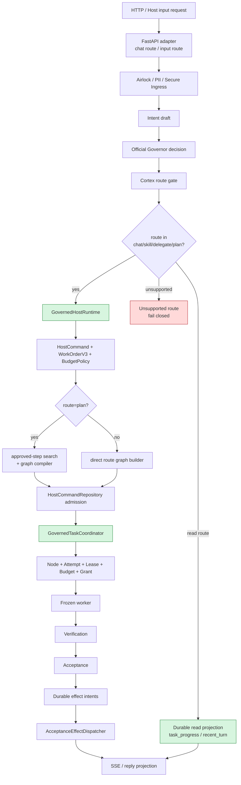
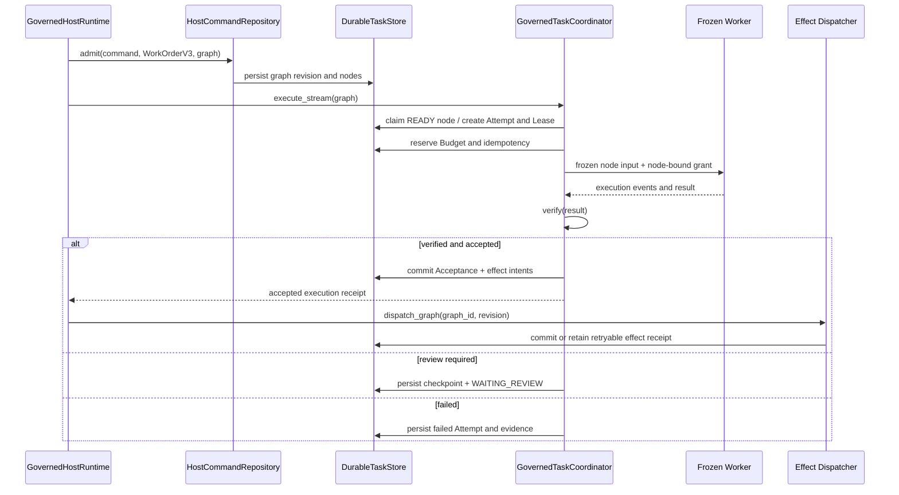
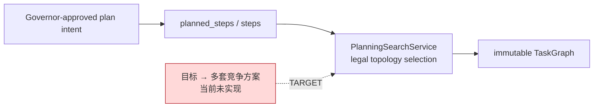

受众：PROJECT
标题：图 02——Governed Host 请求主链

# 图 02：Governed Host 请求主链

版本：v2.1
核对日期：2026-07-15

本文画的是 `chat/skill/delegate/plan` canonical route。它替换了旧图中“所有请求都由 Executive Runtime 决策并直接后处理”的错误主链。

## 请求总览

## Task 节点时序

## Plan 分支的真实边界

当前 Host Plan 不会新增步骤、发明工具组合或比较多套方案。搜索内核存在，但这里主要用于选择完整合法的拓扑顺序。

## 当前例外与缺口

1. `task_progress`、`recent_turn` 已走 durable projection，不创建 Task；未知 route 直接拒绝。
2. Scheduler 与 Internal 已接入同一 canonical admission；Internal v2 只保留在授权验证后的 executor 兼容边界。
3. B1 store/coordinator 子集已接 decision、原子 claim、到期 promotion、store retry deadline/cancel 和 concurrency fence；生产失败尚未进入 retry，真正并行、retry budget、heartbeat/takeover 与 Review continuation 尚未完成。
4. Acceptance effect 是可恢复的最终一致，不是所有外部系统共享一个事务。

## 代码锚点

- HTTP 装配：`host_brain/app/app_factory.py`、`host_brain/app/chat_routes.py`、`host_brain/app/chat_handler.py`
- Cortex 分流：`host_brain/agent_runtime/cortex_runtime.py`
- Governed Host adapter：`host_brain/app/governed_task_adapter.py`
- Direct contracts：`host_brain/orchestration/host_route_contracts.py`
- Plan search/compiler：`host_brain/orchestration/plan_intent_search.py`、`planning_graph_compiler.py`
- Admission：`host_brain/orchestration/planning_admission.py`、`host_brain/persistence/host_command_repository.py`
- Task execution：`host_brain/task_runtime/coordinator.py`、`host_brain/task_runtime/dag_scheduler.py`
- Read projection：`host_brain/agent_runtime/read_routes.py`
- Node grant：`host_brain/orchestration/node_grants.py`
- Acceptance effects：`host_brain/task_runtime/acceptance_effects.py`、`acceptance_effect_dispatcher.py`
- Retired Executive guard：`host_brain/executive_runtime/runtime.py`
