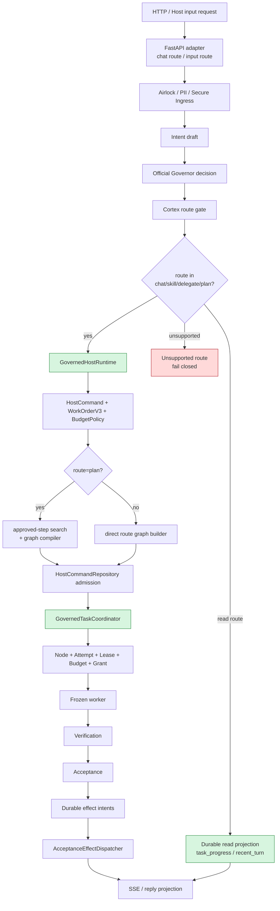
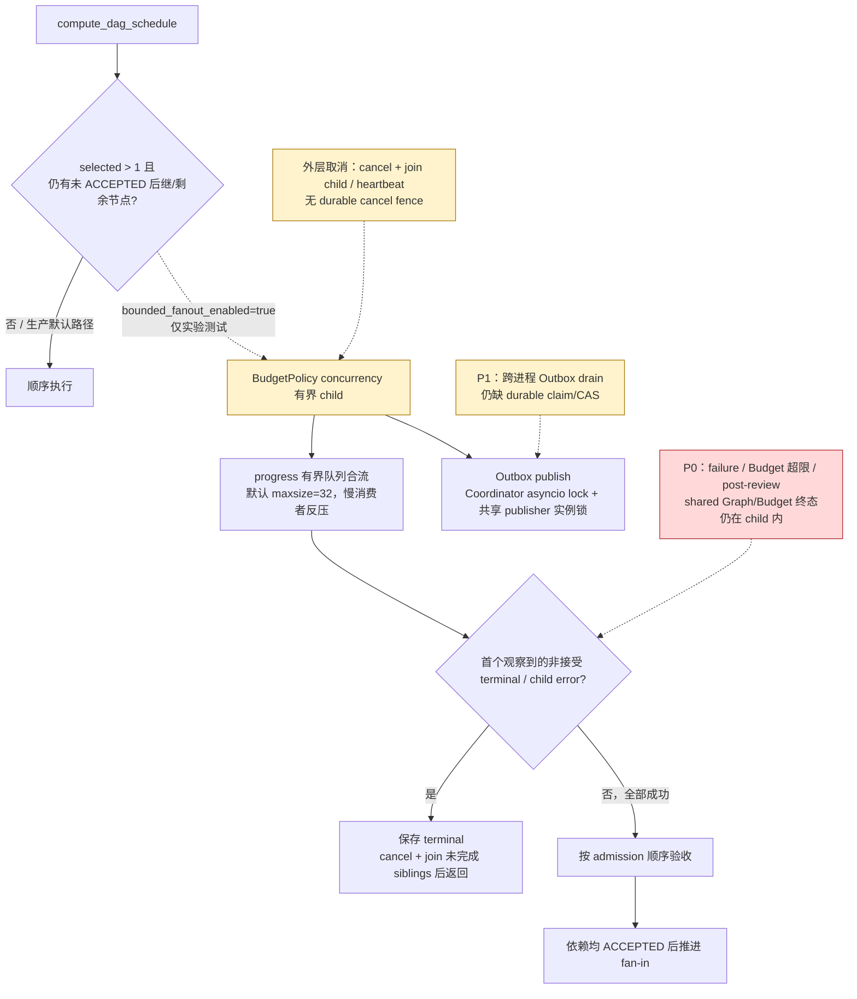
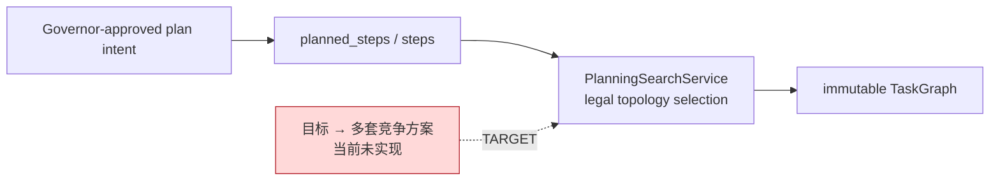

受众：PROJECT
标题：图 02——Governed Host 请求主链

# 图 02：Governed Host 请求主链

版本：v2.3
核对日期：2026-07-15

本文画的是 `chat/skill/delegate/plan` canonical route。它替换了旧图中“所有请求都由 Executive Runtime 决策并直接后处理”的错误主链。

## 请求总览



## Task 节点时序

```mermaid
sequenceDiagram
    participant H as GovernedHostRuntime
    participant R as HostCommandRepository
    participant T as DurableTaskStore
    participant C as GovernedTaskCoordinator
    participant B as DurableExecutionHeartbeat
    participant W as Frozen Worker
    participant E as Effect Dispatcher

    H->>R: admit(command, WorkOrderV3, graph)
    R->>T: persist graph revision and nodes
    H->>C: execute_stream(graph)
    C->>T: claim READY node / create Attempt and Lease
    C->>T: reserve Budget
    alt pre-reservation resolver failed
        C->>T: atomic Attempt/Node/Graph/Lease terminal bundle + 4 Outboxes
        C-->>H: failed receipt
    else resolver ready
        C->>T: reserve operation idempotency
        C->>B: start + attach reservation
        C->>W: frozen node input + node-bound grant
        loop worker execution
            B->>T: renew Lease, then Reservation
            W-->>C: execution event / final result
            C->>B: checkpoint
        end
        C->>B: stop and join
        alt heartbeat failed
            C-->>H: RECOVERY_REQUIRED; never COMMIT
        else heartbeat healthy
            C->>T: COMMIT with latest Reservation version
            C->>C: verify(result)
            alt verified and accepted
                C->>T: commit Acceptance + effect intents
                C-->>H: accepted execution receipt
                H->>E: dispatch_graph(graph_id, revision)
                E->>T: commit or retain retryable effect receipt
            else review required
                C->>T: persist checkpoint + WAITING_REVIEW
            end
        end
    end
```

## 默认关闭的 fan-out 影子路径



实验证据证明 concurrency=2 的 root 真重叠、concurrency=1 保持串行、size=1 时慢消费者会反压 child；admission 第二节点失败时会返回该 durable terminal、取消第一 sibling、阻止 join 且不产生 `OPERATION_COMMITTED`；外层取消也没有 child/heartbeat task 泄漏。同进程 Host/Internal/Scheduler 共享的 publisher 实例以 `threading.Lock` 串行完整 drain，但跨进程仍缺 durable claim/CAS。该图是 shadow，不是 production wiring：构造默认值为 `false`，生产 composition 未开启；shared Graph/Budget terminal authority 和 terminal-leaf batch 仍未闭环。

## Plan 分支的真实边界



当前 Host Plan 不会新增步骤、发明工具组合或比较多套方案。搜索内核存在，但这里主要用于选择完整合法的拓扑顺序。

## 当前例外与缺口

1. `task_progress`、`recent_turn` 已走 durable projection，不创建 Task；未知 route 直接拒绝。
2. Scheduler 与 Internal 已接入同一 canonical admission；Internal v2 只保留在授权验证后的 executor 兼容边界。
3. `PARTIAL_B2_SHADOW_FANOUT` 在 B1 安全重试/heartbeat 上增加默认关闭的非 terminal-leaf 有界 fan-out；生产未启用。共享 Graph/Budget 终态、durable cancel fence、built-in retry marker、在线 takeover、即时 reconciliation 与 Review continuation 尚未完成。
4. Acceptance effect 是可恢复的最终一致，不是所有外部系统共享一个事务。
5. 启动按 migration → `recover_startup` → recovery outbox publish → runtime activation 排序，恢复异常 fail closed；配置逻辑 owner 会派生为每次 container construction 唯一的 execution owner。这不代表自动 continuation、在线 takeover 或即时 reconciliation 已完成。

## 代码锚点

- HTTP 装配：`host_brain/app/app_factory.py`、`host_brain/app/chat_routes.py`、`host_brain/app/chat_handler.py`
- Cortex 分流：`host_brain/agent_runtime/cortex_runtime.py`
- Governed Host adapter：`host_brain/app/governed_task_adapter.py`
- Direct contracts：`host_brain/orchestration/host_route_contracts.py`
- Plan search/compiler：`host_brain/orchestration/plan_intent_search.py`、`planning_graph_compiler.py`
- Admission：`host_brain/orchestration/planning_admission.py`、`host_brain/persistence/host_command_repository.py`
- Task execution：`host_brain/task_runtime/coordinator.py`、`host_brain/task_runtime/heartbeat.py`、`host_brain/task_runtime/dag_scheduler.py`
- Read projection：`host_brain/agent_runtime/read_routes.py`
- Node grant：`host_brain/orchestration/node_grants.py`
- Acceptance effects：`host_brain/task_runtime/acceptance_effects.py`、`acceptance_effect_dispatcher.py`
- Retired Executive guard：`host_brain/executive_runtime/runtime.py`
