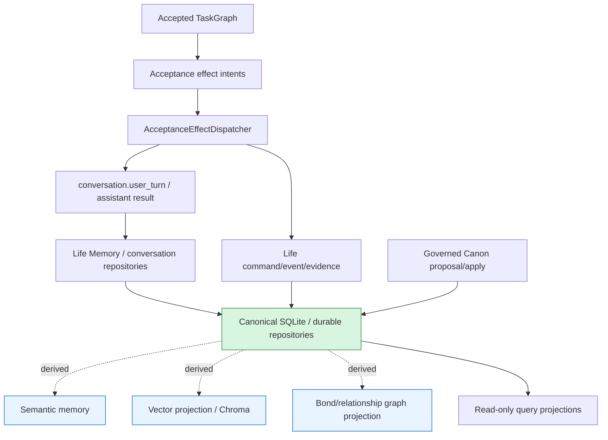
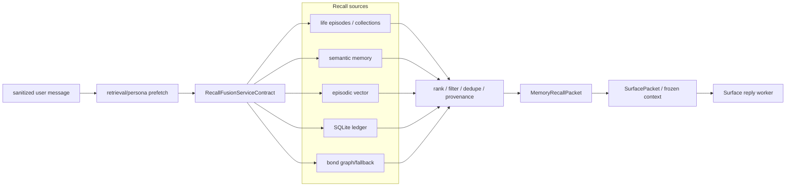
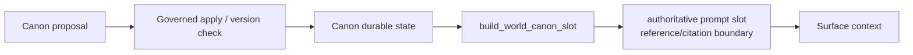
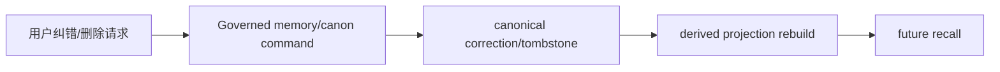

受众：PROJECT
标题：图 03——记忆、Canon 与召回数据流

# 图 03：记忆、Canon 与召回数据流

版本：v2.0
核对日期：2026-07-15

本图区分三件容易混淆的事：durable 事实写入、衍生索引、对话时召回。向量相似度、语义摘要和图关系可以帮助找材料，但不能独立证明事实。

## 写入与投影

Acceptance 与 effect intent 登记属于 TaskStore 的原子操作；具体 conversation、Life 或 transport handler 随后可独立重试。因此“Task 已接纳”和“所有衍生索引都已更新”不是同一时刻。

## 对话召回

召回结果是带来源和置信边界的上下文材料。它必须经过过滤、去重、时间和人物范围约束，再进入冻结的 worker context；检索服务本身不写最终回复。

## Canon 进入上下文

Canon 是受治理的设定/知识材料，不等于“现实中已经发生的事件”。Prompt slot 必须保留引用性质和安全标记，不能因为被放进 authoritative slot 就伪造执行证据。

## 纠错和删除

纠错应先落 canonical correction、版本或 tombstone，再使语义/向量/图投影失效或重建。只删向量而保留事实 writer、或只改 UI 显示，都不构成完整纠错。

## Authority 规则

| 数据 | 可作为事实吗 | 要求 |
|---|---|---|
| Accepted conversation/Life event | 可以 | 必须有 request/graph/effect lineage |
| Canon version | 作为 Canon 引用可以 | 不得冒充真实 outcome |
| Semantic summary | 不能单独作为事实 | 必须能回溯来源记录 |
| Vector hit | 不能 | 只是候选检索信号 |
| Bond graph relation | 依赖其来源 | 图投影不能覆盖 canonical event |
| 模型生成的“记忆” | 不能直接写入 | 必须形成 proposal/evidence 并走治理 |

## 代码锚点

- Acceptance effect 编译：`host_brain/task_runtime/acceptance_effects.py`
- Effect dispatcher：`host_brain/task_runtime/acceptance_effect_dispatcher.py`
- 生产 effect handlers：`host_brain/app/acceptance_effect_handlers.py`
- Conversation writer：`host_brain/app/conversation_writer.py`
- Life memory：`host_brain/memory/life_memory/`、`host_brain/persistence/life_memory_repository.py`
- Recall service：`host_brain/retrieval/recall_fusion.py`、`recall_fusion_stores.py`
- Surface memory packet：`host_brain/persona/surface_memory_recall.py`
- Surface packet：`host_brain/persona/surface_packet_compiler.py`
- Canon application：`host_brain/canon/`、`host_brain/persistence/canon_repository.py`、`canon_apply_repository.py`
- Canon prompt slot：`host_brain/core/prompt_context.py::build_world_canon_slot`

## 当前限制

- 非 canonical compatibility route 仍可能使用旧 conversation writer 和异步后效。
- Knowledge OS 尚未统一 provenance、staleness、conflict 和 Decision Record 生命周期。
- 可选向量/图服务的完整生产可用性取决于环境，缺失时必须显式降级。
