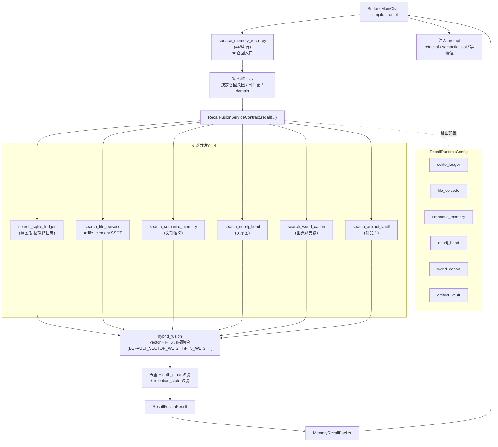
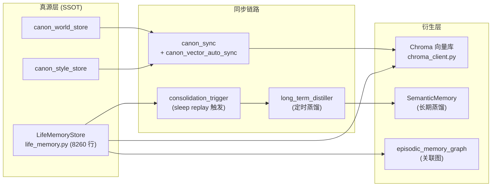
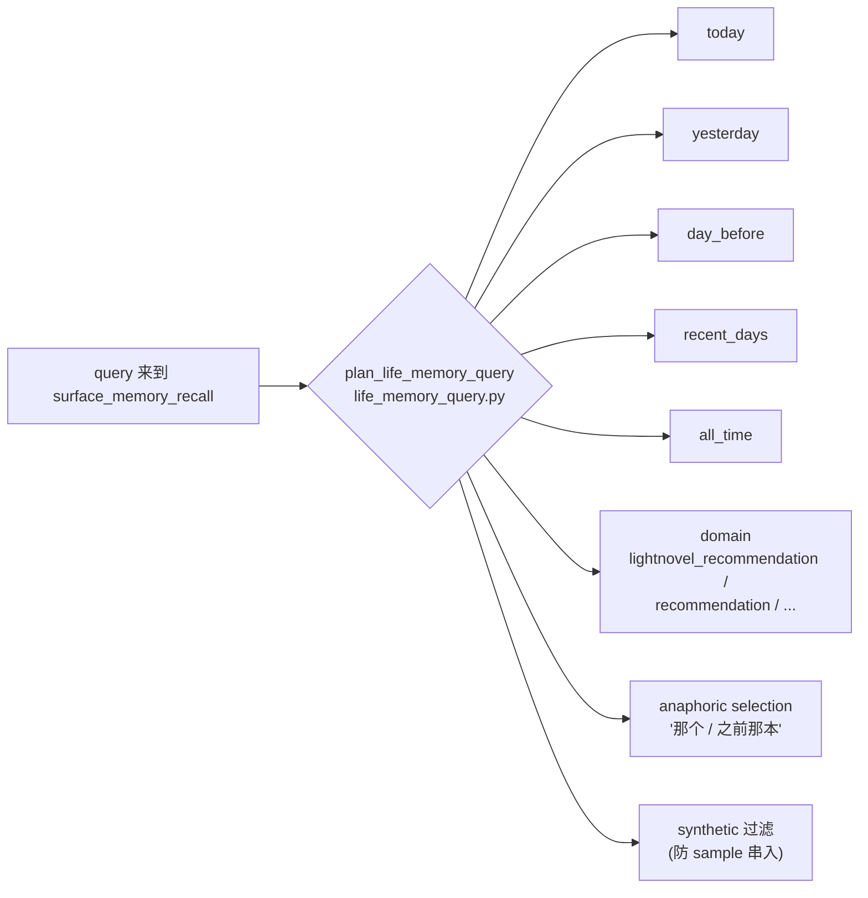

受众：MASTER
标题：图 03 — 召回与记忆数据流（RecallFusion + life_memory SSOT）

版本：v1.0
日期：2026-05-30
归属：docs/50_project/arch/diagrams/

---

## 怎么读这张图

召回是一条**触发→规划→多路并发→融合→去重→交付**的链路，最终把事实清单交给 SurfaceMainChain 注入 prompt。

3 大重点：
1. **入口在 surface 层**（不是 chat_handler）：`surface_memory_recall.py`
2. **6 路 store** 同时跑，由 `RecallFusionServiceContract` 编排
3. **life_memory 是 SSOT**；vector / semantic / canon 等都是衍生层

## 召回总流程

## life_memory 衍生层关系

## 召回的 5 个时间窗与过滤

## 代码锚点

| 链路位置 | 文件 | 关键方法 |
|---|---|---|
| 召回入口 | `host_brain/persona/surface_memory_recall.py` | (4484 行) |
| 召回服务契约 | `host_brain/retrieval/recall_fusion.py` | `RecallFusionServiceContract.recall(...)`（line 331） |
| 路由配置 | `host_brain/retrieval/recall_fusion_config.py` | `load_recall_runtime_config(...)`、`resolve_recall_routes(...)` |
| 6 路 store | `host_brain/retrieval/recall_fusion_stores.py` | `search_sqlite_ledger / search_life_episode / search_semantic_memory / search_neo4j_bond / search_world_canon / search_artifact_vault` |
| 混合融合 | `host_brain/retrieval/hybrid_fusion.py` | vector + FTS 加权 |
| schema | `host_brain/retrieval/recall_schemas.py` | `RecallRouteConfig`、`RecallRuntimeConfig`、`RecallFusionResult` |
| life memory SSOT | `host_brain/memory/life_memory.py` | (8260 行) |
| 查询规划 | `host_brain/memory/life_memory_query.py` | `plan_life_memory_query(...)` |
| 蒸馏 | `host_brain/memory/long_term_distiller.py` / `distillation.py` | — |
| 蒸馏触发 | `host_brain/memory/consolidation_trigger.py` | — |
| canon vector 同步 | `host_brain/memory/canon_vector_auto_sync.py`、`canon_vector_projection.py` | — |

## 不变量

1. **召回入口在 surface 层**（`surface_memory_recall.py`），不是 chat_handler / cortex_orchestrator。
2. **6 路 store**：`sqlite_ledger / life_episode / semantic_memory / neo4j_bond / world_canon / artifact_vault`。
3. `life_memory` 是 SSOT；canon 是显式真源；其它都是衍生层。
4. 召回结果 = `RecallFusionResult` → `MemoryRecallPacket` 注入 prompt 槽位（retrieval / semantic_slot / 等）。
5. retrieval 层**不知道** `ReplyControlPacket` / `SurfaceRuntime` 存在；不直接写 chat 主链回复。
6. 旧 Agentic RAG stack（QueryPlanner / RetrievalPipelineContract / EvidenceEvaluator / AgenticRetrievalLoop / RetrievalOrchestrator）已**整体从代码移除**。

## 已废弃路径

| 旧路径 | 当前事实 |
|---|---|
| `retrieval.orchestrator` | ❌ 已删除 |
| `retrieval.pipeline` | ❌ 已删除 |
| `QueryPlanner` 类 | ❌ 已删除 |
| `EvidenceEvaluator` 类 | ❌ 已删除 |
| `AgenticRetrievalLoop` | ❌ 已删除 |
| `episodic` 作为记忆主作者 | ❌ 已降级为兼容层 |
| `hippocampus_agent → retrieval.orchestrator → retrieval.pipeline` | ❌ 整链路已移除 |
