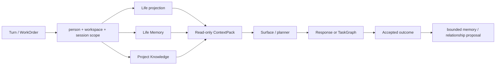

受众：CODEX
标题：图 03——关系与知识召回

# 图 03：关系与知识召回

召回过程只读，不因读取续期 TTL，也不直接修改 Life 或 Knowledge。person memory 与 workspace knowledge 必须隔离；只有 accepted outcome 才能生成后续写入候选。

原始用户正文不进入 affect journal；ContextPack 只包含完成本轮所需的摘要与来源引用。
