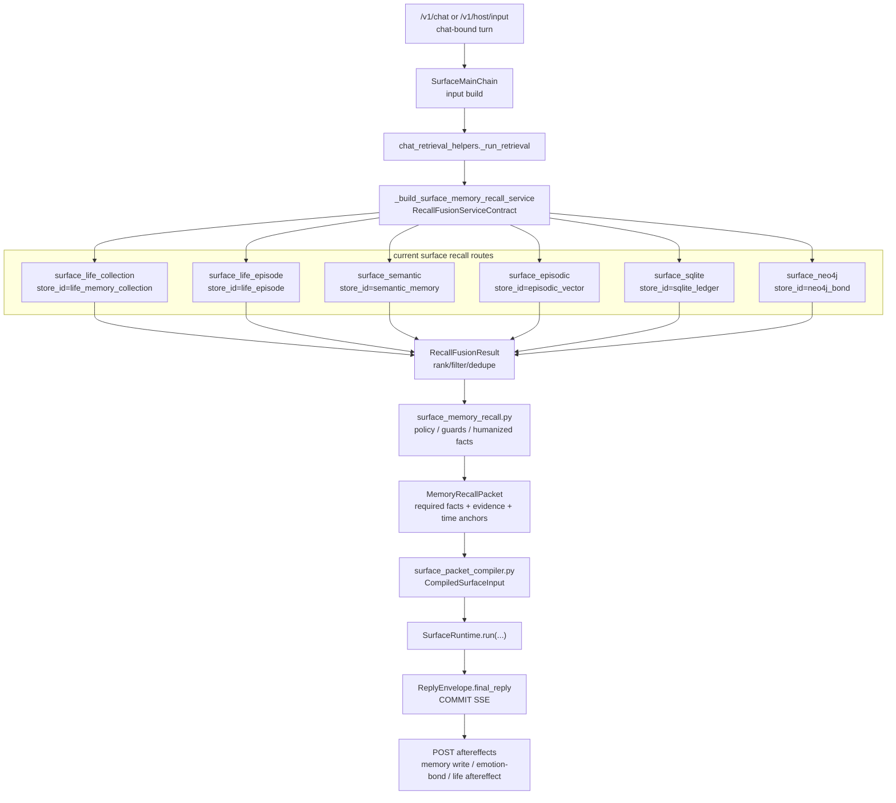
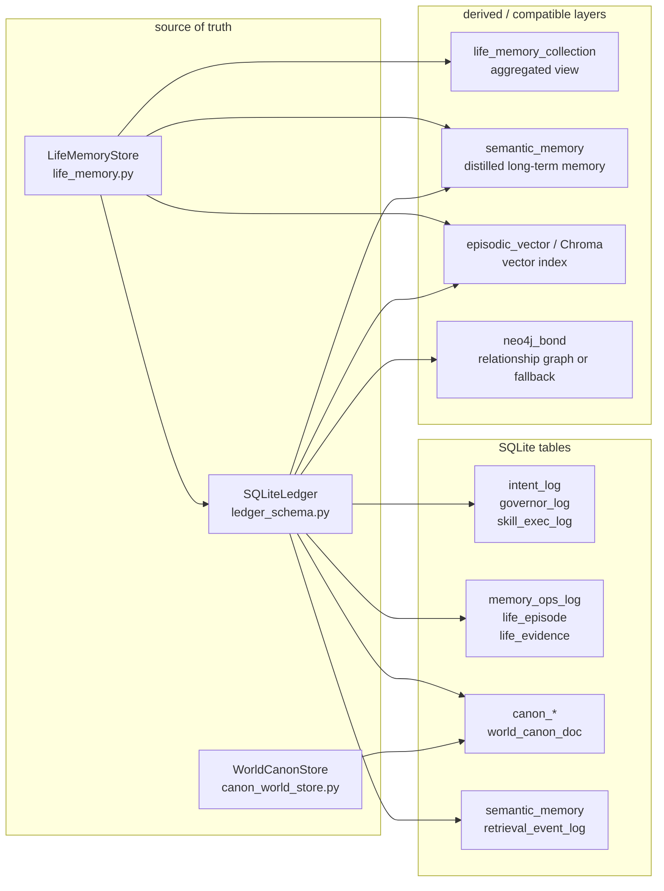
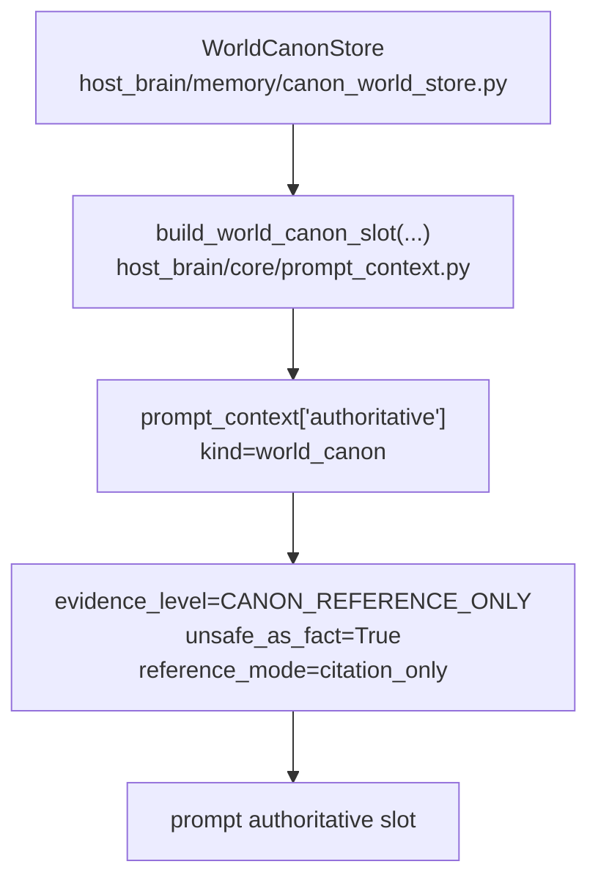
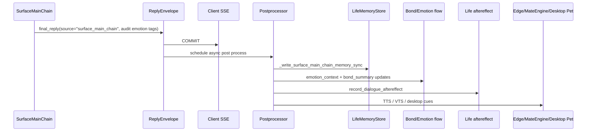

受众：MASTER
标题：图 03 — 召回与记忆数据流（surface recall + LifeMemoryStore SSOT）

版本：v1.1
日期：2026-06-23
归属：docs/50_project/arch/diagrams/
分析锚点：dev@b28c20a2

---

## 怎么读这张图

当前 surface recall 是一条**SurfaceMainChain 输入构建 -> `_run_retrieval` -> RecallFusionServiceContract -> 多路 route -> MemoryRecallPacket -> prompt facts** 的链路。

重点：
1. 入口在 surface / chat retrieval helpers，不在旧 Agentic RAG。
2. 当前 surface 主 routes 是 `life_memory_collection`、`life_episode`、`semantic_memory`、`episodic_vector`、`sqlite_ledger`、`neo4j_bond`。
3. `LifeMemoryStore` 是记忆 SSOT；SQLite 是 source of truth；vector / semantic / graph 是衍生层。
4. `WorldCanonStore` 通过 prompt authoritative slot 进入上下文，不是当前 surface recall route。

## 召回总流程

## SSOT 与衍生层

`life_episode` / `life_evidence` 是可追溯的生命记忆事实。`semantic_memory`、`episodic_vector`、`neo4j_bond` 可参与召回排序和上下文补强，但不能脱离来源证明成为真源。

## WorldCanon 进入 prompt 的实际路径

WorldCanon 是设定/典籍引用源，不证明「已执行」「已保存」「用户已确认」。它不是当前 surface recall route，也不应写成 StateArbiter 中的 StyleCanon 优先级。

## ReplyEnvelope 后效

后效只在 COMMIT 之后调度。记忆写回进入 LifeMemoryStore / SQLiteLedger；Edge、MateEngine、Desktop Pet 只承载外显执行与状态展示。

## 代码锚点

| 链路位置 | 文件 | 关键方法 / 事实 |
|---|---|---|
| surface recall 入口 | `host_brain/app/chat_retrieval_helpers.py` | `_run_retrieval(...)` |
| surface recall service | `host_brain/app/chat_retrieval_helpers.py` | `_build_surface_memory_recall_service()` |
| 召回服务契约 | `host_brain/retrieval/recall_fusion.py` | `RecallFusionServiceContract` |
| store 实现 | `host_brain/retrieval/recall_fusion_stores.py` | `search_life_episode` / `search_life_memory_collection` / `search_semantic_memory` / `search_sqlite_ledger` / `search_neo4j_bond` |
| route schema | `host_brain/retrieval/recall_schemas.py` | `RecallRouteConfig` / `RecallRuntimeConfig` / `RecallFusionResult` |
| surface facts guard | `host_brain/persona/surface_memory_recall.py` | `MemoryRecallPacket` 组装、store 优先级、事实清洗 |
| 记忆 SSOT | `host_brain/memory/life_memory.py` | `LifeMemoryStore` |
| ledger schema | `host_brain/audit/ledger_schema.py` | `intent_log` / `governor_log` / `skill_exec_log` / `memory_ops_log` / `life_episode` / `life_evidence` / `canon_*` / `semantic_memory` / `retrieval_event_log` |
| WorldCanon SSOT | `host_brain/memory/canon_world_store.py` | `WorldCanonStore` |
| WorldCanon prompt slot | `host_brain/core/prompt_context.py` | `build_world_canon_slot(...)` |
| ReplyEnvelope | `host_brain/input_runtime/reply_envelope.py` | final reply contract |
| Surface 后效 | `host_brain/app/surface_main_chain_adapter.py` | `_schedule_surface_life_aftereffect(...)` / `_async_post_process(...)` 调度 |

## 不变量

1. 当前 surface recall routes 是 `life_memory_collection`、`life_episode`、`semantic_memory`、`episodic_vector`、`sqlite_ledger`、`neo4j_bond`。
2. `LifeMemoryStore` + SQLiteLedger 是记忆 SSOT；vector / semantic / graph 是衍生层。
3. `WorldCanonStore` 主要进入 `authoritative` slot，带 `unsafe_as_fact=True` 与 `reference_mode="citation_only"`；它不是当前 surface recall route。
4. 当前源码没有 `canon_style_store.py`，也没有 `host_brain/canon/style/`；不要写 StyleCanon route 或 StateArbiter 优先级。
5. 旧 Agentic RAG stack：`RetrievalOrchestrator`、`RetrievalPipeline`、`QueryPlanner`、`AgenticRetrievalLoop` 不属于当前链路。
6. Edge 外显面只上报遥测/执行结果，不是事实裁决源。

## 已废弃口径

| 旧口径 | 当前事实 |
|---|---|
| `RetrievalOrchestrator -> RetrievalPipeline -> QueryPlanner` | 当前 surface recall 走 `_run_retrieval` + `RecallFusionServiceContract` |
| `world_canon` 是当前 surface recall route | WorldCanon 通过 `build_world_canon_slot` 进入 authoritative slot |
| StyleCanon 是召回 route | 当前无 `canon_style_store.py` / `host_brain/canon/style/` |
| semantic/vector 可直接当事实 | 它们是衍生层，必须回到 LifeMemoryStore / SQLiteLedger provenance |
| Edge 状态可裁决事实 | Edge 只提供遥测和执行回执 |
