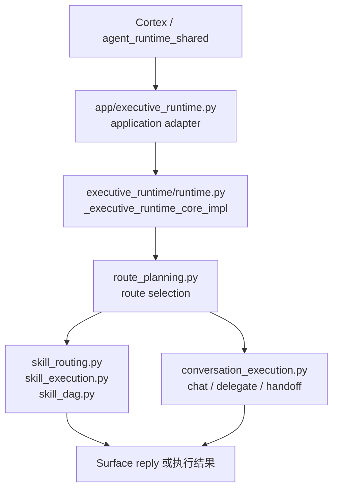

受众：MASTER
标题：图 04 — Executive Runtime 当前分层

# Executive Runtime 当前分层

版本：v2.0
维护日期：2026-07-15
状态：当前代码事实

Executive 已从旧 `host_brain/app/executive_runtime_core.py` 单文件迁到独立包。旧文件不存在，不得继续作为生产锚点。

## 分层

| 层 | 当前文件 | 职责 |
|---|---|---|
| 应用适配 | `host_brain/app/executive_runtime.py` | 从 composition 构造 `ExecutiveRuntimeApplicationPorts`，对外提供 `executive_runtime_sse_generator()` |
| 运行核心 | `host_brain/executive_runtime/runtime.py` | 执行 `_executive_runtime_core_impl()`，完成 legacy Executive 路由、chat stream 和结果收口 |
| 路由规划 | `host_brain/executive_runtime/route_planning.py` | 硬规则路由、复杂计划判定和路由辅助函数 |
| Skill 路由 | `host_brain/executive_runtime/skill_routing.py` | Skill family 与 route decision |
| Skill 执行 | `host_brain/executive_runtime/skill_execution.py`、`skill_dag.py` | legacy Skill/Plan 执行与 DAG 辅助 |
| 对话与 handoff | `host_brain/executive_runtime/conversation_execution.py` | chat/delegate handoff、capability execution 记录 |
| 合同与共享类型 | `host_brain/executive_runtime/ports.py`、`_shared.py` | 端口、`_RouteSelection`、`_ExecutionOutcome` 等共享结构 |

## 调用关系

## Authority 边界

- `chat / skill / delegate / plan` 的显式 canonical route 必须由 Governed Task Runtime 接纳；`runtime.py` 会拒绝它们直接进入 legacy Executive。
- 本包仍承担 legacy compatibility 路线，不能据此宣称旧执行 authority 已全部删除。
- 新代码不得恢复 `host_brain/app/executive_router.py`、`host_brain/app/executive_runtime_core.py` 或 `host_brain/app/executive/` 平行实现。
