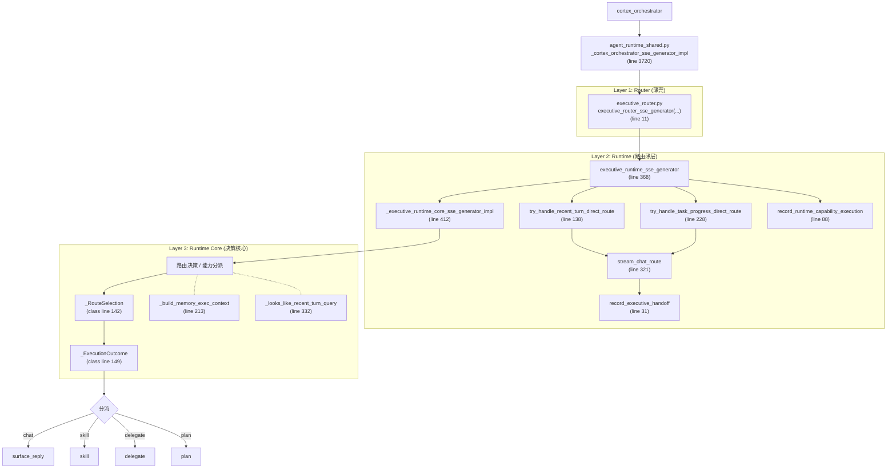
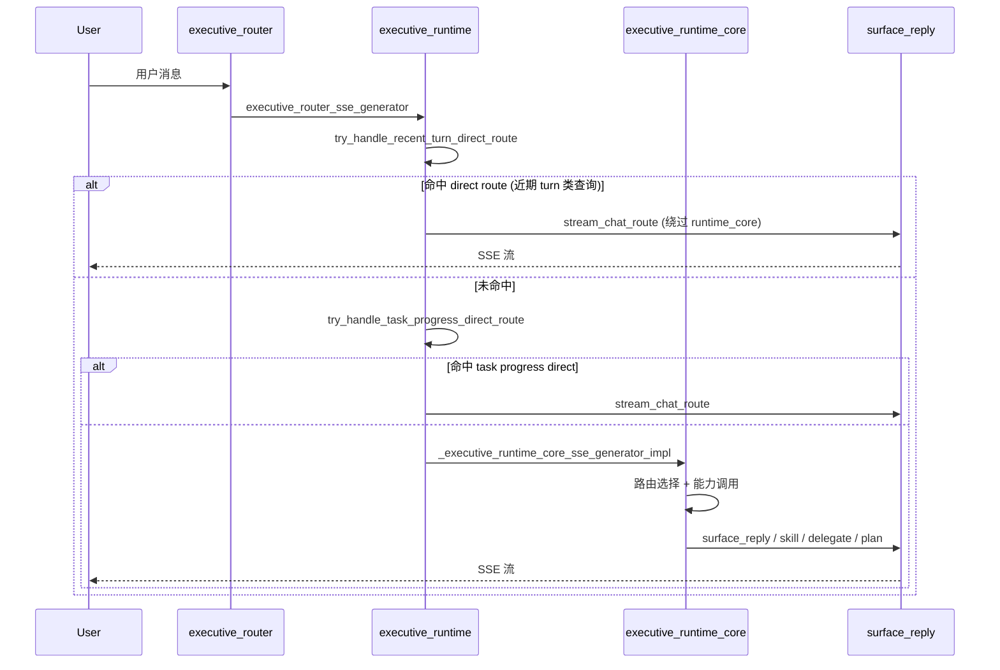

受众：MASTER
标题：图 04 — Executive 三层架构（router → runtime → runtime_core）

版本：v1.0
日期：2026-05-30
归属：docs/50_project/arch/diagrams/

---

## 怎么读这张图

Executive 是 chat 主链的**决策与分流**核心。当前已演进为严格的**三层职责分离**：

| 层 | 文件 | 角色 | 主要职责 |
|---|---|---|---|
| **router**（薄壳） | `executive_router.py` (11 行起) | 路由薄壳 | 把 SSE 生成器代理给 runtime；做最小 handoff 记录 |
| **runtime**（路由薄层） | `executive_runtime.py` | 路由薄层 | direct route 尝试、handoff 记录、stream chat 转发 |
| **runtime_core**（决策核心） | `executive_runtime_core.py` | 决策核心 | 真正的路由选择、能力调用、execution outcome 收口 |

## 三层调用关系

## 直通路径（direct route）的快速路径

## 代码锚点

| 层 | 文件 | 关键符号 | 行 |
|---|---|---|---:|
| Router | `host_brain/app/executive_router.py` | `executive_router_sse_generator` | 11 |
| Runtime | `host_brain/app/executive_runtime.py` | `record_executive_handoff` | 31 |
| Runtime | 同上 | `try_handle_recent_turn_direct_route` | 138 |
| Runtime | 同上 | `try_handle_task_progress_direct_route` | 228 |
| Runtime | 同上 | `stream_chat_route` | 321 |
| Runtime | 同上 | `executive_runtime_sse_generator` | 368 |
| Runtime | 同上 | `_executive_runtime_core_sse_generator_impl` | 412 |
| Runtime Core | `host_brain/app/executive_runtime_core.py` | `_RouteSelection` | 142 |
| Runtime Core | 同上 | `_ExecutionOutcome` | 149 |
| Runtime Core | 同上 | `_build_memory_exec_context` | 213 |
| Runtime Core | 同上 | `_looks_like_recent_turn_query` | 332 |

## 不变量

1. Executive 严格分**三层**：router 是薄壳、runtime 是路由薄层、runtime_core 是决策核心；三层不能合并。
2. **direct route**（recent_turn / task_progress）属于性能优化路径，可短路 runtime_core 直达 surface_reply。
3. runtime_core 永远是兜底：未命中 direct route 时全部走 runtime_core 的路由决策。
4. handoff 记录由 `record_executive_handoff` 统一负责，不在 runtime_core 内部散写。
5. Capability 执行结果由 `record_runtime_capability_execution` 统一审计。

## 已废弃路径

| 旧路径 | 当前事实 |
|---|---|
| `executive_runtime.py` 单文件包含全部决策逻辑 | ❌ 已拆为 runtime / runtime_core |
| `dispatch_agent` 调度执行 | ❌ 已删除，由 executive 三层取代 |
| 灰度开关控制 direct route | ❌ 已直接默认开启（灰度全删除） |
