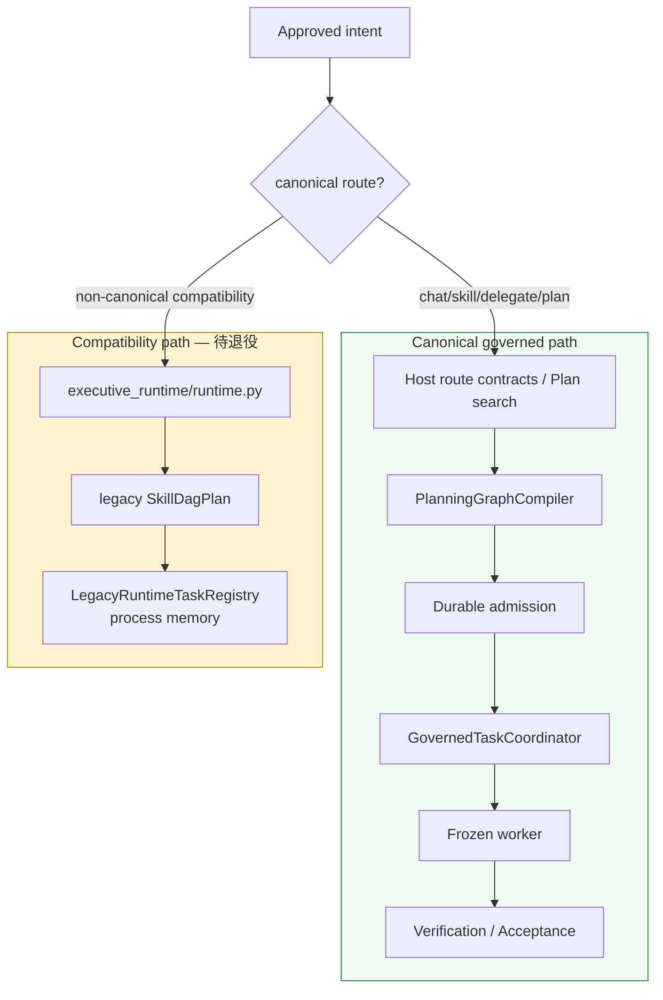
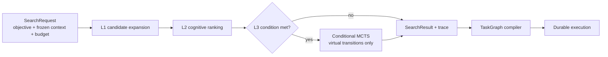
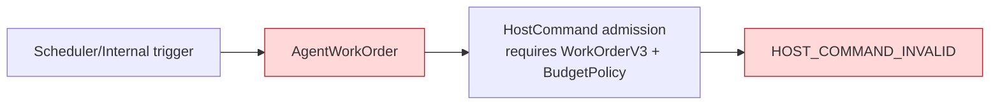
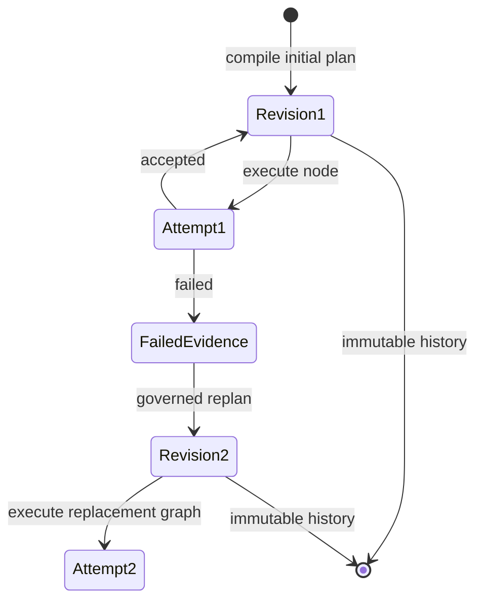

受众：PROJECT
标题：图 04——Planning、Task Runtime 与 Legacy 边界

# 图 04：Planning、Task Runtime 与 Legacy 边界

版本：v3.0
核对日期：2026-07-15

文件名保留为 `04_executive_layers.md` 以兼容旧链接，但本图不再把 Executive 描述成 canonical 三层主链。当前 authority 是 Governed Runtime；Executive 只承担尚未删除的 compatibility route。

## 当前分界

`executive_runtime/runtime.py` 会拒绝显式 `chat/skill/delegate/plan` 直接进入 legacy path。只要旧 SkillDag 执行和内存 registry 仍有生产写入，就不能宣布 Executive authority 已完全删除。

## Planning Search 分层

| 领域 | 当前材料来源 | 当前结论 |
|---|---|---|
| Host Plan | Governor 已批准的 `planned_steps/steps` | 只做合法拓扑选择，未生成竞争方案 |
| Pentest | 授权范围内的 action candidates 与虚拟世界 | L1/L2 接线；L3 shadow 未完成 durable calibration |
| Research | 冻结模拟 fixture | 没有真实来源、模型和 verifier 对照 |
| Code | 冻结模拟 fixture | 没有真实 worktree、测试和成本对照 |

## Scheduler/Internal 故障位置

修复不能通过放宽 admission 接受旧合同完成。正确方向是让 Scheduler/Internal 生成完整 WorkOrderV3、TaskGraph、Budget、node grant、Review 和 receipt lineage。

## Graph revision

失败重规划必须保留旧 revision 和失败证据。修改原 graph、在 worker 内追加隐藏步骤、或让 Executive 另建一个无 lineage 的 plan 都会破坏审计。

## 代码锚点

- 公共搜索：`host_brain/planning_search/`
- Host Plan adapter：`host_brain/orchestration/plan_intent_search.py`
- Graph compiler：`host_brain/orchestration/planning_graph_compiler.py`
- Replan/recovery：`host_brain/orchestration/planning_recovery.py`、`failure_replan_intent.py`
- Durable coordinator：`host_brain/task_runtime/coordinator.py`
- Executive guard/legacy：`host_brain/executive_runtime/runtime.py`、`skill_dag.py`
- Legacy registry：`host_brain/app/runtime_task_registry.py`
- Scheduler contracts：`host_brain/scheduler/governed_runtime.py`
- Internal contracts：`host_brain/app/internal_task_runtime.py`

## 目标删除条件

只有当 compatibility route 已迁移、legacy SkillDag 生产调用为零、LegacyRuntimeTaskRegistry 只剩历史读取或被删除，并且所有入口共享同一 Task lineage 时，Executive 才能从架构图中移除。
