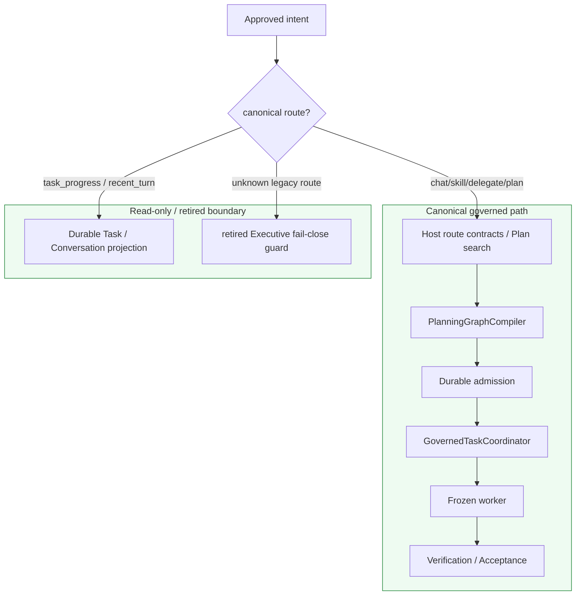
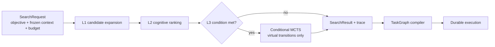
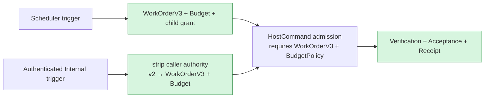
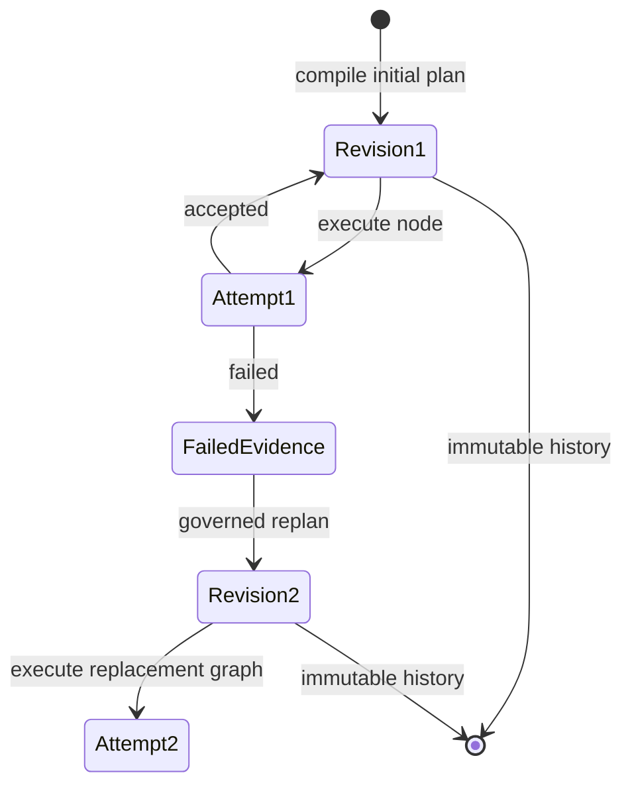

受众：PROJECT
标题：图 04——Planning、Task Runtime 与退役 Executive 边界

# 图 04：Planning、Task Runtime 与退役 Executive 边界

版本：v3.2
核对日期：2026-07-15

文件名保留为 `04_executive_layers.md` 以兼容旧链接。当前执行 authority 是 Governed Runtime；Executive 的生产入口、SkillDag 执行和进程内任务 registry 已删除。

## 当前分界

`agent_runtime/cortex_runtime.py` 不再持有 Executive application port。执行 route 只能进入 Governed Runtime，读取 route 只能进入 durable projection，未知 route fail closed。`executive_runtime/runtime.py` 只保留不可达的拒绝边界和孤立 helper。

## Planning Search 分层

| 领域 | 当前材料来源 | 当前结论 |
|---|---|---|
| Host Plan | Governor 已批准的 `planned_steps/steps` | 只做合法拓扑选择，未生成竞争方案 |
| Pentest | 授权范围内的 action candidates 与虚拟世界 | L1/L2 接线；L3 shadow 未完成 durable calibration |
| Research | 冻结模拟 fixture | 没有真实来源、模型和 verifier 对照 |
| Code | 冻结模拟 fixture | 没有真实 worktree、测试和成本对照 |

## Scheduler/Internal 分界

Scheduler 与 Internal 已沿同一方向接通。Internal 没有放宽 admission：边界 v2 在清除 caller authority 后编译为完整 WorkOrderV3、TaskGraph、Budget、node grant、Review 和 receipt lineage；既有 executor 只消费授权验证后的兼容投影。

## Graph revision

失败重规划必须保留旧 revision 和失败证据。修改原 graph、在 worker 内追加隐藏步骤、或让 Executive 另建一个无 lineage 的 plan 都会破坏审计。

## 代码锚点

- 公共搜索：`host_brain/planning_search/`
- Host Plan adapter：`host_brain/orchestration/plan_intent_search.py`
- Graph compiler：`host_brain/orchestration/planning_graph_compiler.py`
- Replan/recovery：`host_brain/orchestration/planning_recovery.py`、`failure_replan_intent.py`
- Durable coordinator/decision：`host_brain/task_runtime/coordinator.py`、`dag_scheduler.py`
- Read projections：`host_brain/agent_runtime/read_routes.py`
- Retired Executive guard：`host_brain/executive_runtime/runtime.py`
- Scheduler contracts：`host_brain/scheduler/governed_runtime.py`
- Internal contracts：`host_brain/app/internal_task_runtime.py`

## 已完成与剩余条件

Executive 生产调用、legacy SkillDag 执行和进程内 registry 已归零；Scheduler 与 Internal 也已共享 canonical Task lineage。NE-01 仍需把 B0 调度合同接入真实 durable 并发/retry/recovery，并完成显式 composition 与最终 route matrix 验收；Executive 退役不能替代这些剩余条件。
