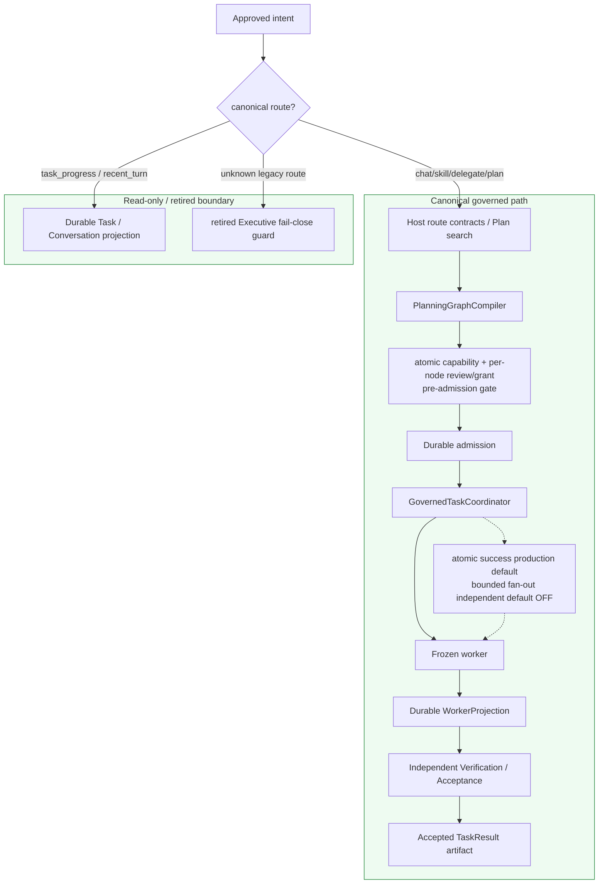
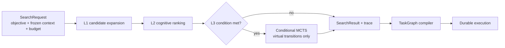
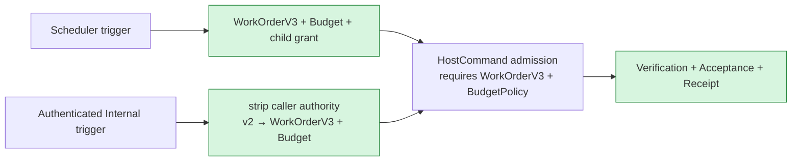
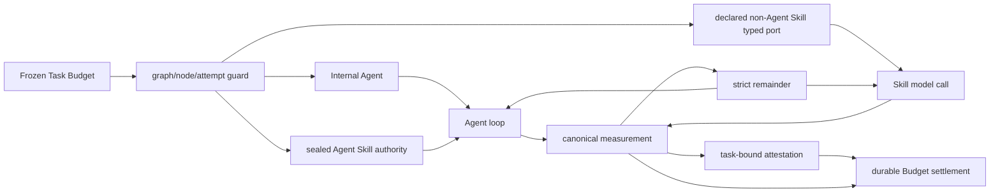
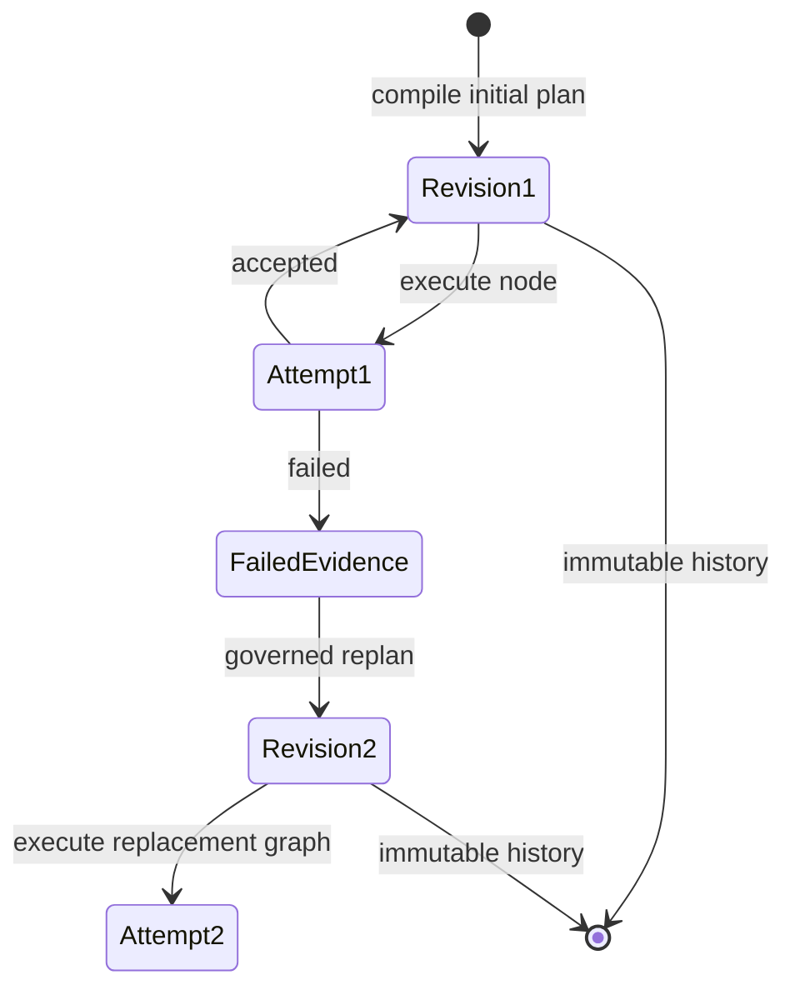

受众：PROJECT
标题：图 04——Planning、Task Runtime 与退役 Executive 边界

# 图 04：Planning、Task Runtime 与退役 Executive 边界

版本：v3.12
核对日期：2026-07-26

文件名保留为 `04_executive_layers.md` 以兼容旧链接。当前执行 authority 是 Governed Runtime；Executive 的生产入口、`route_planning`、`conversation_execution`、application `composition`、application port wiring、legacy diagnostic direct-skill matrix、legacy SkillDag worker 执行和进程内任务 registry 已删除，且 Executive 内的 Forge route override call 已移除。纯 SkillDag adapter 仅作零生产调用的兼容合同；独立 Forge `runtime-match` 仍是待退役边界。

## 当前分界

`agent_runtime/cortex_runtime.py` 不再持有 Executive application port。执行 route 只能进入 Governed Runtime，读取 route 只能进入 durable projection，未知 route fail closed。Cortex 的 contextual-session/style、clarification、LLM unavailable 与 async post-process direct-reply branch 已物理删除；它只把冻结上下文交给 TaskGraph。`executive_runtime/runtime.py` 与 `app/executive_runtime.py` 只保留不可达的拒绝边界；任何 stale import 都不能重建 Executive application port。

`AC` 不是 worker 内部判断：Verifier 与 Acceptance 各自重开 durable projection。Plan 的 final Chat 还要从 `ART` 获得 digest-bound predecessor bundle；因此 TaskGraph 边既是调度约束，也是可验证的数据输入合同。当前规则只覆盖已启用 capability-plan 的固定结构政策，通用候选生成与语义收益仍属于 NE-02。

capability Plan 不再要求候选一律 `require_confirm=false`。该字段被转换为 compiler-owned、覆盖整图 node ID 的 Review policy；续跑只延长 exact grant 的有效期，不把 Review authority交给 Search 或 worker。Plan 当前启用路径的节点 grant/Review 已有真实 SQLite 证据，但 graph-scope Budget 和一般 PlanningSearch 仍未完成。

## Planning Search 分层

| 领域 | 当前材料来源 | 当前结论 |
|---|---|---|
| Host Plan | Governor-bound task/tag/risk + composed SkillRegistry catalog | 窄 Research/Frontend capability route 会生成并排序竞争能力，编译为 `skill → skill → chat`；confirm-required Skill 逐节点 Review。它不是通用目标搜索或收益证明 |
| Pentest | 授权范围内的 action candidates 与虚拟世界 | L1/L2 接线；L3 强制 shadow-only；0105 durable calibration 仅显式注入时写入，target 在 fingerprint 前收口，库故障只记 unavailable 事件，outcome 仍是未验证运行记录投影 |
| Research | D20a `ResearchTaskSnapshot` 的公开 task/corpus/source metadata（`source_id/ref/digest` 与有限 authority/relevance/cost hints）；`FrozenResearchCorpusLoader` 仅从可信实验根+manifest 读取 repository-relative 普通文件；D20c adapter 只能使用 canonical `ModelAttemptService` 与 audit lookup | 按虚拟状态动态给出 `query`、`quick-answer`、`primary-source`、`independent-source`、`cross-check`、`resolve-conflict`、`stop` 的 pure-shadow L1/L2；L3 仅冻结 `virtual_transition_ready=true` 时有虚拟 ports。公开 snapshot 没有 dedicated 本机 locator/source-body/answer-key/verifier-decision 字段，constraints 拒绝命名 key，任务文字不是内容级 DLP；公开 receipt 不含路径或正文。loader 在稳定输入中前后核对状态/大小并在读完后核对摘要，拒绝绝对/遍历/ADS colon/case alias/link/reparse/未列来源；D20b 已有 snapshot-manifest-document exact handshake 与 fresh-loader UTF-8 citation span 验证。D20c 在外呼前强制 execution ID 的 canonical audit 为空，已有行或 lookup 故障须 reconciliation；随后才接受一个非缓存成功 canonical attempt 的精确 route/output、token/成本、provider/总延迟，并重开同一 request 的 started/terminal audit pair 后嵌入 attestation；但普通请求仍不能改写 route retry ceiling，且没有真实 credential/provider execution、prompt/workload 或 cohort。它不是生产 route、TaskGraph、Host、BrowserWorker、网页抓取、独立 verifier、收益证明或 OS/tenant/sandbox；Research `ACCEPTANCE_PENDING_EXTERNAL`，benefit `UNPROVEN` |
| Code | D16 frozen opaque ref/digest + registered patch catalog；D17 trusted-process private bare 双 detached worktree；D18 cleanup-gated 0106 ledger；D19 pre-registered fixed pytest subprocess receipt | D16 动态 pure-shadow `inspect→patch→unit/rollback` 已有单测；D17/D18 证明受信 adapter 的本地 private-bare clone、portable ACL file API、双 arm cleanup 后 source fingerprint 无漂移，且 preregistration/evidence/clean receipt 可跨重启审计；D19 实际拒 paired test-command/wall limit 并保留无路径 command receipt。它不是恶意执行防护、独立 verifier 或 OS/container sandbox，`network_isolation=NOT_ENFORCED`；仍没有真实模型/工具/token/cost budget 或成本收益对照 |

## Scheduler/Internal 分界

Scheduler 与 Internal 已沿同一方向接通。Internal 没有放宽 admission：边界 v2 在清除 caller authority 后编译为完整 WorkOrderV3、TaskGraph、Budget、node grant、Review 和 receipt lineage；既有 executor 只消费授权验证后的兼容投影。

### Agent 模型预算子流

`strict remainder` 只在同一 Agent loop 内防止额度重置，不拥有持久写
authority；普通 Skill 的 typed port 也遵守同一限制。缺失 usage、缓存、重复
measurement 或 lineage 漂移会停止下一次模型调用。未声明的普通 Skill 不
取得裸模型端口。该子流不代表 program-wide Budget 或 NE-01 已完成。

### 只读 Delegate 零用量证明

这里的零不是缺失 measurement 的默认值。adapter 没有模型、工具、nested
dispatch 或 Effect port，dispatcher 仍须生成 digest-bound attestation；任一
非零、缺失或 lineage drift 在 COMMIT 前失败。该证明只适用于当前启用的
`pentest_agent`，不能给未来一般 Delegate 复用。

## Graph revision

失败重规划必须保留旧 revision 和失败证据。修改原 graph、在 worker 内追加隐藏步骤、或让 Executive 另建一个无 lineage 的 plan 都会破坏审计。

对 Code D16，只有根快照可以进入 catalog-bound compile；中间虚拟状态不能借用本图的 revision 箭头，因为其 durable predecessor lineage 尚未实现。compiler/recovery 的 context 透传和 parent-grant 对齐只防止 authority/input 漂移，不能把纯虚拟路径升级为可执行 Code replan。

## 代码锚点

- 公共搜索：`host_brain/planning_search/`
- Code pure-shadow frozen models / catalog：`host_brain/planning_search/code_domain_models.py`、`host_brain/planning_search/code_domain.py`
- Research pure-shadow metadata catalog / frozen-corpus loader / D20c model evidence adapter：`host_brain/planning_search/research_domain_models.py`、`host_brain/planning_search/research_domain.py`、`host_brain/planning_search/research_benchmark_corpus.py`、`host_brain/planning_search/attested_external_research_adapter.py`
- Code private-bare experiment adapter / durable ledger：`host_brain/planning_search/code_benchmark_models.py`、`host_brain/planning_search/code_benchmark_sandbox.py`、`host_brain/planning_search/code_benchmark_ledger.py`、`host_brain/persistence/code_benchmark_ledger_repository.py`
- Host Plan adapter：`host_brain/orchestration/plan_intent_search.py`
- Graph compiler：`host_brain/orchestration/planning_graph_compiler.py`
- Replan/recovery：`host_brain/orchestration/planning_recovery.py`、`failure_replan_intent.py`
- Durable coordinator/decision：`host_brain/task_runtime/coordinator.py`、`dag_scheduler.py`
- Read projections：`host_brain/agent_runtime/read_routes.py`
- Retired Executive guards：`host_brain/executive_runtime/runtime.py`、`host_brain/app/executive_runtime.py`
- Scheduler contracts：`host_brain/scheduler/governed_runtime.py`
- Internal contracts：`host_brain/app/internal_task_runtime.py`

## 已完成与剩余条件

Executive 生产调用、`route_planning`、`conversation_execution`、application `composition`、application port wiring、legacy diagnostic direct-skill matrix、legacy SkillDag worker 执行和进程内 registry 已归零；Executive 内 Forge route override call 已移除，纯 SkillDag adapter 仍是无生产 caller 的 compatibility contract。独立 Forge `runtime-match` 仍未归零，因此这是部分负向收口。当前 DAG 定级为 `PARTIAL_ATOMIC_DEFAULT_B5C / NE01_IN_PROGRESS`：新生产 Graph 已以 0090/0091 原子收口失败/成功；0092～0097 的 cancellation、delivery、continuation、revision、Review 与 grant authority 已有证据。DAG scheduler 还可在 live owner fence 清除后续接多节点 exact canonical COMMITTED checkpoint 的 `EXACT_ACCEPTED / EXACT_REJECTED / MISSING`，不重放 worker；这不覆盖 general batch 或 unknown-effect recovery。0099 exact auto 默认开启且只处理 `EXACT_REPAIRABLE`；Cancellation Operator 仍为 `WIRED_DEFAULT_OFF`，启用时强制 Operation/Effect/Terminal reconciliation 全开，并要求共享 Secure Ingress verifier、Gateway/BFF/UI 与 verification-only keyring。bounded fan-out、部署凭据、真实 canary、general/multi-node recovery 和完整 Workspace/Composition 仍缺，不能宣称 Lane B 或完整架构完成。
