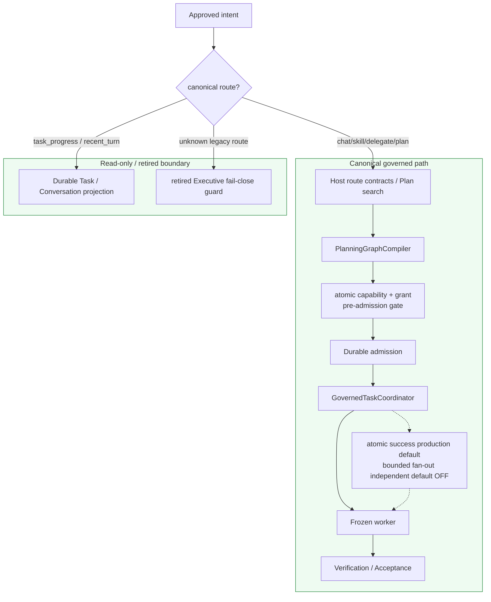
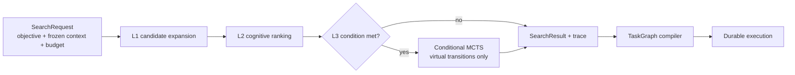
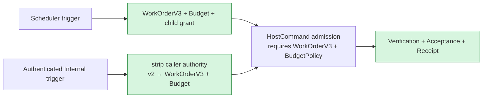
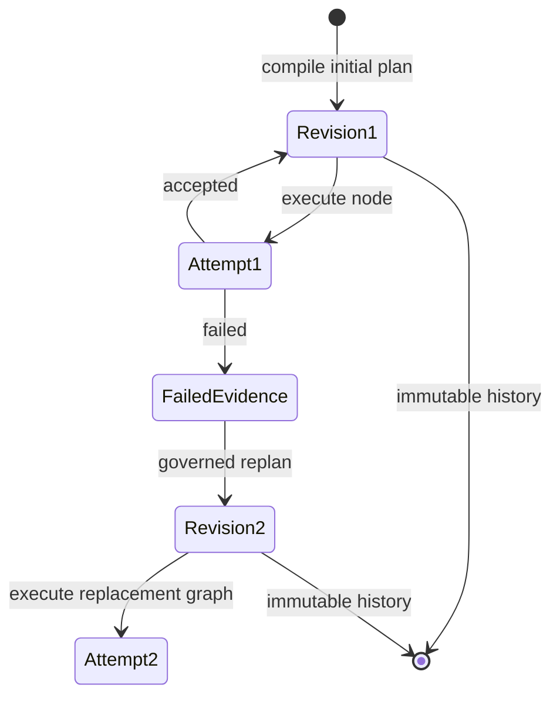

受众：PROJECT
标题：图 04——Planning、Task Runtime 与退役 Executive 边界

# 图 04：Planning、Task Runtime 与退役 Executive 边界

版本：v3.7
核对日期：2026-07-18

文件名保留为 `04_executive_layers.md` 以兼容旧链接。当前执行 authority 是 Governed Runtime；Executive 的生产入口、SkillDag 执行和进程内任务 registry 已删除。

## 当前分界

`agent_runtime/cortex_runtime.py` 不再持有 Executive application port。执行 route 只能进入 Governed Runtime，读取 route 只能进入 durable projection，未知 route fail closed。`executive_runtime/runtime.py` 只保留不可达的拒绝边界和孤立 helper。

## Planning Search 分层

| 领域 | 当前材料来源 | 当前结论 |
|---|---|---|
| Host Plan | Governor 已批准的 `planned_steps/steps` | 只做合法拓扑选择，未生成竞争方案 |
| Pentest | 授权范围内的 action candidates 与虚拟世界 | L1/L2 接线；L3 强制 shadow-only；0105 durable calibration 仅显式注入时写入，target 在 fingerprint 前收口，库故障只记 unavailable 事件，outcome 仍是未验证运行记录投影 |
| Research | D20a `ResearchTaskSnapshot` 的公开 task/corpus/source metadata（`source_id/ref/digest` 与有限 authority/relevance/cost hints）；`FrozenResearchCorpusLoader` 仅从可信实验根+manifest 读取 repository-relative 普通文件 | 按虚拟状态动态给出 `query`、`quick-answer`、`primary-source`、`independent-source`、`cross-check`、`resolve-conflict`、`stop` 的 pure-shadow L1/L2；L3 仅冻结 `virtual_transition_ready=true` 时有虚拟 ports。公开 snapshot 没有 dedicated 本机 locator/source-body/answer-key/verifier-decision 字段，constraints 拒绝命名 key，任务文字不是内容级 DLP；公开 receipt 不含路径或正文。loader 在稳定输入中前后核对状态/大小并在读完后核对摘要，拒绝绝对/遍历/ADS colon/case alias/link/reparse/未列来源；未有 snapshot-manifest-document exact handshake，亦非 hostile TOCTOU 防线或独立来源证明。它不是生产 route、TaskGraph、Host、BrowserWorker、网页抓取、真实模型、独立 verifier、paired cohort、收益证明或 OS/tenant/sandbox；Research benefit `UNPROVEN` |
| Code | D16 frozen opaque ref/digest + registered patch catalog；D17 trusted-process private bare 双 detached worktree；D18 cleanup-gated 0106 ledger；D19 pre-registered fixed pytest subprocess receipt | D16 动态 pure-shadow `inspect→patch→unit/rollback` 已有单测；D17/D18 证明受信 adapter 的本地 private-bare clone、portable ACL file API、双 arm cleanup 后 source fingerprint 无漂移，且 preregistration/evidence/clean receipt 可跨重启审计；D19 实际拒 paired test-command/wall limit 并保留无路径 command receipt。它不是恶意执行防护、独立 verifier 或 OS/container sandbox，`network_isolation=NOT_ENFORCED`；仍没有真实模型/工具/token/cost budget 或成本收益对照 |

## Scheduler/Internal 分界

Scheduler 与 Internal 已沿同一方向接通。Internal 没有放宽 admission：边界 v2 在清除 caller authority 后编译为完整 WorkOrderV3、TaskGraph、Budget、node grant、Review 和 receipt lineage；既有 executor 只消费授权验证后的兼容投影。

## Graph revision

失败重规划必须保留旧 revision 和失败证据。修改原 graph、在 worker 内追加隐藏步骤、或让 Executive 另建一个无 lineage 的 plan 都会破坏审计。

对 Code D16，只有根快照可以进入 catalog-bound compile；中间虚拟状态不能借用本图的 revision 箭头，因为其 durable predecessor lineage 尚未实现。compiler/recovery 的 context 透传和 parent-grant 对齐只防止 authority/input 漂移，不能把纯虚拟路径升级为可执行 Code replan。

## 代码锚点

- 公共搜索：`host_brain/planning_search/`
- Code pure-shadow frozen models / catalog：`host_brain/planning_search/code_domain_models.py`、`host_brain/planning_search/code_domain.py`
- Research pure-shadow metadata catalog / frozen-corpus loader：`host_brain/planning_search/research_domain_models.py`、`host_brain/planning_search/research_domain.py`、`host_brain/planning_search/research_benchmark_corpus.py`
- Code private-bare experiment adapter / durable ledger：`host_brain/planning_search/code_benchmark_models.py`、`host_brain/planning_search/code_benchmark_sandbox.py`、`host_brain/planning_search/code_benchmark_ledger.py`、`host_brain/persistence/code_benchmark_ledger_repository.py`
- Host Plan adapter：`host_brain/orchestration/plan_intent_search.py`
- Graph compiler：`host_brain/orchestration/planning_graph_compiler.py`
- Replan/recovery：`host_brain/orchestration/planning_recovery.py`、`failure_replan_intent.py`
- Durable coordinator/decision：`host_brain/task_runtime/coordinator.py`、`dag_scheduler.py`
- Read projections：`host_brain/agent_runtime/read_routes.py`
- Retired Executive guard：`host_brain/executive_runtime/runtime.py`
- Scheduler contracts：`host_brain/scheduler/governed_runtime.py`
- Internal contracts：`host_brain/app/internal_task_runtime.py`

## 已完成与剩余条件

Executive 生产调用、legacy SkillDag 和进程内 registry 已归零。当前 DAG 定级为 `PARTIAL_ATOMIC_DEFAULT / NE01_IN_PROGRESS`：新生产 Graph 已以 0090/0091 原子收口失败/成功；0092 verified cancellation、0093 delivery、0094 cancellation continuation、0095 revisioned identity、0096 Review continuation 与 0097 grant uniqueness已有证据。Cancellation Operator authority/入口为 `WIRED_DEFAULT_OFF`；bounded fan-out与cancellation仍 OFF。完整业务对账、历史修复、general/multi-node recovery、部署凭据与真实 canary仍缺，不能宣称 Lane B 或完整架构完成。
