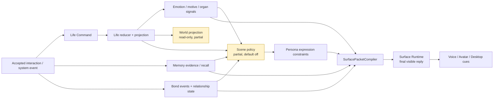
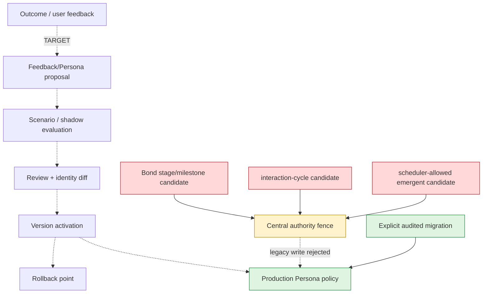

受众：PROJECT
标题：图 05——数字生命状态与表达

# 图 05：数字生命状态与表达

版本：v2.1
核对日期：2026-07-26

文件名保留为 `05_tribe_topology.md` 以兼容旧链接。本图不再把一个固定 family 清单当作整个数字生命架构，而是描述状态、记忆、关系、场景、人格和最终表达的 authority 关系。

## 状态到表达

这里的核心不是“模拟多少器官”，而是确保不同信号只提供材料，最终表达和长期状态各有明确 owner：

- Life reducer 维护可追溯生命状态。
- Memory 保存经历与来源材料。
- Bond 保存关系事件/状态。
- Scene 解析当前表达约束，但目前未形成完整 canonical aggregate。
- Persona 约束风格、边界和身份连续性。
- Surface Runtime 生成最终可见文本。
- Edge/Pet 只负责外显，不拥有 Persona 或 Life 真相。

## Persona 演化风险

红色节点现在只能形成候选，中央围栏拒绝其写入；`T-PERSONA-FENCE-01` 防止生产代码恢复 direct writer。绿色迁移路径只用于带 actor/evidence 的显式历史迁移。候选尚未进入 proposal、shadow、Review、版本激活和 rollback，所以“安全围栏已接通”不等于“人格演化已完成”。

## 主动行为

后台周期、器官信号或模型建议不能直接外发消息、改变人格或执行设备动作。它们只能提出 intent，随后进入与用户请求相同的治理和验收链。当前 Intent Arbiter 尚未完整统一 user/task/life/relationship/long-term goal。

Scheduler 的定义管理和 occurrence 执行也遵守这条边界。`scheduler.task.publish/delete/enable/disable` 先绑定 Scheduler 或 Operator 的精确 ingress authority，再进入 immutable HostCommand/TaskGraph；人工或时钟 occurrence 必须先 durable admission，重放按 `request_id/occurrence_id` 重开，不得重复制造任务。Scheduler 只把 occurrence payload、当前 mode 和 Life context 编译为受治理 intent，不能直接写 Life、Bond、Persona 或外发渠道。

## Tribe/Organ 的位置

`host_brain/tribe/` 与 `host_brain/organ_ops/` 提供器官化信号、descriptor 和协作材料。它们可以影响 affect、drive、continuity、task 或 safety 上下文，但不是一组平行的状态数据库，也不应各自拥有最终回复或真实副作用 authority。具体可用 family 以 `host_brain/tribe/registry.py` 为准，不在架构文档中冻结数量。

## 代码锚点

- Life command/reducer：`host_brain/digital_life/`
- Life composition：`host_brain/composition/life.py`
- Scheduler command/occurrence authority：`host_brain/scheduler/command_service.py`
- Persona/Surface：`host_brain/persona/`、`host_brain/surface_runtime/`
- Scene policy：`host_brain/persona/scene_policy.py`
- World projection：`host_brain/runtime/world_model.py`、`host_brain/persistence/world_model_query_repository.py`
- Memory：`host_brain/memory/`、`host_brain/retrieval/`
- Bond：`host_brain/bond/`、`host_brain/persistence/bond_*`
- Organ influence：`host_brain/persona/surface_organ_influence.py`
- Persona growth authority：`host_brain/persona/persona_engine.py`、`host_brain/persona/persona_growth.py`、`tools/static_scan/persona_growth_authority_scan.py`

## 当前限制

- `HOST_LIFE_PROJECTION_ENABLED` 生产默认关闭，使 Scene 消费链默认不完整。
- World Model 只是只读事实投影，不具备预测、虚拟 transition 或统一 context resolver 语义。
- Persona direct growth writer 已被中央封口，但受治理 proposal/Review/版本激活链仍缺失。
- Evolution Lab、统一 Feedback Proposal 和 Identity Migration 尚未形成生产闭环。
