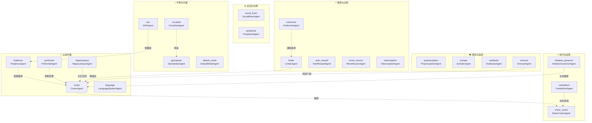

受众：MASTER
标题：图 05 — Tribe 23 family 拓扑（脑区 / 内分泌 / 外周 / 执行）

版本：v1.0
日期：2026-05-30
归属：docs/50_project/arch/diagrams/

---

## 怎么读这张图

23 family 不是一个扁平列表，而是按"功能层"自然分簇：

| 簇 | family | 角色 |
|---|---|---|
| 🧠 **认知中枢** | cortex / thalamus / prefrontal / hippocampus / language | 主链编排、意图、计划、记忆、语言 |
| 💛 **情感与动机** | limbic / pain_reward / endocrine / mirror_neuron / interoception | 情绪、奖惩、激素、共情、内感 |
| 👁️ **感知与监控** | proprioception / somatic / vestibular / immune | 本体感、躯体、平衡、风险 |
| 🌐 **社交与外周** | social_brain / peripheral / language（外向） | 社交模型、外围执行、对外语言 |
| 🌙 **节律与代谢** | circadian / glymphatic / ans / default_mode | 昼夜、清理、自主神经、默认模式 |
| ⚡ **执行与反射** | motor_cortex / cerebellum / initiative_governor | 动作、协调、自启动 |

## 23 family 全景图

## 主链关键 family 在 chat 流的位置

## 23 family 完整代码事实清单

| # | family_id | 默认 display_name |
|---:|---|---|
| 1 | `cortex` | CortexAgent |
| 2 | `thalamus` | ThalamusAgent |
| 3 | `ans` | ANSAgent |
| 4 | `hippocampus` | HippocampusAgent |
| 5 | `limbic` | LimbicAgent |
| 6 | `prefrontal` | PrefrontalAgent |
| 7 | `social_brain` | SocialBrainAgent |
| 8 | `endocrine` | EndocrineAgent |
| 9 | `immune` | ImmuneAgent |
| 10 | `pain_reward` | PainRewardAgent |
| 11 | `language` | LanguageSystemAgent |
| 12 | `somatic` | SomaticAgent |
| 13 | `peripheral` | PeripheralAgent |
| 14 | `circadian` | CircadianAgent |
| 15 | `proprioception` | ProprioceptionAgent |
| 16 | `initiative_governor` | InitiativeGovernorAgent |
| 17 | `default_mode` | DefaultModeAgent |
| 18 | `mirror_neuron` | MirrorNeuronAgent |
| 19 | `interoception` | InteroceptionAgent |
| 20 | `motor_cortex` | MotorCortexAgent |
| 21 | `cerebellum` | CerebellumAgent |
| 22 | `glymphatic` | GlymphaticAgent |
| 23 | `vestibular` | VestibularAgent |

## 代码锚点

| 内容 | 文件 |
|---|---|
| 23 family 真源 | `host_brain/tribe/registry.py:_DEFAULT_FAMILY_SPECS` |
| `TribeFamilySpec` 定义 | `host_brain/tribe/registry.py:10` |
| `HostTribeRegistry` | `host_brain/tribe/registry.py:44` |
| 默认 agent 描述 | `host_brain/tribe/registry.py:_bootstrap_default_agents` |
| 主链 family agent | `host_brain/tribe/*_agent.py`（每个 family 各一） |

## 不变量

1. **23 family**，既不多也不少；任何文档说"22 个器官族"都是过期口径。
2. 灰度开关已**全数删除**；A 级化升级闭环。
3. family 注册以 `_DEFAULT_FAMILY_SPECS` 为唯一真源；运行时可 `set_host_tribe_registry(...)` 注入定制版本。
4. cortex 是默认 fallback：当 descriptor 没有明确 family 时归到 cortex。

## 已废弃路径

| 旧路径 | 当前事实 |
|---|---|
| 22 个器官族 | ❌ 已升级为 23（新增 `glymphatic`） |
| family 灰度开关 | ❌ 已全数删除 |
| C 级 / B 级 family | ❌ 全数升级到 A 级 |
