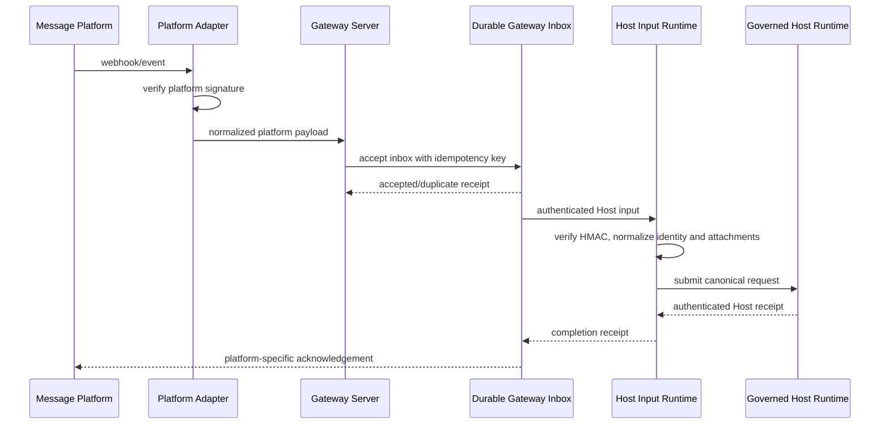
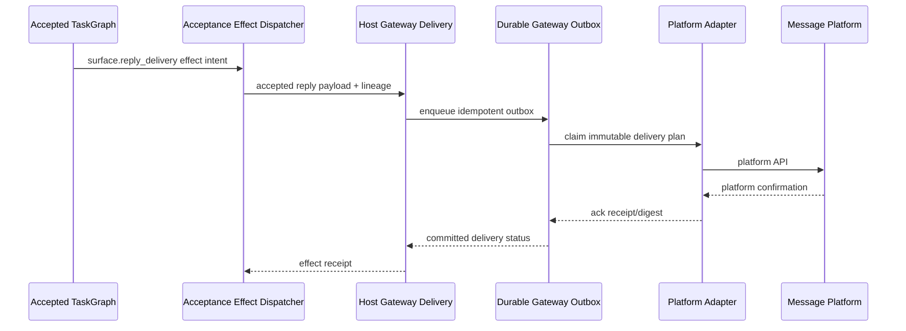
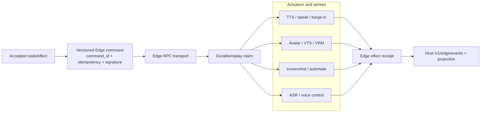

受众：PROJECT
标题：图 06——Gateway 与 Edge 输入输出

# 图 06：Gateway 与 Edge 输入输出

版本：v2.1
核对日期：2026-07-16

Gateway 处理“平台消息”，Edge RPC 处理“本机感知与动作”。两者可以在同一 Edge lifecycle 中运行，但 transport authority 和 effect authority 不应混为一体。

## 平台入站

Gateway durable inbox 负责重复消息、claim、retry 和 uncertain/DLQ 状态。Host 业务是否允许执行仍由 Secure Ingress、Governor 和 Task Runtime 决定，Gateway receipt 不能替代 Host Acceptance。

## 平台出站

平台 API 返回不明确时，Gateway 把状态保留为 retryable 或 uncertain，而不是盲目重发并宣称成功。出站 adapter 只能执行已经验收的 delivery plan，不能重写回复内容或重新决定目标用户。

该不确定性也进入 Graph cancellation fence：Acceptance Effect handler/transport 返回 `FAILED` 不能证明平台未收到消息，因此 cancellation 必须继续 `RECONCILIATION_REQUIRED`；只有 `COMMITTED` 且存在 durable receipt 才可自动收口，不能用错误码猜测 `NO_SIDE_EFFECT`。0098 已把签名 Effect 对账接成默认关闭的 append-only sidecar：PENDING proof exact 绑定 case/intent/effect/fence/Attempt/resolution/actor/Outbox/`graph_revision`，只进入之后的新 decision evidence；已有 FINALIZED decision 的 correction 仅作 trusted-read overlay，旧 decision、fence 和 evidence 均不改写。生产 gate 只阻断目标数据库中实际存在且未修复/未隔离的 legacy inventory；部署密钥/凭据、完整 key lifecycle 与真实 canary仍未完成。

## Edge 设备动作

真实动作必须绑定 command identity、重放保护和 receipt。语音/Avatar 状态、截图内容或设备 telemetry 是观察材料，不拥有 Host 的任务、Persona 或事实裁决权。

## 三类入口

| 入口 | 用途 | Authority |
|---|---|---|
| `POST /v1/chat` | 前端/API 直接对话 | Host Secure Ingress + Governor |
| Host input contract | Gateway 平台消息回流 | Gateway transport receipt + Host business admission |
| `POST /v1/edge/events` | Edge 执行/状态事件 | Edge command receipt 与 Host projection |

Edge event 不是用户对话输入；平台 inbox 也不是设备 receipt。把三类 payload 复用成一个松散 JSON 会破坏 idempotency、身份和审计边界。

## 代码锚点

- Gateway lifecycle：`edge_client/runtime/bootstrap.py`、`edge_client/gateway/bootstrap.py`
- Gateway server/security：`edge_client/gateway/server.py`、`webhook_security.py`
- 归一化：`edge_client/gateway/normalizer.py`
- Durable delivery：`edge_client/gateway/delivery_runtime.py`
- Transport store：`edge_client/persistence/sqlite.py` 与 `host_brain/persistence/gateway_transport_repository.py`
- 平台 adapters：`edge_client/gateway/adapters/`
- Host input runtime：`host_brain/input_runtime/`
- Accepted delivery handler：`host_brain/app/acceptance_effect_handlers.py`
- Edge HTTP/RPC：`edge_client/app/fastapi_app.py`、`edge_client/rpc/`
- Host Edge event：`host_brain/app/app_factory.py` 及对应 input runtime handler
- 跨进程合同：`natsume_contracts/edge/`

## 配置与验证边界

- Gateway 是否启用由 `EDGE_GATEWAY_ENABLED` 和 `EDGE_GATEWAY_PLATFORMS` 决定。
- Edge RPC 监听地址来自 `EDGE_RPC_HOST/EDGE_RPC_PORT`。
- 生产鉴权需要独立的 Gateway/Host/Edge secret profile；不同边界不得复用一把通用密钥。
- 没有真实平台账号或设备时，只能标 `NOT_TESTED/DEGRADED`，mock receipt 不能证明真实投递或硬件动作。
