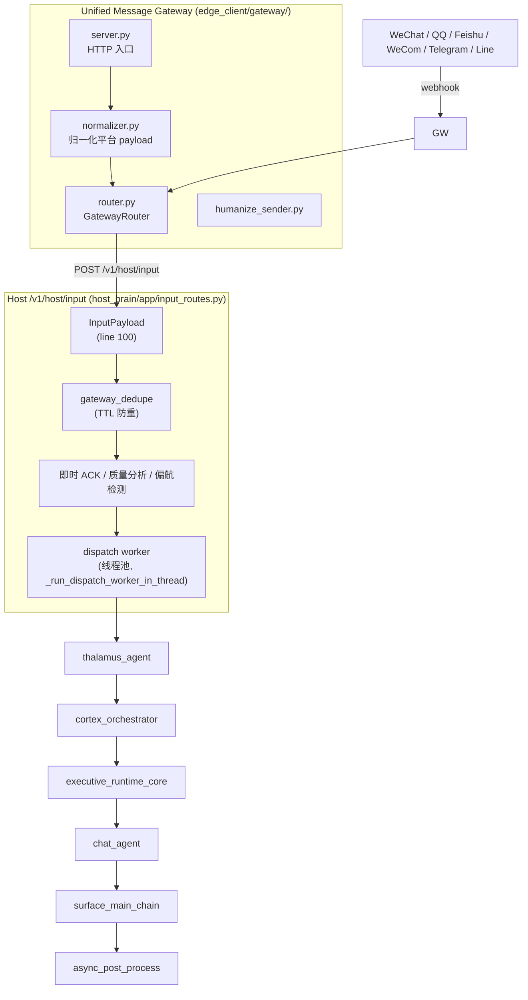
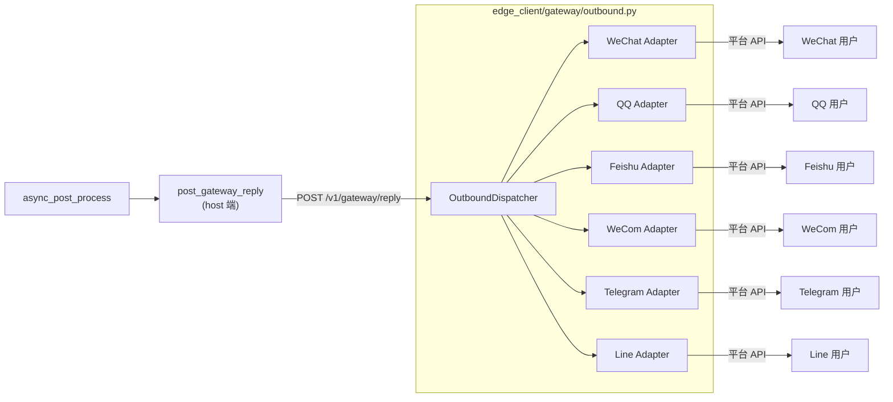
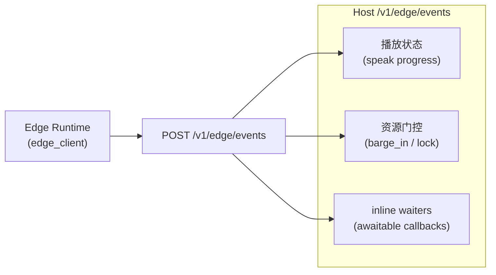

受众：MASTER
标题：图 06 — 输入回流与出站（Gateway / `/v1/host/input` / OutboundDispatcher）

版本：v1.0
日期：2026-05-30
归属：docs/50_project/arch/diagrams/

---

## 怎么读这张图

外部消息进入和发出的核心是 **Unified Message Gateway**：

| 方向 | 链路 |
|---|---|
| **入站** | 平台 webhook → Gateway → `/v1/host/input` → Host 主链 |
| **出站** | Host 主链 → `post_gateway_reply` → `/v1/gateway/reply` → OutboundDispatcher → 平台适配器 |
| **Edge 事件** | Edge Runtime → `/v1/edge/events`（**不是** `/v1/host/input`） |

## 入站链路（消息进入主链）

## 出站链路（回复回到平台）

## Edge 事件链路（与 input 不混）

## 三种入站口径对比

| 入站方式 | HTTP 路由 | 用途 |
|---|---|---|
| **直接 chat** | `POST /v1/chat` | 前端直连聊天主链 |
| **Gateway 平台消息** | `POST /v1/host/input` | 微信 / QQ / 飞书等平台消息归一化进入 |
| **Edge 运行时事件** | `POST /v1/edge/events` | 播放状态、资源门控、inline waiter 等 |

## 代码锚点

| 链路 | 文件 | 行 |
|---|---|---:|
| Gateway 入口 | `edge_client/gateway/server.py` | — |
| Gateway 归一化 | `edge_client/gateway/normalizer.py` | — |
| Gateway 路由 | `edge_client/gateway/router.py` | — |
| Gateway 出站 | `edge_client/gateway/outbound.py` | — |
| 平台适配器 | `edge_client/gateway/adapters/` | — |
| Host 入站 | `host_brain/app/input_routes.py` | 100（InputPayload） |
| Host 入站 worker | 同上 | 192（`_run_dispatch_worker_in_thread`） |
| Host 入站 dedupe | 同上 | 239（`_gateway_dedupe_ttl_s`） |

## 不变量

1. **Gateway 不再是旧 chat 主链里的一个场景分支**；它是独立运行面，平台输入/输出总线。
2. 入站消息**不能**再走旧的 `SCENE_GATEWAY → SceneRouter` 结构；当前是 `Gateway.router → /v1/host/input → 主链`。
3. `/v1/host/input` 已承担 ACK / 进度推送 / 重对齐通知等控制逻辑，不再只是"转发壳"。
4. **Edge 运行时事件**（播放状态 / 资源门控 / inline waiter）走 `/v1/edge/events`，与 `/v1/host/input` 严格分离。
5. Outbound 由 `OutboundDispatcher` 统一，平台 adapter 隔离。

## 已废弃路径

| 旧路径 | 当前事实 |
|---|---|
| `SCENE_GATEWAY` 场景类型 | ❌ 已删除 |
| Gateway 消息走 `SceneRouter` | ❌ 已不再使用 |
| `/v1/host/input` 是"转发壳" | ❌ 已升级为含 ACK / 质量分析 / 偏航检测 |
| Edge 事件走 `/v1/host/input` | ❌ 已迁移到 `/v1/edge/events` |
