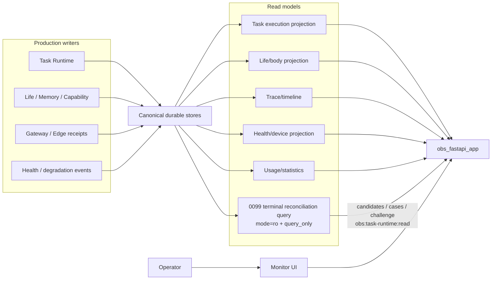
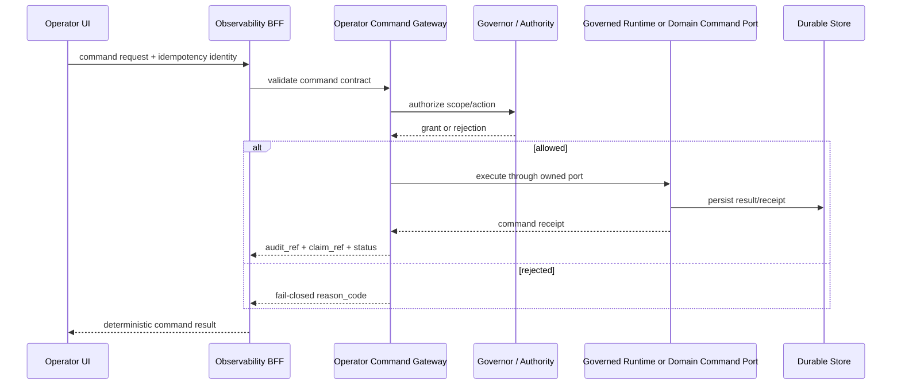
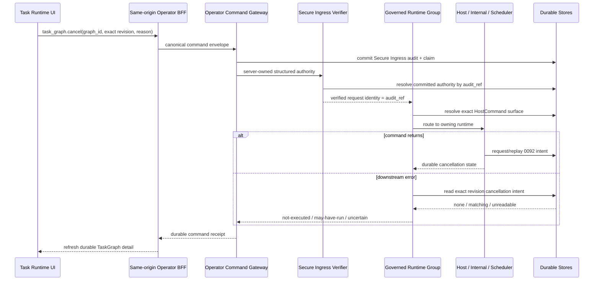
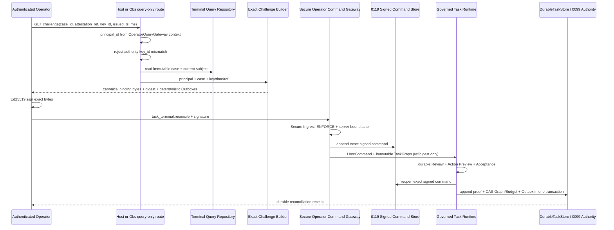
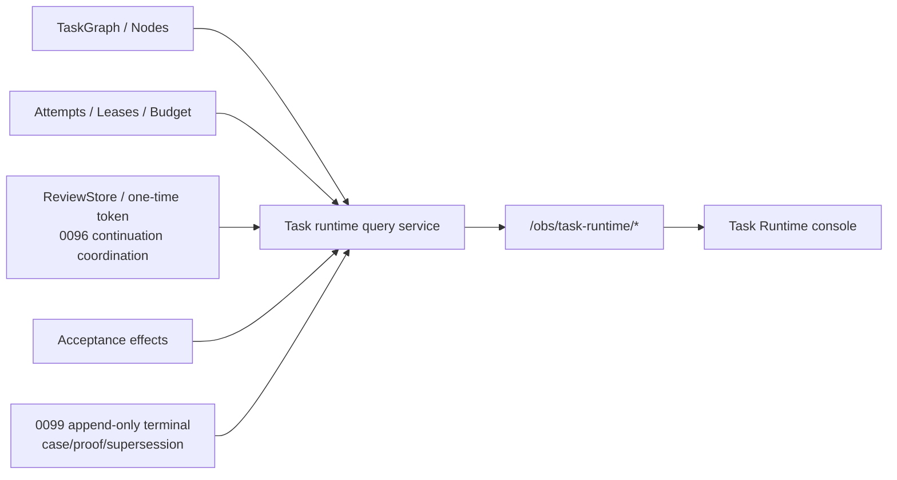
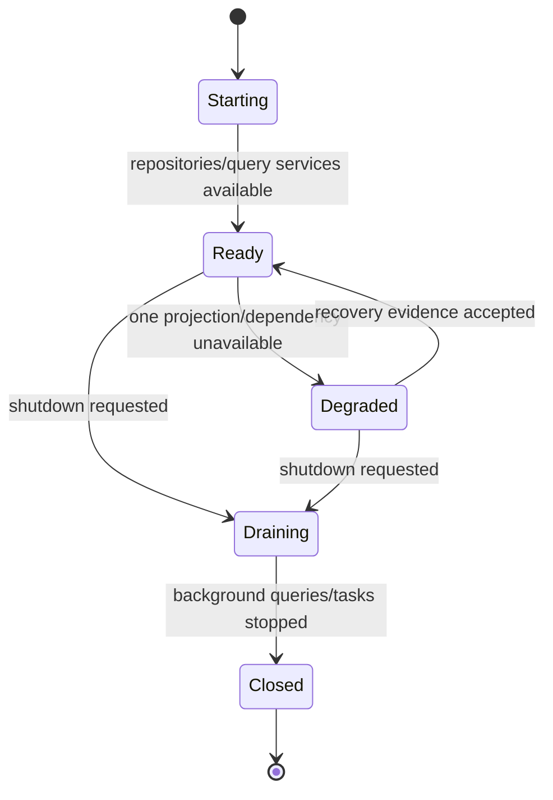

受众：PROJECT
标题：图 07——Observability 与 Operator 数据流

# 图 07：Observability 与 Operator 数据流

版本：v2.2
核对日期：2026-07-16

Observability 是独立 ASGI 读面和 Operator BFF。它应从 durable repositories/projections 解释系统，而不是维护第二套任务或 Life 真相。

## 查询拓扑

Read model 可以被重建、缓存或丢弃。Projection 丢失不得导致 canonical Task、Review、Life event 或 receipt 丢失。

## Operator 命令

目标是所有有副作用的 Operator 动作都进入 Governed Runtime。当前仍有部分专用 control endpoint 直接调用 domain/embodiment port，因此 Operator 统一 authority 属于需要继续收敛的边界，不能把整个 Observability 面描述成纯读取后宣称完成。

TaskGraph 取消是已接通但默认关闭的窄切片：

取消命令要求 `obs:write + task-runtime:cancel`；Operation/Effect/terminal 对账命令使用各自受控 action/scope，认证 actor 必须由服务端绑定。四个 Operator 开关默认关闭，启用 cancellation 必须三类 reconciliation 全开；0099 exact auto 默认开启且只消费 `EXACT_REPAIRABLE`。`task_terminal.reconcile` 还要求 Secure Ingress=`ENFORCE`、可执行 Gateway 与 verification-only Ed25519 公钥环；完整命令写入 0119，TaskGraph 只携带 ref/digest，并经 Review、Action Preview、Acceptance 后执行。Operator 本地 governed SQLite integration 已通过，HTTP/network canary 仍未运行。

业务对账口径必须保守：一般 Effect `FAILED` 仍可能已产生副作用。0099 将历史 terminal 半状态分为 exact auto/signed/quarantine：仅唯一 graph-scope exact FAILED bundle 可由默认开启的 auto 精确处理，结构漂移 quarantine。隔离真实 SQLite restart canary 已验证 exact FAILED proof/预算释放与 signed-required CANCELLED 围栏同时成立；后者会阻断 production readiness。外部 inventory、key lifecycle、签名 Operator HTTP 与 Operation/Effect canary 未知，状态保持 `AUTO_EXACT_ON / LOCAL_SQLITE_CANARY_PASS / OPERATOR_OFF / HTTP_CANARY_NOT_RUN`。

## 0099 Terminal reconciliation 查询与签名

三条 GET 精确要求 `obs:task-runtime:read`。主 Host 与独立 Obs 都只从同 canonical SQLite 的 `mode=ro + PRAGMA query_only=ON` repository 读取，禁止 fallback 到完整 `DurableTaskStore`；case snapshot 与 proof signature 不进入普通摘要。Challenge 从 request context 绑定认证 principal，接收 `attestation_ref/key_id/issued_ts_ms`；若认证 authority 自带 key ID则拒绝不一致请求。它复用 runtime builder，返回 0099 authority 使用的 exact Ed25519 bytes、deterministic Graph/Budget Outbox identity 与 `command_request`。命令 POST 经 Secure Ingress 后先进入 0119，再以 ref/digest 进入 governed runtime；本地真实 SQLite 链路已覆盖 Review 到 Effect exact replay。HTTP/network canary、外部 deployment credential 与 key rotation/revocation仍未知。

## Task/Review 观测

UI 应按范围显示真实能力边界：TaskGraph 取消必须由用户选择 exact revision，命令完成后刷新 durable projection，不能先把按钮响应显示成 Graph 已 `CANCELLED`。0099 cases 页面必须区分 `EXACT_REPAIRABLE`、`SIGNED_REPAIR_REQUIRED` 与 `QUARANTINED_STRUCTURAL`；quarantine 不能显示为“可一键修复”，默认关闭的 system auto也不能显示为已启用。task-bound Review 的 authority仍属于 ReviewStore/0096 coordination。部署凭据与真实 canary未完成。

## 生命周期

Observability 的降级不应被误报为 Host 业务完成；同样，Host 健康也不代表 Gateway、Edge、模型 Provider 和所有投影都可用。健康响应必须按 component 给出状态和 reason code。

## 代码锚点

- 独立入口：`host_brain/obs_main.py`
- ASGI composition：`host_brain/app/obs_fastapi_app.py`
- Obs routers：`host_brain/app/obs_routes_*.py`
- Task runtime query：`host_brain/app/obs_routes_task_runtime.py`
- Operator command composition：`host_brain/app/observability_runtime/command_composition.py`
- Domain command ports：`host_brain/app/observability_runtime/domain_command_ports.py`
- Query/projection runtime：`host_brain/app/observability_runtime/projection_runtime.py`
- Health/device projection：`host_brain/app/observability_runtime/health_device_projection.py`
- Durable query repositories：`host_brain/persistence/*_query_repository.py`
- 0099 terminal service/store：`host_brain/task_runtime/terminal_state_reconciliation.py`、`host_brain/persistence/task_terminal_reconciliation_*`
- 0119 signed command/store：`host_brain/audit/migrations/0119_terminal_operator_signed_command.sql`、`host_brain/persistence/terminal_operator_command_store.py`
- Governed terminal runtime/handler：`host_brain/app/governed_terminal_reconciliation_runtime.py`、`host_brain/app/accepted_terminal_reconciliation_handler.py`
- Monitor UI：`host_brain/app/monitor_ui/`

## 不变量

1. Host Main 与 Observability 是独立 ASGI 应用。
2. UI/Obs cache 不是 durable authority。
3. 有副作用的 Operator 操作必须留下 command、grant、audit 和 receipt。
4. 观测查询不得为了“补齐数据”反向修改业务 store。
5. 页面、router 或 cache 数量不属于稳定架构合同，以源码 manifest 和 OpenAPI 为准。
6. Query challenge 只有在其字节与 Store 验签 binding 完全一致时才可标为“可直接签名”；subject 摘要或自制 JSON 不能冒充签名 authority。
