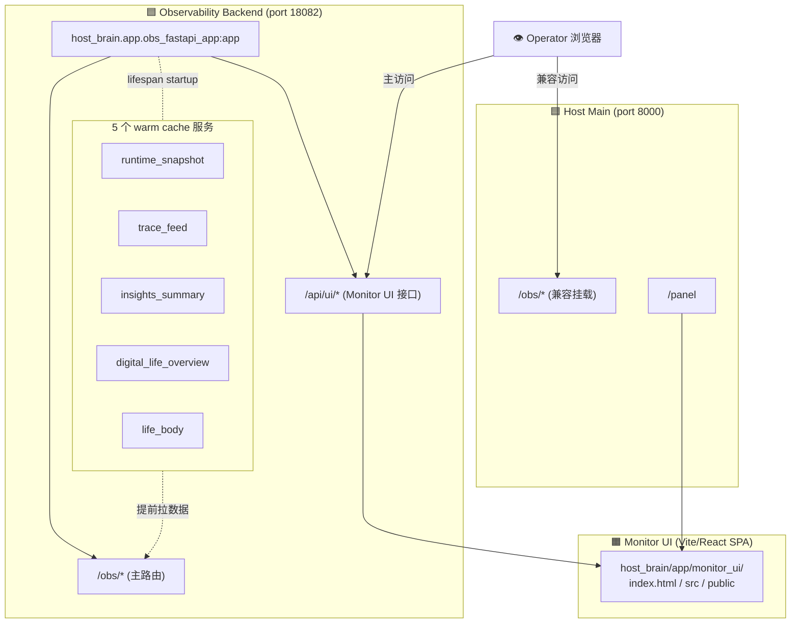
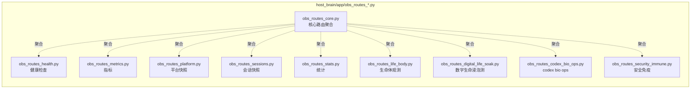
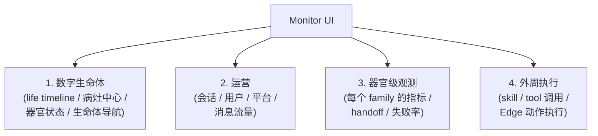
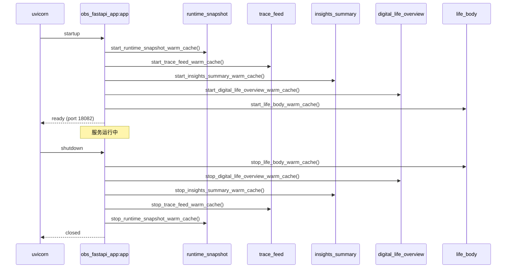

受众：MASTER
标题：图 07 — Observability 拓扑（独立 ASGI / warm cache / Monitor UI）

版本：v1.0
日期：2026-05-30
归属：docs/50_project/arch/diagrams/

---

## 怎么读这张图

Observability 的核心特点：

1. **是独立 ASGI app**（不是 Host 的子路由），有独立进程和端口
2. **有 5 个 warm cache 服务**，提前拉好热点数据，提升 Monitor UI 响应
3. **Host Main 也保留 `/obs/*` 兼容挂载**，但完整观测以 Obs Backend 为准
4. **Monitor UI 是一个 Vite/React SPA**，由 Host 或 Obs 静态托管

## 总览

## obs_routes 模块清单

## Monitor UI 信息架构（4 大板块）

## 启动顺序（lifespan）

## 关键环境变量

| 变量 | 默认 | 说明 |
|---|---|---|
| `HOST_OBS_APP_HOST` | `127.0.0.1` | Obs Backend 监听 host |
| `HOST_OBS_APP_PORT` | `18082` | Obs Backend 端口 |
| `HOST_RUNTIME_ENV_FILE` | — | runtime env 配置文件路径 |
| `HOST_SYS_MODE` | `normal` | sys_mode（locked / maintenance / normal） |
| `HOST_GOVERNOR_EXECUTOR_WORKERS` | `4` | governor executor 线程数（2-12） |

## 代码锚点

| 内容 | 文件 |
|---|---|
| Obs 主入口 | `host_brain/obs_main.py` |
| Obs ASGI app | `host_brain/app/obs_fastapi_app.py`（**单文件保留**） |
| obs_routes 模块组 | `host_brain/app/obs_routes_*.py` |
| Monitor UI 工程 | `host_brain/app/monitor_ui/` |
| warm cache 实现 | `host_brain/observability/*_warm_cache.py` |

## 不变量

1. Host Main 与 Observability 是**两个独立 ASGI app**，独立端口、独立进程。
2. **`obs_fastapi_app.py` 是单文件保留**（与 Host 的三件套不同），因为 Obs 装配相对简单。
3. Host Main 的 `/obs/*` 是**兼容路径**；正式观测应走 Obs Backend (`:18082`)。
4. 5 个 warm cache 在 lifespan startup 时启动，shutdown 时反序停止。
5. Monitor UI 是 Vite/React SPA，构建产物由 Host 或 Obs 静态托管，**不是后端服务**。

## 已废弃路径

| 旧路径 | 当前事实 |
|---|---|
| Obs 是 Host 主进程的附属接口 | ❌ 已升级为独立后端 |
| 单一 `/obs` 路由模块 | ❌ 已拆为 10 个 obs_routes_* |
| Monitor UI 只是"调试控制台" | ❌ 已升级为"数字生命驾驶舱" |
