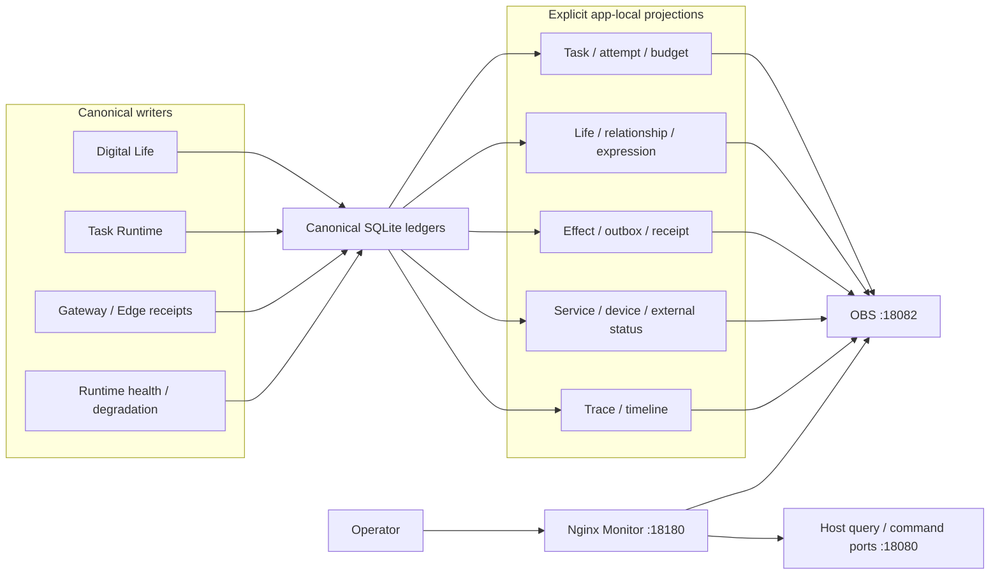
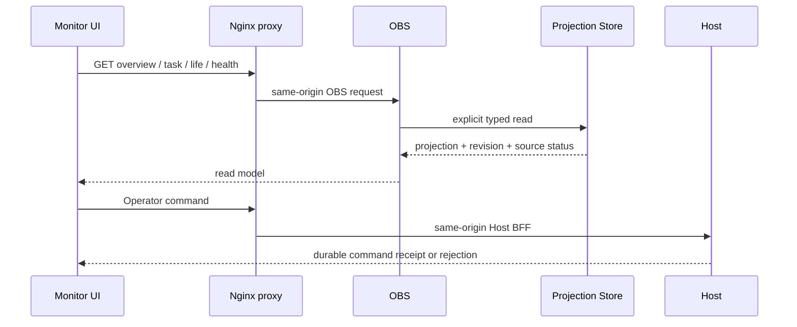
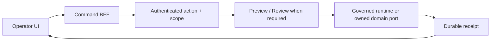
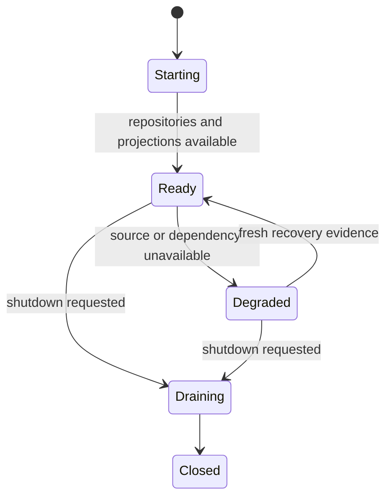

受众：PROJECT
标题：图 07——Observability、Monitor 与 Operator 数据流

# 图 07：Observability、Monitor 与 Operator 数据流

核对日期：2026-08-02

OBS 是独立 ASGI 读面和 Operator BFF。Monitor UI 展示 OBS／Host 的真实读模型，不保存 Task、Life、Review 或外部服务的第二套真相。

## 查询拓扑

Projection 可以重建、缓存或降级；其丢失不得导致 canonical event、Task、Review 或 receipt 丢失。当前 OBS 注册 22 个显式 projection job，路由不通过全局 query-projection locator 重新发现 store。

## Monitor Overview

Overview 的 service card 同时展示 Host、OBS、Gateway、Edge、模型与外部依赖的真实状态。前端 `overviewModel` 只归一服务端返回的 status、reason 和 evidence；不能把网络请求成功、toast 或默认绿色样式当成服务健康。

真实页面验收必须由 Nginx 提供构建产物并读取运行中的 OBS。Playwright fixture、请求拦截和静态 JSON 只用于前端回归，不算全栈通过。

## Operator 写入

有副作用的 Operator 动作必须经服务端绑定 actor、action、scope 和幂等身份。UI 只有收到 durable receipt 后才能显示成功；本地 React state 不能预先改变 canonical 状态。

## 降级与生命周期

Host 健康不代表 OBS、Monitor、Gateway、Edge、模型、Neo4j、Chroma 和 Redis 全部健康。每个组件必须独立给出 `PASS`、`FAIL`、`DEGRADED` 或 `NOT_TESTED` 及 reason；远端 Edge 当前必须显示 `NOT_TESTED`。

## 代码锚点

- 独立入口：`host_brain/obs_main.py`
- OBS composition：`host_brain/app/obs_application.py`
- OBS routes：`host_brain/app/obs_routes_*.py`
- Projection runtime：`host_brain/app/observability_runtime/projection_runtime.py`
- Health/device projection：`host_brain/app/observability_runtime/health_device_projection.py`
- Service heartbeat：`host_brain/app/observability_runtime/service_health_heartbeat.py`
- Monitor UI：`host_brain/app/monitor_ui/`
- Overview model：`host_brain/app/monitor_ui/src/features/observability/overviewModel.js`

## 不变量

1. Host 与 OBS 是独立 ASGI 应用。
2. Monitor、OBS cache 和 projection 都不是 durable authority。
3. 查询不得反向修改业务 store。
4. Operator 成功必须由服务端 durable receipt 证明。
5. component 状态独立，禁止用 Host health 代替完整服务栈验收。
6. endpoint 数量是当前机器事实，不是永久公共合同。
