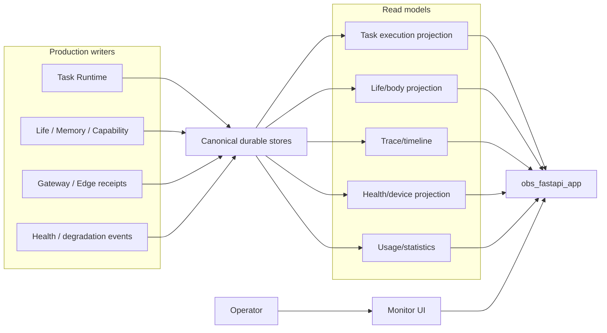
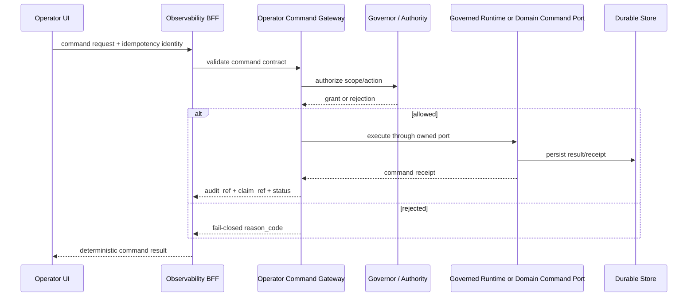
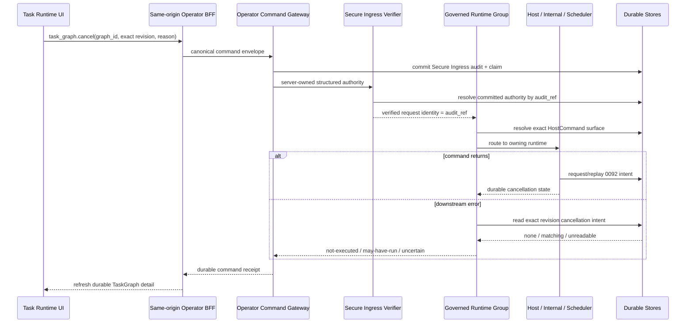
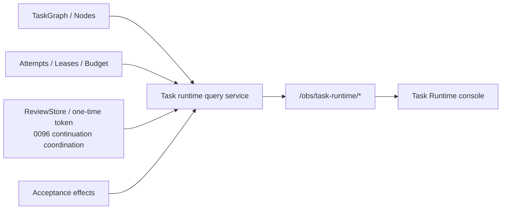
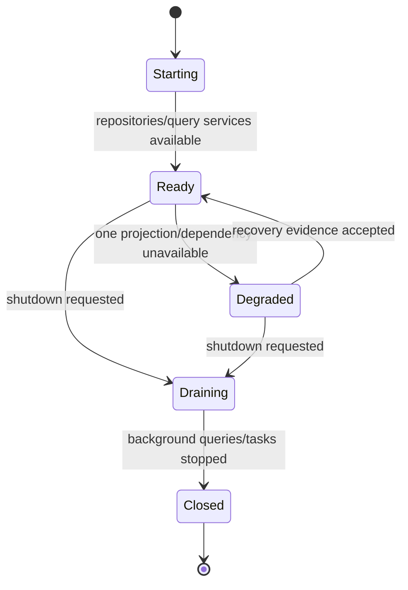

受众：PROJECT
标题：图 07——Observability 与 Operator 数据流

# 图 07：Observability 与 Operator 数据流

版本：v2.0
核对日期：2026-07-15

Observability 是独立 ASGI 读面和 Operator BFF。它应从 durable repositories/projections 解释系统，而不是维护第二套任务或 Life 真相。

## 查询拓扑

Read model 可以被重建、缓存或丢弃。Projection 丢失不得导致 canonical Task、Review、Life event 或 receipt 丢失。

## Operator 命令

目标是所有有副作用的 Operator 动作都进入 Governed Runtime。当前仍有部分专用 control endpoint 直接调用 domain/embodiment port，因此 Operator 统一 authority 属于需要继续收敛的边界，不能把整个 Observability 面描述成纯读取后宣称完成。

TaskGraph 取消是已接通但默认关闭的窄切片：

取消命令要求 `obs:write + task-runtime:cancel`；Operation 对账命令要求 `obs:write + task-runtime:reconcile`，认证 actor 由服务端绑定。两个开关默认关闭，开启 cancellation 时必须同时开启 Operation 对账；还要求 Secure Ingress=`ENFORCE`、可执行 Gateway 与 verification-only Ed25519 公钥环。这里证明的是 `WIRED_DEFAULT_OFF`，不是 production enablement。

业务对账的观测口径必须保守：一般 Acceptance Effect `FAILED` 仍可能已经产生副作用，UI/Operator 只能显示 `RECONCILIATION_REQUIRED`，不得把它渲染成“未执行”或“可安全取消”；只有 `COMMITTED + durable receipt` 可显示正向完成证据。旧 `FAILED_EVIDENCE` 属历史兼容与修复缺口。Operation 签名对账已完成 service、composition、OBS command 和 verification-only 公钥注入，定级 `WIRED_DEFAULT_OFF / CANARY_NOT_RUN`；Effect 签名对账、历史修复、Budget 高竞争、部署凭据与真实 canary仍缺，cancellation 保持 `PRODUCTION_OFF`。

## Task/Review 观测

UI 应按范围显示真实能力边界：TaskGraph 取消必须由用户选择 exact revision，命令完成后刷新 durable projection，不能先把按钮响应显示成 Graph 已 `CANCELLED`。task-bound Review 在一次性 token 被消费、拒绝或到期后会由 0096 worker 自动续跑/收口；非 Task subject 不会被自动调度。ReviewStore 仍是 decision/token authority，0096 coordination 只负责 claim、takeover 和重入，不得在 UI 中被显示成第二个 Review status。Review HTTP 决策要求独立 `review.operator / review:decide` principal；部署凭据与真实 canary仍未完成。

## 生命周期

Observability 的降级不应被误报为 Host 业务完成；同样，Host 健康也不代表 Gateway、Edge、模型 Provider 和所有投影都可用。健康响应必须按 component 给出状态和 reason code。

## 代码锚点

- 独立入口：`host_brain/obs_main.py`
- ASGI composition：`host_brain/app/obs_fastapi_app.py`
- Obs routers：`host_brain/app/obs_routes_*.py`
- Task runtime query：`host_brain/app/obs_routes_task_runtime.py`
- Operator command composition：`host_brain/app/observability_runtime/command_composition.py`
- Domain command ports：`host_brain/app/observability_runtime/domain_command_ports.py`
- Query/projection runtime：`host_brain/app/observability_runtime/projection_runtime.py`
- Health/device projection：`host_brain/app/observability_runtime/health_device_projection.py`
- Durable query repositories：`host_brain/persistence/*_query_repository.py`
- Monitor UI：`host_brain/app/monitor_ui/`

## 不变量

1. Host Main 与 Observability 是独立 ASGI 应用。
2. UI/Obs cache 不是 durable authority。
3. 有副作用的 Operator 操作必须留下 command、grant、audit 和 receipt。
4. 观测查询不得为了“补齐数据”反向修改业务 store。
5. 页面、router 或 cache 数量不属于稳定架构合同，以源码 manifest 和 OpenAPI 为准。
