# Natsume AI 系统数据流全景报告

> 报告生成时间：2026-03-11 17:20（初版）| 最后更新：2026-03-17 18:19（P16 数据流图更新）
> 报告范围：双端通信 · 各功能数据流 · 各模块数据流 · Agent 治理 · Agent 路由 · Graph 编排 · 多智能体分派
> 报告模型：claude-4.6-sonnet
> 当前状态：P1-P16 全部完成，多智能体重构升级已封板（含 supervisor_dispatch / agent_dispatch / judge 完整链路）

---

## 目录

1. [系统整体架构概览](#一系统整体架构概览)
2. [双端通信数据流](#二双端通信数据流)
3. [主聊天链路数据流（SCENE_CHAT）](#三主聊天链路数据流scene_chat)
4. [复杂场景数据流（LangGraph 多节点）](#四复杂场景数据流langgraph-多节点)
5. [Agent 治理数据流（Governor）](#五agent-治理数据流governor)
6. [Agent 路由数据流（SceneRouter）](#六agent-路由数据流scenerouter)
7. [Graph 编排数据流（MainChain + LangGraph）](#七graph-编排数据流mainchain--langgraph)
8. [Retrieval 七路召回数据流](#八retrieval-七路召回数据流)
9. [情感层数据流](#九情感层数据流)
10. [Bond 关系层数据流](#十bond-关系层数据流)
11. [Edge 端各功能数据流](#十一edge-端各功能数据流)
12. [双端通信打通状态评估](#十二双端通信打通状态评估)
13. [多智能体分派数据流（P15/P16）](#十三多智能体分派数据流p15p16)

---

## 一、系统整体架构概览

```mermaid
graph TB
    subgraph USER["用户侧"]
        U1["用户语音输入"]
        U2["用户文字输入（微信/直接）"]
        U3["用户屏幕（截图）"]
    end

    subgraph EDGE["Edge Client（本地端）\nPort: 17800"]
        E_ASR["ASR 语音识别\nedge_client/senses/asr.py"]
        E_TTS["TTS 语音合成\nedge_client/actuators/tts_engine.py"]
        E_VTS["VTS 表情驱动\nedge_client/actuators/vts_driver.py"]
        E_WECHAT["微信监听\nedge_client/channels/wechat_listener.py"]
        E_DESKTOP["桌面控制\nedge_client/actuators/desktop_controller.py"]
        E_RPC["Edge RPC Gateway\nedge_client/app/fastapi_app.py"]
        E_FALLBACK["Fallback LLM\nedge_client/rpc/fallback_llm.py"]
        E_REPORTER["事件上报\nedge_client/rpc/event_reporter.py"]
        E_INPUT["输入上报\nedge_client/channels/input_reporter.py"]
    end

    subgraph HOST["Host Brain（云端/服务端）\nPort: 8000"]
        H_CHAT["POST /v1/chat\nchat_handler.py"]
        H_GOV["Governor 鉴权\ngovernor/decision.py"]
        H_ROUTER["SceneRouter\ngraph/main_chain.py"]
        H_RETRIEVAL["七路召回\nretrieval/orchestrator.py"]
        H_LLM["LLM Gateway\nintegrations/llm_gateway.py"]
        H_AIRLOCK["Airlock 检疫\nairlock/quarantine.py"]
        H_EPISODIC["情节记忆\nmemory/episodic_store.py"]
        H_BOND["Bond 关系层\nbond/bond_dynamics.py"]
        H_VTS_CTRL["VTS 控制\nchannels/vts.py"]
        H_EDGE_EVENTS["POST /v1/edge/events\nsystem_handler.py"]
        H_INPUT["POST /v1/host/input\ninput_routes.py"]
        H_AGENT["Agent Loop\napp/vision/agent_loop.py"]
    end

    subgraph LLM_BACKEND["LLM 后端"]
        LLM_LOCAL["本地 Ollama\nqwen3:8b\n127.0.0.1:11434"]
        LLM_CLOUD["云端 Gemini\ngemini-2.5-pro/flash"]
    end

    subgraph STORAGE["存储层"]
        DB_CHROMA["ChromaDB\n向量数据库"]
        DB_NEO4J["Neo4j / SQLite\nBond 关系图"]
        DB_EPISODIC["情节记忆存储"]
    end

    U1 --> E_ASR
    U2 --> E_WECHAT
    U3 --> E_DESKTOP

    E_ASR -->|"ASR 结果\nHTTP POST /v1/host/input"| H_INPUT
    E_WECHAT -->|"微信消息\nHTTP POST /v1/host/input"| H_INPUT
    E_REPORTER -->|"批量事件\nHTTP POST /v1/edge/events"| H_EDGE_EVENTS
    E_INPUT -->|"输入上报\nHTTP POST /v1/host/input"| H_INPUT

    H_CHAT -->|"SSE 流式响应"| E_RPC
    H_VTS_CTRL -->|"VTS 指令\nHTTP POST /v1/edge/vts"| E_RPC
    H_AGENT -->|"截图请求\nHTTP POST /v1/edge/screenshot"| E_RPC
    H_AGENT -->|"自动化操作\nHTTP POST /v1/edge/automate"| E_RPC

    E_RPC -->|"TTS 合成指令\nHTTP POST /v1/edge/speak"| E_TTS
    E_RPC -->|"VTS 表情指令"| E_VTS
    E_RPC -->|"截图结果"| H_AGENT
    E_RPC -->|"操作结果"| H_AGENT

    H_LLM -->|"本地推理"| LLM_LOCAL
    H_LLM -->|"云端推理"| LLM_CLOUD

    H_RETRIEVAL --> DB_CHROMA
    H_BOND --> DB_NEO4J
    H_EPISODIC --> DB_EPISODIC

    E_TTS --> U1
    E_VTS -->|"Live2D 表情"| U3
```

---

## 二、双端通信数据流

### 2.1 Host → Edge 通信（主动推送方向）

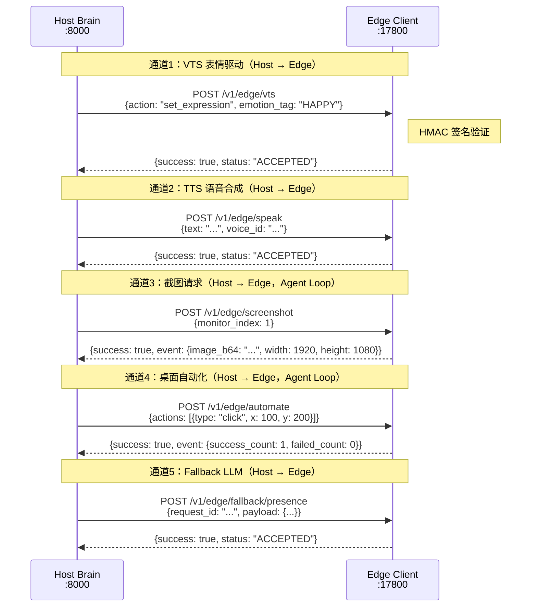

### 2.2 Edge → Host 通信（上报方向）

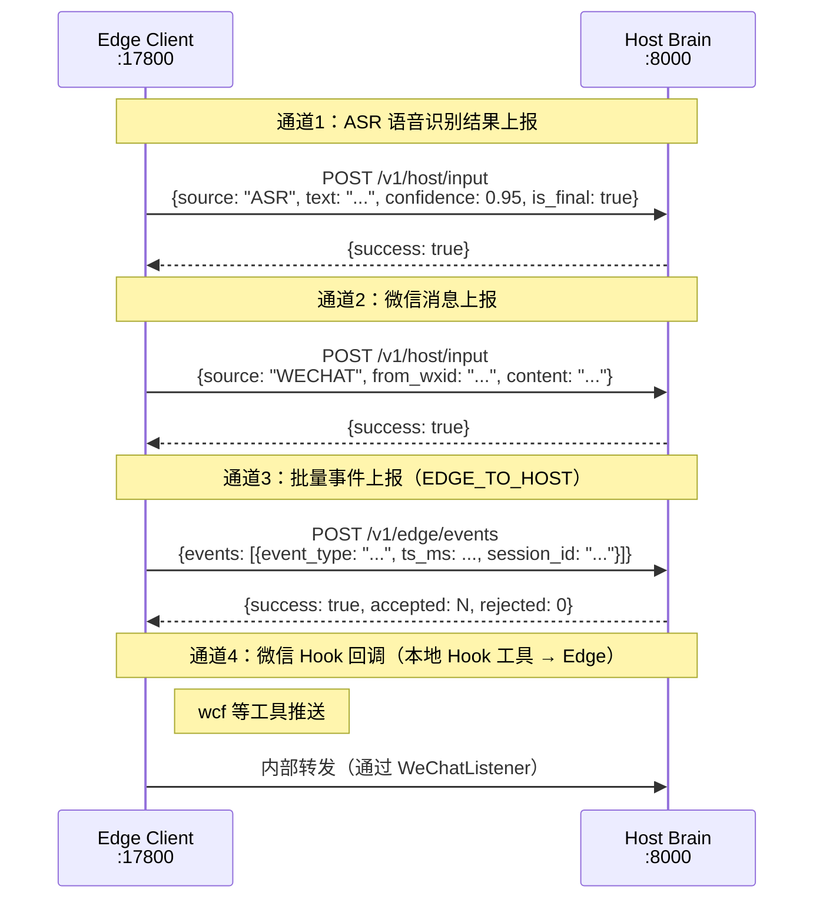

### 2.3 双端 SSE 流式通信（核心聊天链路）

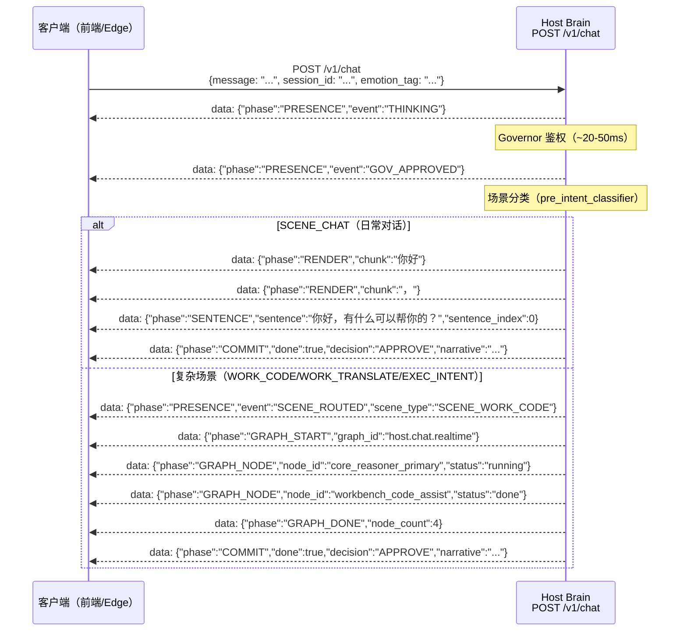

---

## 三、主聊天链路数据流（SCENE_CHAT）

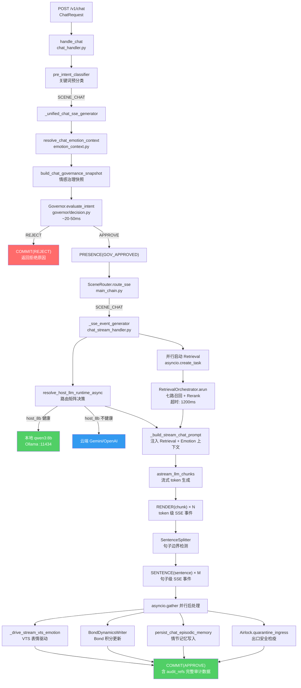

### 3.1 SCENE_CHAT 关键延迟分布

| 阶段 | 典型延迟 | 超时配置 |
|------|---------|---------|
| Governor 鉴权 | 20-50ms | 2000ms |
| Retrieval 七路召回 | 200-800ms | 1200ms（可配置） |
| LLM 首 token | 300-1500ms | 10000ms（最低） |
| 后处理并行（Airlock+Episodic+Bond+VTS） | 50-300ms | 各自独立超时 |

---

## 四、复杂场景数据流（LangGraph 多节点）

> **P15 重构说明**：所有复杂场景（WORK_CODE / WORK_TRANSLATE / EXEC_INTENT / AUTO）统一走 `PROFILE_WORKFLOW_SUPERVISED` 图，
> 旧的 `core_reasoner_primary → scene_router_post_core → workbench_*` 长链已废弃，
> 现在统一入口为 `supervisor_dispatch → agent_dispatch → judge_agent → chat_render_node`。

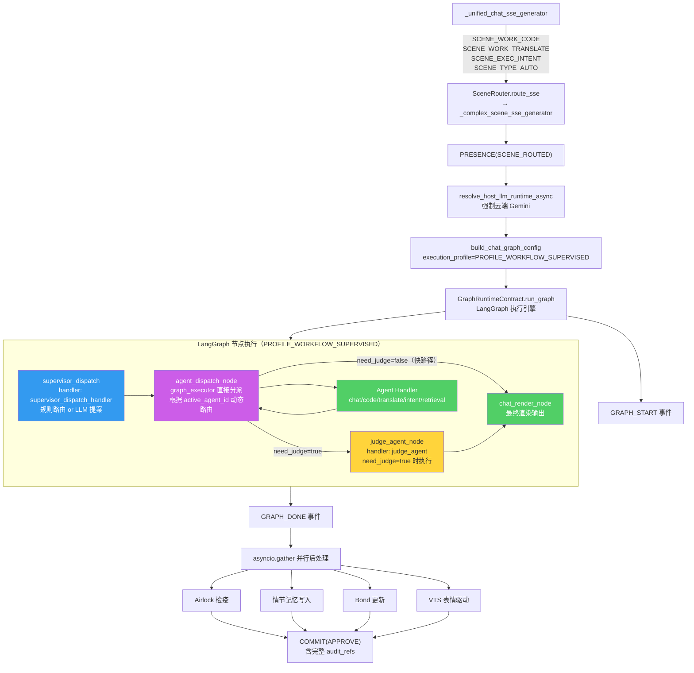

### 4.1 场景节点序列（P15 重构后）

| 场景 | execution_profile | 节点序列 | 总预算 |
|------|------------------|---------|--------|
| SCENE_CHAT | `PROFILE_CHAT_FAST` | `chat_direct_ja → chat_render_node` | 8-12s |
| SCENE_WORK_CODE | `PROFILE_WORKFLOW_SUPERVISED` | `supervisor_dispatch → agent_dispatch → [judge_agent] → chat_render_node` | 30-240s |
| SCENE_WORK_TRANSLATE | `PROFILE_WORKFLOW_SUPERVISED` | `supervisor_dispatch → agent_dispatch → [judge_agent] → chat_render_node` | 30-240s |
| SCENE_EXEC_INTENT | `PROFILE_INTENT_EXEC` | `intent_agent_entry → safety_verifier → judge_agent → chat_render_node` | 30-240s |
| SCENE_TYPE_AUTO | `PROFILE_WORKFLOW_SUPERVISED` | `supervisor_dispatch → agent_dispatch → [judge_agent] → chat_render_node` | 30-240s |

> **注**：`workbench_code_assist` / `workbench_translate` 仍注册为 model 节点，供 agent handler 内部通过 `invoke_model_node` 调用，不再作为主图边序列节点。

---

## 五、Agent 治理数据流（Governor）

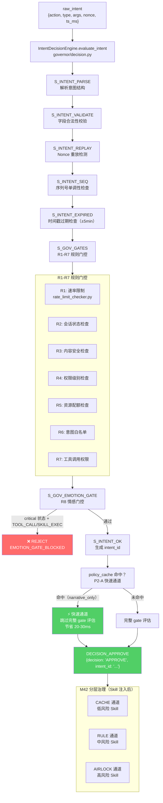

### 5.1 Governor 决策链关键参数

| 门控 | 检查内容 | 失败原因码 |
|------|---------|-----------|
| R1 速率限制 | 每会话请求频率 | `RATE_LIMIT_EXCEEDED` |
| R5 资源配额 | Token 消耗配额 | `QUOTA_EXCEEDED` |
| R8 情感门控 | `critical` 状态下拒绝工具调用 | `EMOTION_GATE_BLOCKED` |
| Nonce 重放 | 防止请求重放攻击 | `NONCE_REPLAY` |
| 时间戳过期 | ±5 分钟窗口 | `INTENT_EXPIRED` |

---

## 六、Agent 路由数据流（SceneRouter）

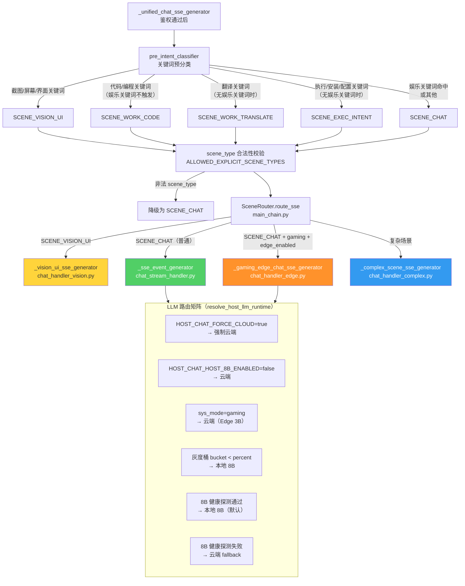

### 6.1 pre_intent_classifier 路由优先级

```
优先级（VISION_UI > WORK_CODE > WORK_TRANSLATE > EXEC_INTENT > CHAT）：
1. 截图/屏幕/界面关键词                → SCENE_VISION_UI（最高优先级）
2. 代码/编程关键词                     → SCENE_WORK_CODE（娱乐关键词不触发代码路由）
3. 娱乐关键词命中（动漫/音乐/游戏等）  → 强制 SCENE_CHAT（修复问题A：防止"安装这首歌"误判为 EXEC_INTENT）
4. 翻译关键词（无娱乐关键词时）        → SCENE_WORK_TRANSLATE
5. 执行/安装/配置关键词（无娱乐关键词时）→ SCENE_EXEC_INTENT
6. 其他（默认）                        → SCENE_CHAT
```

### 6.2 LLM 路由矩阵（resolve_host_llm_runtime）

```
1. HOST_CHAT_FORCE_CLOUD=true          → 强制云端（最高优先级）
2. HOST_CHAT_HOST_8B_ENABLED=false     → 云端
3. sys_mode=gaming                     → 云端（Edge 3B 路径）
4. 灰度排除（gray_rollout.in_rollout=false） → 云端
5. 本地 8B 健康探测通过                → 本地 qwen3:8b（默认路径）
6. 本地 8B 健康探测失败                → 云端 fallback
```

### 6.2 Gaming Edge 路由（特殊路径）

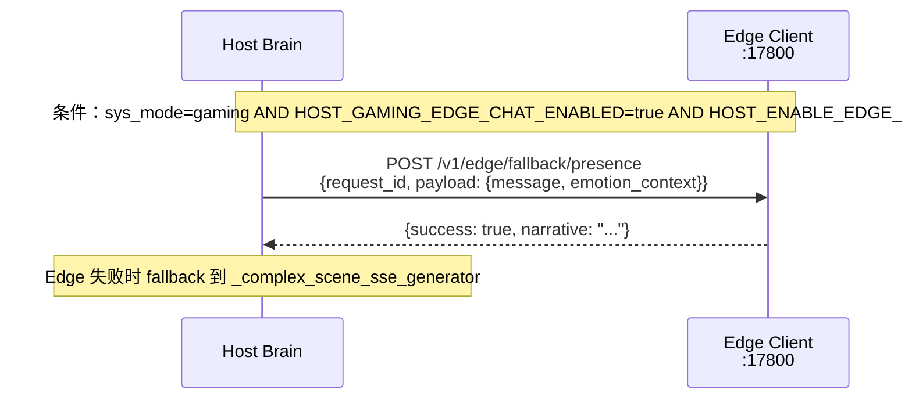

---

## 七、Graph 编排数据流（MainChain + LangGraph）

### 7.1 MainChain 节点链路（轻编排层）

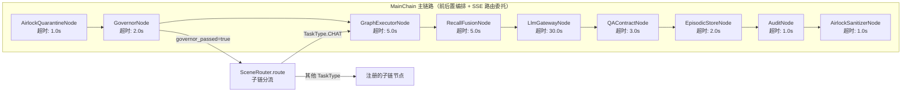

> ✅ **当前状态（2026-03-11）**：`MainChain` 节点已补充最小可执行语义（输入净化、任务类型映射、召回/LLM/QA/审计/出口净化状态落点），
> `run_as_sse_adapter()` 已具备前置节点执行、SSE 事件观测、后置节点收尾，不再是纯透传。
> 对外 SSE 协议保持兼容，真实路由仍委托 `_unified_chat_sse_generator`。

### 7.2 graph_executor agent_dispatch_node 数据流（P15/P16）

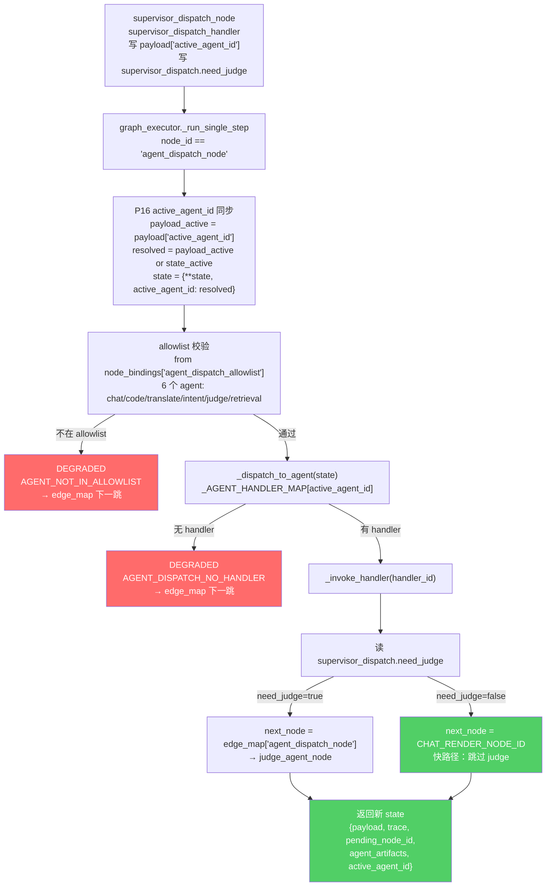

### 7.3 supervisor_dispatch_handler 决策流（P15）

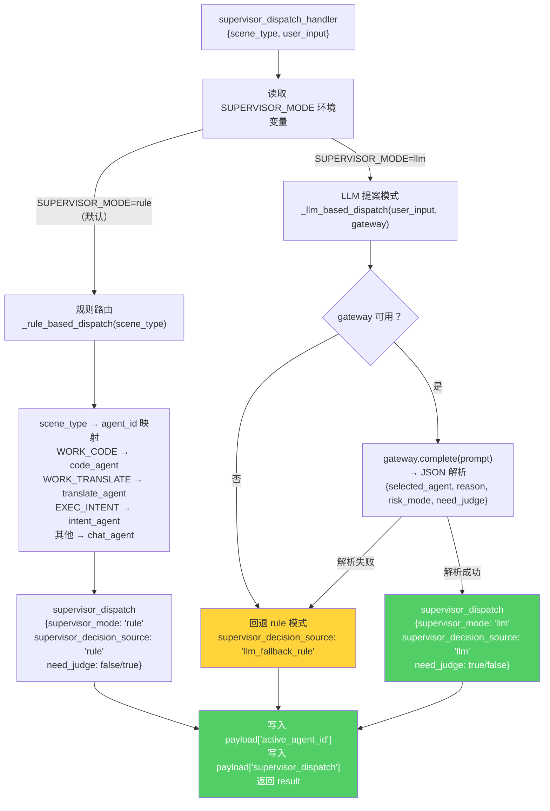

### 7.4 LangGraph 图配置（build_chat_graph_config / _build_graph_config_by_profile）

> **P15 重构说明**：`build_chat_graph_config` 现在通过 `execution_profile` 选择图结构，不再按 `scene_type` 直接映射节点链路。

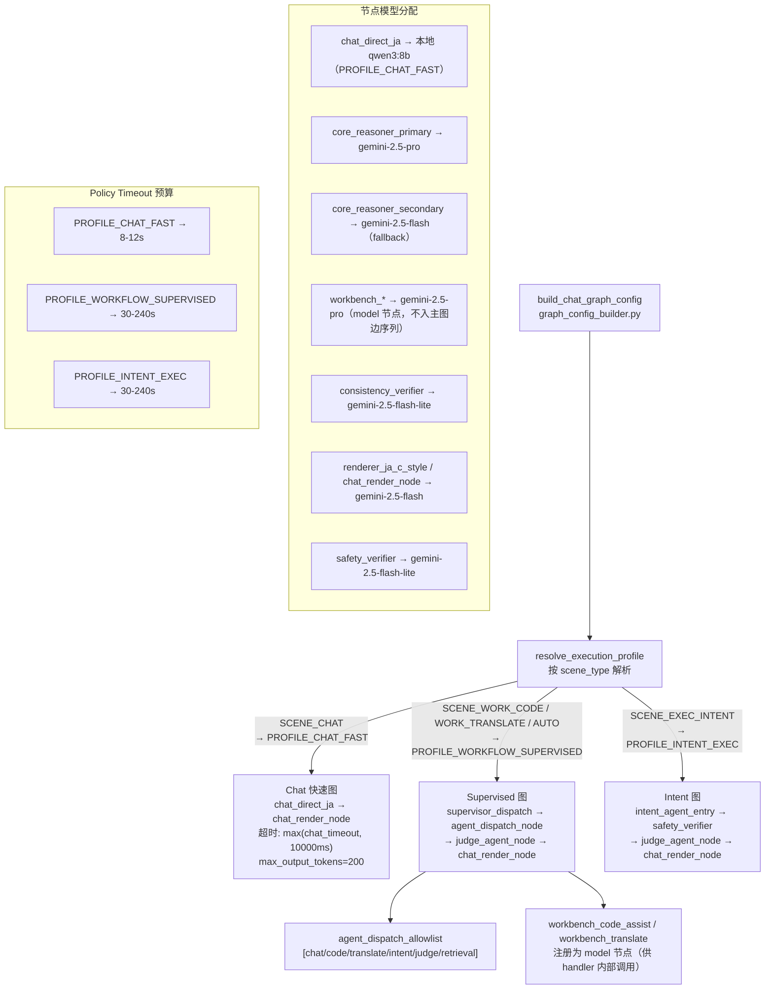

---

## 八、Retrieval 七路召回数据流

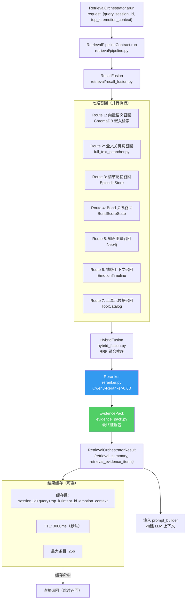

### 8.1 Retrieval 降级策略

| 状态 | 触发条件 | 处理方式 |
|------|---------|---------|
| `SKIPPED` | `HOST_ENABLE_RETRIEVAL=false` 或 `HOST_CHAT_DISABLE_RETRIEVAL=true` | 跳过召回，使用空摘要 |
| `DEGRADED(RETRIEVAL_TIMEOUT)` | 超过 `HOST_STREAM_RETRIEVAL_TIMEOUT_MS`（默认 1200ms） | 使用降级摘要，后台任务继续 |
| `DEGRADED(RETRIEVAL_FAILED)` | 召回管道异常 | 使用降级摘要 |
| `OK` | 正常完成 | 注入完整证据包 |

---

## 九、情感层数据流

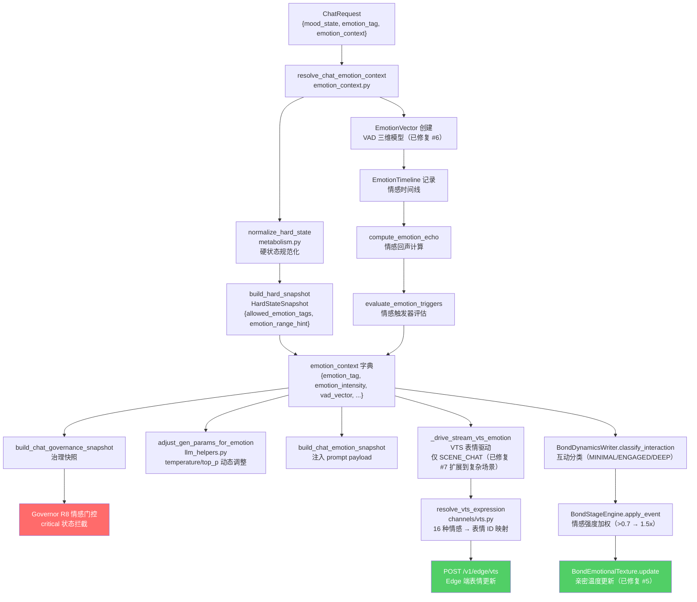

### 9.1 情感标签映射（16 种）

| 情感标签 | 中文 | VTS 表情 ID |
|---------|------|------------|
| HAPPY | 开心 | exp_happy |
| SAD | 悲伤 | exp_sad |
| ANGRY | 愤怒 | exp_angry |
| SURPRISED | 惊讶 | exp_surprised |
| NEUTRAL | 平静 | exp_neutral |
| ... | ... | ... |

---

## 十、Bond 关系层数据流

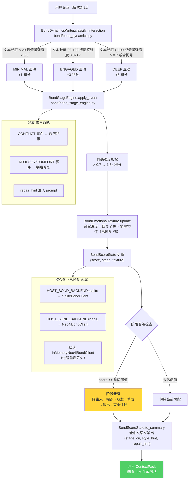

---

## 十一、Edge 端各功能数据流

### 11.1 ASR 语音识别数据流

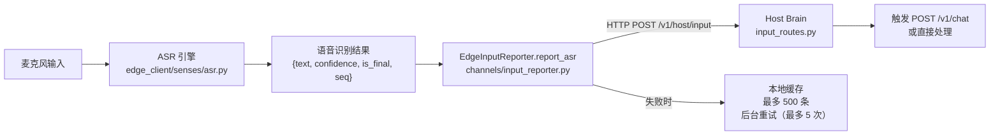

### 11.2 TTS 语音合成数据流

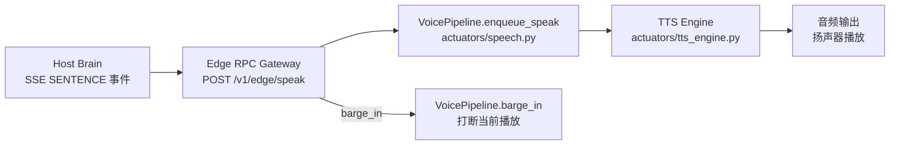

### 11.3 VTS 表情驱动数据流

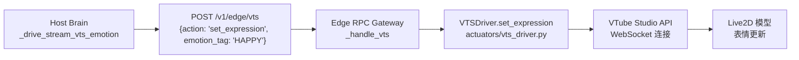

### 11.4 Agent Loop 视觉自动化数据流

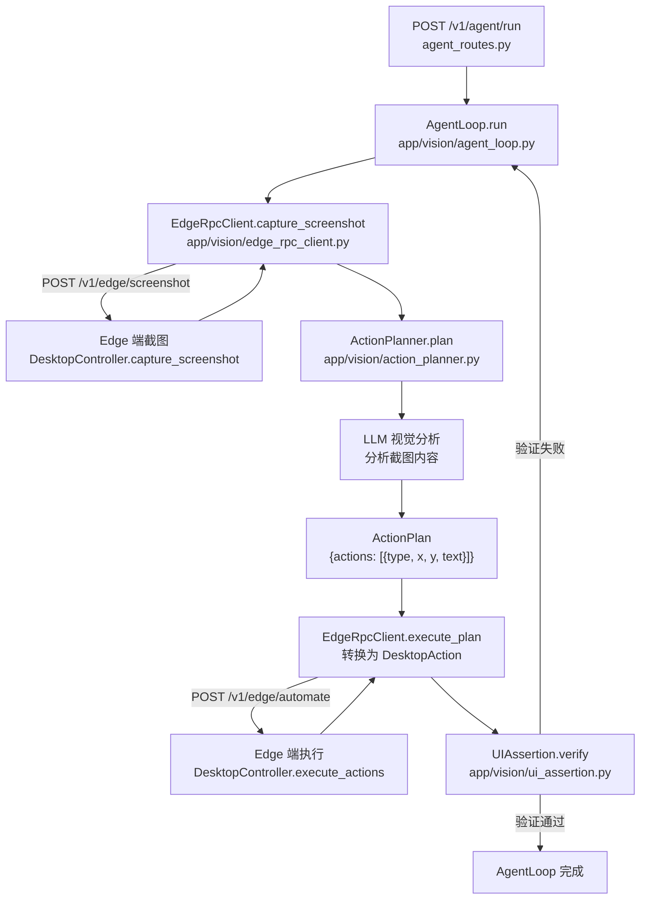

---

## 十二、双端通信打通状态评估

### 12.1 通信通道完整性矩阵

| 通信通道 | 方向 | 协议 | 鉴权 | 实现状态 | 打通状态 |
|---------|------|------|------|---------|---------|
| `/v1/chat` SSE 流式 | 客户端→Host | HTTP SSE | 无（内网） | ✅ 完整实现 | ✅ **已打通** |
| `/v1/edge/speak` TTS | Host→Edge | HTTP POST | HMAC | ✅ 完整实现 | ✅ **已打通** |
| `/v1/edge/vts` 表情 | Host→Edge | HTTP POST | HMAC | ✅ 完整实现 | ✅ **已打通** |
| `/v1/edge/barge_in` 打断 | Host→Edge | HTTP POST | HMAC | ✅ 完整实现 | ✅ **已打通** |
| `/v1/edge/screenshot` 截图 | Host→Edge | HTTP POST | HMAC | ✅ 完整实现 | ✅ **已打通** |
| `/v1/edge/automate` 自动化 | Host→Edge | HTTP POST | HMAC | ✅ 完整实现 | ✅ **已打通** |
| `/v1/edge/fallback/*` Fallback | Host→Edge | HTTP POST | HMAC | ✅ 完整实现 | ✅ **已打通** |
| `/v1/host/input` 输入上报 | Edge→Host | HTTP POST | HMAC | ✅ 完整实现 | ✅ **已打通**（`run_main_chain_from_input` 已实现，触发完整 chat 流程） |
| `/v1/edge/events` 事件上报 | Edge→Host | HTTP POST | 无 | ✅ 完整实现 | ✅ **已打通**（情感事件触发 Bond 更新 + VTS 驱动，本次修复） |
| `/v1/edge/wechat/callback` 微信 | 本地Hook→Edge | HTTP POST | 无（本地） | ✅ 完整实现 | ✅ **已打通** |

### 12.2 未完全打通的关键问题

```mermaid
flowchart TD
    subgraph FIXED["✅ 本次修复已打通的链路"]
        F1["Edge 事件上报\nPOST /v1/edge/events\n✅ 情感事件触发 Bond 更新\n✅ 情感事件触发 VTS 驱动\n（ASR_FINAL/EMOTION_DETECTED/USER_REACTION）"]

        F2["ASR/微信输入上报\nPOST /v1/host/input\n✅ run_main_chain_from_input 已实现\n✅ 触发完整 Governor+LLM+Bond+VTS 流程"]
    end

    subgraph REMAIN["⚠️ 仍存在的限制"]
        B3["Gaming Edge 路径\nPOST /v1/edge/fallback/presence\n⚠️ 无 VTS 驱动（有意设计）\n⚠️ 无 Bond 更新（有意设计）\n⚠️ 无 episodic 写入（有意设计）\n已补充设计说明注释"]

        B4["SCENE_VISION_UI\n⚠️ 已可用但需 image_upload_consent=true 才允许传图\n⚠️ 仍需持续验证真实云模型稳定性"]
    end

    style F1 fill:#51cf66,color:#fff
    style F2 fill:#51cf66,color:#fff
    style B3 fill:#ffd43b,color:#333
    style B4 fill:#ffd43b,color:#333
```

### 12.3 双端 SSE 事件协议对齐状态

| SSE 事件 | SCENE_CHAT | 复杂场景 | Gaming Edge | 对齐状态 |
|---------|-----------|---------|------------|---------|
| `PRESENCE(THINKING)` | ✅ | ✅ | ✅ | ✅ 对齐 |
| `PRESENCE(GOV_APPROVED)` | ✅ | ✅ | ✅ | ✅ 对齐 |
| `PRESENCE(SCENE_ROUTED)` | ❌（不发送） | ✅ | ❌ | ⚠️ 不对称（设计如此） |
| `GRAPH_START` | ❌ | ✅ | ❌ | ⚠️ 仅复杂场景 |
| `RENDER(chunk)` | ✅ | ❌ | ❌ | ⚠️ 仅 SCENE_CHAT |
| `SENTENCE(sentence)` | ✅ | ❌ | ❌ | ⚠️ 仅 SCENE_CHAT |
| `GRAPH_DONE` | ❌ | ✅ | ❌ | ⚠️ 仅复杂场景 |
| `COMMIT(APPROVE)` | ✅ | ✅ | ✅ | ✅ 对齐 |
| `COMMIT.audit_refs.vts` | ✅ | ✅（已修复 #12） | ⚠️ 空 `{}` | ⚠️ Gaming Edge 缺失 |
| `COMMIT.audit_refs.context_pack_validation` | ✅ | ✅ | ⚠️ 空 `{}` | ⚠️ Gaming Edge 缺失 |

---

## 十三、多智能体分派数据流（P15/P16）

### 13.1 _AGENT_HANDLER_MAP 与 AGENT_ALLOWLIST 对齐状态（P16 后）

| agent_id | `_AGENT_HANDLER_MAP` | `AGENT_ALLOWLIST` | handler 文件 | need_judge | 说明 |
|----------|---------------------|-------------------|-------------|-----------|------|
| `chat_agent` | ✅ | ✅ | `chat_agent_handler.py` | false | 快路径，跳过 judge |
| `code_agent` | ✅ | ✅ | `code_agent_handler.py` | true | P9 新增 |
| `translate_agent` | ✅ | ✅ | `translate_agent_handler.py` | true | P10 新增 |
| `intent_agent` | ✅ | ✅ | `intent_agent_handler.py` | true | 高风险 |
| `judge_agent` | ✅ | ✅ | `judge_agent_handler.py` | — | 裁判节点 |
| `retrieval_agent` | ✅ | ✅ | `retrieval_agent_handler.py` | false | P11 新增，P16 补注册 |
| `safety_agent` | ❌ | ❌ | 无 | — | 待 P17+ 补充 handler |
| `renderer_agent` | ❌ | ❌ | 无 | — | 待 P17+ 补充 handler |

### 13.2 多智能体完整链路时序

```mermaid
sequenceDiagram
    participant SR as SceneRouter
    participant SD as supervisor_dispatch_node
    participant GE as graph_executor
    participant AD as agent_dispatch_node
    participant AG as Agent Handler
    participant JD as judge_agent_node
    participant CR as chat_render_node

    SR->>SD: state {scene_type, user_input}
    SD->>SD: SUPERVISOR_MODE=rule → 规则路由
    SD->>SD: SUPERVISOR_MODE=llm → LLM 提案（失败回退 rule）
    SD-->>GE: payload['active_agent_id'] = 'code_agent'
    SD-->>GE: payload['supervisor_dispatch'] = {need_judge: true, ...}

    GE->>AD: node_id == 'agent_dispatch_node'
    AD->>AD: P16 同步 active_agent_id 到 state
    AD->>AD: allowlist 校验（6 个 agent）
    AD->>AG: _dispatch_to_agent → _invoke_handler('code_agent_handler')
    AG-->>AD: agent_artifacts

    alt need_judge=true
        AD->>JD: next_node = judge_agent_node
        JD-->>CR: 裁判通过后 → chat_render_node
    else need_judge=false（快路径）
        AD->>CR: next_node = CHAT_RENDER_NODE_ID（跳过 judge）
    end

    CR-->>SR: GRAPH_DONE
```

---

*报告最后更新：2026-03-17 18:21 | 生成模型：claude-4.6-sonnet*
*基于代码库深度分析，覆盖 host_brain 和 edge_client 全部核心模块，含 P16 多智能体技术债清理*
*P15 重构后数据流图已全量更新：图4/图6/图7.4 对齐 PROFILE_WORKFLOW_SUPERVISED 新链路*

