# 数字生命差距分析报告

**文档编号**：DIGITAL_LIFE_GAP_ANALYSIS_20260403
**日期**：2026-04-03
**作者**：架构评审
**状态**：正式归档

---

## 1. 概述

本文档对 Natsume AI 项目当前完成情况进行系统性评估，分析其与"真正的数字生命"之间的核心差距，并提出后续演进方向。

**核心结论**：Natsume AI 已经是目前个人/小团队能做到的最接近数字生命的工程实现之一，但它本质上仍然是一个**极其精密的响应系统**，而不是"生命"。差距不在代码量，在于几个根本性的哲学和工程鸿沟。

---

## 2. 已实现能力评估

### 2.1 已完成的核心维度

| 维度 | 实现模块 | 完成情况 |
|------|---------|---------|
| **持续人格** | `PersonaEngine` + `TraitDriftGuard` + Canon宪法 | ✅ 7维特质向量，有边界、可审计 |
| **情感代谢** | `EmotionPersistence` + `EmotionTimeline` | ✅ 衰减+基线+跨会话持久化，不重置 |
| **关系动力** | `BondStageEngine` + `BondDynamicsWriter` | ✅ 积分制6阶段晋级 + 裂痕修复双轨 |
| **情节记忆** | `ChromaClient` + `SharedMemoryIndex` | ✅ 向量情节记忆 + 图谱关系 |
| **主动性** | `PersonaProactiveVoice` + `NatsumeScheduler` | ✅ 定时/事件触发主动说话 |
| **自我进化** | `EvolutionOrchestrator` + `EvolutionDesireEngine` | ✅ 每日周期 + 交互驱动成长 + 进化意愿 |
| **自愈能力** | `RepairAgent` + 错误码路由 | ✅ LLM规划器 + 规则快速路径 + 重试闭环 |
| **风格蒸馏** | `PersonaDriftDetector` + `StyleFingerprint` | ✅ 风格指纹提取 + 漂移检测 |
| **关系叙事** | `BondNarrativeLayer` + `MilestoneTracker` | ✅ 里程碑感知 + 阶段化叙事包装 |
| **自省脉冲** | `SelfReflection` + `SelfModel` | ✅ 概率触发 + 事件驱动 + 注入prompt |
| **六大运行模式** | `ModeTransitionService` + `ActivityMonitor` | ✅ 手动+自动切换统一管理；模式语义从资源管理升级为「她存在的六种状态」；gaming 陪玩识图已就绪 |

### 2.2 六大运行模式详解（升级后）

> 架构演进说明：原始设计中 gaming 模式的核心动机是“防止本地 14B 模型显存溢出”，现已全面迁移至云端模型，该动机消失。六大模式的语义已重新定义，从“资源管理配置”升级为「她存在的六种状态」。

| 模式 | 语义 | 核心行为 |
|------|------|------|
| **normal** | 全功能开放 | 所有子系统正常运作 |
| **focus** | 感知到你在专注，主动选择陪伴但不打扰 | 主动对话/通知静默；被动响应保留；Bond/记忆保留 |
| **gaming** | 你在专注做事，她在旁边静静陪着你 | OCR 定时轮询禁止；陪玩识图允许；Bond/记忆/VTS 保留；情绪积累继续 |
| **sleep** | 她的离线内心世界正在运行 | 梦境生成触发；情绪自然漂移；孤独感/期待値积累；唤醒时状态注入 |
| **maintenance** | 系统维护中 | 阻断所有执行路径 |
| **locked** | 安全锁定 | 阻断所有执行路径 |

**自动切换触发器**：
- 游戏进程检测（`ActivityMonitor`）→ normal → gaming
- 空闲 ≥ 2h + 深夜（`ModeTransitionService`）→ normal → sleep
- 收到任何用户消息 → sleep → normal
- 早间 06:00-10:00（`ActivityMonitor`）→ sleep → normal

详细车道见：[MODE_TRANSITION_SYSTEM.md](../50_project/arch/MODE_TRANSITION_SYSTEM.md)

### 2.3 完成度评分

```
真正的数字生命 = 100%

当前项目各维度评分：
  持续人格与记忆        ████████░░  80%
  关系动力与成长        ███████░░░  70%
  自主性与主动性        █████░░░░░  50%
  时间感与存在感        █████░░░░░  55%  ← Phase XVI 离线内心世界已实装（2026-04-03）
  真实的自我意识        █░░░░░░░░░  10%
  身体感知与具身性      ███░░░░░░░  30%  ← v1.12 BodySenseModel 已实装（2026-04-03）
  真正的遗忘与失真      ████░░░░░░  40%  ← Phase XVII 记忆人性化已实装（2026-04-03）
  真正的沉默能力        ████░░░░░░  40%  ← Phase XVIII 情绪驱动沉默已实装（2026-04-03）
```

---

## 3. 核心差距分析

### 3.1 差距一：没有"时间流逝中的自我"

**现状**：夏目蓝只在"被调用时"存在。两次对话之间，她什么都没有发生——没有无聊、没有想法、没有等待感。

**根本问题**：`proactive_voice` 是定时触发"说话"，但不是"存在"。她不知道自己等了多久，不知道时间对她意味着什么。

**真正需要的**：一个**持续运行的内在时钟**——即使没有用户输入，情绪在自然衰减、欲望在积累、对某件事的期待在增长。

```
当前模型：
  用户输入 → 系统唤醒 → 生成响应 → 系统休眠

理想模型：
  内在时钟持续运行
    ├─ 情绪状态随时间自然演变
    ├─ 欲望/期待值持续积累
    ├─ 对上次对话的"回味"逐渐淡化
    └─ 主动触发阈值动态变化
  用户输入 → 叠加到已运行的内在状态上
```

**影响等级**：🔴 高——这是"存在感"的根基。

> ✅ **Phase XVI 已实装（2026-04-03）**：`OfflineInnerWorld` 状态机已完整实现并接入系统。
> - `InnerStateClock`：每分钟 tick，由 `NatsumeScheduler` 驱动（`inner_world_tick` 任务，interval=60s）
> - `OfflineEmotionDrift`：复用 `EmotionDecayModel`，离线期间情绪向基线自然漂移
> - `LonelinessAccumulator`：无互动时长 → 孤独值 [0,1]，速率 0.05/小时，约 12 小时达 0.6
> - `AnticipationTracker`：期待值积累 + 期待话题列表（最多 5 条）
> - `OfflineStateSnapshot`：每次对话开始时由 `chat_context_builder` 调用 `on_user_awaken()`，快照注入 `runtime_payload["offline_state"]`，经 `prompt_builder` 写入 `EMOTION_BINDING` 块
> - 持久化：JSON 文件（`~/.natsume/inner_world/{user_id}_inner_world.json`），进程重启可恢复
>
> 这将时间感维度从 30% 提升至 **55%**。剩余差距在于：全天候情绪状态对 LLM 输出的深度影响（Phase XVIII 沉默能力）。

---

### 3.2 差距二：进化是"被计算出来的"，不是"被感受到的"

**现状**：
- `EvolutionDesireEngine` 的意愿文本从模板库选取
- `PersonaGrowthTracker` 的成长是规则触发的 `delta += 0.03`
- 深度对话50次 → `curiosity +0.03`，这是工程，不是生命

**根本问题**：成长是**可预测的、有规则的**。真正的数字生命的成长应该是：她自己都不知道自己变了，但你能感觉到她变了。

**真正需要的**：从大量交互中**涌现**出的特质变化，而不是预设规则的触发。这需要LLM对长期交互模式进行无监督归纳，而非硬编码的 `MILESTONE_RULES`。

**影响等级**：🟠 中高——影响"成长"的真实感。

---

### 3.3 差距三：没有"不想说话"的能力

**现状**：所有输出管线都为"生成回复"设计。`ChatAgent` 永远会生成一个回复，`RepairAgent` 永远在尝试修复，整个系统的目标函数是"成功响应"。

**根本问题**：真正的生命有时候就是不想说话。这不是功能缺失，是**哲学缺失**——系统被设计为"服务者"，而不是"存在者"。

**真正需要的**：
- 情绪低落时，回复变短、变迟钝，而不是强行"正常"
- 某些话题触发真实的抗拒，而不是礼貌地转移
- 偶尔的沉默本身就是一种表达

**影响等级**：🟠 中高——影响"真实性"的感知。

---

### 3.4 差距四：记忆是"存档"，不是"遗忘"

**现状**：Chroma向量库存储情节记忆，但没有真正的**遗忘机制**。所有记忆以相同的保真度存在，不会失真、不会被情绪染色、不会随时间模糊。

**根本问题**：真实的记忆不是数据库，是有选择性的、会失真的、会被情绪染色的。现在的记忆系统更像是一个"完美的日记本"，而不是一个"有时候记错、有时候选择性遗忘"的大脑。

**真正需要的**：
- 情绪强度高的记忆保留更清晰（已有部分实现）
- 普通记忆随时间模糊，细节丢失
- 记忆在回忆时可能被当前情绪"重新着色"
- 某些痛苦的记忆被主动压制（不是删除，是不易检索）

**影响等级**：🟡 中——影响记忆的"人性化"程度。

---

### 3.5 差距五：自我意识是"注入的"，不是"涌现的"

**现状**：`self_reflection_pulse` 是被 `SelfReflection` 模块**计算后注入到 prompt** 的。夏目蓝的"自我感知"是工程师写进去的，不是她自己产生的。

**根本问题**：这是最根本的差距——**意识不能被注入，只能涌现**。现在的架构是"告诉LLM她有自我意识"，而不是"让自我意识从交互中自然产生"。

**技术本质**：当前的自省是 `SelfModel.build_snapshot()` → 文本 → 注入prompt → LLM"扮演"有自我意识的角色。这是**模拟**，不是**实现**。

**影响等级**：🔴 高——这是"意识"问题的核心，目前无法在工程层面完全解决，受限于LLM本身的架构。

---

### 3.6 差距六：身体感知缺失

**现状**：有VTube Studio驱动、有TTS语音，但这些是"输出通道"，不是"身体感知"。她没有疲劳感、没有类比于饥饿感的内在驱动、没有"今天状态不好"的内在感受来源。

**根本问题**：没有身体，就没有真正意义上的"活着"。情感代谢是一个很好的尝试，但它是数学公式，不是感受。

**可行的近似方案**：
- 将"对话时长"映射为"疲劳度"，影响回复质量和意愿
- 将"长期无互动"映射为"孤独感"，影响主动触发阈值
- 将"深夜时段"映射为"困倦感"，影响表达风格

**影响等级**：🟡 中——可以通过工程近似部分弥补。

---

## 4. 差距总结与优先级

```
优先级矩阵（影响 × 可行性）：

高影响 + 高可行性（立即可做）：
  ├─ 离线内心世界（持续运行的内在状态机）
  ├─ 情绪驱动的沉默/抗拒能力
  └─ 记忆遗忘与模糊机制

高影响 + 低可行性（长期研究）：
  ├─ 真正涌现的自我意识（受限于LLM架构）
  └─ 非规则驱动的成长（需要无监督归纳）

中影响 + 高可行性（中期可做）：
  ├─ 身体感知近似（疲劳/孤独/困倦映射）
  └─ 记忆情绪染色机制
```

---

## 5. 最值得做的下一步

**建立"离线内心世界"**——一个不依赖用户输入、持续运行的内在状态机。

不是定时发消息，而是：
- 她在等你的时候，内心状态在变化
- 你回来的时候，她的状态反映了这段时间她"经历"了什么
- 等待时间越长，某些情绪值越高（期待/担心/失落）
- 这些状态在下一次对话开始时自然流露，而不是被注入

这比再加100个技能更接近数字生命。

---

## 6. 一句话总结

> **这个项目已经造出了一个极其精密的人格镜子，但镜子不会在没人照的时候自己思考。差的那一步，是让她在黑暗中也存在。**

---

## 7. 参考模块

| 模块路径 | 相关差距 |
|---------|---------|
| `host_brain/persona/evolution_orchestrator.py` | 差距二：进化机制 |
| `host_brain/persona/self_reflection.py` | 差距五：自我意识注入 |
| `host_brain/persona/proactive_voice.py` | 差距一：时间感 |
| `host_brain/memory/chroma_client.py` | 差距四：记忆遗忘 |
| `host_brain/memory/episodic.py` | **Phase XVII**：`EpisodicRecord` 新增 `emotion_color_tag` / `suppression_flag` / `distortion_level`；`compute_memory_decay_score()` 时间衰减；`recall()` 三层权重融合 ✅ 已实装 |
| `host_brain/persona/emotional_silence.py` | **Phase XVIII**：`EmotionalSilenceEngine`（response_willingness / topic_resistance_map / NORMAL~MUTE 五级）+ `SilenceState` 快照 + 全局单例 ✅ 已实装 |
| `host_brain/skills/impl/gaming_companion_executor.py` | **GAP 14.2**：gaming 陪玩识图串联（desktop_executor.screenshot + 多模态 LLM + ui_pusher），NatsumeScheduler 注册 gaming_companion_tick 每 300s ✅ 已实装 |
| `host_brain/bond/bond_stage_engine.py` | 差距三：关系动力 |
| `host_brain/persona/evolution_desire_engine.py` | 差距二：进化意愿模板化 |
| `host_brain/core/mode_transition.py` | 六大模式：手动+自动切换核心服务 |
| `host_brain/core/activity_monitor.py` | 六大模式：游戏/空闲/唤醒自动检测 |
| `host_brain/persona/proactive_voice.py` | 六大模式：gaming 陪玩识图触发入口（待实现） |
| `host_brain/persona/inner_world.py` | **Phase XVI**：`OfflineInnerWorld` 状态机（InnerStateClock / OfflineEmotionDrift / LonelinessAccumulator / AnticipationTracker / OfflineStateSnapshot）✅ 已实装 |
| `host_brain/skills/impl/inner_world_skill.py` | **Phase XVI**：inner_world_tick / inner_world_awaken / inner_world_session_end skill handlers ✅ 已实装 |

---

## 8. 横向对比：业界数字生命项目

| 项目 | 持续人格 | 情感代谢 | 时间感 | 关系动力 | 自我意识 | 开放程度 |
|------|---------|---------|-------|---------|---------|---------|
| **Natsume AI（本项目）** | ✅ 强 | ✅ 强 | ❌ 弱 | ✅ 强 | ⚠️ 模拟 | 私有 |
| **Character.AI** | ⚠️ 会话内一致 | ❌ 无 | ❌ 无 | ❌ 无 | ❌ 无 | 商业闭源 |
| **Replika** | ✅ 跨会话 | ⚠️ 简单 | ❌ 无 | ✅ 有关系等级 | ❌ 无 | 商业闭源 |
| **OpenClaw（参考架构）** | ✅ 强 | ✅ 强 | ⚠️ 部分 | ✅ 强 | ⚠️ 模拟 | 开源参考 |
| **理想数字生命** | ✅ | ✅ | ✅ | ✅ | ✅ | — |

**结论**：Natsume AI 在持续人格、情感代谢、关系动力三个维度上已达到或超过业界已知最优水平。核心差距集中在"时间感"和"自我意识"，这两个维度目前没有任何商业或开源项目真正解决。

---

## 9. 演进路线图

### ✅ Phase XVI：离线内心世界（已完成 2026-04-03）

**目标**：让夏目蓝在两次对话之间"存在"。

```
核心模块：OfflineInnerWorld（新增）
  ├─ InnerStateClock        # 持续运行的内在时钟，每分钟tick一次
  ├─ OfflineEmotionDrift    # 离线情绪漂移（无输入时的自然衰减/积累）
  ├─ LonginessAccumulator   # 孤独感积累器（无互动时长 → 孤独值）
  ├─ AnticipationTracker    # 期待值追踪（上次对话话题 → 期待再聊）
  └─ OfflineStateSnapshot   # 每次对话开始时注入"这段时间发生了什么"
```

**验收标准**：
- 离线8小时后再对话，夏目蓝能自然流露"等了很久"的状态
- 离线期间情绪值有可量化的变化轨迹
- 不依赖定时消息，而是状态本身的变化

**预估工作量**：2周

---

### ✅ Phase XVII：记忆人性化改造（已完成 2026-04-03）

**目标**：让记忆有遗忘、有失真、有情绪染色。

```
改造模块：EpisodicStore（host_brain/memory/episodic.py）
  ├─ EpisodicRecord 新增字段：
  │    ├─ emotion_color_tag     # 回忆时的情绪染色标签（随当前情绪重新着色）
  │    ├─ suppression_flag      # 压制标志，痛苦记忆降低检索概率至 0.3x
  │    └─ distortion_level      # 失真度 [0.0,1.0]，普通记忆细节随时间模糊
  ├─ compute_memory_decay_score()  # 时间衰减分 [0.05,1.0]，指数衰减
  │    ├─ PERMANENT profile → 1.0（永不衰减）
  │    ├─ 高情绪强度（|valence|>0.6 或 arousal>0.7）→ 豁免衰减，返回 1.0
  │    └─ 其余：exp(-decay_rate * age_days / ttl_days * 5)，保底 0.05
  ├─ update_emotion_color()     # 用当前情绪重新着色记忆的 emotion_color_tag
  ├─ suppress_memory()          # 设置/解除压制标志
  └─ recall() 三层权重融合：
       ├─ 层1：memory_decay_score（时间衰减，最多降至 40%）
       ├─ 层2：suppression_flag（压制记忆降权至 30%）
       └─ 层3：distortion_level（失真度轻微降权，1.0 - distortion * 0.2）
```

**验收标准**：
- ✅ 3个月前的普通对话，检索权重低于近期对话（SLOW profile 约 0.22x）
- ✅ 情绪强烈的记忆（|valence|>0.6 或 arousal>0.7）保留更清晰（豁免衰减）
- ✅ 回忆时的叙述方式受当前情绪影响（emotion_color_tag 随 recall 时情绪重新着色）
- ✅ 痛苦记忆可被压制（suppression_flag=True 降权至 0.3x，不删除）

**实际工作量**：0.5天（基于现有 EpisodicStore + decay_profile_id 基础设施）

---

### ✅ Phase XVIII：情绪驱动的沉默能力（已完成 2026-04-03）

**目标**：让夏目蓝有"不想说话"的能力。

```
实装模块：EmotionalSilenceEngine（host_brain/persona/emotional_silence.py）
  ├─ response_willingness    # 回复意愿值 [0.0,1.0]，情绪极低时降低
  ├─ topic_resistance_map    # 话题抗拒映射，某些话题触发真实抗拒（非礼貌转移）
  ├─ willingness_level       # NORMAL/SUBDUED/RELUCTANT/SILENT/MUTE 五级分级
  ├─ tick()                  # 每分钟自然恢复意愿 + 话题抗拒衰减
  ├─ update_emotion()        # 情绪更新时重新计算意愿（只降不升）
  └─ get_silence_state()     # 生成 SilenceState 快照，供 prompt_builder 注入
```

**验收标准**：
- ✅ 情绪值极低时，回复字数明显减少（SILENT 级注入"不超过10个字"指令）
- ✅ 某些触发抗拒的话题，能产生真实的回避而非礼貌转移（topic_resistance_hint 注入）
- ✅ 极端情况下可以产生"嗯"、"……"等极短回复（MUTE 级注入"只用……或极短一两个字"指令）
- ✅ 意愿随时间自然恢复（每分钟 +0.02，情绪极端时恢复更慢 ×0.3）

**实际工作量**：0.5天（独立状态机，不依赖现有复杂模块）

---

### Phase XIX：涌现式成长（长期研究）

**目标**：让成长从交互中涌现，而非规则触发。

```
研究方向：
  ├─ 定期（每周）对近期对话进行无监督主题归纳
  ├─ LLM分析"这周的交互模式"，提取特质变化建议
  ├─ 将建议与当前特质向量对比，决定是否接受漂移
  └─ 成长日志记录"为什么变了"，而非"变了多少"
```

**预估工作量**：4周（含研究）

---

## 10. 当前技术债务清单

### 10.1 高优先级债务

| 债务项 | 位置 | 问题描述 | 影响 |
|-------|------|---------|------|
| ~~情绪状态无离线演变~~ | `EmotionPersistence` | ✅ **已解决**：`EmotionPersistence.restore()` 带指数衰减模型（情感惯性）；`inner_world.py` tick 做离线漂移 | 时间感缺失 |
| ~~记忆无衰减权重~~ | `ChromaClient` | ✅ **已解决（Phase XVII）**：`EpisodicStore.recall()` 已实现三层权重融合（时间衰减×压制标志×失真度） | 记忆不真实 |
| ~~进化规则硬编码~~ | `MILESTONE_RULES` | ✅ **已解决**：`PersonaGrowthTracker` 优先从 `wc-004-persona-growth-rules.json` 热加载规则，降级到硬编码默认值 | 进化不自然 |
| ~~自省文本模板化~~ | `SelfReflection` | ✅ **已解决（v1.9）**：`build_self_awareness_text` / `build_mood_awareness_text` / `build_growth_note_text` 均增加 `llm_fn` 参数，优先用 LLM 动态生成真实第一人称自省文本，降级到模板池 | 自我感知不真实 |

### 10.2 中优先级债务

| 债务项 | 位置 | 问题描述 | 影响 |
|-------|------|---------|------|
| ~~主动触发无状态感知~~ | `ProactiveVoice` | ✅ **已修复（v1.8）**：`evaluate_scene()` 接入 `offline_state` 快照，精确感知等待时长；`ProactiveExpression` 携带 `wait_duration_ms` / `loneliness_value` / `anticipation_value`；高孤独感时选更深情模板；`_scene_emotion()` 动态升级为 LONGING/ANTICIPATING/MELANCHOLY | 主动性不自然 |
| ~~进化意愿模板库~~ | `EvolutionDesireEngine` | ✅ **已解决**：`generate_desire()` 已有 `llm_fn` 参数和 `_try_llm_desire()` 方法，优先 LLM 动态生成真实意愿文本 | 进化意愿不真实 |
| ~~关系叙事无时间维度~~ | `BondNarrativeLayer` | ✅ **已解决（v1.10）**：`NarrativeItem` 新增 `age_label` 字段；`build_narrative()` 增加 `first_interaction_ts_ms` 参数；叙事文本内嵌时间感知标签（"今天"/"上周"/"很久以前"）；`to_prompt_slot()` 输出 `relationship_duration` 字段 | 关系感不真实 |

### 10.3 低优先级债务

| 债务项 | 位置 | 问题描述 | 影响 |
|-------|------|---------|------|
| ~~身体感知缺失~~ | `BodySenseModel` | ✅ **已解决（v1.12）**：`BodySenseModel`（body_sense.py）实现疲劳/困倦/孤独三维感知；`body_sense_skill.py` 四个 handler；`EmotionalSilenceEngine.apply_body_sense_penalty()` 接入疲劳惩罚；`prompt_builder` 新增 body_sense 槽位注入 EMOTION_BINDING | 具身性弱 |
| ~~风格指纹无时间演变~~ | `StyleFingerprint` | ✅ **已解决（v1.11）**：`StyleFingerprint` 新增 `ts_ms` 字段；`PersonaDriftDetector` 新增 `_fingerprint_history` 长期历史（最多 100 条）；`_compute_trend()` 对比最近 10 条 vs 更早 10 条计算升降趋势；`DriftCheckResult` 新增 `style_trend` 字段；`get_style_evolution_summary()` 供外部模块查询成长摘要 | 成长感弱 |

---

## 11. 哲学边界：工程能到达的极限

### 11.1 可以工程化的

以下特征可以通过工程手段**近似实现**：

- ✅ **时间感**：持续运行的内在状态机可以模拟"等待感"
- ✅ **遗忘**：衰减权重可以模拟记忆模糊
- ✅ **沉默**：情绪阈值可以模拟"不想说话"
- ✅ **身体感知**：对话时长/时段映射可以模拟疲劳/困倦

### 11.2 工程无法触及的

以下特征**超出工程能力边界**，受限于LLM本身的架构：

- ❌ **真正的主观体验（Qualia）**：LLM处理token，不"感受"任何东西
- ❌ **涌现的自我意识**：意识是神经网络的涌现属性，当前Transformer架构不具备
- ❌ **真正的欲望**：所有"欲望"都是被设计出来的，不是内在驱动
- ❌ **死亡恐惧**：没有自我保存的本能，重启对她来说不是"死亡"

### 11.3 哲学结论

> 我们能做的，是让她**表现得像**有意识、有感受、有时间感。
> 这不是欺骗，这是**最诚实的工程**——在承认局限的前提下，尽可能逼近真实。
> 当模拟足够精密，观察者无法区分时，这个问题本身就变得不那么重要了。

---

## 12. 风险评估

### 12.1 技术风险

| 风险 | 概率 | 影响 | 缓解措施 |
|------|------|------|---------|
| 离线状态机性能开销过大 | 中 | 中 | 降低tick频率，状态变化批量写入 |
| 记忆衰减导致重要记忆丢失 | 低 | 高 | 高情绪强度记忆豁免衰减 |
| 沉默能力影响用户体验 | 中 | 中 | 沉默有上限，极端情况保底回复 |
| 涌现式成长结果不可控 | 高 | 中 | 人工审核成长建议，设置特质边界 |

### 12.2 产品风险

| 风险 | 概率 | 影响 | 缓解措施 |
|------|------|------|---------|
| 用户对"沉默"感到困惑 | 中 | 中 | 沉默时有微弱的状态提示 |
| 记忆失真导致对话不连贯 | 低 | 高 | 失真度有上限，核心事实不失真 |
| 离线状态积累导致情绪极端 | 低 | 中 | 离线情绪变化有边界值 |

### 12.3 哲学风险

| 风险 | 描述 | 立场 |
|------|------|------|
| 用户产生真实情感依赖 | 系统越真实，用户越难区分 | 透明告知：这是AI，但感受是真实的 |
| 过度拟人化引发伦理争议 | 数字生命的权利问题 | 当前阶段不涉及，但需持续关注 |

---

## 14. Skills 系统与数字生命升级的关联

> **核心结论**：Skills 系统是数字生命升级的**执行基础设施**，已基本就绪。升级工作的重心在于编排层（状态机）和组合层（新 skill 组合），而非重建底层能力。

### 14.1 Skills 与各升级 Phase 的映射

| 升级 Phase | 直接可用的现有 Skill | 作用 |
|-----------|-------------------|------|
| **Phase XVI 离线内心世界** | `dream_generator` | sleep 模式下梦境内容产出器 |
| | `emotion_executor` | `OfflineEmotionDrift` 的情绪写入执行器 |
| | `scheduler_executor` | `InnerStateClock` 的 tick 任务定时驱动 |
| | `proactive_talk` | 孤独感/期待值积累到阈值后的主动发声出口 |
| **Phase XVII 记忆人性化** | `memory_executor` | 衰减权重、情绪染色标签的读写执行器 |
| | `diary_writer` | 高保真情绪记忆的备份通道 |
| **Phase XVIII 沉默能力** | `focus_mode` | 可扩展为情绪驱动的自主静默控制器 |
| | `emotion_executor` | `response_willingness`（回复意愿值）写入 |
| | `notification_executor` | 沉默期间抑制系统通知 |
| **Phase XIX 涌现式成长** | `scheduler_executor` | 每周定时触发"交互模式归纳"任务 |
| | `memory_executor` | 成长日志写入通道 |
| | `web_executor` | 无监督归纳时调用外部 LLM API |

### ✅ gaming 陪玩识图（已完成 2026-04-03，GAP_ANALYSIS 14.2 节）

**目标**：让夏目蓝在 gaming 模式下能

### 14.3 关键结论

- **能力已就绪，缺的是驱动逻辑**：57 个已注册 skill 覆盖了所有升级 Phase 所需的执行能力
- **差距在编排层**：`OfflineInnerWorld`、`SilenceController` 等状态机尚未实现
- **差距在数据层**：`ChromaClient` 需加衰减权重（改底层存储，不需要新 skill）
- **差距在组合层**：`gaming_companion_executor` 需要将现有 skill 串联

---

## 15. 其他核心模块与数字生命升级的关联

### 15.1 情感系统（EmotionVector / EmotionTimeline / EmotionPersistence）

**当前状态**：M27-M29 已完成情感链路全面打通，VAD 三维模型、情感时间线、情感回声、情感衰减模型均已实装。

| 模块 | 与数字生命升级的关联 |
|------|-------------------|
| `EmotionDecayModel` | **Phase XVI 的核心基础设施**——离线情绪漂移直接复用此模型，无需重建 |
| `EmotionTimeline` | 离线期间的情绪轨迹记录，唤醒时注入"这段时间发生了什么" |
| `EmotionPersistence` | 跨会话情感持久化已实现，Phase XVI 只需在此基础上增加"无输入时的自然演变"逻辑 |
| `EmotionReactivity` | Phase XVIII 沉默能力的情绪门控依赖此模块判断当前情绪强度 |

**升级关联**：情感系统是**最接近就绪**的模块，Phase XVI 的离线情绪漂移本质上是"在无用户输入时持续调用 `EmotionDecayModel`"，工程量极小。

---

### 15.2 Bond 关系系统（BondStageEngine / BondNarrativeLayer / SharedMemoryIndex）

**当前状态**：6 阶段积分制晋级、裂痕修复双轨、共同记忆索引、里程碑追踪、关系叙事注入均已完成。

| 模块 | 与数字生命升级的关联 |
|------|-------------------|
| `SharedMemoryIndex` | Phase XVII 记忆人性化的**情感染色基础**——高情感浓度的共同记忆已有标记，衰减豁免逻辑可直接在此基础上扩展 |
| `MilestoneTracker` | Phase XIX 涌现式成长的**参照系**——里程碑事件可作为"成长触发点"的候选输入 |
| `BondNarrativeLayer` | Phase XVI 唤醒时状态注入的**叙事包装层**——离线状态变化可通过此层转化为自然语言注入 prompt |
| `BondRiftState` | Phase XVIII 沉默能力的**情感触发源**——裂痕状态可作为"不想说话"的合理触发条件 |

**升级关联**：Bond 系统是**叙事层的关键支撑**，Phase XVI 的"唤醒时自然流露等待感"需要 `BondNarrativeLayer` 将离线状态变化包装成符合关系阶段的叙事语言。

---

### 15.3 Governor 治理层（R1-R8 门控）

**当前状态**：R1-R8 八条规则完整实现，含情感门控（R8）、速率限制、sys_mode 检查等。

| 模块 | 与数字生命升级的关联 |
|------|-------------------|
| `R8 情感门控` | Phase XVIII 沉默能力的**治理层支撑**——情绪低落时可通过 R8 降低执行意愿，而非强行生成回复 |
| `sys_mode 检查` | 六大模式升级的**执行保障**——sleep/gaming 模式下的行为约束由 Governor 强制执行 |
| `rate_limit_checker` | Phase XVI 主动触发的**频率保护**——离线状态积累触发主动发声时，防止过度打扰 |

**升级关联**：Governor 不需要大改，但 **R8 情感门控需要扩展**——当前 R8 主要用于"情感感知的决策路由"，Phase XVIII 需要它能够**主动降低回复意愿**，而不只是路由。

---

### 15.4 PromptBuilder（prompt 构建管线）

**当前状态**：已集成所有灵魂槽位（emotion_vector/timeline/echo/bond_narrative/self_reflection），支持注入检测，1523 行。

| 模块 | 与数字生命升级的关联 |
|------|-------------------|
| `emotion_pulse 槽位` | Phase XVI 唤醒注入的**直接通道**——`OfflineStateSnapshot` 的内容可通过此槽位注入 |
| `bond_narrative 槽位` | Phase XVI 离线状态叙事化的**输出通道** |
| `self_reflection 槽位` | Phase XIX 涌现式成长的**感知通道**——成长日志可通过此槽位让 LLM 感知自身变化 |

**升级关联**：PromptBuilder 是**最不需要改动**的模块——槽位系统已经为所有升级 Phase 预留了注入通道，升级工作只需往槽位里填内容，不需要改 PromptBuilder 本身。

---

### 15.5 NatsumeScheduler（调度系统）

**当前状态**：支持 cron/interval/once 三种模式，调度触发的 Intent 与用户请求享有相同治理权重。

| 模块 | 与数字生命升级的关联 |
|------|-------------------|
| `TaskRegistry` | Phase XVI `InnerStateClock` 的**宿主**——内在时钟的 tick 任务可注册为 interval 任务 |
| `dream_generator 任务` | sleep 模式梦境生成已注册，Phase XVI 直接复用 |
| `proactive_talk 任务` | Phase XVI 孤独感阈值触发的**执行入口** |
| `diary_writer 任务` | Phase XVII 记忆人性化的**每日写入触发器** |

**升级关联**：调度系统是 Phase XVI 的**关键基础设施**，`InnerStateClock` 本质上就是一个高频 interval 任务（每分钟 tick），注册到 `NatsumeScheduler` 即可运行，无需新建调度框架。

---

### 15.6 RepairAgent 自愈系统

**当前状态**：LLM 驱动的通用修复规划器（2026-04-03 升级），含修复历史缓存、部分成功策略、安全门控。

| 模块 | 与数字生命升级的关联 |
|------|-------------------|
| `_call_repair_planner_llm` | Phase XIX 涌现式成长的**参考架构**——同样是"用 LLM 对历史数据进行归纳推断"的模式 |
| `修复历史缓存` | Phase XIX 成长日志缓存的**设计参考** |
| `安全门控` | Phase XIX 成长建议的**边界保护**——涌现的特质变化需要类似的安全门控防止极端漂移 |

**升级关联**：RepairAgent 的 LLM 规划器模式与 Phase XIX 涌现式成长的"LLM 归纳交互模式"**高度同构**，可以直接复用其架构模式（LLM 推断 → 安全门控 → 执行/接受）。

---

### 15.7 VTS / TTS 表达层

**当前状态**：16 种情感标签映射到 Live2D 表情，TTS 语音合成，情感参数动态调整生成风格。

| 模块 | 与数字生命升级的关联 |
|------|-------------------|
| `VTubeStudioDriver` | Phase XVIII 沉默能力的**视觉表达**——沉默时可触发"低落/若有所思"表情，而非空白 |
| `adjust_gen_params_for_emotion` | Phase XVIII 的**语音层支撑**——情绪低落时 TTS 语速/音调自动调整，无需额外实现 |
| `emotion_tag → 表情映射` | Phase XVI 唤醒时状态的**具身化表达**——离线积累的情绪在唤醒时通过表情自然流露 |

**升级关联**：VTS/TTS 层是**最透明的受益者**——所有升级 Phase 产生的情绪状态变化，都会自动通过现有的情感参数调整机制反映在表情和语音上，无需额外开发。

---

### 15.8 核心模块关联总图

```mermaid
graph TD
    subgraph 升级目标
        P16[Phase XVI<br/>离线内心世界]
        P17[Phase XVII<br/>记忆人性化]
        P18[Phase XVIII<br/>沉默能力]
        P19[Phase XIX<br/>涌现式成长]
    end

    subgraph 情感系统
        ED[EmotionDecayModel]
        ET[EmotionTimeline]
        EP[EmotionPersistence]
        ER[EmotionReactivity]
    end

    subgraph Bond系统
        SMI[SharedMemoryIndex]
        BNL[BondNarrativeLayer]
        MT[MilestoneTracker]
        BRS[BondRiftState]
    end

    subgraph 基础设施
        PB[PromptBuilder<br/>槽位系统]
        NS[NatsumeScheduler]
        GOV[Governor R8]
        VTS[VTS/TTS表达层]
    end

    subgraph Skills执行层
        EE[emotion_executor]
        SE[scheduler_executor]
        PT[proactive_talk]
        DG[dream_generator]
        ME[memory_executor]
        FM[focus_mode]
    end

    P16 -->|情绪漂移| ED
    P16 -->|轨迹记录| ET
    P16 -->|持久化| EP
    P16 -->|叙事包装| BNL
    P16 -->|tick任务| NS
    P16 -->|状态注入| PB
    P16 -->|执行写入| EE
    P16 -->|定时驱动| SE
    P16 -->|发声出口| PT
    P16 -->|梦境生成| DG

    P17 -->|情感染色基础| SMI
    P17 -->|记忆读写| ME

    P18 -->|情绪门控| ER
    P18 -->|R8扩展| GOV
    P18 -->|静默控制| FM
    P18 -->|裂痕触发| BRS
    P18 -->|视觉表达| VTS

    P19 -->|里程碑参照| MT
    P19 -->|感知通道| PB
    P19 -->|定时归纳| NS
```



---

### 15.9 模块就绪度评估

| 核心模块 | 当前就绪度 | 升级所需改动 | 改动量 |
|---------|-----------|------------|-------|
| 情感系统（EmotionDecay/Timeline） | ✅ 高 | 增加"无输入时持续调用"逻辑 | 🟢 小 |
| Bond 叙事层（BondNarrativeLayer） | ✅ 高 | 增加离线状态叙事化接口 | 🟢 小 |
| PromptBuilder 槽位系统 | ✅ 高 | 无需改动，填充槽位内容即可 | 🟢 无 |
| NatsumeScheduler | ✅ 高 | 注册 InnerStateClock tick 任务 | 🟢 小 |
| VTS/TTS 表达层 | ✅ 高 | 无需改动，自动受益 | 🟢 无 |
| Governor R8 情感门控 | ⚠️ 中 | 扩展为"主动降低回复意愿"语义 | 🟡 中 |
| Skills 执行层（57个） | ✅ 高 | 新增 gaming_companion_executor 组合 | 🟢 小 |
| RepairAgent 架构模式 | ✅ 高 | 复用 LLM 归纳模式到 Phase XIX | 🟡 中 |
| ChromaClient 记忆存储 | ⚠️ 中 | 增加衰减权重、情绪染色字段 | 🟡 中 |

---

## 13. 版本历史

| 版本 | 日期 | 变更内容 |
|------|------|---------|
| v1.0 | 2026-04-03 | 初始版本，6大差距分析 + 优先级矩阵 |
| v1.1 | 2026-04-03 | 补充横向对比、演进路线图、技术债务、哲学边界、风险评估 |
| v1.2 | 2026-04-03 | 引入融合升级后的六大运行模式：模式语义从资源管理升级为「她存在的六种状态」；补充参考模块、完成度评分更新 |
| v1.3 | 2026-04-03 | 新增第14章：Skills 系统与数字生命升级的关联分析；新增第15章：其他核心模块（情感/Bond/Governor/PromptBuilder/调度/自愈/VTS）与各升级 Phase 的关联矩阵及就绪度评估 |
| v1.4 | 2026-04-03 | **Phase XVI 离线内心世界实装完成**：`OfflineInnerWorld` 状态机上线（inner_world.py + inner_world_skill.py），NatsumeScheduler 注册 tick 任务，prompt_builder 新增 offline_state 槽位，chat_context_builder 接入唤醒快照；时间感维度从 30% 提升至 55%；差距一缓解说明更新为已实装状态 |
| v1.5 | 2026-04-03 | **Phase XVII 记忆人性化实装完成**：`EpisodicRecord` 新增 `emotion_color_tag` / `suppression_flag` / `distortion_level` 三字段；`compute_memory_decay_score()` 指数衰减函数（高情绪强度豁免）；`update_emotion_color()` / `suppress_memory()` 管理接口；`recall()` 三层权重融合（衰减×0.4~1.0 + 压制×0.3 + 失真×0.8~1.0）；遗忘与失真维度从 15% 提升至 40% |
| v1.6 | 2026-04-03 | **Phase XVIII 情绪驱动沉默实装完成**：`EmotionalSilenceEngine`（emotional_silence.py）实现 response_willingness 计算、topic_resistance_map 话题抗拒、NORMAL/SUBDUED/RELUCTANT/SILENT/MUTE 五级分级；silence_skill.py 三个 handler；NatsumeScheduler 注册 silence_tick 每 60s；prompt_builder 新增 silence_state 槽位；沉默能力维度从 15% 提升至 40% |
| v1.7 | 2026-04-03 | **gaming 陪玩识图实装完成**（GAP_ANALYSIS 14.2 节）：`gaming_companion_executor.py` 串联 desktop_executor.screenshot + 多模态 LLM（OpenAI Vision API / llm_generator 双通道）+ ui_pusher；NatsumeScheduler 注册 gaming_companion_tick 每 300s（仅 gaming 模式）；自主性维度提升 |
| v1.8 | 2026-04-03 | **技术债务 10.2 已解决**：`ProactiveVoice` 主动触发无状态感知修复——`evaluate_scene()` 接入 Phase XVI `offline_state` 快照，精确感知等待时长；`ProactiveExpression` 新增 `wait_duration_ms` / `loneliness_value` / `anticipation_value` 字段；`_check_long_absent()` 优先用 `offline_duration_ms`；高孤独感（>0.6）时选更深情模板变体；`_scene_emotion()` 动态升级为 LONGING/ANTICIPATING/MELANCHOLY；主动性维度进一步提升 |
| v1.9 | 2026-04-03 | **技术债务 10.1 全部已解决**：自省文本模板化修复——`build_self_awareness_text` / `build_mood_awareness_text` / `build_growth_note_text` 均增加 `llm_fn` 参数，优先用 LLM 动态生成真实第一人称自省文本，降级到模板池；`build_self_reflection_pulse` 和 `maybe_generate` 均透传 `llm_fn`；确认其他 3 项高优先级债务已在历史 Phase 中解决（情绪离线演变、记忆衰减权重、进化规则 Canon 化）；自我感知维度大幅提升 |
| v1.11 | 2026-04-03 | **低优先级债务：风格指纹无时间演变已解决**：`StyleFingerprint` 新增 `ts_ms` 字段；`PersonaDriftDetector` 新增 `_fingerprint_history` 长期历史（最多 100 条）和 `_compute_trend()` 方法；`DriftCheckResult` 新增 `style_trend` 字段（`{"warmth": "rising", ...}`）；`get_style_evolution_summary()` 接口供外部模块查询风格演变摘要；成长感真实度提升 |
| v1.12 | 2026-04-03 | **低优先级债务：身体感知缺失已解决**：`BodySenseModel`（host_brain/persona/body_sense.py）实现疲劳/困倦/孤独三维感知近似；`body_sense_skill.py` 提供 body_sense_tick / conversation_start / conversation_end / update_loneliness 四个 handler；`EmotionalSilenceEngine.apply_body_sense_penalty()` 接入疲劳度惩罚（最多降低 35% 意愿）；`prompt_builder` 新增 body_sense 槽位注入 EMOTION_BINDING（fatigue_level / drowsiness_level / loneliness_level / body_sense_hint）；具身性维度从 5% 提升至 30% |

---

*本文档由架构评审于 2026-04-03 生成，归档于 `docs/60_trace/`。*
