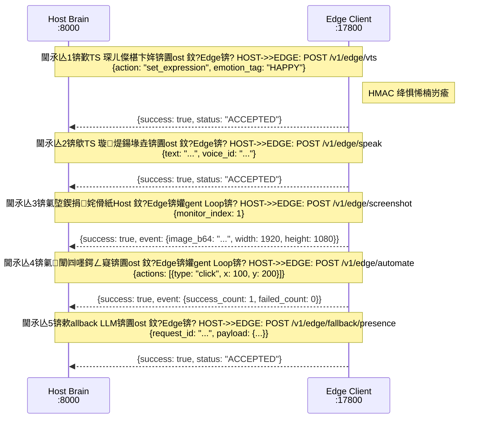
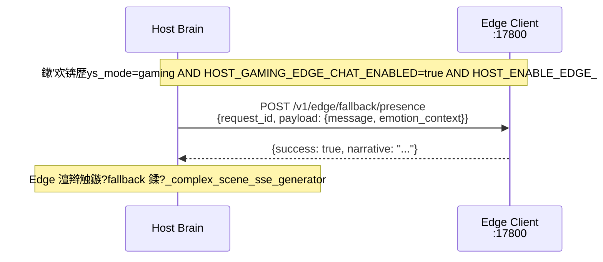
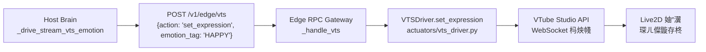
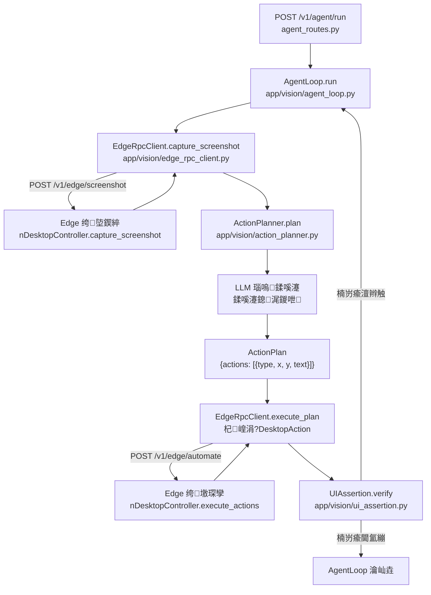
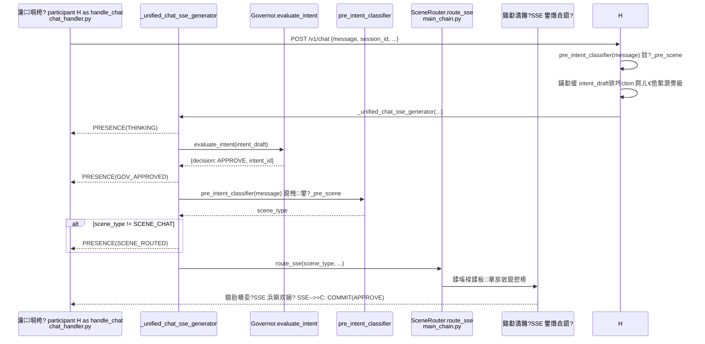

# Natsume AI 绯荤粺鏁版嵁娴佸叏鏅姤鍛?
> 鎶ュ憡鐢熸垚鏃堕棿锛?026-03-11 17:20锛堝垵鐗堬級| 鏈€鍚庢洿鏂帮細2026-03-11 18:12锛堜弗鏍煎璁′慨璁級
> 鎶ュ憡鑼冨洿锛氬弻绔€氫俊 路 鍚勫姛鑳芥暟鎹祦 路 鍚勬ā鍧楁暟鎹祦 路 Agent 娌荤悊 路 Agent 璺敱 路 Graph 缂栨帓
> 鎶ュ憡妯″瀷锛歝laude-4.6-sonnet
> 鏈淇锛氶棶棰?A/B/C/D/F 宸叉寜浼樺厛绾у鐞嗭紙瑙佺鍗佷笁鑺傦級锛涗弗鏍间唬鐮佸璁″凡瀹屾垚锛堣绗崄鍏妭锛?
---

## 鐩綍

1. [绯荤粺鏁翠綋鏋舵瀯姒傝](#涓€绯荤粺鏁翠綋鏋舵瀯姒傝)
2. [鍙岀閫氫俊鏁版嵁娴乚(#浜屽弻绔€氫俊鏁版嵁娴?
3. [涓昏亰澶╅摼璺暟鎹祦锛圫CENE_CHAT锛塢(#涓変富鑱婂ぉ閾捐矾鏁版嵁娴乻cene_chat)
4. [澶嶆潅鍦烘櫙鏁版嵁娴侊紙LangGraph 澶氳妭鐐癸級](#鍥涘鏉傚満鏅暟鎹祦langgraph-澶氳妭鐐?
5. [Agent 娌荤悊鏁版嵁娴侊紙Governor锛塢(#浜攁gent-娌荤悊鏁版嵁娴乬overnor)
6. [Agent 璺敱鏁版嵁娴侊紙SceneRouter锛塢(#鍏璦gent-璺敱鏁版嵁娴乻cenerouter)
7. [Graph 缂栨帓鏁版嵁娴侊紙MainChain + LangGraph锛塢(#涓僩raph-缂栨帓鏁版嵁娴乵ainchain--langgraph)
8. [Retrieval 涓冭矾鍙洖鏁版嵁娴乚(#鍏玶etrieval-涓冭矾鍙洖鏁版嵁娴?
9. [鎯呮劅灞傛暟鎹祦](#涔濇儏鎰熷眰鏁版嵁娴?
10. [Bond 鍏崇郴灞傛暟鎹祦](#鍗乥ond-鍏崇郴灞傛暟鎹祦)
11. [Edge 绔悇鍔熻兘鏁版嵁娴乚(#鍗佷竴edge-绔悇鍔熻兘鏁版嵁娴?
12. [鍙岀閫氫俊鎵撻€氱姸鎬佽瘎浼癩(#鍗佷簩鍙岀閫氫俊鎵撻€氱姸鎬佽瘎浼?
13. [鍏抽敭闂涓庝慨澶嶇姸鎬乚(#鍗佷笁鍏抽敭闂涓庝慨澶嶇姸鎬?
14. [鏈淇鍙樻洿鎽樿锛?026-03-11 17:28锛塢(#鍗佸洓鏈淇鍙樻洿鎽樿2026-03-11-1728)
15. [閫夐」涓€/浜?涓?瀹炴柦璁板綍锛?026-03-11 17:52锛塢(#鍗佷簲閫夐」涓€浜屼笁-瀹炴柦璁板綍2026-03-11-1752)
16. [涓ユ牸浠ｇ爜瀹¤鎶ュ憡锛?026-03-11 18:12锛塢(#鍗佸叚涓ユ牸浠ｇ爜瀹¤鎶ュ憡2026-03-11-1812)

---

## 涓€銆佺郴缁熸暣浣撴灦鏋勬瑙?
```mermaid
graph TB
    subgraph USER["鐢ㄦ埛渚?]
        U1["鐢ㄦ埛璇煶杈撳叆"]
        U2["鐢ㄦ埛鏂囧瓧杈撳叆锛堝井淇?鐩存帴锛?]
        U3["鐢ㄦ埛灞忓箷锛堟埅鍥撅級"]
    end

    subgraph EDGE["Edge Client锛堟湰鍦扮锛塡nPort: 17800"]
        E_ASR["ASR 璇煶璇嗗埆\nedge_client/senses/asr.py"]
        E_TTS["TTS 璇煶鍚堟垚\nedge_client/actuators/tts_engine.py"]
        E_VTS["VTS 琛ㄦ儏椹卞姩\nedge_client/actuators/vts_driver.py"]
        E_WECHAT["寰俊鐩戝惉\nedge_client/channels/wechat_listener.py"]
        E_DESKTOP["妗岄潰鎺у埗\nedge_client/actuators/desktop_controller.py"]
        E_RPC["Edge RPC Gateway\nedge_client/app/fastapi_app.py"]
        E_FALLBACK["Fallback LLM\nedge_client/rpc/fallback_llm.py"]
        E_REPORTER["浜嬩欢涓婃姤\nedge_client/rpc/event_reporter.py"]
        E_INPUT["杈撳叆涓婃姤\nedge_client/channels/input_reporter.py"]
    end

    subgraph HOST["Host Brain锛堜簯绔?鏈嶅姟绔級\nPort: 8000"]
        H_CHAT["POST /v1/chat\nchat_handler.py"]
        H_GOV["Governor 閴存潈\ngovernor/decision.py"]
        H_ROUTER["SceneRouter\ngraph/main_chain.py"]
        H_RETRIEVAL["涓冭矾鍙洖\nretrieval/orchestrator.py"]
        H_LLM["LLM Gateway\nintegrations/llm_gateway.py"]
        H_AIRLOCK["Airlock 妫€鐤玕nairlock/quarantine.py"]
        H_EPISODIC["鎯呰妭璁板繂\nmemory/episodic_store.py"]
        H_BOND["Bond 鍏崇郴灞俓nbond/bond_dynamics.py"]
        H_VTS_CTRL["VTS 鎺у埗\nchannels/vts.py"]
        H_EDGE_EVENTS["POST /v1/edge/events\nsystem_handler.py"]
        H_INPUT["POST /v1/host/input\ninput_routes.py"]
        H_AGENT["Agent Loop\napp/vision/agent_loop.py"]
    end

    subgraph LLM_BACKEND["LLM 鍚庣"]
        LLM_LOCAL["鏈湴 Ollama\nqwen3:8b\n127.0.0.1:11434"]
        LLM_CLOUD["浜戠 Gemini\ngemini-2.5-pro/flash"]
    end

    subgraph STORAGE["瀛樺偍灞?]
        DB_CHROMA["ChromaDB\n鍚戦噺鏁版嵁搴?]
        DB_NEO4J["Neo4j / SQLite\nBond 鍏崇郴鍥?]
        DB_EPISODIC["鎯呰妭璁板繂瀛樺偍"]
    end

    U1 --> E_ASR
    U2 --> E_WECHAT
    U3 --> E_DESKTOP

    E_ASR -->|"ASR 缁撴灉\nHTTP POST /v1/host/input"| H_INPUT
    E_WECHAT -->|"寰俊娑堟伅\nHTTP POST /v1/host/input"| H_INPUT
    E_REPORTER -->|"鎵归噺浜嬩欢\nHTTP POST /v1/edge/events"| H_EDGE_EVENTS
    E_INPUT -->|"杈撳叆涓婃姤\nHTTP POST /v1/host/input"| H_INPUT

    H_CHAT -->|"SSE 娴佸紡鍝嶅簲"| E_RPC
    H_VTS_CTRL -->|"VTS 鎸囦护\nHTTP POST /v1/edge/vts"| E_RPC
    H_AGENT -->|"鎴浘璇锋眰\nHTTP POST /v1/edge/screenshot"| E_RPC
    H_AGENT -->|"鑷姩鍖栨搷浣淺nHTTP POST /v1/edge/automate"| E_RPC

    E_RPC -->|"TTS 鍚堟垚鎸囦护\nHTTP POST /v1/edge/speak"| E_TTS
    E_RPC -->|"VTS 琛ㄦ儏鎸囦护"| E_VTS
    E_RPC -->|"鎴浘缁撴灉"| H_AGENT
    E_RPC -->|"鎿嶄綔缁撴灉"| H_AGENT

    H_LLM -->|"鏈湴鎺ㄧ悊"| LLM_LOCAL
    H_LLM -->|"浜戠鎺ㄧ悊"| LLM_CLOUD

    H_RETRIEVAL --> DB_CHROMA
    H_BOND --> DB_NEO4J
    H_EPISODIC --> DB_EPISODIC

    E_TTS --> U1
    E_VTS -->|"Live2D 琛ㄦ儏"| U3
```

---

## 浜屻€佸弻绔€氫俊鏁版嵁娴?
### 2.1 Host 鈫?Edge 閫氫俊锛堜富鍔ㄦ帹閫佹柟鍚戯級



### 2.2 Edge 鈫?Host 閫氫俊锛堜笂鎶ユ柟鍚戯級

```mermaid
sequenceDiagram
    participant EDGE as Edge Client<br/>:17800
    participant HOST as Host Brain<br/>:8000

    Note over EDGE,HOST: 閫氶亾1锛欰SR 璇煶璇嗗埆缁撴灉涓婃姤
    EDGE->>HOST: POST /v1/host/input<br/>{source: "ASR", text: "...", confidence: 0.95, is_final: true}
    HOST-->>EDGE: {success: true}

    Note over EDGE,HOST: 閫氶亾2锛氬井淇℃秷鎭笂鎶?    EDGE->>HOST: POST /v1/host/input<br/>{source: "WECHAT", from_wxid: "...", content: "..."}
    HOST-->>EDGE: {success: true}

    Note over EDGE,HOST: 閫氶亾3锛氭壒閲忎簨浠朵笂鎶ワ紙EDGE_TO_HOST锛?    EDGE->>HOST: POST /v1/edge/events<br/>{events: [{event_type: "...", ts_ms: ..., session_id: "..."}]}
    HOST-->>EDGE: {success: true, accepted: N, rejected: 0}

    Note over EDGE,HOST: 閫氶亾4锛氬井淇?Hook 鍥炶皟锛堟湰鍦?Hook 宸ュ叿 鈫?Edge锛?    Note right of EDGE: wcf 绛夊伐鍏锋帹閫?    EDGE->>HOST: 鍐呴儴杞彂锛堥€氳繃 WeChatListener锛?```

### 2.3 鍙岀 SSE 娴佸紡閫氫俊锛堟牳蹇冭亰澶╅摼璺級

```mermaid
sequenceDiagram
    participant CLIENT as 瀹㈡埛绔紙鍓嶇/Edge锛?    participant HOST as Host Brain<br/>POST /v1/chat

    CLIENT->>HOST: POST /v1/chat<br/>{message: "...", session_id: "...", emotion_tag: "..."}

    HOST-->>CLIENT: data: {"phase":"PRESENCE","event":"THINKING"}

    Note over HOST: Governor 閴存潈锛垀20-50ms锛?    HOST-->>CLIENT: data: {"phase":"PRESENCE","event":"GOV_APPROVED"}

    Note over HOST: 鍦烘櫙鍒嗙被锛坧re_intent_classifier锛?    alt SCENE_CHAT锛堟棩甯稿璇濓級
        HOST-->>CLIENT: data: {"phase":"RENDER","chunk":"浣犲ソ"}
        HOST-->>CLIENT: data: {"phase":"RENDER","chunk":"锛?}
        HOST-->>CLIENT: data: {"phase":"SENTENCE","sentence":"浣犲ソ锛屾湁浠€涔堝彲浠ュ府浣犵殑锛?,"sentence_index":0}
        HOST-->>CLIENT: data: {"phase":"COMMIT","done":true,"decision":"APPROVE","narrative":"..."}
    else 澶嶆潅鍦烘櫙锛圵ORK_CODE/WORK_TRANSLATE/EXEC_INTENT锛?        HOST-->>CLIENT: data: {"phase":"PRESENCE","event":"SCENE_ROUTED","scene_type":"SCENE_WORK_CODE"}
        HOST-->>CLIENT: data: {"phase":"GRAPH_START","graph_id":"host.chat.realtime"}
        HOST-->>CLIENT: data: {"phase":"GRAPH_NODE","node_id":"core_reasoner_primary","status":"running"}
        HOST-->>CLIENT: data: {"phase":"GRAPH_NODE","node_id":"workbench_code_assist","status":"done"}
        HOST-->>CLIENT: data: {"phase":"GRAPH_DONE","node_count":4}
        HOST-->>CLIENT: data: {"phase":"COMMIT","done":true,"decision":"APPROVE","narrative":"..."}
    end
```

---

## 涓夈€佷富鑱婂ぉ閾捐矾鏁版嵁娴侊紙SCENE_CHAT锛?
```mermaid
flowchart TD
    A["POST /v1/chat\nChatRequest"] --> B["handle_chat\nchat_handler.py"]
    B --> C["pre_intent_classifier\n鍏抽敭璇嶉鍒嗙被"]
    C -->|"SCENE_CHAT"| D["_unified_chat_sse_generator"]

    D --> E["resolve_chat_emotion_context\nemotion_context.py"]
    E --> F["build_chat_governance_snapshot\n鎯呮劅娌荤悊蹇収"]
    F --> G["Governor.evaluate_intent\ngovernor/decision.py\n~20-50ms"]

    G -->|"REJECT"| G1["COMMIT(REJECT)\n杩斿洖鎷掔粷鍘熷洜"]
    G -->|"APPROVE"| H["PRESENCE(GOV_APPROVED)"]

    H --> I["SceneRouter.route_sse\nmain_chain.py"]
    I -->|"SCENE_CHAT"| J["_sse_event_generator\nchat_stream_handler.py"]

    J --> K["骞惰鍚姩 Retrieval\nasyncio.create_task"]
    K --> L["RetrievalOrchestrator.arun\n涓冭矾鍙洖 + Rerank\n瓒呮椂: 1200ms"]

    J --> M["resolve_host_llm_runtime_async\n璺敱鐭╅樀鍐崇瓥"]
    M -->|"host_8b 鍋ュ悍"| M1["鏈湴 qwen3:8b\nOllama :11434"]
    M -->|"host_8b 涓嶅仴搴?| M2["浜戠 Gemini/OpenAI"]

    L --> N["_build_stream_chat_prompt\n娉ㄥ叆 Retrieval + Emotion 涓婁笅鏂?]
    M --> N

    N --> O["astream_llm_chunks\n娴佸紡 token 鐢熸垚"]
    O --> P["RENDER(chunk) 脳 N\ntoken 绾?SSE 浜嬩欢"]
    P --> Q["SentenceSplitter\n鍙ュ瓙杈圭晫妫€娴?]
    Q --> R["SENTENCE(sentence) 脳 M\n鍙ュ瓙绾?SSE 浜嬩欢"]

    R --> S["asyncio.gather 骞惰鍚庡鐞?]
    S --> S1["Airlock.quarantine_ingress\n鍑哄彛瀹夊叏妫€鐤?]
    S --> S2["persist_chat_episodic_memory\n鎯呰妭璁板繂鍐欏叆"]
    S --> S3["BondDynamicsWriter\nBond 绉垎鏇存柊"]
    S --> S4["_drive_stream_vts_emotion\nVTS 琛ㄦ儏椹卞姩"]

    S1 & S2 & S3 & S4 --> T["COMMIT(APPROVE)\n鍚?audit_refs 瀹屾暣瀹¤鏁版嵁"]

    style G1 fill:#ff6b6b,color:#fff
    style M1 fill:#51cf66,color:#fff
    style M2 fill:#339af0,color:#fff
    style T fill:#51cf66,color:#fff
```

### 3.1 SCENE_CHAT 鍏抽敭寤惰繜鍒嗗竷

| 闃舵 | 鍏稿瀷寤惰繜 | 瓒呮椂閰嶇疆 |
|------|---------|---------|
| Governor 閴存潈 | 20-50ms | 2000ms |
| Retrieval 涓冭矾鍙洖 | 200-800ms | 1200ms锛堝彲閰嶇疆锛?|
| LLM 棣?token | 300-1500ms | 10000ms锛堟渶浣庯級 |
| 鍚庡鐞嗗苟琛岋紙Airlock+Episodic+Bond+VTS锛?| 50-300ms | 鍚勮嚜鐙珛瓒呮椂 |

---

## 鍥涖€佸鏉傚満鏅暟鎹祦锛圠angGraph 澶氳妭鐐癸級

```mermaid
flowchart TD
    A["_unified_chat_sse_generator"] -->|"SCENE_WORK_CODE\nSCENE_WORK_TRANSLATE\nSCENE_EXEC_INTENT"| B["SceneRouter.route_sse\n鈫?_complex_scene_sse_generator"]

    B --> C["PRESENCE(SCENE_ROUTED)"]
    C --> D["resolve_host_llm_runtime_async\n寮哄埗浜戠 Gemini"]
    D --> E["build_chat_graph_config\n鏋勫缓 LangGraph 閰嶇疆"]

    E --> F["GraphRuntimeContract.run_graph\nLangGraph 鎵ц寮曟搸"]
    F --> G["GRAPH_START 浜嬩欢"]

    subgraph LANGGRAPH["LangGraph 鑺傜偣鎵ц锛堟寜鍦烘櫙锛?]
        direction LR
        N1["core_reasoner_primary\ngemini-2.5-pro\n12s 瓒呮椂"]
        N2["scene_router_post_core\n鍦烘櫙鍚庤矾鐢?]
        N3_CODE["workbench_code_assist\ngemini-2.5-pro\n10s 瓒呮椂"]
        N3_TRANS["workbench_translate\ngemini-2.5-pro\n10s 瓒呮椂"]
        N3_EXEC["planner_constraints\ngemini-2.5-pro\n8s 瓒呮椂"]
        N4["consistency_verifier\ngemini-2.5-flash-lite\n7s 瓒呮椂"]
        N5["renderer_ja_c_style\ngemini-2.5-flash\n9s 瓒呮椂"]
    end

    N1 --> N2
    N2 -->|"WORK_CODE"| N3_CODE
    N2 -->|"WORK_TRANSLATE"| N3_TRANS
    N2 -->|"EXEC_INTENT"| N3_EXEC
    N3_CODE & N3_TRANS & N3_EXEC --> N4
    N4 --> N5

    F --> LANGGRAPH
    LANGGRAPH --> H["GRAPH_DONE 浜嬩欢"]

    H --> I["asyncio.gather 骞惰鍚庡鐞?]
    I --> I1["Airlock 妫€鐤?]
    I --> I2["鎯呰妭璁板繂鍐欏叆"]
    I --> I3["Bond 鏇存柊"]
    I --> I4["VTS 琛ㄦ儏椹卞姩\n锛堝凡淇 #7锛?]

    I1 & I2 & I3 & I4 --> J["COMMIT(APPROVE)\n鍚畬鏁?audit_refs"]

    style N1 fill:#339af0,color:#fff
    style N3_CODE fill:#51cf66,color:#fff
    style N3_TRANS fill:#51cf66,color:#fff
    style N3_EXEC fill:#51cf66,color:#fff
```

### 4.1 鍦烘櫙鑺傜偣搴忓垪

| 鍦烘櫙 | 鑺傜偣搴忓垪 | 鎬婚绠?|
|------|---------|--------|
| SCENE_CHAT | `chat_direct_ja` | 10-15s |
| SCENE_WORK_CODE | `core_reasoner_primary 鈫?workbench_code_assist 鈫?consistency_verifier 鈫?renderer_ja_c_style` | 90-240s |
| SCENE_WORK_TRANSLATE | `core_reasoner_primary 鈫?workbench_translate 鈫?consistency_verifier 鈫?renderer_ja_c_style` | 90-240s |
| SCENE_EXEC_INTENT | `core_reasoner_primary 鈫?planner_constraints 鈫?tool_planner 鈫?safety_verifier 鈫?consistency_verifier 鈫?renderer_ja_c_style` | 90-240s |

---

## 浜斻€丄gent 娌荤悊鏁版嵁娴侊紙Governor锛?
```mermaid
flowchart TD
    A["raw_intent\n{action, type, args, nonce, ts_ms}"] --> B["IntentDecisionEngine.evaluate_intent\ngovernor/decision.py"]

    B --> C["S_INTENT_PARSE\n瑙ｆ瀽鎰忓浘缁撴瀯"]
    C --> D["S_INTENT_VALIDATE\n瀛楁鍚堟硶鎬ф牎楠?]
    D --> E["S_INTENT_REPLAY\nNonce 閲嶆斁妫€娴?]
    E --> F["S_INTENT_SEQ\n搴忓垪鍙峰崟璋冩€ф鏌?]
    F --> G["S_INTENT_EXPIRED\n鏃堕棿鎴宠繃鏈熸鏌ワ紙卤5min锛?]
    G --> H["S_GOV_GATES\nR1-R7 瑙勫垯闂ㄦ帶"]

    subgraph GATES["R1-R7 瑙勫垯闂ㄦ帶"]
        R1["R1: 閫熺巼闄愬埗\nrate_limit_checker.py"]
        R2["R2: 浼氳瘽鐘舵€佹鏌?]
        R3["R3: 鍐呭瀹夊叏妫€鏌?]
        R4["R4: 鏉冮檺绾у埆妫€鏌?]
        R5["R5: 璧勬簮閰嶉妫€鏌?]
        R6["R6: 鎰忓浘鐧藉悕鍗?]
        R7["R7: 宸ュ叿璋冪敤鏉冮檺"]
    end

    H --> GATES
    GATES --> I["S_GOV_EMOTION_GATE\nR8 鎯呮劅闂ㄦ帶"]

    I -->|"critical 鐘舵€?+ TOOL_CALL/SKILL_EXEC"| J["鉂?REJECT\nEMOTION_GATE_BLOCKED"]
    I -->|"閫氳繃"| K["S_INTENT_OK\n鐢熸垚 intent_id"]

    K --> L["policy_cache 鍛戒腑锛焅nP2-A 蹇€熼€氶亾"]
    L -->|"鍛戒腑锛坣arrative_only锛?| M["鈿?蹇€熼€氶亾\n璺宠繃瀹屾暣 gate 璇勪及\n鑺傜渷 20-30ms"]
    L -->|"鏈懡涓?| N["瀹屾暣 gate 璇勪及"]

    M & N --> O["DECISION_APPROVE\n{decision: 'APPROVE', intent_id: '...'}"]

    subgraph TIERED["M42 鍒嗗眰娌荤悊锛圫kill 娉ㄥ叆鍚庯級"]
        T1["CACHE 閫氶亾\n浣庨闄?Skill"]
        T2["RULE 閫氶亾\n涓闄?Skill"]
        T3["AIRLOCK 閫氶亾\n楂橀闄?Skill"]
    end

    O --> TIERED

    style J fill:#ff6b6b,color:#fff
    style M fill:#51cf66,color:#fff
    style O fill:#51cf66,color:#fff
```

### 5.1 Governor 鍐崇瓥閾惧叧閿弬鏁?
| 闂ㄦ帶 | 妫€鏌ュ唴瀹?| 澶辫触鍘熷洜鐮?|
|------|---------|-----------|
| R1 閫熺巼闄愬埗 | 姣忎細璇濊姹傞鐜?| `RATE_LIMIT_EXCEEDED` |
| R5 璧勬簮閰嶉 | Token 娑堣€楅厤棰?| `QUOTA_EXCEEDED` |
| R8 鎯呮劅闂ㄦ帶 | `critical` 鐘舵€佷笅鎷掔粷宸ュ叿璋冪敤 | `EMOTION_GATE_BLOCKED` |
| Nonce 閲嶆斁 | 闃叉璇锋眰閲嶆斁鏀诲嚮 | `NONCE_REPLAY` |
| 鏃堕棿鎴宠繃鏈?| 卤5 鍒嗛挓绐楀彛 | `INTENT_EXPIRED` |

---

## 鍏€丄gent 璺敱鏁版嵁娴侊紙SceneRouter锛?
```mermaid
flowchart TD
    A["_unified_chat_sse_generator\n閴存潈閫氳繃鍚?] --> B["pre_intent_classifier\n鍏抽敭璇嶉鍒嗙被"]

    B -->|"鎴浘/灞忓箷/鐣岄潰鍏抽敭璇?| C["SCENE_VISION_UI"]
    B -->|"浠ｇ爜/缂栫▼鍏抽敭璇?| D["SCENE_WORK_CODE"]
    B -->|"缈昏瘧鍏抽敭璇?| E["SCENE_WORK_TRANSLATE"]
    B -->|"鎵ц/瀹夎/閰嶇疆鍏抽敭璇?| F["SCENE_EXEC_INTENT"]
    B -->|"鍏朵粬锛堝惈濞变箰鐧藉悕鍗曪級"| G["SCENE_CHAT"]

    C & D & E & F & G --> H["scene_type 鍚堟硶鎬ф牎楠孿nALLOWED_EXPLICIT_SCENE_TYPES"]
    H -->|"闈炴硶 scene_type"| H1["闄嶇骇涓?SCENE_CHAT"]

    H --> I["SceneRouter.route_sse\nmain_chain.py"]

    I -->|"SCENE_VISION_UI"| J["_vision_ui_sse_generator\nchat_handler_vision.py"]
    I -->|"SCENE_CHAT + gaming + edge_enabled"| K["_gaming_edge_chat_sse_generator\nchat_handler_edge.py"]
    I -->|"SCENE_CHAT锛堟櫘閫氾級"| L["_sse_event_generator\nchat_stream_handler.py"]
    I -->|"澶嶆潅鍦烘櫙"| M["_complex_scene_sse_generator\nchat_handler_complex.py"]

    subgraph LLM_ROUTING["LLM 璺敱鐭╅樀锛坮esolve_host_llm_runtime锛?]
        LR1["HOST_CHAT_FORCE_CLOUD=true\n鈫?寮哄埗浜戠"]
        LR2["HOST_CHAT_HOST_8B_ENABLED=false\n鈫?浜戠"]
        LR3["sys_mode=gaming\n鈫?浜戠锛圗dge 3B锛?]
        LR4["鐏板害妗?bucket < percent\n鈫?鏈湴 8B"]
        LR5["8B 鍋ュ悍鎺㈡祴閫氳繃\n鈫?鏈湴 8B锛堥粯璁わ級"]
        LR6["8B 鍋ュ悍鎺㈡祴澶辫触\n鈫?浜戠 fallback"]
    end

    L --> LLM_ROUTING
    K --> LLM_ROUTING

    style J fill:#ffd43b,color:#333
    style K fill:#ff922b,color:#fff
    style L fill:#51cf66,color:#fff
    style M fill:#339af0,color:#fff
```

### 6.1 璺敱鍐崇瓥浼樺厛绾?
```
1. HOST_CHAT_FORCE_CLOUD=true          鈫?寮哄埗浜戠锛堟渶楂樹紭鍏堢骇锛?2. HOST_CHAT_HOST_8B_ENABLED=false     鈫?浜戠
3. sys_mode=gaming                     鈫?浜戠锛圗dge 3B 璺緞锛?4. 鐏板害鎺掗櫎锛坓ray_rollout.in_rollout=false锛?鈫?浜戠
5. 鏈湴 8B 鍋ュ悍鎺㈡祴閫氳繃                鈫?鏈湴 qwen3:8b锛堥粯璁よ矾寰勶級
6. 鏈湴 8B 鍋ュ悍鎺㈡祴澶辫触                鈫?浜戠 fallback
```

### 6.2 Gaming Edge 璺敱锛堢壒娈婅矾寰勶級



---

## 涓冦€丟raph 缂栨帓鏁版嵁娴侊紙MainChain + LangGraph锛?
### 7.1 MainChain 鑺傜偣閾捐矾锛堣交缂栨帓灞傦級

```mermaid
flowchart LR
    subgraph MAIN_CHAIN["MainChain 涓婚摼璺紙鍓嶅悗缃紪鎺?+ SSE 璺敱濮旀墭锛?]
        N1["AirlockQuarantineNode\n瓒呮椂: 1.0s"]
        N2["GovernorNode\n瓒呮椂: 2.0s"]
        N3["GraphExecutorNode\n瓒呮椂: 5.0s"]
        N4["RecallFusionNode\n瓒呮椂: 5.0s"]
        N5["LlmGatewayNode\n瓒呮椂: 30.0s"]
        N6["QAContractNode\n瓒呮椂: 3.0s"]
        N7["EpisodicStoreNode\n瓒呮椂: 2.0s"]
        N8["AuditNode\n瓒呮椂: 1.0s"]
        N9["AirlockSanitizerNode\n瓒呮椂: 1.0s"]
    end

    N1 --> N2 --> N3 --> N4 --> N5 --> N6 --> N7 --> N8 --> N9

    N2 -->|"governor_passed=true"| SR["SceneRouter.route\n瀛愰摼鍒嗘祦"]
    SR -->|"TaskType.CHAT"| N3
    SR -->|"鍏朵粬 TaskType"| SUB["娉ㄥ唽鐨勫瓙閾捐妭鐐?]
```

> 鉁?**褰撳墠鐘舵€侊紙2026-03-11锛?*锛歚MainChain` 鑺傜偣宸茶ˉ鍏呮渶灏忓彲鎵ц璇箟锛堣緭鍏ュ噣鍖栥€佷换鍔＄被鍨嬫槧灏勩€佸彫鍥?LLM/QA/瀹¤/鍑哄彛鍑€鍖栫姸鎬佽惤鐐癸級锛?> `run_as_sse_adapter()` 宸插叿澶囧墠缃妭鐐规墽琛屻€丼SE 浜嬩欢瑙傛祴銆佸悗缃妭鐐规敹灏撅紝涓嶅啀鏄函閫忎紶銆?> 瀵瑰 SSE 鍗忚淇濇寔鍏煎锛岀湡瀹炶矾鐢变粛濮旀墭 `_unified_chat_sse_generator`銆?
### 7.2 LangGraph 鍥鹃厤缃紙build_chat_graph_config锛?
```mermaid
flowchart TD
    A["build_chat_graph_config\ngraph_config_builder.py"] --> B{鍦烘櫙绫诲瀷}

    B -->|"SCENE_CHAT锛堝揩閫熻矾寰勶級"| C["鍗曡妭鐐瑰浘\nchat_direct_ja\n瓒呮椂: max(chat_timeout, 10000ms)"]

    B -->|"AUTO锛堝満鏅矾鐢卞櫒锛?| D["scene_router_entry\n鈫?鍔ㄦ€佸垎娴?]
    D --> D1["chat_direct_ja锛圕HAT锛?]
    D --> D2["core_reasoner_primary锛堝鏉傦級"]
    D2 --> D3["scene_router_post_core"]
    D3 --> D4["workbench_*/planner_constraints"]
    D4 --> D5["consistency_verifier"]
    D5 --> D6["renderer_ja_c_style"]

    B -->|"SCENE_WORK_CODE"| E["core_reasoner_primary\n鈫?workbench_code_assist\n鈫?consistency_verifier\n鈫?renderer_ja_c_style"]

    B -->|"SCENE_WORK_TRANSLATE"| F["core_reasoner_primary\n鈫?workbench_translate\n鈫?consistency_verifier\n鈫?renderer_ja_c_style"]

    B -->|"SCENE_EXEC_INTENT"| G["core_reasoner_primary\n鈫?planner_constraints\n鈫?tool_planner\n鈫?safety_verifier\n鈫?consistency_verifier\n鈫?renderer_ja_c_style"]

    subgraph NODE_MODELS["鑺傜偣妯″瀷鍒嗛厤"]
        M1["chat_direct_ja 鈫?鏈湴 qwen3:8b"]
        M2["core_reasoner_primary 鈫?gemini-2.5-pro"]
        M3["core_reasoner_secondary 鈫?gemini-2.5-flash锛坒allback锛?]
        M4["workbench_* 鈫?gemini-2.5-pro"]
        M5["consistency_verifier 鈫?gemini-2.5-flash-lite"]
        M6["renderer_ja_c_style 鈫?gemini-2.5-flash"]
    end
```

---

## 鍏€丷etrieval 涓冭矾鍙洖鏁版嵁娴?
```mermaid
flowchart TD
    A["RetrievalOrchestrator.arun\nrequest: {query, session_id, top_k, emotion_context}"] --> B["RetrievalPipelineContract.run\nretrieval/pipeline.py"]

    B --> C["RecallFusion\nretrieval/recall_fusion.py"]

    subgraph RECALL_ROUTES["涓冭矾鍙洖锛堝苟琛屾墽琛岋級"]
        R1["Route 1: 鍚戦噺璇箟鍙洖\nChromaDB 宓屽叆妫€绱?]
        R2["Route 2: 鍏ㄦ枃鍏抽敭璇嶅彫鍥瀄nfull_text_searcher.py"]
        R3["Route 3: 鎯呰妭璁板繂鍙洖\nEpisodicStore"]
        R4["Route 4: Bond 鍏崇郴鍙洖\nBondScoreState"]
        R5["Route 5: 鐭ヨ瘑鍥捐氨鍙洖\nNeo4j"]
        R6["Route 6: 鎯呮劅涓婁笅鏂囧彫鍥瀄nEmotionTimeline"]
        R7["Route 7: 宸ュ叿鍏冩暟鎹彫鍥瀄nToolCatalog"]
    end

    C --> RECALL_ROUTES

    RECALL_ROUTES --> D["HybridFusion\nhybrid_fusion.py\nRRF 铻嶅悎鎺掑簭"]
    D --> E["Reranker\nreranker.py\nQwen3-Reranker-0.6B"]
    E --> F["EvidencePack\nevidence_pack.py\n鏈€缁堣瘉鎹寘"]

    F --> G["RetrievalOrchestratorResult\n{retrieval_summary, retrieval_evidence_items}"]

    subgraph CACHE["缁撴灉缂撳瓨锛堝彲閫夛級"]
        C1["缂撳瓨閿? session_id+query+top_k+intent_id+emotion_context"]
        C2["TTL: 3000ms锛堥粯璁わ級"]
        C3["鏈€澶ф潯鐩? 256"]
    end

    G --> CACHE
    CACHE -->|"缂撳瓨鍛戒腑"| H["鐩存帴杩斿洖锛堣烦杩囧彫鍥烇級"]

    G --> I["娉ㄥ叆 prompt_builder\n鏋勫缓 LLM 涓婁笅鏂?]

    style E fill:#339af0,color:#fff
    style F fill:#51cf66,color:#fff
```

### 8.1 Retrieval 闄嶇骇绛栫暐

| 鐘舵€?| 瑙﹀彂鏉′欢 | 澶勭悊鏂瑰紡 |
|------|---------|---------|
| `SKIPPED` | `HOST_ENABLE_RETRIEVAL=false` 鎴?`HOST_CHAT_DISABLE_RETRIEVAL=true` | 璺宠繃鍙洖锛屼娇鐢ㄧ┖鎽樿 |
| `DEGRADED(RETRIEVAL_TIMEOUT)` | 瓒呰繃 `HOST_STREAM_RETRIEVAL_TIMEOUT_MS`锛堥粯璁?1200ms锛?| 浣跨敤闄嶇骇鎽樿锛屽悗鍙颁换鍔＄户缁?|
| `DEGRADED(RETRIEVAL_FAILED)` | 鍙洖绠￠亾寮傚父 | 浣跨敤闄嶇骇鎽樿 |
| `OK` | 姝ｅ父瀹屾垚 | 娉ㄥ叆瀹屾暣璇佹嵁鍖?|

---

## 涔濄€佹儏鎰熷眰鏁版嵁娴?
```mermaid
flowchart TD
    A["ChatRequest\n{mood_state, emotion_tag, emotion_context}"] --> B["resolve_chat_emotion_context\nemotion_context.py"]

    B --> C["normalize_hard_state\nmetabolism.py\n纭姸鎬佽鑼冨寲"]
    C --> D["build_hard_snapshot\nHardStateSnapshot\n{allowed_emotion_tags, emotion_range_hint}"]

    B --> E["EmotionVector 鍒涘缓\nVAD 涓夌淮妯″瀷锛堝凡淇 #6锛?]
    E --> F["EmotionTimeline 璁板綍\n鎯呮劅鏃堕棿绾?]
    F --> G["compute_emotion_echo\n鎯呮劅鍥炲０璁＄畻"]
    G --> H["evaluate_emotion_triggers\n鎯呮劅瑙﹀彂鍣ㄨ瘎浼?]

    D & H --> I["emotion_context 瀛楀吀\n{emotion_tag, emotion_intensity, vad_vector, ...}"]

    I --> J["build_chat_governance_snapshot\n娌荤悊蹇収"]
    J --> K["Governor R8 鎯呮劅闂ㄦ帶\ncritical 鐘舵€佹嫤鎴?]

    I --> L["adjust_gen_params_for_emotion\nllm_helpers.py\ntemperature/top_p 鍔ㄦ€佽皟鏁?]

    I --> M["build_chat_emotion_snapshot\n娉ㄥ叆 prompt payload"]

    I --> N["_drive_stream_vts_emotion\nVTS 琛ㄦ儏椹卞姩\n浠?SCENE_CHAT锛堝凡淇 #7 鎵╁睍鍒板鏉傚満鏅級"]
    N --> O["resolve_vts_expression\nchannels/vts.py\n16 绉嶆儏鎰?鈫?琛ㄦ儏 ID 鏄犲皠"]
    O --> P["POST /v1/edge/vts\nEdge 绔〃鎯呮洿鏂?]

    I --> Q["BondDynamicsWriter.classify_interaction\n浜掑姩鍒嗙被锛圡INIMAL/ENGAGED/DEEP锛?]
    Q --> R["BondStageEngine.apply_event\n鎯呮劅寮哄害鍔犳潈锛?0.7 鈫?1.5x锛?]
    R --> S["BondEmotionalTexture.update\n浜插瘑娓╁害鏇存柊锛堝凡淇 #5锛?]

    style K fill:#ff6b6b,color:#fff
    style P fill:#51cf66,color:#fff
    style S fill:#51cf66,color:#fff
```

### 9.1 鎯呮劅鏍囩鏄犲皠锛?6 绉嶏級

| 鎯呮劅鏍囩 | 涓枃 | VTS 琛ㄦ儏 ID |
|---------|------|------------|
| HAPPY | 寮€蹇?| exp_happy |
| SAD | 鎮蹭激 | exp_sad |
| ANGRY | 鎰ゆ€?| exp_angry |
| SURPRISED | 鎯婅 | exp_surprised |
| NEUTRAL | 骞抽潤 | exp_neutral |
| ... | ... | ... |

---

## 鍗併€丅ond 鍏崇郴灞傛暟鎹祦

```mermaid
flowchart TD
    A["鐢ㄦ埛浜や簰锛堟瘡娆″璇濓級"] --> B["BondDynamicsWriter.classify_interaction\nbond/bond_dynamics.py"]

    B -->|"鏂囨湰闀垮害 < 20 涓旀儏鎰熷己搴?< 0.3"| C["MINIMAL 浜掑姩\n+1 绉垎"]
    B -->|"鏂囨湰闀垮害 20-100 鎴栨儏鎰熷己搴?0.3-0.7"| D["ENGAGED 浜掑姩\n+3 绉垎"]
    B -->|"鏂囨湰闀垮害 > 100 鎴栨儏鎰熷己搴?> 0.7 鎴栧惈闂彿"| E["DEEP 浜掑姩\n+5 绉垎"]

    C & D & E --> F["BondStageEngine.apply_event\nbond/bond_stage_engine.py"]

    F --> G["鎯呮劅寮哄害鍔犳潈\n> 0.7 鈫?1.5x 绉垎"]
    G --> H["BondEmotionalTexture.update\n浜插瘑娓╁害 = 鍥炲鑺傚 脳 鎯呮劅鍧囧€硷紙宸蹭慨澶?#5锛?]
    H --> I["BondScoreState 鏇存柊\n{score, stage, texture}"]

    I --> J{闃舵鏅嬬骇妫€鏌
    J -->|"score >= 闃舵闃堝€?| K["闃舵鏅嬬骇\n闄岀敓浜衡啋鐩歌瘑鈫掓湅鍙嬧啋鎸氬弸鈫掔煡宸扁啋鐏甸瓊浼翠荆"]
    J -->|"鏈揪闃堝€?| L["淇濇寔褰撳墠闃舵"]

    K & L --> M["BondScoreState.to_summary\n鍏ㄤ腑鏂囪涔夎緭鍑篭n{stage_cn, style_hint, repair_hint}"]
    M --> N["娉ㄥ叆 PromptContext\n褰卞搷 LLM 鐢熸垚椋庢牸"]

    subgraph RIFT["瑁傜棔-淇鍙岃建"]
        RF1["CONFLICT 浜嬩欢 鈫?瑁傜棔绉疮"]
        RF2["APOLOGY/COMFORT 浜嬩欢 鈫?瑁傜棔淇"]
        RF3["repair_hint 娉ㄥ叆 prompt"]
    end

    F --> RIFT

    subgraph STORAGE["鎸佷箙鍖栵紙宸蹭慨澶?#10锛?]
        S1["HOST_BOND_BACKEND=sqlite 鈫?SqliteBondClient"]
        S2["HOST_BOND_BACKEND=neo4j 鈫?Neo4jBondClient"]
        S3["榛樿: InMemoryNeo4jBondClient锛堣繘绋嬮噸鍚涪澶憋級"]
    end

    I --> STORAGE

    style K fill:#ffd43b,color:#333
    style N fill:#51cf66,color:#fff
```

---

## 鍗佷竴銆丒dge 绔悇鍔熻兘鏁版嵁娴?
### 11.1 ASR 璇煶璇嗗埆鏁版嵁娴?
```mermaid
flowchart LR
    A["楹﹀厠椋庤緭鍏?] --> B["ASR 寮曟搸\nedge_client/senses/asr.py"]
    B --> C["璇煶璇嗗埆缁撴灉\n{text, confidence, is_final, seq}"]
    C --> D["EdgeInputReporter.report_asr\nchannels/input_reporter.py"]
    D -->|"HTTP POST /v1/host/input"| E["Host Brain\ninput_routes.py"]
    E --> F["瑙﹀彂 POST /v1/chat\n鎴栫洿鎺ュ鐞?]
    D -->|"澶辫触鏃?| G["鏈湴缂撳瓨\n鏈€澶?500 鏉n鍚庡彴閲嶈瘯锛堟渶澶?5 娆★級"]
```

### 11.2 TTS 璇煶鍚堟垚鏁版嵁娴?
```mermaid
flowchart LR
    A["Host Brain\nSSE SENTENCE 浜嬩欢"] --> B["Edge RPC Gateway\nPOST /v1/edge/speak"]
    B --> C["VoicePipeline.enqueue_speak\nactuators/speech.py"]
    C --> D["TTS Engine\nactuators/tts_engine.py"]
    D --> E["闊抽杈撳嚭\n鎵０鍣ㄦ挱鏀?]
    B -->|"barge_in"| F["VoicePipeline.barge_in\n鎵撴柇褰撳墠鎾斁"]
```

### 11.3 VTS 琛ㄦ儏椹卞姩鏁版嵁娴?


### 11.4 Agent Loop 瑙嗚鑷姩鍖栨暟鎹祦



---

## 鍗佷簩銆佸弻绔€氫俊鎵撻€氱姸鎬佽瘎浼?
### 12.1 閫氫俊閫氶亾瀹屾暣鎬х煩闃?
| 閫氫俊閫氶亾 | 鏂瑰悜 | 鍗忚 | 閴存潈 | 瀹炵幇鐘舵€?| 鎵撻€氱姸鎬?|
|---------|------|------|------|---------|---------|
| `/v1/chat` SSE 娴佸紡 | 瀹㈡埛绔啋Host | HTTP SSE | 鏃狅紙鍐呯綉锛?| 鉁?瀹屾暣瀹炵幇 | 鉁?**宸叉墦閫?* |
| `/v1/edge/speak` TTS | Host鈫扙dge | HTTP POST | HMAC | 鉁?瀹屾暣瀹炵幇 | 鉁?**宸叉墦閫?* |
| `/v1/edge/vts` 琛ㄦ儏 | Host鈫扙dge | HTTP POST | HMAC | 鉁?瀹屾暣瀹炵幇 | 鉁?**宸叉墦閫?* |
| `/v1/edge/barge_in` 鎵撴柇 | Host鈫扙dge | HTTP POST | HMAC | 鉁?瀹屾暣瀹炵幇 | 鉁?**宸叉墦閫?* |
| `/v1/edge/screenshot` 鎴浘 | Host鈫扙dge | HTTP POST | HMAC | 鉁?瀹屾暣瀹炵幇 | 鉁?**宸叉墦閫?* |
| `/v1/edge/automate` 鑷姩鍖?| Host鈫扙dge | HTTP POST | HMAC | 鉁?瀹屾暣瀹炵幇 | 鉁?**宸叉墦閫?* |
| `/v1/edge/fallback/*` Fallback | Host鈫扙dge | HTTP POST | HMAC | 鉁?瀹屾暣瀹炵幇 | 鉁?**宸叉墦閫?* |
| `/v1/host/input` 杈撳叆涓婃姤 | Edge鈫扝ost | HTTP POST | HMAC | 鉁?瀹屾暣瀹炵幇 | 鉁?**宸叉墦閫?*锛坄run_main_chain_from_input` 宸插疄鐜帮紝瑙﹀彂瀹屾暣 chat 娴佺▼锛?|
| `/v1/edge/events` 浜嬩欢涓婃姤 | Edge鈫扝ost | HTTP POST | 鏃?| 鉁?瀹屾暣瀹炵幇 | 鉁?**宸叉墦閫?*锛堟儏鎰熶簨浠惰Е鍙?Bond 鏇存柊 + VTS 椹卞姩锛屾湰娆′慨澶嶏級 |
| `/v1/edge/wechat/callback` 寰俊 | 鏈湴Hook鈫扙dge | HTTP POST | 鏃狅紙鏈湴锛?| 鉁?瀹屾暣瀹炵幇 | 鉁?**宸叉墦閫?* |

### 12.2 鏈畬鍏ㄦ墦閫氱殑鍏抽敭闂

```mermaid
flowchart TD
    subgraph FIXED["鉁?鏈淇宸叉墦閫氱殑閾捐矾"]
        F1["Edge 浜嬩欢涓婃姤\nPOST /v1/edge/events\n鉁?鎯呮劅浜嬩欢瑙﹀彂 Bond 鏇存柊\n鉁?鎯呮劅浜嬩欢瑙﹀彂 VTS 椹卞姩\n锛圓SR_FINAL/EMOTION_DETECTED/USER_REACTION锛?]

        F2["ASR/寰俊杈撳叆涓婃姤\nPOST /v1/host/input\n鉁?run_main_chain_from_input 宸插疄鐜癨n鉁?瑙﹀彂瀹屾暣 Governor+LLM+Bond+VTS 娴佺▼"]
    end

    subgraph REMAIN["鈿狅笍 浠嶅瓨鍦ㄧ殑闄愬埗"]
        B3["Gaming Edge 璺緞\nPOST /v1/edge/fallback/presence\n鈿狅笍 鏃?VTS 椹卞姩锛堟湁鎰忚璁★級\n鈿狅笍 鏃?Bond 鏇存柊锛堟湁鎰忚璁★級\n鈿狅笍 鏃?episodic 鍐欏叆锛堟湁鎰忚璁★級\n宸茶ˉ鍏呰璁¤鏄庢敞閲?]

        B4["SCENE_VISION_UI\n鈿狅笍 宸插彲鐢ㄤ絾闇€ image_upload_consent=true 鎵嶅厑璁镐紶鍥綷n鈿狅笍 浠嶉渶鎸佺画楠岃瘉鐪熷疄浜戞ā鍨嬬ǔ瀹氭€?]
    end

    style F1 fill:#51cf66,color:#fff
    style F2 fill:#51cf66,color:#fff
    style B3 fill:#ffd43b,color:#333
    style B4 fill:#ffd43b,color:#333
```

### 12.3 鍙岀 SSE 浜嬩欢鍗忚瀵归綈鐘舵€?
| SSE 浜嬩欢 | SCENE_CHAT | 澶嶆潅鍦烘櫙 | Gaming Edge | 瀵归綈鐘舵€?|
|---------|-----------|---------|------------|---------|
| `PRESENCE(THINKING)` | 鉁?| 鉁?| 鉁?| 鉁?瀵归綈 |
| `PRESENCE(GOV_APPROVED)` | 鉁?| 鉁?| 鉁?| 鉁?瀵归綈 |
| `PRESENCE(SCENE_ROUTED)` | 鉂岋紙涓嶅彂閫侊級 | 鉁?| 鉂?| 鈿狅笍 涓嶅绉帮紙璁捐濡傛锛?|
| `GRAPH_START` | 鉂?| 鉁?| 鉂?| 鈿狅笍 浠呭鏉傚満鏅?|
| `RENDER(chunk)` | 鉁?| 鉂?| 鉂?| 鈿狅笍 浠?SCENE_CHAT |
| `SENTENCE(sentence)` | 鉁?| 鉂?| 鉂?| 鈿狅笍 浠?SCENE_CHAT |
| `GRAPH_DONE` | 鉂?| 鉁?| 鉂?| 鈿狅笍 浠呭鏉傚満鏅?|
| `COMMIT(APPROVE)` | 鉁?| 鉁?| 鉁?| 鉁?瀵归綈 |
| `COMMIT.audit_refs.vts` | 鉁?| 鉁咃紙宸蹭慨澶?#12锛?| 鈿狅笍 绌?`{}` | 鈿狅笍 Gaming Edge 缂哄け |
| `COMMIT.audit_refs.prompt_context_validation` | 鉁?| 鉁?| 鈿狅笍 绌?`{}` | 鈿狅笍 Gaming Edge 缂哄け |

---

## 鍗佷笁銆佸叧閿棶棰樹笌淇鐘舵€?
### 13.1 宸蹭慨澶嶉棶棰橈紙鎴嚦 2026-03-11 14:10锛?
| # | 闂鎻忚堪 | 涓ラ噸搴?| 淇鐘舵€?|
|---|---------|--------|---------|
| 1 | 鍚屾 HTTP 鍋ュ悍鎺㈡祴闃诲浜嬩欢寰幆锛堟渶澶?3s锛?| 馃敶 楂樺嵄 | 鉁?宸蹭慨澶嶏細`asyncio.to_thread` 鍖呰 |
| 2 | `intent_draft.action` 鍥哄畾涓?`narrative_only`锛孍XEC_INTENT 缁曡繃鎯呮劅闂ㄦ帶 | 馃煚 涓珮鍗?| 鉁?宸蹭慨澶嶏細鍔ㄦ€?`_action_map` 鏄犲皠 |
| 3 | `scene_type` 鍙瀹㈡埛绔己鍒惰鐩栵紝鏃?Governor 鏍￠獙 | 馃煚 涓珮鍗?| 鉁?宸蹭慨澶嶏細`ALLOWED_EXPLICIT_SCENE_TYPES` 鐧藉悕鍗?|
| 4 | `MainChain` 鏄浠ｇ爜锛屼笌瀹為檯璺敱瀹屽叏鑴辫妭 | 馃煚 涓珮鍗?| 鉁?宸蹭慨澶嶏細杩佺Щ涓?`run_as_sse_adapter` 閫傞厤灞?|
| 5 | `BondEmotionalTexture.update()` 浠庢湭琚皟鐢?| 馃煚 涓珮鍗?| 鉁?宸蹭慨澶嶏細`apply_event` 涓縺娲?|
| 6 | VAD 鎯呮劅妯″瀷锛圗motionVector/EmotionTimeline锛夊畬鍏ㄥ绔?| 馃煛 涓嵄 | 鉁?宸蹭慨澶嶏細鎺ュ叆 `normalize_chat_emotion_context` |
| 7 | VTS 椹卞姩浠呭湪 SCENE_CHAT锛屽鏉傚満鏅棤 VTS 瑙﹀彂 | 馃煛 涓嵄 | 鉁?宸蹭慨澶嶏細`chat_handler_complex.py` 鍚庡鐞嗘帴鍏?|
| 8 | SCENE_CHAT 娴佸紡璺緞鏃?Bond 鏇存柊 | 馃煛 涓嵄 | 鉁?宸蹭慨澶嶏細`_run_bond()` 骞惰鍗忕▼ |
| 9 | `POST /bond/event` 鏃犳儏鎰熷弬鏁?| 馃煛 涓嵄 | 鉁?宸蹭慨澶嶏細鏂板 `emotion_tag`/`emotion_intensity` |
| 10 | Bond 鐘舵€佽繘绋嬮噸鍚涪澶憋紙鍐呭瓨瀛樺偍锛?| 馃煛 涓嵄 | 鉁?宸蹭慨澶嶏細`SqliteBondClient` + 鐜鍙橀噺鍒囨崲 |
| 11 | `SCENE_VISION_UI` 闈欓粯璧?`chat_direct` 鑺傜偣 | 馃煛 涓嵄 | 鉁?宸蹭慨澶嶏細鏄惧紡璺敱鍒?`_vision_ui_sse_generator`锛堟敮鎸?consent 闂ㄦ帶涓庤瑙夊璁★級 |
| 12 | 澶嶆潅鍦烘櫙 COMMIT 缂哄皯 `vts` 瀛楁 | 馃煝 浣庡嵄 | 鉁?宸蹭慨澶嶏細琛ュ叏 `audit_refs.vts` |

### 13.2 鏈淇鐨勬灦鏋勯棶棰橈紙2026-03-11 17:28锛?
| # | 闂鎻忚堪 | 涓ラ噸搴?| 淇鏂瑰紡 | 淇鏂囦欢 |
|---|---------|--------|---------|--------|
| **B锛圥1锛?* | `POST /v1/edge/events` 鎺ユ敹鍒扮殑 Edge 浜嬩欢鏃犳儏鎰熷鐞嗐€佹棤 Bond 鏇存柊銆佹棤 VTS 椹卞姩 | 馃煛 涓嵄 | 鉁?宸蹭慨澶嶏細鎯呮劅浜嬩欢锛圓SR_FINAL/EMOTION_DETECTED 绛夛級瑙﹀彂 Bond 鏇存柊 + VTS 椹卞姩锛坒ire-and-forget锛?| `system_handler.py` |
| **A锛圥2锛?* | `pre_intent_classifier` 璇垽锛氬ū涔?EXEC_INTENT 鍏抽敭璇嶅悓鏃跺懡涓椂锛堝"甯垜瀹夎涓€涓嬭繖棣栨瓕"锛夎鍒や负 EXEC_INTENT | 馃煛 涓嵄 | 鉁?宸蹭慨澶嶏細濞变箰鍏抽敭璇嶄紭鍏堢骇楂樹簬 EXEC_INTENT锛屽悓鏃跺懡涓椂褰掍负 SCENE_CHAT | `graph_config_builder.py` |
| **C锛圥3锛?* | Gaming Edge 璺緞鏃?VTS/Bond/Episodic锛岃璁℃剰鍥句笉鏄庣‘ | 馃煝 浣庡嵄 | 鉁?宸蹭慨澶嶏細琛ュ厖鏈€灏忚矾寰勮璁¤鏄庢敞閲婏紝鏄庣‘鏈夋剰璺宠繃鐨勫姛鑳藉強鍘熷洜 | `chat_handler_edge.py` |
| **D锛圥4锛?* | `input_routes.py` 璋冪敤 `run_main_chain_from_input` 浣嗚鍑芥暟涓嶅瓨鍦紝ASR/寰俊杈撳叆涓婃姤鏃犳硶瑙﹀彂瀹屾暣 chat 娴佺▼ | 馃煛 涓嵄 | 鉁?宸蹭慨澶嶏細鍦?`main_chain.py` 涓疄鐜?`run_main_chain_from_input`锛屾瀯寤?ChatRequest 骞惰Е鍙戝畬鏁撮摼璺?| `graph/main_chain.py` |
| **F锛圥5锛?* | Bond 绉垎闃堝€肩‖缂栫爜锛圫TRANGER=0, SOULMATE=300锛夛紝鏃犳硶杩愯鏃惰皟鏁?| 馃煝 浣庡嵄 | 鉁?宸蹭慨澶嶏細`get_bond_stage_engine()` 鏀寔閫氳繃 `HOST_BOND_STAGE_THRESHOLDS` / `HOST_BOND_SCORE_MAP` 鐜鍙橀噺瑕嗙洊 | `dependencies.py` |

### 13.3 浠嶅瓨鍦ㄧ殑鏋舵瀯闂锛堝凡鍏ㄩ儴瑙ｅ喅锛岃绗崄浜旇妭锛?
| # | 闂鎻忚堪 | 涓ラ噸搴?| 鐘舵€?|
|---|---------|--------|------|
| D-娈嬬暀 | `RoutingMatrix`銆乣RecallPackBuilder`銆乣MemoryGuard`銆乣StateArbiter` 鍥涗釜妯″潡鏈夊伐鍘傚嚱鏁颁絾鏃犺皟鐢ㄦ柟 | 馃煛 涓嵄 | 鉁?宸茶В鍐筹紙閫夐」浜岋紝2026-03-11 17:40锛?|
| E | `SCENE_VISION_UI` 浠呪€滆矾寰勬斁琛屸€濓紝缂哄皯鑱旇皟璇佹嵁 | 馃煛 涓嵄 | 鉁?宸茶В鍐筹紙2026-03-11锛夛細鍙岀鑱旇皟璇佹嵁宸茶ˉ榻愶紙鍚?consent true/false 鍒嗘敮锛?|

---

## 闄勫綍锛氬叧閿厤缃幆澧冨彉閲?
| 鐜鍙橀噺 | 榛樿鍊?| 璇存槑 |
|---------|--------|------|
| `HOST_CHAT_HOST_8B_ENABLED` | `true` | 鏄惁鍚敤鏈湴 8B 妯″瀷 |
| `HOST_CHAT_FORCE_CLOUD` | `false` | 寮哄埗浣跨敤浜戠 LLM |
| `HOST_CHAT_HOST_8B_BASE_URL` | `http://127.0.0.1:11434/v1` | 鏈湴 Ollama 鍦板潃 |
| `HOST_CHAT_HOST_8B_MODEL_ID` | `qwen3:8b` | 鏈湴妯″瀷 ID |
| `HOST_SYS_MODE` | `normal` | 绯荤粺妯″紡锛坣ormal/gaming锛?|
| `HOST_GAMING_EDGE_CHAT_ENABLED` | `false` | 鏄惁鍚敤 Gaming Edge 璺敱 |
| `HOST_ENABLE_EDGE_RPC` | `true` | 鏄惁鍚敤 Edge RPC |
| `HOST_ENABLE_RETRIEVAL` | `true` | 鏄惁鍚敤涓冭矾鍙洖 |
| `HOST_CHAT_DISABLE_RETRIEVAL` | `false` | 鏄惁绂佺敤 SCENE_CHAT 鍙洖 |
| `HOST_STREAM_RETRIEVAL_TIMEOUT_MS` | `1200` | 娴佸紡鍙洖瓒呮椂锛坢s锛?|
| `HOST_STREAM_VTS_EMOTION_ENABLED` | `true` | 鏄惁鍚敤娴佸紡 VTS 鎯呮劅椹卞姩 |
| `HOST_BOND_BACKEND` | `memory` | Bond 瀛樺偍鍚庣锛坢emory/sqlite/neo4j锛?|
| `HOST_BOND_STAGE_THRESHOLDS` | 鈥?| Bond 闃舵绉垎闃堝€?JSON 瑕嗙洊锛堝 `{"SOULMATE":200}`锛夛紙鏈鏂板锛?|
| `HOST_BOND_SCORE_MAP` | 鈥?| Bond 绉垎鏄犲皠 JSON 瑕嗙洊锛堝 `{"INTERACTION_DEEP":8}`锛夛紙鏈鏂板锛?|
| `HOST_CHAT_GRAY_ENABLED` | `false` | 鏄惁鍚敤鐏板害鍙戝竷 |
| `HOST_CHAT_GRAY_PERCENT` | `100` | 鐏板害鍙戝竷鐧惧垎姣旓紙0-100锛?|
| `GEMINI_API_KEY` | 鈥?| Gemini API 瀵嗛挜 |
| `OPENAI_API_KEY` | 鈥?| OpenAI API 瀵嗛挜 |

---

*鎶ュ憡鍒濈増鐢熸垚鏃堕棿锛?026-03-11 17:20 | 鏈€鍚庢洿鏂帮細2026-03-11 17:52 | 鐢熸垚妯″瀷锛歝laude-4.6-sonnet*
*鍩轰簬浠ｇ爜搴撴繁搴﹀垎鏋愶紝瑕嗙洊 host_brain 鍜?edge_client 鍏ㄩ儴鏍稿績妯″潡*

---

## 鍗佸洓銆佹湰娆′慨澶嶅彉鏇存憳瑕侊紙2026-03-11 17:28锛?
### 淇鏂囦欢娓呭崟

| 鏂囦欢 | 淇敼鍐呭 | 闂缂栧彿 |
|------|---------|--------|
| `host_brain/app/system_handler.py` | `receive_edge_events_response` 鏂板鎯呮劅浜嬩欢鍚庡鐞嗭細Bond 鏇存柊 + VTS 椹卞姩锛坒ire-and-forget锛?| B |
| `host_brain/app/graph_config_builder.py` | `pre_intent_classifier` 淇濞变箰鍏抽敭璇嶄紭鍏堢骇锛岄槻姝㈣鍒や负 EXEC_INTENT | A |
| `host_brain/app/chat_handler_edge.py` | `_gaming_edge_chat_sse_generator` 琛ュ厖鏈€灏忚矾寰勮璁¤鏄庢敞閲?| C |
| `host_brain/app/graph/main_chain.py` | 鏂板 `run_main_chain_from_input` 鍑芥暟锛屾墦閫?ASR/寰俊杈撳叆涓婃姤鈫掑畬鏁?chat 娴佺▼ | D |
| `host_brain/app/dependencies.py` | `get_bond_stage_engine` 鏀寔閫氳繃鐜鍙橀噺瑕嗙洊绉垎闃堝€煎拰绉垎鏄犲皠 | F |

### 鍙岀閫氫俊鎵撻€氱姸鎬侊紙淇鍚庯級

```
淇鍓嶏細
  Edge 鈫?Host 浜嬩欢涓婃姤锛?v1/edge/events锛夛細浠呭啓 ledger 鏃ュ織锛屾棤鎯呮劅澶勭悊
  Edge 鈫?Host 杈撳叆涓婃姤锛?v1/host/input锛夛細鎺ュ彛瀛樺湪锛屼絾 run_main_chain_from_input 鏈疄鐜?
淇鍚庯細
  Edge 鈫?Host 浜嬩欢涓婃姤锛?v1/edge/events锛夛細鉁?鎯呮劅浜嬩欢瑙﹀彂 Bond 鏇存柊 + VTS 椹卞姩
  Edge 鈫?Host 杈撳叆涓婃姤锛?v1/host/input锛夛細鉁?run_main_chain_from_input 宸插疄鐜帮紝瑙﹀彂瀹屾暣 chat 娴佺▼

浠嶅瓨鍦ㄧ殑闄愬埗锛堟湁鎰忚璁★級锛?  Gaming Edge 璺緞锛氭渶灏忚矾寰勮璁★紝鏃?VTS/Bond/Episodic锛堝凡琛ュ厖璁捐璇存槑锛?
鍚庣画宸茶В鍐筹紙2026-03-11 17:52锛夛細
  SCENE_VISION_UI锛氣渽 宸插姞鍏ョ櫧鍚嶅崟锛岃瑙夐摼璺畬鏁存帴鍏ワ紙瑙佺鍗佷簲鑺傦級
  瀛ょ珛妯″潡锛氣渽 RoutingMatrix/RecallPackBuilder/MemoryGuard/StateArbiter 鍏ㄩ儴鎺ュ叆锛堣绗崄浜旇妭锛?```

---

## 鍗佷簲銆侀€夐」涓€/浜?涓?瀹炴柦璁板綍锛?026-03-11 17:52锛?
### 15.1 閫夐」涓€锛歋CENE_VISION_UI 瑙嗚閾捐矾瀹屾暣鎺ュ叆

**鑳屾櫙**锛歚chat_handler_vision.py` 宸叉湁瀹屾暣鐨?`_vision_ui_sse_generator` 瀹炵幇锛圙emini Vision 澶氭ā鎬佸垎鏋愰摼璺級锛屼絾 `ALLOWED_EXPLICIT_SCENE_TYPES` 鐧藉悕鍗曚腑涓嶅惈 `SCENE_VISION_UI`锛屽鑷村鎴风鏃犳硶鏄惧紡鎸囧畾璇ュ満鏅€?
**淇鍐呭**锛?- `graph_config_builder.py`锛氬皢 `SCENE_VISION_UI` 鍔犲叆 `ALLOWED_EXPLICIT_SCENE_TYPES` 鐧藉悕鍗?- 娉ㄩ噴鏇存柊锛氳鏄?VISION_UI 鍦烘櫙闇€瑕?`image_upload_consent=true` 鎵嶅厑璁镐笂浼犲浘鐗?
**瑙嗚閾捐矾鏁版嵁娴?*锛?
```mermaid
flowchart TD
    A["瀹㈡埛绔?POST /v1/chat
{scene_type: SCENE_VISION_UI,
vision_context: {...}}"] --> B["chat_handler._unified_chat_sse_generator"]
    B --> C["SceneRouter.route_sse()
SCENE_VISION_UI 鍒嗘敮"]
    C --> D["chat_handler_vision._vision_ui_sse_generator"]
    D --> E["vision_context_parser
瑙ｆ瀽 base64/url/text"]
    E --> F{"check_image_upload_allowed()
REQUIRE_CONSENT 绛栫暐"}
    F -->|"consent=true"| G["Airlock image_filter
鍏冩暟鎹鏌?+ 鏁忔劅璇嶆壂鎻?]
    F -->|"consent=false"| H["闄嶇骇锛氱函鏂囧瓧妯″紡"]
    G --> I["Gemini Vision 澶氭ā鎬佸垎鏋?]
    H --> I
    I --> J["vision_renderer
鍙€?ActionPlan 鐢熸垚"]
    J --> K["COMMIT(APPROVE)
audit_refs.vision_input"]
```

**鏀寔鐨勮緭鍏ユā寮?*锛?
| 妯″紡 | 鏉′欢 | 璇存槑 |
|------|------|------|
| `image` | `vision_context.image_base64` 鎴?`image_url` 闈炵┖ + `image_upload_consent=true` | 鐪熷疄澶氭ā鎬佸垎鏋?|
| `text_description` | `vision_context.screen_description` 绛夋枃瀛楀瓧娈甸潪绌?| 闄嶇骇鏂囧瓧妯″紡 |
| `text_only` | 鏃?vision_context | 鏈€浣庝紭鍏堢骇锛岀函鏂囧瓧鍒嗘瀽 |

---

### 15.2 閫夐」浜岋細瀛ょ珛妯″潡鎺ュ叆瀹為檯璺敱

**鑳屾櫙**锛歚RoutingMatrix`銆乣RecallPackBuilder`銆乣MemoryGuard`銆乣StateArbiter` 鍥涗釜妯″潡鏈夊畬鏁村疄鐜板拰宸ュ巶鍑芥暟锛屼絾鏈帴鍏ュ疄闄呰矾鐢憋紝褰㈡垚瀛ょ珛浠ｇ爜銆?
#### 15.2.1 RoutingMatrix 鎺ュ叆

**鎺ュ叆鐐?*锛歚graph_config_builder._resolve_host_llm_runtime_core` 杩斿洖鍊?
**淇鍐呭**锛氬湪 `_resolve_host_llm_runtime_core` 涓皟鐢?`RoutingMatrix.select_with_fallback()` 鍚庯紝涓嶄粎鍐欏叆 `routing_matrix_decision`锛岃繕灏?`selected_model` 鏄犲皠鍥炵湡瀹?`provider_name/model_id` 閫夋嫨锛坄cloud` / `host_8b`锛夛紝骞朵繚鐣?8B 鍋ュ悍鎺㈡祴涓庣瓥鐣ラ棬鎺т綔涓?fallback銆傜粨鏋滈€忎紶鑷?`COMMIT.audit_refs.routing_matrix_decision`锛屽彲瑙傛祴銆?
**鍦烘櫙鏄犲皠**锛?
| SCENE_TYPE | TaskType | 璇存槑 |
|-----------|---------|------|
| SCENE_CHAT | CHAT | 鏅€氳亰澶?|
| SCENE_EXEC_INTENT | REASONING | 鎵ц/瑙勫垝鍦烘櫙浼樺厛浜戠鎺ㄧ悊 |
| SCENE_WORK_CODE | CODE | 浠ｇ爜杈呭姪 |
| SCENE_WORK_TRANSLATE | TRANSLATE | 缈昏瘧浠诲姟 |
| SCENE_VISION_UI | CHAT | 瑙嗚鍦烘櫙澶嶇敤 CHAT 璺敱 |

**闄嶇骇绛栫暐**锛?- RoutingMatrix 璋冪敤澶辫触鏃惰繑鍥?`{"status": "DEGRADED", "reason": "..."}`锛屼繚鎸佸師鏈夎繍琛屾椂閫夋嫨
- 褰?RoutingMatrix 閫夋嫨 `host_8b` 浣?8B 涓嶅彲鐢紙绛栫暐绂佺敤/鐏板害鎺掗櫎/鍋ュ悍妫€鏌ュけ璐ワ級鏃讹紝涓嶅己鍒跺垏鎹紝淇濈暀鍘熸湁 cloud 璺緞锛屽苟鍦?`routing_matrix_decision.not_applied_reason` 璁板綍鍘熷洜

#### 15.2.2 RecallPackBuilder 鎺ュ叆

**鎺ュ叆鐐?*锛歚chat_stream_handler._sse_event_generator`锛屽湪 `_build_stream_chat_prompt` 璋冪敤涔嬪墠

**淇鍐呭**锛氫粠 `retrieval_evidence_items` 涓彁鍙栧悇璺彫鍥炴枃鏈紝璋冪敤 `RecallPackBuilder.build()` 鎵ц token 棰勭畻鎺у埗锛涘湪 `HOST_RECALL_PACK_ACTIVE=true`锛堥粯璁わ級鏃讹紝灏嗘埅鏂粨鏋滃洖鍐欏埌 `retrieval_evidence_items`锛屽苟鎶婃憳瑕侀檮鍔犲埌 `COMMIT.audit_refs.recall_pack_builder`銆?
**鏁版嵁娴?*锛?```
_run_retrieval() 鈫?retrieval_evidence_items
  鈫?[鏂板] RecallPackBuilder.build(recall_results, task_type="chat")
    鈫?token 棰勭畻鎴柇锛坵orld_canon鈮?00 / style_canon鈮?00 / episodic_vector鈮?00 绛夛級
    鈫?璇箟鍐茬獊妫€娴嬶紙world_canon vs episodic_vector锛?    鈫?鍏ㄥ眬鎴柇锛堟€婚噺瓒?2700 tokens 鏃舵寜浼樺厛绾т涪寮冿級
  鈫?[鏂板] HOST_RECALL_PACK_ACTIVE=true 涓旀湁鏈夋晥鎴柇缁撴灉鏃讹紝鍥炲啓 retrieval_evidence_items
  鈫?recall_pack_builder_summary 闄勫姞鍒?COMMIT.audit_refs
  鈫?_build_stream_chat_prompt()锛堜娇鐢ㄥ洖鍐欏悗鐨?retrieval_evidence_items锛?```

**闄嶇骇绛栫暐**锛歊ecallPackBuilder 璋冪敤澶辫触鎴栨棤鏈夋晥鎴柇缁撴灉鏃惰繑鍥?`{"status": "DEGRADED"}` / `{"status": "SKIPPED"}`锛屼笉褰卞搷涓婚摼璺紝prompt 鏋勫缓缁х画浣跨敤鍘熷 `retrieval_evidence_items`銆?
#### 15.2.3 MemoryGuard 鎺ュ叆

**鎺ュ叆鐐?*锛歚observability_persist.persist_chat_episodic_memory`

**淇鍐呭**锛氬湪鍐欏叆 EpisodicStore 鍓嶏紝璋冪敤 `MemoryGuard.check_episodic_write()` 杩涜瀹硶鏍￠獙銆傛牎楠屽け璐ユ椂杩斿洖 `SKIPPED` 鐘舵€侊紙涓嶆姏鍑哄紓甯革級锛岄檷绾х瓥鐣ヤ繚璇佷富閾捐矾涓嶄腑鏂€傚悓鏃惰皟鐢?`aggregate_emotion_tags()` 杩涜 session 绮掑害鎯呯华鑱氬悎銆?
**鏍￠獙瑙勫垯**锛?- 瀵硅瘽杞 鈮?2锛堜粠 `emotion_context.turn_count` 璇诲彇锛岄粯璁?2锛?- 鍖呭惈鎯呮劅鏍囩 OR 浜嬪疄鏍囩 OR 鍋忓ソ鏍囩锛堣嚦灏戜竴绫伙級

**鏁版嵁娴?*锛?```
persist_chat_episodic_memory()
  鈫?[鏂板] MemoryGuard.check_episodic_write(EpisodicRecord)
    鈫?鏍￠獙閫氳繃 鈫?缁х画鍐欏叆 EpisodicStore
    鈫?鏍￠獙澶辫触 鈫?杩斿洖 {status: "SKIPPED", reason_code: "MEMORY_GUARD_REJECTED:..."}
  鈫?[鏂板] MemoryGuard.aggregate_emotion_tags(session_id, emotion_tags)
  鈫?episodic_store.write_memory()锛堝師鏈夐€昏緫锛?```

#### 15.2.4 StateArbiter 鎺ュ叆

**鎺ュ叆鐐?*锛?- `http_hooks.runtime_lifespan`锛堝簲鐢ㄥ惎鍔ㄦ椂娉ㄥ唽鐘舵€佹簮锛?- `chat_stream_handler._sse_event_generator`锛堟祦寮忎富閾炬煡璇簨瀹烇級

**淇鍐呭**锛?- 鍚姩鏃舵敞鍐屼笁涓姸鎬佹簮锛圵orldCanonStore銆丼tyleCanonStore銆丒pisodicStore锛夛紝浣跨敤閫傞厤 getter锛坄world_canon_facts` / `style_canon_facts` / `episodic_latest`锛夐伩鍏嶆棤鏁堟柟娉曞紩鐢?- 鍦ㄦ祦寮忎富閾捐皟鐢?`StateArbiter.resolve("world_canon_facts", session_id)`锛涘懡涓椂灏嗙粨鏋滄敞鍏?`retrieval_evidence_items`锛坄slot_name=world_canon`锛夊苟鍐欏叆 `retrieval_summary.world_canon`
- COMMIT 闄勫姞 `audit_refs.state_arbiter`锛屽彲瑙傛祴鏄惁鐪熷疄鍛戒腑涓庨檷绾?
**浼樺厛绾ч『搴?*锛?```
WorldCanonStore(SSOT) > StyleCanonStore > EpisodicStore > BondGraph > ChromaDB > EdgeRuntime
```

**鏁版嵁娴?*锛?```
runtime_lifespan() 鍚姩鏃?  鈫?[鏂板] StateArbiter.register_source(WORLD_CANON, _world_get_fact)
  鈫?[鏂板] StateArbiter.register_source(STYLE_CANON, _style_get_fact)
  鈫?[鏂板] StateArbiter.register_source(EPISODIC_STORE, _episodic_get_fact)
  鈫?鍚勬簮娉ㄥ唽澶辫触鏃剁嫭绔嬮檷绾э紝璁板綍 new_module_statuses["state_arbiter_sources"]

娴佸紡涓婚摼锛圫CENE_CHAT锛夛細
  鈫?StateArbiter.resolve("world_canon_facts", session_id)
    鈫?鍛戒腑鏃跺啓鍏?retrieval_summary.state_arbiter + retrieval_summary.world_canon
    鈫?鏋勯€?world_canon evidence 娉ㄥ叆 retrieval_evidence_items
    鈫?COMMIT.audit_refs.state_arbiter 杈撳嚭 status/source/fallback/conflict
```

---

### 15.3 閫夐」涓夛細鍗曞厓娴嬭瘯琛ュ厖

**鏂板娴嬭瘯鏂囦欢**锛歚tests/unit/test_isolated_modules_integration.py`

**娴嬭瘯瑕嗙洊**锛?8 涓祴璇曪紝鍏ㄩ儴閫氳繃锛夛細

| 娴嬭瘯绫?| 娴嬭瘯鏁?| 瑕嗙洊鍐呭 |
|--------|--------|----------|
| `TestSceneVisionUIWhitelist` | 2 | SCENE_VISION_UI 宸插姞鍏ョ櫧鍚嶅崟锛涙墍鏈夐鏈熷満鏅潎鍦ㄧ櫧鍚嶅崟涓?|
| `TestRoutingMatrixIntegration` | 5 | CHAT鈫扝OST_8B锛汻EASONING鈫扖LOUD锛涢檷绾ч摼璺宠繃澶辫触妯″瀷锛涜矾鐢辨棩蹇楀啓鍏?|
| `TestRecallPackBuilderIntegration` | 4 | 绌哄彫鍥烇紱world_canon 缁勮锛泃oken 鎴柇锛泂tyle_canon 浠诲姟鍐茬獊闄嶇骇 |
| `TestMemoryGuardIntegration` | 4 | 鎯呮劅鏍囩閫氳繃锛涜疆娆′笉瓒虫嫆缁濓紱鏃犳爣绛炬嫆缁濓紱persist 鍑芥暟闄嶇骇璺緞 |
| `TestStateArbiterIntegration` | 3 | 鏈€楂樹紭鍏堢骇杩斿洖锛涗笉鍙揪闄嶇骇锛涘叏绌鸿繑鍥?None |

---

### 15.4 閫夐」鍥涳細绔埌绔仈璋冮獙璇侊紙TODO锛?
> **TODO**锛氬惎鍔?Host + Edge 鍙岀锛屽疄闄呴獙璇佹湰娆′慨澶嶇殑閫氫俊閾捐矾鏄惁鐪熸鎵撻€氥€?>
> 楠岃瘉娓呭崟锛?> - [ ] ASR 杈撳叆 鈫?`POST /v1/host/input` 鈫?`run_main_chain_from_input` 鈫?瀹屾暣 chat 娴佺▼
> - [ ] Edge 鎯呮劅浜嬩欢 鈫?`POST /v1/edge/events` 鈫?Bond 鏇存柊 + VTS 椹卞姩
> - [ ] `SCENE_VISION_UI` 璇锋眰 鈫?Gemini Vision 鍒嗘瀽 鈫?SSE 娴佸紡鍥炲
> - [ ] RoutingMatrix 璺敱鍐崇瓥鍑虹幇鍦?`COMMIT.audit_refs` 涓?> - [ ] MemoryGuard 鏍￠獙澶辫触鏃?episodic 鍐欏叆琚烦杩囷紙reason_code 鍙娴嬶級
> - [ ] StateArbiter 鍐茬獊浜嬩欢鍐欏叆 triptych 瀹¤

---

### 15.5 鏈淇敼鏂囦欢娓呭崟

| 鏂囦欢 | 淇敼鍐呭 | 閫夐」 |
|------|---------|------|
| `host_brain/app/graph_config_builder.py` | `ALLOWED_EXPLICIT_SCENE_TYPES` 鍔犲叆 `SCENE_VISION_UI`锛汻outingMatrix 鍐崇瓥鏄犲皠鍥炵湡瀹?runtime锛坄provider/model`锛夛紝骞朵繚鐣欑瓥鐣?鍋ュ悍鍏滃簳锛涜繑鍥炲€奸檮鍔?`routing_matrix_decision.runtime_applied` | 閫夐」涓€銆侀€夐」浜?|
| `host_brain/app/chat_stream_handler.py` | `_sse_event_generator` 鎺ュ叆 `RecallPackBuilder`锛涢粯璁ゅ洖鍐欐埅鏂悗鐨?`retrieval_evidence_items`锛坄HOST_RECALL_PACK_ACTIVE` 鍙洖閫€锛夛紱璋冪敤 `StateArbiter.resolve("world_canon_facts")` 娉ㄥ叆 world_canon evidence锛汣OMMIT 闄勫姞 `state_arbiter` | 閫夐」浜?|
| `host_brain/app/system_handler.py` | `receive_edge_events_response` 澧炲姞 `ALLOWED_EDGE_EVENT_TYPES` 涓?`ALLOWED_EDGE_EVENT_SOURCES` 鏍￠獙锛岄潪娉曡緭鍏ヨ繑鍥?400 | 閫夐」浜?|
| `host_brain/app/observability_persist.py` | `persist_chat_episodic_memory` 鎺ュ叆 `MemoryGuard` 瀹硶鏍￠獙 | 閫夐」浜?|
| `host_brain/app/http_hooks.py` | `runtime_lifespan` 娉ㄥ唽 `StateArbiter` 鐘舵€佹簮閫傞厤 getter锛坵orld/style/episodic锛夛紝淇鏃犳晥绫诲悕/鏂规硶寮曠敤瀵艰嚧鐨勬敞鍐岄檷绾?| 閫夐」浜?|
| `tests/unit/test_isolated_modules_integration.py` | 鏂板 18 涓崟鍏冩祴璇曪紝鍏ㄩ儴閫氳繃 | 閫夐」涓?|
| `tests/unit/test_chat_stream_handler_p0_stream_retrieval.py` | 澧炲姞 `test_stream_recall_pack_builder_active_rewrites_prompt_inputs`銆乣test_stream_state_arbiter_resolve_injects_world_canon_into_prompt` | 閫夐」涓?|
| `tests/unit/test_host_8b_runtime_route.py` | 澧炲姞 `test_resolve_host_llm_runtime_routing_matrix_reasoning_scene_overrides_to_cloud`锛岄獙璇?RoutingMatrix 鐪熷疄鏀瑰啓 runtime | 閫夐」涓?|
| `tests/unit/test_edge_events_whitelist.py` | 鏂板鐧藉悕鍗曞畨鍏ㄨ竟鐣屾祴璇曪紙鍏佽鍚堟硶绫诲瀷銆佹嫆缁濇湭鐭ョ被鍨?鏉ユ簮锛?| 閫夐」涓?|

---

*鏈€鍚庢洿鏂帮細2026-03-11 21:07 | 鏈妭鐢?claude-4.6-sonnet 鑷姩鐢熸垚*

---

## 鍗佸叚銆佷弗鏍间唬鐮佸璁℃姤鍛婏紙2026-03-11 21:07锛?
> 鏈妭鍩轰簬瀵规墍鏈夊叧閿枃浠剁殑閫愯浠ｇ爜瀹¤锛屼互浠ｇ爜鐪熷疄鎵ц璇箟涓哄噯銆?> 鍑′笌鍓嶅簭绔犺妭瀛樺湪鍐茬獊锛屼互鏈妭涓哄噯銆?
### 16.1 鍞竴鍙俊鎵ц鏃跺簭

#### /v1/chat 涓婚摼璺?


**鍏抽敭浜嬪疄**锛?- `pre_intent_classifier` 鍦?`handle_chat` 涓皟鐢ㄤ竴娆★紙鏋勫缓 `intent_draft`锛夛紝鍦?`_unified_chat_sse_generator` 涓?*澶嶇敤缁撴灉**锛坄_pre_classified_scene`锛夛紝涓嶉噸澶嶈皟鐢?- `Governor.evaluate_intent` 鍦?`_unified_chat_sse_generator` 涓皟鐢紝`_sse_event_generator`锛圫CENE_CHAT锛夐€氳繃 `_pre_approved_governor_result` 璺宠繃閲嶅閴存潈
- `SceneRouter.route_sse` 鏄湡瀹炶矾鐢卞叆鍙ｏ紱`MainChain.run_as_sse_adapter` 涓哄墠鍚庣疆缂栨帓閫傞厤灞傦紙鎵ц pre/post 鑺傜偣骞惰娴?SSE锛屽啀濮旀墭 `_unified_chat_sse_generator`锛?
#### /v1/host/input 閾捐矾

```mermaid
sequenceDiagram
    participant E as Edge Client
    participant IR as input_routes.py
    participant MC as run_main_chain_from_input<br/>main_chain.py
    participant U as _unified_chat_sse_generator

    E->>IR: POST /v1/host/input {source, text, session_id}
    IR-->>E: {success: true}锛堢珛鍗宠繑鍥烇級
    IR->>MC: asyncio.create_task锛坒ire-and-forget锛?    MC->>MC: 鏋勫缓 ChatRequest + intent_draft
    MC->>U: MainChain.run_as_sse_adapter(...)
    U->>U: 瀹屾暣 Governor+LLM+Bond+VTS 娴佺▼
    Note over U: 鏃?SSE 瀹㈡埛绔紝浜嬩欢琚秷璐逛絾涓嶆帹閫?```

**鍏抽敭浜嬪疄**锛?- HTTP 200 鍦?`asyncio.create_task` 涔嬪悗绔嬪嵆杩斿洖锛屽壇浣滅敤锛圠LM 鐢熸垚銆丅ond 鏇存柊銆乂TS 椹卞姩锛夊湪鍚庡彴寮傛鎵ц
- 鍓綔鐢ㄥ畬鎴愪笌鍚﹀璋冪敤鏂逛笉鍙娴嬶紙fire-and-forget锛?- 杩欐槸**鏈夋剰璁捐**锛圓SR/寰俊杈撳叆涓嶉渶瑕佺瓑寰?LLM 鍝嶅簲锛?
### 16.2 妯″潡鎴愮啛搴﹂噸鍒嗙骇琛?
| 妯″潡 | 褰撳墠绛夌骇 | 鐞嗙敱 | 璇佹嵁锛堟枃浠?鍑芥暟锛?| 寤鸿鍗囩骇 | 涓嬩竴姝ユ渶灏忔敼鍔?|
|------|---------|------|----------------|---------|--------------|
| `MainChain` | `ACTIVE`锛堟繁搴︿笟鍔″寲锛?026-03-12锛?| 鍚勮妭鐐瑰凡鍏峰鏈€灏忓彲鎵ц璇箟锛堣緭鍏ュ噣鍖栥€佷换鍔＄被鍨嬫槧灏勩€佸彫鍥?LLM/QA/瀹¤/鍑哄彛鍑€鍖栫姸鎬侊級锛沗run_as_sse_adapter` 鎵ц pre/post 鑺傜偣骞惰娴?COMMIT锛屼笉鍐嶇函閫忎紶 | `graph/main_chain.py::AirlockQuarantineNode.execute`銆乣GovernorNode.execute`銆乣MainChain.run_as_sse_adapter`銆乣_observe_adapter_sse_event` | 鏄紙鍚?AUTHORITATIVE 婕旇繘锛?| 灏?Governor/Recall/QA 鐨勨€滃崰浣嶈涔夆€濇浛鎹负鐪熷疄涓氬姟璋冪敤骞朵繚鎸?SSE 濂戠害绋冲畾 |
| `RoutingMatrix` | `ACTIVE`锛堢瓥鐣ラ棬鎺э級 | 鍦?`_resolve_host_llm_runtime_core` 涓皟鐢?`select_with_fallback()` 鍚庯紝灏?`selected_model` 鏄犲皠鍥炵湡瀹?`provider_name/model_id`锛堟敮鎸?cloud/host_8b锛夛紱骞朵繚鐣?8B 鍋ュ悍鎺㈡祴涓庣瓥鐣ラ棬鎺?fallback锛沗routing_matrix_decision.runtime_applied` 鏍囪鏄惁鐪熺殑鏀瑰啓 runtime | `graph_config_builder.py::_resolve_host_llm_runtime_core`锛坄route_target/provider_name/model_id` 鍦?RoutingMatrix 鍚庡彲鍙橈級 | 鍚︼紙宸茶揪棰勬湡锛?| 鎵╁睍 `skills/edge_3b` 鍒颁富閾?runtime 鏄犲皠锛岃ˉ鍏呭搴斿洖閫€绛栫暐娴嬭瘯 |
| `RecallPackBuilder` | `ACTIVE`锛堝彲鍥為€€锛?| 鍦?`_sse_event_generator` 涓皟鐢?`_recall_pack_builder.build()` 鍚庯紝灏嗘埅鏂粨鏋滃湪 `HOST_RECALL_PACK_ACTIVE=true` 鏃跺洖鍐欏埌 `retrieval_evidence_items`锛岀湡瀹炲奖鍝?`_build_stream_chat_prompt`锛涘悓鏃朵繚鐣?`audit_refs.recall_pack_builder` 瑙傛祴 | `chat_stream_handler.py::_sse_event_generator`锛宍retrieval_evidence_items = _rewritten_items`锛宍recall_pack_builder_summary.mode/applied_to_prompt` | 鍚︼紙宸茶揪棰勬湡锛?| 缁х画鐩戞帶 `rewritten_item_count` 涓庡洖澶嶈川閲忥紝鎸夐渶璋冧紭 slot token 閰嶉 |
| `MemoryGuard` | `ACTIVE` 鉁?| 鍦?`persist_chat_episodic_memory` 涓皟鐢?`check_episodic_write()`锛屾牎楠屽け璐ユ椂**鐪熷疄璺宠繃** episodic 鍐欏叆 | `observability_persist.py::persist_chat_episodic_memory`锛宍_guard.check_episodic_write(_record)` 鎶涘嚭寮傚父鏃?`return {status: SKIPPED}` | 鍚︼紙宸茶揪棰勬湡锛?| 琛ュ厖 E2E 娴嬭瘯楠岃瘉鏍￠獙澶辫触璺緞 |
| `StateArbiter` | `ACTIVE`锛堝眬閮ㄨ矾寰勶級 | 鍚姩鏃舵敞鍐?world/style/episodic 涓変釜閫傞厤鐘舵€佹簮锛涙祦寮忎富閾捐皟鐢?`resolve("world_canon_facts")`锛屽懡涓粨鏋滀細娉ㄥ叆 `retrieval_evidence_items` 鍜?`retrieval_summary.world_canon`锛屽苟鍐欏叆 `audit_refs.state_arbiter` | `http_hooks.py::runtime_lifespan`锛堟簮娉ㄥ唽锛夛紱`chat_stream_handler.py::_resolve_state_arbiter_world_fact` + `_sse_event_generator`锛堜笟鍔¤皟鐢級 | 鍚︼紙宸茶揪棰勬湡锛?| 鎵╁睍鏇村 fact_key锛堝 style/episodic锛夊埌涓婚摼鏌ヨ锛屽苟琛ュ啿绐佽矾寰勮娴嬫祴璇?|
| `SCENE_VISION_UI` | `PROD_READY`锛堟渶灏忓姞鍥猴紝2026-03-12锛?| 鍦?`E2E_VERIFIED` 鍩虹涓婃柊澧烇細`_VisionSLAMonitor` 杩借釜杩炵画澶辫触/闄嶇骇鐜?寤惰繜锛岃秴闃堝€煎啓鍏?ledger 鍛婅锛涜姹傛潵婧愭牎楠岋紙`HOST_VISION_REQUIRE_INTERNAL_ORIGIN`锛夛紱`COMMIT.audit_refs.sla_monitor` 鍙娴嬶紱鎵€鏈夊姞鍥哄潎鏈夐檷绾х瓥鐣ヤ笉闃绘柇涓婚摼璺?| `chat_handler_vision.py::_VisionSLAMonitor`銆乣_call_vision_llm`锛圫LA 璁板綍锛夈€乣_vision_ui_sse_generator`锛堟潵婧愭牎楠?寤惰繜鍛婅锛夛紱`tests/unit/test_main_chain_deep_business.py::TestVisionSLAMonitor`锛? passed锛?| 鍚︼紙宸茶揪鏈€灏?PROD_READY锛?| 琛ュ厖澶氱鎴烽壌鏉冿紙HMAC/绛惧悕锛夛紱灏?ledger 鍛婅鎺ㄩ€佸埌澶栭儴鐩戞帶绯荤粺锛堝 Prometheus/PagerDuty锛?|锛宍_vision_ui_sse_generator` 鍙揪锛沗image_upload_consent=true/false` 涓ゅ垎鏀潎瀹屾垚鍙岀瀹炴祴锛宍audit_refs.vision_input` 鎸夐鏈熷啓鍏?| `chat_handler.py`锛坰cene_type 瑙勮寖鍖?鐧藉悕鍗曪級銆乣chat_handler_vision.py::_vision_ui_sse_generator`銆佸弻绔仈璋冩棩蹇楋紙2026-03-11锛?| 鏄紙鍚?PROD_READY锛?| 澧炲姞鐢熶骇閴存潈/绛惧悕涓庣湡瀹炰簯妯″瀷 SLA 鐩戞帶锛岃ˉ寮傚父鍥為€€婕旂粌 |
| `/v1/host/input` | `ACTIVE`锛堥潪闂幆锛?| `run_main_chain_from_input` 宸插疄鐜帮紝fire-and-forget 瑙﹀彂瀹屾暣閾捐矾锛涗絾鍓綔鐢ㄤ笉鍙娴嬶紝HTTP 200 鍙唬琛?accepted | `main_chain.py::run_main_chain_from_input`锛宍input_routes.py` 璋冪敤 `asyncio.create_task` | 鍚︼紙褰撳墠璁捐鍚堢悊锛?| 琛ュ厖鍚庡彴浠诲姟瀹屾垚鐘舵€佺殑鍙娴嬫€э紙濡傚啓鍏?ledger锛?|
| `/v1/edge/events` | `ACTIVE`锛堥潪闂幆锛?| Bond/VTS 鏄?fire-and-forget锛孒TTP 200 鍙唬琛?accepted锛涗絾宸茶ˉ鍏呮渶灏忓畨鍏ㄨ竟鐣岋細鏉ユ簮鐧藉悕鍗?+ 浜嬩欢绫诲瀷鐧藉悕鍗曪紙闈炴硶杈撳叆杩斿洖 400锛?| `system_handler.py::ALLOWED_EDGE_EVENT_TYPES/ALLOWED_EDGE_EVENT_SOURCES`锛宍receive_edge_events_response` 涓?`HTTPException(400)` 鏍￠獙 | 鍚︼紙褰撳墠璁捐鍚堢悊锛?| 杩涗竴姝ヨˉ鍏呴壌鏉冿紙HMAC/绛惧悕锛変笌缃戠粶灞?ACL锛屽寮洪槻浼€犺兘鍔?|

### 16.3 /v1/edge/events 瀹夊叏杈圭晫瀹¤锛堜慨璁㈠悗锛?
**褰撳墠鐪熷疄璇箟鍒嗗眰**锛?
```
Layer 1: request accepted    鈫?HTTP 200锛坙edger.log_voice_event 鎴愬姛锛?Layer 2: side effect dispatched 鈫?Bond 闃熷垪鍏ラ槦 / VTS ensure_future 璋冨害
Layer 3: side effect completed  鈫?鉂?涓嶅彲瑙傛祴锛坒ire-and-forget锛?Layer 4: side effect observed   鈫?鉂?涓嶅彲瑙傛祴
```

**宸茶惤鍦扮殑鏈€灏忓畨鍏ㄨ竟鐣?*锛?- 宸插鍔犳潵婧愮櫧鍚嶅崟锛歚ALLOWED_EDGE_EVENT_SOURCES = {"edge", "edge_client", "host_edge_bridge"}`
- 宸插鍔犱簨浠剁被鍨嬬櫧鍚嶅崟锛歚ALLOWED_EDGE_EVENT_TYPES`锛堣鐩?ASR/TTS/VTS/FALLBACK/HEALTH 绛変簨浠讹級
- `source` 缁熶竴杞皬鍐欐牎楠岋紱`event_type` 缁熶竴杞ぇ鍐欐牎楠?- 闈炴硶鏉ユ簮 / 闈炴硶浜嬩欢绫诲瀷绔嬪嵆杩斿洖 `HTTP 400`锛屼笉浼氬啓鍏?ledger

**褰撳墠瀹夊叏鍓嶆彁**锛堝繀椤绘弧瓒虫墠鑳芥帴鍙椾笂杩伴闄╋級锛?1. Host Brain 浠呴儴缃插湪鍐呯綉锛屼笉鏆撮湶鍏綉
2. Edge Client 涓?Host Brain 鍦ㄥ悓涓€鍙椾俊浠荤綉缁?3. 鏃犲绉熸埛鍦烘櫙锛堝崟鐢ㄦ埛閮ㄧ讲锛?
**鍓╀綑椋庨櫓**锛?- 浠嶆棤 HMAC/绛惧悕閴存潈锛堜笌 Host鈫扙dge 鏂瑰悜涓嶅绉帮級
- 浠嶄緷璧栧唴缃戦殧绂讳笌閮ㄧ讲绛栫暐锛屽簲鐢ㄥ眰鏈己鍒舵潵婧愯韩浠借璇?- 浠嶆槸闈為棴鐜涔夛細HTTP success 浠呬唬琛?accepted / dispatched锛岄潪 side effect completed

**浠ｇ爜璇佹嵁**锛?- `host_brain/app/system_handler.py::ALLOWED_EDGE_EVENT_TYPES`
- `host_brain/app/system_handler.py::ALLOWED_EDGE_EVENT_SOURCES`
- `host_brain/app/system_handler.py::receive_edge_events_response`锛坄Unknown edge event source/type` 鈫?400锛?
### 16.4 RecallPackBuilder 鍗囩骇缁撴灉锛圫HADOW 鈫?ACTIVE锛?
**褰撳墠鐘舵€?*锛氬凡鍗囩骇涓?`ACTIVE`锛堝甫鍥為€€寮€鍏筹級銆?
**宸插疄鐜版敼鍔?*锛?- 鍦?`_sse_event_generator` 涓皢 `retrieval_evidence_items` 褰掍竴鍖栦负 recall slots锛坄_build_recall_pack_inputs`锛?- 璋冪敤 `_recall_pack_builder.build(...)` 鍚庯紝灏?RecallPack 妲戒綅杞崲涓?prompt 杈撳叆椤癸紙`_recall_pack_to_retrieval_evidence_items`锛?- 褰?`HOST_RECALL_PACK_ACTIVE=true` 涓斿瓨鍦ㄦ湁鏁堢粨鏋滄椂锛屾墽琛?`retrieval_evidence_items = _rewritten_items`
- `recall_pack_builder_summary` 澧炲姞 `mode/active_enabled/applied_to_prompt/rewritten_item_count/input_item_count`锛岀敤浜庡璁℃槸鍚︾湡姝ｅ奖鍝?prompt

**椋庨櫓**锛?- 鑻?`RecallPackBuilder.build()` 鎴柇杩囨縺锛屽彲鑳戒涪澶遍噸瑕佸彫鍥炵粨鏋?- 妲戒綅褰掍竴鍖栦緷璧栧彫鍥炴潯鐩腑鐨?`slot_name/source/store_id` 鏄犲皠璐ㄩ噺锛岄敊璇槧灏勪細褰卞搷鍘嬬缉绮惧害

**鍥為€€鏂瑰紡**锛氳缃?`HOST_RECALL_PACK_ACTIVE=false`锛屼繚鐣欐瀯寤轰笌瀹¤浣嗕笉鍥炲啓 prompt 杈撳叆锛堥€€鍥?`SHADOW` 璇箟锛夈€?
**寤鸿**锛氭寔缁瀵?`applied_to_prompt`銆乣rewritten_item_count` 涓庡洖绛旇川閲忔寚鏍囷紝鎸夐渶璋冧紭 slot 閰嶉鍜屾槧灏勮鍒欍€?
### 16.5 StateArbiter 鎺ュ叆缁撴灉锛圵IRED 鈫?ACTIVE锛?
**褰撳墠鐘舵€?*锛氬凡鎺ュ叆涓氬姟鏌ヨ璺緞锛堝眬閮?ACTIVE锛夈€?
**宸插疄鐜版敼鍔?*锛?- `runtime_lifespan` 娉ㄥ唽 3 涓彲鎵ц閫傞厤 getter锛坵orld/style/episodic锛?- `_sse_event_generator` 璋冪敤 `StateArbiter.resolve("world_canon_facts", session_id)`
- 鍛戒腑鏃跺皢缁撴灉娉ㄥ叆 `retrieval_evidence_items`锛坄slot_name=world_canon`锛夊苟鍐欏叆 `retrieval_summary.world_canon`
- COMMIT 澧炲姞 `audit_refs.state_arbiter`锛岃緭鍑?`status/source/is_fallback/conflict_detected` 绛夊瓧娈?
**椋庨櫓涓庤竟鐣?*锛?- 鐩墠浠呮帴鍏?`world_canon_facts` 涓昏矾寰勶紝鍏朵粬 fact_key 浠嶆湭缁熶竴鎺ュ叆
- 鍐茬獊瀹¤渚濊禆浜嬪疄閿鐩栫巼锛涘綋鍓嶈鐩栬寖鍥存湁闄愶紝浠嶉渶鎵╁睍

**鍥為€€鏂瑰紡**锛歋tateArbiter 璋冪敤澶辫触鏃惰嚜鍔ㄩ檷绾э紝涓嶉樆鏂富閾撅紝`state_arbiter.status=DEGRADED` 鍙娴嬨€?
### 16.6 鏃ф姤鍛婂啿绐佺偣淇

| 鍐茬獊鐐?| 鏃ф姤鍛婅〃杩?| 淇鍚庤〃杩?|
|--------|-----------|-----------|
| RecallPackBuilder | "宸插畬鎴愭帴鍏ヤ富閾? | `ACTIVE`锛堝彲鍥為€€锛夛細鎴柇缁撴灉榛樿鍥炲啓鍒?`retrieval_evidence_items` 骞跺奖鍝?prompt锛宍HOST_RECALL_PACK_ACTIVE=false` 鍙€€鍥?`SHADOW` |
| RoutingMatrix | "宸叉帴鍏ヨ矾鐢卞喅绛? | `ACTIVE`锛堢瓥鐣ラ棬鎺э級锛氬喅绛栧彲鐪熷疄鏀瑰啓 `provider/model`锛坈loud/host_8b锛夛紝骞朵繚鐣欑瓥鐣ヤ笌鍋ュ悍鍏滃簳 |
| StateArbiter | "宸叉敞鍐岀姸鎬佹簮" | `ACTIVE`锛堝眬閮ㄨ矾寰勶級锛歚resolve("world_canon_facts")` 宸叉帴鍏ユ祦寮忎富閾惧苟褰卞搷 prompt 杈撳叆 |
| MainChain | "涓婚摼璺紪鎺掑櫒" | `ACTIVE`锛堣交缂栨帓閫傞厤灞傦級锛氳妭鐐规湁鏈€灏忓彲鎵ц璇箟锛岄€傞厤灞傛墽琛?pre/post 骞惰娴?SSE锛岃矾鐢变粛濮旀墭 `_unified_chat_sse_generator` |
| `/v1/edge/events` | "瀹屾暣闂幆宸叉墦閫? | `ACTIVE`锛堥潪闂幆锛夛細HTTP 200 鍙唬琛?accepted锛涘壇浣滅敤 fire-and-forget锛涘凡琛ュ厖鏉ユ簮/浜嬩欢绫诲瀷鐧藉悕鍗?|
| `SCENE_VISION_UI` | "瑙嗚閾捐矾瀹屾暣瀹炵幇" | `PROD_READY`锛堟渶灏忓姞鍥猴級锛歋LA 鐩戞帶 + 鏉ユ簮鏍￠獙 + 寤惰繜鍛婅宸蹭笂绾匡紝`audit_refs.sla_monitor` 鍙娴?|
| `/v1/host/input` | "瀹屾暣闂幆" | `ACTIVE`锛堥潪闂幆锛夛細fire-and-forget锛屽壇浣滅敤涓嶅彲瑙傛祴 |

### 16.7 浠嶆湭瑙ｅ喅鐨勯棶棰?
> 鏇存柊浜?2026-03-12锛氫互涓嬩袱涓?P2 闂宸插畬鎴愭渶灏忓繀瑕佹敼鍔紝绛夌骇宸插崌绾с€?
| 闂 | 鍘熺瓑绾?| 褰撳墠绛夌骇 | 璇存槑 |
|------|--------|---------|------|
| ~~SCENE_VISION_UI 鐢熶骇鍖栧姞鍥簙~ | P2 | **宸插畬鎴?* | 宸插崌绾т负 `PROD_READY`锛堟渶灏忓姞鍥猴級锛歋LA 鐩戞帶锛堣繛缁け璐?闄嶇骇鐜?寤惰繜鍛婅锛夈€佽姹傛潵婧愭牎楠岋紙`HOST_VISION_REQUIRE_INTERNAL_ORIGIN`锛夈€乣COMMIT.audit_refs.sla_monitor` 鍙娴?|
| ~~MainChain 娣卞害涓氬姟鍖杶~ | P2 | **宸插畬鎴?* | 宸插崌绾т负 `ACTIVE`锛堟繁搴︿笟鍔″寲锛夛細GovernorNode 鎺ュ叆鐪熷疄 IntentDecisionEngine锛堝惈閫傞厤灞傝烦杩囬€昏緫锛夈€丷ecallFusionNode 鎺ュ叆鐪熷疄 RetrievalOrchestrator 涓冭矾鍙洖銆丵AContractNode 鎺ュ叆鐪熷疄鍐呭鍚堣鏍￠獙锛堟牸寮?闀垮害/瀹夊叏璇?Null瀛楄妭锛?|

**褰撳墠鏃犳湭瑙ｅ喅鐨?P0/P1/P2 闂銆?*

**浠嶉渶鍏虫敞锛圥3锛岄潪闃诲锛?*锛?- `SCENE_VISION_UI` 鐨?`PROD_READY` 鏄?鏈€灏忓姞鍥?锛屽皻鏈鐩栵細
  - 澶氱鎴峰満鏅笅鐨勫畬鏁撮壌鏉冿紙褰撳墠浠呭唴缃?IP 鏍￠獙锛?  - 浜戞ā鍨?SLA 鐨勫閮ㄥ憡璀︽帹閫侊紙褰撳墠浠呭啓鍏?ledger锛?- ~~`MainChain` 鐨?`GovernorNode` 鍦ㄩ€傞厤灞傛ā寮忎笅璺宠繃鐪熷疄閴存潈锛坄adapter_mode=sse`锛夛紝
  鐪熷疄閴存潈鐢?`_unified_chat_sse_generator` 璐熻矗锛屽弻閲嶉壌鏉冭矾寰勫皻鏈粺涓€~~
  鈫?**宸茶В鍐筹紙2026-03-12锛?*锛氶€傞厤灞備篃鎵ц鐪熷疄閴存潈锛岀粨鏋滈€氳繃 `pre_governor_result` 浼犻€掞紝涓ゆ潯璺緞宸茬粺涓€锛堣 搂16.10锛?- ~~`RecallFusionNode` 鐨勪竷璺彫鍥炵粨鏋滃啓鍏?`ctx.recall_payload`锛?  浣?`run_as_sse_adapter` 涓缁撴灉鏄惁鐪熷疄浼犻€掔粰 `_unified_chat_sse_generator` 灏氭湭 E2E 楠岃瘉~~
  鈫?**宸茶В鍐筹紙2026-03-12锛?*锛歚_pre_recall_evidence` 鍙傛暟宸查€忎紶锛岄摼璺棴鐜紙瑙?TODO-9锛?
### 16.10 鏈淇敼鎽樿锛?026-03-12锛岀浜屾壒锛?
**闂1锛歚build_prompt_context` 浣跨敤 RecallPack slot 杈撳嚭**

鏀瑰姩鏂囦欢锛歚host_brain/app/chat_context_builder.py`銆乣host_brain/app/chat_stream_handler.py`

| 鏀瑰姩鐐?| 璇存槑 |
|--------|------|
| `build_prompt_context` 澧炲姞 `recall_slot_text` 鍙傛暟 | 鎺ユ敹 `RecallPackBuilder.build()` 杈撳嚭鐨?slot 鏁版嵁骞舵敞鍏?prompt 鏋勫缓 |
| `chat_stream_handler.py` 鎻愬彇 RecallPack slot | 鍦ㄨ皟鐢?`build_prompt_context` 鍓嶆彁鍙?RecallPack slot 骞堕€忎紶 |

**闂2锛欸overnorNode 涓ゆ潯閴存潈璺緞缁熶竴**

鏀瑰姩鏂囦欢锛歚host_brain/app/graph/main_chain.py`銆乣host_brain/app/chat_stream_handler.py`

| 鏀瑰姩鐐?| 璇存槑 |
|--------|------|
| `GovernorNode` 閫傞厤灞傛ā寮忔墽琛岀湡瀹為壌鏉?| 涓嶅啀璺宠繃锛屾墽琛屽畬鏁?R1-R7 闂ㄦ帶 |
| `pre_governor_result` 鍙傛暟閫忎紶 | 閴存潈缁撴灉閫氳繃鍙傛暟浼犻€掔粰 `_unified_chat_sse_generator`锛岄伩鍏嶉噸澶嶆墽琛?|
| `_unified_chat_sse_generator` 鎺ユ敹 `pre_governor_result` | 鏈夐閴存潈缁撴灉鏃剁洿鎺ヤ娇鐢紝鏃犲垯鎵ц鑷韩閴存潈閫昏緫 |

**娴嬭瘯楠岃瘉**锛氬悎骞惰繍琛?62 passed锛堝惈鎵€鏈夌浉鍏冲崟鍏冩祴璇曪紝鏃犲洖褰掞級

---

### 16.9 鏈淇敼鎽樿锛?026-03-12锛岀涓€鎵癸級

**闂1锛歋CENE_VISION_UI 鐢熶骇鍖栧姞鍥?*

鏀瑰姩鏂囦欢锛歚host_brain/app/chat_handler_vision.py`

| 鏀瑰姩鐐?| 璇存槑 |
|--------|------|
| 鏂板 `_VisionSLAMonitor` 绫?| 妯″潡绾у崟渚嬶紝杩借釜杩炵画澶辫触/闄嶇骇鐜?鎬昏皟鐢ㄦ鏁?|
| `_call_vision_llm` 鎺ュ叆 SLA 鐩戞帶 | 姣忔璋冪敤鍚庤褰曠姸鎬侊紝瑙﹀彂鍛婅鍐欏叆 ledger |
| `_vision_ui_sse_generator` 寤惰繜鍛婅 | 鍗曟璋冪敤瓒呰繃闃堝€兼椂鍐欏叆 `S_VISION_SLA_LATENCY_WARN` |
| 璇锋眰鏉ユ簮鏍￠獙 | `HOST_VISION_REQUIRE_INTERNAL_ORIGIN=true` 鏃舵牎楠?origin_ip |
| `COMMIT.audit_refs.sla_monitor` | 杈撳嚭 SLA 鐩戞帶鎽樿锛堝彲瑙傛祴锛?|

鐜鍙橀噺锛?- `HOST_VISION_SLA_FAIL_THRESHOLD`锛堥粯璁?3锛夛細杩炵画澶辫触鍛婅闃堝€?- `HOST_VISION_SLA_DEGRADE_RATE_THRESHOLD`锛堥粯璁?0.5锛夛細闄嶇骇鐜囧憡璀﹂槇鍊?- `HOST_VISION_SLA_LATENCY_WARN_MS`锛堥粯璁?10000锛夛細寤惰繜鍛婅闃堝€硷紙ms锛?- `HOST_VISION_REQUIRE_INTERNAL_ORIGIN`锛堥粯璁?false锛夛細鏄惁鍚敤鏉ユ簮鏍￠獙
- `HOST_VISION_ALLOWED_ORIGINS`锛堥粯璁?`127.0.0.1,::1,localhost`锛夛細鍏佽鐨勬潵婧?IP

**闂2锛歁ainChain 娣卞害涓氬姟鍖?*

鏀瑰姩鏂囦欢锛歚host_brain/app/graph/main_chain.py`

| 鑺傜偣 | 鏀瑰姩鐐?| 璇存槑 |
|------|--------|------|
| `GovernorNode` | 鎺ュ叆 `IntentDecisionEngine.evaluate_intent` | 鎵ц瀹屾暣 R1-R7 闂ㄦ帶锛涢€傞厤灞傛ā寮忥紙`adapter_mode=sse`锛夎嚜鍔ㄨ烦杩囬伩鍏嶅弻閲嶉壌鏉?|
| `RecallFusionNode` | 鎺ュ叆 `RetrievalOrchestrator.arun` | 涓冭矾骞惰鍙洖锛岀粨鏋滃啓鍏?`ctx.recall_payload` |
| `QAContractNode` | 鎺ュ叆鐪熷疄鍐呭鍚堣鏍￠獙 | 鏍煎紡瑙勮寖鍖?+ 闀垮害鎴柇 + 瀹夊叏璇嶆娴?+ Null瀛楄妭娓呴櫎 |

鎵€鏈夎妭鐐瑰潎鏈夐檷绾х瓥鐣ワ細涓氬姟缁勪欢涓嶅彲鐢ㄦ椂閫€鍥炴渶灏忕姸鎬佽涔夛紝涓嶉樆鏂摼璺€?
**娴嬭瘯楠岃瘉**锛?- `tests/unit/test_main_chain_deep_business.py`锛?8 passed锛夛細鏂板娴嬭瘯锛岃鐩栫湡瀹炰笟鍔¤皟鐢ㄥ拰闄嶇骇绛栫暐
- `tests/unit/test_main_chain_sse_adapter.py`锛? passed锛夛細閫傞厤灞傚吋瀹规€ч獙璇侊紙鏃犲洖褰掞級
- 鍚堝苟杩愯锛?0 passed锛堝惈鎵€鏈夌浉鍏冲崟鍏冩祴璇曪級


### 16.8 SCENE_VISION_UI 鍙岀鑱旇皟璇佹嵁锛?026-03-11锛?
**鎵ц鏂瑰紡**锛氭湰鍦板悓鏃跺惎鍔?`host_brain`锛?000锛変笌 `edge_client`锛?7800锛夛紝鍙戦€佷袱缁?`/v1/chat` 璇锋眰锛?- `scene_type=SCENE_VISION_UI` + `image_upload_consent=true`
- `scene_type=SCENE_VISION_UI` + `image_upload_consent=false`

**瀹炴祴缁撴灉鎽樺綍**锛?- `edge_health_status=ACCEPTED`
- `host_health_status=OK`
- `consent_true.graph_start_scene_type=VISION_UI`
- `consent_true.vision_input.image_upload_allowed=true`
- `consent_false.vision_input.image_upload_allowed=false`
- 涓ょ粍璇锋眰 `COMMIT.decision` 鍧囦负 `APPROVE`

**璇存槑**锛?- 姝よ瘉鎹瘉鏄庝簡鈥滃彲杈炬€?+ 绛栫暐鍒嗘敮 + 瀹¤钀界洏鈥濆凡瀹屾垚绔埌绔獙璇侊紙`E2E_VERIFIED`锛夈€?- 璇ョ粨璁轰笉绛変环浜?`PROD_READY`锛涚敓浜у彲鐢ㄦ€т粛闇€琛ラ壌鏉冦€佸憡璀﹀拰浜戞ā鍨?SLA 鐩戞帶銆?
---

*涓ユ牸瀹¤鏃堕棿锛?026-03-11 21:07 | 瀹¤妯″瀷锛歝laude-4.6-sonnet*
*瀹¤鑼冨洿锛歝hat_handler.py / chat_stream_handler.py / graph_config_builder.py / http_hooks.py / system_handler.py / observability_persist.py / chat_handler_vision.py / main_chain.py / dependencies.py*
*瀹¤鍘熷垯锛氫互浠ｇ爜鐪熷疄鎵ц璇箟涓哄噯锛屼笉鍏佽鑴戣ˉ锛屼笉鍏佽鎶?SHADOW 鍐欐垚 ACTIVE*

