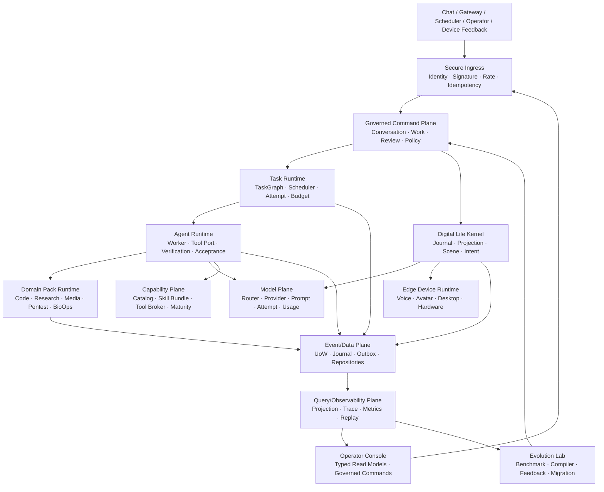
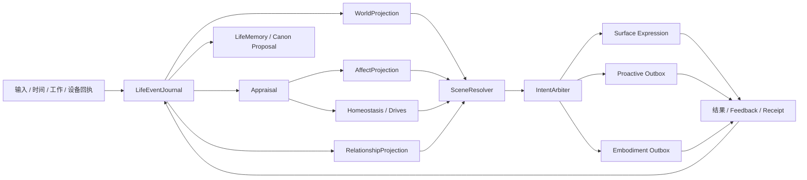

受众：PROJECT
标题：Natsume AI V1 完整架构重构目标蓝图（代码事实版）

# Natsume AI V1 完整架构重构目标蓝图（代码事实版）

> 历史快照：本文已被无日期、状态分离的 `../../../50_project/arch/TARGET_ARCHITECTURE.md` 取代。

版本：v1.1
日期：2026-07-12
状态：`ADOPTED_TARGET_ARCHITECTURE`
代码基线：目标事实最初采自 `dev@1ec8be1a8a20397627855aa946c0ff8aaaa87b72`；当前执行基线为 `codex/m48-integration@0aa4e9314`。
工作区状态：AW-00 生产接线进行中；未知遗留源码 WIP 不再受保护，运行数据与 secret 不纳入 Git。
上游参考：`C:/Users/34145/Downloads/Natsume_AI_V1_高级能力拓展重构计划_新增长期演化能力.md`
M48 地基执行：`docs/30_devspec/NATSUME_AI_V1_LONG_TERM_EVOLUTION_EXECUTION_20260710.md`
完整执行程序：`docs/30_devspec/NATSUME_AI_V1_FULL_ARCHITECTURE_REFACTOR_MASTER_EXECUTION_20260710.md`

本文定义最终架构归宿和边界，不是直接调度来源。依赖、切流、验证和回滚以 Architecture Waves v2 Master 执行合同为准；历史 TASK 编号只作追踪。

---

## 0. 结论

M48 只解决“系统能否安全地继续重构”：TaskStore、Verification、Review、事件、Life OCC、Domain 写边界等。它不是完整架构重构。

完整重构的实际对象是一个约 39.5 万行 Python、6.1 万行 Monitor UI 源码、多个进程和设备运行面组成的系统。目标不是继续堆新模块，而是把当前巨石、循环依赖、重复真相源和并行运行时收敛为：

- 一个模块化 Host 内核；
- 一套可分进程但共享合同的 Host/Worker/Query 架构；
- 一个事件驱动且可重放的 Digital Life 内核；
- 一个领域无关的 Task/Agent Runtime；
- 一个统一的 Governance、Model、Capability 和 Tool 平面；
- 一组真正隔离的 Domain Packs；
- 一个独立安装的 Edge Device Runtime；
- 一个只读 Query/Observability Plane 和契约驱动的 Operator Console；
- 一个受控的 Evolution Lab、Skill Compiler、Feedback 和 Identity Migration 闭环。

历史 `TASK-0461～TASK-0622` 已证明不适合作为执行粒度：逐任务证据、提交、复审和 Seal 重复放大成本，却允许生产主链长期不切换。自 2026-07-12 起，核心架构改由 AW-00～AW-08 九个端到端架构波推进；每波必须包含 production cutover、单一 authority 收敛和旧路径删除。Evolution 新能力在 Core Release 后另立 Follow-up Goal。旧任务与原始日估仅保留为范围参考，不再用任务完成数或名义工期衡量架构进展。

---

## 1. 当前代码规模

| 范围 | 文件/规模 | 事实 |
|---|---:|---|
| `host_brain` | 799 个 Python 文件，约 361,339 行 | Host 核心、领域、运行时、平台能力高度集中 |
| `edge_client` | 80 个 Python 文件，约 33,276 行 | Edge 仍直接依赖 Host 包和 Host Audit |
| Monitor UI `src` | 458 个 JS/JSX/CSS 文件，约 60,978 行 | 已是完整运营前端，但缺统一类型与 API 生成链 |
| Tests | 752 个 `test_*.py` 文件，6881 个收集项 | 测试体量大，但架构边界、迁移和真实平台发布覆盖不足 |
| Host API | 约 250 个路由装饰器 | Command、Query、Internal、Obs 写操作混合 |
| 顶级包双向依赖 | 36 组 | `app/tribe/persona/runtime/agent_runtime/skills` 等形成循环 |
| Host 环境变量读取 | 约 754 处 | Settings、feature flag 和 provider 配置缺少统一真源 |
| Edge 环境变量读取 | 约 74 处 | Host/Edge 配置语义难以协商和审计 |
| Inline `CREATE TABLE` | 约 98 处 | schema ownership 与迁移事实分裂 |
| SQLite connect | 约 27 处 | 事务、WAL、timeout、生命周期不统一 |
| 直接访问 Ledger 私有 `_conn` | 约 124 处、24 个文件 | Repository/UoW 边界未成立 |
| 超过 1500 行的 Python 文件 | 44 个 | 多数混合 application/domain/infrastructure 职责 |
| 超过 2500 行的 Python 文件 | 20 个 | 高风险巨石需要按行为切片迁移 |

### 1.1 主要巨石

| 文件 | 约行数 | 当前混合职责 |
|---|---:|---|
| `pentest/tools/tool_executors.py` | 6245 | 工具执行、解析、系统集成、错误映射 |
| `app/surface_main_chain_adapter.py` | 4782 | Context、Life 推进、Memory、Surface、回写、观测 |
| `agent_runtime/production_executor.py` | 4587 | 通用执行 + 轻小说/媒体/交付领域逻辑 |
| `persona/surface_memory_recall.py` | 4539 | Query、召回、证据、验证、策略和 Trace |
| `pentest/action_policy.py` | 4491 | 行动策略、工具能力、门禁和领域规则 |
| `app/agent_runtime_shared.py` | 4142 | Chat、Governor、Runtime、fallback、Surface 协调 |
| `tribe/thalamus_agent.py` | 4014 | Intent、LLM、规则、路由和降级 |
| `app/input_routes.py` | 3677 | HTTP、ingress、质量、进度、路由和回包 |
| `app/obs_routes_core.py` | 3568 | Query、聚合、缓存和部分控制语义 |
| `memory/life_memory/store.py` | 3275 | 多种 Memory 模型、SQL、事务、GC 和查询 |
| `edge_client/runtime/voice_pipeline.py` | 3117 | ASR/TTS/播放/中断/资源/状态协调 |
| `pentest/autonomous_kernel.py` | 3099 | 规划、运行、知识、Canon、报告和策略 |
| `executive_runtime/`（历史上为 `app/executive_runtime_core.py`） | 已拆分 | 入口、计划、路由、执行、fallback 与聚合已按模块拆分，但生产 authority 尚未完全统一 |
| `persona/inner_world.py` | 2565 | 数值状态、时间演化、LLM 叙事、私密文本、投影 |

---

## 2. 结构性问题

### 2.1 `app` 已成为隐式内核

`host_brain/app` 有 229 个 Python 文件、约 105,416 行，同时承担 HTTP、DI、生命周期、编排、模型路由、存储、领域逻辑、观测和前端后端。`app/dependencies.py` 是 1352 行服务定位器；大量底层包反向导入 `app`。

最重的双向依赖包括：

| 双向边 | Import 计数 |
|---|---:|
| `app ↔ tribe` | 183 |
| `app ↔ core` | 76 |
| `persona ↔ tribe` | 71 |
| `app ↔ persona` | 65 |
| `app ↔ integrations` | 48 |
| `app ↔ skills` | 37 |
| `app ↔ pentest` | 36 |
| `agent_runtime ↔ app` | 32 |
| `app ↔ memory` | 31 |
| `app ↔ scheduler` | 30 |
| `app ↔ runtime` | 30 |

当前 `app` 既不是纯 interface，也不是 application layer，更不是稳定 domain kernel。

### 2.2 多套运行语义并存

- Chat 主链经 `chat_handler → cortex_orchestrator → agent_runtime_shared → app.executive_runtime → executive_runtime.runtime` 多层转发。
- Governed Graph 有完整控制合同，但不是普通聊天的生产执行真源。
- SkillDag、PlanGraph、Executive 和 Agent Runtime 各自拥有计划/状态语义。
- `scheduler/NatsumeScheduler`、`app/automation/HostTaskScheduler` 和未来 Task Runtime 是三类不同 scheduler。
- `agents/`、`app/agents/`、`agent_runtime/`、Tribe descriptors 和 Pentest agents 是多套 Agent taxonomy。
- `skills/`、`tools/`、MCP、app agent tools 和 Pentest tools 是多套能力/执行入口。

### 2.3 Digital Life 存在多核与多时钟

- LifeContinuity、LifeOrgans、Tribe agents、InnerWorld、DigitalLifeSupervisor 和 Scheduler 都能推进生命状态。
- Surface Context 构造会调用生命推进逻辑，读操作可能产生人生事件。
- 用户情绪观察和夏目自身 Affect 没有严格类型隔离。
- Bond stage/score、rift/repair、SocialBrain vector、Neo4j 和缓存恢复语义不一致。
- Proactive 有至少四套判断/发送链。
- VTS、MateEngine、MotorCortex、Electron Pet 存在多个具身写出口。

### 2.4 数据与事件没有统一所有权

- MemoryEventStore、LifeMemory、两套 EpisodicStore、多套 Distillation 并存。
- Schema 由 migration、ledger schema 和 runtime inline DDL 共同创建。
- Migration catalog 存在重复编号和缺口，而真实启动仍依赖 `_ensure_schema`。
- 多个模块直接持有 Ledger `_conn`，事务边界跨越领域。
- Tribe、Pentest、Swarm 等使用独立内存 EventBus；拥塞和重启会丢事件。
- Pentest 运行知识、权威 Canon、Life Memory 和 Audit Evidence 没有明确 namespace/promotion 边界。

### 2.5 平台与安全平面分裂

- Host Main、Obs、Edge、Gateway、Desktop Pet、MateEngine、VRM、VTS 各有独立端口和配置，缺统一 Service Catalog。
- 端口 18770 存在多个默认占用者。
- Edge 直接导入 `host_brain.core` 和 `host_brain.audit`，Host 又导入 Edge 配置/健康，无法独立安装。
- Obs 名义上是观测面，却包含多类写命令。
- Gateway webhook 验签、重放保护、持久 inbox/outbox 和统一 principal 不完整。
- Skill/Provider 安装可以把 Python 源码导入 Host 进程，供应链隔离不足。
- Host、Edge、MateEngine、Electron、Browser/Unity VRM 缺统一协议版本、身份和 capability handshake。

### 2.6 Model、Prompt 与 Capability 平面重复

- `llm_helpers.py`、`llm_gateway.py`、`provider_factory.py`、`model_router.py`、`routing_matrix.py`、`graph_config_llm_runtime.py` 都承担路由/重试/降级的部分职责。
- Provider、Role、Prompt、预算、熔断、usage 和 route trace 没有唯一 Attempt 语义。
- SkillRegistry、ToolCatalog、ToolBroker、ToolExecutorRegistry、MCP registry、Pentest contract、Runtime capability registry 使用不同风险和生命周期模型。

### 2.7 Query/Operator 与发布体系滞后

- Obs API 同时做 query 和 command；存在重复 path handler 风险。
- Monitor UI 的 endpoint risk 主要是展示元数据，client 并不执行治理策略。
- 前端以 JS 为主，缺 OpenAPI codegen、typecheck、unit/component/a11y 门禁。
- hashed static assets 被跟踪，构建与源码 diff 混合。
- CI 没有覆盖 Edge 独立安装、Electron、.NET/Unity bridge、真实 migration、SBOM/signature 和可复现 release。
- Release catalog 仍停留在 M0～M3，与实际代码演化不匹配。

---

## 3. 目标架构原则

1. **模块化单体优先**：先建立严格模块边界，不以拆微服务掩盖循环依赖。
2. **Contracts 独立**：Host、Edge、Gateway、UI 共享版本化合同，不共享 Host 实现包。
3. **依赖只向内**：Interface/Adapter → Application → Domain/Kernel → Contracts。
4. **Composition 是唯一例外**：composition 可以导入实现，任何业务包不得反向导入 composition。
5. **Command/Query 分离**：Host Command Plane 负责治理和写入；Obs Query Plane 只消费 projection。
6. **Plan once, execute same revision**：规划、审批、执行和回放指向同一 TaskGraph revision。
7. **Event journal + Projection**：长期状态来自 versioned event/reducer/projection，不来自多个最后写 JSON。
8. **所有副作用经 Outbox**：工具、消息、主动行为和具身命令均有幂等、lease、receipt 和 dead letter。
9. **Domain Pack 不拥有平台权力**：领域提供能力、状态、验证和 UI contribution，不提供第二套 Runtime/Governor。
10. **显式退役**：compatibility facade 必须有 owner、usage telemetry 和删除版本。

---

## 4. 目标运行拓扑



生产形态可以保留为模块化单体 + 独立 Obs/Edge/Gateway 进程；开发形态允许同进程 composition。边界由 contracts 和 ports 保证，而不是依赖部署拓扑保证。

---

## 5. 最终包结构

```text
natsume_contracts/
  identity/ ids/ errors/ envelopes/ events/ risk/ embodiment/

host_brain/
  kernel/
    clock.py result.py versions.py causality.py

  contracts/
    commands.py queries.py task.py review.py model.py capability.py

  composition/
    container.py lifecycle.py settings.py feature_flags.py service_catalog.py

  api/
    http/v2/ internal/ legacy/ sse/

  orchestration/
    conversation/ ingress/ work/ proactive/ review/

  task_runtime/
    graph/ scheduler/ attempts/ budget/ checkpoint/

  agent_runtime/
    application/ domain/ ports/ infrastructure/

  model_plane/
    service.py routing/ providers/ attempts/ prompts/ usage/

  capability_plane/
    catalog/ skills/ tools/ bundles/ maturity/ sandbox/

  governor/
    authorization/ policy/ risk/ token/ review/ manifest/

  eventing/
    journal.py outbox.py inbox.py dispatcher.py projections.py

  persistence/
    uow.py repositories/ sqlite/ migrations/ backup/

  digital_life/
    contracts/ kernel/ world/ appraisal/ affect/ drives/
    relationship/ inner/ scene/ intent/ proactive/ memory/
    identity/ embodiment/ surface/ infrastructure/ observability/

  domain_packs/
    sdk/ code/ research/ media/ personal_knowledge/
    desktop/ hardware/ pentest/ bio_ops/ mcp/

  observability/
    read_models/ trace/ metrics/ alerts/ api/

edge_client/
  composition/ contracts/ application/ ports/ adapters/
  voice/ embodiment/ gateway/ devices/ observability/

operator_ui/
  generated_api/ app/ features/ shared/ tests/
```

该目录是最终归宿，不允许长期保留“新目录一套、旧目录一套”的双核。迁移期旧包只作为 shim；达到删除 Gate 后必须退役。

---

## 6. 强制依赖规则

| 层 | 可以依赖 | 禁止依赖 |
|---|---|---|
| `natsume_contracts` | stdlib、最小 schema 库 | Host/Edge/FastAPI/SQLite/provider |
| `kernel` | contracts | app/api/composition/adapters |
| `digital_life/* domain` | kernel、contracts、domain ports | app、HTTP、SQLite、LLM provider |
| `task_runtime` | contracts、ports、kernel | route、global dependencies、Domain implementation |
| `agent_runtime` | contracts、ports、task runtime contract | app、Gateway、Ledger 单例、Domain private store |
| `orchestration` | domain/application ports | FastAPI request、SQLite connection |
| `api` | application services、DTO mapper | repository/private domain internals |
| `adapters/infrastructure` | ports、外部库 | 反向成为 domain 真相源 |
| `composition` | 所有具体实现 | 被其他层反向导入 |
| `edge_client` | `natsume_contracts`、Edge 自有层 | `host_brain.*` 实现包 |
| `domain_packs` | Pack SDK、Capability/Task ports | Host app/global container/Persona/Bond private store |

目标 Gate：目标层之间双向依赖为 0；所有例外都有 ADR、owner 和删除版本。

---

## 7. Bounded Context 与唯一真相源

| Context | 唯一写模型 | 只读投影/适配 |
|---|---|---|
| Authorization | AuthorizationGrant + Token Repository | route/UI risk display |
| Task | TaskGraph + TaskAttempt + Budget | execution/trace UI |
| Runtime Event | EventJournal + Transactional Outbox | SSE/EventBus/metrics |
| Life | LifeEventJournal + versioned reducers | `digital_life_state` compatibility projection |
| Affect | NatsumeAffectProjection | UserAffectObservation、VAD compatibility |
| Homeostasis | HomeostasisProjection | Tribe organ contribution |
| Relationship | RelationshipProjection | Neo4j graph、Bond summary、SocialBrain cache |
| Memory | LifeMemoryService | Chroma/FTS/semantic projection |
| Canon | Canon proposal/apply aggregate | prompt/retrieval citation projection |
| Knowledge | Domain/Personal Knowledge Document Store | vector/full-text index |
| Proactive | IntentDecision + durable outbox | recent episode/read model |
| Embodiment | EmbodimentCommand + receipt | VTS/VRM/MateEngine/Pet adapters |
| Identity | immutable baseline + adaptive overlay versions | release snapshot/diff |
| Capability | CapabilityCatalog + signed SkillBundle | UI/registry compatibility view |

Neo4j、Chroma、Tribe Registry、Monitor cache 和进程内对象均为 projection/cache，不是长期状态真相源。

---

## 8. Digital Life 核心数据流



不可妥协的语义：

- Surface Context build 是纯读操作；预览、重试和回放不会推进生命状态。
- 用户情绪观察与夏目自身 Affect 是不同类型、不同字段、不同 writer。
- 私密 Inner Narrative 有独立保留和降敏策略，不进入通用 Trace/Memory/Prompt。
- Tribe agents 只能提交 `StateContribution`，不能自行推进第二套生命状态机。
- 所有主动行为和具身动作经过 durable outbox，并产生 receipt。
- 人格成长经过 proposal、shadow evaluation、activate version 和 rollback。

---

## 9. 平台安全与运行面边界

P0 平台封口属于完整重构的前置安全线：

1. Host、Obs、Gateway 和本地 Bridge 使用统一 principal、签名、scope 和 audit envelope。
2. Gateway 保留 raw body/header 并执行平台验签；使用 durable inbox/outbox、ack、idempotency 和 DLQ。
3. Obs 变成只读 Query Plane；所有写操作进入 Governed Command Plane。
4. SkillBundle 使用 digest、signature、SBOM、quarantine、sandbox、staged activation 和 rollback；不允许未隔离 Python 热导入。
5. Pentest 使用统一 Governor token、真实 principal、Lab-only 网络/进程隔离和共享 RunStore。
6. Service Catalog 统一端口、健康、协议版本和 capability handshake，解决 18770 冲突。
7. Edge 不再导入 Host 实现；物理输出只有 Edge Device Runtime 一个 authority。
8. Electron、MateEngine、VRM、VTS 默认 loopback + token/HMAC；远程暴露必须显式配置和审计。

---

## 10. Command、Query 与 Event Plane

### Command Plane

- 对外写命令全部进入 Secure Ingress。
- CommandEnvelope 绑定 principal、intent、authorization、idempotency、budget 和 causality。
- Route 只做认证、DTO mapping 和 application service 调用。
- Domain 不接触 HTTP/FastAPI 对象。

### Query Plane

- Obs 只消费 versioned projections。
- UI 不直接查询业务表或调用模块全局缓存。
- Read model 带 schema version、freshness、source cursor 和 degraded state。

### Event Plane

- 关键事件与状态变化同事务写 Journal/Outbox。
- Consumer 使用 offset、idempotency 和 dead letter。
- SSE 是持久 Event 的 projection，不是临时 replay list。
- 所有事件包含 identity、correlation、causation、observed/ingested time、visibility、confidence 和 evidence refs。

---

## 11. Model、Prompt、Capability 与 Tool Plane

### Model Plane

统一 `ModelRequest → RouteDecision → ProviderAttempt → StructuredResult`：

- provider registry
- declarative role/profile
- timeout/retry/fallback/circuit breaker
- streaming/non-streaming
- token/cost/latency budget
- usage/audit/route trace
- structured output validation/repair

### Prompt Plane

- prompt template 版本、owner、input contract 和 output schema 可追踪；
- Persona、Task、Domain prompt 通过明确 slots 组合；
- 不再由业务模块直接调用私有 LLM helper。

### Capability Plane

- CapabilityCatalog 是 Skill、Tool、MCP、Agent 和 Domain Pack 的联邦视图；
- 所有执行经过唯一 Tool/Capability Broker；
- 风险映射统一，但保留来源尺度和转换证据；
- SkillBundle 供应链与运行 sandbox 分离；
- maturity 只能收紧执行权限。

---

## 12. Domain Pack 目标

每个 Pack 只提供：

```text
manifest
commands / capabilities / tools
state repository port
knowledge namespace
verifier / acceptance profile
risk profile
benchmark suite
read-model and UI contribution
```

Pack 不提供第二套 TaskGraph、Governor、Review、Model Gateway、EventBus 或身份系统。

首批目标 Pack：

- Code
- Research/Browser
- Media/Translation/Lightnovel
- Personal Knowledge/Obsidian
- Desktop Automation
- Hardware/Embodiment
- Pentest Lab
- BioOps
- MCP/External Providers

---

## 13. Operator Console 目标

Operator Console 不是简单监控页，而是三个受治理产品面：

1. **Operate**：Task、Review、Policy、Domain Pack、Device、Release。
2. **Understand**：Life、World、Memory、Relationship、Identity、Capability。
3. **Replay/Lab**：Trace、Evidence、Counterfactual、Scenario、Benchmark。

前端以 versioned read model 和生成 client 为边界；role/capability 决定路由可见性和操作许可。UI risk 标签只解释后端门禁，不能代替后端授权。

---

## 14. Architecture Waves v2

| Wave | 主题 | 核心结果 |
|---|---|---|
| AW-00 | 平台安全生产接线 | 已实现的 Ingress/Obs/Pentest/Supply-chain/Bridge 能力进入真实 composition 与 lifecycle |
| AW-01 | Contracts/Kernel/Composition 脊柱 | 单装配根、typed settings、lifecycle、service catalog、依赖门禁 |
| AW-02 | Governed Host Runtime | Secure Ingress → Application → Task/Agent Runtime 成为唯一新请求链 |
| AW-03 | Durable Data/Event 脊柱 | UoW、Journal/Outbox、Migration、Memory/Canon 单写与 projection rebuild |
| AW-04 | Digital Life 单内核 | 单 coordinator/clock/writer，Surface 纯读，主动/具身 durable outbox |
| AW-05 | Model/Capability/Governor/Domain Pack | 单 ModelAttempt/Broker/Grant，领域逻辑离开通用 executor |
| AW-06 | Edge/Gateway/Device Authority | Edge contracts-only 独立发布，物理输出单 authority |
| AW-07 | Query/Operator Plane | Obs 只读、versioned projections、generated client、写动作回 Ingress |
| AW-08 | Decompat/Core Release | 删除旧 authority，`CODE_COMPLETE → PROGRAM_ACCEPTANCE → DONE`，一次最终全量与真实实测 |

AW-02/AW-03 和 AW-04/AW-05/AW-06 可按公共合同与文件 owner 安全并行。具体 DAG、效率护栏和测试频率以 Master v2 为准。

Evolution Lab、Skill Compiler、Counterfactual、Knowledge OS 与 Identity Migration 仍属于完整目标架构，但移到 Core Release 后的独立 Follow-up Goal。它们不得在核心 authority、persistence 和 governance 尚未封板时提前成为实现主线。

---

## 15. 上游能力覆盖

| 上游能力 | 目标落点 | 里程碑 |
|---|---|---|
| Universal Agent Runtime | Task/Agent Runtime | AW-02 |
| GraphState/Mutation/Replay | Task Event + Domain Journal + Projection | AW-02、AW-03、AW-07 |
| Context/Capability/Search | Context Plane + Capability Plane + Retrieval | AW-03、AW-05 |
| Verifier/Critic/Judge/Review | Acceptance + Review/Token | AW-02、AW-05 |
| Domain Pack | Domain Pack SDK/Registry | AW-05 |
| Digital Life Core | `digital_life/` kernel and contexts | AW-04 |
| Operator Console | Typed Query Plane UI | AW-07 |
| World Model | WorldProjection | AW-04 |
| Scene Engine | SceneResolver | AW-04 |
| Intent Arbiter | IntentArbiter | AW-04、AW-05 |
| Shadow Execution | Task shadow + policy simulation | AW-02、AW-05、Evolution Follow-up |
| Capability Maturity | CapabilityCatalog/Maturity | AW-05 |
| Skill Compiler | Evolution Lab + SkillBundle | Evolution Follow-up |
| Experience Feedback | Feedback proposal pipeline | Evolution Follow-up |
| Runtime Guardian | Lifecycle/Degradation/Service Catalog | AW-00、AW-01、AW-06 |
| Counterfactual | Replay/Lab analysis | Evolution Follow-up |
| Scenario Lab | Evolution Lab | Evolution Follow-up |
| Knowledge OS | Knowledge context + Operator workflows | AW-03、AW-07、Evolution Follow-up |
| Identity Migration | versioned identity + regression/migration | AW-04、Evolution Follow-up |

---

## 16. 最终架构 Gate

1. 目标层之间双向 package dependency 为 0；Edge 对 `host_brain.*` 实现导入为 0。
2. `host_brain/app` 不再承载 domain、repository、provider 和 lifecycle 真相；只保留明确 legacy facade 直至退役。
3. 所有 production giant file >1500 行都有拆分完成或经 ADR 批准的纯数据/生成例外；禁止新增 >800 行混合职责文件。
4. 同一 action 只有一个 AuthorizationGrant、一个 Task/Attempt lineage 和一个副作用 receipt。
5. Verification FAIL/ERROR/required-NOT_RUN 不可能进入 committed success。
6. 每个长期字段只有一个 writer；所有 projection 可由 journal 重建。
7. Surface Context 构造零写入；主动行为和具身动作全部经过 durable outbox。
8. 普通聊天不能检索 Pentest 领域知识；Canon Apply 校验审批内容 hash。
9. Host/Obs/Gateway/Bridge 写接口全部具备 principal、scope、signature/token、rate 和 audit。
10. Migration catalog 可在空库、旧库、备份恢复和 rollback drill 中通过；production runtime inline DDL 为 0。
11. OpenAPI 不存在重复 method/path handler；UI client 来自版本化 schema。
12. 所有 compatibility facade 有 usage=0 证据并按删除版本退役。
13. Skill/Provider bundle 有 digest/signature/SBOM/quarantine/sandbox/rollback。
14. ReleaseManifest 包含 commit、package、schema、protocol、model/avatar assets、SBOM、gates 和 rollback compatibility。
15. 完整 Golden Paths、replay、chaos、performance、security、backup/restore 和 identity regression 全部有 Seal 证据。

---

## 17. 迁移方法

完整重构采用 Strangler + Contract-First + Shadow Compare：

1. 先冻结现有行为和 Golden Paths。
2. 提取 contracts/ports，不改变行为。
3. 新 application/domain 实现通过旧 facade 接入。
4. shadow 只比较结果，禁止双副作用。
5. 每次只切一个 vertical slice 和新请求。
6. 旧任务由原执行器 drain；旧 projection 保持只读对照。
7. 经过两个稳定发布窗口后删除旧 writer/facade。

双写不是默认迁移手段。确需同步多个目标时，只能由 transactional outbox 驱动，并具有对账、停止和回滚证据。
