# Natsume AI 系统数据流全景报告

> 报告生成时间：2026-03-11 17:20（初版）| 最后更新：2026-03-11 17:28（本次修复后更新）
> 报告范围：双端通信 · 各功能数据流 · 各模块数据流 · Agent 治理 · Agent 路由 · Graph 编排
> 报告模型：claude-4.6-sonnet
> 本次修复：问题 A/B/C/D/F 已按优先级处理（见第十三节）

---

## 目录

1. [系统整体架构概览](#一系统整体架构概览)
2. [双端通信数据流](#二双端通信数据流)
3. [主聊天链路数据流（SCENE_CHAT）](#三主聊天链路数据流scene_chat)
4. [复杂场景数据流（LangGraph 多节点）](#四复杂场景数据流langgraph-多节点)
5. [Agent 治理数据流（Governor）](#五agent-治理数据流governor)
6. [Agent 路由数据流（SceneRouter）](#六agent-路由数据流scenerouter)
7. [Graph 编排数据流（MainChain + LangGraph）](#七graph-编排数据流mainchain--langgraph)
8. [Retrieval 七路召回数据流](#八retrieval-七路召回数据流)
9. [情感层数据流](#九情感层数据流)
10. [Bond 关系层数据流](#十bond-关系层数据流)
11. [Edge 端各功能数据流](#十一edge-端各功能数据流)
12. [双端通信打通状态评估](#十二双端通信打通状态评估)
13. [关键问题与修复状态](#十三关键问题与修复状态)

---

## 一、系统整体架构概览

```mermaid
graph TB
    subgraph USER["用户侧"]
        U1["用户语音输入"]
        U2["用户文字输入（微信/直接）"]
        U3["用户屏幕（截图）"]
    end

    subgraph EDGE["Edge Client（本地端）\nPort: 17800"]
        E_ASR["ASR 语音识别\nedge_client/senses/asr.py"]
        E_TTS["TTS 语音合成\nedge_client/actuators/tts_engine.py"]
        E_VTS["VTS 表情驱动\nedge_client/actuators/vts_driver.py"]
        E_WECHAT["微信监听\nedge_client/channels/wechat_listener.py"]
        E_DESKTOP["桌面控制\nedge_client/actuators/desktop_controller.py"]
        E_RPC["Edge RPC Gateway\nedge_client/app/fastapi_app.py"]
        E_FALLBACK["Fallback LLM\nedge_client/rpc/fallback_llm.py"]
        E_REPORTER["事件上报\nedge_client/rpc/event_reporter.py"]
        E_INPUT["输入上报\nedge_client/channels/input_reporter.py"]
    end

    subgraph HOST["Host Brain（云端/服务端）\nPort: 8000"]
        H_CHAT["POST /v1/chat\nchat_handler.py"]
        H_GOV["Governor 鉴权\ngovernor/decision.py"]
        H_ROUTER["SceneRouter\ngraph/main_chain.py"]
        H_RETRIEVAL["七路召回\nretrieval/orchestrator.py"]
        H_LLM["LLM Gateway\nintegrations/llm_gateway.py"]
        H_AIRLOCK["Airlock 检疫\nairlock/quarantine.py"]
        H_EPISODIC["情节记忆\nmemory/episodic_store.py"]
        H_BOND["Bond 关系层\nbond/bond_dynamics.py"]
        H_VTS_CTRL["VTS 控制\nchannels/vts.py"]
        H_EDGE_EVENTS["POST /v1/edge/events\nsystem_handler.py"]
        H_INPUT["POST /v1/host/input\ninput_routes.py"]
        H_AGENT["Agent Loop\napp/vision/agent_loop.py"]
    end

    subgraph LLM_BACKEND["LLM 后端"]
        LLM_LOCAL["本地 Ollama\nqwen3:8b\n127.0.0.1:11434"]
        LLM_CLOUD["云端 Gemini\ngemini-2.5-pro/flash"]
    end

    subgraph STORAGE["存储层"]
        DB_CHROMA["ChromaDB\n向量数据库"]
        DB_NEO4J["Neo4j / SQLite\nBond 关系图"]
        DB_EPISODIC["情节记忆存储"]
    end

    U1 --> E_ASR
    U2 --> E_WECHAT
    U3 --> E_DESKTOP

    E_ASR -->|"ASR 结果\nHTTP POST /v1/host/input"| H_INPUT
    E_WECHAT -->|"微信消息\nHTTP POST /v1/host/input"| H_INPUT
    E_REPORTER -->|"批量事件\nHTTP POST /v1/edge/events"| H_EDGE_EVENTS
    E_INPUT -->|"输入上报\nHTTP POST /v1/host/input"| H_INPUT

    H_CHAT -->|"SSE 流式响应"| E_RPC
    H_VTS_CTRL -->|"VTS 指令\nHTTP POST /v1/edge/vts"| E_RPC
    H_AGENT -->|"截图请求\nHTTP POST /v1/edge/screenshot"| E_RPC
    H_AGENT -->|"自动化操作\nHTTP POST /v1/edge/automate"| E_RPC

    E_RPC -->|"TTS 合成指令\nHTTP POST /v1/edge/speak"| E_TTS
    E_RPC -->|"VTS 表情指令"| E_VTS
    E_RPC -->|"截图结果"| H_AGENT
    E_RPC -->|"操作结果"| H_AGENT

    H_LLM -->|"本地推理"| LLM_LOCAL
    H_LLM -->|"云端推理"| LLM_CLOUD

    H_RETRIEVAL --> DB_CHROMA
    H_BOND --> DB_NEO4J
    H_EPISODIC --> DB_EPISODIC

    E_TTS --> U1
    E_VTS -->|"Live2D 表情"| U3
```

---

## 二、双端通信数据流

### 2.1 Host → Edge 通信（主动推送方向）

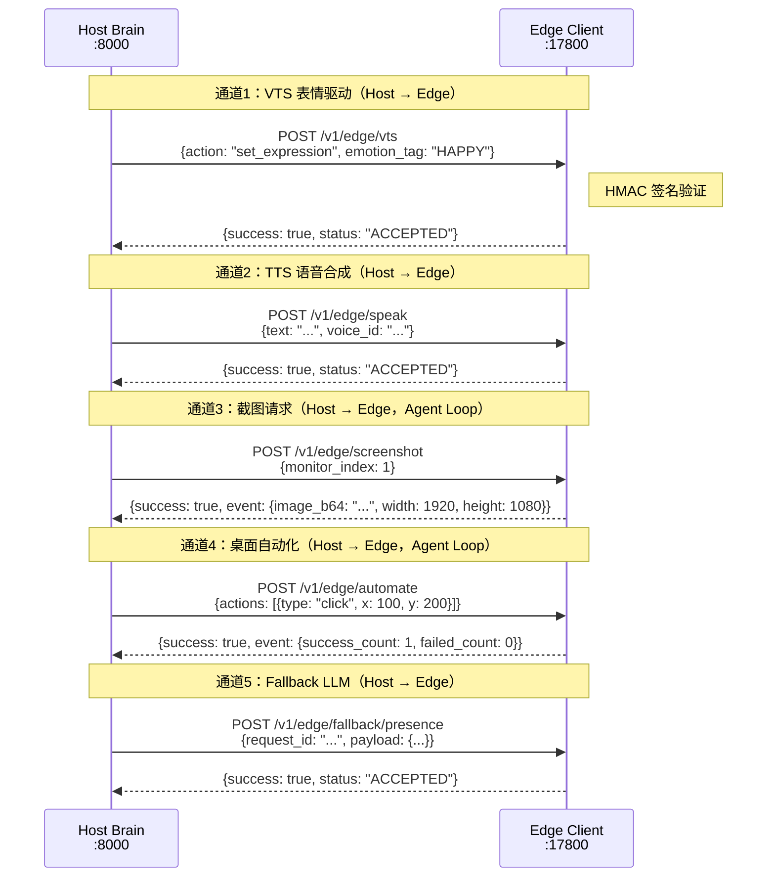

### 2.2 Edge → Host 通信（上报方向）

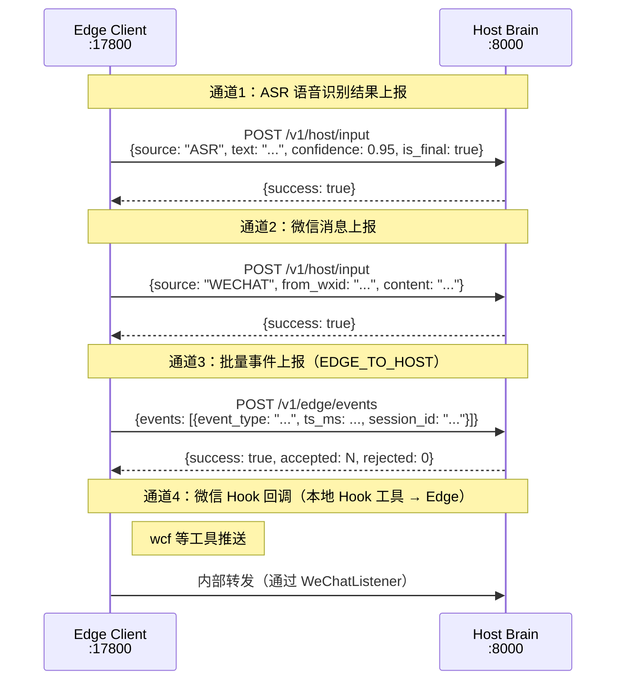

### 2.3 双端 SSE 流式通信（核心聊天链路）

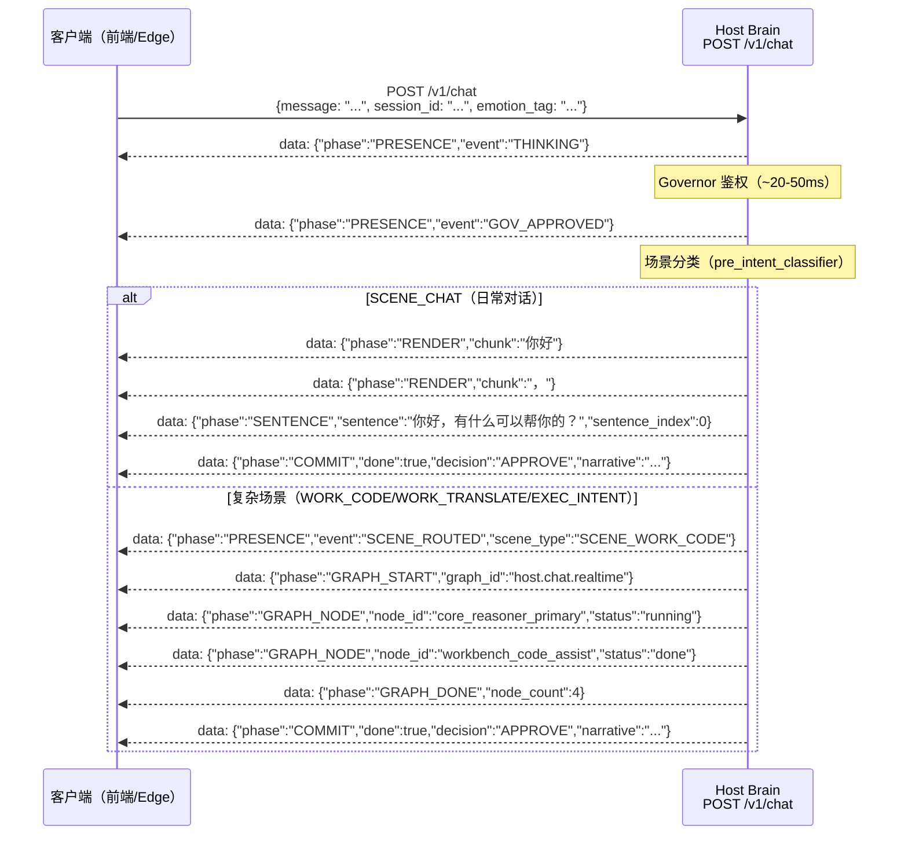

---

## 三、主聊天链路数据流（SCENE_CHAT）

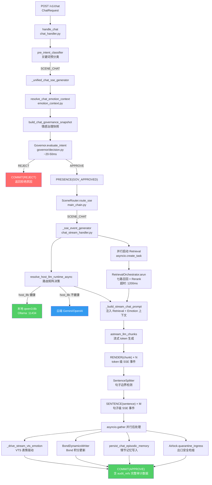

### 3.1 SCENE_CHAT 关键延迟分布

| 阶段 | 典型延迟 | 超时配置 |
|------|---------|---------|
| Governor 鉴权 | 20-50ms | 2000ms |
| Retrieval 七路召回 | 200-800ms | 1200ms（可配置） |
| LLM 首 token | 300-1500ms | 10000ms（最低） |
| 后处理并行（Airlock+Episodic+Bond+VTS） | 50-300ms | 各自独立超时 |

---

## 四、复杂场景数据流（LangGraph 多节点）

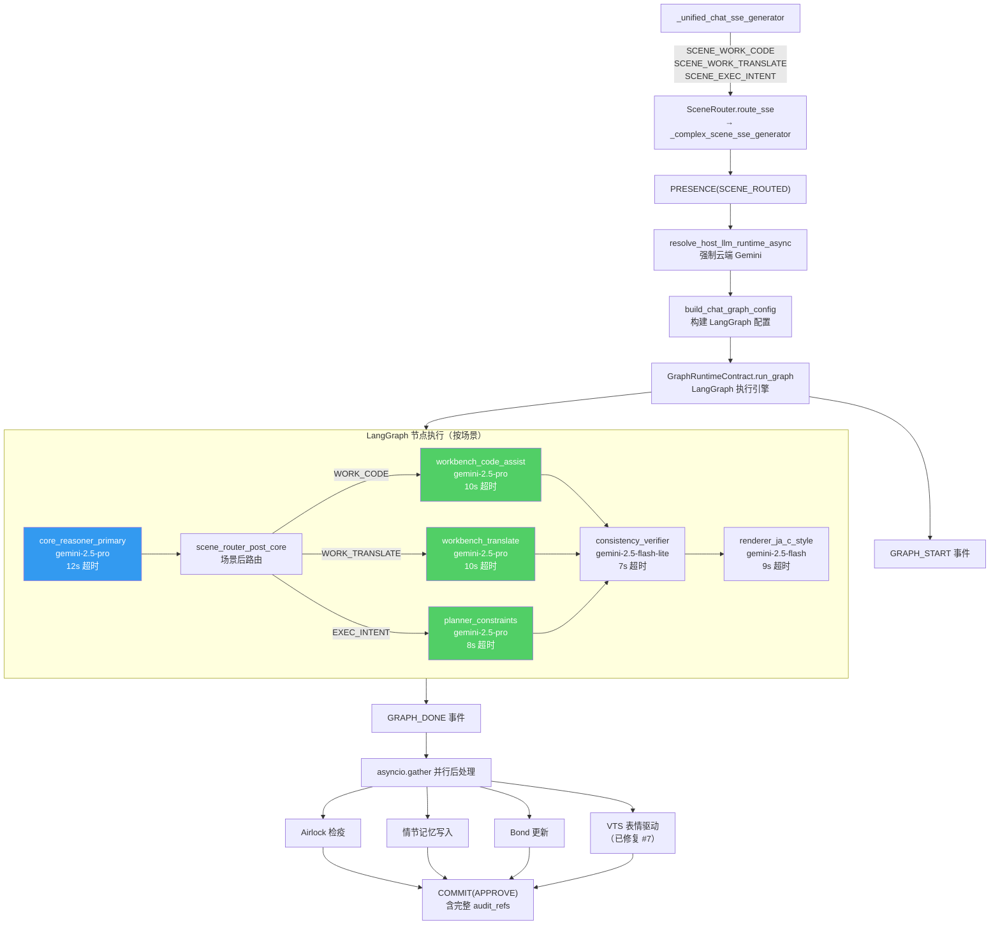

### 4.1 场景节点序列

| 场景 | 节点序列 | 总预算 |
|------|---------|--------|
| SCENE_CHAT | `chat_direct_ja` | 10-15s |
| SCENE_WORK_CODE | `core_reasoner_primary → workbench_code_assist → consistency_verifier → renderer_ja_c_style` | 90-240s |
| SCENE_WORK_TRANSLATE | `core_reasoner_primary → workbench_translate → consistency_verifier → renderer_ja_c_style` | 90-240s |
| SCENE_EXEC_INTENT | `core_reasoner_primary → planner_constraints → tool_planner → safety_verifier → consistency_verifier → renderer_ja_c_style` | 90-240s |

---

## 五、Agent 治理数据流（Governor）

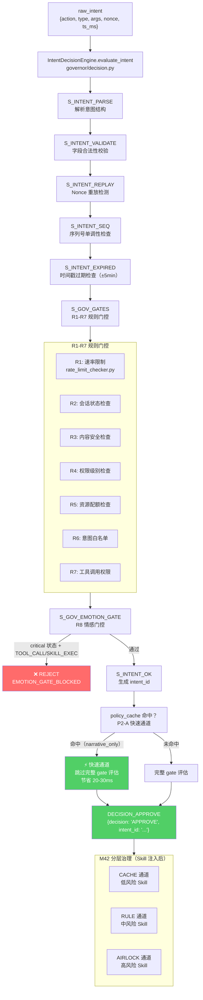

### 5.1 Governor 决策链关键参数

| 门控 | 检查内容 | 失败原因码 |
|------|---------|-----------|
| R1 速率限制 | 每会话请求频率 | `RATE_LIMIT_EXCEEDED` |
| R5 资源配额 | Token 消耗配额 | `QUOTA_EXCEEDED` |
| R8 情感门控 | `critical` 状态下拒绝工具调用 | `EMOTION_GATE_BLOCKED` |
| Nonce 重放 | 防止请求重放攻击 | `NONCE_REPLAY` |
| 时间戳过期 | ±5 分钟窗口 | `INTENT_EXPIRED` |

---

## 六、Agent 路由数据流（SceneRouter）

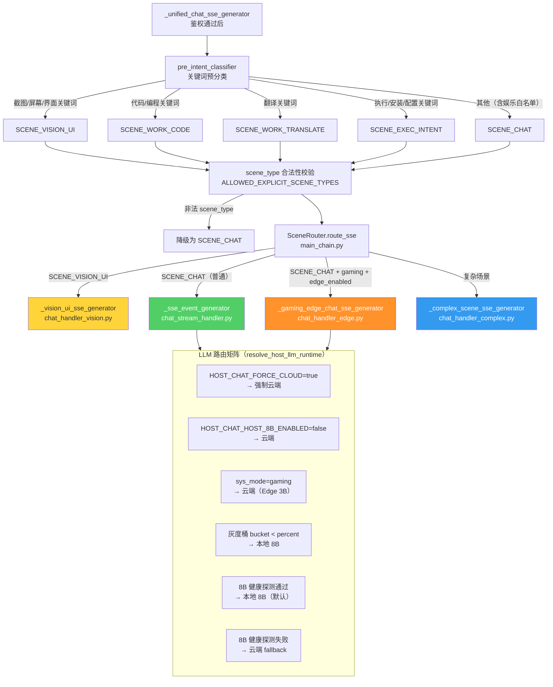

### 6.1 路由决策优先级

```
1. HOST_CHAT_FORCE_CLOUD=true          → 强制云端（最高优先级）
2. HOST_CHAT_HOST_8B_ENABLED=false     → 云端
3. sys_mode=gaming                     → 云端（Edge 3B 路径）
4. 灰度排除（gray_rollout.in_rollout=false） → 云端
5. 本地 8B 健康探测通过                → 本地 qwen3:8b（默认路径）
6. 本地 8B 健康探测失败                → 云端 fallback
```

### 6.2 Gaming Edge 路由（特殊路径）

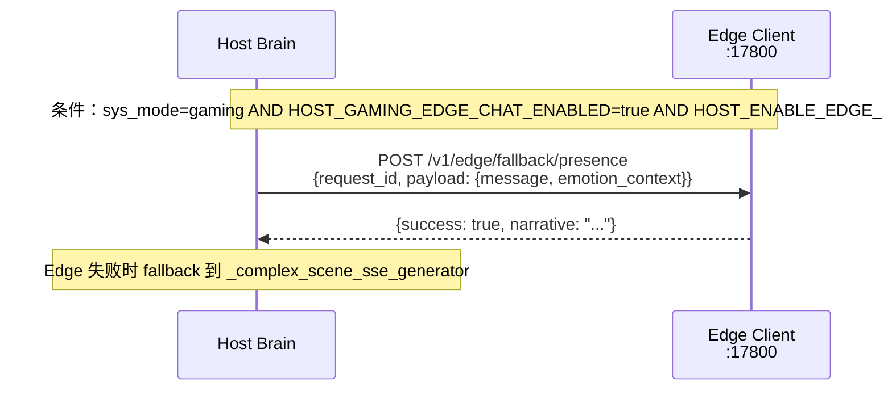

---

## 七、Graph 编排数据流（MainChain + LangGraph）

### 7.1 MainChain 节点链路（骨架层）

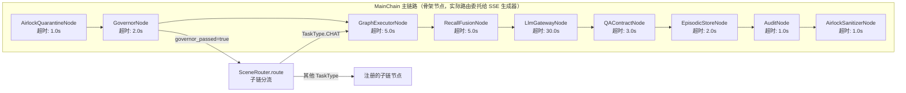

> ⚠️ **注意**：`MainChain` 的骨架节点（`GovernorNode`、`LlmGatewayNode` 等）均为空实现（`return True`）。
> 实际执行路径通过 `MainChain.run_as_sse_adapter()` 委托给 `_unified_chat_sse_generator`。
> 这是审计问题 #4 的修复结果（已完成）。

### 7.2 LangGraph 图配置（build_chat_graph_config）

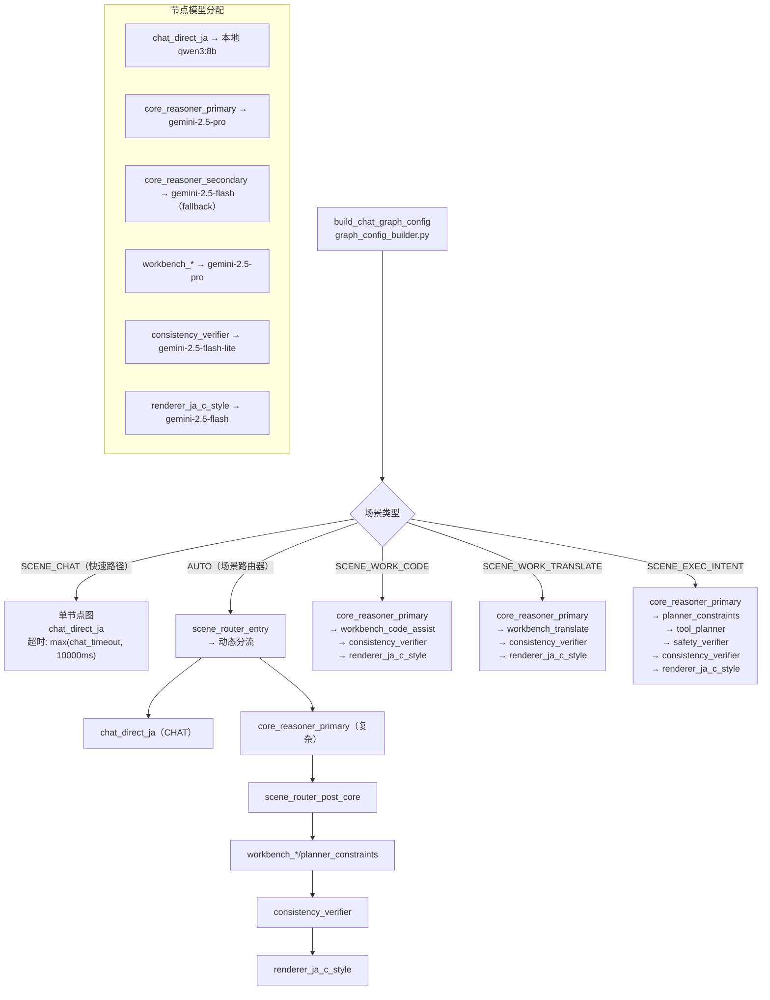

---

## 八、Retrieval 七路召回数据流

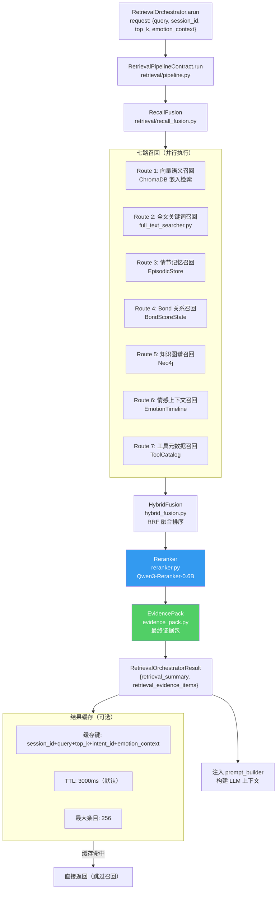

### 8.1 Retrieval 降级策略

| 状态 | 触发条件 | 处理方式 |
|------|---------|---------|
| `SKIPPED` | `HOST_ENABLE_RETRIEVAL=false` 或 `HOST_CHAT_DISABLE_RETRIEVAL=true` | 跳过召回，使用空摘要 |
| `DEGRADED(RETRIEVAL_TIMEOUT)` | 超过 `HOST_STREAM_RETRIEVAL_TIMEOUT_MS`（默认 1200ms） | 使用降级摘要，后台任务继续 |
| `DEGRADED(RETRIEVAL_FAILED)` | 召回管道异常 | 使用降级摘要 |
| `OK` | 正常完成 | 注入完整证据包 |

---

## 九、情感层数据流

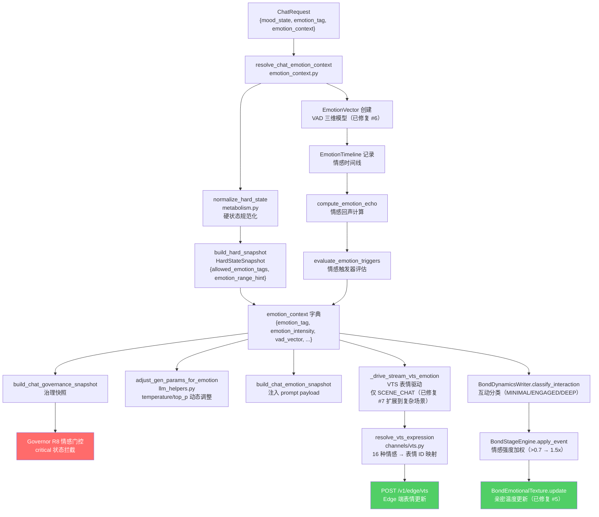

### 9.1 情感标签映射（16 种）

| 情感标签 | 中文 | VTS 表情 ID |
|---------|------|------------|
| HAPPY | 开心 | exp_happy |
| SAD | 悲伤 | exp_sad |
| ANGRY | 愤怒 | exp_angry |
| SURPRISED | 惊讶 | exp_surprised |
| NEUTRAL | 平静 | exp_neutral |
| ... | ... | ... |

---

## 十、Bond 关系层数据流

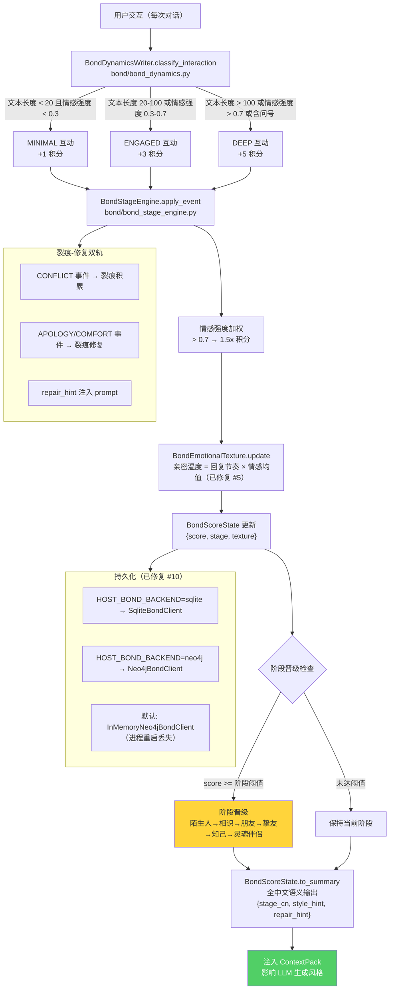

---

## 十一、Edge 端各功能数据流

### 11.1 ASR 语音识别数据流

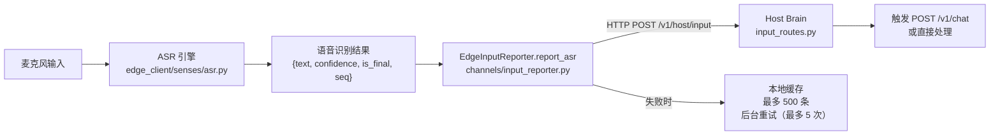

### 11.2 TTS 语音合成数据流

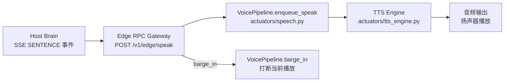

### 11.3 VTS 表情驱动数据流

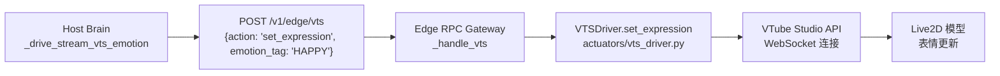

### 11.4 Agent Loop 视觉自动化数据流

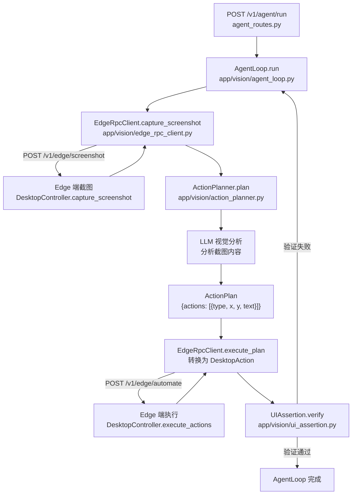

---

## 十二、双端通信打通状态评估

### 12.1 通信通道完整性矩阵

| 通信通道 | 方向 | 协议 | 鉴权 | 实现状态 | 打通状态 |
|---------|------|------|------|---------|---------|
| `/v1/chat` SSE 流式 | 客户端→Host | HTTP SSE | 无（内网） | ✅ 完整实现 | ✅ **已打通** |
| `/v1/edge/speak` TTS | Host→Edge | HTTP POST | HMAC | ✅ 完整实现 | ✅ **已打通** |
| `/v1/edge/vts` 表情 | Host→Edge | HTTP POST | HMAC | ✅ 完整实现 | ✅ **已打通** |
| `/v1/edge/barge_in` 打断 | Host→Edge | HTTP POST | HMAC | ✅ 完整实现 | ✅ **已打通** |
| `/v1/edge/screenshot` 截图 | Host→Edge | HTTP POST | HMAC | ✅ 完整实现 | ✅ **已打通** |
| `/v1/edge/automate` 自动化 | Host→Edge | HTTP POST | HMAC | ✅ 完整实现 | ✅ **已打通** |
| `/v1/edge/fallback/*` Fallback | Host→Edge | HTTP POST | HMAC | ✅ 完整实现 | ✅ **已打通** |
| `/v1/host/input` 输入上报 | Edge→Host | HTTP POST | HMAC | ✅ 完整实现 | ✅ **已打通**（`run_main_chain_from_input` 已实现，触发完整 chat 流程） |
| `/v1/edge/events` 事件上报 | Edge→Host | HTTP POST | 无 | ✅ 完整实现 | ✅ **已打通**（情感事件触发 Bond 更新 + VTS 驱动，本次修复） |
| `/v1/edge/wechat/callback` 微信 | 本地Hook→Edge | HTTP POST | 无（本地） | ✅ 完整实现 | ✅ **已打通** |

### 12.2 未完全打通的关键问题

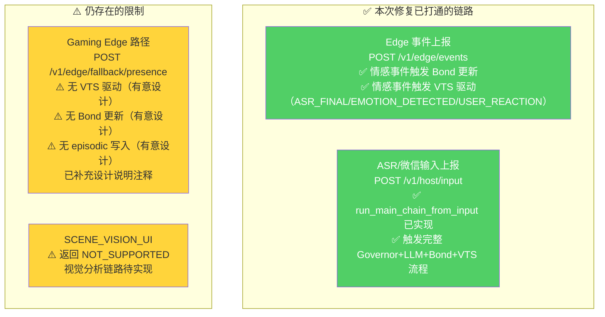

### 12.3 双端 SSE 事件协议对齐状态

| SSE 事件 | SCENE_CHAT | 复杂场景 | Gaming Edge | 对齐状态 |
|---------|-----------|---------|------------|---------|
| `PRESENCE(THINKING)` | ✅ | ✅ | ✅ | ✅ 对齐 |
| `PRESENCE(GOV_APPROVED)` | ✅ | ✅ | ✅ | ✅ 对齐 |
| `PRESENCE(SCENE_ROUTED)` | ❌（不发送） | ✅ | ❌ | ⚠️ 不对称（设计如此） |
| `GRAPH_START` | ❌ | ✅ | ❌ | ⚠️ 仅复杂场景 |
| `RENDER(chunk)` | ✅ | ❌ | ❌ | ⚠️ 仅 SCENE_CHAT |
| `SENTENCE(sentence)` | ✅ | ❌ | ❌ | ⚠️ 仅 SCENE_CHAT |
| `GRAPH_DONE` | ❌ | ✅ | ❌ | ⚠️ 仅复杂场景 |
| `COMMIT(APPROVE)` | ✅ | ✅ | ✅ | ✅ 对齐 |
| `COMMIT.audit_refs.vts` | ✅ | ✅（已修复 #12） | ⚠️ 空 `{}` | ⚠️ Gaming Edge 缺失 |
| `COMMIT.audit_refs.context_pack_validation` | ✅ | ✅ | ⚠️ 空 `{}` | ⚠️ Gaming Edge 缺失 |

---

## 十三、关键问题与修复状态

### 13.1 已修复问题（截至 2026-03-11 14:10）

| # | 问题描述 | 严重度 | 修复状态 |
|---|---------|--------|---------|
| 1 | 同步 HTTP 健康探测阻塞事件循环（最多 3s） | 🔴 高危 | ✅ 已修复：`asyncio.to_thread` 包装 |
| 2 | `intent_draft.action` 固定为 `narrative_only`，EXEC_INTENT 绕过情感门控 | 🟠 中高危 | ✅ 已修复：动态 `_action_map` 映射 |
| 3 | `scene_type` 可被客户端强制覆盖，无 Governor 校验 | 🟠 中高危 | ✅ 已修复：`ALLOWED_EXPLICIT_SCENE_TYPES` 白名单 |
| 4 | `MainChain` 是死代码，与实际路由完全脱节 | 🟠 中高危 | ✅ 已修复：迁移为 `run_as_sse_adapter` 适配层 |
| 5 | `BondEmotionalTexture.update()` 从未被调用 | 🟠 中高危 | ✅ 已修复：`apply_event` 中激活 |
| 6 | VAD 情感模型（EmotionVector/EmotionTimeline）完全孤立 | 🟡 中危 | ✅ 已修复：接入 `normalize_chat_emotion_context` |
| 7 | VTS 驱动仅在 SCENE_CHAT，复杂场景无 VTS 触发 | 🟡 中危 | ✅ 已修复：`chat_handler_complex.py` 后处理接入 |
| 8 | SCENE_CHAT 流式路径无 Bond 更新 | 🟡 中危 | ✅ 已修复：`_run_bond()` 并行协程 |
| 9 | `POST /bond/event` 无情感参数 | 🟡 中危 | ✅ 已修复：新增 `emotion_tag`/`emotion_intensity` |
| 10 | Bond 状态进程重启丢失（内存存储） | 🟡 中危 | ✅ 已修复：`SqliteBondClient` + 环境变量切换 |
| 11 | `SCENE_VISION_UI` 静默走 `chat_direct` 节点 | 🟡 中危 | ✅ 已修复：返回 `SCENE_VISION_UI_NOT_SUPPORTED` |
| 12 | 复杂场景 COMMIT 缺少 `vts` 字段 | 🟢 低危 | ✅ 已修复：补全 `audit_refs.vts` |

### 13.2 本次修复的架构问题（2026-03-11 17:28）

| # | 问题描述 | 严重度 | 修复方式 | 修复文件 |
|---|---------|--------|---------|--------|
| **B（P1）** | `POST /v1/edge/events` 接收到的 Edge 事件无情感处理、无 Bond 更新、无 VTS 驱动 | 🟡 中危 | ✅ 已修复：情感事件（ASR_FINAL/EMOTION_DETECTED 等）触发 Bond 更新 + VTS 驱动（fire-and-forget） | `system_handler.py` |
| **A（P2）** | `pre_intent_classifier` 误判：娱乐+EXEC_INTENT 关键词同时命中时（如"帮我安装一下这首歌"）误判为 EXEC_INTENT | 🟡 中危 | ✅ 已修复：娱乐关键词优先级高于 EXEC_INTENT，同时命中时归为 SCENE_CHAT | `graph_config_builder.py` |
| **C（P3）** | Gaming Edge 路径无 VTS/Bond/Episodic，设计意图不明确 | 🟢 低危 | ✅ 已修复：补充最小路径设计说明注释，明确有意跳过的功能及原因 | `chat_handler_edge.py` |
| **D（P4）** | `input_routes.py` 调用 `run_main_chain_from_input` 但该函数不存在，ASR/微信输入上报无法触发完整 chat 流程 | 🟡 中危 | ✅ 已修复：在 `main_chain.py` 中实现 `run_main_chain_from_input`，构建 ChatRequest 并触发完整链路 | `graph/main_chain.py` |
| **F（P5）** | Bond 积分阈值硬编码（STRANGER=0, SOULMATE=300），无法运行时调整 | 🟢 低危 | ✅ 已修复：`get_bond_stage_engine()` 支持通过 `HOST_BOND_STAGE_THRESHOLDS` / `HOST_BOND_SCORE_MAP` 环境变量覆盖 | `dependencies.py` |

### 13.3 仍存在的架构问题（待后续处理）

| # | 问题描述 | 严重度 | 建议 |
|---|---------|--------|------|
| D-残留 | `RoutingMatrix`、`ContextPackBuilder`、`MemoryGuard`、`StateArbiter` 四个模块有工厂函数但无调用方（实际路由仍由 `graph_config_builder.py` 直接处理） | 🟡 中危 | 接入实际路由或标记为待实现 |
| E | `SCENE_VISION_UI` 目前返回 `NOT_SUPPORTED`，视觉场景无完整实现 | 🟡 中危 | 实现完整的视觉分析链路 |

---

## 附录：关键配置环境变量

| 环境变量 | 默认值 | 说明 |
|---------|--------|------|
| `HOST_CHAT_HOST_8B_ENABLED` | `true` | 是否启用本地 8B 模型 |
| `HOST_CHAT_FORCE_CLOUD` | `false` | 强制使用云端 LLM |
| `HOST_CHAT_HOST_8B_BASE_URL` | `http://127.0.0.1:11434/v1` | 本地 Ollama 地址 |
| `HOST_CHAT_HOST_8B_MODEL_ID` | `qwen3:8b` | 本地模型 ID |
| `HOST_SYS_MODE` | `normal` | 系统模式（normal/gaming） |
| `HOST_GAMING_EDGE_CHAT_ENABLED` | `false` | 是否启用 Gaming Edge 路由 |
| `HOST_ENABLE_EDGE_RPC` | `true` | 是否启用 Edge RPC |
| `HOST_ENABLE_RETRIEVAL` | `true` | 是否启用七路召回 |
| `HOST_CHAT_DISABLE_RETRIEVAL` | `false` | 是否禁用 SCENE_CHAT 召回 |
| `HOST_STREAM_RETRIEVAL_TIMEOUT_MS` | `1200` | 流式召回超时（ms） |
| `HOST_STREAM_VTS_EMOTION_ENABLED` | `true` | 是否启用流式 VTS 情感驱动 |
| `HOST_BOND_BACKEND` | `memory` | Bond 存储后端（memory/sqlite/neo4j） |
| `HOST_BOND_STAGE_THRESHOLDS` | — | Bond 阶段积分阈值 JSON 覆盖（如 `{"SOULMATE":200}`）（本次新增） |
| `HOST_BOND_SCORE_MAP` | — | Bond 积分映射 JSON 覆盖（如 `{"INTERACTION_DEEP":8}`）（本次新增） |
| `HOST_CHAT_GRAY_ENABLED` | `false` | 是否启用灰度发布 |
| `HOST_CHAT_GRAY_PERCENT` | `100` | 灰度发布百分比（0-100） |
| `GEMINI_API_KEY` | — | Gemini API 密钥 |
| `OPENAI_API_KEY` | — | OpenAI API 密钥 |

---

*报告初版生成时间：2026-03-11 17:20 | 最后更新：2026-03-11 17:28 | 生成模型：claude-4.6-sonnet*
*基于代码库深度分析，覆盖 host_brain 和 edge_client 全部核心模块*

---

## 十四、本次修复变更摘要（2026-03-11 17:28）

### 修复文件清单

| 文件 | 修改内容 | 问题编号 |
|------|---------|--------|
| `host_brain/app/system_handler.py` | `receive_edge_events_response` 新增情感事件后处理：Bond 更新 + VTS 驱动（fire-and-forget） | B |
| `host_brain/app/graph_config_builder.py` | `pre_intent_classifier` 修复娱乐关键词优先级，防止误判为 EXEC_INTENT | A |
| `host_brain/app/chat_handler_edge.py` | `_gaming_edge_chat_sse_generator` 补充最小路径设计说明注释 | C |
| `host_brain/app/graph/main_chain.py` | 新增 `run_main_chain_from_input` 函数，打通 ASR/微信输入上报→完整 chat 流程 | D |
| `host_brain/app/dependencies.py` | `get_bond_stage_engine` 支持通过环境变量覆盖积分阈值和积分映射 | F |

### 双端通信打通状态（修复后）

```
修复前：
  Edge → Host 事件上报（/v1/edge/events）：仅写 ledger 日志，无情感处理
  Edge → Host 输入上报（/v1/host/input）：接口存在，但 run_main_chain_from_input 未实现

修复后：
  Edge → Host 事件上报（/v1/edge/events）：✅ 情感事件触发 Bond 更新 + VTS 驱动
  Edge → Host 输入上报（/v1/host/input）：✅ run_main_chain_from_input 已实现，触发完整 chat 流程

仍存在的限制（有意设计）：
  Gaming Edge 路径：最小路径设计，无 VTS/Bond/Episodic（已补充设计说明）
  SCENE_VISION_UI：返回 NOT_SUPPORTED，视觉分析链路待实现
```
